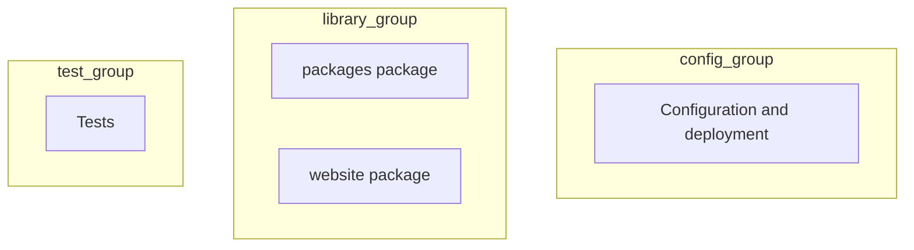

# Architecture report: FormidableLabs/react-live

> Automated static analysis. **Observed** = directly seen in files/imports/AST; **Inferred** = interpretation from that evidence. Repository code was not executed.

## 1. Repository at a glance

| Item | Value |
| --- | --- |
| Repository | FormidableLabs/react-live |
| Description | A flexible playground for live editing React components |
| Language | TypeScript |
| Stars | 4616 |
| Licence | MIT |
| Analysed commit / branch | aec1504d87a3a0b7ee552d1238a9264af9e4ef94 / master |
| Framework(s) | React |
| Files analysed | 87 |
| Components | 4 |

## 2. Architecture in one minute

FormidableLabs/react-live - A flexible playground for live editing React components. This repository was analysed statically from 87 file(s) (0 Python). Detected technologies (observed from imports/manifests): GitHub Actions, React, Tailwind CSS, TypeScript, Vite, Vitest. Files are grouped into 4 component(s): Configuration and deployment, packages package, Tests, website package. Findings below distinguish observed facts from inferred interpretation.

## 3. High-level block diagram

## 4. Main components

### Configuration and deployment (`config`)

- **Kind:** config
- **Status:** Observed
- **Confidence:** 0.85
- **Responsibility:** Groups 7 file(s) under configuration and deployment (observed from repository paths and static analysis).
- **Paths:** `package.json`, `packages/react-live/package.json`, `packages/react-live/tsconfig.json`, `packages/react-live/tsconfig.stories.json`, `website/package.json`, `website/tsconfig.json`, `website/vercel.json`
- **Evidence:** [package.json](https://github.com/FormidableLabs/react-live/blob/aec1504d87a3a0b7ee552d1238a9264af9e4ef94/package.json); [packages/react-live/package.json](https://github.com/FormidableLabs/react-live/blob/aec1504d87a3a0b7ee552d1238a9264af9e4ef94/packages/react-live/package.json); [packages/react-live/tsconfig.json](https://github.com/FormidableLabs/react-live/blob/aec1504d87a3a0b7ee552d1238a9264af9e4ef94/packages/react-live/tsconfig.json); [packages/react-live/tsconfig.stories.json](https://github.com/FormidableLabs/react-live/blob/aec1504d87a3a0b7ee552d1238a9264af9e4ef94/packages/react-live/tsconfig.stories.json); [website/package.json](https://github.com/FormidableLabs/react-live/blob/aec1504d87a3a0b7ee552d1238a9264af9e4ef94/website/package.json); [website/tsconfig.json](https://github.com/FormidableLabs/react-live/blob/aec1504d87a3a0b7ee552d1238a9264af9e4ef94/website/tsconfig.json); [website/vercel.json](https://github.com/FormidableLabs/react-live/blob/aec1504d87a3a0b7ee552d1238a9264af9e4ef94/website/vercel.json)

### packages package (`packages`)

- **Kind:** library
- **Status:** Observed
- **Confidence:** 0.85
- **Responsibility:** Groups 28 file(s) under packages package (observed from repository paths and static analysis).
- **Paths:** `packages/react-live/src/components/Editor/index.test.jsx`, `packages/react-live/src/components/Editor/index.tsx`, `packages/react-live/src/components/Live/ErrorBoundary.test.jsx`, `packages/react-live/src/components/Live/ErrorBoundary.tsx`, `packages/react-live/src/components/Live/LiveContext.ts`, `packages/react-live/src/components/Live/LiveEditor.tsx`, `packages/react-live/src/components/Live/LiveError.tsx`, `packages/react-live/src/components/Live/LivePreview.tsx`, `packages/react-live/src/components/Live/LiveProvider.test.jsx`, `packages/react-live/src/components/Live/LiveProvider.tsx`, `packages/react-live/src/components/Live/editor-interaction.browser.test.jsx`, `packages/react-live/src/components/Live/live-components.test.jsx`, `packages/react-live/src/hoc/withLive.tsx`, `packages/react-live/src/index.ts`, `packages/react-live/src/utils/transpile/compose.ts`, `packages/react-live/src/utils/transpile/errorBoundary.tsx`, `packages/react-live/src/utils/transpile/evalCode.ts`, `packages/react-live/src/utils/transpile/index.ts`, `packages/react-live/src/utils/transpile/transform.ts`, `packages/react-live/stories/editor.stories.tsx`, `packages/react-live/stories/live.stories.tsx`, `packages/react-live/stories/load.ts`, `packages/react-live/stories/main.tsx`, `packages/react-live/stories/stories.browser.test.tsx`, `packages/react-live/stories/story.ts`, `packages/react-live/stories/theme.ts`, `packages/react-live/stories/vite-env.d.ts`, `packages/react-live/vitest.setup.js`
- **Evidence:** [packages/react-live/src/components/Editor/index.test.jsx](https://github.com/FormidableLabs/react-live/blob/aec1504d87a3a0b7ee552d1238a9264af9e4ef94/packages/react-live/src/components/Editor/index.test.jsx); [packages/react-live/src/components/Editor/index.tsx](https://github.com/FormidableLabs/react-live/blob/aec1504d87a3a0b7ee552d1238a9264af9e4ef94/packages/react-live/src/components/Editor/index.tsx); [packages/react-live/src/components/Live/ErrorBoundary.test.jsx](https://github.com/FormidableLabs/react-live/blob/aec1504d87a3a0b7ee552d1238a9264af9e4ef94/packages/react-live/src/components/Live/ErrorBoundary.test.jsx); [packages/react-live/src/components/Live/ErrorBoundary.tsx](https://github.com/FormidableLabs/react-live/blob/aec1504d87a3a0b7ee552d1238a9264af9e4ef94/packages/react-live/src/components/Live/ErrorBoundary.tsx); [packages/react-live/src/components/Live/LiveContext.ts](https://github.com/FormidableLabs/react-live/blob/aec1504d87a3a0b7ee552d1238a9264af9e4ef94/packages/react-live/src/components/Live/LiveContext.ts); [packages/react-live/src/components/Live/LiveEditor.tsx](https://github.com/FormidableLabs/react-live/blob/aec1504d87a3a0b7ee552d1238a9264af9e4ef94/packages/react-live/src/components/Live/LiveEditor.tsx); [packages/react-live/src/components/Live/LiveError.tsx](https://github.com/FormidableLabs/react-live/blob/aec1504d87a3a0b7ee552d1238a9264af9e4ef94/packages/react-live/src/components/Live/LiveError.tsx); [packages/react-live/src/components/Live/LivePreview.tsx](https://github.com/FormidableLabs/react-live/blob/aec1504d87a3a0b7ee552d1238a9264af9e4ef94/packages/react-live/src/components/Live/LivePreview.tsx)

### Tests (`tests`)

- **Kind:** test
- **Status:** Observed
- **Confidence:** 0.85
- **Responsibility:** Groups 5 file(s) under tests (observed from repository paths and static analysis).
- **Paths:** `packages/react-live/src/utils/test/compose.test.js`, `packages/react-live/src/utils/test/errorBoundary.test.jsx`, `packages/react-live/src/utils/test/fixtures/optional-chain.test.jsx`, `packages/react-live/src/utils/test/renderer.js`, `packages/react-live/src/utils/test/transpile.test.jsx`
- **Evidence:** [packages/react-live/src/utils/test/compose.test.js](https://github.com/FormidableLabs/react-live/blob/aec1504d87a3a0b7ee552d1238a9264af9e4ef94/packages/react-live/src/utils/test/compose.test.js); [packages/react-live/src/utils/test/errorBoundary.test.jsx](https://github.com/FormidableLabs/react-live/blob/aec1504d87a3a0b7ee552d1238a9264af9e4ef94/packages/react-live/src/utils/test/errorBoundary.test.jsx); [packages/react-live/src/utils/test/fixtures/optional-chain.test.jsx](https://github.com/FormidableLabs/react-live/blob/aec1504d87a3a0b7ee552d1238a9264af9e4ef94/packages/react-live/src/utils/test/fixtures/optional-chain.test.jsx); [packages/react-live/src/utils/test/renderer.js](https://github.com/FormidableLabs/react-live/blob/aec1504d87a3a0b7ee552d1238a9264af9e4ef94/packages/react-live/src/utils/test/renderer.js); [packages/react-live/src/utils/test/transpile.test.jsx](https://github.com/FormidableLabs/react-live/blob/aec1504d87a3a0b7ee552d1238a9264af9e4ef94/packages/react-live/src/utils/test/transpile.test.jsx)

### website package (`website`)

- **Kind:** library
- **Status:** Observed
- **Confidence:** 0.85
- **Responsibility:** Groups 13 file(s) under website package (observed from repository paths and static analysis).
- **Paths:** `website/docusaurus.config.js`, `website/sidebars.js`, `website/src/components/landing/landing-banner.tsx`, `website/src/components/landing/landing-divider.tsx`, `website/src/components/landing/landing-featured-projects.tsx`, `website/src/components/landing/landing-features.tsx`, `website/src/components/landing/landing-hero.tsx`, `website/src/components/landing/landing-logos.tsx`, `website/src/components/landing/nf-link-button.tsx`, `website/src/components/live-edit.tsx`, `website/src/globals.d.ts`, `website/src/pages/index.tsx`, `website/tailwind.config.js`
- **Evidence:** [website/docusaurus.config.js](https://github.com/FormidableLabs/react-live/blob/aec1504d87a3a0b7ee552d1238a9264af9e4ef94/website/docusaurus.config.js); [website/sidebars.js](https://github.com/FormidableLabs/react-live/blob/aec1504d87a3a0b7ee552d1238a9264af9e4ef94/website/sidebars.js); [website/src/components/landing/landing-banner.tsx](https://github.com/FormidableLabs/react-live/blob/aec1504d87a3a0b7ee552d1238a9264af9e4ef94/website/src/components/landing/landing-banner.tsx); [website/src/components/landing/landing-divider.tsx](https://github.com/FormidableLabs/react-live/blob/aec1504d87a3a0b7ee552d1238a9264af9e4ef94/website/src/components/landing/landing-divider.tsx); [website/src/components/landing/landing-featured-projects.tsx](https://github.com/FormidableLabs/react-live/blob/aec1504d87a3a0b7ee552d1238a9264af9e4ef94/website/src/components/landing/landing-featured-projects.tsx); [website/src/components/landing/landing-features.tsx](https://github.com/FormidableLabs/react-live/blob/aec1504d87a3a0b7ee552d1238a9264af9e4ef94/website/src/components/landing/landing-features.tsx); [website/src/components/landing/landing-hero.tsx](https://github.com/FormidableLabs/react-live/blob/aec1504d87a3a0b7ee552d1238a9264af9e4ef94/website/src/components/landing/landing-hero.tsx); [website/src/components/landing/landing-logos.tsx](https://github.com/FormidableLabs/react-live/blob/aec1504d87a3a0b7ee552d1238a9264af9e4ef94/website/src/components/landing/landing-logos.tsx)

## 5. Execution flow

**Observed** entry point(s):

- [packages/react-live/src/index.ts](https://github.com/FormidableLabs/react-live/blob/aec1504d87a3a0b7ee552d1238a9264af9e4ef94/packages/react-live/src/index.ts)
- [packages/react-live/stories/main.tsx](https://github.com/FormidableLabs/react-live/blob/aec1504d87a3a0b7ee552d1238a9264af9e4ef94/packages/react-live/stories/main.tsx)
- [website/src/pages/index.tsx](https://github.com/FormidableLabs/react-live/blob/aec1504d87a3a0b7ee552d1238a9264af9e4ef94/website/src/pages/index.tsx)

Representative flow (derived from observed entry points and the import graph; steps beyond the entry point are **Inferred**):

1. Execution starts at an observed entry point listed above, if present.
2. No internal import relationships between components were observed.

## 6. Project structure

### `(root)`

- `.editorconfig` - config (242 bytes)
- `.gitignore` - other (196 bytes)
- `.nvmrc` - other (6 bytes)
- `.oxlintrc.json` - config (614 bytes)
- `.prettierignore` - other (107 bytes)
- `.prettierrc` - other (3 bytes)
- `CHANGELOG.md` - docs (430 bytes)
- `CODE_OF_CONDUCT.md` - docs (3231 bytes)
- `CONTRIBUTING.md` - docs (5122 bytes)
- `LICENSE` - docs (1065 bytes)
- `README.md` - docs (1944 bytes)
- `package.json` - manifest (1048 bytes)

### `.changeset`

- `.changeset/config.json` - config (275 bytes)

### `.github`

- `.github/workflows/ci.yml` - ci, YAML (3991 bytes)
- `.github/workflows/release.yml` - ci, YAML (4307 bytes)

### `docs`

- `docs/api.md` - docs (7070 bytes)
- `docs/faq.md` - docs (1898 bytes)
- `docs/installation.md` - docs (1616 bytes)
- `docs/introduction.mdx` - docs (2849 bytes)
- `docs/usage.md` - docs (2587 bytes)

### `packages`

- `packages/react-live/CHANGELOG.md` - docs (6313 bytes)
- `packages/react-live/package.json` - manifest (2321 bytes)
- `packages/react-live/src/components/Editor/index.test.jsx` - source, JavaScript (7097 bytes)
- `packages/react-live/src/components/Editor/index.tsx` - source, TypeScript (3354 bytes)
- `packages/react-live/src/components/Live/ErrorBoundary.test.jsx` - source, JavaScript (3439 bytes)
- `packages/react-live/src/components/Live/ErrorBoundary.tsx` - source, TypeScript (575 bytes)
- `packages/react-live/src/components/Live/LiveContext.ts` - source, TypeScript (472 bytes)
- `packages/react-live/src/components/Live/LiveEditor.tsx` - source, TypeScript (466 bytes)
- `packages/react-live/src/components/Live/LiveError.tsx` - source, TypeScript (268 bytes)
- `packages/react-live/src/components/Live/LivePreview.tsx` - source, TypeScript (802 bytes)
- `packages/react-live/src/components/Live/LiveProvider.test.jsx` - source, JavaScript (6453 bytes)
- `packages/react-live/src/components/Live/LiveProvider.tsx` - source, TypeScript (3165 bytes)
- `packages/react-live/src/components/Live/editor-interaction.browser.test.jsx` - source, JavaScript (3791 bytes)
- `packages/react-live/src/components/Live/live-components.test.jsx` - source, JavaScript (3146 bytes)
- `packages/react-live/src/hoc/withLive.tsx` - source, TypeScript (732 bytes)
- `packages/react-live/src/index.ts` - source, TypeScript (527 bytes)
- `packages/react-live/src/utils/test/compose.test.js` - test, JavaScript (370 bytes)
- `packages/react-live/src/utils/test/errorBoundary.test.jsx` - test, JavaScript (2481 bytes)
- `packages/react-live/src/utils/test/fixtures/optional-chain.test.jsx` - test, JavaScript (682 bytes)
- `packages/react-live/src/utils/test/renderer.js` - test, JavaScript (1174 bytes)
- `packages/react-live/src/utils/test/transpile.test.jsx` - test, JavaScript (3988 bytes)
- `packages/react-live/src/utils/transpile/compose.ts` - source, TypeScript (282 bytes)
- `packages/react-live/src/utils/transpile/errorBoundary.tsx` - source, TypeScript (905 bytes)
- `packages/react-live/src/utils/transpile/evalCode.ts` - source, TypeScript (322 bytes)
- `packages/react-live/src/utils/transpile/index.ts` - source, TypeScript (2188 bytes)
- `packages/react-live/src/utils/transpile/transform.ts` - source, TypeScript (831 bytes)
- `packages/react-live/stories/editor.stories.tsx` - source, TypeScript (1695 bytes)
- `packages/react-live/stories/index.html` - other (300 bytes)
- `packages/react-live/stories/live.stories.tsx` - source, TypeScript (6401 bytes)
- `packages/react-live/stories/load.ts` - source, TypeScript (1239 bytes)
- `packages/react-live/stories/main.tsx` - source, TypeScript (4054 bytes)
- `packages/react-live/stories/stories.browser.test.tsx` - source, TypeScript (1968 bytes)
- `packages/react-live/stories/story.ts` - source, TypeScript (1415 bytes)
- `packages/react-live/stories/theme.ts` - source, TypeScript (1064 bytes)
- `packages/react-live/stories/vite-env.d.ts` - source, TypeScript (38 bytes)
- `packages/react-live/tsconfig.json` - config (470 bytes)
- `packages/react-live/tsconfig.stories.json` - config (139 bytes)
- `packages/react-live/tsdown.config.mts` - other (733 bytes)
- `packages/react-live/vite.stories.mts` - other (444 bytes)
- `packages/react-live/vitest.browser.mts` - other (1316 bytes)
- `packages/react-live/vitest.config.mts` - other (1207 bytes)
- `packages/react-live/vitest.setup.js` - source, JavaScript (1026 bytes)

### `website`

- `website/.gitignore` - other (233 bytes)
- `website/README.md` - docs (2499 bytes)
- `website/docusaurus.config.js` - source, JavaScript (2894 bytes)
- `website/package.json` - manifest (1313 bytes)
- `website/sidebars.js` - source, JavaScript (783 bytes)
- `website/src/components/landing/landing-banner.tsx` - source, TypeScript (601 bytes)
- `website/src/components/landing/landing-divider.tsx` - source, TypeScript (118 bytes)
- `website/src/components/landing/landing-featured-projects.tsx` - source, TypeScript (1682 bytes)
- `website/src/components/landing/landing-features.tsx` - source, TypeScript (1005 bytes)
- `website/src/components/landing/landing-hero.tsx` - source, TypeScript (2542 bytes)
- `website/src/components/landing/landing-logos.tsx` - source, TypeScript (816 bytes)
- `website/src/components/landing/nf-link-button.tsx` - source, TypeScript (834 bytes)
- `website/src/components/live-edit.tsx` - source, TypeScript (523 bytes)
- `website/src/css/custom.css` - other (3194 bytes)
- `website/src/globals.d.ts` - source, TypeScript (408 bytes)
- `website/src/pages/index.tsx` - source, TypeScript (3932 bytes)
- `website/static/.nojekyll` - other (0 bytes)
- `website/static/img/logo.svg` - other (6438 bytes)
- `website/static/img/nearform-icon-white.svg` - other (352 bytes)
- `website/static/img/nearform-icon.svg` - other (269 bytes)
- `website/static/img/nearform-logo-white.svg` - other (302 bytes)
- `website/static/img/nearform-logo.svg` - other (371 bytes)
- `website/tailwind.config.js` - source, JavaScript (1936 bytes)
- `website/tsconfig.json` - config (818 bytes)
- `website/vercel.json` - config (148 bytes)

## 7. Key dependencies and integrations

| Name | Category | Status | Confidence | Evidence |
| --- | --- | --- | --- | --- |
| GitHub Actions | ci | Observed | 0.90 | [.github/workflows/ci.yml](https://github.com/FormidableLabs/react-live/blob/aec1504d87a3a0b7ee552d1238a9264af9e4ef94/.github/workflows/ci.yml); [.github/workflows/release.yml](https://github.com/FormidableLabs/react-live/blob/aec1504d87a3a0b7ee552d1238a9264af9e4ef94/.github/workflows/release.yml) |
| React | framework | Observed | 0.90 | [packages/react-live/package.json:2](https://github.com/FormidableLabs/react-live/blob/aec1504d87a3a0b7ee552d1238a9264af9e4ef94/packages/react-live/package.json#L2); [packages/react-live/package.json:61](https://github.com/FormidableLabs/react-live/blob/aec1504d87a3a0b7ee552d1238a9264af9e4ef94/packages/react-live/package.json#L61); [website/package.json:8](https://github.com/FormidableLabs/react-live/blob/aec1504d87a3a0b7ee552d1238a9264af9e4ef94/website/package.json#L8); [website/package.json:23](https://github.com/FormidableLabs/react-live/blob/aec1504d87a3a0b7ee552d1238a9264af9e4ef94/website/package.json#L23) |
| Tailwind CSS | library | Observed | 0.85 | [website/package.json:25](https://github.com/FormidableLabs/react-live/blob/aec1504d87a3a0b7ee552d1238a9264af9e4ef94/website/package.json#L25) |
| TypeScript | tooling | Observed | 0.90 | [packages/react-live/package.json:78](https://github.com/FormidableLabs/react-live/blob/aec1504d87a3a0b7ee552d1238a9264af9e4ef94/packages/react-live/package.json#L78); [website/package.json:32](https://github.com/FormidableLabs/react-live/blob/aec1504d87a3a0b7ee552d1238a9264af9e4ef94/website/package.json#L32) |
| Vite | tooling | Observed | 0.85 | [packages/react-live/package.json:46](https://github.com/FormidableLabs/react-live/blob/aec1504d87a3a0b7ee552d1238a9264af9e4ef94/packages/react-live/package.json#L46) |
| Vitest | tooling | Observed | 0.85 | [packages/react-live/package.json:48](https://github.com/FormidableLabs/react-live/blob/aec1504d87a3a0b7ee552d1238a9264af9e4ef94/packages/react-live/package.json#L48) |

## 8. Data and state

No database, cache, queue, or persistent-state usage was observed in the analysed files. State handling, if any, may be in-memory or in files that were not analysed.

## 9. Configuration and deployment clues

- `.changeset/config.json` (config)
- `.editorconfig` (config)
- `.github/workflows/ci.yml` (ci)
- `.github/workflows/release.yml` (ci)
- `.oxlintrc.json` (config)
- `package.json` (manifest)
- `packages/react-live/package.json` (manifest)
- `packages/react-live/tsconfig.json` (config)
- `packages/react-live/tsconfig.stories.json` (config)
- `website/package.json` (manifest)
- `website/tsconfig.json` (config)
- `website/vercel.json` (config)

## 10. Design observations

- Tests are present alongside source code (Observed from test file paths).

These observations are interpretations (**Inferred**) of the observed structure, not guarantees about runtime design.

## 11. Limitations and unknowns

- Static analysis only: repository code was not executed, installed, or imported at runtime.
- Components and relationships are inferred from file paths, imports, and AST structure; runtime behaviour, dynamic imports, and reflection may not be visible.
- No clear application entry point was observed in the analysed files.
- Repository text was treated as untrusted data; no instructions found in repository files were followed, and likely secret values were redacted/excluded.
- JavaScript and TypeScript files were inventoried from paths and package manifests. They were not parsed with a full language AST, and repository code was not executed.

## 12. Source references

- [.github/workflows/ci.yml](https://github.com/FormidableLabs/react-live/blob/aec1504d87a3a0b7ee552d1238a9264af9e4ef94/.github/workflows/ci.yml)
- [.github/workflows/release.yml](https://github.com/FormidableLabs/react-live/blob/aec1504d87a3a0b7ee552d1238a9264af9e4ef94/.github/workflows/release.yml)
- [package.json](https://github.com/FormidableLabs/react-live/blob/aec1504d87a3a0b7ee552d1238a9264af9e4ef94/package.json)
- [packages/react-live/package.json](https://github.com/FormidableLabs/react-live/blob/aec1504d87a3a0b7ee552d1238a9264af9e4ef94/packages/react-live/package.json)
- [packages/react-live/package.json:2](https://github.com/FormidableLabs/react-live/blob/aec1504d87a3a0b7ee552d1238a9264af9e4ef94/packages/react-live/package.json#L2)
- [packages/react-live/package.json:46](https://github.com/FormidableLabs/react-live/blob/aec1504d87a3a0b7ee552d1238a9264af9e4ef94/packages/react-live/package.json#L46)
- [packages/react-live/package.json:48](https://github.com/FormidableLabs/react-live/blob/aec1504d87a3a0b7ee552d1238a9264af9e4ef94/packages/react-live/package.json#L48)
- [packages/react-live/package.json:61](https://github.com/FormidableLabs/react-live/blob/aec1504d87a3a0b7ee552d1238a9264af9e4ef94/packages/react-live/package.json#L61)
- [packages/react-live/package.json:78](https://github.com/FormidableLabs/react-live/blob/aec1504d87a3a0b7ee552d1238a9264af9e4ef94/packages/react-live/package.json#L78)
- [packages/react-live/src/components/Editor/index.test.jsx](https://github.com/FormidableLabs/react-live/blob/aec1504d87a3a0b7ee552d1238a9264af9e4ef94/packages/react-live/src/components/Editor/index.test.jsx)
- [packages/react-live/src/components/Editor/index.tsx](https://github.com/FormidableLabs/react-live/blob/aec1504d87a3a0b7ee552d1238a9264af9e4ef94/packages/react-live/src/components/Editor/index.tsx)
- [packages/react-live/src/components/Live/ErrorBoundary.test.jsx](https://github.com/FormidableLabs/react-live/blob/aec1504d87a3a0b7ee552d1238a9264af9e4ef94/packages/react-live/src/components/Live/ErrorBoundary.test.jsx)
- [packages/react-live/src/components/Live/ErrorBoundary.tsx](https://github.com/FormidableLabs/react-live/blob/aec1504d87a3a0b7ee552d1238a9264af9e4ef94/packages/react-live/src/components/Live/ErrorBoundary.tsx)
- [packages/react-live/src/components/Live/LiveContext.ts](https://github.com/FormidableLabs/react-live/blob/aec1504d87a3a0b7ee552d1238a9264af9e4ef94/packages/react-live/src/components/Live/LiveContext.ts)
- [packages/react-live/src/components/Live/LiveEditor.tsx](https://github.com/FormidableLabs/react-live/blob/aec1504d87a3a0b7ee552d1238a9264af9e4ef94/packages/react-live/src/components/Live/LiveEditor.tsx)
- [packages/react-live/src/components/Live/LiveError.tsx](https://github.com/FormidableLabs/react-live/blob/aec1504d87a3a0b7ee552d1238a9264af9e4ef94/packages/react-live/src/components/Live/LiveError.tsx)
- [packages/react-live/src/components/Live/LivePreview.tsx](https://github.com/FormidableLabs/react-live/blob/aec1504d87a3a0b7ee552d1238a9264af9e4ef94/packages/react-live/src/components/Live/LivePreview.tsx)
- [packages/react-live/src/index.ts](https://github.com/FormidableLabs/react-live/blob/aec1504d87a3a0b7ee552d1238a9264af9e4ef94/packages/react-live/src/index.ts)
- [packages/react-live/src/utils/test/compose.test.js](https://github.com/FormidableLabs/react-live/blob/aec1504d87a3a0b7ee552d1238a9264af9e4ef94/packages/react-live/src/utils/test/compose.test.js)
- [packages/react-live/src/utils/test/errorBoundary.test.jsx](https://github.com/FormidableLabs/react-live/blob/aec1504d87a3a0b7ee552d1238a9264af9e4ef94/packages/react-live/src/utils/test/errorBoundary.test.jsx)
- [packages/react-live/src/utils/test/fixtures/optional-chain.test.jsx](https://github.com/FormidableLabs/react-live/blob/aec1504d87a3a0b7ee552d1238a9264af9e4ef94/packages/react-live/src/utils/test/fixtures/optional-chain.test.jsx)
- [packages/react-live/src/utils/test/renderer.js](https://github.com/FormidableLabs/react-live/blob/aec1504d87a3a0b7ee552d1238a9264af9e4ef94/packages/react-live/src/utils/test/renderer.js)
- [packages/react-live/src/utils/test/transpile.test.jsx](https://github.com/FormidableLabs/react-live/blob/aec1504d87a3a0b7ee552d1238a9264af9e4ef94/packages/react-live/src/utils/test/transpile.test.jsx)
- [packages/react-live/stories/main.tsx](https://github.com/FormidableLabs/react-live/blob/aec1504d87a3a0b7ee552d1238a9264af9e4ef94/packages/react-live/stories/main.tsx)
- [packages/react-live/tsconfig.json](https://github.com/FormidableLabs/react-live/blob/aec1504d87a3a0b7ee552d1238a9264af9e4ef94/packages/react-live/tsconfig.json)
- [packages/react-live/tsconfig.stories.json](https://github.com/FormidableLabs/react-live/blob/aec1504d87a3a0b7ee552d1238a9264af9e4ef94/packages/react-live/tsconfig.stories.json)
- [website/docusaurus.config.js](https://github.com/FormidableLabs/react-live/blob/aec1504d87a3a0b7ee552d1238a9264af9e4ef94/website/docusaurus.config.js)
- [website/package.json](https://github.com/FormidableLabs/react-live/blob/aec1504d87a3a0b7ee552d1238a9264af9e4ef94/website/package.json)
- [website/package.json:8](https://github.com/FormidableLabs/react-live/blob/aec1504d87a3a0b7ee552d1238a9264af9e4ef94/website/package.json#L8)
- [website/package.json:23](https://github.com/FormidableLabs/react-live/blob/aec1504d87a3a0b7ee552d1238a9264af9e4ef94/website/package.json#L23)
- [website/package.json:25](https://github.com/FormidableLabs/react-live/blob/aec1504d87a3a0b7ee552d1238a9264af9e4ef94/website/package.json#L25)
- [website/package.json:32](https://github.com/FormidableLabs/react-live/blob/aec1504d87a3a0b7ee552d1238a9264af9e4ef94/website/package.json#L32)
- [website/sidebars.js](https://github.com/FormidableLabs/react-live/blob/aec1504d87a3a0b7ee552d1238a9264af9e4ef94/website/sidebars.js)
- [website/src/components/landing/landing-banner.tsx](https://github.com/FormidableLabs/react-live/blob/aec1504d87a3a0b7ee552d1238a9264af9e4ef94/website/src/components/landing/landing-banner.tsx)
- [website/src/components/landing/landing-divider.tsx](https://github.com/FormidableLabs/react-live/blob/aec1504d87a3a0b7ee552d1238a9264af9e4ef94/website/src/components/landing/landing-divider.tsx)
- [website/src/components/landing/landing-featured-projects.tsx](https://github.com/FormidableLabs/react-live/blob/aec1504d87a3a0b7ee552d1238a9264af9e4ef94/website/src/components/landing/landing-featured-projects.tsx)
- [website/src/components/landing/landing-features.tsx](https://github.com/FormidableLabs/react-live/blob/aec1504d87a3a0b7ee552d1238a9264af9e4ef94/website/src/components/landing/landing-features.tsx)
- [website/src/components/landing/landing-hero.tsx](https://github.com/FormidableLabs/react-live/blob/aec1504d87a3a0b7ee552d1238a9264af9e4ef94/website/src/components/landing/landing-hero.tsx)
- [website/src/components/landing/landing-logos.tsx](https://github.com/FormidableLabs/react-live/blob/aec1504d87a3a0b7ee552d1238a9264af9e4ef94/website/src/components/landing/landing-logos.tsx)
- [website/src/pages/index.tsx](https://github.com/FormidableLabs/react-live/blob/aec1504d87a3a0b7ee552d1238a9264af9e4ef94/website/src/pages/index.tsx)
- [website/tsconfig.json](https://github.com/FormidableLabs/react-live/blob/aec1504d87a3a0b7ee552d1238a9264af9e4ef94/website/tsconfig.json)
- [website/vercel.json](https://github.com/FormidableLabs/react-live/blob/aec1504d87a3a0b7ee552d1238a9264af9e4ef94/website/vercel.json)
