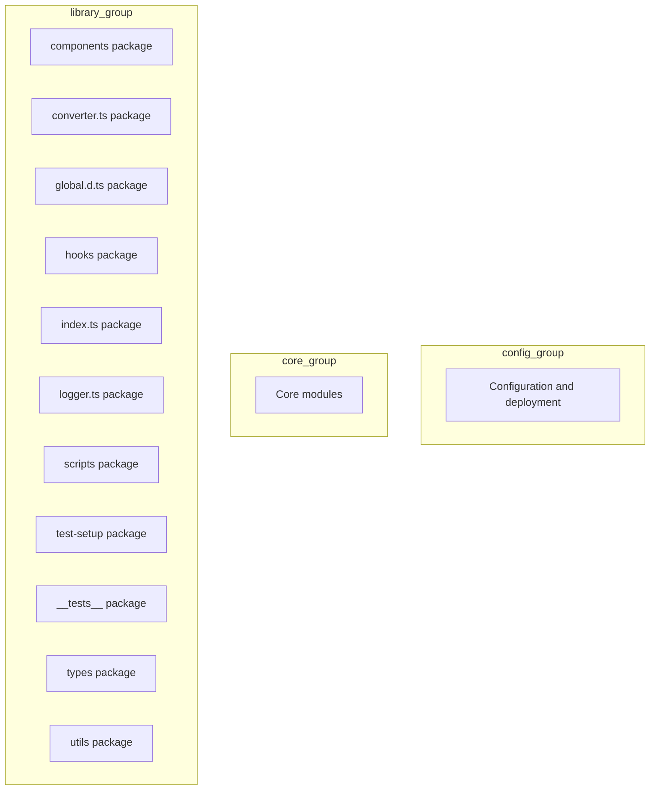

# Architecture report: FortAwesome/react-fontawesome

> Automated static analysis. **Observed** = directly seen in files/imports/AST; **Inferred** = interpretation from that evidence. Repository code was not executed.

## 1. Repository at a glance

| Item | Value |
| --- | --- |
| Repository | FortAwesome/react-fontawesome |
| Description | Official React Component for Font Awesome Icons |
| Language | TypeScript |
| Stars | 3742 |
| Licence | MIT |
| Analysed commit / branch | 3017221bae25d8a9bf08f15129e888e42f814e8e / main |
| Framework(s) | React |
| Files analysed | 62 |
| Components | 13 |

## 2. Architecture in one minute

FortAwesome/react-fontawesome - Official React Component for Font Awesome Icons. This repository was analysed statically from 62 file(s) (0 Python). Detected technologies (observed from imports/manifests): GitHub Actions, React, Jest, TypeScript. Files are grouped into 13 component(s): components package, Configuration and deployment, converter.ts package, Core modules, global.d.ts package, hooks package, index.ts package, logger.ts package. Findings below distinguish observed facts from inferred interpretation.

## 3. High-level block diagram

## 4. Main components

### components package (`components`)

- **Kind:** library
- **Status:** Observed
- **Confidence:** 0.85
- **Responsibility:** Groups 7 file(s) under components package (observed from repository paths and static analysis).
- **Paths:** `src/components/FontAwesomeIcon.tsx`, `src/components/FontAwesomeLayers.tsx`, `src/components/__fixtures__/icons.ts`, `src/components/__tests__/FontAwesomeIcon.test.tsx`, `src/components/__tests__/FontAwesomeLayers.test.tsx`, `src/components/rsc/CustomPrefixProvider.tsx`, `src/components/rsc/__tests__/CustomPrefixProvider.test.tsx`
- **Evidence:** [src/components/FontAwesomeIcon.tsx](https://github.com/FortAwesome/react-fontawesome/blob/3017221bae25d8a9bf08f15129e888e42f814e8e/src/components/FontAwesomeIcon.tsx); [src/components/FontAwesomeLayers.tsx](https://github.com/FortAwesome/react-fontawesome/blob/3017221bae25d8a9bf08f15129e888e42f814e8e/src/components/FontAwesomeLayers.tsx); [src/components/__fixtures__/icons.ts](https://github.com/FortAwesome/react-fontawesome/blob/3017221bae25d8a9bf08f15129e888e42f814e8e/src/components/__fixtures__/icons.ts); [src/components/__tests__/FontAwesomeIcon.test.tsx](https://github.com/FortAwesome/react-fontawesome/blob/3017221bae25d8a9bf08f15129e888e42f814e8e/src/components/__tests__/FontAwesomeIcon.test.tsx); [src/components/__tests__/FontAwesomeLayers.test.tsx](https://github.com/FortAwesome/react-fontawesome/blob/3017221bae25d8a9bf08f15129e888e42f814e8e/src/components/__tests__/FontAwesomeLayers.test.tsx); [src/components/rsc/CustomPrefixProvider.tsx](https://github.com/FortAwesome/react-fontawesome/blob/3017221bae25d8a9bf08f15129e888e42f814e8e/src/components/rsc/CustomPrefixProvider.tsx); [src/components/rsc/__tests__/CustomPrefixProvider.test.tsx](https://github.com/FortAwesome/react-fontawesome/blob/3017221bae25d8a9bf08f15129e888e42f814e8e/src/components/rsc/__tests__/CustomPrefixProvider.test.tsx)

### Configuration and deployment (`config`)

- **Kind:** config
- **Status:** Observed
- **Confidence:** 0.85
- **Responsibility:** Groups 2 file(s) under configuration and deployment (observed from repository paths and static analysis).
- **Paths:** `package.json`, `tsconfig.json`
- **Evidence:** [package.json](https://github.com/FortAwesome/react-fontawesome/blob/3017221bae25d8a9bf08f15129e888e42f814e8e/package.json); [tsconfig.json](https://github.com/FortAwesome/react-fontawesome/blob/3017221bae25d8a9bf08f15129e888e42f814e8e/tsconfig.json)

### converter.ts package (`converter_ts`)

- **Kind:** library
- **Status:** Observed
- **Confidence:** 0.85
- **Responsibility:** Groups 1 file(s) under converter.ts package (observed from repository paths and static analysis).
- **Paths:** `src/converter.ts`
- **Evidence:** [src/converter.ts](https://github.com/FortAwesome/react-fontawesome/blob/3017221bae25d8a9bf08f15129e888e42f814e8e/src/converter.ts)

### Core modules (`core`)

- **Kind:** core
- **Status:** Observed
- **Confidence:** 0.85
- **Responsibility:** Groups 7 file(s) under core modules (observed from repository paths and static analysis).
- **Paths:** `babel.config.js`, `commitlint.config.ts`, `eslint.config.mjs`, `jest.config.ts`, `release.config.mjs`, `tsup.config.ts`, `typedoc.config.mjs`
- **Evidence:** [babel.config.js](https://github.com/FortAwesome/react-fontawesome/blob/3017221bae25d8a9bf08f15129e888e42f814e8e/babel.config.js); [commitlint.config.ts](https://github.com/FortAwesome/react-fontawesome/blob/3017221bae25d8a9bf08f15129e888e42f814e8e/commitlint.config.ts); [eslint.config.mjs](https://github.com/FortAwesome/react-fontawesome/blob/3017221bae25d8a9bf08f15129e888e42f814e8e/eslint.config.mjs); [jest.config.ts](https://github.com/FortAwesome/react-fontawesome/blob/3017221bae25d8a9bf08f15129e888e42f814e8e/jest.config.ts); [release.config.mjs](https://github.com/FortAwesome/react-fontawesome/blob/3017221bae25d8a9bf08f15129e888e42f814e8e/release.config.mjs); [tsup.config.ts](https://github.com/FortAwesome/react-fontawesome/blob/3017221bae25d8a9bf08f15129e888e42f814e8e/tsup.config.ts); [typedoc.config.mjs](https://github.com/FortAwesome/react-fontawesome/blob/3017221bae25d8a9bf08f15129e888e42f814e8e/typedoc.config.mjs)

### global.d.ts package (`global_d_ts`)

- **Kind:** library
- **Status:** Observed
- **Confidence:** 0.85
- **Responsibility:** Groups 1 file(s) under global.d.ts package (observed from repository paths and static analysis).
- **Paths:** `src/global.d.ts`
- **Evidence:** [src/global.d.ts](https://github.com/FortAwesome/react-fontawesome/blob/3017221bae25d8a9bf08f15129e888e42f814e8e/src/global.d.ts)

### hooks package (`hooks`)

- **Kind:** library
- **Status:** Observed
- **Confidence:** 0.85
- **Responsibility:** Groups 2 file(s) under hooks package (observed from repository paths and static analysis).
- **Paths:** `src/hooks/__tests__/useAccessibilityId.test.ts`, `src/hooks/useAccessibilityId.ts`
- **Evidence:** [src/hooks/__tests__/useAccessibilityId.test.ts](https://github.com/FortAwesome/react-fontawesome/blob/3017221bae25d8a9bf08f15129e888e42f814e8e/src/hooks/__tests__/useAccessibilityId.test.ts); [src/hooks/useAccessibilityId.ts](https://github.com/FortAwesome/react-fontawesome/blob/3017221bae25d8a9bf08f15129e888e42f814e8e/src/hooks/useAccessibilityId.ts)

### index.ts package (`index_ts`)

- **Kind:** library
- **Status:** Observed
- **Confidence:** 0.85
- **Responsibility:** Groups 1 file(s) under index.ts package (observed from repository paths and static analysis).
- **Paths:** `src/index.ts`
- **Evidence:** [src/index.ts](https://github.com/FortAwesome/react-fontawesome/blob/3017221bae25d8a9bf08f15129e888e42f814e8e/src/index.ts)

### logger.ts package (`logger_ts`)

- **Kind:** library
- **Status:** Observed
- **Confidence:** 0.85
- **Responsibility:** Groups 1 file(s) under logger.ts package (observed from repository paths and static analysis).
- **Paths:** `src/logger.ts`
- **Evidence:** [src/logger.ts](https://github.com/FortAwesome/react-fontawesome/blob/3017221bae25d8a9bf08f15129e888e42f814e8e/src/logger.ts)

### scripts package (`scripts`)

- **Kind:** library
- **Status:** Observed
- **Confidence:** 0.85
- **Responsibility:** Groups 1 file(s) under scripts package (observed from repository paths and static analysis).
- **Paths:** `scripts/publish.sh`
- **Evidence:** [scripts/publish.sh](https://github.com/FortAwesome/react-fontawesome/blob/3017221bae25d8a9bf08f15129e888e42f814e8e/scripts/publish.sh)

### test-setup package (`test_setup`)

- **Kind:** library
- **Status:** Observed
- **Confidence:** 0.85
- **Responsibility:** Groups 1 file(s) under test-setup package (observed from repository paths and static analysis).
- **Paths:** `test-setup/jest.setup.ts`
- **Evidence:** [test-setup/jest.setup.ts](https://github.com/FortAwesome/react-fontawesome/blob/3017221bae25d8a9bf08f15129e888e42f814e8e/test-setup/jest.setup.ts)

### __tests__ package (`tests`)

- **Kind:** library
- **Status:** Observed
- **Confidence:** 0.85
- **Responsibility:** Groups 1 file(s) under __tests__ package (observed from repository paths and static analysis).
- **Paths:** `src/__tests__/converter.test.ts`
- **Evidence:** [src/__tests__/converter.test.ts](https://github.com/FortAwesome/react-fontawesome/blob/3017221bae25d8a9bf08f15129e888e42f814e8e/src/__tests__/converter.test.ts)

### types package (`types`)

- **Kind:** library
- **Status:** Observed
- **Confidence:** 0.85
- **Responsibility:** Groups 5 file(s) under types package (observed from repository paths and static analysis).
- **Paths:** `src/types/animation-props.ts`, `src/types/css-variables.ts`, `src/types/gradients.ts`, `src/types/icon-props.ts`, `src/types/transform-props.ts`
- **Evidence:** [src/types/animation-props.ts](https://github.com/FortAwesome/react-fontawesome/blob/3017221bae25d8a9bf08f15129e888e42f814e8e/src/types/animation-props.ts); [src/types/css-variables.ts](https://github.com/FortAwesome/react-fontawesome/blob/3017221bae25d8a9bf08f15129e888e42f814e8e/src/types/css-variables.ts); [src/types/gradients.ts](https://github.com/FortAwesome/react-fontawesome/blob/3017221bae25d8a9bf08f15129e888e42f814e8e/src/types/gradients.ts); [src/types/icon-props.ts](https://github.com/FortAwesome/react-fontawesome/blob/3017221bae25d8a9bf08f15129e888e42f814e8e/src/types/icon-props.ts); [src/types/transform-props.ts](https://github.com/FortAwesome/react-fontawesome/blob/3017221bae25d8a9bf08f15129e888e42f814e8e/src/types/transform-props.ts)

### utils package (`utils`)

- **Kind:** library
- **Status:** Observed
- **Confidence:** 0.85
- **Responsibility:** Groups 11 file(s) under utils package (observed from repository paths and static analysis).
- **Paths:** `src/utils/__tests__/camelize.test.ts`, `src/utils/__tests__/get-class-list-from-props.test.ts`, `src/utils/__tests__/gradients.test.ts`, `src/utils/__tests__/logger.test.ts`, `src/utils/__tests__/normalize-icon-args.test.ts`, `src/utils/camelize.ts`, `src/utils/constants.ts`, `src/utils/get-class-list-from-props.ts`, `src/utils/gradients.ts`, `src/utils/normalize-icon-args.ts`, `src/utils/typed-object-keys.ts`
- **Evidence:** [src/utils/__tests__/camelize.test.ts](https://github.com/FortAwesome/react-fontawesome/blob/3017221bae25d8a9bf08f15129e888e42f814e8e/src/utils/__tests__/camelize.test.ts); [src/utils/__tests__/get-class-list-from-props.test.ts](https://github.com/FortAwesome/react-fontawesome/blob/3017221bae25d8a9bf08f15129e888e42f814e8e/src/utils/__tests__/get-class-list-from-props.test.ts); [src/utils/__tests__/gradients.test.ts](https://github.com/FortAwesome/react-fontawesome/blob/3017221bae25d8a9bf08f15129e888e42f814e8e/src/utils/__tests__/gradients.test.ts); [src/utils/__tests__/logger.test.ts](https://github.com/FortAwesome/react-fontawesome/blob/3017221bae25d8a9bf08f15129e888e42f814e8e/src/utils/__tests__/logger.test.ts); [src/utils/__tests__/normalize-icon-args.test.ts](https://github.com/FortAwesome/react-fontawesome/blob/3017221bae25d8a9bf08f15129e888e42f814e8e/src/utils/__tests__/normalize-icon-args.test.ts); [src/utils/camelize.ts](https://github.com/FortAwesome/react-fontawesome/blob/3017221bae25d8a9bf08f15129e888e42f814e8e/src/utils/camelize.ts); [src/utils/constants.ts](https://github.com/FortAwesome/react-fontawesome/blob/3017221bae25d8a9bf08f15129e888e42f814e8e/src/utils/constants.ts); [src/utils/get-class-list-from-props.ts](https://github.com/FortAwesome/react-fontawesome/blob/3017221bae25d8a9bf08f15129e888e42f814e8e/src/utils/get-class-list-from-props.ts)

## 5. Execution flow

**Observed** entry point(s):

- [src/index.ts](https://github.com/FortAwesome/react-fontawesome/blob/3017221bae25d8a9bf08f15129e888e42f814e8e/src/index.ts)

Representative flow (derived from observed entry points and the import graph; steps beyond the entry point are **Inferred**):

1. Execution starts at an observed entry point listed above, if present.
2. No internal import relationships between components were observed.

## 6. Project structure

### `(root)`

- `.editorconfig` - config (229 bytes)
- `.gitignore` - other (99 bytes)
- `.prettierignore` - other (40 bytes)
- `.prettierrc.json` - config (236 bytes)
- `.tool-versions` - other (15 bytes)
- `CHANGELOG.md` - docs (14774 bytes)
- `CODE_OF_CONDUCT.md` - docs (3243 bytes)
- `CONTRIBUTING.md` - docs (2923 bytes)
- `DEVELOPMENT.md` - docs (3470 bytes)
- `LICENSE.txt` - docs (1055 bytes)
- `README.md` - docs (4675 bytes)
- `babel.config.js` - source, JavaScript (121 bytes)
- `commitlint.config.ts` - source, TypeScript (384 bytes)
- `eslint.config.mjs` - source, JavaScript (3292 bytes)
- `jest.config.ts` - source, TypeScript (1396 bytes)
- `package.json` - manifest (5680 bytes)
- `release.config.mjs` - source, JavaScript (2303 bytes)
- `tsconfig.json` - config (490 bytes)
- `tsup.config.ts` - source, TypeScript (628 bytes)
- `typedoc.config.mjs` - source, JavaScript (5974 bytes)

### `.github`

- `.github/ISSUE_TEMPLATE/bug_report.md` - docs (588 bytes)
- `.github/ISSUE_TEMPLATE/feature_request.md` - docs (594 bytes)
- `.github/workflows/ci.yml` - ci, YAML (2470 bytes)
- `.github/workflows/docs.yml` - ci, YAML (1012 bytes)
- `.github/workflows/publish.yml` - ci, YAML (1913 bytes)

### `.husky`

- `.husky/commit-msg` - other (26 bytes)
- `.husky/pre-commit` - other (38 bytes)

### `.vscode`

- `.vscode/extensions.json` - config (114 bytes)
- `.vscode/settings.json` - config (1215 bytes)

### `docs`

- `docs/src/API-Reference-Readme.md` - docs (1646 bytes)

### `scripts`

- `scripts/publish.sh` - source, Shell (248 bytes)

### `src`

- `src/__tests__/converter.test.ts` - source, TypeScript (10943 bytes)
- `src/components/FontAwesomeIcon.tsx` - source, TypeScript (3751 bytes)
- `src/components/FontAwesomeLayers.tsx` - source, TypeScript (5630 bytes)
- `src/components/__fixtures__/icons.ts` - source, TypeScript (1240 bytes)
- `src/components/__tests__/FontAwesomeIcon.test.tsx` - source, TypeScript (23931 bytes)
- `src/components/__tests__/FontAwesomeLayers.test.tsx` - source, TypeScript (5364 bytes)
- `src/components/rsc/CustomPrefixProvider.tsx` - source, TypeScript (1891 bytes)
- `src/components/rsc/__tests__/CustomPrefixProvider.test.tsx` - source, TypeScript (1566 bytes)
- `src/converter.ts` - source, TypeScript (5114 bytes)
- `src/global.d.ts` - source, TypeScript (169 bytes)
- `src/hooks/__tests__/useAccessibilityId.test.ts` - source, TypeScript (6777 bytes)
- `src/hooks/useAccessibilityId.ts` - source, TypeScript (630 bytes)
- `src/index.ts` - source, TypeScript (265 bytes)
- `src/logger.ts` - source, TypeScript (1948 bytes)
- `src/types/animation-props.ts` - source, TypeScript (3268 bytes)
- `src/types/css-variables.ts` - source, TypeScript (1734 bytes)
- `src/types/gradients.ts` - source, TypeScript (2619 bytes)
- `src/types/icon-props.ts` - source, TypeScript (5387 bytes)
- `src/types/transform-props.ts` - source, TypeScript (2123 bytes)
- `src/utils/__tests__/camelize.test.ts` - source, TypeScript (819 bytes)
- `src/utils/__tests__/get-class-list-from-props.test.ts` - source, TypeScript (7550 bytes)
- `src/utils/__tests__/gradients.test.ts` - source, TypeScript (928 bytes)
- `src/utils/__tests__/logger.test.ts` - source, TypeScript (3712 bytes)
- `src/utils/__tests__/normalize-icon-args.test.ts` - source, TypeScript (2280 bytes)
- `src/utils/camelize.ts` - source, TypeScript (685 bytes)
- `src/utils/constants.ts` - source, TypeScript (2803 bytes)
- `src/utils/get-class-list-from-props.ts` - source, TypeScript (4009 bytes)
- `src/utils/gradients.ts` - source, TypeScript (347 bytes)
- `src/utils/normalize-icon-args.ts` - source, TypeScript (703 bytes)
- `src/utils/typed-object-keys.ts` - source, TypeScript (495 bytes)

### `test-setup`

- `test-setup/jest.setup.ts` - source, TypeScript (35 bytes)

## 7. Key dependencies and integrations

| Name | Category | Status | Confidence | Evidence |
| --- | --- | --- | --- | --- |
| GitHub Actions | ci | Observed | 0.90 | [.github/workflows/ci.yml](https://github.com/FortAwesome/react-fontawesome/blob/3017221bae25d8a9bf08f15129e888e42f814e8e/.github/workflows/ci.yml); [.github/workflows/docs.yml](https://github.com/FortAwesome/react-fontawesome/blob/3017221bae25d8a9bf08f15129e888e42f814e8e/.github/workflows/docs.yml); [.github/workflows/publish.yml](https://github.com/FortAwesome/react-fontawesome/blob/3017221bae25d8a9bf08f15129e888e42f814e8e/.github/workflows/publish.yml) |
| React | framework | Observed | 0.90 | [package.json:2](https://github.com/FortAwesome/react-fontawesome/blob/3017221bae25d8a9bf08f15129e888e42f814e8e/package.json#L2); [package.json:105](https://github.com/FortAwesome/react-fontawesome/blob/3017221bae25d8a9bf08f15129e888e42f814e8e/package.json#L105) |
| Jest | tooling | Observed | 0.85 | [package.json:66](https://github.com/FortAwesome/react-fontawesome/blob/3017221bae25d8a9bf08f15129e888e42f814e8e/package.json#L66) |
| TypeScript | tooling | Observed | 0.85 | [package.json:90](https://github.com/FortAwesome/react-fontawesome/blob/3017221bae25d8a9bf08f15129e888e42f814e8e/package.json#L90) |

## 8. Data and state

No database, cache, queue, or persistent-state usage was observed in the analysed files. State handling, if any, may be in-memory or in files that were not analysed.

## 9. Configuration and deployment clues

- `.editorconfig` (config)
- `.github/workflows/ci.yml` (ci)
- `.github/workflows/docs.yml` (ci)
- `.github/workflows/publish.yml` (ci)
- `.prettierrc.json` (config)
- `.vscode/extensions.json` (config)
- `.vscode/settings.json` (config)
- `package.json` (manifest)
- `tsconfig.json` (config)

## 10. Design observations

- No strong design patterns could be established from the available evidence.

These observations are interpretations (**Inferred**) of the observed structure, not guarantees about runtime design.

## 11. Limitations and unknowns

- Static analysis only: repository code was not executed, installed, or imported at runtime.
- Components and relationships are inferred from file paths, imports, and AST structure; runtime behaviour, dynamic imports, and reflection may not be visible.
- No clear application entry point was observed in the analysed files.
- Repository text was treated as untrusted data; no instructions found in repository files were followed, and likely secret values were redacted/excluded.
- JavaScript and TypeScript files were inventoried from paths and package manifests. They were not parsed with a full language AST, and repository code was not executed.

## 12. Source references

- [.github/workflows/ci.yml](https://github.com/FortAwesome/react-fontawesome/blob/3017221bae25d8a9bf08f15129e888e42f814e8e/.github/workflows/ci.yml)
- [.github/workflows/docs.yml](https://github.com/FortAwesome/react-fontawesome/blob/3017221bae25d8a9bf08f15129e888e42f814e8e/.github/workflows/docs.yml)
- [.github/workflows/publish.yml](https://github.com/FortAwesome/react-fontawesome/blob/3017221bae25d8a9bf08f15129e888e42f814e8e/.github/workflows/publish.yml)
- [babel.config.js](https://github.com/FortAwesome/react-fontawesome/blob/3017221bae25d8a9bf08f15129e888e42f814e8e/babel.config.js)
- [commitlint.config.ts](https://github.com/FortAwesome/react-fontawesome/blob/3017221bae25d8a9bf08f15129e888e42f814e8e/commitlint.config.ts)
- [eslint.config.mjs](https://github.com/FortAwesome/react-fontawesome/blob/3017221bae25d8a9bf08f15129e888e42f814e8e/eslint.config.mjs)
- [jest.config.ts](https://github.com/FortAwesome/react-fontawesome/blob/3017221bae25d8a9bf08f15129e888e42f814e8e/jest.config.ts)
- [package.json](https://github.com/FortAwesome/react-fontawesome/blob/3017221bae25d8a9bf08f15129e888e42f814e8e/package.json)
- [package.json:2](https://github.com/FortAwesome/react-fontawesome/blob/3017221bae25d8a9bf08f15129e888e42f814e8e/package.json#L2)
- [package.json:66](https://github.com/FortAwesome/react-fontawesome/blob/3017221bae25d8a9bf08f15129e888e42f814e8e/package.json#L66)
- [package.json:90](https://github.com/FortAwesome/react-fontawesome/blob/3017221bae25d8a9bf08f15129e888e42f814e8e/package.json#L90)
- [package.json:105](https://github.com/FortAwesome/react-fontawesome/blob/3017221bae25d8a9bf08f15129e888e42f814e8e/package.json#L105)
- [release.config.mjs](https://github.com/FortAwesome/react-fontawesome/blob/3017221bae25d8a9bf08f15129e888e42f814e8e/release.config.mjs)
- [scripts/publish.sh](https://github.com/FortAwesome/react-fontawesome/blob/3017221bae25d8a9bf08f15129e888e42f814e8e/scripts/publish.sh)
- [src/__tests__/converter.test.ts](https://github.com/FortAwesome/react-fontawesome/blob/3017221bae25d8a9bf08f15129e888e42f814e8e/src/__tests__/converter.test.ts)
- [src/components/FontAwesomeIcon.tsx](https://github.com/FortAwesome/react-fontawesome/blob/3017221bae25d8a9bf08f15129e888e42f814e8e/src/components/FontAwesomeIcon.tsx)
- [src/components/FontAwesomeLayers.tsx](https://github.com/FortAwesome/react-fontawesome/blob/3017221bae25d8a9bf08f15129e888e42f814e8e/src/components/FontAwesomeLayers.tsx)
- [src/components/__fixtures__/icons.ts](https://github.com/FortAwesome/react-fontawesome/blob/3017221bae25d8a9bf08f15129e888e42f814e8e/src/components/__fixtures__/icons.ts)
- [src/components/__tests__/FontAwesomeIcon.test.tsx](https://github.com/FortAwesome/react-fontawesome/blob/3017221bae25d8a9bf08f15129e888e42f814e8e/src/components/__tests__/FontAwesomeIcon.test.tsx)
- [src/components/__tests__/FontAwesomeLayers.test.tsx](https://github.com/FortAwesome/react-fontawesome/blob/3017221bae25d8a9bf08f15129e888e42f814e8e/src/components/__tests__/FontAwesomeLayers.test.tsx)
- [src/components/rsc/CustomPrefixProvider.tsx](https://github.com/FortAwesome/react-fontawesome/blob/3017221bae25d8a9bf08f15129e888e42f814e8e/src/components/rsc/CustomPrefixProvider.tsx)
- [src/components/rsc/__tests__/CustomPrefixProvider.test.tsx](https://github.com/FortAwesome/react-fontawesome/blob/3017221bae25d8a9bf08f15129e888e42f814e8e/src/components/rsc/__tests__/CustomPrefixProvider.test.tsx)
- [src/converter.ts](https://github.com/FortAwesome/react-fontawesome/blob/3017221bae25d8a9bf08f15129e888e42f814e8e/src/converter.ts)
- [src/global.d.ts](https://github.com/FortAwesome/react-fontawesome/blob/3017221bae25d8a9bf08f15129e888e42f814e8e/src/global.d.ts)
- [src/hooks/__tests__/useAccessibilityId.test.ts](https://github.com/FortAwesome/react-fontawesome/blob/3017221bae25d8a9bf08f15129e888e42f814e8e/src/hooks/__tests__/useAccessibilityId.test.ts)
- [src/hooks/useAccessibilityId.ts](https://github.com/FortAwesome/react-fontawesome/blob/3017221bae25d8a9bf08f15129e888e42f814e8e/src/hooks/useAccessibilityId.ts)
- [src/index.ts](https://github.com/FortAwesome/react-fontawesome/blob/3017221bae25d8a9bf08f15129e888e42f814e8e/src/index.ts)
- [src/logger.ts](https://github.com/FortAwesome/react-fontawesome/blob/3017221bae25d8a9bf08f15129e888e42f814e8e/src/logger.ts)
- [src/types/animation-props.ts](https://github.com/FortAwesome/react-fontawesome/blob/3017221bae25d8a9bf08f15129e888e42f814e8e/src/types/animation-props.ts)
- [src/types/css-variables.ts](https://github.com/FortAwesome/react-fontawesome/blob/3017221bae25d8a9bf08f15129e888e42f814e8e/src/types/css-variables.ts)
- [src/types/gradients.ts](https://github.com/FortAwesome/react-fontawesome/blob/3017221bae25d8a9bf08f15129e888e42f814e8e/src/types/gradients.ts)
- [src/types/icon-props.ts](https://github.com/FortAwesome/react-fontawesome/blob/3017221bae25d8a9bf08f15129e888e42f814e8e/src/types/icon-props.ts)
- [src/types/transform-props.ts](https://github.com/FortAwesome/react-fontawesome/blob/3017221bae25d8a9bf08f15129e888e42f814e8e/src/types/transform-props.ts)
- [src/utils/__tests__/camelize.test.ts](https://github.com/FortAwesome/react-fontawesome/blob/3017221bae25d8a9bf08f15129e888e42f814e8e/src/utils/__tests__/camelize.test.ts)
- [src/utils/__tests__/get-class-list-from-props.test.ts](https://github.com/FortAwesome/react-fontawesome/blob/3017221bae25d8a9bf08f15129e888e42f814e8e/src/utils/__tests__/get-class-list-from-props.test.ts)
- [src/utils/__tests__/gradients.test.ts](https://github.com/FortAwesome/react-fontawesome/blob/3017221bae25d8a9bf08f15129e888e42f814e8e/src/utils/__tests__/gradients.test.ts)
- [src/utils/__tests__/logger.test.ts](https://github.com/FortAwesome/react-fontawesome/blob/3017221bae25d8a9bf08f15129e888e42f814e8e/src/utils/__tests__/logger.test.ts)
- [src/utils/__tests__/normalize-icon-args.test.ts](https://github.com/FortAwesome/react-fontawesome/blob/3017221bae25d8a9bf08f15129e888e42f814e8e/src/utils/__tests__/normalize-icon-args.test.ts)
- [src/utils/camelize.ts](https://github.com/FortAwesome/react-fontawesome/blob/3017221bae25d8a9bf08f15129e888e42f814e8e/src/utils/camelize.ts)
- [src/utils/constants.ts](https://github.com/FortAwesome/react-fontawesome/blob/3017221bae25d8a9bf08f15129e888e42f814e8e/src/utils/constants.ts)
- [src/utils/get-class-list-from-props.ts](https://github.com/FortAwesome/react-fontawesome/blob/3017221bae25d8a9bf08f15129e888e42f814e8e/src/utils/get-class-list-from-props.ts)
- [test-setup/jest.setup.ts](https://github.com/FortAwesome/react-fontawesome/blob/3017221bae25d8a9bf08f15129e888e42f814e8e/test-setup/jest.setup.ts)
- [tsconfig.json](https://github.com/FortAwesome/react-fontawesome/blob/3017221bae25d8a9bf08f15129e888e42f814e8e/tsconfig.json)
- [tsup.config.ts](https://github.com/FortAwesome/react-fontawesome/blob/3017221bae25d8a9bf08f15129e888e42f814e8e/tsup.config.ts)
- [typedoc.config.mjs](https://github.com/FortAwesome/react-fontawesome/blob/3017221bae25d8a9bf08f15129e888e42f814e8e/typedoc.config.mjs)
