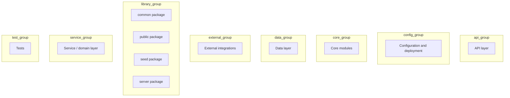

# Architecture report: FreeCodeCampChina/freecodecamp.cn

> Automated static analysis. **Observed** = directly seen in files/imports/AST; **Inferred** = interpretation from that evidence. Repository code was not executed.

## 1. Repository at a glance

| Item | Value |
| --- | --- |
| Repository | FreeCodeCampChina/freecodecamp.cn |
| Description | FCC China open source codebase and curriculum. Learn to code and help nonprofits. |
| Language | CSS |
| Stars | 37789 |
| Licence | Other |
| Analysed commit / branch | b09a3a0dec1fa0b0620601a705ff2e9b97564f97 / dev |
| Framework(s) | Express, React |
| Files analysed | 503 |
| Components | 11 |

## 2. Architecture in one minute

FreeCodeCampChina/freecodecamp.cn - FCC China open source codebase and curriculum. Learn to code and help nonprofits.. This repository was analysed statically from 503 file(s) (0 Python). Detected technologies (observed from imports/manifests): Express, React, React Router, Redux, webpack. Files are grouped into 11 component(s): API layer, common package, Configuration and deployment, Core modules, Data layer, External integrations, public package, seed package. Findings below distinguish observed facts from inferred interpretation.

## 3. High-level block diagram

## 4. Main components

### API layer (`api_layer`)

- **Kind:** api
- **Status:** Observed
- **Confidence:** 0.85
- **Responsibility:** Groups 36 file(s) under api layer (observed from repository paths and static analysis).
- **Paths:** `common/app/routes/Hikes/components/Hike.jsx`, `common/app/routes/Hikes/components/Hikes.jsx`, `common/app/routes/Hikes/components/Lecture.jsx`, `common/app/routes/Hikes/components/Map.jsx`, `common/app/routes/Hikes/components/Questions.jsx`, `common/app/routes/Hikes/index.js`, `common/app/routes/Hikes/redux/actions.js`, `common/app/routes/Hikes/redux/answer-saga.js`, `common/app/routes/Hikes/redux/fetch-hikes-saga.js`, `common/app/routes/Hikes/redux/index.js`, `common/app/routes/Hikes/redux/oldActions.js`, `common/app/routes/Hikes/redux/reducer.js`, `common/app/routes/Hikes/redux/selectors.js`, `common/app/routes/Hikes/redux/types.js`, `common/app/routes/Hikes/redux/utils.js`, `common/app/routes/Jobs/components/JobNotFound.jsx`, `common/app/routes/Jobs/components/JobTotal.jsx`, `common/app/routes/Jobs/components/Jobs.jsx`, `common/app/routes/Jobs/components/List.jsx`, `common/app/routes/Jobs/components/NewJob.jsx`, `common/app/routes/Jobs/components/NewJobCompleted.jsx`, `common/app/routes/Jobs/components/Preview.jsx`, `common/app/routes/Jobs/components/Show.jsx`, `common/app/routes/Jobs/components/ShowJob.jsx`, `common/app/routes/Jobs/index.js`, `common/app/routes/Jobs/redux/actions.js`, `common/app/routes/Jobs/redux/apply-promo-saga.js`, `common/app/routes/Jobs/redux/fetch-jobs-saga.js`, `common/app/routes/Jobs/redux/index.js`, `common/app/routes/Jobs/redux/jobs-form-normalizer.js`, `common/app/routes/Jobs/redux/oldActions.js`, `common/app/routes/Jobs/redux/reducer.js`, `common/app/routes/Jobs/redux/save-job-saga.js`, `common/app/routes/Jobs/redux/types.js`, `common/app/routes/Jobs/utils.js`, `common/app/routes/index.js`
- **Evidence:** [common/app/routes/Hikes/components/Hike.jsx](https://github.com/FreeCodeCampChina/freecodecamp.cn/blob/b09a3a0dec1fa0b0620601a705ff2e9b97564f97/common/app/routes/Hikes/components/Hike.jsx); [common/app/routes/Hikes/components/Hikes.jsx](https://github.com/FreeCodeCampChina/freecodecamp.cn/blob/b09a3a0dec1fa0b0620601a705ff2e9b97564f97/common/app/routes/Hikes/components/Hikes.jsx); [common/app/routes/Hikes/components/Lecture.jsx](https://github.com/FreeCodeCampChina/freecodecamp.cn/blob/b09a3a0dec1fa0b0620601a705ff2e9b97564f97/common/app/routes/Hikes/components/Lecture.jsx); [common/app/routes/Hikes/components/Map.jsx](https://github.com/FreeCodeCampChina/freecodecamp.cn/blob/b09a3a0dec1fa0b0620601a705ff2e9b97564f97/common/app/routes/Hikes/components/Map.jsx); [common/app/routes/Hikes/components/Questions.jsx](https://github.com/FreeCodeCampChina/freecodecamp.cn/blob/b09a3a0dec1fa0b0620601a705ff2e9b97564f97/common/app/routes/Hikes/components/Questions.jsx); [common/app/routes/Hikes/index.js](https://github.com/FreeCodeCampChina/freecodecamp.cn/blob/b09a3a0dec1fa0b0620601a705ff2e9b97564f97/common/app/routes/Hikes/index.js); [common/app/routes/Hikes/redux/actions.js](https://github.com/FreeCodeCampChina/freecodecamp.cn/blob/b09a3a0dec1fa0b0620601a705ff2e9b97564f97/common/app/routes/Hikes/redux/actions.js); [common/app/routes/Hikes/redux/answer-saga.js](https://github.com/FreeCodeCampChina/freecodecamp.cn/blob/b09a3a0dec1fa0b0620601a705ff2e9b97564f97/common/app/routes/Hikes/redux/answer-saga.js)

### common package (`common`)

- **Kind:** library
- **Status:** Observed
- **Confidence:** 0.85
- **Responsibility:** Groups 32 file(s) under common package (observed from repository paths and static analysis).
- **Paths:** `common/app/App.jsx`, `common/app/components/Flash/Queue.jsx`, `common/app/components/Flash/index.jsx`, `common/app/components/Footer/Footer.jsx`, `common/app/components/Footer/index.js`, `common/app/components/Nav/Nav.jsx`, `common/app/components/Nav/NavItem.jsx`, `common/app/components/Nav/index.js`, `common/app/components/NotFound/index.jsx`, `common/app/create-app.jsx`, `common/app/create-reducer.js`, `common/app/index.js`, `common/app/middlewares.js`, `common/app/provide-store.js`, `common/app/redux/actions.js`, `common/app/redux/fetch-user-saga.js`, `common/app/redux/index.js`, `common/app/redux/oldActions.js`, `common/app/redux/reducer.js`, `common/app/redux/types.js`, `common/app/sagas.js`, `common/app/utils/Professor-Context.js`, `common/app/utils/create-types.js`, `common/app/utils/professor-x.js`, `common/app/utils/render-to-string.js`, `common/app/utils/render.js`, `common/app/utils/shallow-equals.js`, `common/config.global.js`, `common/utils/ajax-stream.js`, `common/utils/index.js`, `common/utils/jsonp$.js`, `common/utils/services-creator.js`
- **Evidence:** [common/app/App.jsx](https://github.com/FreeCodeCampChina/freecodecamp.cn/blob/b09a3a0dec1fa0b0620601a705ff2e9b97564f97/common/app/App.jsx); [common/app/components/Flash/Queue.jsx](https://github.com/FreeCodeCampChina/freecodecamp.cn/blob/b09a3a0dec1fa0b0620601a705ff2e9b97564f97/common/app/components/Flash/Queue.jsx); [common/app/components/Flash/index.jsx](https://github.com/FreeCodeCampChina/freecodecamp.cn/blob/b09a3a0dec1fa0b0620601a705ff2e9b97564f97/common/app/components/Flash/index.jsx); [common/app/components/Footer/Footer.jsx](https://github.com/FreeCodeCampChina/freecodecamp.cn/blob/b09a3a0dec1fa0b0620601a705ff2e9b97564f97/common/app/components/Footer/Footer.jsx); [common/app/components/Footer/index.js](https://github.com/FreeCodeCampChina/freecodecamp.cn/blob/b09a3a0dec1fa0b0620601a705ff2e9b97564f97/common/app/components/Footer/index.js); [common/app/components/Nav/Nav.jsx](https://github.com/FreeCodeCampChina/freecodecamp.cn/blob/b09a3a0dec1fa0b0620601a705ff2e9b97564f97/common/app/components/Nav/Nav.jsx); [common/app/components/Nav/NavItem.jsx](https://github.com/FreeCodeCampChina/freecodecamp.cn/blob/b09a3a0dec1fa0b0620601a705ff2e9b97564f97/common/app/components/Nav/NavItem.jsx); [common/app/components/Nav/index.js](https://github.com/FreeCodeCampChina/freecodecamp.cn/blob/b09a3a0dec1fa0b0620601a705ff2e9b97564f97/common/app/components/Nav/index.js)

### Configuration and deployment (`config`)

- **Kind:** config
- **Status:** Observed
- **Confidence:** 0.85
- **Responsibility:** Groups 77 file(s) under configuration and deployment (observed from repository paths and static analysis).
- **Paths:** `bower.json`, `common/app/components/Footer/links.json`, `common/app/components/Nav/links.json`, `common/models/User-Credential.json`, `common/models/User-Identity.json`, `common/models/challenge.json`, `common/models/job.json`, `common/models/nonprofit.json`, `common/models/pledge.json`, `common/models/promo.json`, `common/models/story.json`, `common/models/user.json`, `common/utils/constantStrings.json`, `config/secrets.js`, `package.json`, `public/favicons/android-chrome-manifest.json`, `public/json/bootcamps.json`, `public/json/cats.json`, `seed/challenges/00-getting-started/getting-started.json`, `seed/challenges/01-front-end-development-certification/advanced-bonfires.json`, `seed/challenges/01-front-end-development-certification/advanced-ziplines.json`, `seed/challenges/01-front-end-development-certification/basic-bonfires.json`, `seed/challenges/01-front-end-development-certification/basic-ziplines.json`, `seed/challenges/01-front-end-development-certification/bootstrap.json`, `seed/challenges/01-front-end-development-certification/front-end-development-certificate.json`, `seed/challenges/01-front-end-development-certification/gear-up-for-success.json`, `seed/challenges/01-front-end-development-certification/html5-and-css.json`, `seed/challenges/01-front-end-development-certification/intermediate-bonfires.json`, `seed/challenges/01-front-end-development-certification/intermediate-ziplines.json`, `seed/challenges/01-front-end-development-certification/jquery.json`, `seed/challenges/01-front-end-development-certification/json-apis-and-ajax.json`, `seed/challenges/01-front-end-development-certification/object-oriented-and-functional-programming.json`, `seed/challenges/02-data-visualization-certification/d3.json`, `seed/challenges/02-data-visualization-certification/data-visualization-certificate.json`, `seed/challenges/02-data-visualization-certification/data-visualization-projects.json`, `seed/challenges/02-data-visualization-certification/react-projects.json`, `seed/challenges/02-data-visualization-certification/react.json`, `seed/challenges/02-data-visualization-certification/sass.json`, `seed/challenges/03-back-end-development-certification/api-projects.json`, `seed/challenges/03-back-end-development-certification/automated-testing-and-debugging.json`, `seed/challenges/03-back-end-development-certification/back-end-development-certificate.json`, `seed/challenges/03-back-end-development-certification/dynamic-web-applications.json`, `seed/challenges/03-back-end-development-certification/git.json`, `seed/challenges/03-back-end-development-certification/mongodb.json`, `seed/challenges/03-back-end-development-certification/nodejs-and-expressjs.json`, `seed/challenges/04-video-challenges/accessibility.json`, `seed/challenges/04-video-challenges/agile.json`, `seed/challenges/04-video-challenges/bigonotation.json`, `seed/challenges/04-video-challenges/chromedevtools.json`, `seed/challenges/04-video-challenges/computer-basics.json`, `seed/challenges/04-video-challenges/computer-science.json`, `seed/challenges/04-video-challenges/data-visualization.json`, `seed/challenges/04-video-challenges/devops.json`, `seed/challenges/04-video-challenges/dom.json`, `seed/challenges/04-video-challenges/embedded-and-internet-of-things.json`, `seed/challenges/04-video-challenges/game-development.json`, `seed/challenges/04-video-challenges/gamification.json`, `seed/challenges/04-video-challenges/jslingo.json`, `seed/challenges/04-video-challenges/machine-learning.json`, `seed/challenges/04-video-challenges/math-for-programmers.json`, `seed/challenges/04-video-challenges/mobile-javascript-development.json`, `seed/challenges/04-video-challenges/software-engineering-principles.json`, `seed/challenges/04-video-challenges/statistics.json`, `seed/challenges/04-video-challenges/tools.json`, `seed/challenges/04-video-challenges/user-experience-design.json`, `seed/challenges/04-video-challenges/visual-design.json`, `server/config.json`, `server/datasources.json`, `server/middleware.json`, `server/model-config.json`, `server/resources/labs.json`, `server/resources/testimonials.json`, `server/utils/certTypes.json`, `server/utils/commit-goals.json`, `server/utils/commit.json`, `server/utils/constantStrings.json`, `server/utils/resources.json`
- **Evidence:** [bower.json](https://github.com/FreeCodeCampChina/freecodecamp.cn/blob/b09a3a0dec1fa0b0620601a705ff2e9b97564f97/bower.json); [common/app/components/Footer/links.json](https://github.com/FreeCodeCampChina/freecodecamp.cn/blob/b09a3a0dec1fa0b0620601a705ff2e9b97564f97/common/app/components/Footer/links.json); [common/app/components/Nav/links.json](https://github.com/FreeCodeCampChina/freecodecamp.cn/blob/b09a3a0dec1fa0b0620601a705ff2e9b97564f97/common/app/components/Nav/links.json); [common/models/User-Credential.json](https://github.com/FreeCodeCampChina/freecodecamp.cn/blob/b09a3a0dec1fa0b0620601a705ff2e9b97564f97/common/models/User-Credential.json); [common/models/User-Identity.json](https://github.com/FreeCodeCampChina/freecodecamp.cn/blob/b09a3a0dec1fa0b0620601a705ff2e9b97564f97/common/models/User-Identity.json); [common/models/challenge.json](https://github.com/FreeCodeCampChina/freecodecamp.cn/blob/b09a3a0dec1fa0b0620601a705ff2e9b97564f97/common/models/challenge.json); [common/models/job.json](https://github.com/FreeCodeCampChina/freecodecamp.cn/blob/b09a3a0dec1fa0b0620601a705ff2e9b97564f97/common/models/job.json); [common/models/nonprofit.json](https://github.com/FreeCodeCampChina/freecodecamp.cn/blob/b09a3a0dec1fa0b0620601a705ff2e9b97564f97/common/models/nonprofit.json)

### Core modules (`core`)

- **Kind:** core
- **Status:** Observed
- **Confidence:** 0.85
- **Responsibility:** Groups 7 file(s) under core modules (observed from repository paths and static analysis).
- **Paths:** `dataAsync.js`, `gulpfile.js`, `leanTest.js`, `pm2Start.js`, `simple-json.js`, `webpack.config.js`, `webpack.config.node.js`
- **Evidence:** [dataAsync.js](https://github.com/FreeCodeCampChina/freecodecamp.cn/blob/b09a3a0dec1fa0b0620601a705ff2e9b97564f97/dataAsync.js); [gulpfile.js](https://github.com/FreeCodeCampChina/freecodecamp.cn/blob/b09a3a0dec1fa0b0620601a705ff2e9b97564f97/gulpfile.js); [leanTest.js](https://github.com/FreeCodeCampChina/freecodecamp.cn/blob/b09a3a0dec1fa0b0620601a705ff2e9b97564f97/leanTest.js); [pm2Start.js](https://github.com/FreeCodeCampChina/freecodecamp.cn/blob/b09a3a0dec1fa0b0620601a705ff2e9b97564f97/pm2Start.js); [simple-json.js](https://github.com/FreeCodeCampChina/freecodecamp.cn/blob/b09a3a0dec1fa0b0620601a705ff2e9b97564f97/simple-json.js); [webpack.config.js](https://github.com/FreeCodeCampChina/freecodecamp.cn/blob/b09a3a0dec1fa0b0620601a705ff2e9b97564f97/webpack.config.js); [webpack.config.node.js](https://github.com/FreeCodeCampChina/freecodecamp.cn/blob/b09a3a0dec1fa0b0620601a705ff2e9b97564f97/webpack.config.node.js)

### Data layer (`data_layer`)

- **Kind:** data
- **Status:** Observed
- **Confidence:** 0.85
- **Responsibility:** Groups 3 file(s) under data layer (observed from repository paths and static analysis).
- **Paths:** `common/models/User-Identity.js`, `common/models/promo.js`, `common/models/user.js`
- **Evidence:** [common/models/User-Identity.js](https://github.com/FreeCodeCampChina/freecodecamp.cn/blob/b09a3a0dec1fa0b0620601a705ff2e9b97564f97/common/models/User-Identity.js); [common/models/promo.js](https://github.com/FreeCodeCampChina/freecodecamp.cn/blob/b09a3a0dec1fa0b0620601a705ff2e9b97564f97/common/models/promo.js); [common/models/user.js](https://github.com/FreeCodeCampChina/freecodecamp.cn/blob/b09a3a0dec1fa0b0620601a705ff2e9b97564f97/common/models/user.js)

### External integrations (`external_integrations`)

- **Kind:** external
- **Status:** Observed
- **Confidence:** 0.85
- **Responsibility:** Groups 28 file(s) under external integrations (observed from repository paths and static analysis).
- **Paths:** `client/commonFramework/add-loop-protect.js`, `client/commonFramework/bindings.js`, `client/commonFramework/code-storage.js`, `client/commonFramework/code-uri.js`, `client/commonFramework/create-editor.js`, `client/commonFramework/detect-unsafe-code-stream.js`, `client/commonFramework/display-test-results.js`, `client/commonFramework/end.js`, `client/commonFramework/execute-challenge-stream.js`, `client/commonFramework/get-iframe.js`, `client/commonFramework/init.js`, `client/commonFramework/output-display.js`, `client/commonFramework/phone-scroll-lock.js`, `client/commonFramework/report-issue.js`, `client/commonFramework/run-tests-stream.js`, `client/commonFramework/show-completion.js`, `client/commonFramework/step-challenge.js`, `client/commonFramework/update-preview.js`, `client/es6-shims.js`, `client/iFrameScripts.js`, `client/index.js`, `client/main.js`, `client/plugin.js`, `client/sagas/err-saga.js`, `client/sagas/hard-go-to-saga.js`, `client/sagas/index.js`, `client/sagas/local-storage-saga.js`, `client/sagas/title-saga.js`
- **Evidence:** [client/commonFramework/add-loop-protect.js](https://github.com/FreeCodeCampChina/freecodecamp.cn/blob/b09a3a0dec1fa0b0620601a705ff2e9b97564f97/client/commonFramework/add-loop-protect.js); [client/commonFramework/bindings.js](https://github.com/FreeCodeCampChina/freecodecamp.cn/blob/b09a3a0dec1fa0b0620601a705ff2e9b97564f97/client/commonFramework/bindings.js); [client/commonFramework/code-storage.js](https://github.com/FreeCodeCampChina/freecodecamp.cn/blob/b09a3a0dec1fa0b0620601a705ff2e9b97564f97/client/commonFramework/code-storage.js); [client/commonFramework/code-uri.js](https://github.com/FreeCodeCampChina/freecodecamp.cn/blob/b09a3a0dec1fa0b0620601a705ff2e9b97564f97/client/commonFramework/code-uri.js); [client/commonFramework/create-editor.js](https://github.com/FreeCodeCampChina/freecodecamp.cn/blob/b09a3a0dec1fa0b0620601a705ff2e9b97564f97/client/commonFramework/create-editor.js); [client/commonFramework/detect-unsafe-code-stream.js](https://github.com/FreeCodeCampChina/freecodecamp.cn/blob/b09a3a0dec1fa0b0620601a705ff2e9b97564f97/client/commonFramework/detect-unsafe-code-stream.js); [client/commonFramework/display-test-results.js](https://github.com/FreeCodeCampChina/freecodecamp.cn/blob/b09a3a0dec1fa0b0620601a705ff2e9b97564f97/client/commonFramework/display-test-results.js); [client/commonFramework/end.js](https://github.com/FreeCodeCampChina/freecodecamp.cn/blob/b09a3a0dec1fa0b0620601a705ff2e9b97564f97/client/commonFramework/end.js)

### public package (`public`)

- **Kind:** library
- **Status:** Observed
- **Confidence:** 0.85
- **Responsibility:** Groups 18 file(s) under public package (observed from repository paths and static analysis).
- **Paths:** `public/js/calculator.js`, `public/js/commonFramework-2c9795240d.js`, `public/js/commonFramework-2f0be7f94b.js`, `public/js/commonFramework-64e637bbe5.js`, `public/js/commonFramework-e9a2482e6b.js`, `public/js/commonFramework.js`, `public/js/dashboard.js`, `public/js/greensock.js`, `public/js/join-group.js`, `public/js/join-race.js`, `public/js/lib/jailed/_JailedSite.js`, `public/js/lib/jailed/_frame.js`, `public/js/lib/jailed/_pluginCore.js`, `public/js/lib/jailed/_pluginNode.js`, `public/js/lib/jailed/_pluginWeb.js`, `public/js/lib/jailed/jailed.js`, `public/js/lib/loop-protect/loop-protect.js`, `public/js/sidecar.v1.js`
- **Evidence:** [public/js/calculator.js](https://github.com/FreeCodeCampChina/freecodecamp.cn/blob/b09a3a0dec1fa0b0620601a705ff2e9b97564f97/public/js/calculator.js); [public/js/commonFramework-2c9795240d.js](https://github.com/FreeCodeCampChina/freecodecamp.cn/blob/b09a3a0dec1fa0b0620601a705ff2e9b97564f97/public/js/commonFramework-2c9795240d.js); [public/js/commonFramework-2f0be7f94b.js](https://github.com/FreeCodeCampChina/freecodecamp.cn/blob/b09a3a0dec1fa0b0620601a705ff2e9b97564f97/public/js/commonFramework-2f0be7f94b.js); [public/js/commonFramework-64e637bbe5.js](https://github.com/FreeCodeCampChina/freecodecamp.cn/blob/b09a3a0dec1fa0b0620601a705ff2e9b97564f97/public/js/commonFramework-64e637bbe5.js); [public/js/commonFramework-e9a2482e6b.js](https://github.com/FreeCodeCampChina/freecodecamp.cn/blob/b09a3a0dec1fa0b0620601a705ff2e9b97564f97/public/js/commonFramework-e9a2482e6b.js); [public/js/commonFramework.js](https://github.com/FreeCodeCampChina/freecodecamp.cn/blob/b09a3a0dec1fa0b0620601a705ff2e9b97564f97/public/js/commonFramework.js); [public/js/dashboard.js](https://github.com/FreeCodeCampChina/freecodecamp.cn/blob/b09a3a0dec1fa0b0620601a705ff2e9b97564f97/public/js/dashboard.js); [public/js/greensock.js](https://github.com/FreeCodeCampChina/freecodecamp.cn/blob/b09a3a0dec1fa0b0620601a705ff2e9b97564f97/public/js/greensock.js)

### seed package (`seed`)

- **Kind:** library
- **Status:** Observed
- **Confidence:** 0.85
- **Responsibility:** Groups 8 file(s) under seed package (observed from repository paths and static analysis).
- **Paths:** `seed/bonfireMDNlinks.js`, `seed/create-challenge-bundle.js`, `seed/get-challenge-completion.js`, `seed/get-emails.js`, `seed/getChallenges.js`, `seed/index.js`, `seed/loopbackMigration.js`, `seed/test-challenges.js`
- **Evidence:** [seed/bonfireMDNlinks.js](https://github.com/FreeCodeCampChina/freecodecamp.cn/blob/b09a3a0dec1fa0b0620601a705ff2e9b97564f97/seed/bonfireMDNlinks.js); [seed/create-challenge-bundle.js](https://github.com/FreeCodeCampChina/freecodecamp.cn/blob/b09a3a0dec1fa0b0620601a705ff2e9b97564f97/seed/create-challenge-bundle.js); [seed/get-challenge-completion.js](https://github.com/FreeCodeCampChina/freecodecamp.cn/blob/b09a3a0dec1fa0b0620601a705ff2e9b97564f97/seed/get-challenge-completion.js); [seed/get-emails.js](https://github.com/FreeCodeCampChina/freecodecamp.cn/blob/b09a3a0dec1fa0b0620601a705ff2e9b97564f97/seed/get-emails.js); [seed/getChallenges.js](https://github.com/FreeCodeCampChina/freecodecamp.cn/blob/b09a3a0dec1fa0b0620601a705ff2e9b97564f97/seed/getChallenges.js); [seed/index.js](https://github.com/FreeCodeCampChina/freecodecamp.cn/blob/b09a3a0dec1fa0b0620601a705ff2e9b97564f97/seed/index.js); [seed/loopbackMigration.js](https://github.com/FreeCodeCampChina/freecodecamp.cn/blob/b09a3a0dec1fa0b0620601a705ff2e9b97564f97/seed/loopbackMigration.js); [seed/test-challenges.js](https://github.com/FreeCodeCampChina/freecodecamp.cn/blob/b09a3a0dec1fa0b0620601a705ff2e9b97564f97/seed/test-challenges.js)

### server package (`server`)

- **Kind:** library
- **Status:** Observed
- **Confidence:** 0.85
- **Responsibility:** Groups 50 file(s) under server package (observed from repository paths and static analysis).
- **Paths:** `server/boot/a-extendUser.js`, `server/boot/a-extendUserIdent.js`, `server/boot/a-react.js`, `server/boot/a-services.js`, `server/boot/about.js`, `server/boot/authentication.js`, `server/boot/certificate.js`, `server/boot/challenge.js`, `server/boot/commit.js`, `server/boot/explorer.js`, `server/boot/home.js`, `server/boot/randomAPIs.js`, `server/boot/redirectHttps.js`, `server/boot/redirects.js`, `server/boot/restApi.js`, `server/boot/story.js`, `server/boot/t-wiki.js`, `server/boot/user.js`, `server/config.development.js`, `server/config.local.js`, `server/config.production.js`, `server/datasources.local.js`, `server/debug-entry.js`, `server/middlewares/add-return-to.js`, `server/middlewares/constant-headers.js`, `server/middlewares/cookie-parser.js`, `server/middlewares/csp.js`, `server/middlewares/error-handlers.js`, `server/middlewares/express-rx.js`, `server/middlewares/global-locals.js`, `server/middlewares/jade-helpers.js`, `server/middlewares/keymetrics.js`, `server/middlewares/migrate-completed-challenges.js`, `server/middlewares/revision-helpers.js`, `server/middlewares/sessions.js`, `server/middlewares/validator.js`, `server/passport-providers.js`, `server/production-start.js`, `server/server.js`, `server/ssl-config.js`, `server/utils/auth.js`, `server/utils/bad-id-map.js`, `server/utils/commit.js`, `server/utils/constants.js`, `server/utils/date-utils.js`, `server/utils/getFromDisk$.js`, `server/utils/index.js`, `server/utils/middleware.js`, `server/utils/rx.js`, `server/utils/user-stats.js`
- **Evidence:** [server/boot/a-extendUser.js](https://github.com/FreeCodeCampChina/freecodecamp.cn/blob/b09a3a0dec1fa0b0620601a705ff2e9b97564f97/server/boot/a-extendUser.js); [server/boot/a-extendUserIdent.js](https://github.com/FreeCodeCampChina/freecodecamp.cn/blob/b09a3a0dec1fa0b0620601a705ff2e9b97564f97/server/boot/a-extendUserIdent.js); [server/boot/a-react.js](https://github.com/FreeCodeCampChina/freecodecamp.cn/blob/b09a3a0dec1fa0b0620601a705ff2e9b97564f97/server/boot/a-react.js); [server/boot/a-services.js](https://github.com/FreeCodeCampChina/freecodecamp.cn/blob/b09a3a0dec1fa0b0620601a705ff2e9b97564f97/server/boot/a-services.js); [server/boot/about.js](https://github.com/FreeCodeCampChina/freecodecamp.cn/blob/b09a3a0dec1fa0b0620601a705ff2e9b97564f97/server/boot/about.js); [server/boot/authentication.js](https://github.com/FreeCodeCampChina/freecodecamp.cn/blob/b09a3a0dec1fa0b0620601a705ff2e9b97564f97/server/boot/authentication.js); [server/boot/certificate.js](https://github.com/FreeCodeCampChina/freecodecamp.cn/blob/b09a3a0dec1fa0b0620601a705ff2e9b97564f97/server/boot/certificate.js); [server/boot/challenge.js](https://github.com/FreeCodeCampChina/freecodecamp.cn/blob/b09a3a0dec1fa0b0620601a705ff2e9b97564f97/server/boot/challenge.js)

### Service / domain layer (`service_layer`)

- **Kind:** service
- **Status:** Observed
- **Confidence:** 0.85
- **Responsibility:** Groups 3 file(s) under service / domain layer (observed from repository paths and static analysis).
- **Paths:** `server/services/hikes.js`, `server/services/job.js`, `server/services/user.js`
- **Evidence:** [server/services/hikes.js](https://github.com/FreeCodeCampChina/freecodecamp.cn/blob/b09a3a0dec1fa0b0620601a705ff2e9b97564f97/server/services/hikes.js); [server/services/job.js](https://github.com/FreeCodeCampChina/freecodecamp.cn/blob/b09a3a0dec1fa0b0620601a705ff2e9b97564f97/server/services/job.js); [server/services/user.js](https://github.com/FreeCodeCampChina/freecodecamp.cn/blob/b09a3a0dec1fa0b0620601a705ff2e9b97564f97/server/services/user.js)

### Tests (`tests`)

- **Kind:** test
- **Status:** Observed
- **Confidence:** 0.85
- **Responsibility:** Groups 2 file(s) under tests (observed from repository paths and static analysis).
- **Paths:** `test/server/utils/date-utils-test.js`, `test/server/utils/user-stats-test.js`
- **Evidence:** [test/server/utils/date-utils-test.js](https://github.com/FreeCodeCampChina/freecodecamp.cn/blob/b09a3a0dec1fa0b0620601a705ff2e9b97564f97/test/server/utils/date-utils-test.js); [test/server/utils/user-stats-test.js](https://github.com/FreeCodeCampChina/freecodecamp.cn/blob/b09a3a0dec1fa0b0620601a705ff2e9b97564f97/test/server/utils/user-stats-test.js)

## 5. Execution flow

**Observed** entry point(s):

- [client/index.js](https://github.com/FreeCodeCampChina/freecodecamp.cn/blob/b09a3a0dec1fa0b0620601a705ff2e9b97564f97/client/index.js)
- [client/main.js](https://github.com/FreeCodeCampChina/freecodecamp.cn/blob/b09a3a0dec1fa0b0620601a705ff2e9b97564f97/client/main.js)
- [client/sagas/index.js](https://github.com/FreeCodeCampChina/freecodecamp.cn/blob/b09a3a0dec1fa0b0620601a705ff2e9b97564f97/client/sagas/index.js)
- [common/app/App.jsx](https://github.com/FreeCodeCampChina/freecodecamp.cn/blob/b09a3a0dec1fa0b0620601a705ff2e9b97564f97/common/app/App.jsx)
- [common/app/index.js](https://github.com/FreeCodeCampChina/freecodecamp.cn/blob/b09a3a0dec1fa0b0620601a705ff2e9b97564f97/common/app/index.js)
- [common/app/redux/index.js](https://github.com/FreeCodeCampChina/freecodecamp.cn/blob/b09a3a0dec1fa0b0620601a705ff2e9b97564f97/common/app/redux/index.js)
- [common/app/routes/index.js](https://github.com/FreeCodeCampChina/freecodecamp.cn/blob/b09a3a0dec1fa0b0620601a705ff2e9b97564f97/common/app/routes/index.js)
- [common/utils/index.js](https://github.com/FreeCodeCampChina/freecodecamp.cn/blob/b09a3a0dec1fa0b0620601a705ff2e9b97564f97/common/utils/index.js)
- [seed/index.js](https://github.com/FreeCodeCampChina/freecodecamp.cn/blob/b09a3a0dec1fa0b0620601a705ff2e9b97564f97/seed/index.js)
- [server/server.js](https://github.com/FreeCodeCampChina/freecodecamp.cn/blob/b09a3a0dec1fa0b0620601a705ff2e9b97564f97/server/server.js)
- [server/utils/index.js](https://github.com/FreeCodeCampChina/freecodecamp.cn/blob/b09a3a0dec1fa0b0620601a705ff2e9b97564f97/server/utils/index.js)

Representative flow (derived from observed entry points and the import graph; steps beyond the entry point are **Inferred**):

1. Execution starts at an observed entry point listed above, if present.
2. No internal import relationships between components were observed.

## 6. Project structure

### `(root)`

- `.babelrc` - other (102 bytes)
- `.bowerrc` - other (46 bytes)
- `.editorconfig` - config (188 bytes)
- `.eslintignore` - other (15 bytes)
- `.eslintrc` - other (4954 bytes)
- `.gitattributes` - other (80 bytes)
- `.gitignore` - other (550 bytes)
- `.jshintrc` - other (1857 bytes)
- `.node-inspectorrc` - other (30 bytes)
- `.travis.yml` - ci, YAML (53 bytes)
- `CONTRIBUTING.md` - docs (12091 bytes)
- `LICENSE` - docs (1519 bytes)
- `LICENSE-freeCodeCamp-Curriculum.md` - docs (20131 bytes)
- `LICENSE-freeCodeCamp-Translation.md` - docs (17696 bytes)
- `README.md` - docs (3862 bytes)
- `bower.json` - config (630 bytes)
- `dataAsync.js` - source, JavaScript (60991 bytes)
- `gulpfile.js` - source, JavaScript (13328 bytes)
- `leanTest.js` - source, JavaScript (1088 bytes)
- `package.json` - manifest (4861 bytes)
- `pm2Start.js` - source, JavaScript (774 bytes)
- `sample.env` - other (482 bytes)
- `simple-json.js` - source, JavaScript (3390 bytes)
- `webpack.config.js` - source, JavaScript (940 bytes)
- `webpack.config.node.js` - source, JavaScript (1115 bytes)

### `.github`

- `.github/ISSUE_TEMPLATE.md` - docs (955 bytes)
- `.github/PULL_REQUEST_TEMPLATE.md` - docs (1314 bytes)

### `client`

- `client/README.md` - docs (175 bytes)
- `client/commonFramework/add-loop-protect.js` - source, JavaScript (571 bytes)
- `client/commonFramework/bindings.js` - source, JavaScript (5982 bytes)
- `client/commonFramework/code-storage.js` - source, JavaScript (1479 bytes)
- `client/commonFramework/code-uri.js` - source, JavaScript (3598 bytes)
- `client/commonFramework/create-editor.js` - source, JavaScript (2780 bytes)
- `client/commonFramework/detect-unsafe-code-stream.js` - source, JavaScript (1382 bytes)
- `client/commonFramework/display-test-results.js` - source, JavaScript (798 bytes)
- `client/commonFramework/end.js` - source, JavaScript (4857 bytes)
- `client/commonFramework/execute-challenge-stream.js` - source, JavaScript (1502 bytes)
- `client/commonFramework/get-iframe.js` - source, JavaScript (592 bytes)
- `client/commonFramework/init.js` - source, JavaScript (3366 bytes)
- `client/commonFramework/output-display.js` - source, JavaScript (1231 bytes)
- `client/commonFramework/phone-scroll-lock.js` - source, JavaScript (3398 bytes)
- `client/commonFramework/report-issue.js` - source, JavaScript (1478 bytes)
- `client/commonFramework/run-tests-stream.js` - source, JavaScript (853 bytes)
- `client/commonFramework/show-completion.js` - source, JavaScript (2139 bytes)
- `client/commonFramework/step-challenge.js` - source, JavaScript (5224 bytes)
- `client/commonFramework/update-preview.js` - source, JavaScript (3001 bytes)
- `client/es6-shims.js` - source, JavaScript (63 bytes)
- `client/iFrameScripts.js` - source, JavaScript (2520 bytes)
- `client/index.js` - source, JavaScript (1984 bytes)
- `client/less/challenge.less` - other (2009 bytes)
- `client/less/chat.less` - other (402 bytes)
- `client/less/jobs.less` - other (230 bytes)
- `client/less/lib/animate.min.less` - other (53431 bytes)
- `client/less/lib/bootstrap-social/bootstrap-social.less` - other (3116 bytes)
- `client/less/lib/bootstrap/alerts.less` - other (1513 bytes)
- `client/less/lib/bootstrap/badges.less` - other (1069 bytes)
- `client/less/lib/bootstrap/bootstrap.less` - other (1121 bytes)
- `client/less/lib/bootstrap/breadcrumbs.less` - other (594 bytes)
- `client/less/lib/bootstrap/button-groups.less` - other (5740 bytes)
- `client/less/lib/bootstrap/buttons.less` - other (3547 bytes)
- `client/less/lib/bootstrap/carousel.less` - other (5318 bytes)
- `client/less/lib/bootstrap/close.less` - other (683 bytes)
- `client/less/lib/bootstrap/code.less` - other (1401 bytes)
- `client/less/lib/bootstrap/component-animations.less` - other (709 bytes)
- `client/less/lib/bootstrap/dropdowns.less` - other (4754 bytes)
- `client/less/lib/bootstrap/forms.less` - other (14215 bytes)
- `client/less/lib/bootstrap/glyphicons.less` - other (14879 bytes)
- `client/less/lib/bootstrap/grid.less` - other (1387 bytes)
- `client/less/lib/bootstrap/input-groups.less` - other (4215 bytes)
- `client/less/lib/bootstrap/jumbotron.less` - other (959 bytes)
- `client/less/lib/bootstrap/labels.less` - other (1079 bytes)
- `client/less/lib/bootstrap/list-group.less` - other (3143 bytes)
- `client/less/lib/bootstrap/media.less` - other (652 bytes)
- `client/less/lib/bootstrap/mixins.less` - other (1102 bytes)
- `client/less/lib/bootstrap/mixins/alerts.less` - other (257 bytes)
- `client/less/lib/bootstrap/mixins/background-variant.less` - other (139 bytes)
- `client/less/lib/bootstrap/mixins/border-radius.less` - other (468 bytes)
- `client/less/lib/bootstrap/mixins/buttons.less` - other (1074 bytes)
- `client/less/lib/bootstrap/mixins/center-block.less` - other (120 bytes)
- `client/less/lib/bootstrap/mixins/clearfix.less` - other (605 bytes)
- `client/less/lib/bootstrap/mixins/forms.less` - other (2641 bytes)
- `client/less/lib/bootstrap/mixins/gradients.less` - other (4388 bytes)
- `client/less/lib/bootstrap/mixins/grid-framework.less` - other (2820 bytes)
- `client/less/lib/bootstrap/mixins/grid.less` - other (3094 bytes)
- `client/less/lib/bootstrap/mixins/hide-text.less` - other (579 bytes)
- `client/less/lib/bootstrap/mixins/image.less` - other (1062 bytes)
- `client/less/lib/bootstrap/mixins/labels.less` - other (161 bytes)
- `client/less/lib/bootstrap/mixins/list-group.less` - other (533 bytes)
- `client/less/lib/bootstrap/mixins/nav-divider.less` - other (232 bytes)
- `client/less/lib/bootstrap/mixins/nav-vertical-align.less` - other (364 bytes)
- `client/less/lib/bootstrap/mixins/opacity.less` - other (148 bytes)
- `client/less/lib/bootstrap/mixins/pagination.less` - other (438 bytes)
- `client/less/lib/bootstrap/mixins/panels.less` - other (537 bytes)
- `client/less/lib/bootstrap/mixins/progress-bar.less` - other (191 bytes)
- `client/less/lib/bootstrap/mixins/reset-filter.less` - other (248 bytes)
- `client/less/lib/bootstrap/mixins/resize.less` - other (196 bytes)
- `client/less/lib/bootstrap/mixins/responsive-visibility.less` - other (343 bytes)
- `client/less/lib/bootstrap/mixins/size.less` - other (127 bytes)
- `client/less/lib/bootstrap/mixins/tab-focus.less` - other (159 bytes)
- `client/less/lib/bootstrap/mixins/table-row.less` - other (700 bytes)
- `client/less/lib/bootstrap/mixins/text-emphasis.less` - other (116 bytes)
- `client/less/lib/bootstrap/mixins/text-overflow.less` - other (162 bytes)
- `client/less/lib/bootstrap/mixins/vendor-prefixes.less` - other (6606 bytes)
- `client/less/lib/bootstrap/modals.less` - other (3528 bytes)
- `client/less/lib/bootstrap/navbar.less` - other (14585 bytes)
- `client/less/lib/bootstrap/navs.less` - other (4979 bytes)
- `client/less/lib/bootstrap/normalize.less` - other (7650 bytes)
- `client/less/lib/bootstrap/pager.less` - other (861 bytes)
- `client/less/lib/bootstrap/pagination.less` - other (2001 bytes)
- `client/less/lib/bootstrap/panels.less` - other (6097 bytes)
- `client/less/lib/bootstrap/popovers.less` - other (3474 bytes)
- `client/less/lib/bootstrap/print.less` - other (2133 bytes)
- `client/less/lib/bootstrap/progress-bars.less` - other (1925 bytes)
- `client/less/lib/bootstrap/responsive-embed.less` - other (564 bytes)
- `client/less/lib/bootstrap/responsive-utilities.less` - other (4262 bytes)
- `client/less/lib/bootstrap/scaffolding.less` - other (2656 bytes)
- `client/less/lib/bootstrap/tables.less` - other (4610 bytes)
- `client/less/lib/bootstrap/theme.less` - other (7345 bytes)
- `client/less/lib/bootstrap/thumbnails.less` - other (753 bytes)
- `client/less/lib/bootstrap/tooltip.less` - other (2590 bytes)
- `client/less/lib/bootstrap/type.less` - other (5959 bytes)
- `client/less/lib/bootstrap/utilities.less` - other (780 bytes)
- `client/less/lib/bootstrap/variables.less` - other (27209 bytes)
- `client/less/lib/bootstrap/wells.less` - other (527 bytes)
- `client/less/lib/font-awesome-4.3.0/css/font-awesome.css` - other (28747 bytes)
- `client/less/lib/font-awesome-4.3.0/less/animated.less` - other (713 bytes)
- `client/less/lib/font-awesome-4.3.0/less/bordered-pulled.less` - other (330 bytes)
- `client/less/lib/font-awesome-4.3.0/less/core.less` - other (509 bytes)
- `client/less/lib/font-awesome-4.3.0/less/fixed-width.less` - other (119 bytes)
- `client/less/lib/font-awesome-4.3.0/less/font-awesome.less` - other (465 bytes)
- `client/less/lib/font-awesome-4.3.0/less/icons.less` - other (37290 bytes)
- `client/less/lib/font-awesome-4.3.0/less/larger.less` - other (370 bytes)
- `client/less/lib/font-awesome-4.3.0/less/list.less` - other (377 bytes)
- `client/less/lib/font-awesome-4.3.0/less/mixins.less` - other (983 bytes)
- `client/less/lib/font-awesome-4.3.0/less/path.less` - other (770 bytes)
- `client/less/lib/font-awesome-4.3.0/less/rotated-flipped.less` - other (622 bytes)
- `client/less/lib/font-awesome-4.3.0/less/stacked.less` - other (476 bytes)
- `client/less/lib/font-awesome-4.3.0/less/variables.less` - other (16792 bytes)
- `client/less/lib/font-awesome-4.3.0/scss/_animated.scss` - other (715 bytes)
- `client/less/lib/font-awesome-4.3.0/scss/_bordered-pulled.scss` - other (332 bytes)
- `client/less/lib/font-awesome-4.3.0/scss/_core.scss` - other (513 bytes)
- `client/less/lib/font-awesome-4.3.0/scss/_fixed-width.scss` - other (120 bytes)
- `client/less/lib/font-awesome-4.3.0/scss/_icons.scss` - other (37883 bytes)
- `client/less/lib/font-awesome-4.3.0/scss/_larger.scss` - other (375 bytes)
- `client/less/lib/font-awesome-4.3.0/scss/_list.scss` - other (378 bytes)
- `client/less/lib/font-awesome-4.3.0/scss/_mixins.scss` - other (1000 bytes)
- `client/less/lib/font-awesome-4.3.0/scss/_path.scss` - other (783 bytes)
- `client/less/lib/font-awesome-4.3.0/scss/_rotated-flipped.scss` - other (672 bytes)
- `client/less/lib/font-awesome-4.3.0/scss/_stacked.scss` - other (482 bytes)
- `client/less/lib/font-awesome-4.3.0/scss/_variables.scss` - other (16864 bytes)
- `client/less/lib/font-awesome-4.3.0/scss/font-awesome.scss` - other (405 bytes)
- `client/less/lib/ionicons/_ionicons-animation.less` - other (2049 bytes)
- `client/less/lib/ionicons/_ionicons-font.less` - other (885 bytes)
- `client/less/lib/ionicons/_ionicons-icons.less` - other (90037 bytes)
- `client/less/lib/ionicons/_ionicons-variables.less` - other (27680 bytes)
- `client/less/lib/ionicons/ionicons.less` - other (114 bytes)
- `client/less/main.less` - other (18739 bytes)
- `client/less/map.less` - other (9283 bytes)
- `client/less/signin.less` - other (177 bytes)
- `client/less/toastr.less` - other (7603 bytes)
- `client/less/wiki.less` - other (6925 bytes)
- `client/main.js` - source, JavaScript (14883 bytes)
- `client/plugin.js` - source, JavaScript (1934 bytes)
- `client/sagas/README.md` - docs (0 bytes)
- `client/sagas/err-saga.js` - source, JavaScript (547 bytes)
- `client/sagas/hard-go-to-saga.js` - source, JavaScript (525 bytes)
- `client/sagas/index.js` - source, JavaScript (243 bytes)
- `client/sagas/local-storage-saga.js` - source, JavaScript (1518 bytes)
- `client/sagas/title-saga.js` - source, JavaScript (470 bytes)

### `common`

- `common/app/App.jsx` - source, JavaScript (2035 bytes)
- `common/app/components/Flash/Queue.jsx` - source, JavaScript (467 bytes)
- `common/app/components/Flash/index.jsx` - source, JavaScript (0 bytes)
- `common/app/components/Footer/Footer.jsx` - source, JavaScript (1066 bytes)
- `common/app/components/Footer/README.md` - docs (19 bytes)
- `common/app/components/Footer/index.js` - source, JavaScript (36 bytes)
- `common/app/components/Footer/links.json` - config (988 bytes)
- `common/app/components/Nav/Nav.jsx` - source, JavaScript (2804 bytes)
- `common/app/components/Nav/NavItem.jsx` - source, JavaScript (1873 bytes)
- `common/app/components/Nav/index.js` - source, JavaScript (33 bytes)
- `common/app/components/Nav/links.json` - config (311 bytes)
- `common/app/components/NotFound/index.jsx` - source, JavaScript (447 bytes)
- `common/app/components/README.md` - docs (38 bytes)
- `common/app/create-app.jsx` - source, JavaScript (2086 bytes)
- `common/app/create-reducer.js` - source, JavaScript (493 bytes)
- `common/app/index.js` - source, JavaScript (40 bytes)
- `common/app/middlewares.js` - source, JavaScript (0 bytes)
- `common/app/provide-store.js` - source, JavaScript (241 bytes)
- `common/app/redux/actions.js` - source, JavaScript (847 bytes)
- `common/app/redux/fetch-user-saga.js` - source, JavaScript (911 bytes)
- `common/app/redux/index.js` - source, JavaScript (228 bytes)
- `common/app/redux/oldActions.js` - source, JavaScript (1356 bytes)
- `common/app/redux/reducer.js` - source, JavaScript (763 bytes)
- `common/app/redux/types.js` - source, JavaScript (228 bytes)
- `common/app/routes/Admin/README.md` - docs (36 bytes)
- `common/app/routes/Bonfires/README.md` - docs (62 bytes)
- `common/app/routes/Hikes/components/Hike.jsx` - source, JavaScript (1787 bytes)
- `common/app/routes/Hikes/components/Hikes.jsx` - source, JavaScript (2070 bytes)
- `common/app/routes/Hikes/components/Lecture.jsx` - source, JavaScript (2241 bytes)
- `common/app/routes/Hikes/components/Map.jsx` - source, JavaScript (802 bytes)
- `common/app/routes/Hikes/components/Questions.jsx` - source, JavaScript (5039 bytes)
- `common/app/routes/Hikes/index.js` - source, JavaScript (213 bytes)
- `common/app/routes/Hikes/redux/actions.js` - source, JavaScript (1671 bytes)
- `common/app/routes/Hikes/redux/answer-saga.js` - source, JavaScript (3660 bytes)
- `common/app/routes/Hikes/redux/fetch-hikes-saga.js` - source, JavaScript (1205 bytes)
- `common/app/routes/Hikes/redux/index.js` - source, JavaScript (239 bytes)
- `common/app/routes/Hikes/redux/oldActions.js` - source, JavaScript (8514 bytes)
- `common/app/routes/Hikes/redux/reducer.js` - source, JavaScript (2287 bytes)
- `common/app/routes/Hikes/redux/selectors.js` - source, JavaScript (291 bytes)
- `common/app/routes/Hikes/redux/types.js` - source, JavaScript (392 bytes)
- `common/app/routes/Hikes/redux/utils.js` - source, JavaScript (1638 bytes)
- `common/app/routes/Jobs/README.md` - docs (55 bytes)
- `common/app/routes/Jobs/components/JobNotFound.jsx` - source, JavaScript (776 bytes)
- `common/app/routes/Jobs/components/JobTotal.jsx` - source, JavaScript (7252 bytes)
- `common/app/routes/Jobs/components/Jobs.jsx` - source, JavaScript (3814 bytes)
- `common/app/routes/Jobs/components/List.jsx` - source, JavaScript (1976 bytes)
- `common/app/routes/Jobs/components/NewJob.jsx` - source, JavaScript (11168 bytes)
- `common/app/routes/Jobs/components/NewJobCompleted.jsx` - source, JavaScript (1015 bytes)
- `common/app/routes/Jobs/components/Preview.jsx` - source, JavaScript (2225 bytes)
- `common/app/routes/Jobs/components/Show.jsx` - source, JavaScript (3464 bytes)
- `common/app/routes/Jobs/components/ShowJob.jsx` - source, JavaScript (3423 bytes)
- `common/app/routes/Jobs/index.js` - source, JavaScript (774 bytes)
- `common/app/routes/Jobs/redux/actions.js` - source, JavaScript (1047 bytes)
- `common/app/routes/Jobs/redux/apply-promo-saga.js` - source, JavaScript (921 bytes)
- `common/app/routes/Jobs/redux/fetch-jobs-saga.js` - source, JavaScript (1158 bytes)
- `common/app/routes/Jobs/redux/index.js` - source, JavaScript (359 bytes)
- `common/app/routes/Jobs/redux/jobs-form-normalizer.js` - source, JavaScript (1088 bytes)
- `common/app/routes/Jobs/redux/oldActions.js` - source, JavaScript (4739 bytes)
- `common/app/routes/Jobs/redux/reducer.js` - source, JavaScript (1862 bytes)
- `common/app/routes/Jobs/redux/save-job-saga.js` - source, JavaScript (764 bytes)
- `common/app/routes/Jobs/redux/types.js` - source, JavaScript (335 bytes)
- `common/app/routes/Jobs/utils.js` - source, JavaScript (493 bytes)
- `common/app/routes/index.js` - source, JavaScript (244 bytes)
- `common/app/sagas.js` - source, JavaScript (230 bytes)
- `common/app/shared/README.md` - docs (68 bytes)
- `common/app/utils/Professor-Context.js` - source, JavaScript (856 bytes)
- `common/app/utils/create-types.js` - source, JavaScript (311 bytes)
- `common/app/utils/professor-x.js` - source, JavaScript (5065 bytes)
- `common/app/utils/render-to-string.js` - source, JavaScript (1525 bytes)
- `common/app/utils/render.js` - source, JavaScript (669 bytes)
- `common/app/utils/shallow-equals.js` - source, JavaScript (768 bytes)
- `common/config.global.js` - source, JavaScript (318 bytes)
- `common/models/User-Credential.json` - config (283 bytes)
- `common/models/User-Identity.js` - source, JavaScript (5365 bytes)
- `common/models/User-Identity.json` - config (410 bytes)
- `common/models/challenge.json` - config (3036 bytes)
- `common/models/job.json` - config (2403 bytes)
- `common/models/nonprofit.json` - config (1203 bytes)
- `common/models/pledge.json` - config (977 bytes)
- `common/models/promo.js` - source, JavaScript (1807 bytes)
- `common/models/promo.json` - config (1381 bytes)
- `common/models/story.json` - config (1439 bytes)
- `common/models/user.js` - source, JavaScript (11823 bytes)
- `common/models/user.json` - config (5628 bytes)
- `common/utils/ajax-stream.js` - source, JavaScript (8280 bytes)
- `common/utils/constantStrings.json` - config (91 bytes)
- `common/utils/index.js` - source, JavaScript (360 bytes)
- `common/utils/jsonp$.js` - source, JavaScript (2010 bytes)
- `common/utils/services-creator.js` - source, JavaScript (1072 bytes)

### `config`

- `config/secrets.js` - source, JavaScript (1462 bytes)

### `public`

- `public/browserconfig.xml` - other (387 bytes)
- `public/code.html` - other (12201 bytes)
- `public/css/Vimeo.css` - other (1597 bytes)
- `public/css/lato.css` - other (355 bytes)
- `public/css/themes/flatly.less` - other (31593 bytes)
- `public/css/themes/modern.less` - other (2754 bytes)
- `public/css/ubuntu.css` - other (206 bytes)
- `public/favicons.html` - other (1269 bytes)
- `public/favicons/android-chrome-manifest.json` - config (720 bytes)
- `public/favicons/browserconfig.xml` - other (281 bytes)
- `public/grouth-hacker.html` - other (4703 bytes)
- `public/images/challenges.svg` - other (133709 bytes)
- `public/images/content.svg` - other (127339 bytes)
- `public/images/d3-logo.svg` - other (5021 bytes)
- `public/images/freecodecamp_logo.svg` - other (12315 bytes)
- `public/images/landingIcons_connect.svg` - other (3888 bytes)
- `public/images/landingIcons_learn.svg` - other (7075 bytes)
- `public/images/landingIcons_nonprofits.svg` - other (18825 bytes)
- `public/images/landingIcons_portfolio.svg` - other (3499 bytes)
- `public/images/logo-footer.svg` - other (6719 bytes)
- `public/images/react.svg` - other (2160 bytes)
- `public/images/timeline.svg` - other (65304 bytes)
- `public/js/.jshintrc` - other (1602 bytes)
- `public/js/calculator.js` - source, JavaScript (8424 bytes)
- `public/js/commonFramework-2c9795240d.js` - source, JavaScript (39128 bytes)
- `public/js/commonFramework-2f0be7f94b.js` - source, JavaScript (26451 bytes)
- `public/js/commonFramework-64e637bbe5.js` - source, JavaScript (123372 bytes)
- `public/js/commonFramework-e9a2482e6b.js` - source, JavaScript (123444 bytes)
- `public/js/commonFramework.js` - source, JavaScript (123372 bytes)
- `public/js/dashboard.js` - source, JavaScript (251 bytes)
- `public/js/greensock.js` - source, JavaScript (57376 bytes)
- `public/js/join-group.js` - source, JavaScript (2309 bytes)
- `public/js/join-race.js` - source, JavaScript (2513 bytes)
- `public/js/lib/jailed/_JailedSite.js` - source, JavaScript (12641 bytes)
- `public/js/lib/jailed/_frame.html` - other (76 bytes)
- `public/js/lib/jailed/_frame.js` - source, JavaScript (1592 bytes)
- `public/js/lib/jailed/_pluginCore.js` - source, JavaScript (2212 bytes)
- `public/js/lib/jailed/_pluginNode.js` - source, JavaScript (5893 bytes)
- `public/js/lib/jailed/_pluginWeb.js` - source, JavaScript (2337 bytes)
- `public/js/lib/jailed/jailed.js` - source, JavaScript (22814 bytes)
- `public/js/lib/loop-protect/LICENSE.md` - docs (1077 bytes)
- `public/js/lib/loop-protect/loop-protect.js` - source, JavaScript (15166 bytes)
- `public/js/sidecar.v1.js` - source, JavaScript (41984 bytes)
- `public/json/bootcamps.json` - config (3996 bytes)
- `public/json/cats.json` - config (432 bytes)
- `public/leader-board.html` - other (1572 bytes)
- `public/progress.html` - other (6702 bytes)
- `public/robots.txt` - docs (71 bytes)

### `seed`

- `seed/bonfireMDNlinks.js` - source, JavaScript (7604 bytes)
- `seed/challenges/00-getting-started/getting-started.json` - config (14079 bytes)
- `seed/challenges/01-front-end-development-certification/advanced-bonfires.json` - config (47860 bytes)
- `seed/challenges/01-front-end-development-certification/advanced-ziplines.json` - config (7161 bytes)
- `seed/challenges/01-front-end-development-certification/basic-bonfires.json` - config (37042 bytes)
- `seed/challenges/01-front-end-development-certification/basic-ziplines.json` - config (7306 bytes)
- `seed/challenges/01-front-end-development-certification/bootstrap.json` - config (96018 bytes)
- `seed/challenges/01-front-end-development-certification/front-end-development-certificate.json` - config (7288 bytes)
- `seed/challenges/01-front-end-development-certification/gear-up-for-success.json` - config (4811 bytes)
- `seed/challenges/01-front-end-development-certification/html5-and-css.json` - config (151621 bytes)
- `seed/challenges/01-front-end-development-certification/intermediate-bonfires.json` - config (51886 bytes)
- `seed/challenges/01-front-end-development-certification/intermediate-ziplines.json` - config (11990 bytes)
- `seed/challenges/01-front-end-development-certification/jquery.json` - config (52653 bytes)
- `seed/challenges/01-front-end-development-certification/json-apis-and-ajax.json` - config (16880 bytes)
- `seed/challenges/01-front-end-development-certification/object-oriented-and-functional-programming.json` - config (28087 bytes)
- `seed/challenges/02-data-visualization-certification/d3.json` - config (338 bytes)
- `seed/challenges/02-data-visualization-certification/data-visualization-certificate.json` - config (3474 bytes)
- `seed/challenges/02-data-visualization-certification/data-visualization-projects.json` - config (11379 bytes)
- `seed/challenges/02-data-visualization-certification/react-projects.json` - config (12392 bytes)
- `seed/challenges/02-data-visualization-certification/react.json` - config (344 bytes)
- `seed/challenges/02-data-visualization-certification/sass.json` - config (342 bytes)
- `seed/challenges/03-back-end-development-certification/api-projects.json` - config (16280 bytes)
- `seed/challenges/03-back-end-development-certification/automated-testing-and-debugging.json` - config (2717 bytes)
- `seed/challenges/03-back-end-development-certification/back-end-development-certificate.json` - config (3292 bytes)
- `seed/challenges/03-back-end-development-certification/dynamic-web-applications.json` - config (9879 bytes)
- `seed/challenges/03-back-end-development-certification/git.json` - config (2329 bytes)
- `seed/challenges/03-back-end-development-certification/mongodb.json` - config (2824 bytes)
- `seed/challenges/03-back-end-development-certification/nodejs-and-expressjs.json` - config (8921 bytes)
- `seed/challenges/04-video-challenges/accessibility.json` - config (369 bytes)
- `seed/challenges/04-video-challenges/agile.json` - config (343 bytes)
- `seed/challenges/04-video-challenges/bigonotation.json` - config (4743 bytes)
- `seed/challenges/04-video-challenges/chromedevtools.json` - config (12694 bytes)
- `seed/challenges/04-video-challenges/computer-basics.json` - config (41429 bytes)
- `seed/challenges/04-video-challenges/computer-science.json` - config (376 bytes)
- `seed/challenges/04-video-challenges/data-visualization.json` - config (382 bytes)
- `seed/challenges/04-video-challenges/devops.json` - config (347 bytes)
- `seed/challenges/04-video-challenges/dom.json` - config (3723 bytes)
- `seed/challenges/04-video-challenges/embedded-and-internet-of-things.json` - config (421 bytes)
- `seed/challenges/04-video-challenges/game-development.json` - config (377 bytes)
- `seed/challenges/04-video-challenges/gamification.json` - config (365 bytes)
- `seed/challenges/04-video-challenges/jslingo.json` - config (12885 bytes)
- `seed/challenges/04-video-challenges/machine-learning.json` - config (377 bytes)
- `seed/challenges/04-video-challenges/math-for-programmers.json` - config (389 bytes)
- `seed/challenges/04-video-challenges/mobile-javascript-development.json` - config (416 bytes)
- `seed/challenges/04-video-challenges/software-engineering-principles.json` - config (422 bytes)
- `seed/challenges/04-video-challenges/statistics.json` - config (359 bytes)
- `seed/challenges/04-video-challenges/tools.json` - config (344 bytes)
- `seed/challenges/04-video-challenges/user-experience-design.json` - config (395 bytes)
- `seed/challenges/04-video-challenges/visual-design.json` - config (368 bytes)
- `seed/create-challenge-bundle.js` - source, JavaScript (192 bytes)
- `seed/get-challenge-completion.js` - source, JavaScript (1555 bytes)
- `seed/get-emails.js` - source, JavaScript (772 bytes)
- `seed/getChallenges.js` - source, JavaScript (1609 bytes)
- `seed/index.js` - source, JavaScript (2564 bytes)
- `seed/loopbackMigration.js` - source, JavaScript (5665 bytes)
- `seed/test-challenges.js` - source, JavaScript (3418 bytes)

### `server`

- `server/README.md` - docs (190 bytes)
- `server/boot/a-extendUser.js` - source, JavaScript (2871 bytes)
- `server/boot/a-extendUserIdent.js` - source, JavaScript (2216 bytes)
- `server/boot/a-react.js` - source, JavaScript (2099 bytes)
- `server/boot/a-services.js` - source, JavaScript (517 bytes)
- `server/boot/about.js` - source, JavaScript (1067 bytes)
- `server/boot/authentication.js` - source, JavaScript (104 bytes)
- `server/boot/certificate.js` - source, JavaScript (3424 bytes)
- `server/boot/challenge.js` - source, JavaScript (18904 bytes)
- `server/boot/commit.js` - source, JavaScript (5262 bytes)
- `server/boot/explorer.js` - source, JavaScript (852 bytes)
- `server/boot/home.js` - source, JavaScript (713 bytes)
- `server/boot/randomAPIs.js` - source, JavaScript (18890 bytes)
- `server/boot/redirectHttps.js` - source, JavaScript (991 bytes)
- `server/boot/redirects.js` - source, JavaScript (874 bytes)
- `server/boot/restApi.js` - source, JavaScript (138 bytes)
- `server/boot/story.js` - source, JavaScript (12539 bytes)
- `server/boot/t-wiki.js` - source, JavaScript (264 bytes)
- `server/boot/user.js` - source, JavaScript (16196 bytes)
- `server/config.development.js` - source, JavaScript (327 bytes)
- `server/config.json` - config (517 bytes)
- `server/config.local.js` - source, JavaScript (399 bytes)
- `server/config.production.js` - source, JavaScript (62 bytes)
- `server/datasources.json` - config (124 bytes)
- `server/datasources.local.js` - source, JavaScript (365 bytes)
- `server/debug-entry.js` - source, JavaScript (130 bytes)
- `server/manifests/README.md` - docs (404 bytes)
- `server/middleware.json` - config (1307 bytes)
- `server/middlewares/add-return-to.js` - source, JavaScript (885 bytes)
- `server/middlewares/constant-headers.js` - source, JavaScript (260 bytes)
- `server/middlewares/cookie-parser.js` - source, JavaScript (157 bytes)
- `server/middlewares/csp.js` - source, JavaScript (2767 bytes)
- `server/middlewares/error-handlers.js` - source, JavaScript (1220 bytes)
- `server/middlewares/express-rx.js` - source, JavaScript (265 bytes)
- `server/middlewares/global-locals.js` - source, JavaScript (176 bytes)
- `server/middlewares/jade-helpers.js` - source, JavaScript (320 bytes)
- `server/middlewares/keymetrics.js` - source, JavaScript (553 bytes)
- `server/middlewares/migrate-completed-challenges.js` - source, JavaScript (2712 bytes)
- `server/middlewares/revision-helpers.js` - source, JavaScript (1029 bytes)
- `server/middlewares/sessions.js` - source, JavaScript (382 bytes)
- `server/middlewares/validator.js` - source, JavaScript (356 bytes)
- `server/model-config.json` - config (1104 bytes)
- `server/passport-providers.js` - source, JavaScript (1673 bytes)
- `server/production-start.js` - source, JavaScript (749 bytes)
- `server/resources/labs.json` - config (2627 bytes)
- `server/resources/testimonials.json` - config (33484 bytes)
- `server/server.js` - source, JavaScript (3215 bytes)
- `server/services/hikes.js` - source, JavaScript (802 bytes)
- `server/services/job.js` - source, JavaScript (922 bytes)
- `server/services/user.js` - source, JavaScript (728 bytes)
- `server/ssl-config.js` - source, JavaScript (358 bytes)
- `server/utils/auth.js` - source, JavaScript (1236 bytes)
- `server/utils/bad-id-map.js` - source, JavaScript (964 bytes)
- `server/utils/certTypes.json` - config (129 bytes)
- `server/utils/commit-goals.json` - config (227 bytes)
- `server/utils/commit.js` - source, JavaScript (1282 bytes)
- `server/utils/commit.json` - config (2311 bytes)
- `server/utils/constantStrings.json` - config (303 bytes)
- `server/utils/constants.js` - source, JavaScript (593 bytes)
- `server/utils/date-utils.js` - source, JavaScript (302 bytes)
- `server/utils/getFromDisk$.js` - source, JavaScript (1356 bytes)
- `server/utils/index.js` - source, JavaScript (2331 bytes)
- `server/utils/middleware.js` - source, JavaScript (603 bytes)
- `server/utils/resources.json` - config (3313 bytes)
- `server/utils/rx.js` - source, JavaScript (922 bytes)
- `server/utils/user-stats.js` - source, JavaScript (1296 bytes)
- `server/views/account/email-signin.jade` - other (1081 bytes)
- `server/views/account/email-signup.jade` - other (997 bytes)
- `server/views/account/forgot.jade` - other (642 bytes)
- `server/views/account/reset.jade` - other (755 bytes)
- `server/views/account/settings.jade` - other (4853 bytes)
- `server/views/account/show.jade` - other (9367 bytes)
- `server/views/account/signin.jade` - other (1942 bytes)
- `server/views/certificate/back-end.jade` - other (216 bytes)
- `server/views/certificate/data-vis.jade` - other (226 bytes)
- `server/views/certificate/font.jade` - other (695 bytes)
- `server/views/certificate/front-end.jade` - other (217 bytes)
- `server/views/certificate/full-stack.jade` - other (218 bytes)
- `server/views/certificate/index.jade` - other (154 bytes)
- `server/views/certificate/script.jade` - other (304 bytes)
- `server/views/challenges/showBonfire.jade` - other (5137 bytes)
- `server/views/challenges/showHTML.jade` - other (4953 bytes)
- `server/views/challenges/showJS.jade` - other (5200 bytes)
- `server/views/challenges/showStep.jade` - other (3243 bytes)
- `server/views/challenges/showVideo.jade` - other (4117 bytes)
- `server/views/challenges/showZiplineOrBasejump.jade` - other (5722 bytes)
- `server/views/commit/directory.jade` - other (672 bytes)
- `server/views/commit/index.jade` - other (4770 bytes)
- `server/views/commit/pledge.jade` - other (764 bytes)
- `server/views/feed.jade` - other (657 bytes)
- `server/views/home.jade` - other (6521 bytes)
- `server/views/layout-react.jade` - other (293 bytes)
- `server/views/layout-wide.jade` - other (415 bytes)
- `server/views/layout.jade` - other (280 bytes)
- `server/views/map/show.jade` - other (9671 bytes)
- `server/views/partials/challenge-footer.jade` - other (529 bytes)
- `server/views/partials/challenge-modals.jade` - other (1698 bytes)
- `server/views/partials/flash.jade` - other (786 bytes)
- `server/views/partials/footer.jade` - other (2812 bytes)
- `server/views/partials/meta.jade` - other (2595 bytes)
- `server/views/partials/navbar.jade` - other (1824 bytes)
- `server/views/partials/react-stylesheets.jade` - other (926 bytes)
- `server/views/partials/scripts.jade` - other (1234 bytes)
- `server/views/partials/stylesheets.jade` - other (385 bytes)
- `server/views/redirect-https.html` - other (7454 bytes)
- `server/views/redirect-https.jade` - other (1304 bytes)
- `server/views/resources/about.jade` - other (14645 bytes)
- `server/views/resources/academic-honesty.jade` - other (1721 bytes)
- `server/views/resources/calculator.jade` - other (7295 bytes)
- `server/views/resources/code-of-conduct.jade` - other (2459 bytes)
- `server/views/resources/code.jade` - other (6853 bytes)
- `server/views/resources/dashboard.jade` - other (1005 bytes)
- `server/views/resources/group.jade` - other (3835 bytes)
- `server/views/resources/how-nonprofit-projects-work.jade` - other (7655 bytes)
- `server/views/resources/labs.jade` - other (725 bytes)
- `server/views/resources/links.jade` - other (1780 bytes)
- `server/views/resources/nonprofits-form.jade` - other (256 bytes)
- `server/views/resources/nonprofits.jade` - other (5713 bytes)
- `server/views/resources/pmi-acp-agile-project-managers-form.jade` - other (256 bytes)
- `server/views/resources/pmi-acp-agile-project-managers.jade` - other (3390 bytes)
- `server/views/resources/privacy.jade` - other (9985 bytes)
- `server/views/resources/progress.jade` - other (6996 bytes)
- `server/views/resources/shop.jade` - other (1063 bytes)
- `server/views/resources/sitemap.jade` - other (1419 bytes)
- `server/views/resources/stories.jade` - other (1401 bytes)
- `server/views/resources/terms-of-service.jade` - other (18638 bytes)
- `server/views/resources/test.css` - other (1812 bytes)
- `server/views/resources/the-fastest-web-page-on-the-internet.jade` - other (338 bytes)
- `server/views/resources/unsubscribed.jade` - other (190 bytes)
- `server/views/sponsors/sponsors.html` - other (0 bytes)
- `server/views/sponsors/sponsors.jade` - other (5297 bytes)
- `server/views/stories/hot-stories.jade` - other (5716 bytes)
- `server/views/stories/index.jade` - other (866 bytes)
- `server/views/stories/news-nav.jade` - other (7043 bytes)
- `server/views/stories/preliminary-submit.jade` - other (1810 bytes)
- `server/views/stories/show.jade` - other (1613 bytes)
- `server/views/stories/submit-story.jade` - other (1897 bytes)
- `server/views/wiki/show.jade` - other (262 bytes)

### `test`

- `test/server/utils/date-utils-test.js` - test, JavaScript (1859 bytes)
- `test/server/utils/user-stats-test.js` - test, JavaScript (12192 bytes)

## 7. Key dependencies and integrations

| Name | Category | Status | Confidence | Evidence |
| --- | --- | --- | --- | --- |
| Express | framework | Observed | 0.85 | [package.json:54](https://github.com/FreeCodeCampChina/freecodecamp.cn/blob/b09a3a0dec1fa0b0620601a705ff2e9b97564f97/package.json#L54) |
| React | framework | Observed | 0.90 | [package.json:37](https://github.com/FreeCodeCampChina/freecodecamp.cn/blob/b09a3a0dec1fa0b0620601a705ff2e9b97564f97/package.json#L37); [package.json:107](https://github.com/FreeCodeCampChina/freecodecamp.cn/blob/b09a3a0dec1fa0b0620601a705ff2e9b97564f97/package.json#L107) |
| React Router | library | Observed | 0.85 | [package.json:111](https://github.com/FreeCodeCampChina/freecodecamp.cn/blob/b09a3a0dec1fa0b0620601a705ff2e9b97564f97/package.json#L111) |
| Redux | library | Observed | 0.85 | [package.json:110](https://github.com/FreeCodeCampChina/freecodecamp.cn/blob/b09a3a0dec1fa0b0620601a705ff2e9b97564f97/package.json#L110) |
| webpack | tooling | Observed | 0.85 | [package.json:131](https://github.com/FreeCodeCampChina/freecodecamp.cn/blob/b09a3a0dec1fa0b0620601a705ff2e9b97564f97/package.json#L131) |

## 8. Data and state

- Data component `data_layer` (Observed): Groups 3 file(s) under data layer (observed from repository paths and static analysis).

## 9. Configuration and deployment clues

- `.editorconfig` (config)
- `.travis.yml` (ci)
- `bower.json` (config)
- `common/app/components/Footer/links.json` (config)
- `common/app/components/Nav/links.json` (config)
- `common/models/User-Credential.json` (config)
- `common/models/User-Identity.json` (config)
- `common/models/challenge.json` (config)
- `common/models/job.json` (config)
- `common/models/nonprofit.json` (config)
- `common/models/pledge.json` (config)
- `common/models/promo.json` (config)
- `common/models/story.json` (config)
- `common/models/user.json` (config)
- `common/utils/constantStrings.json` (config)
- `package.json` (manifest)
- `public/favicons/android-chrome-manifest.json` (config)
- `public/json/bootcamps.json` (config)
- `public/json/cats.json` (config)
- `seed/challenges/00-getting-started/getting-started.json` (config)
- `seed/challenges/01-front-end-development-certification/advanced-bonfires.json` (config)
- `seed/challenges/01-front-end-development-certification/advanced-ziplines.json` (config)
- `seed/challenges/01-front-end-development-certification/basic-bonfires.json` (config)
- `seed/challenges/01-front-end-development-certification/basic-ziplines.json` (config)
- `seed/challenges/01-front-end-development-certification/bootstrap.json` (config)
- `seed/challenges/01-front-end-development-certification/front-end-development-certificate.json` (config)
- `seed/challenges/01-front-end-development-certification/gear-up-for-success.json` (config)
- `seed/challenges/01-front-end-development-certification/html5-and-css.json` (config)
- `seed/challenges/01-front-end-development-certification/intermediate-bonfires.json` (config)
- `seed/challenges/01-front-end-development-certification/intermediate-ziplines.json` (config)
- `seed/challenges/01-front-end-development-certification/jquery.json` (config)
- `seed/challenges/01-front-end-development-certification/json-apis-and-ajax.json` (config)
- `seed/challenges/01-front-end-development-certification/object-oriented-and-functional-programming.json` (config)
- `seed/challenges/02-data-visualization-certification/d3.json` (config)
- `seed/challenges/02-data-visualization-certification/data-visualization-certificate.json` (config)
- `seed/challenges/02-data-visualization-certification/data-visualization-projects.json` (config)
- `seed/challenges/02-data-visualization-certification/react-projects.json` (config)
- `seed/challenges/02-data-visualization-certification/react.json` (config)
- `seed/challenges/02-data-visualization-certification/sass.json` (config)
- `seed/challenges/03-back-end-development-certification/api-projects.json` (config)
- `seed/challenges/03-back-end-development-certification/automated-testing-and-debugging.json` (config)
- `seed/challenges/03-back-end-development-certification/back-end-development-certificate.json` (config)
- `seed/challenges/03-back-end-development-certification/dynamic-web-applications.json` (config)
- `seed/challenges/03-back-end-development-certification/git.json` (config)
- `seed/challenges/03-back-end-development-certification/mongodb.json` (config)
- `seed/challenges/03-back-end-development-certification/nodejs-and-expressjs.json` (config)
- `seed/challenges/04-video-challenges/accessibility.json` (config)
- `seed/challenges/04-video-challenges/agile.json` (config)
- `seed/challenges/04-video-challenges/bigonotation.json` (config)
- `seed/challenges/04-video-challenges/chromedevtools.json` (config)
- `seed/challenges/04-video-challenges/computer-basics.json` (config)
- `seed/challenges/04-video-challenges/computer-science.json` (config)
- `seed/challenges/04-video-challenges/data-visualization.json` (config)
- `seed/challenges/04-video-challenges/devops.json` (config)
- `seed/challenges/04-video-challenges/dom.json` (config)
- `seed/challenges/04-video-challenges/embedded-and-internet-of-things.json` (config)
- `seed/challenges/04-video-challenges/game-development.json` (config)
- `seed/challenges/04-video-challenges/gamification.json` (config)
- `seed/challenges/04-video-challenges/jslingo.json` (config)
- `seed/challenges/04-video-challenges/machine-learning.json` (config)
- `seed/challenges/04-video-challenges/math-for-programmers.json` (config)
- `seed/challenges/04-video-challenges/mobile-javascript-development.json` (config)
- `seed/challenges/04-video-challenges/software-engineering-principles.json` (config)
- `seed/challenges/04-video-challenges/statistics.json` (config)
- `seed/challenges/04-video-challenges/tools.json` (config)
- `seed/challenges/04-video-challenges/user-experience-design.json` (config)
- `seed/challenges/04-video-challenges/visual-design.json` (config)
- `server/config.json` (config)
- `server/datasources.json` (config)
- `server/middleware.json` (config)
- `server/model-config.json` (config)
- `server/resources/labs.json` (config)
- `server/resources/testimonials.json` (config)
- `server/utils/certTypes.json` (config)
- `server/utils/commit-goals.json` (config)
- `server/utils/commit.json` (config)
- `server/utils/constantStrings.json` (config)
- `server/utils/resources.json` (config)

## 10. Design observations

- An entry/API layer is separated from other code (Inferred from paths and decorators).
- Data-related code is grouped separately, suggesting a data-layer boundary (Inferred).
- Service/domain code is distinct from entry and data code, suggesting layered separation (Inferred).
- Tests are present alongside source code (Observed from test file paths).
- External integrations appear isolated behind a boundary component (Inferred from imports/paths).

These observations are interpretations (**Inferred**) of the observed structure, not guarantees about runtime design.

## 11. Limitations and unknowns

- Static analysis only: repository code was not executed, installed, or imported at runtime.
- Components and relationships are inferred from file paths, imports, and AST structure; runtime behaviour, dynamic imports, and reflection may not be visible.
- 2 file(s) were skipped during inventory (2 x generated/minified file excluded).
- No clear application entry point was observed in the analysed files.
- Repository text was treated as untrusted data; no instructions found in repository files were followed, and likely secret values were redacted/excluded.
- JavaScript and TypeScript files were inventoried from paths and package manifests. They were not parsed with a full language AST, and repository code was not executed.

## 12. Source references

- [bower.json](https://github.com/FreeCodeCampChina/freecodecamp.cn/blob/b09a3a0dec1fa0b0620601a705ff2e9b97564f97/bower.json)
- [client/commonFramework/add-loop-protect.js](https://github.com/FreeCodeCampChina/freecodecamp.cn/blob/b09a3a0dec1fa0b0620601a705ff2e9b97564f97/client/commonFramework/add-loop-protect.js)
- [client/commonFramework/bindings.js](https://github.com/FreeCodeCampChina/freecodecamp.cn/blob/b09a3a0dec1fa0b0620601a705ff2e9b97564f97/client/commonFramework/bindings.js)
- [client/commonFramework/code-storage.js](https://github.com/FreeCodeCampChina/freecodecamp.cn/blob/b09a3a0dec1fa0b0620601a705ff2e9b97564f97/client/commonFramework/code-storage.js)
- [client/commonFramework/code-uri.js](https://github.com/FreeCodeCampChina/freecodecamp.cn/blob/b09a3a0dec1fa0b0620601a705ff2e9b97564f97/client/commonFramework/code-uri.js)
- [client/commonFramework/create-editor.js](https://github.com/FreeCodeCampChina/freecodecamp.cn/blob/b09a3a0dec1fa0b0620601a705ff2e9b97564f97/client/commonFramework/create-editor.js)
- [client/commonFramework/detect-unsafe-code-stream.js](https://github.com/FreeCodeCampChina/freecodecamp.cn/blob/b09a3a0dec1fa0b0620601a705ff2e9b97564f97/client/commonFramework/detect-unsafe-code-stream.js)
- [client/commonFramework/display-test-results.js](https://github.com/FreeCodeCampChina/freecodecamp.cn/blob/b09a3a0dec1fa0b0620601a705ff2e9b97564f97/client/commonFramework/display-test-results.js)
- [client/commonFramework/end.js](https://github.com/FreeCodeCampChina/freecodecamp.cn/blob/b09a3a0dec1fa0b0620601a705ff2e9b97564f97/client/commonFramework/end.js)
- [client/index.js](https://github.com/FreeCodeCampChina/freecodecamp.cn/blob/b09a3a0dec1fa0b0620601a705ff2e9b97564f97/client/index.js)
- [client/main.js](https://github.com/FreeCodeCampChina/freecodecamp.cn/blob/b09a3a0dec1fa0b0620601a705ff2e9b97564f97/client/main.js)
- [client/sagas/index.js](https://github.com/FreeCodeCampChina/freecodecamp.cn/blob/b09a3a0dec1fa0b0620601a705ff2e9b97564f97/client/sagas/index.js)
- [common/app/App.jsx](https://github.com/FreeCodeCampChina/freecodecamp.cn/blob/b09a3a0dec1fa0b0620601a705ff2e9b97564f97/common/app/App.jsx)
- [common/app/components/Flash/Queue.jsx](https://github.com/FreeCodeCampChina/freecodecamp.cn/blob/b09a3a0dec1fa0b0620601a705ff2e9b97564f97/common/app/components/Flash/Queue.jsx)
- [common/app/components/Flash/index.jsx](https://github.com/FreeCodeCampChina/freecodecamp.cn/blob/b09a3a0dec1fa0b0620601a705ff2e9b97564f97/common/app/components/Flash/index.jsx)
- [common/app/components/Footer/Footer.jsx](https://github.com/FreeCodeCampChina/freecodecamp.cn/blob/b09a3a0dec1fa0b0620601a705ff2e9b97564f97/common/app/components/Footer/Footer.jsx)
- [common/app/components/Footer/index.js](https://github.com/FreeCodeCampChina/freecodecamp.cn/blob/b09a3a0dec1fa0b0620601a705ff2e9b97564f97/common/app/components/Footer/index.js)
- [common/app/components/Footer/links.json](https://github.com/FreeCodeCampChina/freecodecamp.cn/blob/b09a3a0dec1fa0b0620601a705ff2e9b97564f97/common/app/components/Footer/links.json)
- [common/app/components/Nav/Nav.jsx](https://github.com/FreeCodeCampChina/freecodecamp.cn/blob/b09a3a0dec1fa0b0620601a705ff2e9b97564f97/common/app/components/Nav/Nav.jsx)
- [common/app/components/Nav/NavItem.jsx](https://github.com/FreeCodeCampChina/freecodecamp.cn/blob/b09a3a0dec1fa0b0620601a705ff2e9b97564f97/common/app/components/Nav/NavItem.jsx)
- [common/app/components/Nav/index.js](https://github.com/FreeCodeCampChina/freecodecamp.cn/blob/b09a3a0dec1fa0b0620601a705ff2e9b97564f97/common/app/components/Nav/index.js)
- [common/app/components/Nav/links.json](https://github.com/FreeCodeCampChina/freecodecamp.cn/blob/b09a3a0dec1fa0b0620601a705ff2e9b97564f97/common/app/components/Nav/links.json)
- [common/app/index.js](https://github.com/FreeCodeCampChina/freecodecamp.cn/blob/b09a3a0dec1fa0b0620601a705ff2e9b97564f97/common/app/index.js)
- [common/app/redux/index.js](https://github.com/FreeCodeCampChina/freecodecamp.cn/blob/b09a3a0dec1fa0b0620601a705ff2e9b97564f97/common/app/redux/index.js)
- [common/app/routes/Hikes/components/Hike.jsx](https://github.com/FreeCodeCampChina/freecodecamp.cn/blob/b09a3a0dec1fa0b0620601a705ff2e9b97564f97/common/app/routes/Hikes/components/Hike.jsx)
- [common/app/routes/Hikes/components/Hikes.jsx](https://github.com/FreeCodeCampChina/freecodecamp.cn/blob/b09a3a0dec1fa0b0620601a705ff2e9b97564f97/common/app/routes/Hikes/components/Hikes.jsx)
- [common/app/routes/Hikes/components/Lecture.jsx](https://github.com/FreeCodeCampChina/freecodecamp.cn/blob/b09a3a0dec1fa0b0620601a705ff2e9b97564f97/common/app/routes/Hikes/components/Lecture.jsx)
- [common/app/routes/Hikes/components/Map.jsx](https://github.com/FreeCodeCampChina/freecodecamp.cn/blob/b09a3a0dec1fa0b0620601a705ff2e9b97564f97/common/app/routes/Hikes/components/Map.jsx)
- [common/app/routes/Hikes/components/Questions.jsx](https://github.com/FreeCodeCampChina/freecodecamp.cn/blob/b09a3a0dec1fa0b0620601a705ff2e9b97564f97/common/app/routes/Hikes/components/Questions.jsx)
- [common/app/routes/Hikes/index.js](https://github.com/FreeCodeCampChina/freecodecamp.cn/blob/b09a3a0dec1fa0b0620601a705ff2e9b97564f97/common/app/routes/Hikes/index.js)
- [common/app/routes/Hikes/redux/actions.js](https://github.com/FreeCodeCampChina/freecodecamp.cn/blob/b09a3a0dec1fa0b0620601a705ff2e9b97564f97/common/app/routes/Hikes/redux/actions.js)
- [common/app/routes/Hikes/redux/answer-saga.js](https://github.com/FreeCodeCampChina/freecodecamp.cn/blob/b09a3a0dec1fa0b0620601a705ff2e9b97564f97/common/app/routes/Hikes/redux/answer-saga.js)
- [common/app/routes/index.js](https://github.com/FreeCodeCampChina/freecodecamp.cn/blob/b09a3a0dec1fa0b0620601a705ff2e9b97564f97/common/app/routes/index.js)
- [common/models/User-Credential.json](https://github.com/FreeCodeCampChina/freecodecamp.cn/blob/b09a3a0dec1fa0b0620601a705ff2e9b97564f97/common/models/User-Credential.json)
- [common/models/User-Identity.js](https://github.com/FreeCodeCampChina/freecodecamp.cn/blob/b09a3a0dec1fa0b0620601a705ff2e9b97564f97/common/models/User-Identity.js)
- [common/models/User-Identity.json](https://github.com/FreeCodeCampChina/freecodecamp.cn/blob/b09a3a0dec1fa0b0620601a705ff2e9b97564f97/common/models/User-Identity.json)
- [common/models/challenge.json](https://github.com/FreeCodeCampChina/freecodecamp.cn/blob/b09a3a0dec1fa0b0620601a705ff2e9b97564f97/common/models/challenge.json)
- [common/models/job.json](https://github.com/FreeCodeCampChina/freecodecamp.cn/blob/b09a3a0dec1fa0b0620601a705ff2e9b97564f97/common/models/job.json)
- [common/models/nonprofit.json](https://github.com/FreeCodeCampChina/freecodecamp.cn/blob/b09a3a0dec1fa0b0620601a705ff2e9b97564f97/common/models/nonprofit.json)
- [common/models/promo.js](https://github.com/FreeCodeCampChina/freecodecamp.cn/blob/b09a3a0dec1fa0b0620601a705ff2e9b97564f97/common/models/promo.js)
- [common/models/user.js](https://github.com/FreeCodeCampChina/freecodecamp.cn/blob/b09a3a0dec1fa0b0620601a705ff2e9b97564f97/common/models/user.js)
- [common/utils/index.js](https://github.com/FreeCodeCampChina/freecodecamp.cn/blob/b09a3a0dec1fa0b0620601a705ff2e9b97564f97/common/utils/index.js)
- [dataAsync.js](https://github.com/FreeCodeCampChina/freecodecamp.cn/blob/b09a3a0dec1fa0b0620601a705ff2e9b97564f97/dataAsync.js)
- [gulpfile.js](https://github.com/FreeCodeCampChina/freecodecamp.cn/blob/b09a3a0dec1fa0b0620601a705ff2e9b97564f97/gulpfile.js)
- [leanTest.js](https://github.com/FreeCodeCampChina/freecodecamp.cn/blob/b09a3a0dec1fa0b0620601a705ff2e9b97564f97/leanTest.js)
- [package.json:37](https://github.com/FreeCodeCampChina/freecodecamp.cn/blob/b09a3a0dec1fa0b0620601a705ff2e9b97564f97/package.json#L37)
- [package.json:54](https://github.com/FreeCodeCampChina/freecodecamp.cn/blob/b09a3a0dec1fa0b0620601a705ff2e9b97564f97/package.json#L54)
- [package.json:107](https://github.com/FreeCodeCampChina/freecodecamp.cn/blob/b09a3a0dec1fa0b0620601a705ff2e9b97564f97/package.json#L107)
- [package.json:110](https://github.com/FreeCodeCampChina/freecodecamp.cn/blob/b09a3a0dec1fa0b0620601a705ff2e9b97564f97/package.json#L110)
- [package.json:111](https://github.com/FreeCodeCampChina/freecodecamp.cn/blob/b09a3a0dec1fa0b0620601a705ff2e9b97564f97/package.json#L111)
- [package.json:131](https://github.com/FreeCodeCampChina/freecodecamp.cn/blob/b09a3a0dec1fa0b0620601a705ff2e9b97564f97/package.json#L131)
- [pm2Start.js](https://github.com/FreeCodeCampChina/freecodecamp.cn/blob/b09a3a0dec1fa0b0620601a705ff2e9b97564f97/pm2Start.js)
- [public/js/calculator.js](https://github.com/FreeCodeCampChina/freecodecamp.cn/blob/b09a3a0dec1fa0b0620601a705ff2e9b97564f97/public/js/calculator.js)
- [public/js/commonFramework-2c9795240d.js](https://github.com/FreeCodeCampChina/freecodecamp.cn/blob/b09a3a0dec1fa0b0620601a705ff2e9b97564f97/public/js/commonFramework-2c9795240d.js)
- [public/js/commonFramework-2f0be7f94b.js](https://github.com/FreeCodeCampChina/freecodecamp.cn/blob/b09a3a0dec1fa0b0620601a705ff2e9b97564f97/public/js/commonFramework-2f0be7f94b.js)
- [public/js/commonFramework-64e637bbe5.js](https://github.com/FreeCodeCampChina/freecodecamp.cn/blob/b09a3a0dec1fa0b0620601a705ff2e9b97564f97/public/js/commonFramework-64e637bbe5.js)
- [public/js/commonFramework-e9a2482e6b.js](https://github.com/FreeCodeCampChina/freecodecamp.cn/blob/b09a3a0dec1fa0b0620601a705ff2e9b97564f97/public/js/commonFramework-e9a2482e6b.js)
- [public/js/commonFramework.js](https://github.com/FreeCodeCampChina/freecodecamp.cn/blob/b09a3a0dec1fa0b0620601a705ff2e9b97564f97/public/js/commonFramework.js)
- [public/js/dashboard.js](https://github.com/FreeCodeCampChina/freecodecamp.cn/blob/b09a3a0dec1fa0b0620601a705ff2e9b97564f97/public/js/dashboard.js)
- [public/js/greensock.js](https://github.com/FreeCodeCampChina/freecodecamp.cn/blob/b09a3a0dec1fa0b0620601a705ff2e9b97564f97/public/js/greensock.js)
- [seed/bonfireMDNlinks.js](https://github.com/FreeCodeCampChina/freecodecamp.cn/blob/b09a3a0dec1fa0b0620601a705ff2e9b97564f97/seed/bonfireMDNlinks.js)
- [seed/create-challenge-bundle.js](https://github.com/FreeCodeCampChina/freecodecamp.cn/blob/b09a3a0dec1fa0b0620601a705ff2e9b97564f97/seed/create-challenge-bundle.js)
- [seed/get-challenge-completion.js](https://github.com/FreeCodeCampChina/freecodecamp.cn/blob/b09a3a0dec1fa0b0620601a705ff2e9b97564f97/seed/get-challenge-completion.js)
- [seed/get-emails.js](https://github.com/FreeCodeCampChina/freecodecamp.cn/blob/b09a3a0dec1fa0b0620601a705ff2e9b97564f97/seed/get-emails.js)
- [seed/getChallenges.js](https://github.com/FreeCodeCampChina/freecodecamp.cn/blob/b09a3a0dec1fa0b0620601a705ff2e9b97564f97/seed/getChallenges.js)
- [seed/index.js](https://github.com/FreeCodeCampChina/freecodecamp.cn/blob/b09a3a0dec1fa0b0620601a705ff2e9b97564f97/seed/index.js)
- [seed/loopbackMigration.js](https://github.com/FreeCodeCampChina/freecodecamp.cn/blob/b09a3a0dec1fa0b0620601a705ff2e9b97564f97/seed/loopbackMigration.js)
- [seed/test-challenges.js](https://github.com/FreeCodeCampChina/freecodecamp.cn/blob/b09a3a0dec1fa0b0620601a705ff2e9b97564f97/seed/test-challenges.js)
- [server/boot/a-extendUser.js](https://github.com/FreeCodeCampChina/freecodecamp.cn/blob/b09a3a0dec1fa0b0620601a705ff2e9b97564f97/server/boot/a-extendUser.js)
- [server/boot/a-extendUserIdent.js](https://github.com/FreeCodeCampChina/freecodecamp.cn/blob/b09a3a0dec1fa0b0620601a705ff2e9b97564f97/server/boot/a-extendUserIdent.js)
- [server/boot/a-react.js](https://github.com/FreeCodeCampChina/freecodecamp.cn/blob/b09a3a0dec1fa0b0620601a705ff2e9b97564f97/server/boot/a-react.js)
- [server/boot/a-services.js](https://github.com/FreeCodeCampChina/freecodecamp.cn/blob/b09a3a0dec1fa0b0620601a705ff2e9b97564f97/server/boot/a-services.js)
- [server/boot/about.js](https://github.com/FreeCodeCampChina/freecodecamp.cn/blob/b09a3a0dec1fa0b0620601a705ff2e9b97564f97/server/boot/about.js)
- [server/boot/authentication.js](https://github.com/FreeCodeCampChina/freecodecamp.cn/blob/b09a3a0dec1fa0b0620601a705ff2e9b97564f97/server/boot/authentication.js)
- [server/boot/certificate.js](https://github.com/FreeCodeCampChina/freecodecamp.cn/blob/b09a3a0dec1fa0b0620601a705ff2e9b97564f97/server/boot/certificate.js)
- [server/boot/challenge.js](https://github.com/FreeCodeCampChina/freecodecamp.cn/blob/b09a3a0dec1fa0b0620601a705ff2e9b97564f97/server/boot/challenge.js)
- [server/server.js](https://github.com/FreeCodeCampChina/freecodecamp.cn/blob/b09a3a0dec1fa0b0620601a705ff2e9b97564f97/server/server.js)
- [server/services/hikes.js](https://github.com/FreeCodeCampChina/freecodecamp.cn/blob/b09a3a0dec1fa0b0620601a705ff2e9b97564f97/server/services/hikes.js)
- [server/services/job.js](https://github.com/FreeCodeCampChina/freecodecamp.cn/blob/b09a3a0dec1fa0b0620601a705ff2e9b97564f97/server/services/job.js)
- [server/services/user.js](https://github.com/FreeCodeCampChina/freecodecamp.cn/blob/b09a3a0dec1fa0b0620601a705ff2e9b97564f97/server/services/user.js)
- [server/utils/index.js](https://github.com/FreeCodeCampChina/freecodecamp.cn/blob/b09a3a0dec1fa0b0620601a705ff2e9b97564f97/server/utils/index.js)
- [simple-json.js](https://github.com/FreeCodeCampChina/freecodecamp.cn/blob/b09a3a0dec1fa0b0620601a705ff2e9b97564f97/simple-json.js)
- [test/server/utils/date-utils-test.js](https://github.com/FreeCodeCampChina/freecodecamp.cn/blob/b09a3a0dec1fa0b0620601a705ff2e9b97564f97/test/server/utils/date-utils-test.js)
- [test/server/utils/user-stats-test.js](https://github.com/FreeCodeCampChina/freecodecamp.cn/blob/b09a3a0dec1fa0b0620601a705ff2e9b97564f97/test/server/utils/user-stats-test.js)
- [webpack.config.js](https://github.com/FreeCodeCampChina/freecodecamp.cn/blob/b09a3a0dec1fa0b0620601a705ff2e9b97564f97/webpack.config.js)
- [webpack.config.node.js](https://github.com/FreeCodeCampChina/freecodecamp.cn/blob/b09a3a0dec1fa0b0620601a705ff2e9b97564f97/webpack.config.node.js)
