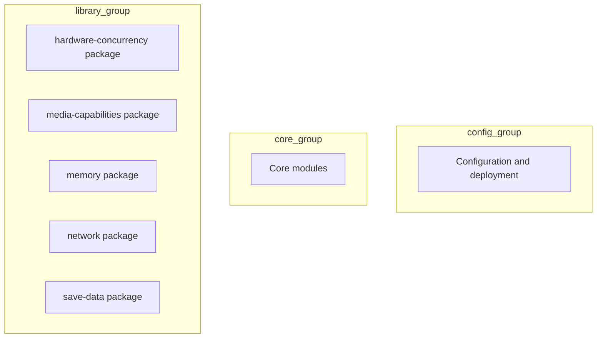

# Architecture report: GoogleChromeLabs/react-adaptive-hooks

> Automated static analysis. **Observed** = directly seen in files/imports/AST; **Inferred** = interpretation from that evidence. Repository code was not executed.

## 1. Repository at a glance

| Item | Value |
| --- | --- |
| Repository | GoogleChromeLabs/react-adaptive-hooks |
| Description | Deliver experiences best suited to a user's device and network constraints |
| Language | JavaScript |
| Stars | 5154 |
| Licence | Apache-2.0 |
| Analysed commit / branch | baad292c62f6c3e77b11d7f0820896050df2c5b4 / master |
| Framework(s) | React |
| Files analysed | 18 |
| Components | 7 |

## 2. Architecture in one minute

GoogleChromeLabs/react-adaptive-hooks - Deliver experiences best suited to a user's device and network constraints. This repository was analysed statically from 18 file(s) (0 Python). Detected technologies (observed from imports/manifests): React, Jest. Files are grouped into 7 component(s): Configuration and deployment, Core modules, hardware-concurrency package, media-capabilities package, memory package, network package, save-data package. Findings below distinguish observed facts from inferred interpretation.

## 3. High-level block diagram

## 4. Main components

### Configuration and deployment (`config`)

- **Kind:** config
- **Status:** Observed
- **Confidence:** 0.85
- **Responsibility:** Groups 1 file(s) under configuration and deployment (observed from repository paths and static analysis).
- **Paths:** `package.json`
- **Evidence:** [package.json](https://github.com/GoogleChromeLabs/react-adaptive-hooks/blob/baad292c62f6c3e77b11d7f0820896050df2c5b4/package.json)

### Core modules (`core`)

- **Kind:** core
- **Status:** Observed
- **Confidence:** 0.85
- **Responsibility:** Groups 2 file(s) under core modules (observed from repository paths and static analysis).
- **Paths:** `babel.config.js`, `index.js`
- **Evidence:** [babel.config.js](https://github.com/GoogleChromeLabs/react-adaptive-hooks/blob/baad292c62f6c3e77b11d7f0820896050df2c5b4/babel.config.js); [index.js](https://github.com/GoogleChromeLabs/react-adaptive-hooks/blob/baad292c62f6c3e77b11d7f0820896050df2c5b4/index.js)

### hardware-concurrency package (`hardware_concurrency`)

- **Kind:** library
- **Status:** Observed
- **Confidence:** 0.85
- **Responsibility:** Groups 2 file(s) under hardware-concurrency package (observed from repository paths and static analysis).
- **Paths:** `hardware-concurrency/hardware-concurrency.test.js`, `hardware-concurrency/index.js`
- **Evidence:** [hardware-concurrency/hardware-concurrency.test.js](https://github.com/GoogleChromeLabs/react-adaptive-hooks/blob/baad292c62f6c3e77b11d7f0820896050df2c5b4/hardware-concurrency/hardware-concurrency.test.js); [hardware-concurrency/index.js](https://github.com/GoogleChromeLabs/react-adaptive-hooks/blob/baad292c62f6c3e77b11d7f0820896050df2c5b4/hardware-concurrency/index.js)

### media-capabilities package (`media_capabilities`)

- **Kind:** library
- **Status:** Observed
- **Confidence:** 0.85
- **Responsibility:** Groups 2 file(s) under media-capabilities package (observed from repository paths and static analysis).
- **Paths:** `media-capabilities/index.js`, `media-capabilities/media-capabilities.test.js`
- **Evidence:** [media-capabilities/index.js](https://github.com/GoogleChromeLabs/react-adaptive-hooks/blob/baad292c62f6c3e77b11d7f0820896050df2c5b4/media-capabilities/index.js); [media-capabilities/media-capabilities.test.js](https://github.com/GoogleChromeLabs/react-adaptive-hooks/blob/baad292c62f6c3e77b11d7f0820896050df2c5b4/media-capabilities/media-capabilities.test.js)

### memory package (`memory`)

- **Kind:** library
- **Status:** Observed
- **Confidence:** 0.85
- **Responsibility:** Groups 2 file(s) under memory package (observed from repository paths and static analysis).
- **Paths:** `memory/index.js`, `memory/memory.test.js`
- **Evidence:** [memory/index.js](https://github.com/GoogleChromeLabs/react-adaptive-hooks/blob/baad292c62f6c3e77b11d7f0820896050df2c5b4/memory/index.js); [memory/memory.test.js](https://github.com/GoogleChromeLabs/react-adaptive-hooks/blob/baad292c62f6c3e77b11d7f0820896050df2c5b4/memory/memory.test.js)

### network package (`network`)

- **Kind:** library
- **Status:** Observed
- **Confidence:** 0.85
- **Responsibility:** Groups 2 file(s) under network package (observed from repository paths and static analysis).
- **Paths:** `network/index.js`, `network/network.test.js`
- **Evidence:** [network/index.js](https://github.com/GoogleChromeLabs/react-adaptive-hooks/blob/baad292c62f6c3e77b11d7f0820896050df2c5b4/network/index.js); [network/network.test.js](https://github.com/GoogleChromeLabs/react-adaptive-hooks/blob/baad292c62f6c3e77b11d7f0820896050df2c5b4/network/network.test.js)

### save-data package (`save_data`)

- **Kind:** library
- **Status:** Observed
- **Confidence:** 0.85
- **Responsibility:** Groups 2 file(s) under save-data package (observed from repository paths and static analysis).
- **Paths:** `save-data/index.js`, `save-data/save-data.test.js`
- **Evidence:** [save-data/index.js](https://github.com/GoogleChromeLabs/react-adaptive-hooks/blob/baad292c62f6c3e77b11d7f0820896050df2c5b4/save-data/index.js); [save-data/save-data.test.js](https://github.com/GoogleChromeLabs/react-adaptive-hooks/blob/baad292c62f6c3e77b11d7f0820896050df2c5b4/save-data/save-data.test.js)

## 5. Execution flow

**Observed** entry point(s):

- [hardware-concurrency/index.js](https://github.com/GoogleChromeLabs/react-adaptive-hooks/blob/baad292c62f6c3e77b11d7f0820896050df2c5b4/hardware-concurrency/index.js)
- [index.js](https://github.com/GoogleChromeLabs/react-adaptive-hooks/blob/baad292c62f6c3e77b11d7f0820896050df2c5b4/index.js)
- [media-capabilities/index.js](https://github.com/GoogleChromeLabs/react-adaptive-hooks/blob/baad292c62f6c3e77b11d7f0820896050df2c5b4/media-capabilities/index.js)
- [memory/index.js](https://github.com/GoogleChromeLabs/react-adaptive-hooks/blob/baad292c62f6c3e77b11d7f0820896050df2c5b4/memory/index.js)
- [network/index.js](https://github.com/GoogleChromeLabs/react-adaptive-hooks/blob/baad292c62f6c3e77b11d7f0820896050df2c5b4/network/index.js)
- [save-data/index.js](https://github.com/GoogleChromeLabs/react-adaptive-hooks/blob/baad292c62f6c3e77b11d7f0820896050df2c5b4/save-data/index.js)

Representative flow (derived from observed entry points and the import graph; steps beyond the entry point are **Inferred**):

1. Execution starts at an observed entry point listed above, if present.
2. No internal import relationships between components were observed.

## 6. Project structure

### `(root)`

- `.gitignore` - other (316 bytes)
- `.travis.yml` - ci, YAML (191 bytes)
- `CONTRIBUTING.md` - docs (1101 bytes)
- `LICENSE` - docs (11358 bytes)
- `README.md` - docs (18203 bytes)
- `babel.config.js` - source, JavaScript (680 bytes)
- `index.js` - source, JavaScript (271 bytes)
- `package.json` - manifest (1003 bytes)

### `hardware-concurrency`

- `hardware-concurrency/hardware-concurrency.test.js` - source, JavaScript (2552 bytes)
- `hardware-concurrency/index.js` - source, JavaScript (1016 bytes)

### `media-capabilities`

- `media-capabilities/index.js` - source, JavaScript (1297 bytes)
- `media-capabilities/media-capabilities.test.js` - source, JavaScript (3954 bytes)

### `memory`

- `memory/index.js` - source, JavaScript (1460 bytes)
- `memory/memory.test.js` - source, JavaScript (3766 bytes)

### `network`

- `network/index.js` - source, JavaScript (1687 bytes)
- `network/network.test.js` - source, JavaScript (4113 bytes)

### `save-data`

- `save-data/index.js` - source, JavaScript (1030 bytes)
- `save-data/save-data.test.js` - source, JavaScript (2601 bytes)

## 7. Key dependencies and integrations

| Name | Category | Status | Confidence | Evidence |
| --- | --- | --- | --- | --- |
| React | framework | Observed | 0.90 | [package.json:2](https://github.com/GoogleChromeLabs/react-adaptive-hooks/blob/baad292c62f6c3e77b11d7f0820896050df2c5b4/package.json#L2) |
| Jest | tooling | Observed | 0.85 | [package.json:17](https://github.com/GoogleChromeLabs/react-adaptive-hooks/blob/baad292c62f6c3e77b11d7f0820896050df2c5b4/package.json#L17) |

## 8. Data and state

No database, cache, queue, or persistent-state usage was observed in the analysed files. State handling, if any, may be in-memory or in files that were not analysed.

## 9. Configuration and deployment clues

- `.travis.yml` (ci)
- `package.json` (manifest)

## 10. Design observations

- No strong design patterns could be established from the available evidence.

These observations are interpretations (**Inferred**) of the observed structure, not guarantees about runtime design.

## 11. Limitations and unknowns

- Static analysis only: repository code was not executed, installed, or imported at runtime.
- Components and relationships are inferred from file paths, imports, and AST structure; runtime behaviour, dynamic imports, and reflection may not be visible.
- No clear application entry point was observed in the analysed files.
- Repository text was treated as untrusted data; no instructions found in repository files were followed, and likely secret values were redacted/excluded.
- JavaScript and TypeScript files were inventoried from paths and package manifests. They were not parsed with a full language AST, and repository code was not executed.

## 12. Source references

- [babel.config.js](https://github.com/GoogleChromeLabs/react-adaptive-hooks/blob/baad292c62f6c3e77b11d7f0820896050df2c5b4/babel.config.js)
- [hardware-concurrency/hardware-concurrency.test.js](https://github.com/GoogleChromeLabs/react-adaptive-hooks/blob/baad292c62f6c3e77b11d7f0820896050df2c5b4/hardware-concurrency/hardware-concurrency.test.js)
- [hardware-concurrency/index.js](https://github.com/GoogleChromeLabs/react-adaptive-hooks/blob/baad292c62f6c3e77b11d7f0820896050df2c5b4/hardware-concurrency/index.js)
- [index.js](https://github.com/GoogleChromeLabs/react-adaptive-hooks/blob/baad292c62f6c3e77b11d7f0820896050df2c5b4/index.js)
- [media-capabilities/index.js](https://github.com/GoogleChromeLabs/react-adaptive-hooks/blob/baad292c62f6c3e77b11d7f0820896050df2c5b4/media-capabilities/index.js)
- [media-capabilities/media-capabilities.test.js](https://github.com/GoogleChromeLabs/react-adaptive-hooks/blob/baad292c62f6c3e77b11d7f0820896050df2c5b4/media-capabilities/media-capabilities.test.js)
- [memory/index.js](https://github.com/GoogleChromeLabs/react-adaptive-hooks/blob/baad292c62f6c3e77b11d7f0820896050df2c5b4/memory/index.js)
- [memory/memory.test.js](https://github.com/GoogleChromeLabs/react-adaptive-hooks/blob/baad292c62f6c3e77b11d7f0820896050df2c5b4/memory/memory.test.js)
- [network/index.js](https://github.com/GoogleChromeLabs/react-adaptive-hooks/blob/baad292c62f6c3e77b11d7f0820896050df2c5b4/network/index.js)
- [network/network.test.js](https://github.com/GoogleChromeLabs/react-adaptive-hooks/blob/baad292c62f6c3e77b11d7f0820896050df2c5b4/network/network.test.js)
- [package.json](https://github.com/GoogleChromeLabs/react-adaptive-hooks/blob/baad292c62f6c3e77b11d7f0820896050df2c5b4/package.json)
- [package.json:2](https://github.com/GoogleChromeLabs/react-adaptive-hooks/blob/baad292c62f6c3e77b11d7f0820896050df2c5b4/package.json#L2)
- [package.json:17](https://github.com/GoogleChromeLabs/react-adaptive-hooks/blob/baad292c62f6c3e77b11d7f0820896050df2c5b4/package.json#L17)
- [save-data/index.js](https://github.com/GoogleChromeLabs/react-adaptive-hooks/blob/baad292c62f6c3e77b11d7f0820896050df2c5b4/save-data/index.js)
- [save-data/save-data.test.js](https://github.com/GoogleChromeLabs/react-adaptive-hooks/blob/baad292c62f6c3e77b11d7f0820896050df2c5b4/save-data/save-data.test.js)
