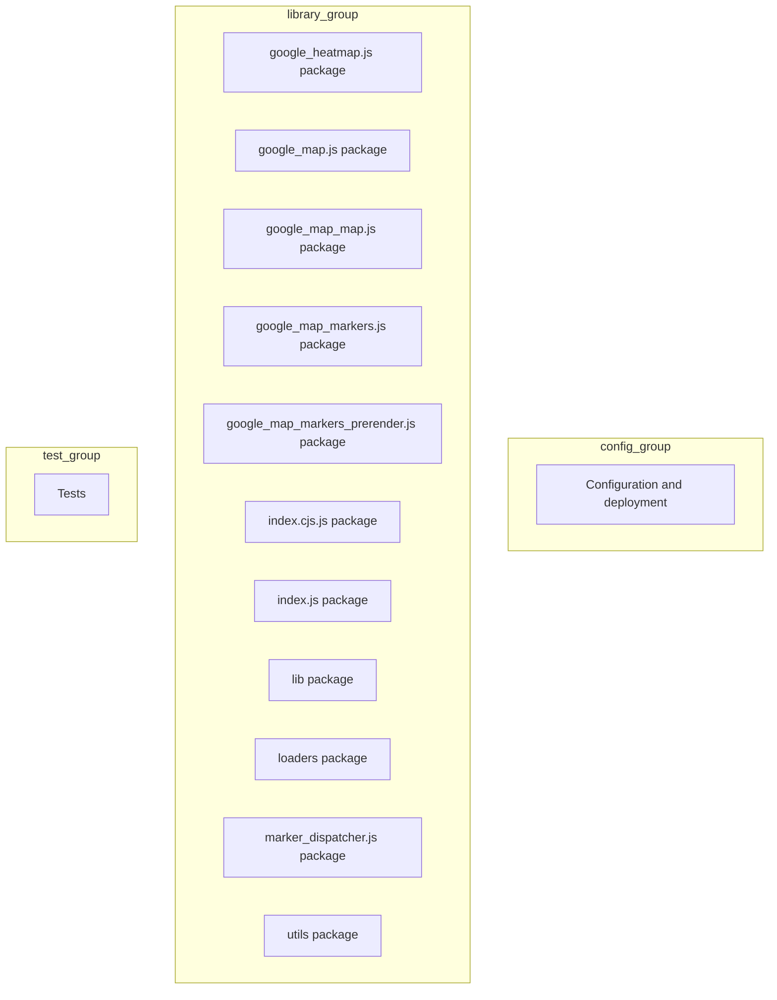

# Architecture report: GoogleMapReact/google-map-react

> Automated static analysis. **Observed** = directly seen in files/imports/AST; **Inferred** = interpretation from that evidence. Repository code was not executed.

## 1. Repository at a glance

| Item | Value |
| --- | --- |
| Repository | GoogleMapReact/google-map-react |
| Description | Google map library for react that allows rendering components as markers :tada: |
| Language | JavaScript |
| Stars | 6480 |
| Licence | MIT |
| Analysed commit / branch | ba0ef4df4351c511e3dce67d0214f4c5270dcf52 / master |
| Framework(s) | React |
| Files analysed | 56 |
| Components | 13 |

## 2. Architecture in one minute

GoogleMapReact/google-map-react - Google map library for react that allows rendering components as markers :tada:. This repository was analysed statically from 56 file(s) (0 Python). Detected technologies (observed from imports/manifests): GitHub Actions, React. Files are grouped into 13 component(s): Configuration and deployment, google_heatmap.js package, google_map.js package, google_map_map.js package, google_map_markers.js package, google_map_markers_prerender.js package, index.cjs.js package, index.js package. Findings below distinguish observed facts from inferred interpretation.

## 3. High-level block diagram

## 4. Main components

### Configuration and deployment (`config`)

- **Kind:** config
- **Status:** Observed
- **Confidence:** 0.85
- **Responsibility:** Groups 1 file(s) under configuration and deployment (observed from repository paths and static analysis).
- **Paths:** `package.json`
- **Evidence:** [package.json](https://github.com/GoogleMapReact/google-map-react/blob/ba0ef4df4351c511e3dce67d0214f4c5270dcf52/package.json)

### google_heatmap.js package (`google_heatmap_js`)

- **Kind:** library
- **Status:** Observed
- **Confidence:** 0.85
- **Responsibility:** Groups 1 file(s) under google_heatmap.js package (observed from repository paths and static analysis).
- **Paths:** `src/google_heatmap.js`
- **Evidence:** [src/google_heatmap.js](https://github.com/GoogleMapReact/google-map-react/blob/ba0ef4df4351c511e3dce67d0214f4c5270dcf52/src/google_heatmap.js)

### google_map.js package (`google_map_js`)

- **Kind:** library
- **Status:** Observed
- **Confidence:** 0.85
- **Responsibility:** Groups 1 file(s) under google_map.js package (observed from repository paths and static analysis).
- **Paths:** `src/google_map.js`
- **Evidence:** [src/google_map.js](https://github.com/GoogleMapReact/google-map-react/blob/ba0ef4df4351c511e3dce67d0214f4c5270dcf52/src/google_map.js)

### google_map_map.js package (`google_map_map_js`)

- **Kind:** library
- **Status:** Observed
- **Confidence:** 0.85
- **Responsibility:** Groups 1 file(s) under google_map_map.js package (observed from repository paths and static analysis).
- **Paths:** `src/google_map_map.js`
- **Evidence:** [src/google_map_map.js](https://github.com/GoogleMapReact/google-map-react/blob/ba0ef4df4351c511e3dce67d0214f4c5270dcf52/src/google_map_map.js)

### google_map_markers.js package (`google_map_markers_js`)

- **Kind:** library
- **Status:** Observed
- **Confidence:** 0.85
- **Responsibility:** Groups 1 file(s) under google_map_markers.js package (observed from repository paths and static analysis).
- **Paths:** `src/google_map_markers.js`
- **Evidence:** [src/google_map_markers.js](https://github.com/GoogleMapReact/google-map-react/blob/ba0ef4df4351c511e3dce67d0214f4c5270dcf52/src/google_map_markers.js)

### google_map_markers_prerender.js package (`google_map_markers_prerender_js`)

- **Kind:** library
- **Status:** Observed
- **Confidence:** 0.85
- **Responsibility:** Groups 1 file(s) under google_map_markers_prerender.js package (observed from repository paths and static analysis).
- **Paths:** `src/google_map_markers_prerender.js`
- **Evidence:** [src/google_map_markers_prerender.js](https://github.com/GoogleMapReact/google-map-react/blob/ba0ef4df4351c511e3dce67d0214f4c5270dcf52/src/google_map_markers_prerender.js)

### index.cjs.js package (`index_cjs_js`)

- **Kind:** library
- **Status:** Observed
- **Confidence:** 0.85
- **Responsibility:** Groups 1 file(s) under index.cjs.js package (observed from repository paths and static analysis).
- **Paths:** `src/index.cjs.js`
- **Evidence:** [src/index.cjs.js](https://github.com/GoogleMapReact/google-map-react/blob/ba0ef4df4351c511e3dce67d0214f4c5270dcf52/src/index.cjs.js)

### index.js package (`index_js`)

- **Kind:** library
- **Status:** Observed
- **Confidence:** 0.85
- **Responsibility:** Groups 1 file(s) under index.js package (observed from repository paths and static analysis).
- **Paths:** `src/index.js`
- **Evidence:** [src/index.js](https://github.com/GoogleMapReact/google-map-react/blob/ba0ef4df4351c511e3dce67d0214f4c5270dcf52/src/index.js)

### lib package (`lib`)

- **Kind:** library
- **Status:** Observed
- **Confidence:** 0.85
- **Responsibility:** Groups 6 file(s) under lib package (observed from repository paths and static analysis).
- **Paths:** `src/lib/geo/index.js`, `src/lib/geo/lat_lng.js`, `src/lib/geo/lat_lng_bounds.js`, `src/lib/geo/transform.js`, `src/lib/geo/wrap.js`, `src/lib/index.js`
- **Evidence:** [src/lib/geo/index.js](https://github.com/GoogleMapReact/google-map-react/blob/ba0ef4df4351c511e3dce67d0214f4c5270dcf52/src/lib/geo/index.js); [src/lib/geo/lat_lng.js](https://github.com/GoogleMapReact/google-map-react/blob/ba0ef4df4351c511e3dce67d0214f4c5270dcf52/src/lib/geo/lat_lng.js); [src/lib/geo/lat_lng_bounds.js](https://github.com/GoogleMapReact/google-map-react/blob/ba0ef4df4351c511e3dce67d0214f4c5270dcf52/src/lib/geo/lat_lng_bounds.js); [src/lib/geo/transform.js](https://github.com/GoogleMapReact/google-map-react/blob/ba0ef4df4351c511e3dce67d0214f4c5270dcf52/src/lib/geo/transform.js); [src/lib/geo/wrap.js](https://github.com/GoogleMapReact/google-map-react/blob/ba0ef4df4351c511e3dce67d0214f4c5270dcf52/src/lib/geo/wrap.js); [src/lib/index.js](https://github.com/GoogleMapReact/google-map-react/blob/ba0ef4df4351c511e3dce67d0214f4c5270dcf52/src/lib/index.js)

### loaders package (`loaders`)

- **Kind:** library
- **Status:** Observed
- **Confidence:** 0.85
- **Responsibility:** Groups 1 file(s) under loaders package (observed from repository paths and static analysis).
- **Paths:** `src/loaders/google_map_loader.js`
- **Evidence:** [src/loaders/google_map_loader.js](https://github.com/GoogleMapReact/google-map-react/blob/ba0ef4df4351c511e3dce67d0214f4c5270dcf52/src/loaders/google_map_loader.js)

### marker_dispatcher.js package (`marker_dispatcher_js`)

- **Kind:** library
- **Status:** Observed
- **Confidence:** 0.85
- **Responsibility:** Groups 1 file(s) under marker_dispatcher.js package (observed from repository paths and static analysis).
- **Paths:** `src/marker_dispatcher.js`
- **Evidence:** [src/marker_dispatcher.js](https://github.com/GoogleMapReact/google-map-react/blob/ba0ef4df4351c511e3dce67d0214f4c5270dcf52/src/marker_dispatcher.js)

### Tests (`tests`)

- **Kind:** test
- **Status:** Observed
- **Confidence:** 0.85
- **Responsibility:** Groups 1 file(s) under tests (observed from repository paths and static analysis).
- **Paths:** `src/test/components/GoogleMap.spec.js`
- **Evidence:** [src/test/components/GoogleMap.spec.js](https://github.com/GoogleMapReact/google-map-react/blob/ba0ef4df4351c511e3dce67d0214f4c5270dcf52/src/test/components/GoogleMap.spec.js)

### utils package (`utils`)

- **Kind:** library
- **Status:** Observed
- **Confidence:** 0.85
- **Responsibility:** Groups 12 file(s) under utils package (observed from repository paths and static analysis).
- **Paths:** `src/utils/detect.js`, `src/utils/detectElementResize.js`, `src/utils/isArraysEqualEps.js`, `src/utils/isEmpty.js`, `src/utils/isNumber.js`, `src/utils/isPlainObject.js`, `src/utils/log2.js`, `src/utils/omit.js`, `src/utils/passiveEvents.js`, `src/utils/pick.js`, `src/utils/raf.js`, `src/utils/shallowEqual.js`
- **Evidence:** [src/utils/detect.js](https://github.com/GoogleMapReact/google-map-react/blob/ba0ef4df4351c511e3dce67d0214f4c5270dcf52/src/utils/detect.js); [src/utils/detectElementResize.js](https://github.com/GoogleMapReact/google-map-react/blob/ba0ef4df4351c511e3dce67d0214f4c5270dcf52/src/utils/detectElementResize.js); [src/utils/isArraysEqualEps.js](https://github.com/GoogleMapReact/google-map-react/blob/ba0ef4df4351c511e3dce67d0214f4c5270dcf52/src/utils/isArraysEqualEps.js); [src/utils/isEmpty.js](https://github.com/GoogleMapReact/google-map-react/blob/ba0ef4df4351c511e3dce67d0214f4c5270dcf52/src/utils/isEmpty.js); [src/utils/isNumber.js](https://github.com/GoogleMapReact/google-map-react/blob/ba0ef4df4351c511e3dce67d0214f4c5270dcf52/src/utils/isNumber.js); [src/utils/isPlainObject.js](https://github.com/GoogleMapReact/google-map-react/blob/ba0ef4df4351c511e3dce67d0214f4c5270dcf52/src/utils/isPlainObject.js); [src/utils/log2.js](https://github.com/GoogleMapReact/google-map-react/blob/ba0ef4df4351c511e3dce67d0214f4c5270dcf52/src/utils/log2.js); [src/utils/omit.js](https://github.com/GoogleMapReact/google-map-react/blob/ba0ef4df4351c511e3dce67d0214f4c5270dcf52/src/utils/omit.js)

## 5. Execution flow

**Observed** entry point(s):

- [src/index.js](https://github.com/GoogleMapReact/google-map-react/blob/ba0ef4df4351c511e3dce67d0214f4c5270dcf52/src/index.js)
- [src/lib/geo/index.js](https://github.com/GoogleMapReact/google-map-react/blob/ba0ef4df4351c511e3dce67d0214f4c5270dcf52/src/lib/geo/index.js)
- [src/lib/index.js](https://github.com/GoogleMapReact/google-map-react/blob/ba0ef4df4351c511e3dce67d0214f4c5270dcf52/src/lib/index.js)

Representative flow (derived from observed entry points and the import graph; steps beyond the entry point are **Inferred**):

1. Execution starts at an observed entry point listed above, if present.
2. No internal import relationships between components were observed.

## 6. Project structure

### `(root)`

- `.eslintignore` - other (57 bytes)
- `.eslintrc` - other (602 bytes)
- `.gitignore` - other (281 bytes)
- `.prettierrc` - other (195 bytes)
- `.travis.yml` - ci, YAML (201 bytes)
- `API.md` - docs (10667 bytes)
- `CHANGELOG.md` - docs (5585 bytes)
- `DOC.md` - docs (7037 bytes)
- `LICENSE.md` - docs (1101 bytes)
- `README.md` - docs (8334 bytes)
- `package.json` - manifest (2261 bytes)

### `.github`

- `.github/ISSUE_TEMPLATE/BUG_REPORT.md` - docs (789 bytes)
- `.github/ISSUE_TEMPLATE/FEATURE_REQUEST.md` - docs (676 bytes)
- `.github/lock.yml` - config (0 bytes)
- `.github/workflows/npm-publish.yml` - ci, YAML (833 bytes)

### `example`

- `example/README.md` - docs (269 bytes)
- `example/package.json` - manifest (909 bytes)
- `example/public/index.html` - other (1628 bytes)
- `example/public/manifest.json` - config (306 bytes)
- `example/public/places.json` - config (29197 bytes)
- `example/src/App.js` - source, JavaScript (1073 bytes)
- `example/src/App.test.js` - source, JavaScript (375 bytes)
- `example/src/components/Marker.js` - source, JavaScript (697 bytes)
- `example/src/const/la_center.js` - source, JavaScript (49 bytes)
- `example/src/index.css` - other (481 bytes)
- `example/src/index.js` - source, JavaScript (252 bytes)

### `src`

- `src/google_heatmap.js` - source, JavaScript (438 bytes)
- `src/google_map.js` - source, JavaScript (36402 bytes)
- `src/google_map_map.js` - source, JavaScript (419 bytes)
- `src/google_map_markers.js` - source, JavaScript (9183 bytes)
- `src/google_map_markers_prerender.js` - source, JavaScript (396 bytes)
- `src/index.cjs.js` - source, JavaScript (369 bytes)
- `src/index.js` - source, JavaScript (214 bytes)
- `src/lib/geo/LICENCE.txt` - docs (1506 bytes)
- `src/lib/geo/README.md` - docs (90 bytes)
- `src/lib/geo/index.js` - source, JavaScript (4032 bytes)
- `src/lib/geo/lat_lng.js` - source, JavaScript (576 bytes)
- `src/lib/geo/lat_lng_bounds.js` - source, JavaScript (1576 bytes)
- `src/lib/geo/transform.js` - source, JavaScript (3023 bytes)
- `src/lib/geo/wrap.js` - source, JavaScript (172 bytes)
- `src/lib/index.js` - source, JavaScript (5280 bytes)
- `src/loaders/google_map_loader.js` - source, JavaScript (2220 bytes)
- `src/marker_dispatcher.js` - source, JavaScript (477 bytes)
- `src/test/components/GoogleMap.spec.js` - test, JavaScript (6881 bytes)
- `src/utils/detect.js` - source, JavaScript (1073 bytes)
- `src/utils/detectElementResize.js` - source, JavaScript (6635 bytes)
- `src/utils/isArraysEqualEps.js` - source, JavaScript (264 bytes)
- `src/utils/isEmpty.js` - source, JavaScript (352 bytes)
- `src/utils/isNumber.js` - source, JavaScript (334 bytes)
- `src/utils/isPlainObject.js` - source, JavaScript (750 bytes)
- `src/utils/log2.js` - source, JavaScript (90 bytes)
- `src/utils/omit.js` - source, JavaScript (310 bytes)
- `src/utils/passiveEvents.js` - source, JavaScript (810 bytes)
- `src/utils/pick.js` - source, JavaScript (291 bytes)
- `src/utils/raf.js` - source, JavaScript (322 bytes)
- `src/utils/shallowEqual.js` - source, JavaScript (1770 bytes)

## 7. Key dependencies and integrations

| Name | Category | Status | Confidence | Evidence |
| --- | --- | --- | --- | --- |
| GitHub Actions | ci | Observed | 0.85 | [.github/workflows/npm-publish.yml](https://github.com/GoogleMapReact/google-map-react/blob/ba0ef4df4351c511e3dce67d0214f4c5270dcf52/.github/workflows/npm-publish.yml) |
| React | framework | Observed | 0.90 | [example/package.json:2](https://github.com/GoogleMapReact/google-map-react/blob/ba0ef4df4351c511e3dce67d0214f4c5270dcf52/example/package.json#L2); [example/package.json:15](https://github.com/GoogleMapReact/google-map-react/blob/ba0ef4df4351c511e3dce67d0214f4c5270dcf52/example/package.json#L15); [package.json:2](https://github.com/GoogleMapReact/google-map-react/blob/ba0ef4df4351c511e3dce67d0214f4c5270dcf52/package.json#L2); [package.json:37](https://github.com/GoogleMapReact/google-map-react/blob/ba0ef4df4351c511e3dce67d0214f4c5270dcf52/package.json#L37) |

## 8. Data and state

No database, cache, queue, or persistent-state usage was observed in the analysed files. State handling, if any, may be in-memory or in files that were not analysed.

## 9. Configuration and deployment clues

- `.github/lock.yml` (config)
- `.github/workflows/npm-publish.yml` (ci)
- `.travis.yml` (ci)
- `example/package.json` (manifest)
- `example/public/manifest.json` (config)
- `example/public/places.json` (config)
- `package.json` (manifest)

## 10. Design observations

- Tests are present alongside source code (Observed from test file paths).

These observations are interpretations (**Inferred**) of the observed structure, not guarantees about runtime design.

## 11. Limitations and unknowns

- Static analysis only: repository code was not executed, installed, or imported at runtime.
- Components and relationships are inferred from file paths, imports, and AST structure; runtime behaviour, dynamic imports, and reflection may not be visible.
- No clear application entry point was observed in the analysed files.
- Repository text was treated as untrusted data; no instructions found in repository files were followed, and likely secret values were redacted/excluded.
- JavaScript and TypeScript files were inventoried from paths and package manifests. They were not parsed with a full language AST, and repository code was not executed.

## 12. Source references

- [.github/workflows/npm-publish.yml](https://github.com/GoogleMapReact/google-map-react/blob/ba0ef4df4351c511e3dce67d0214f4c5270dcf52/.github/workflows/npm-publish.yml)
- [example/package.json:2](https://github.com/GoogleMapReact/google-map-react/blob/ba0ef4df4351c511e3dce67d0214f4c5270dcf52/example/package.json#L2)
- [example/package.json:15](https://github.com/GoogleMapReact/google-map-react/blob/ba0ef4df4351c511e3dce67d0214f4c5270dcf52/example/package.json#L15)
- [package.json](https://github.com/GoogleMapReact/google-map-react/blob/ba0ef4df4351c511e3dce67d0214f4c5270dcf52/package.json)
- [package.json:2](https://github.com/GoogleMapReact/google-map-react/blob/ba0ef4df4351c511e3dce67d0214f4c5270dcf52/package.json#L2)
- [package.json:37](https://github.com/GoogleMapReact/google-map-react/blob/ba0ef4df4351c511e3dce67d0214f4c5270dcf52/package.json#L37)
- [src/google_heatmap.js](https://github.com/GoogleMapReact/google-map-react/blob/ba0ef4df4351c511e3dce67d0214f4c5270dcf52/src/google_heatmap.js)
- [src/google_map.js](https://github.com/GoogleMapReact/google-map-react/blob/ba0ef4df4351c511e3dce67d0214f4c5270dcf52/src/google_map.js)
- [src/google_map_map.js](https://github.com/GoogleMapReact/google-map-react/blob/ba0ef4df4351c511e3dce67d0214f4c5270dcf52/src/google_map_map.js)
- [src/google_map_markers.js](https://github.com/GoogleMapReact/google-map-react/blob/ba0ef4df4351c511e3dce67d0214f4c5270dcf52/src/google_map_markers.js)
- [src/google_map_markers_prerender.js](https://github.com/GoogleMapReact/google-map-react/blob/ba0ef4df4351c511e3dce67d0214f4c5270dcf52/src/google_map_markers_prerender.js)
- [src/index.cjs.js](https://github.com/GoogleMapReact/google-map-react/blob/ba0ef4df4351c511e3dce67d0214f4c5270dcf52/src/index.cjs.js)
- [src/index.js](https://github.com/GoogleMapReact/google-map-react/blob/ba0ef4df4351c511e3dce67d0214f4c5270dcf52/src/index.js)
- [src/lib/geo/index.js](https://github.com/GoogleMapReact/google-map-react/blob/ba0ef4df4351c511e3dce67d0214f4c5270dcf52/src/lib/geo/index.js)
- [src/lib/geo/lat_lng.js](https://github.com/GoogleMapReact/google-map-react/blob/ba0ef4df4351c511e3dce67d0214f4c5270dcf52/src/lib/geo/lat_lng.js)
- [src/lib/geo/lat_lng_bounds.js](https://github.com/GoogleMapReact/google-map-react/blob/ba0ef4df4351c511e3dce67d0214f4c5270dcf52/src/lib/geo/lat_lng_bounds.js)
- [src/lib/geo/transform.js](https://github.com/GoogleMapReact/google-map-react/blob/ba0ef4df4351c511e3dce67d0214f4c5270dcf52/src/lib/geo/transform.js)
- [src/lib/geo/wrap.js](https://github.com/GoogleMapReact/google-map-react/blob/ba0ef4df4351c511e3dce67d0214f4c5270dcf52/src/lib/geo/wrap.js)
- [src/lib/index.js](https://github.com/GoogleMapReact/google-map-react/blob/ba0ef4df4351c511e3dce67d0214f4c5270dcf52/src/lib/index.js)
- [src/loaders/google_map_loader.js](https://github.com/GoogleMapReact/google-map-react/blob/ba0ef4df4351c511e3dce67d0214f4c5270dcf52/src/loaders/google_map_loader.js)
- [src/marker_dispatcher.js](https://github.com/GoogleMapReact/google-map-react/blob/ba0ef4df4351c511e3dce67d0214f4c5270dcf52/src/marker_dispatcher.js)
- [src/test/components/GoogleMap.spec.js](https://github.com/GoogleMapReact/google-map-react/blob/ba0ef4df4351c511e3dce67d0214f4c5270dcf52/src/test/components/GoogleMap.spec.js)
- [src/utils/detect.js](https://github.com/GoogleMapReact/google-map-react/blob/ba0ef4df4351c511e3dce67d0214f4c5270dcf52/src/utils/detect.js)
- [src/utils/detectElementResize.js](https://github.com/GoogleMapReact/google-map-react/blob/ba0ef4df4351c511e3dce67d0214f4c5270dcf52/src/utils/detectElementResize.js)
- [src/utils/isArraysEqualEps.js](https://github.com/GoogleMapReact/google-map-react/blob/ba0ef4df4351c511e3dce67d0214f4c5270dcf52/src/utils/isArraysEqualEps.js)
- [src/utils/isEmpty.js](https://github.com/GoogleMapReact/google-map-react/blob/ba0ef4df4351c511e3dce67d0214f4c5270dcf52/src/utils/isEmpty.js)
- [src/utils/isNumber.js](https://github.com/GoogleMapReact/google-map-react/blob/ba0ef4df4351c511e3dce67d0214f4c5270dcf52/src/utils/isNumber.js)
- [src/utils/isPlainObject.js](https://github.com/GoogleMapReact/google-map-react/blob/ba0ef4df4351c511e3dce67d0214f4c5270dcf52/src/utils/isPlainObject.js)
- [src/utils/log2.js](https://github.com/GoogleMapReact/google-map-react/blob/ba0ef4df4351c511e3dce67d0214f4c5270dcf52/src/utils/log2.js)
- [src/utils/omit.js](https://github.com/GoogleMapReact/google-map-react/blob/ba0ef4df4351c511e3dce67d0214f4c5270dcf52/src/utils/omit.js)
