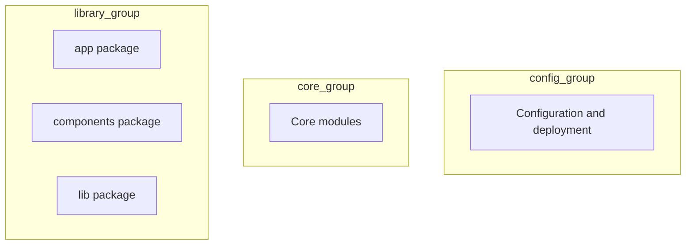

# Architecture report: JCodesMore/ai-website-cloner-template

> Automated static analysis. **Observed** = directly seen in files/imports/AST; **Inferred** = interpretation from that evidence. Repository code was not executed.

## 1. Repository at a glance

| Item | Value |
| --- | --- |
| Repository | JCodesMore/ai-website-cloner-template |
| Description | Clone any website with one command using AI coding agents |
| Language | TypeScript |
| Stars | 39142 |
| Licence | MIT |
| Analysed commit / branch | 5426e0e2ec35dbc173a7a18f47a3dfe2a765313e / master |
| Framework(s) | Next.js, React |
| Files analysed | 44 |
| Components | 5 |

## 2. Architecture in one minute

JCodesMore/ai-website-cloner-template - Clone any website with one command using AI coding agents. This repository was analysed statically from 44 file(s) (0 Python). Detected technologies (observed from imports/manifests): GitHub Actions, Next.js, React, Tailwind CSS, Docker, Docker Compose. Files are grouped into 5 component(s): app package, components package, Configuration and deployment, Core modules, lib package. Findings below distinguish observed facts from inferred interpretation.

## 3. High-level block diagram

## 4. Main components

### app package (`app`)

- **Kind:** library
- **Status:** Observed
- **Confidence:** 0.85
- **Responsibility:** Groups 2 file(s) under app package (observed from repository paths and static analysis).
- **Paths:** `src/app/layout.tsx`, `src/app/page.tsx`
- **Evidence:** [src/app/layout.tsx](https://github.com/JCodesMore/ai-website-cloner-template/blob/5426e0e2ec35dbc173a7a18f47a3dfe2a765313e/src/app/layout.tsx); [src/app/page.tsx](https://github.com/JCodesMore/ai-website-cloner-template/blob/5426e0e2ec35dbc173a7a18f47a3dfe2a765313e/src/app/page.tsx)

### components package (`components`)

- **Kind:** library
- **Status:** Observed
- **Confidence:** 0.85
- **Responsibility:** Groups 1 file(s) under components package (observed from repository paths and static analysis).
- **Paths:** `src/components/ui/button.tsx`
- **Evidence:** [src/components/ui/button.tsx](https://github.com/JCodesMore/ai-website-cloner-template/blob/5426e0e2ec35dbc173a7a18f47a3dfe2a765313e/src/components/ui/button.tsx)

### Configuration and deployment (`config`)

- **Kind:** config
- **Status:** Observed
- **Confidence:** 0.85
- **Responsibility:** Groups 6 file(s) under configuration and deployment (observed from repository paths and static analysis).
- **Paths:** `Dockerfile`, `Dockerfile.dev`, `components.json`, `docker-compose.yml`, `package.json`, `tsconfig.json`
- **Evidence:** [Dockerfile](https://github.com/JCodesMore/ai-website-cloner-template/blob/5426e0e2ec35dbc173a7a18f47a3dfe2a765313e/Dockerfile); [Dockerfile.dev](https://github.com/JCodesMore/ai-website-cloner-template/blob/5426e0e2ec35dbc173a7a18f47a3dfe2a765313e/Dockerfile.dev); [components.json](https://github.com/JCodesMore/ai-website-cloner-template/blob/5426e0e2ec35dbc173a7a18f47a3dfe2a765313e/components.json); [docker-compose.yml](https://github.com/JCodesMore/ai-website-cloner-template/blob/5426e0e2ec35dbc173a7a18f47a3dfe2a765313e/docker-compose.yml); [package.json](https://github.com/JCodesMore/ai-website-cloner-template/blob/5426e0e2ec35dbc173a7a18f47a3dfe2a765313e/package.json); [tsconfig.json](https://github.com/JCodesMore/ai-website-cloner-template/blob/5426e0e2ec35dbc173a7a18f47a3dfe2a765313e/tsconfig.json)

### Core modules (`core`)

- **Kind:** core
- **Status:** Observed
- **Confidence:** 0.85
- **Responsibility:** Groups 3 file(s) under core modules (observed from repository paths and static analysis).
- **Paths:** `eslint.config.mjs`, `next.config.ts`, `postcss.config.mjs`
- **Evidence:** [eslint.config.mjs](https://github.com/JCodesMore/ai-website-cloner-template/blob/5426e0e2ec35dbc173a7a18f47a3dfe2a765313e/eslint.config.mjs); [next.config.ts](https://github.com/JCodesMore/ai-website-cloner-template/blob/5426e0e2ec35dbc173a7a18f47a3dfe2a765313e/next.config.ts); [postcss.config.mjs](https://github.com/JCodesMore/ai-website-cloner-template/blob/5426e0e2ec35dbc173a7a18f47a3dfe2a765313e/postcss.config.mjs)

### lib package (`lib`)

- **Kind:** library
- **Status:** Observed
- **Confidence:** 0.85
- **Responsibility:** Groups 1 file(s) under lib package (observed from repository paths and static analysis).
- **Paths:** `src/lib/utils.ts`
- **Evidence:** [src/lib/utils.ts](https://github.com/JCodesMore/ai-website-cloner-template/blob/5426e0e2ec35dbc173a7a18f47a3dfe2a765313e/src/lib/utils.ts)

## 5. Execution flow

**Observed** entry point(s):

- [src/app/page.tsx](https://github.com/JCodesMore/ai-website-cloner-template/blob/5426e0e2ec35dbc173a7a18f47a3dfe2a765313e/src/app/page.tsx)

Representative flow (derived from observed entry points and the import graph; steps beyond the entry point are **Inferred**):

1. Execution starts at an observed entry point listed above, if present.
2. No internal import relationships between components were observed.

## 6. Project structure

### `(root)`

- `.dockerignore` - container (650 bytes)
- `.gitattributes` - other (228 bytes)
- `.gitignore` - other (539 bytes)
- `.nvmrc` - other (3 bytes)
- `AGENTS.md` - docs (3164 bytes)
- `CHANGELOG.md` - docs (8084 bytes)
- `CLAUDE.md` - docs (11 bytes)
- `CONTRIBUTING.md` - docs (2562 bytes)
- `Dockerfile` - container (3985 bytes)
- `Dockerfile.dev` - container (252 bytes)
- `LICENSE` - docs (1067 bytes)
- `README.md` - docs (8300 bytes)
- `SECURITY.md` - docs (1998 bytes)
- `components.json` - config (520 bytes)
- `docker-compose.yml` - container (1235 bytes)
- `eslint.config.mjs` - source, JavaScript (465 bytes)
- `next.config.ts` - source, TypeScript (157 bytes)
- `package.json` - manifest (1492 bytes)
- `postcss.config.mjs` - source, JavaScript (94 bytes)
- `tsconfig.json` - config (670 bytes)

### `.agents`

- `.agents/skills/clone-website/SKILL.md` - docs (6762 bytes)
- `.agents/skills/clone-website/references/framer-and-motion.md` - docs (3186 bytes)
- `.agents/skills/clone-website/references/inspection-guide.md` - docs (3014 bytes)

### `.claude`

- `.claude/commands/clone-website.md` - docs (454 bytes)

### `.github`

- `.github/FUNDING.yml` - config (212 bytes)
- `.github/ISSUE_TEMPLATE/bug_report.yml` - config (2100 bytes)
- `.github/ISSUE_TEMPLATE/config.yml` - config (179 bytes)
- `.github/ISSUE_TEMPLATE/feature_request.yml` - config (1253 bytes)
- `.github/PULL_REQUEST_TEMPLATE.md` - docs (313 bytes)
- `.github/copilot-setup-steps.yml` - config (54 bytes)
- `.github/workflows/ci.yml` - ci, YAML (568 bytes)
- `.github/workflows/token-badge.yml` - ci, YAML (1851 bytes)

### `docs`

- `docs/design-references/.gitkeep` - docs (0 bytes)

### `public`

- `public/images/.gitkeep` - other (0 bytes)
- `public/seo/.gitkeep` - other (0 bytes)
- `public/videos/.gitkeep` - other (0 bytes)

### `scripts`

- `scripts/.gitkeep` - other (0 bytes)

### `src`

- `src/app/globals.css` - other (4389 bytes)
- `src/app/layout.tsx` - source, TypeScript (716 bytes)
- `src/app/page.tsx` - source, TypeScript (303 bytes)
- `src/components/ui/button.tsx` - source, TypeScript (3211 bytes)
- `src/hooks/.gitkeep` - other (0 bytes)
- `src/lib/utils.ts` - source, TypeScript (166 bytes)
- `src/types/.gitkeep` - other (0 bytes)

## 7. Key dependencies and integrations

| Name | Category | Status | Confidence | Evidence |
| --- | --- | --- | --- | --- |
| GitHub Actions | ci | Observed | 0.90 | [.github/workflows/ci.yml](https://github.com/JCodesMore/ai-website-cloner-template/blob/5426e0e2ec35dbc173a7a18f47a3dfe2a765313e/.github/workflows/ci.yml); [.github/workflows/token-badge.yml](https://github.com/JCodesMore/ai-website-cloner-template/blob/5426e0e2ec35dbc173a7a18f47a3dfe2a765313e/.github/workflows/token-badge.yml) |
| Next.js | framework | Observed | 0.85 | [package.json:5](https://github.com/JCodesMore/ai-website-cloner-template/blob/5426e0e2ec35dbc173a7a18f47a3dfe2a765313e/package.json#L5) |
| React | framework | Observed | 0.90 | [package.json:38](https://github.com/JCodesMore/ai-website-cloner-template/blob/5426e0e2ec35dbc173a7a18f47a3dfe2a765313e/package.json#L38); [package.json:44](https://github.com/JCodesMore/ai-website-cloner-template/blob/5426e0e2ec35dbc173a7a18f47a3dfe2a765313e/package.json#L44) |
| Tailwind CSS | library | Observed | 0.85 | [package.json:23](https://github.com/JCodesMore/ai-website-cloner-template/blob/5426e0e2ec35dbc173a7a18f47a3dfe2a765313e/package.json#L23) |
| Docker | tooling | Observed | 0.90 | [Dockerfile](https://github.com/JCodesMore/ai-website-cloner-template/blob/5426e0e2ec35dbc173a7a18f47a3dfe2a765313e/Dockerfile); [Dockerfile.dev](https://github.com/JCodesMore/ai-website-cloner-template/blob/5426e0e2ec35dbc173a7a18f47a3dfe2a765313e/Dockerfile.dev) |
| Docker Compose | tooling | Observed | 0.85 | [docker-compose.yml](https://github.com/JCodesMore/ai-website-cloner-template/blob/5426e0e2ec35dbc173a7a18f47a3dfe2a765313e/docker-compose.yml) |
| TypeScript | tooling | Observed | 0.85 | [package.json:57](https://github.com/JCodesMore/ai-website-cloner-template/blob/5426e0e2ec35dbc173a7a18f47a3dfe2a765313e/package.json#L57) |

## 8. Data and state

No database, cache, queue, or persistent-state usage was observed in the analysed files. State handling, if any, may be in-memory or in files that were not analysed.

## 9. Configuration and deployment clues

- `.dockerignore` (container)
- `.github/FUNDING.yml` (config)
- `.github/ISSUE_TEMPLATE/bug_report.yml` (config)
- `.github/ISSUE_TEMPLATE/config.yml` (config)
- `.github/ISSUE_TEMPLATE/feature_request.yml` (config)
- `.github/copilot-setup-steps.yml` (config)
- `.github/workflows/ci.yml` (ci)
- `.github/workflows/token-badge.yml` (ci)
- `Dockerfile` (container)
- `Dockerfile.dev` (container)
- `components.json` (config)
- `docker-compose.yml` (container)
- `package.json` (manifest)
- `tsconfig.json` (config)

## 10. Design observations

- No strong design patterns could be established from the available evidence.

These observations are interpretations (**Inferred**) of the observed structure, not guarantees about runtime design.

## 11. Limitations and unknowns

- Static analysis only: repository code was not executed, installed, or imported at runtime.
- Components and relationships are inferred from file paths, imports, and AST structure; runtime behaviour, dynamic imports, and reflection may not be visible.
- No clear application entry point was observed in the analysed files.
- Repository text was treated as untrusted data; no instructions found in repository files were followed, and likely secret values were redacted/excluded.
- JavaScript and TypeScript files were inventoried from paths and package manifests. They were not parsed with a full language AST, and repository code was not executed.

## 12. Source references

- [.github/workflows/ci.yml](https://github.com/JCodesMore/ai-website-cloner-template/blob/5426e0e2ec35dbc173a7a18f47a3dfe2a765313e/.github/workflows/ci.yml)
- [.github/workflows/token-badge.yml](https://github.com/JCodesMore/ai-website-cloner-template/blob/5426e0e2ec35dbc173a7a18f47a3dfe2a765313e/.github/workflows/token-badge.yml)
- [Dockerfile](https://github.com/JCodesMore/ai-website-cloner-template/blob/5426e0e2ec35dbc173a7a18f47a3dfe2a765313e/Dockerfile)
- [Dockerfile.dev](https://github.com/JCodesMore/ai-website-cloner-template/blob/5426e0e2ec35dbc173a7a18f47a3dfe2a765313e/Dockerfile.dev)
- [components.json](https://github.com/JCodesMore/ai-website-cloner-template/blob/5426e0e2ec35dbc173a7a18f47a3dfe2a765313e/components.json)
- [docker-compose.yml](https://github.com/JCodesMore/ai-website-cloner-template/blob/5426e0e2ec35dbc173a7a18f47a3dfe2a765313e/docker-compose.yml)
- [eslint.config.mjs](https://github.com/JCodesMore/ai-website-cloner-template/blob/5426e0e2ec35dbc173a7a18f47a3dfe2a765313e/eslint.config.mjs)
- [next.config.ts](https://github.com/JCodesMore/ai-website-cloner-template/blob/5426e0e2ec35dbc173a7a18f47a3dfe2a765313e/next.config.ts)
- [package.json](https://github.com/JCodesMore/ai-website-cloner-template/blob/5426e0e2ec35dbc173a7a18f47a3dfe2a765313e/package.json)
- [package.json:5](https://github.com/JCodesMore/ai-website-cloner-template/blob/5426e0e2ec35dbc173a7a18f47a3dfe2a765313e/package.json#L5)
- [package.json:23](https://github.com/JCodesMore/ai-website-cloner-template/blob/5426e0e2ec35dbc173a7a18f47a3dfe2a765313e/package.json#L23)
- [package.json:38](https://github.com/JCodesMore/ai-website-cloner-template/blob/5426e0e2ec35dbc173a7a18f47a3dfe2a765313e/package.json#L38)
- [package.json:44](https://github.com/JCodesMore/ai-website-cloner-template/blob/5426e0e2ec35dbc173a7a18f47a3dfe2a765313e/package.json#L44)
- [package.json:57](https://github.com/JCodesMore/ai-website-cloner-template/blob/5426e0e2ec35dbc173a7a18f47a3dfe2a765313e/package.json#L57)
- [postcss.config.mjs](https://github.com/JCodesMore/ai-website-cloner-template/blob/5426e0e2ec35dbc173a7a18f47a3dfe2a765313e/postcss.config.mjs)
- [src/app/layout.tsx](https://github.com/JCodesMore/ai-website-cloner-template/blob/5426e0e2ec35dbc173a7a18f47a3dfe2a765313e/src/app/layout.tsx)
- [src/app/page.tsx](https://github.com/JCodesMore/ai-website-cloner-template/blob/5426e0e2ec35dbc173a7a18f47a3dfe2a765313e/src/app/page.tsx)
- [src/components/ui/button.tsx](https://github.com/JCodesMore/ai-website-cloner-template/blob/5426e0e2ec35dbc173a7a18f47a3dfe2a765313e/src/components/ui/button.tsx)
- [src/lib/utils.ts](https://github.com/JCodesMore/ai-website-cloner-template/blob/5426e0e2ec35dbc173a7a18f47a3dfe2a765313e/src/lib/utils.ts)
- [tsconfig.json](https://github.com/JCodesMore/ai-website-cloner-template/blob/5426e0e2ec35dbc173a7a18f47a3dfe2a765313e/tsconfig.json)
