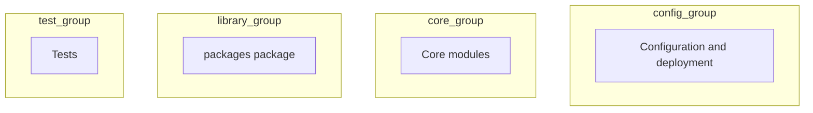

# Architecture report: JohannesKlauss/react-hotkeys-hook

> Automated static analysis. **Observed** = directly seen in files/imports/AST; **Inferred** = interpretation from that evidence. Repository code was not executed.

## 1. Repository at a glance

| Item | Value |
| --- | --- |
| Repository | JohannesKlauss/react-hotkeys-hook |
| Description | React hook for using keyboard shortcuts in components. |
| Language | TypeScript |
| Stars | 3504 |
| Licence | MIT |
| Analysed commit / branch | 7a9378447013b2cf29704c4cec88bb8cd28fa919 / main |
| Framework(s) | React |
| Files analysed | 132 |
| Components | 4 |

## 2. Architecture in one minute

JohannesKlauss/react-hotkeys-hook - React hook for using keyboard shortcuts in components.. This repository was analysed statically from 132 file(s) (0 Python). Detected technologies (observed from imports/manifests): GitHub Actions, React, TypeScript, Vite, Vitest. Files are grouped into 4 component(s): Configuration and deployment, Core modules, packages package, Tests. Findings below distinguish observed facts from inferred interpretation.

## 3. High-level block diagram

## 4. Main components

### Configuration and deployment (`config`)

- **Kind:** config
- **Status:** Observed
- **Confidence:** 0.85
- **Responsibility:** Groups 21 file(s) under configuration and deployment (observed from repository paths and static analysis).
- **Paths:** `package.json`, `packages/documentation/docs/api/_category_.json`, `packages/documentation/docs/documentation/_category_.json`, `packages/documentation/docs/documentation/useHotkeys/_category_.json`, `packages/documentation/package.json`, `packages/documentation/tsconfig.json`, `packages/documentation/versioned_docs/version-3.x/api/_category_.json`, `packages/documentation/versioned_docs/version-3.x/documentation/_category_.json`, `packages/documentation/versioned_docs/version-3.x/documentation/useHotkeys/_category_.json`, `packages/documentation/versioned_docs/version-4.x/api/_category_.json`, `packages/documentation/versioned_docs/version-4.x/documentation/_category_.json`, `packages/documentation/versioned_docs/version-4.x/documentation/useHotkeys/_category_.json`, `packages/documentation/versioned_sidebars/version-3.x-sidebars.json`, `packages/documentation/versioned_sidebars/version-4.x-sidebars.json`, `packages/documentation/versions.json`, `packages/react-hotkeys-hook/package.json`, `packages/react-hotkeys-hook/tsconfig.app.json`, `packages/react-hotkeys-hook/tsconfig.build.json`, `packages/react-hotkeys-hook/tsconfig.json`, `packages/react-hotkeys-hook/tsconfig.node.json`, `renovate.json`
- **Evidence:** [package.json](https://github.com/JohannesKlauss/react-hotkeys-hook/blob/7a9378447013b2cf29704c4cec88bb8cd28fa919/package.json); [packages/documentation/docs/api/_category_.json](https://github.com/JohannesKlauss/react-hotkeys-hook/blob/7a9378447013b2cf29704c4cec88bb8cd28fa919/packages/documentation/docs/api/_category_.json); [packages/documentation/docs/documentation/_category_.json](https://github.com/JohannesKlauss/react-hotkeys-hook/blob/7a9378447013b2cf29704c4cec88bb8cd28fa919/packages/documentation/docs/documentation/_category_.json); [packages/documentation/docs/documentation/useHotkeys/_category_.json](https://github.com/JohannesKlauss/react-hotkeys-hook/blob/7a9378447013b2cf29704c4cec88bb8cd28fa919/packages/documentation/docs/documentation/useHotkeys/_category_.json); [packages/documentation/package.json](https://github.com/JohannesKlauss/react-hotkeys-hook/blob/7a9378447013b2cf29704c4cec88bb8cd28fa919/packages/documentation/package.json); [packages/documentation/tsconfig.json](https://github.com/JohannesKlauss/react-hotkeys-hook/blob/7a9378447013b2cf29704c4cec88bb8cd28fa919/packages/documentation/tsconfig.json); [packages/documentation/versioned_docs/version-3.x/api/_category_.json](https://github.com/JohannesKlauss/react-hotkeys-hook/blob/7a9378447013b2cf29704c4cec88bb8cd28fa919/packages/documentation/versioned_docs/version-3.x/api/_category_.json); [packages/documentation/versioned_docs/version-3.x/documentation/_category_.json](https://github.com/JohannesKlauss/react-hotkeys-hook/blob/7a9378447013b2cf29704c4cec88bb8cd28fa919/packages/documentation/versioned_docs/version-3.x/documentation/_category_.json)

### Core modules (`core`)

- **Kind:** core
- **Status:** Observed
- **Confidence:** 0.85
- **Responsibility:** Groups 1 file(s) under core modules (observed from repository paths and static analysis).
- **Paths:** `vite.config.ts`
- **Evidence:** [vite.config.ts](https://github.com/JohannesKlauss/react-hotkeys-hook/blob/7a9378447013b2cf29704c4cec88bb8cd28fa919/vite.config.ts)

### packages package (`packages`)

- **Kind:** library
- **Status:** Observed
- **Confidence:** 0.85
- **Responsibility:** Groups 26 file(s) under packages package (observed from repository paths and static analysis).
- **Paths:** `packages/documentation/babel.config.js`, `packages/documentation/docusaurus.config.js`, `packages/documentation/prism-themes.js`, `packages/documentation/sidebars.js`, `packages/documentation/src/components/InstallCommand.tsx`, `packages/documentation/src/components/ShortcutCue.tsx`, `packages/documentation/src/components/TaskManagerDemo.tsx`, `packages/documentation/src/components/UnreferencedHotkeysNotice.tsx`, `packages/documentation/src/pages/index.tsx`, `packages/documentation/src/theme/ReactLiveScope/index.ts`, `packages/documentation/src/theme/Root.tsx`, `packages/documentation/vitest.config.ts`, `packages/react-hotkeys-hook/src/lib/BoundHotkeysProxyProvider.tsx`, `packages/react-hotkeys-hook/src/lib/HotkeysProvider.tsx`, `packages/react-hotkeys-hook/src/lib/deepEqual.ts`, `packages/react-hotkeys-hook/src/lib/index.ts`, `packages/react-hotkeys-hook/src/lib/isHotkeyPressed.ts`, `packages/react-hotkeys-hook/src/lib/parseHotkeys.ts`, `packages/react-hotkeys-hook/src/lib/types.ts`, `packages/react-hotkeys-hook/src/lib/useDeepEqualMemo.ts`, `packages/react-hotkeys-hook/src/lib/useHotkeys.ts`, `packages/react-hotkeys-hook/src/lib/useRecordHotkeys.ts`, `packages/react-hotkeys-hook/src/lib/validators.ts`, `packages/react-hotkeys-hook/src/vite-env.d.ts`, `packages/react-hotkeys-hook/vite.config.ts`, `packages/react-hotkeys-hook/vitest.setup.ts`
- **Evidence:** [packages/documentation/babel.config.js](https://github.com/JohannesKlauss/react-hotkeys-hook/blob/7a9378447013b2cf29704c4cec88bb8cd28fa919/packages/documentation/babel.config.js); [packages/documentation/docusaurus.config.js](https://github.com/JohannesKlauss/react-hotkeys-hook/blob/7a9378447013b2cf29704c4cec88bb8cd28fa919/packages/documentation/docusaurus.config.js); [packages/documentation/prism-themes.js](https://github.com/JohannesKlauss/react-hotkeys-hook/blob/7a9378447013b2cf29704c4cec88bb8cd28fa919/packages/documentation/prism-themes.js); [packages/documentation/sidebars.js](https://github.com/JohannesKlauss/react-hotkeys-hook/blob/7a9378447013b2cf29704c4cec88bb8cd28fa919/packages/documentation/sidebars.js); [packages/documentation/src/components/InstallCommand.tsx](https://github.com/JohannesKlauss/react-hotkeys-hook/blob/7a9378447013b2cf29704c4cec88bb8cd28fa919/packages/documentation/src/components/InstallCommand.tsx); [packages/documentation/src/components/ShortcutCue.tsx](https://github.com/JohannesKlauss/react-hotkeys-hook/blob/7a9378447013b2cf29704c4cec88bb8cd28fa919/packages/documentation/src/components/ShortcutCue.tsx); [packages/documentation/src/components/TaskManagerDemo.tsx](https://github.com/JohannesKlauss/react-hotkeys-hook/blob/7a9378447013b2cf29704c4cec88bb8cd28fa919/packages/documentation/src/components/TaskManagerDemo.tsx); [packages/documentation/src/components/UnreferencedHotkeysNotice.tsx](https://github.com/JohannesKlauss/react-hotkeys-hook/blob/7a9378447013b2cf29704c4cec88bb8cd28fa919/packages/documentation/src/components/UnreferencedHotkeysNotice.tsx)

### Tests (`tests`)

- **Kind:** test
- **Status:** Observed
- **Confidence:** 0.85
- **Responsibility:** Groups 13 file(s) under tests (observed from repository paths and static analysis).
- **Paths:** `packages/documentation/src/test/Analytics.test.tsx`, `packages/documentation/src/test/DocumentationTheme.test.ts`, `packages/documentation/src/test/InstallCommand.test.tsx`, `packages/documentation/src/test/ShortcutCue.test.tsx`, `packages/documentation/src/test/SiteConfiguration.test.ts`, `packages/documentation/src/test/TaskManagerDemo.test.tsx`, `packages/documentation/src/test/prismTheme.test.ts`, `packages/react-hotkeys-hook/src/test/HotkeysProvider.test.tsx`, `packages/react-hotkeys-hook/src/test/deepEqual.test.ts`, `packages/react-hotkeys-hook/src/test/isHotkeyPressed.test.tsx`, `packages/react-hotkeys-hook/src/test/useHotkeys.test.tsx`, `packages/react-hotkeys-hook/src/test/useHotkeysContext.test.tsx`, `packages/react-hotkeys-hook/src/test/useRecordHotkeys.test.tsx`
- **Evidence:** [packages/documentation/src/test/Analytics.test.tsx](https://github.com/JohannesKlauss/react-hotkeys-hook/blob/7a9378447013b2cf29704c4cec88bb8cd28fa919/packages/documentation/src/test/Analytics.test.tsx); [packages/documentation/src/test/DocumentationTheme.test.ts](https://github.com/JohannesKlauss/react-hotkeys-hook/blob/7a9378447013b2cf29704c4cec88bb8cd28fa919/packages/documentation/src/test/DocumentationTheme.test.ts); [packages/documentation/src/test/InstallCommand.test.tsx](https://github.com/JohannesKlauss/react-hotkeys-hook/blob/7a9378447013b2cf29704c4cec88bb8cd28fa919/packages/documentation/src/test/InstallCommand.test.tsx); [packages/documentation/src/test/ShortcutCue.test.tsx](https://github.com/JohannesKlauss/react-hotkeys-hook/blob/7a9378447013b2cf29704c4cec88bb8cd28fa919/packages/documentation/src/test/ShortcutCue.test.tsx); [packages/documentation/src/test/SiteConfiguration.test.ts](https://github.com/JohannesKlauss/react-hotkeys-hook/blob/7a9378447013b2cf29704c4cec88bb8cd28fa919/packages/documentation/src/test/SiteConfiguration.test.ts); [packages/documentation/src/test/TaskManagerDemo.test.tsx](https://github.com/JohannesKlauss/react-hotkeys-hook/blob/7a9378447013b2cf29704c4cec88bb8cd28fa919/packages/documentation/src/test/TaskManagerDemo.test.tsx); [packages/documentation/src/test/prismTheme.test.ts](https://github.com/JohannesKlauss/react-hotkeys-hook/blob/7a9378447013b2cf29704c4cec88bb8cd28fa919/packages/documentation/src/test/prismTheme.test.ts); [packages/react-hotkeys-hook/src/test/HotkeysProvider.test.tsx](https://github.com/JohannesKlauss/react-hotkeys-hook/blob/7a9378447013b2cf29704c4cec88bb8cd28fa919/packages/react-hotkeys-hook/src/test/HotkeysProvider.test.tsx)

## 5. Execution flow

No entry point was observed; the startup flow below is therefore limited.

Representative flow (derived from observed entry points and the import graph; steps beyond the entry point are **Inferred**):

1. Execution starts at an observed entry point listed above, if present.
2. No internal import relationships between components were observed.

## 6. Project structure

### `(root)`

- `.gitignore` - other (1009 bytes)
- `AGENTS.md` - docs (5188 bytes)
- `CHANGELOG.md` - docs (3831 bytes)
- `LICENSE` - docs (1072 bytes)
- `README.md` - docs (16034 bytes)
- `package.json` - manifest (1388 bytes)
- `renovate.json` - config (2368 bytes)
- `vite.config.ts` - source, TypeScript (739 bytes)

### `.github`

- `.github/ISSUE_TEMPLATE/bug_report.md` - docs (900 bytes)
- `.github/ISSUE_TEMPLATE/feature_request.md` - docs (594 bytes)
- `.github/workflows/main.yml` - ci, YAML (911 bytes)

### `packages`

- `packages/documentation/.gitignore` - other (233 bytes)
- `packages/documentation/DESIGN.md` - docs (11922 bytes)
- `packages/documentation/PRODUCT.md` - docs (2357 bytes)
- `packages/documentation/README.md` - docs (770 bytes)
- `packages/documentation/babel.config.js` - source, JavaScript (88 bytes)
- `packages/documentation/docs/api/_category_.json` - config (38 bytes)
- `packages/documentation/docs/api/is-hotkey-pressed.mdx` - docs (1166 bytes)
- `packages/documentation/docs/api/use-hotkeys-context.mdx` - docs (2088 bytes)
- `packages/documentation/docs/api/use-hotkeys.mdx` - docs (13144 bytes)
- `packages/documentation/docs/api/use-record-hotkeys.mdx` - docs (1557 bytes)
- `packages/documentation/docs/documentation/_category_.json` - config (48 bytes)
- `packages/documentation/docs/documentation/advanced-usage.mdx` - docs (3361 bytes)
- `packages/documentation/docs/documentation/hotkeys-provider.mdx` - docs (3424 bytes)
- `packages/documentation/docs/documentation/installation.mdx` - docs (1184 bytes)
- `packages/documentation/docs/documentation/is-hotkey-pressed.mdx` - docs (1515 bytes)
- `packages/documentation/docs/documentation/typescript.mdx` - docs (1807 bytes)
- `packages/documentation/docs/documentation/use-record-hotkeys.mdx` - docs (2194 bytes)
- `packages/documentation/docs/documentation/useHotkeys/_category_.json` - config (45 bytes)
- `packages/documentation/docs/documentation/useHotkeys/basic-usage.mdx` - docs (6215 bytes)
- `packages/documentation/docs/documentation/useHotkeys/disable-hotkeys.mdx` - docs (5431 bytes)
- `packages/documentation/docs/documentation/useHotkeys/ignore-layouts.mdx` - docs (6014 bytes)
- `packages/documentation/docs/documentation/useHotkeys/scoping-hotkeys.mdx` - docs (4094 bytes)
- `packages/documentation/docs/documentation/useHotkeys/setting-callback-dependencies.mdx` - docs (3058 bytes)
- `packages/documentation/docs/intro.mdx` - docs (1189 bytes)
- `packages/documentation/docs/migrate-to-5.mdx` - docs (2416 bytes)
- `packages/documentation/docusaurus.config.js` - source, JavaScript (5508 bytes)
- `packages/documentation/package.json` - manifest (1504 bytes)
- `packages/documentation/prism-themes.js` - source, JavaScript (1264 bytes)
- `packages/documentation/sidebars.js` - source, JavaScript (727 bytes)
- `packages/documentation/src/components/InstallCommand.module.css` - other (2096 bytes)
- `packages/documentation/src/components/InstallCommand.tsx` - source, TypeScript (2561 bytes)
- `packages/documentation/src/components/ShortcutCue.module.css` - other (3964 bytes)
- `packages/documentation/src/components/ShortcutCue.tsx` - source, TypeScript (2927 bytes)
- `packages/documentation/src/components/TaskManagerDemo.module.css` - other (3318 bytes)
- `packages/documentation/src/components/TaskManagerDemo.tsx` - source, TypeScript (2580 bytes)
- `packages/documentation/src/components/UnreferencedHotkeysNotice.tsx` - source, TypeScript (1558 bytes)
- `packages/documentation/src/css/custom.css` - other (14858 bytes)
- `packages/documentation/src/pages/index.module.css` - other (6178 bytes)
- `packages/documentation/src/pages/index.tsx` - source, TypeScript (5085 bytes)
- `packages/documentation/src/pages/markdown-page.md` - docs (0 bytes)
- `packages/documentation/src/test/Analytics.test.tsx` - test, TypeScript (620 bytes)
- `packages/documentation/src/test/DocumentationTheme.test.ts` - test, TypeScript (4447 bytes)
- `packages/documentation/src/test/InstallCommand.test.tsx` - test, TypeScript (3247 bytes)
- `packages/documentation/src/test/ShortcutCue.test.tsx` - test, TypeScript (3051 bytes)
- `packages/documentation/src/test/SiteConfiguration.test.ts` - test, TypeScript (3509 bytes)
- `packages/documentation/src/test/TaskManagerDemo.test.tsx` - test, TypeScript (1791 bytes)
- `packages/documentation/src/test/prismTheme.test.ts` - test, TypeScript (518 bytes)
- `packages/documentation/src/theme/ReactLiveScope/index.ts` - source, TypeScript (280 bytes)
- `packages/documentation/src/theme/Root.tsx` - source, TypeScript (257 bytes)
- `packages/documentation/static/.nojekyll` - other (0 bytes)
- `packages/documentation/static/img/battery-full-solid.svg` - other (540 bytes)
- `packages/documentation/static/img/hotkey.svg` - other (434 bytes)
- `packages/documentation/static/img/logo.svg` - other (6438 bytes)
- `packages/documentation/static/img/react.svg` - other (3092 bytes)
- `packages/documentation/static/img/typescript.svg` - other (1306 bytes)
- `packages/documentation/static/llm.txt` - docs (2883 bytes)
- `packages/documentation/tsconfig.json` - config (191 bytes)
- `packages/documentation/versioned_docs/version-3.x/api/_category_.json` - config (38 bytes)
- `packages/documentation/versioned_docs/version-3.x/api/is-hotkey-pressed.mdx` - other (940 bytes)
- `packages/documentation/versioned_docs/version-3.x/api/use-hotkeys.mdx` - other (9964 bytes)
- `packages/documentation/versioned_docs/version-3.x/api/use-is-hotkey-pressed.mdx` - other (775 bytes)
- `packages/documentation/versioned_docs/version-3.x/documentation/_category_.json` - config (48 bytes)
- `packages/documentation/versioned_docs/version-3.x/documentation/advanced-usage.mdx` - other (357 bytes)
- `packages/documentation/versioned_docs/version-3.x/documentation/installation.mdx` - other (2005 bytes)
- `packages/documentation/versioned_docs/version-3.x/documentation/is-hotkey-pressed.mdx` - other (860 bytes)
- `packages/documentation/versioned_docs/version-3.x/documentation/typescript.mdx` - other (1154 bytes)
- `packages/documentation/versioned_docs/version-3.x/documentation/useHotkeys/_category_.json` - config (45 bytes)
- `packages/documentation/versioned_docs/version-3.x/documentation/useHotkeys/basic-usage.mdx` - other (5847 bytes)
- `packages/documentation/versioned_docs/version-3.x/documentation/useHotkeys/disable-hotkeys.mdx` - other (8317 bytes)
- `packages/documentation/versioned_docs/version-3.x/documentation/useHotkeys/scoping-hotkeys.mdx` - other (4641 bytes)
- `packages/documentation/versioned_docs/version-3.x/documentation/useHotkeys/setting-callback-dependencies.mdx` - other (2927 bytes)
- `packages/documentation/versioned_docs/version-3.x/intro.mdx` - other (1350 bytes)
- `packages/documentation/versioned_docs/version-4.x/api/_category_.json` - config (38 bytes)
- `packages/documentation/versioned_docs/version-4.x/api/is-hotkey-pressed.mdx` - other (935 bytes)
- `packages/documentation/versioned_docs/version-4.x/api/use-hotkeys.mdx` - other (13060 bytes)
- `packages/documentation/versioned_docs/version-4.x/api/use-record-hotkeys.mdx` - other (713 bytes)
- `packages/documentation/versioned_docs/version-4.x/documentation/_category_.json` - config (48 bytes)
- `packages/documentation/versioned_docs/version-4.x/documentation/advanced-usage.mdx` - other (805 bytes)
- `packages/documentation/versioned_docs/version-4.x/documentation/hotkeys-provider.mdx` - other (2661 bytes)
- `packages/documentation/versioned_docs/version-4.x/documentation/installation.mdx` - other (2005 bytes)
- `packages/documentation/versioned_docs/version-4.x/documentation/is-hotkey-pressed.mdx` - other (994 bytes)
- `packages/documentation/versioned_docs/version-4.x/documentation/typescript.mdx` - other (1081 bytes)
- `packages/documentation/versioned_docs/version-4.x/documentation/use-record-hotkeys.mdx` - other (1423 bytes)
- `packages/documentation/versioned_docs/version-4.x/documentation/useHotkeys/_category_.json` - config (45 bytes)
- `packages/documentation/versioned_docs/version-4.x/documentation/useHotkeys/basic-usage.mdx` - other (6097 bytes)
- `packages/documentation/versioned_docs/version-4.x/documentation/useHotkeys/disable-hotkeys.mdx` - other (7151 bytes)
- `packages/documentation/versioned_docs/version-4.x/documentation/useHotkeys/scoping-hotkeys.mdx` - other (4745 bytes)
- `packages/documentation/versioned_docs/version-4.x/documentation/useHotkeys/setting-callback-dependencies.mdx` - other (2942 bytes)
- `packages/documentation/versioned_docs/version-4.x/intro.mdx` - other (1355 bytes)
- `packages/documentation/versioned_docs/version-4.x/migrate-to-4.mdx` - other (2369 bytes)
- `packages/documentation/versioned_sidebars/version-3.x-sidebars.json` - config (95 bytes)
- `packages/documentation/versioned_sidebars/version-4.x-sidebars.json` - config (95 bytes)
- `packages/documentation/versions.json` - config (15 bytes)
- `packages/documentation/vitest.config.ts` - source, TypeScript (265 bytes)
- `packages/react-hotkeys-hook/.gitignore` - other (262 bytes)
- `packages/react-hotkeys-hook/README.md` - docs (14512 bytes)
- `packages/react-hotkeys-hook/package.json` - manifest (1339 bytes)
- `packages/react-hotkeys-hook/src/lib/BoundHotkeysProxyProvider.tsx` - source, TypeScript (804 bytes)
- `packages/react-hotkeys-hook/src/lib/HotkeysProvider.tsx` - source, TypeScript (2573 bytes)
- `packages/react-hotkeys-hook/src/lib/deepEqual.ts` - source, TypeScript (367 bytes)
- `packages/react-hotkeys-hook/src/lib/index.ts` - source, TypeScript (429 bytes)
- `packages/react-hotkeys-hook/src/lib/isHotkeyPressed.ts` - source, TypeScript (3177 bytes)
- `packages/react-hotkeys-hook/src/lib/parseHotkeys.ts` - source, TypeScript (2244 bytes)
- `packages/react-hotkeys-hook/src/lib/types.ts` - source, TypeScript (2971 bytes)
- `packages/react-hotkeys-hook/src/lib/useDeepEqualMemo.ts` - source, TypeScript (264 bytes)
- `packages/react-hotkeys-hook/src/lib/useHotkeys.ts` - source, TypeScript (8767 bytes)
- `packages/react-hotkeys-hook/src/lib/useRecordHotkeys.ts` - source, TypeScript (1742 bytes)
- `packages/react-hotkeys-hook/src/lib/validators.ts` - source, TypeScript (5203 bytes)
- `packages/react-hotkeys-hook/src/test/HotkeysProvider.test.tsx` - test, TypeScript (6564 bytes)
- `packages/react-hotkeys-hook/src/test/deepEqual.test.ts` - test, TypeScript (348 bytes)
- `packages/react-hotkeys-hook/src/test/isHotkeyPressed.test.tsx` - test, TypeScript (5633 bytes)
- `packages/react-hotkeys-hook/src/test/useHotkeys.test.tsx` - test, TypeScript (60729 bytes)
- `packages/react-hotkeys-hook/src/test/useHotkeysContext.test.tsx` - test, TypeScript (3205 bytes)
- `packages/react-hotkeys-hook/src/test/useRecordHotkeys.test.tsx` - test, TypeScript (4439 bytes)
- `packages/react-hotkeys-hook/src/vite-env.d.ts` - source, TypeScript (43 bytes)
- `packages/react-hotkeys-hook/tsconfig.app.json` - config (779 bytes)
- `packages/react-hotkeys-hook/tsconfig.build.json` - config (244 bytes)
- `packages/react-hotkeys-hook/tsconfig.json` - config (107 bytes)
- `packages/react-hotkeys-hook/tsconfig.node.json` - config (593 bytes)
- `packages/react-hotkeys-hook/vite.config.ts` - source, TypeScript (1196 bytes)
- `packages/react-hotkeys-hook/vitest.setup.ts` - source, TypeScript (42 bytes)

## 7. Key dependencies and integrations

| Name | Category | Status | Confidence | Evidence |
| --- | --- | --- | --- | --- |
| GitHub Actions | ci | Observed | 0.85 | [.github/workflows/main.yml](https://github.com/JohannesKlauss/react-hotkeys-hook/blob/7a9378447013b2cf29704c4cec88bb8cd28fa919/.github/workflows/main.yml) |
| React | framework | Observed | 0.90 | [package.json:2](https://github.com/JohannesKlauss/react-hotkeys-hook/blob/7a9378447013b2cf29704c4cec88bb8cd28fa919/package.json#L2); [package.json:44](https://github.com/JohannesKlauss/react-hotkeys-hook/blob/7a9378447013b2cf29704c4cec88bb8cd28fa919/package.json#L44); [packages/documentation/package.json:23](https://github.com/JohannesKlauss/react-hotkeys-hook/blob/7a9378447013b2cf29704c4cec88bb8cd28fa919/packages/documentation/package.json#L23); [packages/documentation/package.json:30](https://github.com/JohannesKlauss/react-hotkeys-hook/blob/7a9378447013b2cf29704c4cec88bb8cd28fa919/packages/documentation/package.json#L30) |
| TypeScript | tooling | Observed | 0.85 | [packages/react-hotkeys-hook/package.json:50](https://github.com/JohannesKlauss/react-hotkeys-hook/blob/7a9378447013b2cf29704c4cec88bb8cd28fa919/packages/react-hotkeys-hook/package.json#L50) |
| Vite | tooling | Observed | 0.85 | [packages/react-hotkeys-hook/package.json:48](https://github.com/JohannesKlauss/react-hotkeys-hook/blob/7a9378447013b2cf29704c4cec88bb8cd28fa919/packages/react-hotkeys-hook/package.json#L48) |
| Vitest | tooling | Observed | 0.85 | [packages/react-hotkeys-hook/package.json:53](https://github.com/JohannesKlauss/react-hotkeys-hook/blob/7a9378447013b2cf29704c4cec88bb8cd28fa919/packages/react-hotkeys-hook/package.json#L53) |

## 8. Data and state

No database, cache, queue, or persistent-state usage was observed in the analysed files. State handling, if any, may be in-memory or in files that were not analysed.

## 9. Configuration and deployment clues

- `.github/workflows/main.yml` (ci)
- `package.json` (manifest)
- `packages/documentation/docs/api/_category_.json` (config)
- `packages/documentation/docs/documentation/_category_.json` (config)
- `packages/documentation/docs/documentation/useHotkeys/_category_.json` (config)
- `packages/documentation/package.json` (manifest)
- `packages/documentation/tsconfig.json` (config)
- `packages/documentation/versioned_docs/version-3.x/api/_category_.json` (config)
- `packages/documentation/versioned_docs/version-3.x/documentation/_category_.json` (config)
- `packages/documentation/versioned_docs/version-3.x/documentation/useHotkeys/_category_.json` (config)
- `packages/documentation/versioned_docs/version-4.x/api/_category_.json` (config)
- `packages/documentation/versioned_docs/version-4.x/documentation/_category_.json` (config)
- `packages/documentation/versioned_docs/version-4.x/documentation/useHotkeys/_category_.json` (config)
- `packages/documentation/versioned_sidebars/version-3.x-sidebars.json` (config)
- `packages/documentation/versioned_sidebars/version-4.x-sidebars.json` (config)
- `packages/documentation/versions.json` (config)
- `packages/react-hotkeys-hook/package.json` (manifest)
- `packages/react-hotkeys-hook/tsconfig.app.json` (config)
- `packages/react-hotkeys-hook/tsconfig.build.json` (config)
- `packages/react-hotkeys-hook/tsconfig.json` (config)
- `packages/react-hotkeys-hook/tsconfig.node.json` (config)
- `renovate.json` (config)

## 10. Design observations

- Tests are present alongside source code (Observed from test file paths).

These observations are interpretations (**Inferred**) of the observed structure, not guarantees about runtime design.

## 11. Limitations and unknowns

- Static analysis only: repository code was not executed, installed, or imported at runtime.
- Components and relationships are inferred from file paths, imports, and AST structure; runtime behaviour, dynamic imports, and reflection may not be visible.
- 1 file(s) were skipped during inventory (1 x likely secret file excluded).
- No clear application entry point was observed in the analysed files.
- Repository text was treated as untrusted data; no instructions found in repository files were followed, and likely secret values were redacted/excluded.
- JavaScript and TypeScript files were inventoried from paths and package manifests. They were not parsed with a full language AST, and repository code was not executed.

## 12. Source references

- [.github/workflows/main.yml](https://github.com/JohannesKlauss/react-hotkeys-hook/blob/7a9378447013b2cf29704c4cec88bb8cd28fa919/.github/workflows/main.yml)
- [package.json](https://github.com/JohannesKlauss/react-hotkeys-hook/blob/7a9378447013b2cf29704c4cec88bb8cd28fa919/package.json)
- [package.json:2](https://github.com/JohannesKlauss/react-hotkeys-hook/blob/7a9378447013b2cf29704c4cec88bb8cd28fa919/package.json#L2)
- [package.json:44](https://github.com/JohannesKlauss/react-hotkeys-hook/blob/7a9378447013b2cf29704c4cec88bb8cd28fa919/package.json#L44)
- [packages/documentation/babel.config.js](https://github.com/JohannesKlauss/react-hotkeys-hook/blob/7a9378447013b2cf29704c4cec88bb8cd28fa919/packages/documentation/babel.config.js)
- [packages/documentation/docs/api/_category_.json](https://github.com/JohannesKlauss/react-hotkeys-hook/blob/7a9378447013b2cf29704c4cec88bb8cd28fa919/packages/documentation/docs/api/_category_.json)
- [packages/documentation/docs/documentation/_category_.json](https://github.com/JohannesKlauss/react-hotkeys-hook/blob/7a9378447013b2cf29704c4cec88bb8cd28fa919/packages/documentation/docs/documentation/_category_.json)
- [packages/documentation/docs/documentation/useHotkeys/_category_.json](https://github.com/JohannesKlauss/react-hotkeys-hook/blob/7a9378447013b2cf29704c4cec88bb8cd28fa919/packages/documentation/docs/documentation/useHotkeys/_category_.json)
- [packages/documentation/docusaurus.config.js](https://github.com/JohannesKlauss/react-hotkeys-hook/blob/7a9378447013b2cf29704c4cec88bb8cd28fa919/packages/documentation/docusaurus.config.js)
- [packages/documentation/package.json](https://github.com/JohannesKlauss/react-hotkeys-hook/blob/7a9378447013b2cf29704c4cec88bb8cd28fa919/packages/documentation/package.json)
- [packages/documentation/package.json:23](https://github.com/JohannesKlauss/react-hotkeys-hook/blob/7a9378447013b2cf29704c4cec88bb8cd28fa919/packages/documentation/package.json#L23)
- [packages/documentation/package.json:30](https://github.com/JohannesKlauss/react-hotkeys-hook/blob/7a9378447013b2cf29704c4cec88bb8cd28fa919/packages/documentation/package.json#L30)
- [packages/documentation/prism-themes.js](https://github.com/JohannesKlauss/react-hotkeys-hook/blob/7a9378447013b2cf29704c4cec88bb8cd28fa919/packages/documentation/prism-themes.js)
- [packages/documentation/sidebars.js](https://github.com/JohannesKlauss/react-hotkeys-hook/blob/7a9378447013b2cf29704c4cec88bb8cd28fa919/packages/documentation/sidebars.js)
- [packages/documentation/src/components/InstallCommand.tsx](https://github.com/JohannesKlauss/react-hotkeys-hook/blob/7a9378447013b2cf29704c4cec88bb8cd28fa919/packages/documentation/src/components/InstallCommand.tsx)
- [packages/documentation/src/components/ShortcutCue.tsx](https://github.com/JohannesKlauss/react-hotkeys-hook/blob/7a9378447013b2cf29704c4cec88bb8cd28fa919/packages/documentation/src/components/ShortcutCue.tsx)
- [packages/documentation/src/components/TaskManagerDemo.tsx](https://github.com/JohannesKlauss/react-hotkeys-hook/blob/7a9378447013b2cf29704c4cec88bb8cd28fa919/packages/documentation/src/components/TaskManagerDemo.tsx)
- [packages/documentation/src/components/UnreferencedHotkeysNotice.tsx](https://github.com/JohannesKlauss/react-hotkeys-hook/blob/7a9378447013b2cf29704c4cec88bb8cd28fa919/packages/documentation/src/components/UnreferencedHotkeysNotice.tsx)
- [packages/documentation/src/test/Analytics.test.tsx](https://github.com/JohannesKlauss/react-hotkeys-hook/blob/7a9378447013b2cf29704c4cec88bb8cd28fa919/packages/documentation/src/test/Analytics.test.tsx)
- [packages/documentation/src/test/DocumentationTheme.test.ts](https://github.com/JohannesKlauss/react-hotkeys-hook/blob/7a9378447013b2cf29704c4cec88bb8cd28fa919/packages/documentation/src/test/DocumentationTheme.test.ts)
- [packages/documentation/src/test/InstallCommand.test.tsx](https://github.com/JohannesKlauss/react-hotkeys-hook/blob/7a9378447013b2cf29704c4cec88bb8cd28fa919/packages/documentation/src/test/InstallCommand.test.tsx)
- [packages/documentation/src/test/ShortcutCue.test.tsx](https://github.com/JohannesKlauss/react-hotkeys-hook/blob/7a9378447013b2cf29704c4cec88bb8cd28fa919/packages/documentation/src/test/ShortcutCue.test.tsx)
- [packages/documentation/src/test/SiteConfiguration.test.ts](https://github.com/JohannesKlauss/react-hotkeys-hook/blob/7a9378447013b2cf29704c4cec88bb8cd28fa919/packages/documentation/src/test/SiteConfiguration.test.ts)
- [packages/documentation/src/test/TaskManagerDemo.test.tsx](https://github.com/JohannesKlauss/react-hotkeys-hook/blob/7a9378447013b2cf29704c4cec88bb8cd28fa919/packages/documentation/src/test/TaskManagerDemo.test.tsx)
- [packages/documentation/src/test/prismTheme.test.ts](https://github.com/JohannesKlauss/react-hotkeys-hook/blob/7a9378447013b2cf29704c4cec88bb8cd28fa919/packages/documentation/src/test/prismTheme.test.ts)
- [packages/documentation/tsconfig.json](https://github.com/JohannesKlauss/react-hotkeys-hook/blob/7a9378447013b2cf29704c4cec88bb8cd28fa919/packages/documentation/tsconfig.json)
- [packages/documentation/versioned_docs/version-3.x/api/_category_.json](https://github.com/JohannesKlauss/react-hotkeys-hook/blob/7a9378447013b2cf29704c4cec88bb8cd28fa919/packages/documentation/versioned_docs/version-3.x/api/_category_.json)
- [packages/documentation/versioned_docs/version-3.x/documentation/_category_.json](https://github.com/JohannesKlauss/react-hotkeys-hook/blob/7a9378447013b2cf29704c4cec88bb8cd28fa919/packages/documentation/versioned_docs/version-3.x/documentation/_category_.json)
- [packages/react-hotkeys-hook/package.json:2](https://github.com/JohannesKlauss/react-hotkeys-hook/blob/7a9378447013b2cf29704c4cec88bb8cd28fa919/packages/react-hotkeys-hook/package.json#L2)
- [packages/react-hotkeys-hook/package.json:47](https://github.com/JohannesKlauss/react-hotkeys-hook/blob/7a9378447013b2cf29704c4cec88bb8cd28fa919/packages/react-hotkeys-hook/package.json#L47)
- [packages/react-hotkeys-hook/package.json:48](https://github.com/JohannesKlauss/react-hotkeys-hook/blob/7a9378447013b2cf29704c4cec88bb8cd28fa919/packages/react-hotkeys-hook/package.json#L48)
- [packages/react-hotkeys-hook/package.json:50](https://github.com/JohannesKlauss/react-hotkeys-hook/blob/7a9378447013b2cf29704c4cec88bb8cd28fa919/packages/react-hotkeys-hook/package.json#L50)
- [packages/react-hotkeys-hook/package.json:53](https://github.com/JohannesKlauss/react-hotkeys-hook/blob/7a9378447013b2cf29704c4cec88bb8cd28fa919/packages/react-hotkeys-hook/package.json#L53)
- [packages/react-hotkeys-hook/src/test/HotkeysProvider.test.tsx](https://github.com/JohannesKlauss/react-hotkeys-hook/blob/7a9378447013b2cf29704c4cec88bb8cd28fa919/packages/react-hotkeys-hook/src/test/HotkeysProvider.test.tsx)
- [vite.config.ts](https://github.com/JohannesKlauss/react-hotkeys-hook/blob/7a9378447013b2cf29704c4cec88bb8cd28fa919/vite.config.ts)
