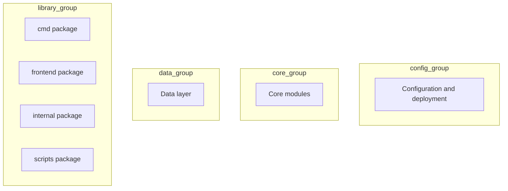

# Architecture report: JordanKnott/taskcafe

> Automated static analysis. **Observed** = directly seen in files/imports/AST; **Inferred** = interpretation from that evidence. Repository code was not executed.

## 1. Repository at a glance

| Item | Value |
| --- | --- |
| Repository | JordanKnott/taskcafe |
| Description | An open source project management tool with Kanban boards |
| Language | TypeScript |
| Stars | 5221 |
| Licence | MIT |
| Analysed commit / branch | 998db2a5da497a7902198a728ddc040fcacbacd6 / master |
| Framework(s) | React |
| Files analysed | 491 |
| Components | 7 |

## 2. Architecture in one minute

JordanKnott/taskcafe - An open source project management tool with Kanban boards. This repository was analysed statically from 491 file(s) (0 Python). Detected technologies (observed from imports/manifests): PostgreSQL, React, axios, React Router, Docker, Docker Compose. Files are grouped into 7 component(s): cmd package, Configuration and deployment, Core modules, Data layer, frontend package, internal package, scripts package. Findings below distinguish observed facts from inferred interpretation.

## 3. High-level block diagram

## 4. Main components

### cmd package (`cmd`)

- **Kind:** library
- **Status:** Observed
- **Confidence:** 0.85
- **Responsibility:** Groups 2 file(s) under cmd package (observed from repository paths and static analysis).
- **Paths:** `cmd/mage/main.go`, `cmd/taskcafe/main.go`
- **Evidence:** [cmd/mage/main.go](https://github.com/JordanKnott/taskcafe/blob/998db2a5da497a7902198a728ddc040fcacbacd6/cmd/mage/main.go); [cmd/taskcafe/main.go](https://github.com/JordanKnott/taskcafe/blob/998db2a5da497a7902198a728ddc040fcacbacd6/cmd/taskcafe/main.go)

### Configuration and deployment (`config`)

- **Kind:** config
- **Status:** Observed
- **Confidence:** 0.85
- **Responsibility:** Groups 21 file(s) under configuration and deployment (observed from repository paths and static analysis).
- **Paths:** `Dockerfile`, `Pipfile`, `conf/air.toml`, `conf/taskcafe.example.toml`, `docker-compose.dev.yml`, `docker-compose.migrate.yml`, `docker-compose.yml`, `frontend/.editorconfig`, `frontend/.eslintrc.json`, `frontend/codegen.yml`, `frontend/package.json`, `frontend/public/manifest.json`, `frontend/src/Teams/Settings/index.tsx`, `frontend/src/shared/components/Settings/index.tsx`, `frontend/tsconfig.json`, `go.mod`, `gqlgen.yml`, `internal/config/config.go`, `sqlc.yaml`, `testing/docker-compose.dev.yml`, `testing/docker-compose.latest.yml`
- **Evidence:** [Dockerfile](https://github.com/JordanKnott/taskcafe/blob/998db2a5da497a7902198a728ddc040fcacbacd6/Dockerfile); [Pipfile](https://github.com/JordanKnott/taskcafe/blob/998db2a5da497a7902198a728ddc040fcacbacd6/Pipfile); [conf/air.toml](https://github.com/JordanKnott/taskcafe/blob/998db2a5da497a7902198a728ddc040fcacbacd6/conf/air.toml); [conf/taskcafe.example.toml](https://github.com/JordanKnott/taskcafe/blob/998db2a5da497a7902198a728ddc040fcacbacd6/conf/taskcafe.example.toml); [docker-compose.dev.yml](https://github.com/JordanKnott/taskcafe/blob/998db2a5da497a7902198a728ddc040fcacbacd6/docker-compose.dev.yml); [docker-compose.migrate.yml](https://github.com/JordanKnott/taskcafe/blob/998db2a5da497a7902198a728ddc040fcacbacd6/docker-compose.migrate.yml); [docker-compose.yml](https://github.com/JordanKnott/taskcafe/blob/998db2a5da497a7902198a728ddc040fcacbacd6/docker-compose.yml); [frontend/.editorconfig](https://github.com/JordanKnott/taskcafe/blob/998db2a5da497a7902198a728ddc040fcacbacd6/frontend/.editorconfig)

### Core modules (`core`)

- **Kind:** core
- **Status:** Observed
- **Confidence:** 0.85
- **Responsibility:** Groups 1 file(s) under core modules (observed from repository paths and static analysis).
- **Paths:** `magefile.go`
- **Evidence:** [magefile.go](https://github.com/JordanKnott/taskcafe/blob/998db2a5da497a7902198a728ddc040fcacbacd6/magefile.go)

### Data layer (`data_layer`)

- **Kind:** data
- **Status:** Observed
- **Confidence:** 0.85
- **Responsibility:** Groups 20 file(s) under data layer (observed from repository paths and static analysis).
- **Paths:** `internal/db/db.go`, `internal/db/label_color.sql.go`, `internal/db/models.go`, `internal/db/notification.sql.go`, `internal/db/organization.sql.go`, `internal/db/project.sql.go`, `internal/db/project_label.sql.go`, `internal/db/querier.go`, `internal/db/repository.go`, `internal/db/system_options.sql.go`, `internal/db/task.sql.go`, `internal/db/task_activity.sql.go`, `internal/db/task_assigned.sql.go`, `internal/db/task_checklist.sql.go`, `internal/db/task_group.sql.go`, `internal/db/task_label.sql.go`, `internal/db/team.sql.go`, `internal/db/team_member.sql.go`, `internal/db/token.sql.go`, `internal/db/user_accounts.sql.go`
- **Evidence:** [internal/db/db.go](https://github.com/JordanKnott/taskcafe/blob/998db2a5da497a7902198a728ddc040fcacbacd6/internal/db/db.go); [internal/db/label_color.sql.go](https://github.com/JordanKnott/taskcafe/blob/998db2a5da497a7902198a728ddc040fcacbacd6/internal/db/label_color.sql.go); [internal/db/models.go](https://github.com/JordanKnott/taskcafe/blob/998db2a5da497a7902198a728ddc040fcacbacd6/internal/db/models.go); [internal/db/notification.sql.go](https://github.com/JordanKnott/taskcafe/blob/998db2a5da497a7902198a728ddc040fcacbacd6/internal/db/notification.sql.go); [internal/db/organization.sql.go](https://github.com/JordanKnott/taskcafe/blob/998db2a5da497a7902198a728ddc040fcacbacd6/internal/db/organization.sql.go); [internal/db/project.sql.go](https://github.com/JordanKnott/taskcafe/blob/998db2a5da497a7902198a728ddc040fcacbacd6/internal/db/project.sql.go); [internal/db/project_label.sql.go](https://github.com/JordanKnott/taskcafe/blob/998db2a5da497a7902198a728ddc040fcacbacd6/internal/db/project_label.sql.go); [internal/db/querier.go](https://github.com/JordanKnott/taskcafe/blob/998db2a5da497a7902198a728ddc040fcacbacd6/internal/db/querier.go)

### frontend package (`frontend`)

- **Kind:** library
- **Status:** Observed
- **Confidence:** 0.85
- **Responsibility:** Groups 249 file(s) under frontend package (observed from repository paths and static analysis).
- **Paths:** `frontend/.prettierrc.js`, `frontend/.storybook/main.js`, `frontend/src/Admin/index.tsx`, `frontend/src/App/BaseStyles.ts`, `frontend/src/App/NormalizeStyles.ts`, `frontend/src/App/Routes.tsx`, `frontend/src/App/ThemeStyles.ts`, `frontend/src/App/Toast.ts`, `frontend/src/App/TopNavbar/ProjectFinder.tsx`, `frontend/src/App/TopNavbar/ProjectPopup.tsx`, `frontend/src/App/TopNavbar/index.tsx`, `frontend/src/App/cache.ts`, `frontend/src/App/context.ts`, `frontend/src/App/index.tsx`, `frontend/src/Auth/Styles.ts`, `frontend/src/Auth/index.tsx`, `frontend/src/Confirm/Styles.ts`, `frontend/src/Confirm/index.tsx`, `frontend/src/Dashboard/index.tsx`, `frontend/src/MyTasks/MyTasksSort.tsx`, `frontend/src/MyTasks/MyTasksStatus.tsx`, `frontend/src/MyTasks/TaskEntry.tsx`, `frontend/src/MyTasks/index.tsx`, `frontend/src/Profile/index.tsx`, `frontend/src/Projects/Project/Board/ControlFilter.tsx`, `frontend/src/Projects/Project/Board/ControlSort.tsx`, `frontend/src/Projects/Project/Board/ControlStatus.tsx`, `frontend/src/Projects/Project/Board/index.tsx`, `frontend/src/Projects/Project/Details/index.tsx`, `frontend/src/Projects/Project/LabelManagerEditor/index.tsx`, `frontend/src/Projects/Project/UserManagementPopup/OptionValue.tsx`, `frontend/src/Projects/Project/UserManagementPopup/Styles.ts`, `frontend/src/Projects/Project/UserManagementPopup/UserOption.tsx`, `frontend/src/Projects/Project/UserManagementPopup/fetchMembers.ts`, `frontend/src/Projects/Project/UserManagementPopup/index.tsx`, `frontend/src/Projects/Project/index.tsx`, `frontend/src/Projects/index.tsx`, `frontend/src/Register/Styles.ts`, `frontend/src/Register/index.tsx`, `frontend/src/Teams/Members/index.tsx`, `frontend/src/Teams/Projects/index.tsx`, `frontend/src/Teams/index.tsx`, `frontend/src/index.tsx`, `frontend/src/outline.d.ts`, `frontend/src/react-app-env.d.ts`, `frontend/src/setupTests.ts`, `frontend/src/shared/components/AddList/Styles.ts`, `frontend/src/shared/components/AddList/index.tsx`, `frontend/src/shared/components/Admin/index.tsx`, `frontend/src/shared/components/Button/index.tsx`, `frontend/src/shared/components/Card/Styles.ts`, `frontend/src/shared/components/Card/index.tsx`, `frontend/src/shared/components/CardComposer/Styles.ts`, `frontend/src/shared/components/CardComposer/index.tsx`, `frontend/src/shared/components/Checklist/index.tsx`, `frontend/src/shared/components/Chip/index.tsx`, `frontend/src/shared/components/Confirm/Styles.ts`, `frontend/src/shared/components/Confirm/index.tsx`, `frontend/src/shared/components/ControlledInput/index.tsx`, `frontend/src/shared/components/DropdownMenu/Styles.ts`, `frontend/src/shared/components/DropdownMenu/index.tsx`, `frontend/src/shared/components/DueDateManager/Styles.ts`, `frontend/src/shared/components/DueDateManager/index.tsx`, `frontend/src/shared/components/EmptyBoard/index.tsx`, `frontend/src/shared/components/FormInput/index.tsx`, `frontend/src/shared/components/Input/index.tsx`, `frontend/src/shared/components/List/Styles.ts`, `frontend/src/shared/components/List/index.tsx`, `frontend/src/shared/components/ListActions/Styles.ts`, `frontend/src/shared/components/ListActions/index.tsx`, `frontend/src/shared/components/Lists/Styles.ts`, `frontend/src/shared/components/Lists/index.tsx`, `frontend/src/shared/components/Lists/metaFilter.ts`, `frontend/src/shared/components/LoadingSpinner/Styles.ts`, `frontend/src/shared/components/LoadingSpinner/index.tsx`, `frontend/src/shared/components/Login/Styles.ts`, `frontend/src/shared/components/Login/index.tsx`, `frontend/src/shared/components/Member/index.tsx`, `frontend/src/shared/components/MemberManager/Styles.ts`, `frontend/src/shared/components/MemberManager/index.tsx`, `frontend/src/shared/components/MiniProfile/Styles.ts`, `frontend/src/shared/components/MiniProfile/index.tsx`, `frontend/src/shared/components/Modal/Styles.ts`, `frontend/src/shared/components/Modal/index.tsx`, `frontend/src/shared/components/Navbar/Styles.ts`, `frontend/src/shared/components/Navbar/index.tsx`, `frontend/src/shared/components/NewProject/index.tsx`, `frontend/src/shared/components/NotifcationPopup/index.tsx`, `frontend/src/shared/components/PopupMenu/LabelEditor.tsx`, `frontend/src/shared/components/PopupMenu/LabelManager.tsx`, `frontend/src/shared/components/PopupMenu/Styles.ts`, `frontend/src/shared/components/PopupMenu/index.tsx`, `frontend/src/shared/components/ProfileIcon/index.tsx`, `frontend/src/shared/components/ProjectGridItem/Styles.ts`, `frontend/src/shared/components/ProjectGridItem/index.tsx`, `frontend/src/shared/components/ProjectSettings/index.tsx`, `frontend/src/shared/components/QuickCardEditor/Styles.ts`, `frontend/src/shared/components/QuickCardEditor/index.tsx`, `frontend/src/shared/components/Register/Styles.ts`, `frontend/src/shared/components/Register/index.tsx`, `frontend/src/shared/components/Select/index.tsx`, `frontend/src/shared/components/Sidebar/Styles.ts`, `frontend/src/shared/components/Sidebar/index.tsx`, `frontend/src/shared/components/Tabs/index.tsx`, `frontend/src/shared/components/TaskAssignee/index.tsx`, `frontend/src/shared/components/TaskDetails/ActivityMessage.tsx`, `frontend/src/shared/components/TaskDetails/CommentCreator.tsx`, `frontend/src/shared/components/TaskDetails/Loading.tsx`, `frontend/src/shared/components/TaskDetails/Styles.ts`, `frontend/src/shared/components/TaskDetails/index.tsx`, `frontend/src/shared/components/TaskDetails/onDragEnd.ts`, `frontend/src/shared/components/TaskDetails/remark.js`, `frontend/src/shared/components/Textarea/index.tsx`, `frontend/src/shared/components/TopNavbar/LoggedOut.tsx`, `frontend/src/shared/components/TopNavbar/Styles.ts`, `frontend/src/shared/components/TopNavbar/index.tsx`, `frontend/src/shared/constants/keyCodes.ts`, `frontend/src/shared/constants/labelColors.ts`, `frontend/src/shared/constants/menuTypes.ts`, `frontend/src/shared/graphql/findProject.ts`, `frontend/src/shared/graphql/fragments/task.ts`, `frontend/src/shared/graphql/labels.ts`, `frontend/src/shared/graphql/notificationToggleRead.ts`, `frontend/src/shared/graphql/notifications.ts`, `frontend/src/shared/graphql/notifictionMarkAllRead.ts`, `frontend/src/shared/graphql/onNotificationAdded.ts`, `frontend/src/shared/graphql/project/deleteProject.ts`, `frontend/src/shared/graphql/project/deleteProjectInvitedMember.ts`, `frontend/src/shared/graphql/project/deleteProjectMember.ts`, `frontend/src/shared/graphql/project/inviteProjectMembers.ts`, `frontend/src/shared/graphql/project/updateProjectMemberRole.ts`, `frontend/src/shared/graphql/task/createTask.ts`, `frontend/src/shared/graphql/task/createTaskChecklist.ts`, `frontend/src/shared/graphql/task/createTaskChecklistItem.ts`, `frontend/src/shared/graphql/task/createTaskComment.ts`, `frontend/src/shared/graphql/task/deleteTaskChecklist.ts`, `frontend/src/shared/graphql/task/deleteTaskChecklistItem.ts`, `frontend/src/shared/graphql/task/deleteTaskComment.ts`, `frontend/src/shared/graphql/task/setTaskChecklistItemComplete.ts`, `frontend/src/shared/graphql/task/setTaskComplete.ts`, `frontend/src/shared/graphql/task/toggleTaskWatcher.ts`, `frontend/src/shared/graphql/task/updateTaskChecklistItemLocation.ts`, `frontend/src/shared/graphql/task/updateTaskChecklistItemName.ts`, `frontend/src/shared/graphql/task/updateTaskChecklistLocation.ts`, `frontend/src/shared/graphql/task/updateTaskChecklistName.ts`, `frontend/src/shared/graphql/task/updateTaskComment.ts`, `frontend/src/shared/graphql/taskGroup/deleteTaskGroupTasks.ts`, `frontend/src/shared/graphql/taskGroup/duplicateTaskGroup.ts`, `frontend/src/shared/graphql/taskGroup/sortTaskGroup.ts`, `frontend/src/shared/graphql/taskGroup/updateTaskGroupName.ts`, `frontend/src/shared/graphql/team/createTeam.ts`, `frontend/src/shared/graphql/team/createTeamMember.ts`, `frontend/src/shared/graphql/team/deleteTeam.ts`, `frontend/src/shared/graphql/team/deleteTeamMember.ts`, `frontend/src/shared/graphql/team/getTeam.ts`, `frontend/src/shared/graphql/team/updateTeamMemberRole.ts`, `frontend/src/shared/graphql/toggleProjectVisibility.ts`, `frontend/src/shared/graphql/topNavbar.ts`, `frontend/src/shared/graphql/unreadNotifications.ts`, `frontend/src/shared/graphql/user/createUser.ts`, `frontend/src/shared/graphql/user/deleteInvitedUser.ts`, `frontend/src/shared/graphql/user/deleteUser.ts`, `frontend/src/shared/graphql/user/updateUserInfo.ts`, `frontend/src/shared/graphql/user/updateUserPassword.ts`, `frontend/src/shared/graphql/user/updateUserRole.ts`, `frontend/src/shared/hooks/memoize.ts`, `frontend/src/shared/hooks/onEscapeKeyDown.ts`, `frontend/src/shared/hooks/onOutsideClick.ts`, `frontend/src/shared/hooks/useStateWithLocalStorage.ts`, `frontend/src/shared/hooks/useStickyState.ts`, `frontend/src/shared/hooks/useWindowSize.ts`, `frontend/src/shared/icons/AccountPlus.tsx`, `frontend/src/shared/icons/AngleDown.tsx`, `frontend/src/shared/icons/AngleLeft.tsx`, `frontend/src/shared/icons/ArrowDown.tsx`, `frontend/src/shared/icons/ArrowLeft.tsx`, `frontend/src/shared/icons/At.tsx`, `frontend/src/shared/icons/BarChart.tsx`, `frontend/src/shared/icons/Bell.tsx`, `frontend/src/shared/icons/Bin.tsx`, `frontend/src/shared/icons/Bolt.tsx`, `frontend/src/shared/icons/Briefcase.tsx`, `frontend/src/shared/icons/Bubble.tsx`, `frontend/src/shared/icons/Calendar.tsx`, `frontend/src/shared/icons/CaretDown.tsx`, `frontend/src/shared/icons/CaretRight.tsx`, `frontend/src/shared/icons/CheckCircle.tsx`, `frontend/src/shared/icons/CheckCircleOutline.tsx`, `frontend/src/shared/icons/CheckSquare.tsx`, `frontend/src/shared/icons/CheckSquareOutline.tsx`, `frontend/src/shared/icons/Checkmark.tsx`, `frontend/src/shared/icons/ChevronRight.tsx`, `frontend/src/shared/icons/Circle.tsx`, `frontend/src/shared/icons/CircleSolid.tsx`, `frontend/src/shared/icons/Clock.tsx`, `frontend/src/shared/icons/Clone.tsx`, `frontend/src/shared/icons/Cog.tsx`, `frontend/src/shared/icons/Cogs.tsx`, `frontend/src/shared/icons/Cross.tsx`, `frontend/src/shared/icons/Crown.tsx`, `frontend/src/shared/icons/Dot.tsx`, `frontend/src/shared/icons/DotCircle.tsx`, `frontend/src/shared/icons/DoubleChevronUp.tsx`, `frontend/src/shared/icons/Ellipsis.tsx`, `frontend/src/shared/icons/Exit.tsx`, `frontend/src/shared/icons/Eye.tsx`, `frontend/src/shared/icons/EyeSlash.tsx`, `frontend/src/shared/icons/Filter.tsx`, `frontend/src/shared/icons/Home.tsx`, `frontend/src/shared/icons/Icon.tsx`, `frontend/src/shared/icons/List.tsx`, `frontend/src/shared/icons/ListUnordered.tsx`, `frontend/src/shared/icons/Lock.tsx`, `frontend/src/shared/icons/Paperclip.tsx`, `frontend/src/shared/icons/Pencil.tsx`, `frontend/src/shared/icons/Plus.tsx`, `frontend/src/shared/icons/Question.tsx`, `frontend/src/shared/icons/Share.tsx`, `frontend/src/shared/icons/Smile.tsx`, `frontend/src/shared/icons/Sort.tsx`, `frontend/src/shared/icons/Square.tsx`, `frontend/src/shared/icons/Stack.tsx`, `frontend/src/shared/icons/Star.tsx`, `frontend/src/shared/icons/Tags.tsx`, `frontend/src/shared/icons/Task.tsx`, `frontend/src/shared/icons/Taskcafe.tsx`, `frontend/src/shared/icons/ToggleOn.tsx`, `frontend/src/shared/icons/Trash.tsx`, `frontend/src/shared/icons/User.tsx`, `frontend/src/shared/icons/UserCircle.tsx`, `frontend/src/shared/icons/UserPlus.tsx`, `frontend/src/shared/icons/Users.tsx`, `frontend/src/shared/icons/index.ts`, `frontend/src/shared/undraw/AccessAccount.tsx`, `frontend/src/shared/undraw/Empty.tsx`, `frontend/src/shared/undraw/NoData.tsx`, `frontend/src/shared/utils/boundingRect.ts`, `frontend/src/shared/utils/cache.ts`, `frontend/src/shared/utils/draggables.ts`, `frontend/src/shared/utils/editorTheme.ts`, `frontend/src/shared/utils/email.ts`, `frontend/src/shared/utils/localStorage.ts`, `frontend/src/shared/utils/noop.ts`, `frontend/src/shared/utils/polling.ts`, `frontend/src/shared/utils/sorting.ts`, `frontend/src/shared/utils/styles.ts`, `frontend/src/styled.d.ts`, `frontend/src/taskcafe.d.ts`, `frontend/src/types.d.ts`
- **Evidence:** [frontend/.prettierrc.js](https://github.com/JordanKnott/taskcafe/blob/998db2a5da497a7902198a728ddc040fcacbacd6/frontend/.prettierrc.js); [frontend/.storybook/main.js](https://github.com/JordanKnott/taskcafe/blob/998db2a5da497a7902198a728ddc040fcacbacd6/frontend/.storybook/main.js); [frontend/src/Admin/index.tsx](https://github.com/JordanKnott/taskcafe/blob/998db2a5da497a7902198a728ddc040fcacbacd6/frontend/src/Admin/index.tsx); [frontend/src/App/BaseStyles.ts](https://github.com/JordanKnott/taskcafe/blob/998db2a5da497a7902198a728ddc040fcacbacd6/frontend/src/App/BaseStyles.ts); [frontend/src/App/NormalizeStyles.ts](https://github.com/JordanKnott/taskcafe/blob/998db2a5da497a7902198a728ddc040fcacbacd6/frontend/src/App/NormalizeStyles.ts); [frontend/src/App/Routes.tsx](https://github.com/JordanKnott/taskcafe/blob/998db2a5da497a7902198a728ddc040fcacbacd6/frontend/src/App/Routes.tsx); [frontend/src/App/ThemeStyles.ts](https://github.com/JordanKnott/taskcafe/blob/998db2a5da497a7902198a728ddc040fcacbacd6/frontend/src/App/ThemeStyles.ts); [frontend/src/App/Toast.ts](https://github.com/JordanKnott/taskcafe/blob/998db2a5da497a7902198a728ddc040fcacbacd6/frontend/src/App/Toast.ts)

### internal package (`internal`)

- **Kind:** library
- **Status:** Observed
- **Confidence:** 0.85
- **Responsibility:** Groups 36 file(s) under internal package (observed from repository paths and static analysis).
- **Paths:** `internal/commands/commands.go`, `internal/commands/commands_prod.go`, `internal/commands/job.go`, `internal/commands/migrate.go`, `internal/commands/reset_password.go`, `internal/commands/seed.go`, `internal/commands/token.go`, `internal/commands/web.go`, `internal/commands/worker.go`, `internal/graph/graph.go`, `internal/graph/helpers.go`, `internal/graph/models_gen.go`, `internal/graph/notification.resolvers.go`, `internal/graph/project.resolvers.go`, `internal/graph/resolver.go`, `internal/graph/scalars.go`, `internal/graph/schema.resolvers.go`, `internal/graph/task.resolvers.go`, `internal/graph/taskList.resolvers.go`, `internal/graph/team.resolvers.go`, `internal/graph/user.resolvers.go`, `internal/jobs/jobs.go`, `internal/jobs/logger.go`, `internal/logger/logger.go`, `internal/logger/route_logger.go`, `internal/route/auth.go`, `internal/route/avatar.go`, `internal/route/log.go`, `internal/route/middleware.go`, `internal/route/route.go`, `internal/route/settings.go`, `internal/utils/context.go`, `internal/utils/cursor.go`, `internal/utils/mail.go`, `internal/utils/redis.go`, `internal/utils/version.go`
- **Evidence:** [internal/commands/commands.go](https://github.com/JordanKnott/taskcafe/blob/998db2a5da497a7902198a728ddc040fcacbacd6/internal/commands/commands.go); [internal/commands/commands_prod.go](https://github.com/JordanKnott/taskcafe/blob/998db2a5da497a7902198a728ddc040fcacbacd6/internal/commands/commands_prod.go); [internal/commands/job.go](https://github.com/JordanKnott/taskcafe/blob/998db2a5da497a7902198a728ddc040fcacbacd6/internal/commands/job.go); [internal/commands/migrate.go](https://github.com/JordanKnott/taskcafe/blob/998db2a5da497a7902198a728ddc040fcacbacd6/internal/commands/migrate.go); [internal/commands/reset_password.go](https://github.com/JordanKnott/taskcafe/blob/998db2a5da497a7902198a728ddc040fcacbacd6/internal/commands/reset_password.go); [internal/commands/seed.go](https://github.com/JordanKnott/taskcafe/blob/998db2a5da497a7902198a728ddc040fcacbacd6/internal/commands/seed.go); [internal/commands/token.go](https://github.com/JordanKnott/taskcafe/blob/998db2a5da497a7902198a728ddc040fcacbacd6/internal/commands/token.go); [internal/commands/web.go](https://github.com/JordanKnott/taskcafe/blob/998db2a5da497a7902198a728ddc040fcacbacd6/internal/commands/web.go)

### scripts package (`scripts`)

- **Kind:** library
- **Status:** Observed
- **Confidence:** 0.85
- **Responsibility:** Groups 1 file(s) under scripts package (observed from repository paths and static analysis).
- **Paths:** `scripts/lint.sh`
- **Evidence:** [scripts/lint.sh](https://github.com/JordanKnott/taskcafe/blob/998db2a5da497a7902198a728ddc040fcacbacd6/scripts/lint.sh)

## 5. Execution flow

**Observed** entry point(s):

- [frontend/.storybook/main.js](https://github.com/JordanKnott/taskcafe/blob/998db2a5da497a7902198a728ddc040fcacbacd6/frontend/.storybook/main.js)
- [frontend/src/Admin/index.tsx](https://github.com/JordanKnott/taskcafe/blob/998db2a5da497a7902198a728ddc040fcacbacd6/frontend/src/Admin/index.tsx)
- [frontend/src/App/index.tsx](https://github.com/JordanKnott/taskcafe/blob/998db2a5da497a7902198a728ddc040fcacbacd6/frontend/src/App/index.tsx)
- [frontend/src/Auth/index.tsx](https://github.com/JordanKnott/taskcafe/blob/998db2a5da497a7902198a728ddc040fcacbacd6/frontend/src/Auth/index.tsx)
- [frontend/src/Confirm/index.tsx](https://github.com/JordanKnott/taskcafe/blob/998db2a5da497a7902198a728ddc040fcacbacd6/frontend/src/Confirm/index.tsx)
- [frontend/src/Dashboard/index.tsx](https://github.com/JordanKnott/taskcafe/blob/998db2a5da497a7902198a728ddc040fcacbacd6/frontend/src/Dashboard/index.tsx)
- [frontend/src/MyTasks/index.tsx](https://github.com/JordanKnott/taskcafe/blob/998db2a5da497a7902198a728ddc040fcacbacd6/frontend/src/MyTasks/index.tsx)
- [frontend/src/Profile/index.tsx](https://github.com/JordanKnott/taskcafe/blob/998db2a5da497a7902198a728ddc040fcacbacd6/frontend/src/Profile/index.tsx)
- [frontend/src/Projects/index.tsx](https://github.com/JordanKnott/taskcafe/blob/998db2a5da497a7902198a728ddc040fcacbacd6/frontend/src/Projects/index.tsx)
- [frontend/src/Register/index.tsx](https://github.com/JordanKnott/taskcafe/blob/998db2a5da497a7902198a728ddc040fcacbacd6/frontend/src/Register/index.tsx)
- [frontend/src/Teams/index.tsx](https://github.com/JordanKnott/taskcafe/blob/998db2a5da497a7902198a728ddc040fcacbacd6/frontend/src/Teams/index.tsx)
- [frontend/src/index.tsx](https://github.com/JordanKnott/taskcafe/blob/998db2a5da497a7902198a728ddc040fcacbacd6/frontend/src/index.tsx)

Representative flow (derived from observed entry points and the import graph; steps beyond the entry point are **Inferred**):

1. Execution starts at an observed entry point listed above, if present.
2. No internal import relationships between components were observed.

## 6. Project structure

### `(root)`

- `.cz.toml` - config (93 bytes)
- `.dockerignore` - container (152 bytes)
- `.gitignore` - other (156 bytes)
- `.pre-commit-config.yaml` - config (649 bytes)
- `.tmuxinator.yml` - config (537 bytes)
- `CHANGELOG.md` - docs (1138 bytes)
- `CODE_OF_CONDUCT.md` - docs (3355 bytes)
- `CONTRIBUTING.md` - docs (2051 bytes)
- `Dockerfile` - container (508 bytes)
- `LICENSE` - docs (1069 bytes)
- `Pipfile` - manifest (155 bytes)
- `README.md` - docs (5157 bytes)
- `docker-compose.dev.yml` - config (619 bytes)
- `docker-compose.migrate.yml` - config (203 bytes)
- `docker-compose.yml` - container (743 bytes)
- `go.mod` - manifest (1153 bytes)
- `go.sum` - other (95118 bytes)
- `gqlgen.yml` - config (1385 bytes)
- `magefile.go` - source, Go (7137 bytes)
- `sqlc.yaml` - config (209 bytes)

### `.github`

- `.github/FUNDING.yml` - config (134 bytes)
- `.github/ISSUE_TEMPLATE/bug_report.md` - docs (725 bytes)
- `.github/ISSUE_TEMPLATE/config.yml` - config (330 bytes)
- `.github/pull_request_template.md` - docs (782 bytes)
- `.github/taskcafe-full.svg` - other (14613 bytes)
- `.github/taskcafe.min.svg` - other (2569 bytes)
- `.github/taskcafe.svg` - other (10529 bytes)

### `cmd`

- `cmd/mage/main.go` - source, Go (121 bytes)
- `cmd/taskcafe/main.go` - source, Go (138 bytes)

### `conf`

- `conf/air.toml` - config (1323 bytes)
- `conf/taskcafe.example.toml` - config (432 bytes)

### `frontend`

- `frontend/.editorconfig` - config (194 bytes)
- `frontend/.eslintignore` - other (76 bytes)
- `frontend/.eslintrc.json` - config (1855 bytes)
- `frontend/.gitignore` - other (318 bytes)
- `frontend/.prettierrc.js` - source, JavaScript (139 bytes)
- `frontend/.storybook/main.js` - source, JavaScript (525 bytes)
- `frontend/Makefile` - other (20 bytes)
- `frontend/codegen.yml` - config (406 bytes)
- `frontend/package.json` - manifest (3372 bytes)
- `frontend/public/index.html` - other (1685 bytes)
- `frontend/public/manifest.json` - config (492 bytes)
- `frontend/public/robots.txt` - docs (67 bytes)
- `frontend/src/Admin/index.tsx` - source, TypeScript (7857 bytes)
- `frontend/src/App/BaseStyles.ts` - source, TypeScript (2089 bytes)
- `frontend/src/App/NormalizeStyles.ts` - source, TypeScript (2636 bytes)
- `frontend/src/App/Routes.tsx` - source, TypeScript (2309 bytes)
- `frontend/src/App/ThemeStyles.ts` - source, TypeScript (736 bytes)
- `frontend/src/App/Toast.ts` - source, TypeScript (775 bytes)
- `frontend/src/App/TopNavbar/ProjectFinder.tsx` - source, TypeScript (6375 bytes)
- `frontend/src/App/TopNavbar/ProjectPopup.tsx` - source, TypeScript (2679 bytes)
- `frontend/src/App/TopNavbar/index.tsx` - source, TypeScript (8505 bytes)
- `frontend/src/App/cache.ts` - source, TypeScript (107 bytes)
- `frontend/src/App/context.ts` - source, TypeScript (413 bytes)
- `frontend/src/App/fonts.css` - other (234 bytes)
- `frontend/src/App/index.tsx` - source, TypeScript (1305 bytes)
- `frontend/src/Auth/Styles.ts` - source, TypeScript (391 bytes)
- `frontend/src/Auth/index.tsx` - source, TypeScript (1916 bytes)
- `frontend/src/Confirm/Styles.ts` - source, TypeScript (239 bytes)
- `frontend/src/Confirm/index.tsx` - source, TypeScript (1273 bytes)
- `frontend/src/Dashboard/index.tsx` - source, TypeScript (173 bytes)
- `frontend/src/MyTasks/MyTasksSort.tsx` - source, TypeScript (3692 bytes)
- `frontend/src/MyTasks/MyTasksStatus.tsx` - source, TypeScript (5126 bytes)
- `frontend/src/MyTasks/TaskEntry.tsx` - source, TypeScript (10248 bytes)
- `frontend/src/MyTasks/index.tsx` - source, TypeScript (28672 bytes)
- `frontend/src/Profile/index.tsx` - source, TypeScript (2769 bytes)
- `frontend/src/Projects/Project/Board/ControlFilter.tsx` - source, TypeScript (11122 bytes)
- `frontend/src/Projects/Project/Board/ControlSort.tsx` - source, TypeScript (3002 bytes)
- `frontend/src/Projects/Project/Board/ControlStatus.tsx` - source, TypeScript (5035 bytes)
- `frontend/src/Projects/Project/Board/index.tsx` - source, TypeScript (29520 bytes)
- `frontend/src/Projects/Project/Details/index.tsx` - source, TypeScript (26924 bytes)
- `frontend/src/Projects/Project/LabelManagerEditor/index.tsx` - source, TypeScript (4859 bytes)
- `frontend/src/Projects/Project/UserManagementPopup/OptionValue.tsx` - source, TypeScript (429 bytes)
- `frontend/src/Projects/Project/UserManagementPopup/Styles.ts` - source, TypeScript (1523 bytes)
- `frontend/src/Projects/Project/UserManagementPopup/UserOption.tsx` - source, TypeScript (975 bytes)
- `frontend/src/Projects/Project/UserManagementPopup/fetchMembers.ts` - source, TypeScript (1776 bytes)
- `frontend/src/Projects/Project/UserManagementPopup/index.tsx` - source, TypeScript (2294 bytes)
- `frontend/src/Projects/Project/index.tsx` - source, TypeScript (10188 bytes)
- `frontend/src/Projects/index.tsx` - source, TypeScript (12540 bytes)
- `frontend/src/Register/Styles.ts` - source, TypeScript (239 bytes)
- `frontend/src/Register/index.tsx` - source, TypeScript (2339 bytes)
- `frontend/src/Teams/Members/index.tsx` - source, TypeScript (17047 bytes)
- `frontend/src/Teams/Projects/index.tsx` - source, TypeScript (4582 bytes)
- `frontend/src/Teams/Settings/index.tsx` - source, TypeScript (113 bytes)
- `frontend/src/Teams/index.tsx` - source, TypeScript (4341 bytes)
- `frontend/src/index.tsx` - source, TypeScript (1618 bytes)
- `frontend/src/outline.d.ts` - source, TypeScript (0 bytes)
- `frontend/src/react-app-env.d.ts` - source, TypeScript (40 bytes)
- `frontend/src/setupTests.ts` - source, TypeScript (255 bytes)
- `frontend/src/shared/components/AddList/Styles.ts` - source, TypeScript (2532 bytes)
- `frontend/src/shared/components/AddList/index.tsx` - source, TypeScript (3043 bytes)
- `frontend/src/shared/components/Admin/index.tsx` - source, TypeScript (22213 bytes)
- `frontend/src/shared/components/Button/index.tsx` - source, TypeScript (6534 bytes)
- `frontend/src/shared/components/Card/Styles.ts` - source, TypeScript (7238 bytes)
- `frontend/src/shared/components/Card/index.tsx` - source, TypeScript (8689 bytes)
- `frontend/src/shared/components/CardComposer/Styles.ts` - source, TypeScript (869 bytes)
- `frontend/src/shared/components/CardComposer/index.tsx` - source, TypeScript (2213 bytes)
- `frontend/src/shared/components/Checklist/index.tsx` - source, TypeScript (16644 bytes)
- `frontend/src/shared/components/Chip/index.tsx` - source, TypeScript (1553 bytes)
- `frontend/src/shared/components/Confirm/Styles.ts` - source, TypeScript (2030 bytes)
- `frontend/src/shared/components/Confirm/index.tsx` - source, TypeScript (1467 bytes)
- `frontend/src/shared/components/ControlledInput/index.tsx` - source, TypeScript (3919 bytes)
- `frontend/src/shared/components/DropdownMenu/Styles.ts` - source, TypeScript (1601 bytes)
- `frontend/src/shared/components/DropdownMenu/index.tsx` - source, TypeScript (2105 bytes)
- `frontend/src/shared/components/DueDateManager/Styles.ts` - source, TypeScript (7945 bytes)
- `frontend/src/shared/components/DueDateManager/index.tsx` - source, TypeScript (13066 bytes)
- `frontend/src/shared/components/EmptyBoard/index.tsx` - source, TypeScript (2049 bytes)
- `frontend/src/shared/components/FormInput/index.tsx` - source, TypeScript (5213 bytes)
- `frontend/src/shared/components/Input/index.tsx` - source, TypeScript (4820 bytes)
- `frontend/src/shared/components/List/Styles.ts` - source, TypeScript (2589 bytes)
- `frontend/src/shared/components/List/index.tsx` - source, TypeScript (3453 bytes)
- `frontend/src/shared/components/ListActions/Styles.ts` - source, TypeScript (728 bytes)
- `frontend/src/shared/components/ListActions/index.tsx` - source, TypeScript (3780 bytes)
- `frontend/src/shared/components/Lists/Styles.ts` - source, TypeScript (725 bytes)
- `frontend/src/shared/components/Lists/index.tsx` - source, TypeScript (15704 bytes)
- `frontend/src/shared/components/Lists/metaFilter.ts` - source, TypeScript (3547 bytes)
- `frontend/src/shared/components/LoadingSpinner/Styles.ts` - source, TypeScript (1151 bytes)
- `frontend/src/shared/components/LoadingSpinner/index.tsx` - source, TypeScript (1112 bytes)
- `frontend/src/shared/components/Login/Styles.ts` - source, TypeScript (4408 bytes)
- `frontend/src/shared/components/Login/index.tsx` - source, TypeScript (3311 bytes)
- `frontend/src/shared/components/Member/index.tsx` - source, TypeScript (1953 bytes)
- `frontend/src/shared/components/MemberManager/Styles.ts` - source, TypeScript (2254 bytes)
- `frontend/src/shared/components/MemberManager/index.tsx` - source, TypeScript (2295 bytes)
- `frontend/src/shared/components/MiniProfile/Styles.ts` - source, TypeScript (2916 bytes)
- `frontend/src/shared/components/MiniProfile/index.tsx` - source, TypeScript (5893 bytes)
- `frontend/src/shared/components/Modal/Styles.ts` - source, TypeScript (703 bytes)
- `frontend/src/shared/components/Modal/index.tsx` - source, TypeScript (2065 bytes)
- `frontend/src/shared/components/Navbar/Styles.ts` - source, TypeScript (2627 bytes)
- `frontend/src/shared/components/Navbar/index.tsx` - source, TypeScript (1058 bytes)
- `frontend/src/shared/components/NewProject/index.tsx` - source, TypeScript (7623 bytes)
- `frontend/src/shared/components/NotifcationPopup/index.tsx` - source, TypeScript (19208 bytes)
- `frontend/src/shared/components/PopupMenu/LabelEditor.tsx` - source, TypeScript (2443 bytes)
- `frontend/src/shared/components/PopupMenu/LabelManager.tsx` - source, TypeScript (2549 bytes)
- `frontend/src/shared/components/PopupMenu/Styles.ts` - source, TypeScript (7509 bytes)
- `frontend/src/shared/components/PopupMenu/index.tsx` - source, TypeScript (8978 bytes)
- `frontend/src/shared/components/ProfileIcon/index.tsx` - source, TypeScript (1299 bytes)
- `frontend/src/shared/components/ProjectGridItem/Styles.ts` - source, TypeScript (1378 bytes)
- `frontend/src/shared/components/ProjectGridItem/index.tsx` - source, TypeScript (937 bytes)
- `frontend/src/shared/components/ProjectSettings/index.tsx` - source, TypeScript (3719 bytes)
- `frontend/src/shared/components/QuickCardEditor/Styles.ts` - source, TypeScript (1999 bytes)
- `frontend/src/shared/components/QuickCardEditor/index.tsx` - source, TypeScript (4078 bytes)
- `frontend/src/shared/components/Register/Styles.ts` - source, TypeScript (2132 bytes)
- `frontend/src/shared/components/Register/index.tsx` - source, TypeScript (5315 bytes)
- `frontend/src/shared/components/Select/index.tsx` - source, TypeScript (4800 bytes)
- `frontend/src/shared/components/Settings/index.tsx` - source, TypeScript (11793 bytes)
- `frontend/src/shared/components/Sidebar/Styles.ts` - source, TypeScript (342 bytes)
- `frontend/src/shared/components/Sidebar/index.tsx` - source, TypeScript (139 bytes)
- `frontend/src/shared/components/Tabs/index.tsx` - source, TypeScript (144 bytes)
- `frontend/src/shared/components/TaskAssignee/index.tsx` - source, TypeScript (2622 bytes)
- `frontend/src/shared/components/TaskDetails/ActivityMessage.tsx` - source, TypeScript (2116 bytes)
- `frontend/src/shared/components/TaskDetails/CommentCreator.tsx` - source, TypeScript (4311 bytes)
- `frontend/src/shared/components/TaskDetails/Loading.tsx` - source, TypeScript (4973 bytes)
- `frontend/src/shared/components/TaskDetails/Styles.ts` - source, TypeScript (16685 bytes)
- `frontend/src/shared/components/TaskDetails/index.tsx` - source, TypeScript (23983 bytes)
- `frontend/src/shared/components/TaskDetails/onDragEnd.ts` - source, TypeScript (3184 bytes)
- `frontend/src/shared/components/TaskDetails/remark.js` - source, JavaScript (2113 bytes)
- `frontend/src/shared/components/Textarea/index.tsx` - source, TypeScript (681 bytes)
- `frontend/src/shared/components/TopNavbar/LoggedOut.tsx` - source, TypeScript (2034 bytes)
- `frontend/src/shared/components/TopNavbar/Styles.ts` - source, TypeScript (7753 bytes)
- `frontend/src/shared/components/TopNavbar/index.tsx` - source, TypeScript (10576 bytes)
- `frontend/src/shared/constants/keyCodes.ts` - source, TypeScript (178 bytes)
- `frontend/src/shared/constants/labelColors.ts` - source, TypeScript (615 bytes)
- `frontend/src/shared/constants/menuTypes.ts` - source, TypeScript (108 bytes)
- `frontend/src/shared/graphql/assignTask.graphqls` - other (170 bytes)
- `frontend/src/shared/graphql/clearAvatarProfile.graphqls` - other (142 bytes)
- `frontend/src/shared/graphql/createProject.graphqls` - other (184 bytes)
- `frontend/src/shared/graphql/createProjectLabel.graphqls` - other (293 bytes)
- `frontend/src/shared/graphql/createTaskGroup.graphqls` - other (214 bytes)
- `frontend/src/shared/graphql/deleteProjectLabel.graphqls` - other (133 bytes)
- `frontend/src/shared/graphql/deleteTask.graphqls` - other (98 bytes)
- `frontend/src/shared/graphql/deleteTaskGroup.graphqls` - other (213 bytes)
- `frontend/src/shared/graphql/findProject.ts` - source, TypeScript (1215 bytes)
- `frontend/src/shared/graphql/findTask.graphqls` - other (1488 bytes)
- `frontend/src/shared/graphql/fragments/task.ts` - source, TypeScript (790 bytes)
- `frontend/src/shared/graphql/getProjects.graphqls` - other (186 bytes)
- `frontend/src/shared/graphql/labels.ts` - source, TypeScript (449 bytes)
- `frontend/src/shared/graphql/me.graphqls` - other (281 bytes)
- `frontend/src/shared/graphql/myTasks.graphqls` - other (388 bytes)
- `frontend/src/shared/graphql/notificationToggleRead.ts` - source, TypeScript (271 bytes)
- `frontend/src/shared/graphql/notifications.ts` - source, TypeScript (660 bytes)
- `frontend/src/shared/graphql/notifictionMarkAllRead.ts` - source, TypeScript (198 bytes)
- `frontend/src/shared/graphql/onNotificationAdded.ts` - source, TypeScript (427 bytes)
- `frontend/src/shared/graphql/project/deleteProject.ts` - source, TypeScript (274 bytes)
- `frontend/src/shared/graphql/project/deleteProjectInvitedMember.ts` - source, TypeScript (362 bytes)
- `frontend/src/shared/graphql/project/deleteProjectMember.ts` - source, TypeScript (348 bytes)
- `frontend/src/shared/graphql/project/inviteProjectMembers.ts` - source, TypeScript (586 bytes)
- `frontend/src/shared/graphql/project/updateProjectMemberRole.ts` - source, TypeScript (448 bytes)
- `frontend/src/shared/graphql/task/createTask.ts` - source, TypeScript (413 bytes)
- `frontend/src/shared/graphql/task/createTaskChecklist.ts` - source, TypeScript (448 bytes)
- `frontend/src/shared/graphql/task/createTaskChecklistItem.ts` - source, TypeScript (364 bytes)
- `frontend/src/shared/graphql/task/createTaskComment.ts` - source, TypeScript (524 bytes)
- `frontend/src/shared/graphql/task/deleteTaskChecklist.ts` - source, TypeScript (317 bytes)
- `frontend/src/shared/graphql/task/deleteTaskChecklistItem.ts` - source, TypeScript (313 bytes)
- `frontend/src/shared/graphql/task/deleteTaskComment.ts` - source, TypeScript (241 bytes)
- `frontend/src/shared/graphql/task/setTaskChecklistItemComplete.ts` - source, TypeScript (317 bytes)
- `frontend/src/shared/graphql/task/setTaskComplete.ts` - source, TypeScript (303 bytes)
- `frontend/src/shared/graphql/task/toggleTaskWatcher.ts` - source, TypeScript (235 bytes)
- `frontend/src/shared/graphql/task/updateTaskChecklistItemLocation.ts` - source, TypeScript (569 bytes)
- `frontend/src/shared/graphql/task/updateTaskChecklistItemName.ts` - source, TypeScript (297 bytes)
- `frontend/src/shared/graphql/task/updateTaskChecklistLocation.ts` - source, TypeScript (395 bytes)
- `frontend/src/shared/graphql/task/updateTaskChecklistName.ts` - source, TypeScript (452 bytes)
- `frontend/src/shared/graphql/task/updateTaskComment.ts` - source, TypeScript (332 bytes)
- `frontend/src/shared/graphql/taskGroup/deleteTaskGroupTasks.ts` - source, TypeScript (241 bytes)
- `frontend/src/shared/graphql/taskGroup/duplicateTaskGroup.ts` - source, TypeScript (496 bytes)
- `frontend/src/shared/graphql/taskGroup/sortTaskGroup.ts` - source, TypeScript (304 bytes)
- `frontend/src/shared/graphql/taskGroup/updateTaskGroupName.ts` - source, TypeScript (306 bytes)
- `frontend/src/shared/graphql/team/createTeam.ts` - source, TypeScript (298 bytes)
- `frontend/src/shared/graphql/team/createTeamMember.ts` - source, TypeScript (510 bytes)
- `frontend/src/shared/graphql/team/deleteTeam.ts` - source, TypeScript (250 bytes)
- `frontend/src/shared/graphql/team/deleteTeamMember.ts` - source, TypeScript (338 bytes)
- `frontend/src/shared/graphql/team/getTeam.ts` - source, TypeScript (1309 bytes)
- `frontend/src/shared/graphql/team/updateTeamMemberRole.ts` - source, TypeScript (431 bytes)
- `frontend/src/shared/graphql/toggleProjectVisibility.ts` - source, TypeScript (344 bytes)
- `frontend/src/shared/graphql/toggleTaskLabel.graphqls` - other (462 bytes)
- `frontend/src/shared/graphql/topNavbar.ts` - source, TypeScript (615 bytes)
- `frontend/src/shared/graphql/unassignTask.graphqls` - other (174 bytes)
- `frontend/src/shared/graphql/unreadNotifications.ts` - source, TypeScript (191 bytes)
- `frontend/src/shared/graphql/updateProjectLabel.graphqls` - other (308 bytes)
- `frontend/src/shared/graphql/updateProjectName.graphqls` - other (153 bytes)
- `frontend/src/shared/graphql/updateTaskDescription.graphqls` - other (180 bytes)
- `frontend/src/shared/graphql/updateTaskDueDate.graphqls` - other (771 bytes)
- `frontend/src/shared/graphql/updateTaskGroupLocation.graphqls` - other (184 bytes)
- `frontend/src/shared/graphql/updateTaskLocation.graphqls` - other (320 bytes)
- `frontend/src/shared/graphql/updateTaskName.graphqls` - other (153 bytes)
- `frontend/src/shared/graphql/user/createUser.ts` - source, TypeScript (974 bytes)
- `frontend/src/shared/graphql/user/deleteInvitedUser.ts` - source, TypeScript (313 bytes)
- `frontend/src/shared/graphql/user/deleteUser.ts` - source, TypeScript (315 bytes)
- `frontend/src/shared/graphql/user/updateUserInfo.ts` - source, TypeScript (448 bytes)
- `frontend/src/shared/graphql/user/updateUserPassword.ts` - source, TypeScript (293 bytes)
- `frontend/src/shared/graphql/user/updateUserRole.ts` - source, TypeScript (357 bytes)
- `frontend/src/shared/graphql/users.graphqls` - other (454 bytes)
- `frontend/src/shared/hooks/memoize.ts` - source, TypeScript (291 bytes)
- `frontend/src/shared/hooks/onEscapeKeyDown.ts` - source, TypeScript (575 bytes)
- `frontend/src/shared/hooks/onOutsideClick.ts` - source, TypeScript (1570 bytes)
- `frontend/src/shared/hooks/useStateWithLocalStorage.ts` - source, TypeScript (3141 bytes)
- `frontend/src/shared/hooks/useStickyState.ts` - source, TypeScript (496 bytes)
- `frontend/src/shared/hooks/useWindowSize.ts` - source, TypeScript (417 bytes)
- `frontend/src/shared/icons/AccountPlus.tsx` - source, TypeScript (788 bytes)
- `frontend/src/shared/icons/AngleDown.tsx` - source, TypeScript (1129 bytes)
- `frontend/src/shared/icons/AngleLeft.tsx` - source, TypeScript (531 bytes)
- `frontend/src/shared/icons/ArrowDown.tsx` - source, TypeScript (574 bytes)
- `frontend/src/shared/icons/ArrowLeft.tsx` - source, TypeScript (631 bytes)
- `frontend/src/shared/icons/At.tsx` - source, TypeScript (1209 bytes)
- `frontend/src/shared/icons/BarChart.tsx` - source, TypeScript (992 bytes)
- `frontend/src/shared/icons/Bell.tsx` - source, TypeScript (713 bytes)
- `frontend/src/shared/icons/Bin.tsx` - source, TypeScript (638 bytes)
- `frontend/src/shared/icons/Bolt.tsx` - source, TypeScript (492 bytes)
- `frontend/src/shared/icons/Briefcase.tsx` - source, TypeScript (594 bytes)
- `frontend/src/shared/icons/Bubble.tsx` - source, TypeScript (819 bytes)
- `frontend/src/shared/icons/Calendar.tsx` - source, TypeScript (593 bytes)
- `frontend/src/shared/icons/CaretDown.tsx` - source, TypeScript (445 bytes)
- `frontend/src/shared/icons/CaretRight.tsx` - source, TypeScript (480 bytes)
- `frontend/src/shared/icons/CheckCircle.tsx` - source, TypeScript (686 bytes)
- `frontend/src/shared/icons/CheckCircleOutline.tsx` - source, TypeScript (845 bytes)
- `frontend/src/shared/icons/CheckSquare.tsx` - source, TypeScript (736 bytes)
- `frontend/src/shared/icons/CheckSquareOutline.tsx` - source, TypeScript (764 bytes)
- `frontend/src/shared/icons/Checkmark.tsx` - source, TypeScript (600 bytes)
- `frontend/src/shared/icons/ChevronRight.tsx` - source, TypeScript (613 bytes)
- `frontend/src/shared/icons/Circle.tsx` - source, TypeScript (472 bytes)
- `frontend/src/shared/icons/CircleSolid.tsx` - source, TypeScript (399 bytes)
- `frontend/src/shared/icons/Clock.tsx` - source, TypeScript (540 bytes)
- `frontend/src/shared/icons/Clone.tsx` - source, TypeScript (560 bytes)
- `frontend/src/shared/icons/Cog.tsx` - source, TypeScript (1141 bytes)
- `frontend/src/shared/icons/Cogs.tsx` - source, TypeScript (2701 bytes)
- `frontend/src/shared/icons/Cross.tsx` - source, TypeScript (760 bytes)
- `frontend/src/shared/icons/Crown.tsx` - source, TypeScript (848 bytes)
- `frontend/src/shared/icons/Dot.tsx` - source, TypeScript (331 bytes)
- `frontend/src/shared/icons/DotCircle.tsx` - source, TypeScript (497 bytes)
- `frontend/src/shared/icons/DoubleChevronUp.tsx` - source, TypeScript (935 bytes)
- `frontend/src/shared/icons/Ellipsis.tsx` - source, TypeScript (964 bytes)
- `frontend/src/shared/icons/Exit.tsx` - source, TypeScript (381 bytes)
- `frontend/src/shared/icons/Eye.tsx` - source, TypeScript (743 bytes)
- `frontend/src/shared/icons/EyeSlash.tsx` - source, TypeScript (1059 bytes)
- `frontend/src/shared/icons/Filter.tsx` - source, TypeScript (525 bytes)
- `frontend/src/shared/icons/Home.tsx` - source, TypeScript (811 bytes)
- `frontend/src/shared/icons/Icon.tsx` - source, TypeScript (874 bytes)
- `frontend/src/shared/icons/List.tsx` - source, TypeScript (874 bytes)
- `frontend/src/shared/icons/ListUnordered.tsx` - source, TypeScript (745 bytes)
- `frontend/src/shared/icons/Lock.tsx` - source, TypeScript (528 bytes)
- `frontend/src/shared/icons/Paperclip.tsx` - source, TypeScript (1112 bytes)
- `frontend/src/shared/icons/Pencil.tsx` - source, TypeScript (781 bytes)
- `frontend/src/shared/icons/Plus.tsx` - source, TypeScript (555 bytes)
- `frontend/src/shared/icons/Question.tsx` - source, TypeScript (687 bytes)
- `frontend/src/shared/icons/Share.tsx` - source, TypeScript (635 bytes)
- `frontend/src/shared/icons/Smile.tsx` - source, TypeScript (827 bytes)
- `frontend/src/shared/icons/Sort.tsx` - source, TypeScript (514 bytes)
- `frontend/src/shared/icons/Square.tsx` - source, TypeScript (539 bytes)
- `frontend/src/shared/icons/Stack.tsx` - source, TypeScript (508 bytes)
- `frontend/src/shared/icons/Star.tsx` - source, TypeScript (1134 bytes)
- `frontend/src/shared/icons/Tags.tsx` - source, TypeScript (833 bytes)
- `frontend/src/shared/icons/Task.tsx` - source, TypeScript (1022 bytes)
- `frontend/src/shared/icons/Taskcafe.tsx` - source, TypeScript (3101 bytes)
- `frontend/src/shared/icons/ToggleOn.tsx` - source, TypeScript (480 bytes)
- `frontend/src/shared/icons/Trash.tsx` - source, TypeScript (552 bytes)
- `frontend/src/shared/icons/User.tsx` - source, TypeScript (784 bytes)
- `frontend/src/shared/icons/UserCircle.tsx` - source, TypeScript (940 bytes)
- `frontend/src/shared/icons/UserPlus.tsx` - source, TypeScript (812 bytes)
- `frontend/src/shared/icons/Users.tsx` - source, TypeScript (849 bytes)
- `frontend/src/shared/icons/index.ts` - source, TypeScript (2663 bytes)
- `frontend/src/shared/undraw/AccessAccount.tsx` - source, TypeScript (7970 bytes)
- `frontend/src/shared/undraw/Empty.tsx` - source, TypeScript (31997 bytes)
- `frontend/src/shared/undraw/NoData.tsx` - source, TypeScript (5264 bytes)
- `frontend/src/shared/utils/boundingRect.ts` - source, TypeScript (486 bytes)
- `frontend/src/shared/utils/cache.ts` - source, TypeScript (675 bytes)
- `frontend/src/shared/utils/draggables.ts` - source, TypeScript (2399 bytes)
- `frontend/src/shared/utils/editorTheme.ts` - source, TypeScript (4128 bytes)
- `frontend/src/shared/utils/email.ts` - source, TypeScript (254 bytes)
- `frontend/src/shared/utils/localStorage.ts` - source, TypeScript (160 bytes)
- `frontend/src/shared/utils/noop.ts` - source, TypeScript (94 bytes)
- `frontend/src/shared/utils/polling.ts` - source, TypeScript (351 bytes)
- `frontend/src/shared/utils/sorting.ts` - source, TypeScript (3329 bytes)
- `frontend/src/shared/utils/styles.ts` - source, TypeScript (2658 bytes)
- `frontend/src/styled.d.ts` - source, TypeScript (625 bytes)
- `frontend/src/taskcafe.d.ts` - source, TypeScript (4836 bytes)
- `frontend/src/types.d.ts` - source, TypeScript (2407 bytes)
- `frontend/tsconfig.json` - config (633 bytes)

### `internal`

- `internal/commands/commands.go` - source, Go (1668 bytes)
- `internal/commands/commands_prod.go` - source, Go (152 bytes)
- `internal/commands/job.go` - source, Go (1486 bytes)
- `internal/commands/migrate.go` - source, Go (1698 bytes)
- `internal/commands/reset_password.go` - source, Go (2053 bytes)
- `internal/commands/seed.go` - source, Go (4459 bytes)
- `internal/commands/token.go` - source, Go (2723 bytes)
- `internal/commands/web.go` - source, Go (3163 bytes)
- `internal/commands/worker.go` - source, Go (1808 bytes)
- `internal/config/config.go` - source, Go (5409 bytes)
- `internal/db/db.go` - source, Go (564 bytes)
- `internal/db/label_color.sql.go` - source, Go (1884 bytes)
- `internal/db/models.go` - source, Go (8694 bytes)
- `internal/db/notification.sql.go` - source, Go (12062 bytes)
- `internal/db/organization.sql.go` - source, Go (1347 bytes)
- `internal/db/project.sql.go` - source, Go (16734 bytes)
- `internal/db/project_label.sql.go` - source, Go (4887 bytes)
- `internal/db/querier.go` - source, Go (15467 bytes)
- `internal/db/query/label_color.sql` - data, SQL (262 bytes)
- `internal/db/query/notification.sql` - data, SQL (2122 bytes)
- `internal/db/query/organization.sql` - data, SQL (170 bytes)
- `internal/db/query/project.sql` - data, SQL (3294 bytes)
- `internal/db/query/project_label.sql` - data, SQL (797 bytes)
- `internal/db/query/system_options.sql` - data, SQL (192 bytes)
- `internal/db/query/task.sql` - data, SQL (5286 bytes)
- `internal/db/query/task_activity.sql` - data, SQL (983 bytes)
- `internal/db/query/task_assigned.sql` - data, SQL (330 bytes)
- `internal/db/query/task_checklist.sql` - data, SQL (2243 bytes)
- `internal/db/query/task_group.sql` - data, SQL (766 bytes)
- `internal/db/query/task_label.sql` - data, SQL (636 bytes)
- `internal/db/query/team.sql` - data, SQL (893 bytes)
- `internal/db/query/team_member.sql` - data, SQL (706 bytes)
- `internal/db/query/token.sql` - data, SQL (447 bytes)
- `internal/db/query/user_accounts.sql` - data, SQL (3621 bytes)
- `internal/db/repository.go` - source, Go (355 bytes)
- `internal/db/system_options.sql.go` - source, Go (1145 bytes)
- `internal/db/task.sql.go` - source, Go (29062 bytes)
- `internal/db/task_activity.sql.go` - source, Go (3833 bytes)
- `internal/db/task_assigned.sql.go` - source, Go (2266 bytes)
- `internal/db/task_checklist.sql.go` - source, Go (10828 bytes)
- `internal/db/task_group.sql.go` - source, Go (4892 bytes)
- `internal/db/task_label.sql.go` - source, Go (3750 bytes)
- `internal/db/team.sql.go` - source, Go (5842 bytes)
- `internal/db/team_member.sql.go` - source, Go (3979 bytes)
- `internal/db/token.sql.go` - source, Go (2018 bytes)
- `internal/db/user_accounts.sql.go` - source, Go (18689 bytes)
- `internal/graph/graph.go` - source, Go (8577 bytes)
- `internal/graph/helpers.go` - source, Go (3098 bytes)
- `internal/graph/models_gen.go` - source, Go (30357 bytes)
- `internal/graph/notification.resolvers.go` - source, Go (11300 bytes)
- `internal/graph/project.resolvers.go` - source, Go (17033 bytes)
- `internal/graph/resolver.go` - source, Go (2013 bytes)
- `internal/graph/scalars.go` - source, Go (564 bytes)
- `internal/graph/schema.resolvers.go` - source, Go (10314 bytes)
- `internal/graph/schema/notification.gql` - other (1522 bytes)
- `internal/graph/schema/notification/notification.gql` - other (1521 bytes)
- `internal/graph/schema/project.gql` - other (4182 bytes)
- `internal/graph/schema/project/_model.gql` - other (733 bytes)
- `internal/graph/schema/project/label.gql` - other (1084 bytes)
- `internal/graph/schema/project/member.gql` - other (1357 bytes)
- `internal/graph/schema/project/project.gql` - other (1004 bytes)
- `internal/graph/schema/schema.gql` - other (2004 bytes)
- `internal/graph/schema/task.gql` - other (10871 bytes)
- `internal/graph/schema/task/_model.gql` - other (1853 bytes)
- `internal/graph/schema/task/checklist.gql` - other (2633 bytes)
- `internal/graph/schema/task/comment.gql` - other (838 bytes)
- `internal/graph/schema/task/group.gql` - other (1870 bytes)
- `internal/graph/schema/task/label.gql` - other (672 bytes)
- `internal/graph/schema/task/task.gql` - other (2999 bytes)
- `internal/graph/schema/taskList.gql` - other (124 bytes)
- `internal/graph/schema/taskList/_model.gql` - other (122 bytes)
- `internal/graph/schema/taskList/taskList.gql` - other (0 bytes)
- `internal/graph/schema/team.gql` - other (1466 bytes)
- `internal/graph/schema/team/_model.gql` - other (171 bytes)
- `internal/graph/schema/team/member.gql` - other (893 bytes)
- `internal/graph/schema/team/team.gql` - other (399 bytes)
- `internal/graph/schema/user.gql` - other (2254 bytes)
- `internal/graph/schema/user/_model.gql` - other (323 bytes)
- `internal/graph/schema/user/user.gql` - other (1929 bytes)
- `internal/graph/task.resolvers.go` - source, Go (43123 bytes)
- `internal/graph/taskList.resolvers.go` - source, Go (929 bytes)
- `internal/graph/team.resolvers.go` - source, Go (6683 bytes)
- `internal/graph/user.resolvers.go` - source, Go (10633 bytes)
- `internal/jobs/jobs.go` - source, Go (5100 bytes)
- `internal/jobs/logger.go` - source, Go (1209 bytes)
- `internal/logger/logger.go` - source, Go (554 bytes)
- `internal/logger/route_logger.go` - source, Go (2640 bytes)
- `internal/route/auth.go` - source, Go (10489 bytes)
- `internal/route/avatar.go` - source, Go (2200 bytes)
- `internal/route/log.go` - source, Go (770 bytes)
- `internal/route/middleware.go` - source, Go (1740 bytes)
- `internal/route/route.go` - source, Go (4042 bytes)
- `internal/route/settings.go` - source, Go (636 bytes)
- `internal/utils/context.go` - source, Go (542 bytes)
- `internal/utils/cursor.go` - source, Go (706 bytes)
- `internal/utils/mail.go` - source, Go (2060 bytes)
- `internal/utils/redis.go` - source, Go (104 bytes)
- `internal/utils/version.go` - source, Go (283 bytes)

### `migrations`

- `migrations/0001_add-refresh-token-table.up.sql` - data, SQL (227 bytes)
- `migrations/0002_add-user_account-table.up.sql` - data, SQL (269 bytes)
- `migrations/0003_add-team-table.up.sql` - data, SQL (134 bytes)
- `migrations/0004_add-project-table.up.sql` - data, SQL (190 bytes)
- `migrations/0005_add-task-group-table.up.sql` - data, SQL (232 bytes)
- `migrations/0006_add-task.up.sql` - data, SQL (229 bytes)
- `migrations/0007_add-organization-table.up.sql` - data, SQL (239 bytes)
- `migrations/0008_add-org-id-to-team-table.up.sql` - data, SQL (100 bytes)
- `migrations/0009_add-task-assigned-table.up.sql` - data, SQL (241 bytes)
- `migrations/0010_add-description-to-task-table.up.sql` - data, SQL (46 bytes)
- `migrations/0011_add-label-color-table.up.sql` - data, SQL (145 bytes)
- `migrations/0012_add-project-label-table.up.sql` - data, SQL (275 bytes)
- `migrations/0013_add-due-date-to-task-table.up.sql` - data, SQL (50 bytes)
- `migrations/0014_add-owner-column-to-project-table.up.sql` - data, SQL (52 bytes)
- `migrations/0015_add-task-label-table.up.sql` - data, SQL (254 bytes)
- `migrations/0016_add-profile_bg_color-column-to-user-account-table.up.sql` - data, SQL (86 bytes)
- `migrations/0017_add-profile-bg-delete-cascade.up.sql` - data, SQL (194 bytes)
- `migrations/0018_add-name-column-to-label-color.up.sql` - data, SQL (76 bytes)
- `migrations/0019_add-unique-constraint-project-label-and-task-on-task-label.up.sql` - data, SQL (63 bytes)
- `migrations/0020_add-full-name-column-to-user_account-table.up.sql` - data, SQL (186 bytes)
- `migrations/0021_drop-first-name-column-from-user_account-table.up.sql` - data, SQL (49 bytes)
- `migrations/0022_drop-last-name-column-from-user_account-table.up.sql` - data, SQL (48 bytes)
- `migrations/0023_add-initials-column-to-user_account-table.up.sql` - data, SQL (71 bytes)
- `migrations/0024_add-profile-avatar-url-column-to-user_account-table.up.sql` - data, SQL (61 bytes)
- `migrations/0025_add-cascade-delete-to-task-id-fk-on-task_label.up.sql` - data, SQL (200 bytes)
- `migrations/0026_add-cascade-delete-to-task-id-fk-on-task_assigned.up.sql` - data, SQL (212 bytes)
- `migrations/0027_add-cascade-delete-to-task_group_id-fk-on-task.up.sql` - data, SQL (206 bytes)
- `migrations/0028_add-complete-column-to-task-table.up.sql` - data, SQL (69 bytes)
- `migrations/0029_add-task_checklist.up.sql` - data, SQL (249 bytes)
- `migrations/0030_add-task_checklist_item.up.sql` - data, SQL (356 bytes)
- `migrations/0031_add-team-member-table.up.sql` - data, SQL (297 bytes)
- `migrations/0032_add-cascade-delete-to-project_label.up.sql` - data, SQL (227 bytes)
- `migrations/0033_add-cascade-delete-to_task_label_project_label_id_fkey.up.sql` - data, SQL (245 bytes)
- `migrations/0034_add-cascade-delete-to_project_team_id_fkey.up.sql` - data, SQL (188 bytes)
- `migrations/0035_add-cascade-delete-to-task_assigned_user_id_fkey.up.sql` - data, SQL (220 bytes)
- `migrations/0036_add-fkey-to-user_id-on-refresh_token-table.up.sql` - data, SQL (150 bytes)
- `migrations/0037_add-project_member-table.up.sql` - data, SQL (283 bytes)
- `migrations/0038_add-role-table.up.sql` - data, SQL (254 bytes)
- `migrations/0039_add-role-column-to-user_account-table.up.sql` - data, SQL (120 bytes)
- `migrations/0040_add-unique-constraint-to-project_member-table.up.sql` - data, SQL (61 bytes)
- `migrations/0041_add-role_code-column-to-project_member-table.up.sql` - data, SQL (122 bytes)
- `migrations/0042_add-default-null-to-profile_avatar_url-on-user_account.up.sql` - data, SQL (75 bytes)
- `migrations/0043_add-role_code-column-to-team_member-table.up.sql` - data, SQL (100 bytes)
- `migrations/0044_add-owner-to-team-table.up.sql` - data, SQL (236 bytes)
- `migrations/0045_add-system_options-table.up.sql` - data, SQL (131 bytes)
- `migrations/0046_add-system-user.up.sql` - data, SQL (163 bytes)
- `migrations/0047_add-default-label_colors.up.sql` - data, SQL (1459 bytes)
- `migrations/0048_add-cascade-delete-to-task_group_project_id_fkey.up.sql` - data, SQL (215 bytes)
- `migrations/0049_remove-owner-column-from-project-table.up.sql` - data, SQL (202 bytes)
- `migrations/0050_remove-owner-column-from-team-table.up.sql` - data, SQL (258 bytes)
- `migrations/0051_add-completed_at-to-task-table.up.sql` - data, SQL (171 bytes)
- `migrations/0052_add-bio-col-to-user_account.up.sql` - data, SQL (66 bytes)
- `migrations/0053_add-notification-tables.up.sql` - data, SQL (568 bytes)
- `migrations/0054_remove-team-not-null-constraint-projects.up.sql` - data, SQL (56 bytes)
- `migrations/0055_add-personal_project_table.up.sql` - data, SQL (254 bytes)
- `migrations/0056_add-user_account_invited-table.up.sql` - data, SQL (233 bytes)
- `migrations/0057_add-project_member_invited-table.up.sql` - data, SQL (314 bytes)
- `migrations/0058_add-active-column-to-user_account.up.sql` - data, SQL (114 bytes)
- `migrations/0059_add-confirm_token_table.up.sql` - data, SQL (138 bytes)
- `migrations/0060_add-task_activity-table.up.sql` - data, SQL (1599 bytes)
- `migrations/0061_add-task_comment-table.up.sql` - data, SQL (331 bytes)
- `migrations/0062_add-cascade-delete-to-task-comments-and-activity.up.sql` - data, SQL (421 bytes)
- `migrations/0063_add-use_time-to-task-due_date.up.sql` - data, SQL (102 bytes)
- `migrations/0064_rename-refresh_token-to-auth_token.up.sql` - data, SQL (48 bytes)
- `migrations/0065_add-public_on-to-project.up.sql` - data, SQL (54 bytes)
- `migrations/0066_redesign-notification-table.up.sql` - data, SQL (681 bytes)
- `migrations/0067_add-user_account_settings.up.sql` - data, SQL (1553 bytes)
- `migrations/0068_add-task_watcher-table.up.sql` - data, SQL (272 bytes)
- `migrations/0069_add-short_id-to-tasks-and-projects.up.sql` - data, SQL (2558 bytes)
- `migrations/0070_add-task_due_date_notification.up.sql` - data, SQL (613 bytes)
- `migrations/0071_add-task_due_date_notification-at-col.up.sql` - data, SQL (92 bytes)
- `migrations/0072_remove-not-null-from-notification-caused_by.up.sql` - data, SQL (164 bytes)

### `scripts`

- `scripts/lint.sh` - source, Shell (211 bytes)

### `templates`

- `templates/mail/user/registered.tmpl` - other (358 bytes)

### `testing`

- `testing/docker-compose.dev.yml` - config (505 bytes)
- `testing/docker-compose.latest.yml` - config (677 bytes)

### `uploads`

- `uploads/.keep` - other (0 bytes)

## 7. Key dependencies and integrations

| Name | Category | Status | Confidence | Evidence |
| --- | --- | --- | --- | --- |
| PostgreSQL | database | Observed | 0.80 | [docker-compose.yml:9](https://github.com/JordanKnott/taskcafe/blob/998db2a5da497a7902198a728ddc040fcacbacd6/docker-compose.yml#L9) |
| React | framework | Observed | 0.90 | [frontend/package.json:7](https://github.com/JordanKnott/taskcafe/blob/998db2a5da497a7902198a728ddc040fcacbacd6/frontend/package.json#L7); [frontend/package.json:19](https://github.com/JordanKnott/taskcafe/blob/998db2a5da497a7902198a728ddc040fcacbacd6/frontend/package.json#L19) |
| axios | library | Observed | 0.85 | [frontend/package.json:32](https://github.com/JordanKnott/taskcafe/blob/998db2a5da497a7902198a728ddc040fcacbacd6/frontend/package.json#L32) |
| React Router | library | Observed | 0.90 | [frontend/package.json:20](https://github.com/JordanKnott/taskcafe/blob/998db2a5da497a7902198a728ddc040fcacbacd6/frontend/package.json#L20); [frontend/package.json:21](https://github.com/JordanKnott/taskcafe/blob/998db2a5da497a7902198a728ddc040fcacbacd6/frontend/package.json#L21) |
| Docker | tooling | Observed | 0.85 | [Dockerfile](https://github.com/JordanKnott/taskcafe/blob/998db2a5da497a7902198a728ddc040fcacbacd6/Dockerfile) |
| Docker Compose | tooling | Observed | 0.85 | [docker-compose.yml](https://github.com/JordanKnott/taskcafe/blob/998db2a5da497a7902198a728ddc040fcacbacd6/docker-compose.yml) |
| TypeScript | tooling | Observed | 0.85 | [frontend/package.json:67](https://github.com/JordanKnott/taskcafe/blob/998db2a5da497a7902198a728ddc040fcacbacd6/frontend/package.json#L67) |

## 8. Data and state

- **PostgreSQL** (Observed, confidence 0.80) - evidence: [docker-compose.yml:9](https://github.com/JordanKnott/taskcafe/blob/998db2a5da497a7902198a728ddc040fcacbacd6/docker-compose.yml#L9)
- Data component `data_layer` (Observed): Groups 20 file(s) under data layer (observed from repository paths and static analysis).

## 9. Configuration and deployment clues

- `.cz.toml` (config)
- `.dockerignore` (container)
- `.github/FUNDING.yml` (config)
- `.github/ISSUE_TEMPLATE/config.yml` (config)
- `.pre-commit-config.yaml` (config)
- `.tmuxinator.yml` (config)
- `Dockerfile` (container)
- `Pipfile` (manifest)
- `conf/air.toml` (config)
- `conf/taskcafe.example.toml` (config)
- `docker-compose.dev.yml` (config)
- `docker-compose.migrate.yml` (config)
- `docker-compose.yml` (container)
- `frontend/.editorconfig` (config)
- `frontend/.eslintrc.json` (config)
- `frontend/codegen.yml` (config)
- `frontend/package.json` (manifest)
- `frontend/public/manifest.json` (config)
- `frontend/tsconfig.json` (config)
- `go.mod` (manifest)
- `gqlgen.yml` (config)
- `sqlc.yaml` (config)
- `testing/docker-compose.dev.yml` (config)
- `testing/docker-compose.latest.yml` (config)

## 10. Design observations

- Data-related code is grouped separately, suggesting a data-layer boundary (Inferred).

These observations are interpretations (**Inferred**) of the observed structure, not guarantees about runtime design.

## 11. Limitations and unknowns

- Static analysis only: repository code was not executed, installed, or imported at runtime.
- Components and relationships are inferred from file paths, imports, and AST structure; runtime behaviour, dynamic imports, and reflection may not be visible.
- 3 file(s) were skipped during inventory (2 x likely secret file excluded; 1 x lockfile excluded).
- No clear application entry point was observed in the analysed files.
- Repository text was treated as untrusted data; no instructions found in repository files were followed, and likely secret values were redacted/excluded.
- JavaScript and TypeScript files were inventoried from paths and package manifests. They were not parsed with a full language AST, and repository code was not executed.

## 12. Source references

- [Dockerfile](https://github.com/JordanKnott/taskcafe/blob/998db2a5da497a7902198a728ddc040fcacbacd6/Dockerfile)
- [Pipfile](https://github.com/JordanKnott/taskcafe/blob/998db2a5da497a7902198a728ddc040fcacbacd6/Pipfile)
- [cmd/mage/main.go](https://github.com/JordanKnott/taskcafe/blob/998db2a5da497a7902198a728ddc040fcacbacd6/cmd/mage/main.go)
- [cmd/taskcafe/main.go](https://github.com/JordanKnott/taskcafe/blob/998db2a5da497a7902198a728ddc040fcacbacd6/cmd/taskcafe/main.go)
- [conf/air.toml](https://github.com/JordanKnott/taskcafe/blob/998db2a5da497a7902198a728ddc040fcacbacd6/conf/air.toml)
- [conf/taskcafe.example.toml](https://github.com/JordanKnott/taskcafe/blob/998db2a5da497a7902198a728ddc040fcacbacd6/conf/taskcafe.example.toml)
- [docker-compose.dev.yml](https://github.com/JordanKnott/taskcafe/blob/998db2a5da497a7902198a728ddc040fcacbacd6/docker-compose.dev.yml)
- [docker-compose.migrate.yml](https://github.com/JordanKnott/taskcafe/blob/998db2a5da497a7902198a728ddc040fcacbacd6/docker-compose.migrate.yml)
- [docker-compose.yml](https://github.com/JordanKnott/taskcafe/blob/998db2a5da497a7902198a728ddc040fcacbacd6/docker-compose.yml)
- [docker-compose.yml:9](https://github.com/JordanKnott/taskcafe/blob/998db2a5da497a7902198a728ddc040fcacbacd6/docker-compose.yml#L9)
- [frontend/.editorconfig](https://github.com/JordanKnott/taskcafe/blob/998db2a5da497a7902198a728ddc040fcacbacd6/frontend/.editorconfig)
- [frontend/.prettierrc.js](https://github.com/JordanKnott/taskcafe/blob/998db2a5da497a7902198a728ddc040fcacbacd6/frontend/.prettierrc.js)
- [frontend/.storybook/main.js](https://github.com/JordanKnott/taskcafe/blob/998db2a5da497a7902198a728ddc040fcacbacd6/frontend/.storybook/main.js)
- [frontend/package.json:7](https://github.com/JordanKnott/taskcafe/blob/998db2a5da497a7902198a728ddc040fcacbacd6/frontend/package.json#L7)
- [frontend/package.json:19](https://github.com/JordanKnott/taskcafe/blob/998db2a5da497a7902198a728ddc040fcacbacd6/frontend/package.json#L19)
- [frontend/package.json:20](https://github.com/JordanKnott/taskcafe/blob/998db2a5da497a7902198a728ddc040fcacbacd6/frontend/package.json#L20)
- [frontend/package.json:21](https://github.com/JordanKnott/taskcafe/blob/998db2a5da497a7902198a728ddc040fcacbacd6/frontend/package.json#L21)
- [frontend/package.json:32](https://github.com/JordanKnott/taskcafe/blob/998db2a5da497a7902198a728ddc040fcacbacd6/frontend/package.json#L32)
- [frontend/package.json:67](https://github.com/JordanKnott/taskcafe/blob/998db2a5da497a7902198a728ddc040fcacbacd6/frontend/package.json#L67)
- [frontend/src/Admin/index.tsx](https://github.com/JordanKnott/taskcafe/blob/998db2a5da497a7902198a728ddc040fcacbacd6/frontend/src/Admin/index.tsx)
- [frontend/src/App/BaseStyles.ts](https://github.com/JordanKnott/taskcafe/blob/998db2a5da497a7902198a728ddc040fcacbacd6/frontend/src/App/BaseStyles.ts)
- [frontend/src/App/NormalizeStyles.ts](https://github.com/JordanKnott/taskcafe/blob/998db2a5da497a7902198a728ddc040fcacbacd6/frontend/src/App/NormalizeStyles.ts)
- [frontend/src/App/Routes.tsx](https://github.com/JordanKnott/taskcafe/blob/998db2a5da497a7902198a728ddc040fcacbacd6/frontend/src/App/Routes.tsx)
- [frontend/src/App/ThemeStyles.ts](https://github.com/JordanKnott/taskcafe/blob/998db2a5da497a7902198a728ddc040fcacbacd6/frontend/src/App/ThemeStyles.ts)
- [frontend/src/App/Toast.ts](https://github.com/JordanKnott/taskcafe/blob/998db2a5da497a7902198a728ddc040fcacbacd6/frontend/src/App/Toast.ts)
- [frontend/src/App/index.tsx](https://github.com/JordanKnott/taskcafe/blob/998db2a5da497a7902198a728ddc040fcacbacd6/frontend/src/App/index.tsx)
- [frontend/src/Auth/index.tsx](https://github.com/JordanKnott/taskcafe/blob/998db2a5da497a7902198a728ddc040fcacbacd6/frontend/src/Auth/index.tsx)
- [frontend/src/Confirm/index.tsx](https://github.com/JordanKnott/taskcafe/blob/998db2a5da497a7902198a728ddc040fcacbacd6/frontend/src/Confirm/index.tsx)
- [frontend/src/Dashboard/index.tsx](https://github.com/JordanKnott/taskcafe/blob/998db2a5da497a7902198a728ddc040fcacbacd6/frontend/src/Dashboard/index.tsx)
- [frontend/src/MyTasks/index.tsx](https://github.com/JordanKnott/taskcafe/blob/998db2a5da497a7902198a728ddc040fcacbacd6/frontend/src/MyTasks/index.tsx)
- [frontend/src/Profile/index.tsx](https://github.com/JordanKnott/taskcafe/blob/998db2a5da497a7902198a728ddc040fcacbacd6/frontend/src/Profile/index.tsx)
- [frontend/src/Projects/index.tsx](https://github.com/JordanKnott/taskcafe/blob/998db2a5da497a7902198a728ddc040fcacbacd6/frontend/src/Projects/index.tsx)
- [frontend/src/Register/index.tsx](https://github.com/JordanKnott/taskcafe/blob/998db2a5da497a7902198a728ddc040fcacbacd6/frontend/src/Register/index.tsx)
- [frontend/src/Teams/index.tsx](https://github.com/JordanKnott/taskcafe/blob/998db2a5da497a7902198a728ddc040fcacbacd6/frontend/src/Teams/index.tsx)
- [frontend/src/index.tsx](https://github.com/JordanKnott/taskcafe/blob/998db2a5da497a7902198a728ddc040fcacbacd6/frontend/src/index.tsx)
- [internal/commands/commands.go](https://github.com/JordanKnott/taskcafe/blob/998db2a5da497a7902198a728ddc040fcacbacd6/internal/commands/commands.go)
- [internal/commands/commands_prod.go](https://github.com/JordanKnott/taskcafe/blob/998db2a5da497a7902198a728ddc040fcacbacd6/internal/commands/commands_prod.go)
- [internal/commands/job.go](https://github.com/JordanKnott/taskcafe/blob/998db2a5da497a7902198a728ddc040fcacbacd6/internal/commands/job.go)
- [internal/commands/migrate.go](https://github.com/JordanKnott/taskcafe/blob/998db2a5da497a7902198a728ddc040fcacbacd6/internal/commands/migrate.go)
- [internal/commands/reset_password.go](https://github.com/JordanKnott/taskcafe/blob/998db2a5da497a7902198a728ddc040fcacbacd6/internal/commands/reset_password.go)
- [internal/commands/seed.go](https://github.com/JordanKnott/taskcafe/blob/998db2a5da497a7902198a728ddc040fcacbacd6/internal/commands/seed.go)
- [internal/commands/token.go](https://github.com/JordanKnott/taskcafe/blob/998db2a5da497a7902198a728ddc040fcacbacd6/internal/commands/token.go)
- [internal/commands/web.go](https://github.com/JordanKnott/taskcafe/blob/998db2a5da497a7902198a728ddc040fcacbacd6/internal/commands/web.go)
- [internal/db/db.go](https://github.com/JordanKnott/taskcafe/blob/998db2a5da497a7902198a728ddc040fcacbacd6/internal/db/db.go)
- [internal/db/label_color.sql.go](https://github.com/JordanKnott/taskcafe/blob/998db2a5da497a7902198a728ddc040fcacbacd6/internal/db/label_color.sql.go)
- [internal/db/models.go](https://github.com/JordanKnott/taskcafe/blob/998db2a5da497a7902198a728ddc040fcacbacd6/internal/db/models.go)
- [internal/db/notification.sql.go](https://github.com/JordanKnott/taskcafe/blob/998db2a5da497a7902198a728ddc040fcacbacd6/internal/db/notification.sql.go)
- [internal/db/organization.sql.go](https://github.com/JordanKnott/taskcafe/blob/998db2a5da497a7902198a728ddc040fcacbacd6/internal/db/organization.sql.go)
- [internal/db/project.sql.go](https://github.com/JordanKnott/taskcafe/blob/998db2a5da497a7902198a728ddc040fcacbacd6/internal/db/project.sql.go)
- [internal/db/project_label.sql.go](https://github.com/JordanKnott/taskcafe/blob/998db2a5da497a7902198a728ddc040fcacbacd6/internal/db/project_label.sql.go)
- [internal/db/querier.go](https://github.com/JordanKnott/taskcafe/blob/998db2a5da497a7902198a728ddc040fcacbacd6/internal/db/querier.go)
- [magefile.go](https://github.com/JordanKnott/taskcafe/blob/998db2a5da497a7902198a728ddc040fcacbacd6/magefile.go)
- [scripts/lint.sh](https://github.com/JordanKnott/taskcafe/blob/998db2a5da497a7902198a728ddc040fcacbacd6/scripts/lint.sh)
