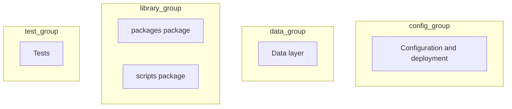

# Architecture report: Kanaries/graphic-walker

> Automated static analysis. **Observed** = directly seen in files/imports/AST; **Inferred** = interpretation from that evidence. Repository code was not executed.

## 1. Repository at a glance

| Item | Value |
| --- | --- |
| Repository | Kanaries/graphic-walker |
| Description | An open source alternative to Tableau. Embeddable visual analytic |
| Language | TypeScript |
| Stars | 3292 |
| Licence | Apache-2.0 |
| Analysed commit / branch | a4b3bc1e87c059c220fa02633fd0207c01b5ad66 / main |
| Framework(s) | React |
| Files analysed | 527 |
| Components | 5 |

## 2. Architecture in one minute

Kanaries/graphic-walker - An open source alternative to Tableau. Embeddable visual analytic. This repository was analysed statically from 527 file(s) (0 Python). Detected technologies (observed from imports/manifests): GitHub Actions, React, React Router, Tailwind CSS, Jest, TypeScript. Files are grouped into 5 component(s): Configuration and deployment, Data layer, packages package, scripts package, Tests. Findings below distinguish observed facts from inferred interpretation.

## 3. High-level block diagram

## 4. Main components

### Configuration and deployment (`config`)

- **Kind:** config
- **Status:** Observed
- **Confidence:** 0.85
- **Responsibility:** Groups 23 file(s) under configuration and deployment (observed from repository paths and static analysis).
- **Paths:** `package.json`, `packages/computation-conformance/package.json`, `packages/computation-conformance/tsconfig.json`, `packages/duckdb-wasm-computation/package.json`, `packages/duckdb-wasm-computation/tsconfig.json`, `packages/graphic-walker/components.json`, `packages/graphic-walker/package.json`, `packages/graphic-walker/public/tersespec_v1.json`, `packages/graphic-walker/src/locales/en-US.json`, `packages/graphic-walker/src/locales/ja-JP.json`, `packages/graphic-walker/src/locales/zh-CN.json`, `packages/graphic-walker/tsconfig.app-dist.json`, `packages/graphic-walker/tsconfig.build.json`, `packages/graphic-walker/tsconfig.json`, `packages/playground/package.json`, `packages/playground/public/tersespec_v1.json`, `packages/playground/src/examples/specs/student-chart-filter.json`, `packages/playground/src/examples/specs/student-chart.json`, `packages/playground/tsconfig.json`, `packages/playground/tsconfig.node.json`, `packages/playground/vercel.json`, `packages/worksheet-renderer/package.json`, `packages/worksheet-renderer/tsconfig.json`
- **Evidence:** [package.json](https://github.com/Kanaries/graphic-walker/blob/a4b3bc1e87c059c220fa02633fd0207c01b5ad66/package.json); [packages/computation-conformance/package.json](https://github.com/Kanaries/graphic-walker/blob/a4b3bc1e87c059c220fa02633fd0207c01b5ad66/packages/computation-conformance/package.json); [packages/computation-conformance/tsconfig.json](https://github.com/Kanaries/graphic-walker/blob/a4b3bc1e87c059c220fa02633fd0207c01b5ad66/packages/computation-conformance/tsconfig.json); [packages/duckdb-wasm-computation/package.json](https://github.com/Kanaries/graphic-walker/blob/a4b3bc1e87c059c220fa02633fd0207c01b5ad66/packages/duckdb-wasm-computation/package.json); [packages/duckdb-wasm-computation/tsconfig.json](https://github.com/Kanaries/graphic-walker/blob/a4b3bc1e87c059c220fa02633fd0207c01b5ad66/packages/duckdb-wasm-computation/tsconfig.json); [packages/graphic-walker/components.json](https://github.com/Kanaries/graphic-walker/blob/a4b3bc1e87c059c220fa02633fd0207c01b5ad66/packages/graphic-walker/components.json); [packages/graphic-walker/package.json](https://github.com/Kanaries/graphic-walker/blob/a4b3bc1e87c059c220fa02633fd0207c01b5ad66/packages/graphic-walker/package.json); [packages/graphic-walker/public/tersespec_v1.json](https://github.com/Kanaries/graphic-walker/blob/a4b3bc1e87c059c220fa02633fd0207c01b5ad66/packages/graphic-walker/public/tersespec_v1.json)

### Data layer (`data_layer`)

- **Kind:** data
- **Status:** Observed
- **Confidence:** 0.85
- **Responsibility:** Groups 12 file(s) under data layer (observed from repository paths and static analysis).
- **Paths:** `packages/graphic-walker/src/models/chat.test.ts`, `packages/graphic-walker/src/models/chat.ts`, `packages/graphic-walker/src/models/normalize.test.ts`, `packages/graphic-walker/src/models/normalize.ts`, `packages/graphic-walker/src/models/replaceChart.test.ts`, `packages/graphic-walker/src/models/terse.test.ts`, `packages/graphic-walker/src/models/terse.ts`, `packages/graphic-walker/src/models/utils.ts`, `packages/graphic-walker/src/models/visSpec.ts`, `packages/graphic-walker/src/models/visSpecHistory.ts`, `packages/graphic-walker/src/models/withHistory.test.ts`, `packages/graphic-walker/src/models/withHistory.ts`
- **Evidence:** [packages/graphic-walker/src/models/chat.test.ts](https://github.com/Kanaries/graphic-walker/blob/a4b3bc1e87c059c220fa02633fd0207c01b5ad66/packages/graphic-walker/src/models/chat.test.ts); [packages/graphic-walker/src/models/chat.ts](https://github.com/Kanaries/graphic-walker/blob/a4b3bc1e87c059c220fa02633fd0207c01b5ad66/packages/graphic-walker/src/models/chat.ts); [packages/graphic-walker/src/models/normalize.test.ts](https://github.com/Kanaries/graphic-walker/blob/a4b3bc1e87c059c220fa02633fd0207c01b5ad66/packages/graphic-walker/src/models/normalize.test.ts); [packages/graphic-walker/src/models/normalize.ts](https://github.com/Kanaries/graphic-walker/blob/a4b3bc1e87c059c220fa02633fd0207c01b5ad66/packages/graphic-walker/src/models/normalize.ts); [packages/graphic-walker/src/models/replaceChart.test.ts](https://github.com/Kanaries/graphic-walker/blob/a4b3bc1e87c059c220fa02633fd0207c01b5ad66/packages/graphic-walker/src/models/replaceChart.test.ts); [packages/graphic-walker/src/models/terse.test.ts](https://github.com/Kanaries/graphic-walker/blob/a4b3bc1e87c059c220fa02633fd0207c01b5ad66/packages/graphic-walker/src/models/terse.test.ts); [packages/graphic-walker/src/models/terse.ts](https://github.com/Kanaries/graphic-walker/blob/a4b3bc1e87c059c220fa02633fd0207c01b5ad66/packages/graphic-walker/src/models/terse.ts); [packages/graphic-walker/src/models/utils.ts](https://github.com/Kanaries/graphic-walker/blob/a4b3bc1e87c059c220fa02633fd0207c01b5ad66/packages/graphic-walker/src/models/utils.ts)

### packages package (`packages`)

- **Kind:** library
- **Status:** Observed
- **Confidence:** 0.85
- **Responsibility:** Groups 408 file(s) under packages package (observed from repository paths and static analysis).
- **Paths:** `packages/computation-conformance/jest.config.js`, `packages/computation-conformance/src/assertRows.ts`, `packages/computation-conformance/src/clientExecutor.ts`, `packages/computation-conformance/src/duckdbAdapter.regression.test.ts`, `packages/computation-conformance/src/duckdbExecutor.ts`, `packages/computation-conformance/src/duckdbRunner.mjs`, `packages/computation-conformance/src/testDoubles/nanoid.js`, `packages/computation-conformance/src/workflow.conformance.test.ts`, `packages/duckdb-wasm-computation/src/compile.cjs`, `packages/duckdb-wasm-computation/src/index.ts`, `packages/duckdb-wasm-computation/src/provider.ts`, `packages/duckdb-wasm-computation/src/result.ts`, `packages/duckdb-wasm-computation/src/runtime.ts`, `packages/duckdb-wasm-computation/src/vite-env.d.ts`, `packages/duckdb-wasm-computation/vite.config.ts`, `packages/graphic-walker/jest.config.js`, `packages/graphic-walker/playwright.config.ts`, `packages/graphic-walker/postcss.config.js`, `packages/graphic-walker/scripts/build-types.mjs`, `packages/graphic-walker/scripts/create-json-schema.js`, `packages/graphic-walker/src/App.tsx`, `packages/graphic-walker/src/Renderer.tsx`, `packages/graphic-walker/src/Table.tsx`, `packages/graphic-walker/src/components/actionMenu/a11y.tsx`, `packages/graphic-walker/src/components/actionMenu/index.tsx`, `packages/graphic-walker/src/components/actionMenu/list.tsx`, `packages/graphic-walker/src/components/appRoot.tsx`, `packages/graphic-walker/src/components/askViz/index.tsx`, `packages/graphic-walker/src/components/autoViz/chartIcons.tsx`, `packages/graphic-walker/src/components/autoViz/index.tsx`, `packages/graphic-walker/src/components/chat/index.tsx`, `packages/graphic-walker/src/components/clickMenu.tsx`, `packages/graphic-walker/src/components/codeExport/index.tsx`, `packages/graphic-walker/src/components/color-picker.ts`, `packages/graphic-walker/src/components/computedField/index.tsx`, `packages/graphic-walker/src/components/dataBoard.tsx`, `packages/graphic-walker/src/components/dataTable/columnHeader.tsx`, `packages/graphic-walker/src/components/dataTable/headers.test.ts`, `packages/graphic-walker/src/components/dataTable/headers.ts`, `packages/graphic-walker/src/components/dataTable/index.tsx`, `packages/graphic-walker/src/components/dataTable/pagination.test.ts`, `packages/graphic-walker/src/components/dataTable/pagination.tsx`, `packages/graphic-walker/src/components/dataTable/profiling.tsx`, `packages/graphic-walker/src/components/dataTypeIcon.tsx`, `packages/graphic-walker/src/components/dropdownContext/index.tsx`, `packages/graphic-walker/src/components/dropdownSelect/combobox.tsx`, `packages/graphic-walker/src/components/dropdownSelect/index.tsx`, `packages/graphic-walker/src/components/embedMenu.tsx`, `packages/graphic-walker/src/components/errorpanel/index.tsx`, `packages/graphic-walker/src/components/explainData/index.tsx`, `packages/graphic-walker/src/components/filterContext/index.tsx`, `packages/graphic-walker/src/components/filterWalker/index.tsx`, `packages/graphic-walker/src/components/highlightField.tsx`, `packages/graphic-walker/src/components/icons/toolbar.tsx`, `packages/graphic-walker/src/components/leafletRenderer/ChoroplethRenderer.tsx`, `packages/graphic-walker/src/components/leafletRenderer/POIRenderer.tsx`, `packages/graphic-walker/src/components/leafletRenderer/color.tsx`, `packages/graphic-walker/src/components/leafletRenderer/encodings.ts`, `packages/graphic-walker/src/components/leafletRenderer/geoConfigPanel.tsx`, `packages/graphic-walker/src/components/leafletRenderer/geojsonRenderer.tsx`, `packages/graphic-walker/src/components/leafletRenderer/index.tsx`, `packages/graphic-walker/src/components/leafletRenderer/tooltip.tsx`, `packages/graphic-walker/src/components/leafletRenderer/utils.ts`, `packages/graphic-walker/src/components/limitSetting.tsx`, `packages/graphic-walker/src/components/loadingLayer.tsx`, `packages/graphic-walker/src/components/pageNav.tsx`, `packages/graphic-walker/src/components/painter/components.tsx`, `packages/graphic-walker/src/components/painter/index.tsx`, `packages/graphic-walker/src/components/pivotTable/core.test.ts`, `packages/graphic-walker/src/components/pivotTable/core.tsx`, `packages/graphic-walker/src/components/pivotTable/index.tsx`, `packages/graphic-walker/src/components/pivotTable/inteface.ts`, `packages/graphic-walker/src/components/pivotTable/interface.ts`, `packages/graphic-walker/src/components/pivotTable/leftTree.tsx`, `packages/graphic-walker/src/components/pivotTable/metricTable.tsx`, `packages/graphic-walker/src/components/pivotTable/public.tsx`, `packages/graphic-walker/src/components/pivotTable/public.types.test.ts`, `packages/graphic-walker/src/components/pivotTable/query.test.ts`, `packages/graphic-walker/src/components/pivotTable/query.ts`, `packages/graphic-walker/src/components/pivotTable/store.tsx`, `packages/graphic-walker/src/components/pivotTable/topTree.tsx`, `packages/graphic-walker/src/components/pivotTable/utils.test.ts`, `packages/graphic-walker/src/components/pivotTable/utils.ts`, `packages/graphic-walker/src/components/pivotTable/view.test.tsx`, `packages/graphic-walker/src/components/pivotTable/view.tsx`, `packages/graphic-walker/src/components/rangeslider.tsx`, `packages/graphic-walker/src/components/removeConfirm.tsx`, `packages/graphic-walker/src/components/renameField/index.tsx`, `packages/graphic-walker/src/components/selectContext/index.tsx`, `packages/graphic-walker/src/components/side-resize.tsx`, `packages/graphic-walker/src/components/sizeSetting.tsx`, `packages/graphic-walker/src/components/spinner.tsx`, `packages/graphic-walker/src/components/tabs/editableTab.tsx`, `packages/graphic-walker/src/components/timeoutImg.tsx`, `packages/graphic-walker/src/components/toggle.tsx`, `packages/graphic-walker/src/components/toolbar/container.tsx`, `packages/graphic-walker/src/components/toolbar/index.tsx`, `packages/graphic-walker/src/components/toolbar/toolbar-button.tsx`, `packages/graphic-walker/src/components/toolbar/toolbar-item.tsx`, `packages/graphic-walker/src/components/toolbar/toolbar-select-button.tsx`, `packages/graphic-walker/src/components/toolbar/toolbar-toggle-button.tsx`, `packages/graphic-walker/src/components/tooltip.tsx`, `packages/graphic-walker/src/components/ui/badge.tsx`, `packages/graphic-walker/src/components/ui/button.tsx`, `packages/graphic-walker/src/components/ui/card.tsx`, `packages/graphic-walker/src/components/ui/checkbox.tsx`, `packages/graphic-walker/src/components/ui/collapsible.tsx`, `packages/graphic-walker/src/components/ui/command.tsx`, `packages/graphic-walker/src/components/ui/context-menu.tsx`, `packages/graphic-walker/src/components/ui/dialog.tsx`, `packages/graphic-walker/src/components/ui/dropdown-menu.tsx`, `packages/graphic-walker/src/components/ui/hover-card.tsx`, `packages/graphic-walker/src/components/ui/input.tsx`, `packages/graphic-walker/src/components/ui/label.tsx`, `packages/graphic-walker/src/components/ui/number-input.tsx`, `packages/graphic-walker/src/components/ui/pagination.tsx`, `packages/graphic-walker/src/components/ui/popover.tsx`, `packages/graphic-walker/src/components/ui/radio-group.tsx`, `packages/graphic-walker/src/components/ui/resizable.tsx`, `packages/graphic-walker/src/components/ui/scroll-area.tsx`, `packages/graphic-walker/src/components/ui/select.tsx`, `packages/graphic-walker/src/components/ui/separator.tsx`, `packages/graphic-walker/src/components/ui/skeleton.tsx`, `packages/graphic-walker/src/components/ui/slider.tsx`, `packages/graphic-walker/src/components/ui/switch.tsx`, `packages/graphic-walker/src/components/ui/tabs.tsx`, `packages/graphic-walker/src/components/ui/textarea.tsx`, `packages/graphic-walker/src/components/ui/toggle.tsx`, `packages/graphic-walker/src/components/ui/tooltip.tsx`, `packages/graphic-walker/src/components/visualConfig/color-picker.tsx`, `packages/graphic-walker/src/components/visualConfig/colorScheme.tsx`, `packages/graphic-walker/src/components/visualConfig/config-item.tsx`, `packages/graphic-walker/src/components/visualConfig/index.tsx`, `packages/graphic-walker/src/components/visualConfig/range-scale.tsx`, `packages/graphic-walker/src/components/visualConfig/timezone.ts`, `packages/graphic-walker/src/computation/clientComputation.ts`, `packages/graphic-walker/src/computation/dataQuery.ts`, `packages/graphic-walker/src/computation/index.ts`, `packages/graphic-walker/src/config.ts`, `packages/graphic-walker/src/constants.ts`, `packages/graphic-walker/src/dataSource/config.ts`, `packages/graphic-walker/src/dataSource/dataSelection/config.ts`, `packages/graphic-walker/src/dataSource/dataSelection/demoData.tsx`, `packages/graphic-walker/src/dataSource/dataSelection/fileUpload.tsx`, `packages/graphic-walker/src/dataSource/dataSelection/gwFile.tsx`, `packages/graphic-walker/src/dataSource/dataSelection/index.tsx`, `packages/graphic-walker/src/dataSource/dataSelection/preview.tsx`, `packages/graphic-walker/src/dataSource/dataSelection/utils.ts`, `packages/graphic-walker/src/dataSource/datasetConfig/index.tsx`, `packages/graphic-walker/src/dataSource/index.tsx`, `packages/graphic-walker/src/dataSource/syncSpecs.test.ts`, `packages/graphic-walker/src/dataSource/syncSpecs.ts`, `packages/graphic-walker/src/dataSource/table.tsx`, `packages/graphic-walker/src/dataSource/utils.ts`, `packages/graphic-walker/src/dataSourceProvider/index.ts`, `packages/graphic-walker/src/dataSourceProvider/listeners.ts`, `packages/graphic-walker/src/dataSourceProvider/localStorage.ts`, `packages/graphic-walker/src/dataSourceProvider/memory.test.ts`, `packages/graphic-walker/src/dataSourceProvider/memory.ts`, `packages/graphic-walker/src/fields/aestheticFields.tsx`, `packages/graphic-walker/src/fields/components.tsx`, `packages/graphic-walker/src/fields/datasetFields/binPanel.tsx`, `packages/graphic-walker/src/fields/datasetFields/dimFields.tsx`, `packages/graphic-walker/src/fields/datasetFields/fieldPill.tsx`, `packages/graphic-walker/src/fields/datasetFields/index.tsx`, `packages/graphic-walker/src/fields/datasetFields/logPanel.tsx`, `packages/graphic-walker/src/fields/datasetFields/meaFields.tsx`, `packages/graphic-walker/src/fields/datasetFields/utils.ts`, `packages/graphic-walker/src/fields/encodeFields/multiEncodeEditor.tsx`, `packages/graphic-walker/src/fields/encodeFields/singleEncodeEditor.tsx`, `packages/graphic-walker/src/fields/fieldsContext.tsx`, `packages/graphic-walker/src/fields/filterField/array.test.ts`, `packages/graphic-walker/src/fields/filterField/array.ts`, `packages/graphic-walker/src/fields/filterField/filterEditDialog.tsx`, `packages/graphic-walker/src/fields/filterField/filterPill.tsx`, `packages/graphic-walker/src/fields/filterField/index.tsx`, `packages/graphic-walker/src/fields/filterField/simple.tsx`, `packages/graphic-walker/src/fields/filterField/slider.tsx`, `packages/graphic-walker/src/fields/filterField/tabs.tsx`, `packages/graphic-walker/src/fields/obComponents/obFContainer.tsx`, `packages/graphic-walker/src/fields/obComponents/obPill.tsx`, `packages/graphic-walker/src/fields/posFields/index.tsx`, `packages/graphic-walker/src/global.d.ts`, `packages/graphic-walker/src/hooks/index.ts`, `packages/graphic-walker/src/hooks/service.ts`, `packages/graphic-walker/src/index.tsx`, `packages/graphic-walker/src/interfaces.ts`, `packages/graphic-walker/src/lib/autoViz/autoViz.test.ts`, `packages/graphic-walker/src/lib/autoViz/builders.ts`, `packages/graphic-walker/src/lib/autoViz/features.ts`, `packages/graphic-walker/src/lib/autoViz/index.ts`, `packages/graphic-walker/src/lib/autoViz/rules.ts`, `packages/graphic-walker/src/lib/autoViz/synthesize.ts`, `packages/graphic-walker/src/lib/autoViz/types.ts`, `packages/graphic-walker/src/lib/execExp.ts`, `packages/graphic-walker/src/lib/explain/engine.test.ts`, `packages/graphic-walker/src/lib/explain/engine.ts`, `packages/graphic-walker/src/lib/explain/explainers/contributingDim.ts`, `packages/graphic-walker/src/lib/explain/explainers/contributingMeasure.ts`, `packages/graphic-walker/src/lib/explain/explainers/extremeValue.ts`, `packages/graphic-walker/src/lib/explain/explainers/uniqueMark.ts`, `packages/graphic-walker/src/lib/explain/format.test.ts`, `packages/graphic-walker/src/lib/explain/format.ts`, `packages/graphic-walker/src/lib/explain/golden.test.ts`, `packages/graphic-walker/src/lib/explain/goldenModel.test.ts`, `packages/graphic-walker/src/lib/explain/index.ts`, `packages/graphic-walker/src/lib/explain/planSnapshot.test.ts`, `packages/graphic-walker/src/lib/explain/queries.ts`, `packages/graphic-walker/src/lib/explain/specCompile.test.ts`, `packages/graphic-walker/src/lib/explain/stats/divergence.test.ts`, `packages/graphic-walker/src/lib/explain/stats/divergence.ts`, `packages/graphic-walker/src/lib/explain/stats/quantile.test.ts`, `packages/graphic-walker/src/lib/explain/stats/quantile.ts`, `packages/graphic-walker/src/lib/explain/stats/ridge.test.ts`, `packages/graphic-walker/src/lib/explain/stats/ridge.ts`, `packages/graphic-walker/src/lib/explain/testUtils.ts`, `packages/graphic-walker/src/lib/explain/types.ts`, `packages/graphic-walker/src/lib/explain/vizTheme.ts`, `packages/graphic-walker/src/lib/filter.ts`, `packages/graphic-walker/src/lib/gog.ts`, `packages/graphic-walker/src/lib/inferMeta.ts`, `packages/graphic-walker/src/lib/observablePlot.test.ts`, `packages/graphic-walker/src/lib/observablePlot.ts`, `packages/graphic-walker/src/lib/op/aggregate.ts`, `packages/graphic-walker/src/lib/op/bin.ts`, `packages/graphic-walker/src/lib/op/dateTime.test.ts`, `packages/graphic-walker/src/lib/op/dateTimeDrill.ts`, `packages/graphic-walker/src/lib/op/dateTimeFeature.ts`, `packages/graphic-walker/src/lib/op/fold.ts`, `packages/graphic-walker/src/lib/op/offset.test.ts`, `packages/graphic-walker/src/lib/op/offset.ts`, `packages/graphic-walker/src/lib/op/stat.ts`, `packages/graphic-walker/src/lib/paint.ts`, `packages/graphic-walker/src/lib/sort.ts`, `packages/graphic-walker/src/lib/sql.ts`, `packages/graphic-walker/src/lib/transform.ts`, `packages/graphic-walker/src/lib/vega.ts`, `packages/graphic-walker/src/lib/viewQuery.ts`, `packages/graphic-walker/src/lib/vl2gw.ts`, `packages/graphic-walker/src/locales/i18n.ts`, `packages/graphic-walker/src/main.tsx`, `packages/graphic-walker/src/renderer/chartNotice.tsx`, `packages/graphic-walker/src/renderer/hooks.ts`, `packages/graphic-walker/src/renderer/index.tsx`, `packages/graphic-walker/src/renderer/native/adapter.test.ts`, `packages/graphic-walker/src/renderer/native/adapter.ts`, `packages/graphic-walker/src/renderer/native/expression.test.ts`, `packages/graphic-walker/src/renderer/native/formats.ts`, `packages/graphic-walker/src/renderer/native/having.test.ts`, `packages/graphic-walker/src/renderer/native/having.ts`, `packages/graphic-walker/src/renderer/native/index.tsx`, `packages/graphic-walker/src/renderer/native/testing.ts`, `packages/graphic-walker/src/renderer/nativeHostExport.test.ts`, `packages/graphic-walker/src/renderer/nativeHostExport.ts`, `packages/graphic-walker/src/renderer/nativeTypes.ts`, `packages/graphic-walker/src/renderer/pureRenderer.tsx`, `packages/graphic-walker/src/renderer/route.test.ts`, `packages/graphic-walker/src/renderer/route.ts`, `packages/graphic-walker/src/renderer/specRenderer.tsx`, `packages/graphic-walker/src/root.tsx`, `packages/graphic-walker/src/segments/visNav.tsx`, `packages/graphic-walker/src/services.ts`, `packages/graphic-walker/src/shadow-dom.tsx`, `packages/graphic-walker/src/store/commonStore.ts`, `packages/graphic-walker/src/store/context.ts`, `packages/graphic-walker/src/store/dataStore.ts`, `packages/graphic-walker/src/store/index.test.tsx`, `packages/graphic-walker/src/store/index.tsx`, `packages/graphic-walker/src/store/storeStateLib.ts`, `packages/graphic-walker/src/store/theme.ts`, `packages/graphic-walker/src/store/visualSpecStore.test.ts`, `packages/graphic-walker/src/store/visualSpecStore.ts`, `packages/graphic-walker/src/utils/chartIndexControl.ts`, `packages/graphic-walker/src/utils/colors.ts`, `packages/graphic-walker/src/utils/context.tsx`, `packages/graphic-walker/src/utils/dataPrep.ts`, `packages/graphic-walker/src/utils/index.ts`, `packages/graphic-walker/src/utils/is-plain-object.ts`, `packages/graphic-walker/src/utils/media.test.ts`, `packages/graphic-walker/src/utils/media.ts`, `packages/graphic-walker/src/utils/proxy.ts`, `packages/graphic-walker/src/utils/reportError.ts`, `packages/graphic-walker/src/utils/save.ts`, `packages/graphic-walker/src/utils/throttle.ts`, `packages/graphic-walker/src/utils/useTheme.ts`, `packages/graphic-walker/src/utils/vegaApiExport.test.ts`, `packages/graphic-walker/src/utils/vegaApiExport.ts`, `packages/graphic-walker/src/utils/workflow.test.ts`, `packages/graphic-walker/src/utils/workflow.ts`, `packages/graphic-walker/src/utils/workflowValidate.test.ts`, `packages/graphic-walker/src/utils/workflowValidate.ts`, `packages/graphic-walker/src/vanilla.tsx`, `packages/graphic-walker/src/vis/future-react-vega.tsx`, `packages/graphic-walker/src/vis/gen-vega.tsx`, `packages/graphic-walker/src/vis/observable-plot-renderer.tsx`, `packages/graphic-walker/src/vis/observable-spec/aggregate.ts`, `packages/graphic-walker/src/vis/react-vega.tsx`, `packages/graphic-walker/src/vis/spec/aggregate.ts`, `packages/graphic-walker/src/vis/spec/bin.ts`, `packages/graphic-walker/src/vis/spec/encode.ts`, `packages/graphic-walker/src/vis/spec/field.ts`, `packages/graphic-walker/src/vis/spec/mark.ts`, `packages/graphic-walker/src/vis/spec/stack.test.ts`, `packages/graphic-walker/src/vis/spec/stack.ts`, `packages/graphic-walker/src/vis/spec/tooltip.ts`, `packages/graphic-walker/src/vis/spec/view.ts`, `packages/graphic-walker/src/vis/temporalFormat.ts`, `packages/graphic-walker/src/vis/theme.ts`, `packages/graphic-walker/src/visualSettings/index.tsx`, `packages/graphic-walker/src/visualSettings/menubar.tsx`, `packages/graphic-walker/src/visualSettings/utils.test.ts`, `packages/graphic-walker/src/visualSettings/utils.ts`, `packages/graphic-walker/src/vite-env.d.ts`, `packages/graphic-walker/src/workers/buildMetricTable.worker.js`, `packages/graphic-walker/src/workers/buildPivotTable.test.ts`, `packages/graphic-walker/src/workers/buildPivotTable.ts`, `packages/graphic-walker/src/workers/filter.worker.ts`, `packages/graphic-walker/src/workers/sort.worker.ts`, `packages/graphic-walker/src/workers/transform.worker.ts`, `packages/graphic-walker/src/workers/viewQuery.worker.ts`, `packages/graphic-walker/tailwind.config.js`, `packages/graphic-walker/vite-app.config.ts`, `packages/graphic-walker/vite.config.ts`, `packages/playground/.eslintrc.cjs`, `packages/playground/postcss.config.js`, `packages/playground/src/examples/components/ThemeToggle.tsx`, `packages/playground/src/examples/components/colorPicker.tsx`, `packages/playground/src/examples/components/errorPage.tsx`, `packages/playground/src/examples/components/examplePage.tsx`, `packages/playground/src/examples/context.ts`, `packages/playground/src/examples/index.tsx`, `packages/playground/src/examples/layout.tsx`, `packages/playground/src/examples/nav.tsx`, `packages/playground/src/examples/pages/cc.stories.tsx`, `packages/playground/src/examples/pages/cc.tsx`, `packages/playground/src/examples/pages/defaultRenderer.stories.tsx`, `packages/playground/src/examples/pages/defaultRenderer.tsx`, `packages/playground/src/examples/pages/ds.stories.tsx`, `packages/playground/src/examples/pages/ds.tsx`, `packages/playground/src/examples/pages/exportChart.stories.tsx`, `packages/playground/src/examples/pages/exportChart.tsx`, `packages/playground/src/examples/pages/filterContext.stories.tsx`, `packages/playground/src/examples/pages/filterContext.tsx`, `packages/playground/src/examples/pages/gw.stories.tsx`, `packages/playground/src/examples/pages/gw.tsx`, `packages/playground/src/examples/pages/hideProfiling.stories.tsx`, `packages/playground/src/examples/pages/hideProfiling.tsx`, `packages/playground/src/examples/pages/inModal.stories.tsx`, `packages/playground/src/examples/pages/inModal.tsx`, `packages/playground/src/examples/pages/pivotTable.stories.tsx`, `packages/playground/src/examples/pages/pivotTable.tsx`, `packages/playground/src/examples/pages/pureRenderer.stories.tsx`, `packages/playground/src/examples/pages/pureRenderer.tsx`, `packages/playground/src/examples/pages/renderer.stories.tsx`, `packages/playground/src/examples/pages/renderer.tsx`, `packages/playground/src/examples/pages/table.stories.tsx`, `packages/playground/src/examples/pages/table.tsx`, `packages/playground/src/examples/pages/tableSettings.stories.tsx`, `packages/playground/src/examples/pages/tableSettings.tsx`, `packages/playground/src/examples/pages/teaserCollege.stories.tsx`, `packages/playground/src/examples/pages/teaserCollege.tsx`, `packages/playground/src/examples/pages/teaserPie.stories.tsx`, `packages/playground/src/examples/pages/teaserPie.tsx`, `packages/playground/src/examples/pages/teaserScatter.stories.tsx`, `packages/playground/src/examples/pages/teaserScatter.tsx`, `packages/playground/src/examples/pages/teaserStackedBar.stories.tsx`, `packages/playground/src/examples/pages/teaserStackedBar.tsx`, `packages/playground/src/examples/pages/teaserTimeSeries.stories.tsx`, `packages/playground/src/examples/pages/teaserTimeSeries.tsx`, `packages/playground/src/examples/pages/terseSpec.stories.tsx`, `packages/playground/src/examples/pages/terseSpec.tsx`, `packages/playground/src/examples/pages/themeBuilder.tsx`, `packages/playground/src/examples/pages/vlSpec.stories.tsx`, `packages/playground/src/examples/pages/vlSpec.tsx`, `packages/playground/src/examples/pages/worksheetRenderer.data.ts`, `packages/playground/src/examples/pages/worksheetRenderer.tsx`, `packages/playground/src/examples/util.ts`, `packages/playground/src/gallery/components/ErrorPage.tsx`, `packages/playground/src/gallery/components/Example.tsx`, `packages/playground/src/gallery/components/GalleryGroup.tsx`, `packages/playground/src/gallery/components/ThemeToggle.tsx`, `packages/playground/src/gallery/context.ts`, `packages/playground/src/gallery/index.tsx`, `packages/playground/src/gallery/layout.tsx`, `packages/playground/src/gallery/pages.tsx`, `packages/playground/src/gallery/resources.ts`, `packages/playground/src/gallery/util.ts`, `packages/playground/src/main.tsx`, `packages/playground/src/vite-env.d.ts`, `packages/playground/tailwind.config.js`, `packages/playground/vite.config.ts`, `packages/worksheet-renderer/src/Worksheet.tsx`, `packages/worksheet-renderer/src/channels.ts`, `packages/worksheet-renderer/src/clip.ts`, `packages/worksheet-renderer/src/color.ts`, `packages/worksheet-renderer/src/compiler.ts`, `packages/worksheet-renderer/src/export.ts`, `packages/worksheet-renderer/src/formats.ts`, `packages/worksheet-renderer/src/index.ts`, `packages/worksheet-renderer/src/keys.ts`, `packages/worksheet-renderer/src/layout.ts`, `packages/worksheet-renderer/src/model.ts`, `packages/worksheet-renderer/src/scene.ts`, `packages/worksheet-renderer/src/time.ts`, `packages/worksheet-renderer/src/types.ts`, `packages/worksheet-renderer/src/vegaBackend.ts`, `packages/worksheet-renderer/src/warp.ts`, `packages/worksheet-renderer/src/zoom.ts`
- **Evidence:** [packages/computation-conformance/jest.config.js](https://github.com/Kanaries/graphic-walker/blob/a4b3bc1e87c059c220fa02633fd0207c01b5ad66/packages/computation-conformance/jest.config.js); [packages/computation-conformance/src/assertRows.ts](https://github.com/Kanaries/graphic-walker/blob/a4b3bc1e87c059c220fa02633fd0207c01b5ad66/packages/computation-conformance/src/assertRows.ts); [packages/computation-conformance/src/clientExecutor.ts](https://github.com/Kanaries/graphic-walker/blob/a4b3bc1e87c059c220fa02633fd0207c01b5ad66/packages/computation-conformance/src/clientExecutor.ts); [packages/computation-conformance/src/duckdbAdapter.regression.test.ts](https://github.com/Kanaries/graphic-walker/blob/a4b3bc1e87c059c220fa02633fd0207c01b5ad66/packages/computation-conformance/src/duckdbAdapter.regression.test.ts); [packages/computation-conformance/src/duckdbExecutor.ts](https://github.com/Kanaries/graphic-walker/blob/a4b3bc1e87c059c220fa02633fd0207c01b5ad66/packages/computation-conformance/src/duckdbExecutor.ts); [packages/computation-conformance/src/duckdbRunner.mjs](https://github.com/Kanaries/graphic-walker/blob/a4b3bc1e87c059c220fa02633fd0207c01b5ad66/packages/computation-conformance/src/duckdbRunner.mjs); [packages/computation-conformance/src/testDoubles/nanoid.js](https://github.com/Kanaries/graphic-walker/blob/a4b3bc1e87c059c220fa02633fd0207c01b5ad66/packages/computation-conformance/src/testDoubles/nanoid.js); [packages/computation-conformance/src/workflow.conformance.test.ts](https://github.com/Kanaries/graphic-walker/blob/a4b3bc1e87c059c220fa02633fd0207c01b5ad66/packages/computation-conformance/src/workflow.conformance.test.ts)

### scripts package (`scripts`)

- **Kind:** library
- **Status:** Observed
- **Confidence:** 0.85
- **Responsibility:** Groups 2 file(s) under scripts package (observed from repository paths and static analysis).
- **Paths:** `scripts/consumer-smoke-test.mjs`, `scripts/demo-datasets.mjs`
- **Evidence:** [scripts/consumer-smoke-test.mjs](https://github.com/Kanaries/graphic-walker/blob/a4b3bc1e87c059c220fa02633fd0207c01b5ad66/scripts/consumer-smoke-test.mjs); [scripts/demo-datasets.mjs](https://github.com/Kanaries/graphic-walker/blob/a4b3bc1e87c059c220fa02633fd0207c01b5ad66/scripts/demo-datasets.mjs)

### Tests (`tests`)

- **Kind:** test
- **Status:** Observed
- **Confidence:** 0.85
- **Responsibility:** Groups 43 file(s) under tests (observed from repository paths and static analysis).
- **Paths:** `packages/graphic-walker/tests/e2e/issue-501-shadow-interactions.spec.ts`, `packages/graphic-walker/tests/e2e/issue-501-shadow-overlays.spec.ts`, `packages/graphic-walker/tests/e2e/issue-501-shadow-primitives.spec.ts`, `packages/graphic-walker/tests/e2e/issue-501.fixture.tsx`, `packages/graphic-walker/tests/e2e/issue-501.helpers.ts`, `packages/graphic-walker/tests/e2e/issue-501.html`, `packages/graphic-walker/tests/e2e/native-renderer.fixture.tsx`, `packages/graphic-walker/tests/e2e/native-renderer.html`, `packages/graphic-walker/tests/e2e/renderer-routing.spec.ts`, `packages/graphic-walker/tests/e2e/vite.config.ts`, `packages/graphic-walker/tests/fixtures/spec-compat/chart-current-complex.expected.json`, `packages/graphic-walker/tests/fixtures/spec-compat/chart-current-complex.input.json`, `packages/graphic-walker/tests/fixtures/spec-compat/chart-geographic.expected.json`, `packages/graphic-walker/tests/fixtures/spec-compat/chart-geographic.input.json`, `packages/graphic-walker/tests/fixtures/spec-compat/partial-minimal.expected.json`, `packages/graphic-walker/tests/fixtures/spec-compat/partial-minimal.input.json`, `packages/graphic-walker/tests/fixtures/spec-compat/special-chars.expected.json`, `packages/graphic-walker/tests/fixtures/spec-compat/special-chars.input.json`, `packages/graphic-walker/tests/fixtures/spec-compat/stoinfo-old.expected.json`, `packages/graphic-walker/tests/fixtures/spec-compat/stoinfo-old.input.json`, `packages/graphic-walker/tests/fixtures/spec-compat/stoinfo-v2.input.json`, `packages/graphic-walker/tests/fixtures/spec-compat/visspec-old-full.expected.json`, `packages/graphic-walker/tests/fixtures/spec-compat/visspec-old-full.input.json`, `packages/graphic-walker/tests/fixtures/spec-compat/visspec-old-geo-drill.expected.json`, `packages/graphic-walker/tests/fixtures/spec-compat/visspec-old-geo-drill.input.json`, `packages/graphic-walker/tests/fixtures/spec-compat/visspec-old-sparse.expected.json`, `packages/graphic-walker/tests/fixtures/spec-compat/visspec-old-sparse.input.json`, `packages/graphic-walker/tests/shims/nanoid.cjs`, `packages/graphic-walker/tests/specCompat.test.ts`, `packages/worksheet-renderer/tests/channels.test.ts`, `packages/worksheet-renderer/tests/core.test.ts`, `packages/worksheet-renderer/tests/export.test.ts`, `packages/worksheet-renderer/tests/formats.test.ts`, `packages/worksheet-renderer/tests/geometry.test.ts`, `packages/worksheet-renderer/tests/helpers.ts`, `packages/worksheet-renderer/tests/marks.test.ts`, `packages/worksheet-renderer/tests/order.test.ts`, `packages/worksheet-renderer/tests/run.mjs`, `packages/worksheet-renderer/tests/scales.test.ts`, `packages/worksheet-renderer/tests/stack.test.ts`, `packages/worksheet-renderer/tests/stretch.test.ts`, `packages/worksheet-renderer/tests/time.test.ts`, `packages/worksheet-renderer/tests/zoom.test.ts`
- **Evidence:** [packages/graphic-walker/tests/e2e/issue-501-shadow-interactions.spec.ts](https://github.com/Kanaries/graphic-walker/blob/a4b3bc1e87c059c220fa02633fd0207c01b5ad66/packages/graphic-walker/tests/e2e/issue-501-shadow-interactions.spec.ts); [packages/graphic-walker/tests/e2e/issue-501-shadow-overlays.spec.ts](https://github.com/Kanaries/graphic-walker/blob/a4b3bc1e87c059c220fa02633fd0207c01b5ad66/packages/graphic-walker/tests/e2e/issue-501-shadow-overlays.spec.ts); [packages/graphic-walker/tests/e2e/issue-501-shadow-primitives.spec.ts](https://github.com/Kanaries/graphic-walker/blob/a4b3bc1e87c059c220fa02633fd0207c01b5ad66/packages/graphic-walker/tests/e2e/issue-501-shadow-primitives.spec.ts); [packages/graphic-walker/tests/e2e/issue-501.fixture.tsx](https://github.com/Kanaries/graphic-walker/blob/a4b3bc1e87c059c220fa02633fd0207c01b5ad66/packages/graphic-walker/tests/e2e/issue-501.fixture.tsx); [packages/graphic-walker/tests/e2e/issue-501.helpers.ts](https://github.com/Kanaries/graphic-walker/blob/a4b3bc1e87c059c220fa02633fd0207c01b5ad66/packages/graphic-walker/tests/e2e/issue-501.helpers.ts); [packages/graphic-walker/tests/e2e/issue-501.html](https://github.com/Kanaries/graphic-walker/blob/a4b3bc1e87c059c220fa02633fd0207c01b5ad66/packages/graphic-walker/tests/e2e/issue-501.html); [packages/graphic-walker/tests/e2e/native-renderer.fixture.tsx](https://github.com/Kanaries/graphic-walker/blob/a4b3bc1e87c059c220fa02633fd0207c01b5ad66/packages/graphic-walker/tests/e2e/native-renderer.fixture.tsx); [packages/graphic-walker/tests/e2e/native-renderer.html](https://github.com/Kanaries/graphic-walker/blob/a4b3bc1e87c059c220fa02633fd0207c01b5ad66/packages/graphic-walker/tests/e2e/native-renderer.html)

## 5. Execution flow

**Observed** entry point(s):

- [packages/duckdb-wasm-computation/src/index.ts](https://github.com/Kanaries/graphic-walker/blob/a4b3bc1e87c059c220fa02633fd0207c01b5ad66/packages/duckdb-wasm-computation/src/index.ts)
- [packages/graphic-walker/src/App.tsx](https://github.com/Kanaries/graphic-walker/blob/a4b3bc1e87c059c220fa02633fd0207c01b5ad66/packages/graphic-walker/src/App.tsx)
- [packages/graphic-walker/src/index.tsx](https://github.com/Kanaries/graphic-walker/blob/a4b3bc1e87c059c220fa02633fd0207c01b5ad66/packages/graphic-walker/src/index.tsx)
- [packages/graphic-walker/src/main.tsx](https://github.com/Kanaries/graphic-walker/blob/a4b3bc1e87c059c220fa02633fd0207c01b5ad66/packages/graphic-walker/src/main.tsx)
- [packages/playground/src/main.tsx](https://github.com/Kanaries/graphic-walker/blob/a4b3bc1e87c059c220fa02633fd0207c01b5ad66/packages/playground/src/main.tsx)
- [packages/worksheet-renderer/src/index.ts](https://github.com/Kanaries/graphic-walker/blob/a4b3bc1e87c059c220fa02633fd0207c01b5ad66/packages/worksheet-renderer/src/index.ts)

Representative flow (derived from observed entry points and the import graph; steps beyond the entry point are **Inferred**):

1. Execution starts at an observed entry point listed above, if present.
2. No internal import relationships between components were observed.

## 6. Project structure

### `(root)`

- `.gitattributes` - other (66 bytes)
- `.gitignore` - other (294 bytes)
- `.npmignore` - other (15 bytes)
- `LICENSE` - docs (11357 bytes)
- `LICENSE2` - other (2555 bytes)
- `README.ja-JP.md` - docs (13694 bytes)
- `README.md` - docs (23788 bytes)
- `README.zh-CN.md` - docs (11237 bytes)
- `computation.md` - docs (12949 bytes)
- `package.json` - manifest (1188 bytes)

### `.github`

- `.github/workflows/auto-build.yml` - ci, YAML (1278 bytes)
- `.github/workflows/bump-version.yml` - ci, YAML (1888 bytes)
- `.github/workflows/release-duckdb.yml` - ci, YAML (714 bytes)
- `.github/workflows/release.yml` - ci, YAML (803 bytes)

### `docs`

- `docs/computation-divergences.md` - docs (10515 bytes)
- `docs/dsl-design-review.md` - docs (30955 bytes)
- `docs/explain-data-redesign.md` - docs (23392 bytes)
- `docs/explain-data-worklog.md` - docs (13982 bytes)
- `docs/handoff-playground-terse-examples.md` - docs (8423 bytes)
- `docs/terse-spec-design.md` - docs (13851 bytes)

### `packages`

- `packages/.npmignore` - other (11 bytes)
- `packages/computation-conformance/jest.config.js` - source, JavaScript (347 bytes)
- `packages/computation-conformance/package.json` - manifest (775 bytes)
- `packages/computation-conformance/src/assertRows.ts` - source, TypeScript (2420 bytes)
- `packages/computation-conformance/src/clientExecutor.ts` - source, TypeScript (1463 bytes)
- `packages/computation-conformance/src/duckdbAdapter.regression.test.ts` - source, TypeScript (7512 bytes)
- `packages/computation-conformance/src/duckdbExecutor.ts` - source, TypeScript (733 bytes)
- `packages/computation-conformance/src/duckdbRunner.mjs` - source, JavaScript (3143 bytes)
- `packages/computation-conformance/src/testDoubles/nanoid.js` - source, JavaScript (119 bytes)
- `packages/computation-conformance/src/workflow.conformance.test.ts` - source, TypeScript (26639 bytes)
- `packages/computation-conformance/tsconfig.json` - config (575 bytes)
- `packages/duckdb-wasm-computation/package.json` - manifest (671 bytes)
- `packages/duckdb-wasm-computation/src/compile.cjs` - source, JavaScript (1771 bytes)
- `packages/duckdb-wasm-computation/src/compile.d.cts` - other (319 bytes)
- `packages/duckdb-wasm-computation/src/index.ts` - source, TypeScript (3716 bytes)
- `packages/duckdb-wasm-computation/src/provider.ts` - source, TypeScript (2943 bytes)
- `packages/duckdb-wasm-computation/src/result.ts` - source, TypeScript (2242 bytes)
- `packages/duckdb-wasm-computation/src/runtime.ts` - source, TypeScript (2672 bytes)
- `packages/duckdb-wasm-computation/src/vite-env.d.ts` - source, TypeScript (38 bytes)
- `packages/duckdb-wasm-computation/tsconfig.json` - config (11316 bytes)
- `packages/duckdb-wasm-computation/vite.config.ts` - source, TypeScript (493 bytes)
- `packages/graphic-walker/.gitignore` - other (17 bytes)
- `packages/graphic-walker/.npmignore` - other (28 bytes)
- `packages/graphic-walker/components.json` - config (337 bytes)
- `packages/graphic-walker/index.html` - other (527 bytes)
- `packages/graphic-walker/jest.config.js` - source, JavaScript (411 bytes)
- `packages/graphic-walker/package.json` - manifest (4802 bytes)
- `packages/graphic-walker/playwright.config.ts` - source, TypeScript (1484 bytes)
- `packages/graphic-walker/postcss.config.js` - source, JavaScript (88 bytes)
- `packages/graphic-walker/public/tersespec_v1.json` - config (33765 bytes)
- `packages/graphic-walker/scripts/build-types.mjs` - source, JavaScript (798 bytes)
- `packages/graphic-walker/scripts/create-json-schema.js` - source, JavaScript (904 bytes)
- `packages/graphic-walker/src/App.tsx` - source, TypeScript (18389 bytes)
- `packages/graphic-walker/src/Renderer.tsx` - source, TypeScript (12446 bytes)
- `packages/graphic-walker/src/Table.tsx` - source, TypeScript (6875 bytes)
- `packages/graphic-walker/src/components/actionMenu/a11y.tsx` - source, TypeScript (2352 bytes)
- `packages/graphic-walker/src/components/actionMenu/index.tsx` - source, TypeScript (6274 bytes)
- `packages/graphic-walker/src/components/actionMenu/list.tsx` - source, TypeScript (7338 bytes)
- `packages/graphic-walker/src/components/appRoot.tsx` - source, TypeScript (3139 bytes)
- `packages/graphic-walker/src/components/askViz/index.tsx` - source, TypeScript (7464 bytes)
- `packages/graphic-walker/src/components/autoViz/chartIcons.tsx` - source, TypeScript (9115 bytes)
- `packages/graphic-walker/src/components/autoViz/index.tsx` - source, TypeScript (12430 bytes)
- `packages/graphic-walker/src/components/chat/index.tsx` - source, TypeScript (8981 bytes)
- `packages/graphic-walker/src/components/clickMenu.tsx` - source, TypeScript (1092 bytes)
- `packages/graphic-walker/src/components/codeExport/index.tsx` - source, TypeScript (4538 bytes)
- `packages/graphic-walker/src/components/color-picker.ts` - source, TypeScript (1174 bytes)
- `packages/graphic-walker/src/components/computedField/index.tsx` - source, TypeScript (6659 bytes)
- `packages/graphic-walker/src/components/dataBoard.tsx` - source, TypeScript (3030 bytes)
- `packages/graphic-walker/src/components/dataTable/columnHeader.tsx` - source, TypeScript (10710 bytes)
- `packages/graphic-walker/src/components/dataTable/headers.test.ts` - source, TypeScript (1633 bytes)
- `packages/graphic-walker/src/components/dataTable/headers.ts` - source, TypeScript (1655 bytes)
- `packages/graphic-walker/src/components/dataTable/index.tsx` - source, TypeScript (32445 bytes)
- `packages/graphic-walker/src/components/dataTable/pagination.test.ts` - source, TypeScript (4993 bytes)
- `packages/graphic-walker/src/components/dataTable/pagination.tsx` - source, TypeScript (4601 bytes)
- `packages/graphic-walker/src/components/dataTable/profiling.tsx` - source, TypeScript (18199 bytes)
- `packages/graphic-walker/src/components/dataTypeIcon.tsx` - source, TypeScript (823 bytes)
- `packages/graphic-walker/src/components/dropdownContext/index.tsx` - source, TypeScript (1471 bytes)
- `packages/graphic-walker/src/components/dropdownSelect/combobox.tsx` - source, TypeScript (2839 bytes)
- `packages/graphic-walker/src/components/dropdownSelect/index.tsx` - source, TypeScript (1468 bytes)
- `packages/graphic-walker/src/components/embedMenu.tsx` - source, TypeScript (3193 bytes)
- `packages/graphic-walker/src/components/errorpanel/index.tsx` - source, TypeScript (4940 bytes)
- `packages/graphic-walker/src/components/explainData/index.tsx` - source, TypeScript (19827 bytes)
- `packages/graphic-walker/src/components/filterContext/index.tsx` - source, TypeScript (11890 bytes)
- `packages/graphic-walker/src/components/filterWalker/index.tsx` - source, TypeScript (16594 bytes)
- `packages/graphic-walker/src/components/highlightField.tsx` - source, TypeScript (1459 bytes)
- `packages/graphic-walker/src/components/icons/toolbar.tsx` - source, TypeScript (9096 bytes)
- `packages/graphic-walker/src/components/leafletRenderer/ChoroplethRenderer.tsx` - source, TypeScript (18061 bytes)
- `packages/graphic-walker/src/components/leafletRenderer/POIRenderer.tsx` - source, TypeScript (8814 bytes)
- `packages/graphic-walker/src/components/leafletRenderer/color.tsx` - source, TypeScript (2888 bytes)
- `packages/graphic-walker/src/components/leafletRenderer/encodings.ts` - source, TypeScript (8643 bytes)
- `packages/graphic-walker/src/components/leafletRenderer/geoConfigPanel.tsx` - source, TypeScript (13141 bytes)
- `packages/graphic-walker/src/components/leafletRenderer/geojsonRenderer.tsx` - source, TypeScript (3935 bytes)
- `packages/graphic-walker/src/components/leafletRenderer/index.tsx` - source, TypeScript (3722 bytes)
- `packages/graphic-walker/src/components/leafletRenderer/tooltip.tsx` - source, TypeScript (959 bytes)
- `packages/graphic-walker/src/components/leafletRenderer/utils.ts` - source, TypeScript (2134 bytes)
- `packages/graphic-walker/src/components/limitSetting.tsx` - source, TypeScript (1701 bytes)
- `packages/graphic-walker/src/components/loadingLayer.tsx` - source, TypeScript (396 bytes)
- `packages/graphic-walker/src/components/pageNav.tsx` - source, TypeScript (1679 bytes)
- `packages/graphic-walker/src/components/painter/components.tsx` - source, TypeScript (10661 bytes)
- `packages/graphic-walker/src/components/painter/index.tsx` - source, TypeScript (56374 bytes)
- `packages/graphic-walker/src/components/pivotTable/core.test.ts` - source, TypeScript (1353 bytes)
- `packages/graphic-walker/src/components/pivotTable/core.tsx` - source, TypeScript (8491 bytes)
- `packages/graphic-walker/src/components/pivotTable/index.tsx` - source, TypeScript (340 bytes)
- `packages/graphic-walker/src/components/pivotTable/inteface.ts` - source, TypeScript (83 bytes)
- `packages/graphic-walker/src/components/pivotTable/interface.ts` - source, TypeScript (715 bytes)
- `packages/graphic-walker/src/components/pivotTable/leftTree.tsx` - source, TypeScript (4244 bytes)
- `packages/graphic-walker/src/components/pivotTable/metricTable.tsx` - source, TypeScript (5138 bytes)
- `packages/graphic-walker/src/components/pivotTable/public.tsx` - source, TypeScript (5579 bytes)
- `packages/graphic-walker/src/components/pivotTable/public.types.test.ts` - source, TypeScript (1060 bytes)
- `packages/graphic-walker/src/components/pivotTable/query.test.ts` - source, TypeScript (19528 bytes)
- `packages/graphic-walker/src/components/pivotTable/query.ts` - source, TypeScript (9273 bytes)
- `packages/graphic-walker/src/components/pivotTable/store.tsx` - source, TypeScript (1605 bytes)
- `packages/graphic-walker/src/components/pivotTable/topTree.tsx` - source, TypeScript (7119 bytes)
- `packages/graphic-walker/src/components/pivotTable/utils.test.ts` - source, TypeScript (5948 bytes)
- `packages/graphic-walker/src/components/pivotTable/utils.ts` - source, TypeScript (9317 bytes)
- `packages/graphic-walker/src/components/pivotTable/view.test.tsx` - source, TypeScript (6632 bytes)
- `packages/graphic-walker/src/components/pivotTable/view.tsx` - source, TypeScript (2467 bytes)
- `packages/graphic-walker/src/components/rangeslider.tsx` - source, TypeScript (1428 bytes)
- `packages/graphic-walker/src/components/removeConfirm.tsx` - source, TypeScript (1471 bytes)
- `packages/graphic-walker/src/components/renameField/index.tsx` - source, TypeScript (2701 bytes)
- `packages/graphic-walker/src/components/selectContext/index.tsx` - source, TypeScript (4132 bytes)
- `packages/graphic-walker/src/components/side-resize.tsx` - source, TypeScript (1581 bytes)
- `packages/graphic-walker/src/components/sizeSetting.tsx` - source, TypeScript (4295 bytes)
- `packages/graphic-walker/src/components/spinner.tsx` - source, TypeScript (602 bytes)
- `packages/graphic-walker/src/components/tabs/editableTab.tsx` - source, TypeScript (9676 bytes)
- `packages/graphic-walker/src/components/timeoutImg.tsx` - source, TypeScript (839 bytes)
- `packages/graphic-walker/src/components/toggle.tsx` - source, TypeScript (536 bytes)
- `packages/graphic-walker/src/components/toolbar/container.tsx` - source, TypeScript (2056 bytes)
- `packages/graphic-walker/src/components/toolbar/index.tsx` - source, TypeScript (1131 bytes)
- `packages/graphic-walker/src/components/toolbar/toolbar-button.tsx` - source, TypeScript (1166 bytes)
- `packages/graphic-walker/src/components/toolbar/toolbar-item.tsx` - source, TypeScript (1675 bytes)
- `packages/graphic-walker/src/components/toolbar/toolbar-select-button.tsx` - source, TypeScript (3178 bytes)
- `packages/graphic-walker/src/components/toolbar/toolbar-toggle-button.tsx` - source, TypeScript (881 bytes)
- `packages/graphic-walker/src/components/tooltip.tsx` - source, TypeScript (604 bytes)
- `packages/graphic-walker/src/components/ui/badge.tsx` - source, TypeScript (1170 bytes)
- `packages/graphic-walker/src/components/ui/button.tsx` - source, TypeScript (2125 bytes)
- `packages/graphic-walker/src/components/ui/card.tsx` - source, TypeScript (1843 bytes)
- `packages/graphic-walker/src/components/ui/checkbox.tsx` - source, TypeScript (1121 bytes)
- `packages/graphic-walker/src/components/ui/collapsible.tsx` - source, TypeScript (315 bytes)
- `packages/graphic-walker/src/components/ui/command.tsx` - source, TypeScript (4883 bytes)
- `packages/graphic-walker/src/components/ui/context-menu.tsx` - source, TypeScript (7677 bytes)
- `packages/graphic-walker/src/components/ui/dialog.tsx` - source, TypeScript (6608 bytes)
- `packages/graphic-walker/src/components/ui/dropdown-menu.tsx` - source, TypeScript (7793 bytes)
- `packages/graphic-walker/src/components/ui/hover-card.tsx` - source, TypeScript (1446 bytes)
- `packages/graphic-walker/src/components/ui/input.tsx` - source, TypeScript (831 bytes)
- `packages/graphic-walker/src/components/ui/label.tsx` - source, TypeScript (690 bytes)
- `packages/graphic-walker/src/components/ui/number-input.tsx` - source, TypeScript (1219 bytes)
- `packages/graphic-walker/src/components/ui/pagination.tsx` - source, TypeScript (2811 bytes)
- `packages/graphic-walker/src/components/ui/popover.tsx` - source, TypeScript (1522 bytes)
- `packages/graphic-walker/src/components/ui/radio-group.tsx` - source, TypeScript (1421 bytes)
- `packages/graphic-walker/src/components/ui/resizable.tsx` - source, TypeScript (1851 bytes)
- `packages/graphic-walker/src/components/ui/scroll-area.tsx` - source, TypeScript (361 bytes)
- `packages/graphic-walker/src/components/ui/select.tsx` - source, TypeScript (6101 bytes)
- `packages/graphic-walker/src/components/ui/separator.tsx` - source, TypeScript (750 bytes)
- `packages/graphic-walker/src/components/ui/skeleton.tsx` - source, TypeScript (270 bytes)
- `packages/graphic-walker/src/components/ui/slider.tsx` - source, TypeScript (1056 bytes)
- `packages/graphic-walker/src/components/ui/switch.tsx` - source, TypeScript (1272 bytes)
- `packages/graphic-walker/src/components/ui/tabs.tsx` - source, TypeScript (2242 bytes)
- `packages/graphic-walker/src/components/ui/textarea.tsx` - source, TypeScript (728 bytes)
- `packages/graphic-walker/src/components/ui/toggle.tsx` - source, TypeScript (1527 bytes)
- `packages/graphic-walker/src/components/ui/tooltip.tsx` - source, TypeScript (1209 bytes)
- `packages/graphic-walker/src/components/visualConfig/color-picker.tsx` - source, TypeScript (3367 bytes)
- `packages/graphic-walker/src/components/visualConfig/colorScheme.tsx` - source, TypeScript (7971 bytes)
- `packages/graphic-walker/src/components/visualConfig/config-item.tsx` - source, TypeScript (864 bytes)
- `packages/graphic-walker/src/components/visualConfig/index.tsx` - source, TypeScript (43319 bytes)
- `packages/graphic-walker/src/components/visualConfig/range-scale.tsx` - source, TypeScript (6284 bytes)
- `packages/graphic-walker/src/components/visualConfig/timezone.ts` - source, TypeScript (5359 bytes)
- `packages/graphic-walker/src/computation/clientComputation.ts` - source, TypeScript (1856 bytes)
- `packages/graphic-walker/src/computation/dataQuery.ts` - source, TypeScript (564 bytes)
- `packages/graphic-walker/src/computation/index.ts` - source, TypeScript (21715 bytes)
- `packages/graphic-walker/src/config.ts` - source, TypeScript (2053 bytes)
- `packages/graphic-walker/src/constants.ts` - source, TypeScript (548 bytes)
- `packages/graphic-walker/src/dataSource/config.ts` - source, TypeScript (3021 bytes)
- `packages/graphic-walker/src/dataSource/dataSelection/config.ts` - source, TypeScript (964 bytes)
- `packages/graphic-walker/src/dataSource/dataSelection/demoData.tsx` - source, TypeScript (4574 bytes)
- `packages/graphic-walker/src/dataSource/dataSelection/fileUpload.tsx` - source, TypeScript (6745 bytes)
- `packages/graphic-walker/src/dataSource/dataSelection/gwFile.tsx` - source, TypeScript (598 bytes)
- `packages/graphic-walker/src/dataSource/dataSelection/index.tsx` - source, TypeScript (1537 bytes)
- `packages/graphic-walker/src/dataSource/dataSelection/preview.tsx` - source, TypeScript (2228 bytes)
- `packages/graphic-walker/src/dataSource/dataSelection/utils.ts` - source, TypeScript (576 bytes)
- `packages/graphic-walker/src/dataSource/datasetConfig/index.tsx` - source, TypeScript (930 bytes)
- `packages/graphic-walker/src/dataSource/index.tsx` - source, TypeScript (11120 bytes)
- `packages/graphic-walker/src/dataSource/syncSpecs.test.ts` - source, TypeScript (1124 bytes)
- `packages/graphic-walker/src/dataSource/syncSpecs.ts` - source, TypeScript (453 bytes)
- `packages/graphic-walker/src/dataSource/table.tsx` - source, TypeScript (1042 bytes)
- `packages/graphic-walker/src/dataSource/utils.ts` - source, TypeScript (1524 bytes)
- `packages/graphic-walker/src/dataSourceProvider/index.ts` - source, TypeScript (58 bytes)
- `packages/graphic-walker/src/dataSourceProvider/listeners.ts` - source, TypeScript (380 bytes)
- `packages/graphic-walker/src/dataSourceProvider/localStorage.ts` - source, TypeScript (339 bytes)
- `packages/graphic-walker/src/dataSourceProvider/memory.test.ts` - source, TypeScript (473 bytes)
- `packages/graphic-walker/src/dataSourceProvider/memory.ts` - source, TypeScript (3618 bytes)
- `packages/graphic-walker/src/empty_sheet.css` - other (405 bytes)
- `packages/graphic-walker/src/fields/aestheticFields.tsx` - source, TypeScript (3054 bytes)
- `packages/graphic-walker/src/fields/components.tsx` - source, TypeScript (4558 bytes)
- `packages/graphic-walker/src/fields/datasetFields/binPanel.tsx` - source, TypeScript (4375 bytes)
- `packages/graphic-walker/src/fields/datasetFields/dimFields.tsx` - source, TypeScript (4361 bytes)
- `packages/graphic-walker/src/fields/datasetFields/fieldPill.tsx` - source, TypeScript (701 bytes)
- `packages/graphic-walker/src/fields/datasetFields/index.tsx` - source, TypeScript (2440 bytes)
- `packages/graphic-walker/src/fields/datasetFields/logPanel.tsx` - source, TypeScript (2777 bytes)
- `packages/graphic-walker/src/fields/datasetFields/meaFields.tsx` - source, TypeScript (5129 bytes)
- `packages/graphic-walker/src/fields/datasetFields/utils.ts` - source, TypeScript (9545 bytes)
- `packages/graphic-walker/src/fields/encodeFields/multiEncodeEditor.tsx` - source, TypeScript (7138 bytes)
- `packages/graphic-walker/src/fields/encodeFields/singleEncodeEditor.tsx` - source, TypeScript (6550 bytes)
- `packages/graphic-walker/src/fields/fieldsContext.tsx` - source, TypeScript (5399 bytes)
- `packages/graphic-walker/src/fields/filterField/array.test.ts` - source, TypeScript (1737 bytes)
- `packages/graphic-walker/src/fields/filterField/array.ts` - source, TypeScript (1033 bytes)
- `packages/graphic-walker/src/fields/filterField/filterEditDialog.tsx` - source, TypeScript (10462 bytes)
- `packages/graphic-walker/src/fields/filterField/filterPill.tsx` - source, TypeScript (3853 bytes)
- `packages/graphic-walker/src/fields/filterField/index.tsx` - source, TypeScript (2019 bytes)
- `packages/graphic-walker/src/fields/filterField/simple.tsx` - source, TypeScript (23141 bytes)
- `packages/graphic-walker/src/fields/filterField/slider.tsx` - source, TypeScript (3787 bytes)
- `packages/graphic-walker/src/fields/filterField/tabs.tsx` - source, TypeScript (41296 bytes)
- `packages/graphic-walker/src/fields/obComponents/obFContainer.tsx` - source, TypeScript (1406 bytes)
- `packages/graphic-walker/src/fields/obComponents/obPill.tsx` - source, TypeScript (3868 bytes)
- `packages/graphic-walker/src/fields/posFields/index.tsx` - source, TypeScript (2008 bytes)
- `packages/graphic-walker/src/global.d.ts` - source, TypeScript (237 bytes)
- `packages/graphic-walker/src/hooks/index.ts` - source, TypeScript (2375 bytes)
- `packages/graphic-walker/src/hooks/service.ts` - source, TypeScript (1510 bytes)
- `packages/graphic-walker/src/index.css` - other (2268 bytes)
- `packages/graphic-walker/src/index.tsx` - source, TypeScript (1689 bytes)
- `packages/graphic-walker/src/interfaces.ts` - source, TypeScript (35404 bytes)
- `packages/graphic-walker/src/lib/autoViz/autoViz.test.ts` - source, TypeScript (17152 bytes)
- `packages/graphic-walker/src/lib/autoViz/builders.ts` - source, TypeScript (11876 bytes)
- `packages/graphic-walker/src/lib/autoViz/features.ts` - source, TypeScript (1399 bytes)
- `packages/graphic-walker/src/lib/autoViz/index.ts` - source, TypeScript (5764 bytes)
- `packages/graphic-walker/src/lib/autoViz/rules.ts` - source, TypeScript (4239 bytes)
- `packages/graphic-walker/src/lib/autoViz/synthesize.ts` - source, TypeScript (3865 bytes)
- `packages/graphic-walker/src/lib/autoViz/types.ts` - source, TypeScript (4004 bytes)
- `packages/graphic-walker/src/lib/execExp.ts` - source, TypeScript (6498 bytes)
- `packages/graphic-walker/src/lib/explain/__snapshots__/planSnapshot.test.ts.snap` - other (6235 bytes)
- `packages/graphic-walker/src/lib/explain/engine.test.ts` - source, TypeScript (5128 bytes)
- `packages/graphic-walker/src/lib/explain/engine.ts` - source, TypeScript (3970 bytes)
- `packages/graphic-walker/src/lib/explain/explainers/contributingDim.ts` - source, TypeScript (6074 bytes)
- `packages/graphic-walker/src/lib/explain/explainers/contributingMeasure.ts` - source, TypeScript (4095 bytes)
- `packages/graphic-walker/src/lib/explain/explainers/extremeValue.ts` - source, TypeScript (8063 bytes)
- `packages/graphic-walker/src/lib/explain/explainers/uniqueMark.ts` - source, TypeScript (11301 bytes)
- `packages/graphic-walker/src/lib/explain/format.test.ts` - source, TypeScript (1731 bytes)
- `packages/graphic-walker/src/lib/explain/format.ts` - source, TypeScript (1971 bytes)
- `packages/graphic-walker/src/lib/explain/golden.test.ts` - source, TypeScript (6210 bytes)
- `packages/graphic-walker/src/lib/explain/goldenModel.test.ts` - source, TypeScript (6016 bytes)
- `packages/graphic-walker/src/lib/explain/index.ts` - source, TypeScript (1160 bytes)
- `packages/graphic-walker/src/lib/explain/planSnapshot.test.ts` - source, TypeScript (1908 bytes)
- `packages/graphic-walker/src/lib/explain/queries.ts` - source, TypeScript (9684 bytes)
- `packages/graphic-walker/src/lib/explain/specCompile.test.ts` - source, TypeScript (3002 bytes)
- `packages/graphic-walker/src/lib/explain/stats/divergence.test.ts` - source, TypeScript (4518 bytes)
- `packages/graphic-walker/src/lib/explain/stats/divergence.ts` - source, TypeScript (5834 bytes)
- `packages/graphic-walker/src/lib/explain/stats/quantile.test.ts` - source, TypeScript (2774 bytes)
- `packages/graphic-walker/src/lib/explain/stats/quantile.ts` - source, TypeScript (3397 bytes)
- `packages/graphic-walker/src/lib/explain/stats/ridge.test.ts` - source, TypeScript (4892 bytes)
- `packages/graphic-walker/src/lib/explain/stats/ridge.ts` - source, TypeScript (6020 bytes)
- `packages/graphic-walker/src/lib/explain/testUtils.ts` - source, TypeScript (1619 bytes)
- `packages/graphic-walker/src/lib/explain/types.ts` - source, TypeScript (3704 bytes)
- `packages/graphic-walker/src/lib/explain/vizTheme.ts` - source, TypeScript (921 bytes)
- `packages/graphic-walker/src/lib/filter.ts` - source, TypeScript (2145 bytes)
- `packages/graphic-walker/src/lib/gog.ts` - source, TypeScript (3840 bytes)
- `packages/graphic-walker/src/lib/inferMeta.ts` - source, TypeScript (3913 bytes)
- `packages/graphic-walker/src/lib/observablePlot.test.ts` - source, TypeScript (16754 bytes)
- `packages/graphic-walker/src/lib/observablePlot.ts` - source, TypeScript (22046 bytes)
- `packages/graphic-walker/src/lib/op/aggregate.ts` - source, TypeScript (2247 bytes)
- `packages/graphic-walker/src/lib/op/bin.ts` - source, TypeScript (913 bytes)
- `packages/graphic-walker/src/lib/op/dateTime.test.ts` - source, TypeScript (21022 bytes)
- `packages/graphic-walker/src/lib/op/dateTimeDrill.ts` - source, TypeScript (7130 bytes)
- `packages/graphic-walker/src/lib/op/dateTimeFeature.ts` - source, TypeScript (6519 bytes)
- `packages/graphic-walker/src/lib/op/fold.ts` - source, TypeScript (2406 bytes)
- `packages/graphic-walker/src/lib/op/offset.test.ts` - source, TypeScript (4897 bytes)
- `packages/graphic-walker/src/lib/op/offset.ts` - source, TypeScript (3734 bytes)
- `packages/graphic-walker/src/lib/op/stat.ts` - source, TypeScript (1293 bytes)
- `packages/graphic-walker/src/lib/paint.ts` - source, TypeScript (8292 bytes)
- `packages/graphic-walker/src/lib/sort.ts` - source, TypeScript (778 bytes)
- `packages/graphic-walker/src/lib/sql.ts` - source, TypeScript (18535 bytes)
- `packages/graphic-walker/src/lib/transform.ts` - source, TypeScript (430 bytes)
- `packages/graphic-walker/src/lib/vega.ts` - source, TypeScript (8301 bytes)
- `packages/graphic-walker/src/lib/viewQuery.ts` - source, TypeScript (548 bytes)
- `packages/graphic-walker/src/lib/vl2gw.ts` - source, TypeScript (15256 bytes)
- `packages/graphic-walker/src/locales/en-US.json` - config (23824 bytes)
- `packages/graphic-walker/src/locales/i18n.ts` - source, TypeScript (1495 bytes)
- `packages/graphic-walker/src/locales/ja-JP.json` - config (27347 bytes)
- `packages/graphic-walker/src/locales/zh-CN.json` - config (23207 bytes)
- `packages/graphic-walker/src/main.css` - other (506 bytes)
- `packages/graphic-walker/src/main.tsx` - source, TypeScript (931 bytes)
- `packages/graphic-walker/src/models/chat.test.ts` - source, TypeScript (2293 bytes)
- `packages/graphic-walker/src/models/chat.ts` - source, TypeScript (13438 bytes)
- `packages/graphic-walker/src/models/normalize.test.ts` - source, TypeScript (11204 bytes)
- `packages/graphic-walker/src/models/normalize.ts` - source, TypeScript (8078 bytes)
- `packages/graphic-walker/src/models/replaceChart.test.ts` - source, TypeScript (2021 bytes)
- `packages/graphic-walker/src/models/terse.test.ts` - source, TypeScript (26182 bytes)
- `packages/graphic-walker/src/models/terse.ts` - source, TypeScript (30978 bytes)
- `packages/graphic-walker/src/models/utils.ts` - source, TypeScript (1960 bytes)
- `packages/graphic-walker/src/models/visSpec.ts` - source, TypeScript (950 bytes)
- `packages/graphic-walker/src/models/visSpecHistory.ts` - source, TypeScript (30079 bytes)
- `packages/graphic-walker/src/models/withHistory.test.ts` - source, TypeScript (2787 bytes)
- `packages/graphic-walker/src/models/withHistory.ts` - source, TypeScript (3615 bytes)
- `packages/graphic-walker/src/renderer/chartNotice.tsx` - source, TypeScript (3009 bytes)
- `packages/graphic-walker/src/renderer/hooks.ts` - source, TypeScript (3255 bytes)
- `packages/graphic-walker/src/renderer/index.tsx` - source, TypeScript (22773 bytes)
- `packages/graphic-walker/src/renderer/native/adapter.test.ts` - source, TypeScript (20543 bytes)
- `packages/graphic-walker/src/renderer/native/adapter.ts` - source, TypeScript (19291 bytes)
- `packages/graphic-walker/src/renderer/native/expression.test.ts` - source, TypeScript (15739 bytes)
- `packages/graphic-walker/src/renderer/native/formats.ts` - source, TypeScript (2783 bytes)
- `packages/graphic-walker/src/renderer/native/having.test.ts` - source, TypeScript (5531 bytes)
- `packages/graphic-walker/src/renderer/native/having.ts` - source, TypeScript (5516 bytes)
- `packages/graphic-walker/src/renderer/native/index.tsx` - source, TypeScript (10970 bytes)
- `packages/graphic-walker/src/renderer/native/testing.ts` - source, TypeScript (3997 bytes)
- `packages/graphic-walker/src/renderer/nativeHostExport.test.ts` - source, TypeScript (4622 bytes)
- `packages/graphic-walker/src/renderer/nativeHostExport.ts` - source, TypeScript (4761 bytes)
- `packages/graphic-walker/src/renderer/nativeTypes.ts` - source, TypeScript (4734 bytes)
- `packages/graphic-walker/src/renderer/pureRenderer.tsx` - source, TypeScript (10585 bytes)
- `packages/graphic-walker/src/renderer/route.test.ts` - source, TypeScript (4453 bytes)
- `packages/graphic-walker/src/renderer/route.ts` - source, TypeScript (2922 bytes)
- `packages/graphic-walker/src/renderer/specRenderer.tsx` - source, TypeScript (11645 bytes)
- `packages/graphic-walker/src/root.tsx` - source, TypeScript (5661 bytes)
- `packages/graphic-walker/src/segments/visNav.tsx` - source, TypeScript (1766 bytes)
- `packages/graphic-walker/src/services.ts` - source, TypeScript (6260 bytes)
- `packages/graphic-walker/src/shadow-dom.tsx` - source, TypeScript (2664 bytes)
- `packages/graphic-walker/src/store/commonStore.ts` - source, TypeScript (3026 bytes)
- `packages/graphic-walker/src/store/context.ts` - source, TypeScript (299 bytes)
- `packages/graphic-walker/src/store/dataStore.ts` - source, TypeScript (4168 bytes)
- `packages/graphic-walker/src/store/index.test.tsx` - source, TypeScript (2569 bytes)
- `packages/graphic-walker/src/store/index.tsx` - source, TypeScript (4391 bytes)
- `packages/graphic-walker/src/store/storeStateLib.ts` - source, TypeScript (463 bytes)
- `packages/graphic-walker/src/store/theme.ts` - source, TypeScript (624 bytes)
- `packages/graphic-walker/src/store/visualSpecStore.test.ts` - source, TypeScript (9346 bytes)
- `packages/graphic-walker/src/store/visualSpecStore.ts` - source, TypeScript (35622 bytes)
- `packages/graphic-walker/src/utils/chartIndexControl.ts` - source, TypeScript (1204 bytes)
- `packages/graphic-walker/src/utils/colors.ts` - source, TypeScript (4760 bytes)
- `packages/graphic-walker/src/utils/context.tsx` - source, TypeScript (578 bytes)
- `packages/graphic-walker/src/utils/dataPrep.ts` - source, TypeScript (1579 bytes)
- `packages/graphic-walker/src/utils/index.ts` - source, TypeScript (6580 bytes)
- `packages/graphic-walker/src/utils/is-plain-object.ts` - source, TypeScript (800 bytes)
- `packages/graphic-walker/src/utils/media.test.ts` - source, TypeScript (214 bytes)
- `packages/graphic-walker/src/utils/media.ts` - source, TypeScript (1240 bytes)
- `packages/graphic-walker/src/utils/proxy.ts` - source, TypeScript (681 bytes)
- `packages/graphic-walker/src/utils/reportError.ts` - source, TypeScript (413 bytes)
- `packages/graphic-walker/src/utils/save.ts` - source, TypeScript (4324 bytes)
- `packages/graphic-walker/src/utils/throttle.ts` - source, TypeScript (694 bytes)
- `packages/graphic-walker/src/utils/useTheme.ts` - source, TypeScript (2836 bytes)
- `packages/graphic-walker/src/utils/vegaApiExport.test.ts` - source, TypeScript (3951 bytes)
- `packages/graphic-walker/src/utils/vegaApiExport.ts` - source, TypeScript (16172 bytes)
- `packages/graphic-walker/src/utils/workflow.test.ts` - source, TypeScript (2520 bytes)
- `packages/graphic-walker/src/utils/workflow.ts` - source, TypeScript (16694 bytes)
- `packages/graphic-walker/src/utils/workflowValidate.test.ts` - source, TypeScript (7903 bytes)
- `packages/graphic-walker/src/utils/workflowValidate.ts` - source, TypeScript (7736 bytes)
- `packages/graphic-walker/src/vanilla.tsx` - source, TypeScript (3286 bytes)
- `packages/graphic-walker/src/vis/future-react-vega.tsx` - source, TypeScript (7150 bytes)
- `packages/graphic-walker/src/vis/gen-vega.tsx` - source, TypeScript (1351 bytes)
- `packages/graphic-walker/src/vis/observable-plot-renderer.tsx` - source, TypeScript (15945 bytes)
- `packages/graphic-walker/src/vis/observable-spec/aggregate.ts` - source, TypeScript (0 bytes)
- `packages/graphic-walker/src/vis/react-vega.tsx` - source, TypeScript (24290 bytes)
- `packages/graphic-walker/src/vis/spec/aggregate.ts` - source, TypeScript (907 bytes)
- `packages/graphic-walker/src/vis/spec/bin.ts` - source, TypeScript (434 bytes)
- `packages/graphic-walker/src/vis/spec/encode.ts` - source, TypeScript (5634 bytes)
- `packages/graphic-walker/src/vis/spec/field.ts` - source, TypeScript (201 bytes)
- `packages/graphic-walker/src/vis/spec/mark.ts` - source, TypeScript (1439 bytes)
- `packages/graphic-walker/src/vis/spec/stack.test.ts` - source, TypeScript (713 bytes)
- `packages/graphic-walker/src/vis/spec/stack.ts` - source, TypeScript (492 bytes)
- `packages/graphic-walker/src/vis/spec/tooltip.ts` - source, TypeScript (1715 bytes)
- `packages/graphic-walker/src/vis/spec/view.ts` - source, TypeScript (5942 bytes)
- `packages/graphic-walker/src/vis/temporalFormat.ts` - source, TypeScript (2269 bytes)
- `packages/graphic-walker/src/vis/theme.ts` - source, TypeScript (20075 bytes)
- `packages/graphic-walker/src/visualSettings/index.tsx` - source, TypeScript (16922 bytes)
- `packages/graphic-walker/src/visualSettings/menubar.tsx` - source, TypeScript (922 bytes)
- `packages/graphic-walker/src/visualSettings/utils.test.ts` - source, TypeScript (837 bytes)
- `packages/graphic-walker/src/visualSettings/utils.ts` - source, TypeScript (371 bytes)
- `packages/graphic-walker/src/vite-env.d.ts` - source, TypeScript (38 bytes)
- `packages/graphic-walker/src/workers/buildMetricTable.worker.js` - source, JavaScript (1343 bytes)
- `packages/graphic-walker/src/workers/buildPivotTable.test.ts` - source, TypeScript (2480 bytes)
- `packages/graphic-walker/src/workers/buildPivotTable.ts` - source, TypeScript (4432 bytes)
- `packages/graphic-walker/src/workers/filter.worker.ts` - source, TypeScript (365 bytes)
- `packages/graphic-walker/src/workers/sort.worker.ts` - source, TypeScript (520 bytes)
- `packages/graphic-walker/src/workers/transform.worker.ts` - source, TypeScript (512 bytes)
- `packages/graphic-walker/src/workers/viewQuery.worker.ts` - source, TypeScript (462 bytes)
- `packages/graphic-walker/tailwind.config.js` - source, JavaScript (3125 bytes)
- `packages/graphic-walker/tests/e2e/issue-501-shadow-interactions.spec.ts` - test, TypeScript (7374 bytes)
- `packages/graphic-walker/tests/e2e/issue-501-shadow-overlays.spec.ts` - test, TypeScript (9685 bytes)
- `packages/graphic-walker/tests/e2e/issue-501-shadow-primitives.spec.ts` - test, TypeScript (5290 bytes)
- `packages/graphic-walker/tests/e2e/issue-501.fixture.tsx` - test, TypeScript (8905 bytes)
- `packages/graphic-walker/tests/e2e/issue-501.helpers.ts` - test, TypeScript (3730 bytes)
- `packages/graphic-walker/tests/e2e/issue-501.html` - test (2428 bytes)
- `packages/graphic-walker/tests/e2e/native-renderer.fixture.tsx` - test, TypeScript (7314 bytes)
- `packages/graphic-walker/tests/e2e/native-renderer.html` - test (664 bytes)
- `packages/graphic-walker/tests/e2e/renderer-routing.spec.ts` - test, TypeScript (14916 bytes)
- `packages/graphic-walker/tests/e2e/vite.config.ts` - test, TypeScript (1022 bytes)
- `packages/graphic-walker/tests/fixtures/spec-compat/chart-current-complex.expected.json` - test (6012 bytes)
- `packages/graphic-walker/tests/fixtures/spec-compat/chart-current-complex.input.json` - test (3911 bytes)
- `packages/graphic-walker/tests/fixtures/spec-compat/chart-geographic.expected.json` - test (2990 bytes)
- `packages/graphic-walker/tests/fixtures/spec-compat/chart-geographic.input.json` - test (1975 bytes)
- `packages/graphic-walker/tests/fixtures/spec-compat/partial-minimal.expected.json` - test (1638 bytes)
- `packages/graphic-walker/tests/fixtures/spec-compat/partial-minimal.input.json` - test (280 bytes)
- `packages/graphic-walker/tests/fixtures/spec-compat/special-chars.expected.json` - test (2096 bytes)
- `packages/graphic-walker/tests/fixtures/spec-compat/special-chars.input.json` - test (810 bytes)
- `packages/graphic-walker/tests/fixtures/spec-compat/stoinfo-old.expected.json` - test (4585 bytes)
- `packages/graphic-walker/tests/fixtures/spec-compat/stoinfo-old.input.json` - test (1552 bytes)
- `packages/graphic-walker/tests/fixtures/spec-compat/stoinfo-v2.input.json` - test (2240 bytes)
- `packages/graphic-walker/tests/fixtures/spec-compat/visspec-old-full.expected.json` - test (4951 bytes)
- `packages/graphic-walker/tests/fixtures/spec-compat/visspec-old-full.input.json` - test (3320 bytes)
- `packages/graphic-walker/tests/fixtures/spec-compat/visspec-old-geo-drill.expected.json` - test (5992 bytes)
- `packages/graphic-walker/tests/fixtures/spec-compat/visspec-old-geo-drill.input.json` - test (3281 bytes)
- `packages/graphic-walker/tests/fixtures/spec-compat/visspec-old-sparse.expected.json` - test (1701 bytes)
- `packages/graphic-walker/tests/fixtures/spec-compat/visspec-old-sparse.input.json` - test (433 bytes)
- `packages/graphic-walker/tests/shims/nanoid.cjs` - test, JavaScript (944 bytes)
- `packages/graphic-walker/tests/specCompat.test.ts` - test, TypeScript (3242 bytes)
- `packages/graphic-walker/tsconfig.app-dist.json` - config (687 bytes)
- `packages/graphic-walker/tsconfig.build.json` - config (340 bytes)
- `packages/graphic-walker/tsconfig.json` - config (911 bytes)
- `packages/graphic-walker/vite-app.config.ts` - source, TypeScript (681 bytes)
- `packages/graphic-walker/vite.config.ts` - source, TypeScript (3067 bytes)
- `packages/playground/.eslintrc.cjs` - source, JavaScript (436 bytes)
- `packages/playground/.gitignore` - other (253 bytes)
- `packages/playground/README.md` - docs (1300 bytes)
- `packages/playground/examples.html` - other (588 bytes)
- `packages/playground/gallery.html` - other (615 bytes)
- `packages/playground/index.html` - other (967 bytes)
- `packages/playground/package.json` - manifest (1740 bytes)
- `packages/playground/postcss.config.js` - source, JavaScript (80 bytes)
- `packages/playground/public/llms.txt` - docs (3505 bytes)
- `packages/playground/public/tersespec_v1.json` - config (33490 bytes)
- `packages/playground/src/examples/components/ThemeToggle.tsx` - source, TypeScript (1579 bytes)
- `packages/playground/src/examples/components/colorPicker.tsx` - source, TypeScript (3140 bytes)
- `packages/playground/src/examples/components/errorPage.tsx` - source, TypeScript (423 bytes)
- `packages/playground/src/examples/components/examplePage.tsx` - source, TypeScript (1807 bytes)
- `packages/playground/src/examples/context.ts` - source, TypeScript (284 bytes)
- `packages/playground/src/examples/index.css` - other (1621 bytes)
- `packages/playground/src/examples/index.tsx` - source, TypeScript (632 bytes)
- `packages/playground/src/examples/layout.tsx` - source, TypeScript (7734 bytes)
- `packages/playground/src/examples/nav.tsx` - source, TypeScript (3816 bytes)
- `packages/playground/src/examples/pages/cc.stories.tsx` - source, TypeScript (1251 bytes)
- `packages/playground/src/examples/pages/cc.tsx` - source, TypeScript (283 bytes)
- `packages/playground/src/examples/pages/defaultRenderer.stories.tsx` - source, TypeScript (566 bytes)
- `packages/playground/src/examples/pages/defaultRenderer.tsx` - source, TypeScript (313 bytes)
- `packages/playground/src/examples/pages/ds.stories.tsx` - source, TypeScript (1037 bytes)
- `packages/playground/src/examples/pages/ds.tsx` - source, TypeScript (289 bytes)
- `packages/playground/src/examples/pages/exportChart.stories.tsx` - source, TypeScript (2742 bytes)
- `packages/playground/src/examples/pages/exportChart.tsx` - source, TypeScript (294 bytes)
- `packages/playground/src/examples/pages/filterContext.stories.tsx` - source, TypeScript (3381 bytes)
- `packages/playground/src/examples/pages/filterContext.tsx` - source, TypeScript (306 bytes)
- `packages/playground/src/examples/pages/gw.stories.tsx` - source, TypeScript (538 bytes)
- `packages/playground/src/examples/pages/gw.tsx` - source, TypeScript (293 bytes)
- `packages/playground/src/examples/pages/hideProfiling.stories.tsx` - source, TypeScript (1853 bytes)
- `packages/playground/src/examples/pages/hideProfiling.tsx` - source, TypeScript (307 bytes)
- `packages/playground/src/examples/pages/inModal.stories.tsx` - source, TypeScript (2075 bytes)
- `packages/playground/src/examples/pages/inModal.tsx` - source, TypeScript (302 bytes)
- `packages/playground/src/examples/pages/pivotTable.stories.tsx` - source, TypeScript (7922 bytes)
- `packages/playground/src/examples/pages/pivotTable.tsx` - source, TypeScript (646 bytes)
- `packages/playground/src/examples/pages/pureRenderer.stories.tsx` - source, TypeScript (704 bytes)
- `packages/playground/src/examples/pages/pureRenderer.tsx` - source, TypeScript (310 bytes)
- `packages/playground/src/examples/pages/renderer.stories.tsx` - source, TypeScript (1177 bytes)
- `packages/playground/src/examples/pages/renderer.tsx` - source, TypeScript (299 bytes)
- `packages/playground/src/examples/pages/table.stories.tsx` - source, TypeScript (2589 bytes)
- `packages/playground/src/examples/pages/table.tsx` - source, TypeScript (288 bytes)
- `packages/playground/src/examples/pages/tableSettings.stories.tsx` - source, TypeScript (3711 bytes)
- `packages/playground/src/examples/pages/tableSettings.tsx` - source, TypeScript (308 bytes)
- `packages/playground/src/examples/pages/teaserCollege.stories.tsx` - source, TypeScript (1018 bytes)
- `packages/playground/src/examples/pages/teaserCollege.tsx` - source, TypeScript (487 bytes)
- `packages/playground/src/examples/pages/teaserPie.stories.tsx` - source, TypeScript (897 bytes)
- `packages/playground/src/examples/pages/teaserPie.tsx` - source, TypeScript (415 bytes)
- `packages/playground/src/examples/pages/teaserScatter.stories.tsx` - source, TypeScript (884 bytes)
- `packages/playground/src/examples/pages/teaserScatter.tsx` - source, TypeScript (474 bytes)
- `packages/playground/src/examples/pages/teaserStackedBar.stories.tsx` - source, TypeScript (893 bytes)
- `packages/playground/src/examples/pages/teaserStackedBar.tsx` - source, TypeScript (464 bytes)
- `packages/playground/src/examples/pages/teaserTimeSeries.stories.tsx` - source, TypeScript (857 bytes)
- `packages/playground/src/examples/pages/teaserTimeSeries.tsx` - source, TypeScript (454 bytes)
- `packages/playground/src/examples/pages/terseSpec.stories.tsx` - source, TypeScript (17060 bytes)
- `packages/playground/src/examples/pages/terseSpec.tsx` - source, TypeScript (455 bytes)
- `packages/playground/src/examples/pages/themeBuilder.tsx` - source, TypeScript (9243 bytes)
- `packages/playground/src/examples/pages/vlSpec.stories.tsx` - source, TypeScript (2444 bytes)
- `packages/playground/src/examples/pages/vlSpec.tsx` - source, TypeScript (280 bytes)
- `packages/playground/src/examples/pages/worksheetRenderer.css` - other (2748 bytes)
- `packages/playground/src/examples/pages/worksheetRenderer.data.ts` - source, TypeScript (5668 bytes)
- `packages/playground/src/examples/pages/worksheetRenderer.tsx` - source, TypeScript (8999 bytes)
- `packages/playground/src/examples/specs/student-chart-filter.json` - config (7133 bytes)
- `packages/playground/src/examples/specs/student-chart.json` - config (6423 bytes)
- `packages/playground/src/examples/util.ts` - source, TypeScript (1711 bytes)
- `packages/playground/src/gallery/components/ErrorPage.tsx` - source, TypeScript (63 bytes)
- `packages/playground/src/gallery/components/Example.tsx` - source, TypeScript (7109 bytes)
- `packages/playground/src/gallery/components/GalleryGroup.tsx` - source, TypeScript (2186 bytes)
- `packages/playground/src/gallery/components/ThemeToggle.tsx` - source, TypeScript (840 bytes)
- `packages/playground/src/gallery/context.ts` - source, TypeScript (267 bytes)
- `packages/playground/src/gallery/index.css` - other (59 bytes)
- `packages/playground/src/gallery/index.tsx` - source, TypeScript (671 bytes)
- `packages/playground/src/gallery/layout.tsx` - source, TypeScript (8822 bytes)
- `packages/playground/src/gallery/pages.tsx` - source, TypeScript (3999 bytes)
- `packages/playground/src/gallery/resources.ts` - source, TypeScript (4721 bytes)
- `packages/playground/src/gallery/util.ts` - source, TypeScript (98 bytes)
- `packages/playground/src/index.css` - other (782 bytes)
- `packages/playground/src/main.tsx` - source, TypeScript (692 bytes)
- `packages/playground/src/vite-env.d.ts` - source, TypeScript (112 bytes)
- `packages/playground/tailwind.config.js` - source, JavaScript (191 bytes)
- `packages/playground/tsconfig.json` - config (694 bytes)
- `packages/playground/tsconfig.node.json` - config (213 bytes)
- `packages/playground/vercel.json` - config (192 bytes)
- `packages/playground/vite.config.ts` - source, TypeScript (2675 bytes)
- `packages/worksheet-renderer/package.json` - manifest (406 bytes)
- `packages/worksheet-renderer/src/Worksheet.tsx` - source, TypeScript (25203 bytes)
- `packages/worksheet-renderer/src/channels.ts` - source, TypeScript (3679 bytes)
- `packages/worksheet-renderer/src/clip.ts` - source, TypeScript (3442 bytes)
- `packages/worksheet-renderer/src/color.ts` - source, TypeScript (5117 bytes)
- `packages/worksheet-renderer/src/compiler.ts` - source, TypeScript (10849 bytes)
- `packages/worksheet-renderer/src/export.ts` - source, TypeScript (2433 bytes)
- `packages/worksheet-renderer/src/formats.ts` - source, TypeScript (6231 bytes)
- `packages/worksheet-renderer/src/index.ts` - source, TypeScript (875 bytes)
- `packages/worksheet-renderer/src/keys.ts` - source, TypeScript (1945 bytes)
- `packages/worksheet-renderer/src/layout.ts` - source, TypeScript (12565 bytes)
- `packages/worksheet-renderer/src/model.ts` - source, TypeScript (37440 bytes)
- `packages/worksheet-renderer/src/scene.ts` - source, TypeScript (46584 bytes)
- `packages/worksheet-renderer/src/time.ts` - source, TypeScript (6650 bytes)
- `packages/worksheet-renderer/src/types.ts` - source, TypeScript (15656 bytes)
- `packages/worksheet-renderer/src/vegaBackend.ts` - source, TypeScript (5392 bytes)
- `packages/worksheet-renderer/src/warp.ts` - source, TypeScript (2793 bytes)
- `packages/worksheet-renderer/src/zoom.ts` - source, TypeScript (3300 bytes)
- `packages/worksheet-renderer/tests/channels.test.ts` - test, TypeScript (9504 bytes)
- `packages/worksheet-renderer/tests/core.test.ts` - test, TypeScript (14457 bytes)
- `packages/worksheet-renderer/tests/export.test.ts` - test, TypeScript (3141 bytes)
- `packages/worksheet-renderer/tests/formats.test.ts` - test, TypeScript (11315 bytes)
- `packages/worksheet-renderer/tests/geometry.test.ts` - test, TypeScript (22801 bytes)
- `packages/worksheet-renderer/tests/helpers.ts` - test, TypeScript (3510 bytes)
- `packages/worksheet-renderer/tests/marks.test.ts` - test, TypeScript (14225 bytes)
- `packages/worksheet-renderer/tests/order.test.ts` - test, TypeScript (6755 bytes)
- `packages/worksheet-renderer/tests/run.mjs` - test, JavaScript (895 bytes)
- `packages/worksheet-renderer/tests/scales.test.ts` - test, TypeScript (12501 bytes)
- `packages/worksheet-renderer/tests/stack.test.ts` - test, TypeScript (8459 bytes)
- `packages/worksheet-renderer/tests/stretch.test.ts` - test, TypeScript (8120 bytes)
- `packages/worksheet-renderer/tests/time.test.ts` - test, TypeScript (9017 bytes)
- `packages/worksheet-renderer/tests/zoom.test.ts` - test, TypeScript (8375 bytes)
- `packages/worksheet-renderer/tsconfig.json` - config (316 bytes)

### `scripts`

- `scripts/consumer-smoke-test.mjs` - source, JavaScript (9843 bytes)
- `scripts/demo-datasets.d.mts` - other (461 bytes)
- `scripts/demo-datasets.mjs` - source, JavaScript (2983 bytes)

## 7. Key dependencies and integrations

| Name | Category | Status | Confidence | Evidence |
| --- | --- | --- | --- | --- |
| GitHub Actions | ci | Observed | 0.90 | [.github/workflows/auto-build.yml](https://github.com/Kanaries/graphic-walker/blob/a4b3bc1e87c059c220fa02633fd0207c01b5ad66/.github/workflows/auto-build.yml); [.github/workflows/bump-version.yml](https://github.com/Kanaries/graphic-walker/blob/a4b3bc1e87c059c220fa02633fd0207c01b5ad66/.github/workflows/bump-version.yml); [.github/workflows/release-duckdb.yml](https://github.com/Kanaries/graphic-walker/blob/a4b3bc1e87c059c220fa02633fd0207c01b5ad66/.github/workflows/release-duckdb.yml); [.github/workflows/release.yml](https://github.com/Kanaries/graphic-walker/blob/a4b3bc1e87c059c220fa02633fd0207c01b5ad66/.github/workflows/release.yml) |
| React | framework | Observed | 0.90 | [packages/graphic-walker/package.json:12](https://github.com/Kanaries/graphic-walker/blob/a4b3bc1e87c059c220fa02633fd0207c01b5ad66/packages/graphic-walker/package.json#L12); [packages/graphic-walker/package.json:140](https://github.com/Kanaries/graphic-walker/blob/a4b3bc1e87c059c220fa02633fd0207c01b5ad66/packages/graphic-walker/package.json#L140); [packages/playground/package.json:21](https://github.com/Kanaries/graphic-walker/blob/a4b3bc1e87c059c220fa02633fd0207c01b5ad66/packages/playground/package.json#L21); [packages/playground/package.json:30](https://github.com/Kanaries/graphic-walker/blob/a4b3bc1e87c059c220fa02633fd0207c01b5ad66/packages/playground/package.json#L30) |
| React Router | library | Observed | 0.90 | [packages/playground/package.json:31](https://github.com/Kanaries/graphic-walker/blob/a4b3bc1e87c059c220fa02633fd0207c01b5ad66/packages/playground/package.json#L31); [packages/playground/package.json:32](https://github.com/Kanaries/graphic-walker/blob/a4b3bc1e87c059c220fa02633fd0207c01b5ad66/packages/playground/package.json#L32) |
| Tailwind CSS | library | Observed | 0.90 | [packages/graphic-walker/package.json:79](https://github.com/Kanaries/graphic-walker/blob/a4b3bc1e87c059c220fa02633fd0207c01b5ad66/packages/graphic-walker/package.json#L79); [packages/playground/package.json:49](https://github.com/Kanaries/graphic-walker/blob/a4b3bc1e87c059c220fa02633fd0207c01b5ad66/packages/playground/package.json#L49) |
| Jest | tooling | Observed | 0.90 | [packages/computation-conformance/package.json:7](https://github.com/Kanaries/graphic-walker/blob/a4b3bc1e87c059c220fa02633fd0207c01b5ad66/packages/computation-conformance/package.json#L7); [packages/graphic-walker/package.json:13](https://github.com/Kanaries/graphic-walker/blob/a4b3bc1e87c059c220fa02633fd0207c01b5ad66/packages/graphic-walker/package.json#L13) |
| TypeScript | tooling | Observed | 0.90 | [packages/computation-conformance/package.json:26](https://github.com/Kanaries/graphic-walker/blob/a4b3bc1e87c059c220fa02633fd0207c01b5ad66/packages/computation-conformance/package.json#L26); [packages/duckdb-wasm-computation/package.json:23](https://github.com/Kanaries/graphic-walker/blob/a4b3bc1e87c059c220fa02633fd0207c01b5ad66/packages/duckdb-wasm-computation/package.json#L23); [packages/graphic-walker/package.json:130](https://github.com/Kanaries/graphic-walker/blob/a4b3bc1e87c059c220fa02633fd0207c01b5ad66/packages/graphic-walker/package.json#L130); [packages/playground/package.json:41](https://github.com/Kanaries/graphic-walker/blob/a4b3bc1e87c059c220fa02633fd0207c01b5ad66/packages/playground/package.json#L41) |
| Vite | tooling | Observed | 0.90 | [packages/graphic-walker/package.json:5](https://github.com/Kanaries/graphic-walker/blob/a4b3bc1e87c059c220fa02633fd0207c01b5ad66/packages/graphic-walker/package.json#L5); [packages/playground/package.json:7](https://github.com/Kanaries/graphic-walker/blob/a4b3bc1e87c059c220fa02633fd0207c01b5ad66/packages/playground/package.json#L7) |

## 8. Data and state

- Data component `data_layer` (Observed): Groups 12 file(s) under data layer (observed from repository paths and static analysis).

## 9. Configuration and deployment clues

- `.github/workflows/auto-build.yml` (ci)
- `.github/workflows/bump-version.yml` (ci)
- `.github/workflows/release-duckdb.yml` (ci)
- `.github/workflows/release.yml` (ci)
- `package.json` (manifest)
- `packages/computation-conformance/package.json` (manifest)
- `packages/computation-conformance/tsconfig.json` (config)
- `packages/duckdb-wasm-computation/package.json` (manifest)
- `packages/duckdb-wasm-computation/tsconfig.json` (config)
- `packages/graphic-walker/components.json` (config)
- `packages/graphic-walker/package.json` (manifest)
- `packages/graphic-walker/public/tersespec_v1.json` (config)
- `packages/graphic-walker/src/locales/en-US.json` (config)
- `packages/graphic-walker/src/locales/ja-JP.json` (config)
- `packages/graphic-walker/src/locales/zh-CN.json` (config)
- `packages/graphic-walker/tsconfig.app-dist.json` (config)
- `packages/graphic-walker/tsconfig.build.json` (config)
- `packages/graphic-walker/tsconfig.json` (config)
- `packages/playground/package.json` (manifest)
- `packages/playground/public/tersespec_v1.json` (config)
- `packages/playground/src/examples/specs/student-chart-filter.json` (config)
- `packages/playground/src/examples/specs/student-chart.json` (config)
- `packages/playground/tsconfig.json` (config)
- `packages/playground/tsconfig.node.json` (config)
- `packages/playground/vercel.json` (config)
- `packages/worksheet-renderer/package.json` (manifest)
- `packages/worksheet-renderer/tsconfig.json` (config)

## 10. Design observations

- Data-related code is grouped separately, suggesting a data-layer boundary (Inferred).
- Tests are present alongside source code (Observed from test file paths).

These observations are interpretations (**Inferred**) of the observed structure, not guarantees about runtime design.

## 11. Limitations and unknowns

- Static analysis only: repository code was not executed, installed, or imported at runtime.
- Components and relationships are inferred from file paths, imports, and AST structure; runtime behaviour, dynamic imports, and reflection may not be visible.
- 1 file(s) were skipped during inventory (1 x binary-looking content excluded).
- No clear application entry point was observed in the analysed files.
- Repository text was treated as untrusted data; no instructions found in repository files were followed, and likely secret values were redacted/excluded.
- JavaScript and TypeScript files were inventoried from paths and package manifests. They were not parsed with a full language AST, and repository code was not executed.

## 12. Source references

- [.github/workflows/auto-build.yml](https://github.com/Kanaries/graphic-walker/blob/a4b3bc1e87c059c220fa02633fd0207c01b5ad66/.github/workflows/auto-build.yml)
- [.github/workflows/bump-version.yml](https://github.com/Kanaries/graphic-walker/blob/a4b3bc1e87c059c220fa02633fd0207c01b5ad66/.github/workflows/bump-version.yml)
- [.github/workflows/release-duckdb.yml](https://github.com/Kanaries/graphic-walker/blob/a4b3bc1e87c059c220fa02633fd0207c01b5ad66/.github/workflows/release-duckdb.yml)
- [.github/workflows/release.yml](https://github.com/Kanaries/graphic-walker/blob/a4b3bc1e87c059c220fa02633fd0207c01b5ad66/.github/workflows/release.yml)
- [package.json](https://github.com/Kanaries/graphic-walker/blob/a4b3bc1e87c059c220fa02633fd0207c01b5ad66/package.json)
- [packages/computation-conformance/jest.config.js](https://github.com/Kanaries/graphic-walker/blob/a4b3bc1e87c059c220fa02633fd0207c01b5ad66/packages/computation-conformance/jest.config.js)
- [packages/computation-conformance/package.json](https://github.com/Kanaries/graphic-walker/blob/a4b3bc1e87c059c220fa02633fd0207c01b5ad66/packages/computation-conformance/package.json)
- [packages/computation-conformance/package.json:7](https://github.com/Kanaries/graphic-walker/blob/a4b3bc1e87c059c220fa02633fd0207c01b5ad66/packages/computation-conformance/package.json#L7)
- [packages/computation-conformance/package.json:26](https://github.com/Kanaries/graphic-walker/blob/a4b3bc1e87c059c220fa02633fd0207c01b5ad66/packages/computation-conformance/package.json#L26)
- [packages/computation-conformance/src/assertRows.ts](https://github.com/Kanaries/graphic-walker/blob/a4b3bc1e87c059c220fa02633fd0207c01b5ad66/packages/computation-conformance/src/assertRows.ts)
- [packages/computation-conformance/src/clientExecutor.ts](https://github.com/Kanaries/graphic-walker/blob/a4b3bc1e87c059c220fa02633fd0207c01b5ad66/packages/computation-conformance/src/clientExecutor.ts)
- [packages/computation-conformance/src/duckdbAdapter.regression.test.ts](https://github.com/Kanaries/graphic-walker/blob/a4b3bc1e87c059c220fa02633fd0207c01b5ad66/packages/computation-conformance/src/duckdbAdapter.regression.test.ts)
- [packages/computation-conformance/src/duckdbExecutor.ts](https://github.com/Kanaries/graphic-walker/blob/a4b3bc1e87c059c220fa02633fd0207c01b5ad66/packages/computation-conformance/src/duckdbExecutor.ts)
- [packages/computation-conformance/src/duckdbRunner.mjs](https://github.com/Kanaries/graphic-walker/blob/a4b3bc1e87c059c220fa02633fd0207c01b5ad66/packages/computation-conformance/src/duckdbRunner.mjs)
- [packages/computation-conformance/src/testDoubles/nanoid.js](https://github.com/Kanaries/graphic-walker/blob/a4b3bc1e87c059c220fa02633fd0207c01b5ad66/packages/computation-conformance/src/testDoubles/nanoid.js)
- [packages/computation-conformance/src/workflow.conformance.test.ts](https://github.com/Kanaries/graphic-walker/blob/a4b3bc1e87c059c220fa02633fd0207c01b5ad66/packages/computation-conformance/src/workflow.conformance.test.ts)
- [packages/computation-conformance/tsconfig.json](https://github.com/Kanaries/graphic-walker/blob/a4b3bc1e87c059c220fa02633fd0207c01b5ad66/packages/computation-conformance/tsconfig.json)
- [packages/duckdb-wasm-computation/package.json](https://github.com/Kanaries/graphic-walker/blob/a4b3bc1e87c059c220fa02633fd0207c01b5ad66/packages/duckdb-wasm-computation/package.json)
- [packages/duckdb-wasm-computation/package.json:23](https://github.com/Kanaries/graphic-walker/blob/a4b3bc1e87c059c220fa02633fd0207c01b5ad66/packages/duckdb-wasm-computation/package.json#L23)
- [packages/duckdb-wasm-computation/src/index.ts](https://github.com/Kanaries/graphic-walker/blob/a4b3bc1e87c059c220fa02633fd0207c01b5ad66/packages/duckdb-wasm-computation/src/index.ts)
- [packages/duckdb-wasm-computation/tsconfig.json](https://github.com/Kanaries/graphic-walker/blob/a4b3bc1e87c059c220fa02633fd0207c01b5ad66/packages/duckdb-wasm-computation/tsconfig.json)
- [packages/graphic-walker/components.json](https://github.com/Kanaries/graphic-walker/blob/a4b3bc1e87c059c220fa02633fd0207c01b5ad66/packages/graphic-walker/components.json)
- [packages/graphic-walker/package.json](https://github.com/Kanaries/graphic-walker/blob/a4b3bc1e87c059c220fa02633fd0207c01b5ad66/packages/graphic-walker/package.json)
- [packages/graphic-walker/package.json:5](https://github.com/Kanaries/graphic-walker/blob/a4b3bc1e87c059c220fa02633fd0207c01b5ad66/packages/graphic-walker/package.json#L5)
- [packages/graphic-walker/package.json:12](https://github.com/Kanaries/graphic-walker/blob/a4b3bc1e87c059c220fa02633fd0207c01b5ad66/packages/graphic-walker/package.json#L12)
- [packages/graphic-walker/package.json:13](https://github.com/Kanaries/graphic-walker/blob/a4b3bc1e87c059c220fa02633fd0207c01b5ad66/packages/graphic-walker/package.json#L13)
- [packages/graphic-walker/package.json:79](https://github.com/Kanaries/graphic-walker/blob/a4b3bc1e87c059c220fa02633fd0207c01b5ad66/packages/graphic-walker/package.json#L79)
- [packages/graphic-walker/package.json:130](https://github.com/Kanaries/graphic-walker/blob/a4b3bc1e87c059c220fa02633fd0207c01b5ad66/packages/graphic-walker/package.json#L130)
- [packages/graphic-walker/package.json:140](https://github.com/Kanaries/graphic-walker/blob/a4b3bc1e87c059c220fa02633fd0207c01b5ad66/packages/graphic-walker/package.json#L140)
- [packages/graphic-walker/public/tersespec_v1.json](https://github.com/Kanaries/graphic-walker/blob/a4b3bc1e87c059c220fa02633fd0207c01b5ad66/packages/graphic-walker/public/tersespec_v1.json)
- [packages/graphic-walker/src/App.tsx](https://github.com/Kanaries/graphic-walker/blob/a4b3bc1e87c059c220fa02633fd0207c01b5ad66/packages/graphic-walker/src/App.tsx)
- [packages/graphic-walker/src/index.tsx](https://github.com/Kanaries/graphic-walker/blob/a4b3bc1e87c059c220fa02633fd0207c01b5ad66/packages/graphic-walker/src/index.tsx)
- [packages/graphic-walker/src/main.tsx](https://github.com/Kanaries/graphic-walker/blob/a4b3bc1e87c059c220fa02633fd0207c01b5ad66/packages/graphic-walker/src/main.tsx)
- [packages/graphic-walker/src/models/chat.test.ts](https://github.com/Kanaries/graphic-walker/blob/a4b3bc1e87c059c220fa02633fd0207c01b5ad66/packages/graphic-walker/src/models/chat.test.ts)
- [packages/graphic-walker/src/models/chat.ts](https://github.com/Kanaries/graphic-walker/blob/a4b3bc1e87c059c220fa02633fd0207c01b5ad66/packages/graphic-walker/src/models/chat.ts)
- [packages/graphic-walker/src/models/normalize.test.ts](https://github.com/Kanaries/graphic-walker/blob/a4b3bc1e87c059c220fa02633fd0207c01b5ad66/packages/graphic-walker/src/models/normalize.test.ts)
- [packages/graphic-walker/src/models/normalize.ts](https://github.com/Kanaries/graphic-walker/blob/a4b3bc1e87c059c220fa02633fd0207c01b5ad66/packages/graphic-walker/src/models/normalize.ts)
- [packages/graphic-walker/src/models/replaceChart.test.ts](https://github.com/Kanaries/graphic-walker/blob/a4b3bc1e87c059c220fa02633fd0207c01b5ad66/packages/graphic-walker/src/models/replaceChart.test.ts)
- [packages/graphic-walker/src/models/terse.test.ts](https://github.com/Kanaries/graphic-walker/blob/a4b3bc1e87c059c220fa02633fd0207c01b5ad66/packages/graphic-walker/src/models/terse.test.ts)
- [packages/graphic-walker/src/models/terse.ts](https://github.com/Kanaries/graphic-walker/blob/a4b3bc1e87c059c220fa02633fd0207c01b5ad66/packages/graphic-walker/src/models/terse.ts)
- [packages/graphic-walker/src/models/utils.ts](https://github.com/Kanaries/graphic-walker/blob/a4b3bc1e87c059c220fa02633fd0207c01b5ad66/packages/graphic-walker/src/models/utils.ts)
- [packages/graphic-walker/tests/e2e/issue-501-shadow-interactions.spec.ts](https://github.com/Kanaries/graphic-walker/blob/a4b3bc1e87c059c220fa02633fd0207c01b5ad66/packages/graphic-walker/tests/e2e/issue-501-shadow-interactions.spec.ts)
- [packages/graphic-walker/tests/e2e/issue-501-shadow-overlays.spec.ts](https://github.com/Kanaries/graphic-walker/blob/a4b3bc1e87c059c220fa02633fd0207c01b5ad66/packages/graphic-walker/tests/e2e/issue-501-shadow-overlays.spec.ts)
- [packages/graphic-walker/tests/e2e/issue-501-shadow-primitives.spec.ts](https://github.com/Kanaries/graphic-walker/blob/a4b3bc1e87c059c220fa02633fd0207c01b5ad66/packages/graphic-walker/tests/e2e/issue-501-shadow-primitives.spec.ts)
- [packages/graphic-walker/tests/e2e/issue-501.fixture.tsx](https://github.com/Kanaries/graphic-walker/blob/a4b3bc1e87c059c220fa02633fd0207c01b5ad66/packages/graphic-walker/tests/e2e/issue-501.fixture.tsx)
- [packages/graphic-walker/tests/e2e/issue-501.helpers.ts](https://github.com/Kanaries/graphic-walker/blob/a4b3bc1e87c059c220fa02633fd0207c01b5ad66/packages/graphic-walker/tests/e2e/issue-501.helpers.ts)
- [packages/graphic-walker/tests/e2e/issue-501.html](https://github.com/Kanaries/graphic-walker/blob/a4b3bc1e87c059c220fa02633fd0207c01b5ad66/packages/graphic-walker/tests/e2e/issue-501.html)
- [packages/graphic-walker/tests/e2e/native-renderer.fixture.tsx](https://github.com/Kanaries/graphic-walker/blob/a4b3bc1e87c059c220fa02633fd0207c01b5ad66/packages/graphic-walker/tests/e2e/native-renderer.fixture.tsx)
- [packages/graphic-walker/tests/e2e/native-renderer.html](https://github.com/Kanaries/graphic-walker/blob/a4b3bc1e87c059c220fa02633fd0207c01b5ad66/packages/graphic-walker/tests/e2e/native-renderer.html)
- [packages/playground/package.json:7](https://github.com/Kanaries/graphic-walker/blob/a4b3bc1e87c059c220fa02633fd0207c01b5ad66/packages/playground/package.json#L7)
- [packages/playground/package.json:21](https://github.com/Kanaries/graphic-walker/blob/a4b3bc1e87c059c220fa02633fd0207c01b5ad66/packages/playground/package.json#L21)
- [packages/playground/package.json:30](https://github.com/Kanaries/graphic-walker/blob/a4b3bc1e87c059c220fa02633fd0207c01b5ad66/packages/playground/package.json#L30)
- [packages/playground/package.json:31](https://github.com/Kanaries/graphic-walker/blob/a4b3bc1e87c059c220fa02633fd0207c01b5ad66/packages/playground/package.json#L31)
- [packages/playground/package.json:32](https://github.com/Kanaries/graphic-walker/blob/a4b3bc1e87c059c220fa02633fd0207c01b5ad66/packages/playground/package.json#L32)
- [packages/playground/package.json:41](https://github.com/Kanaries/graphic-walker/blob/a4b3bc1e87c059c220fa02633fd0207c01b5ad66/packages/playground/package.json#L41)
- [packages/playground/package.json:49](https://github.com/Kanaries/graphic-walker/blob/a4b3bc1e87c059c220fa02633fd0207c01b5ad66/packages/playground/package.json#L49)
- [packages/playground/src/main.tsx](https://github.com/Kanaries/graphic-walker/blob/a4b3bc1e87c059c220fa02633fd0207c01b5ad66/packages/playground/src/main.tsx)
- [packages/worksheet-renderer/package.json:9](https://github.com/Kanaries/graphic-walker/blob/a4b3bc1e87c059c220fa02633fd0207c01b5ad66/packages/worksheet-renderer/package.json#L9)
- [packages/worksheet-renderer/package.json:10](https://github.com/Kanaries/graphic-walker/blob/a4b3bc1e87c059c220fa02633fd0207c01b5ad66/packages/worksheet-renderer/package.json#L10)
- [packages/worksheet-renderer/src/index.ts](https://github.com/Kanaries/graphic-walker/blob/a4b3bc1e87c059c220fa02633fd0207c01b5ad66/packages/worksheet-renderer/src/index.ts)
- [scripts/consumer-smoke-test.mjs](https://github.com/Kanaries/graphic-walker/blob/a4b3bc1e87c059c220fa02633fd0207c01b5ad66/scripts/consumer-smoke-test.mjs)
- [scripts/demo-datasets.mjs](https://github.com/Kanaries/graphic-walker/blob/a4b3bc1e87c059c220fa02633fd0207c01b5ad66/scripts/demo-datasets.mjs)
