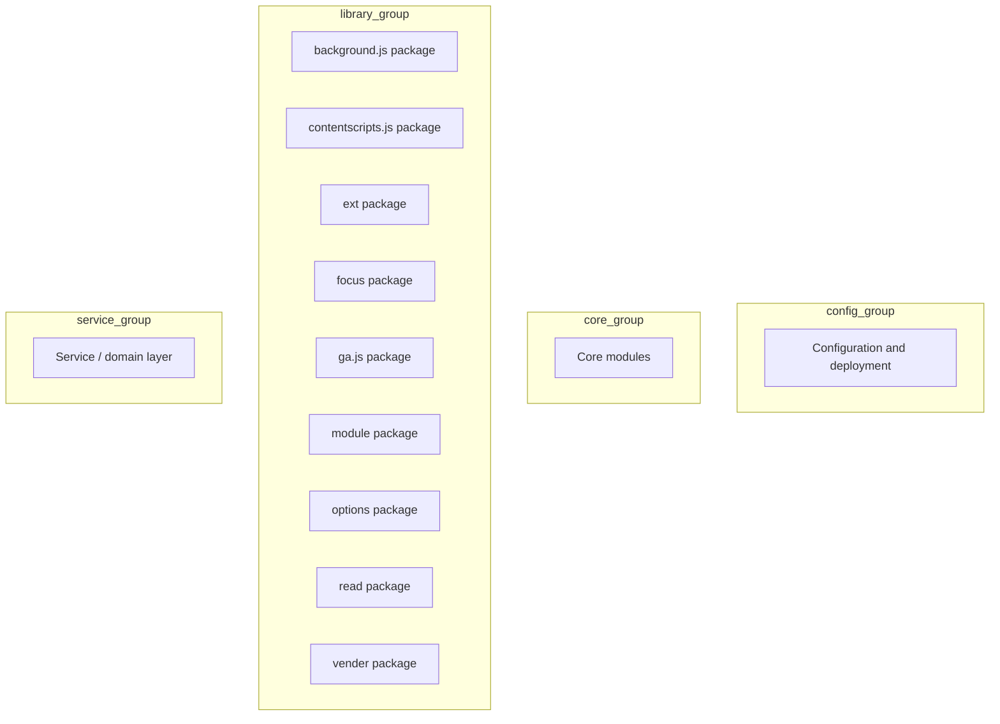

# Architecture report: Kenshin/simpread

> Automated static analysis. **Observed** = directly seen in files/imports/AST; **Inferred** = interpretation from that evidence. Repository code was not executed.

## 1. Repository at a glance

| Item | Value |
| --- | --- |
| Repository | Kenshin/simpread |
| Description | 简悦 ( SimpRead ) - 让你瞬间进入沉浸式阅读的扩展 |
| Language | JavaScript |
| Stars | 8751 |
| Licence | GPL-3.0 |
| Analysed commit / branch | d6534a7d67ab606e0390ff7172360fac88af4422 / master |
| Framework(s) | React |
| Files analysed | 138 |
| Components | 12 |

## 2. Architecture in one minute

Kenshin/simpread - 简悦 ( SimpRead ) - 让你瞬间进入沉浸式阅读的扩展. This repository was analysed statically from 138 file(s) (0 Python). Detected technologies (observed from imports/manifests): React, webpack. Files are grouped into 12 component(s): background.js package, Configuration and deployment, contentscripts.js package, Core modules, ext package, focus package, ga.js package, module package. Findings below distinguish observed facts from inferred interpretation.

## 3. High-level block diagram

## 4. Main components

### background.js package (`background_js`)

- **Kind:** library
- **Status:** Observed
- **Confidence:** 0.85
- **Responsibility:** Groups 1 file(s) under background.js package (observed from repository paths and static analysis).
- **Paths:** `src/background.js`
- **Evidence:** [src/background.js](https://github.com/Kenshin/simpread/blob/d6534a7d67ab606e0390ff7172360fac88af4422/src/background.js)

### Configuration and deployment (`config`)

- **Kind:** config
- **Status:** Observed
- **Confidence:** 0.85
- **Responsibility:** Groups 8 file(s) under configuration and deployment (observed from repository paths and static analysis).
- **Paths:** `ext/manifest.json`, `package.json`, `src/_locales/en/messages.json`, `src/_locales/zh_CN/messages.json`, `src/_locales/zh_TW/messages.json`, `src/help_tips.json`, `src/manifest.json`, `src/website_list.json`
- **Evidence:** [ext/manifest.json](https://github.com/Kenshin/simpread/blob/d6534a7d67ab606e0390ff7172360fac88af4422/ext/manifest.json); [package.json](https://github.com/Kenshin/simpread/blob/d6534a7d67ab606e0390ff7172360fac88af4422/package.json); [src/_locales/en/messages.json](https://github.com/Kenshin/simpread/blob/d6534a7d67ab606e0390ff7172360fac88af4422/src/_locales/en/messages.json); [src/_locales/zh_CN/messages.json](https://github.com/Kenshin/simpread/blob/d6534a7d67ab606e0390ff7172360fac88af4422/src/_locales/zh_CN/messages.json); [src/_locales/zh_TW/messages.json](https://github.com/Kenshin/simpread/blob/d6534a7d67ab606e0390ff7172360fac88af4422/src/_locales/zh_TW/messages.json); [src/help_tips.json](https://github.com/Kenshin/simpread/blob/d6534a7d67ab606e0390ff7172360fac88af4422/src/help_tips.json); [src/manifest.json](https://github.com/Kenshin/simpread/blob/d6534a7d67ab606e0390ff7172360fac88af4422/src/manifest.json); [src/website_list.json](https://github.com/Kenshin/simpread/blob/d6534a7d67ab606e0390ff7172360fac88af4422/src/website_list.json)

### contentscripts.js package (`contentscripts_js`)

- **Kind:** library
- **Status:** Observed
- **Confidence:** 0.85
- **Responsibility:** Groups 1 file(s) under contentscripts.js package (observed from repository paths and static analysis).
- **Paths:** `src/contentscripts.js`
- **Evidence:** [src/contentscripts.js](https://github.com/Kenshin/simpread/blob/d6534a7d67ab606e0390ff7172360fac88af4422/src/contentscripts.js)

### Core modules (`core`)

- **Kind:** core
- **Status:** Observed
- **Confidence:** 0.85
- **Responsibility:** Groups 2 file(s) under core modules (observed from repository paths and static analysis).
- **Paths:** `webpack.config.ext.js`, `webpack.config.js`
- **Evidence:** [webpack.config.ext.js](https://github.com/Kenshin/simpread/blob/d6534a7d67ab606e0390ff7172360fac88af4422/webpack.config.ext.js); [webpack.config.js](https://github.com/Kenshin/simpread/blob/d6534a7d67ab606e0390ff7172360fac88af4422/webpack.config.js)

### ext package (`ext`)

- **Kind:** library
- **Status:** Observed
- **Confidence:** 0.85
- **Responsibility:** Groups 2 file(s) under ext package (observed from repository paths and static analysis).
- **Paths:** `ext/background.js`, `ext/contentscripts.js`
- **Evidence:** [ext/background.js](https://github.com/Kenshin/simpread/blob/d6534a7d67ab606e0390ff7172360fac88af4422/ext/background.js); [ext/contentscripts.js](https://github.com/Kenshin/simpread/blob/d6534a7d67ab606e0390ff7172360fac88af4422/ext/contentscripts.js)

### focus package (`focus`)

- **Kind:** library
- **Status:** Observed
- **Confidence:** 0.85
- **Responsibility:** Groups 2 file(s) under focus package (observed from repository paths and static analysis).
- **Paths:** `src/focus/controlbar.jsx`, `src/focus/focus.js`
- **Evidence:** [src/focus/controlbar.jsx](https://github.com/Kenshin/simpread/blob/d6534a7d67ab606e0390ff7172360fac88af4422/src/focus/controlbar.jsx); [src/focus/focus.js](https://github.com/Kenshin/simpread/blob/d6534a7d67ab606e0390ff7172360fac88af4422/src/focus/focus.js)

### ga.js package (`ga_js`)

- **Kind:** library
- **Status:** Observed
- **Confidence:** 0.85
- **Responsibility:** Groups 1 file(s) under ga.js package (observed from repository paths and static analysis).
- **Paths:** `src/ga.js`
- **Evidence:** [src/ga.js](https://github.com/Kenshin/simpread/blob/d6534a7d67ab606e0390ff7172360fac88af4422/src/ga.js)

### module package (`module`)

- **Kind:** library
- **Status:** Observed
- **Confidence:** 0.85
- **Responsibility:** Groups 30 file(s) under module package (observed from repository paths and static analysis).
- **Paths:** `src/module/about.jsx`, `src/module/account.jsx`, `src/module/actionbar.jsx`, `src/module/authorize.jsx`, `src/module/common.jsx`, `src/module/common/editor.jsx`, `src/module/common/exclude.jsx`, `src/module/common/include.jsx`, `src/module/common/name.jsx`, `src/module/common/shortcuts.jsx`, `src/module/common/theme.jsx`, `src/module/common/url.jsx`, `src/module/enhancesite.jsx`, `src/module/feedback.jsx`, `src/module/focus.jsx`, `src/module/guide.jsx`, `src/module/keyboard.js`, `src/module/labs.jsx`, `src/module/notice.jsx`, `src/module/pluginbar.jsx`, `src/module/plugins.jsx`, `src/module/read.jsx`, `src/module/setting.jsx`, `src/module/sharecard.jsx`, `src/module/sitebar.jsx`, `src/module/siteeditor.jsx`, `src/module/sites.jsx`, `src/module/unrdist.jsx`, `src/module/urlscheme.jsx`, `src/module/welcome.jsx`
- **Evidence:** [src/module/about.jsx](https://github.com/Kenshin/simpread/blob/d6534a7d67ab606e0390ff7172360fac88af4422/src/module/about.jsx); [src/module/account.jsx](https://github.com/Kenshin/simpread/blob/d6534a7d67ab606e0390ff7172360fac88af4422/src/module/account.jsx); [src/module/actionbar.jsx](https://github.com/Kenshin/simpread/blob/d6534a7d67ab606e0390ff7172360fac88af4422/src/module/actionbar.jsx); [src/module/authorize.jsx](https://github.com/Kenshin/simpread/blob/d6534a7d67ab606e0390ff7172360fac88af4422/src/module/authorize.jsx); [src/module/common.jsx](https://github.com/Kenshin/simpread/blob/d6534a7d67ab606e0390ff7172360fac88af4422/src/module/common.jsx); [src/module/common/editor.jsx](https://github.com/Kenshin/simpread/blob/d6534a7d67ab606e0390ff7172360fac88af4422/src/module/common/editor.jsx); [src/module/common/exclude.jsx](https://github.com/Kenshin/simpread/blob/d6534a7d67ab606e0390ff7172360fac88af4422/src/module/common/exclude.jsx); [src/module/common/include.jsx](https://github.com/Kenshin/simpread/blob/d6534a7d67ab606e0390ff7172360fac88af4422/src/module/common/include.jsx)

### options package (`options`)

- **Kind:** library
- **Status:** Observed
- **Confidence:** 0.85
- **Responsibility:** Groups 5 file(s) under options package (observed from repository paths and static analysis).
- **Paths:** `src/options/corb.js`, `src/options/custom.js`, `src/options/notice.js`, `src/options/options.js`, `src/options/sitemgr.js`
- **Evidence:** [src/options/corb.js](https://github.com/Kenshin/simpread/blob/d6534a7d67ab606e0390ff7172360fac88af4422/src/options/corb.js); [src/options/custom.js](https://github.com/Kenshin/simpread/blob/d6534a7d67ab606e0390ff7172360fac88af4422/src/options/custom.js); [src/options/notice.js](https://github.com/Kenshin/simpread/blob/d6534a7d67ab606e0390ff7172360fac88af4422/src/options/notice.js); [src/options/options.js](https://github.com/Kenshin/simpread/blob/d6534a7d67ab606e0390ff7172360fac88af4422/src/options/options.js); [src/options/sitemgr.js](https://github.com/Kenshin/simpread/blob/d6534a7d67ab606e0390ff7172360fac88af4422/src/options/sitemgr.js)

### read package (`read`)

- **Kind:** library
- **Status:** Observed
- **Confidence:** 0.85
- **Responsibility:** Groups 5 file(s) under read package (observed from repository paths and static analysis).
- **Paths:** `src/read/controlbar.jsx`, `src/read/progressbar.jsx`, `src/read/read.jsx`, `src/read/special.jsx`, `src/read/toc.jsx`
- **Evidence:** [src/read/controlbar.jsx](https://github.com/Kenshin/simpread/blob/d6534a7d67ab606e0390ff7172360fac88af4422/src/read/controlbar.jsx); [src/read/progressbar.jsx](https://github.com/Kenshin/simpread/blob/d6534a7d67ab606e0390ff7172360fac88af4422/src/read/progressbar.jsx); [src/read/read.jsx](https://github.com/Kenshin/simpread/blob/d6534a7d67ab606e0390ff7172360fac88af4422/src/read/read.jsx); [src/read/special.jsx](https://github.com/Kenshin/simpread/blob/d6534a7d67ab606e0390ff7172360fac88af4422/src/read/special.jsx); [src/read/toc.jsx](https://github.com/Kenshin/simpread/blob/d6534a7d67ab606e0390ff7172360fac88af4422/src/read/toc.jsx)

### Service / domain layer (`service_layer`)

- **Kind:** service
- **Status:** Observed
- **Confidence:** 0.85
- **Responsibility:** Groups 19 file(s) under service / domain layer (observed from repository paths and static analysis).
- **Paths:** `src/service/browser.js`, `src/service/config.js`, `src/service/export.js`, `src/service/highlight.js`, `src/service/local.js`, `src/service/menu.js`, `src/service/message.js`, `src/service/offline.js`, `src/service/output.js`, `src/service/permission.js`, `src/service/runtime.js`, `src/service/snapshot.js`, `src/service/storage.js`, `src/service/stylesheet.js`, `src/service/theme.js`, `src/service/tips.js`, `src/service/util.js`, `src/service/version.js`, `src/service/watch.js`
- **Evidence:** [src/service/browser.js](https://github.com/Kenshin/simpread/blob/d6534a7d67ab606e0390ff7172360fac88af4422/src/service/browser.js); [src/service/config.js](https://github.com/Kenshin/simpread/blob/d6534a7d67ab606e0390ff7172360fac88af4422/src/service/config.js); [src/service/export.js](https://github.com/Kenshin/simpread/blob/d6534a7d67ab606e0390ff7172360fac88af4422/src/service/export.js); [src/service/highlight.js](https://github.com/Kenshin/simpread/blob/d6534a7d67ab606e0390ff7172360fac88af4422/src/service/highlight.js); [src/service/local.js](https://github.com/Kenshin/simpread/blob/d6534a7d67ab606e0390ff7172360fac88af4422/src/service/local.js); [src/service/menu.js](https://github.com/Kenshin/simpread/blob/d6534a7d67ab606e0390ff7172360fac88af4422/src/service/menu.js); [src/service/message.js](https://github.com/Kenshin/simpread/blob/d6534a7d67ab606e0390ff7172360fac88af4422/src/service/message.js); [src/service/offline.js](https://github.com/Kenshin/simpread/blob/d6534a7d67ab606e0390ff7172360fac88af4422/src/service/offline.js)

### vender package (`vender`)

- **Kind:** library
- **Status:** Observed
- **Confidence:** 0.85
- **Responsibility:** Groups 26 file(s) under vender package (observed from repository paths and static analysis).
- **Paths:** `src/vender/carousel/carousel.js`, `src/vender/instapaper.js`, `src/vender/mduikit/autocomplete.jsx`, `src/vender/mduikit/button.jsx`, `src/vender/mduikit/dialog.jsx`, `src/vender/mduikit/dropdown.jsx`, `src/vender/mduikit/fab.jsx`, `src/vender/mduikit/fap.jsx`, `src/vender/mduikit/list.jsx`, `src/vender/mduikit/progress.jsx`, `src/vender/mduikit/selectfield.jsx`, `src/vender/mduikit/sidebar.jsx`, `src/vender/mduikit/slider.jsx`, `src/vender/mduikit/statebutton.jsx`, `src/vender/mduikit/switch.jsx`, `src/vender/mduikit/tabs.jsx`, `src/vender/mduikit/textfield.jsx`, `src/vender/mduikit/tooltip.jsx`, `src/vender/mduikit/waves.js`, `src/vender/notify/notify.js`, `src/vender/sha1.js`, `src/vender/turndown/turndown-plugin-gfm.js`, `src/vender/turndown/turndown.js`, `src/vender/waves/waves.js`, `src/vender/webdav.js`, `src/vender/wiz.js`
- **Evidence:** [src/vender/carousel/carousel.js](https://github.com/Kenshin/simpread/blob/d6534a7d67ab606e0390ff7172360fac88af4422/src/vender/carousel/carousel.js); [src/vender/instapaper.js](https://github.com/Kenshin/simpread/blob/d6534a7d67ab606e0390ff7172360fac88af4422/src/vender/instapaper.js); [src/vender/mduikit/autocomplete.jsx](https://github.com/Kenshin/simpread/blob/d6534a7d67ab606e0390ff7172360fac88af4422/src/vender/mduikit/autocomplete.jsx); [src/vender/mduikit/button.jsx](https://github.com/Kenshin/simpread/blob/d6534a7d67ab606e0390ff7172360fac88af4422/src/vender/mduikit/button.jsx); [src/vender/mduikit/dialog.jsx](https://github.com/Kenshin/simpread/blob/d6534a7d67ab606e0390ff7172360fac88af4422/src/vender/mduikit/dialog.jsx); [src/vender/mduikit/dropdown.jsx](https://github.com/Kenshin/simpread/blob/d6534a7d67ab606e0390ff7172360fac88af4422/src/vender/mduikit/dropdown.jsx); [src/vender/mduikit/fab.jsx](https://github.com/Kenshin/simpread/blob/d6534a7d67ab606e0390ff7172360fac88af4422/src/vender/mduikit/fab.jsx); [src/vender/mduikit/fap.jsx](https://github.com/Kenshin/simpread/blob/d6534a7d67ab606e0390ff7172360fac88af4422/src/vender/mduikit/fap.jsx)

## 5. Execution flow

No entry point was observed; the startup flow below is therefore limited.

Representative flow (derived from observed entry points and the import graph; steps beyond the entry point are **Inferred**):

1. Execution starts at an observed entry point listed above, if present.
2. No internal import relationships between components were observed.

## 6. Project structure

### `(root)`

- `.gitignore` - other (258 bytes)
- `LICENSE` - docs (35146 bytes)
- `README.md` - docs (15968 bytes)
- `npmw.cmd` - other (1631 bytes)
- `package.json` - manifest (1812 bytes)
- `webpack.config.ext.js` - source, JavaScript (11398 bytes)
- `webpack.config.js` - source, JavaScript (12171 bytes)

### `.github`

- `.github/ISSUE_TEMPLATE/bug_report.yaml` - config (1410 bytes)
- `.github/ISSUE_TEMPLATE/config.yml` - config (4027 bytes)
- `.github/ISSUE_TEMPLATE/feature_request.yml` - config (648 bytes)
- `.github/ISSUE_TEMPLATE/new_site.yml` - config (773 bytes)
- `.github/ISSUE_TEMPLATE/yinxiang_code.yml` - config (608 bytes)

### `ext`

- `ext/background.js` - source, JavaScript (12210 bytes)
- `ext/contentscripts.js` - source, JavaScript (10557 bytes)
- `ext/manifest.json` - config (1736 bytes)

### `src`

- `src/_locales/en/messages.json` - config (660 bytes)
- `src/_locales/zh_CN/messages.json` - config (898 bytes)
- `src/_locales/zh_TW/messages.json` - config (905 bytes)
- `src/assets/css/options_custom.css` - other (599 bytes)
- `src/assets/css/options_notice.css` - other (4513 bytes)
- `src/assets/css/options_page.css` - other (17118 bytes)
- `src/assets/css/options_sitemgr.css` - other (2010 bytes)
- `src/assets/css/setting.css` - other (1662 bytes)
- `src/assets/css/simpread.css` - other (20687 bytes)
- `src/assets/css/theme_common.css` - other (5977 bytes)
- `src/assets/css/theme_dark.css` - other (2516 bytes)
- `src/assets/css/theme_engwrite.css` - other (2889 bytes)
- `src/assets/css/theme_github.css` - other (2995 bytes)
- `src/assets/css/theme_gothic.css` - other (3337 bytes)
- `src/assets/css/theme_mobile.css` - other (4228 bytes)
- `src/assets/css/theme_monospace.css` - other (2430 bytes)
- `src/assets/css/theme_newsprint.css` - other (2791 bytes)
- `src/assets/css/theme_night.css` - other (2867 bytes)
- `src/assets/css/theme_octopress.css` - other (26984 bytes)
- `src/assets/css/theme_pixyii.css` - other (3347 bytes)
- `src/assets/images/icons.svg` - other (649 bytes)
- `src/background.js` - source, JavaScript (18443 bytes)
- `src/contentscripts.js` - source, JavaScript (12975 bytes)
- `src/focus/controlbar.jsx` - source, JavaScript (5065 bytes)
- `src/focus/focus.js` - source, JavaScript (7458 bytes)
- `src/ga.js` - source, JavaScript (661 bytes)
- `src/help_tips.json` - config (2139 bytes)
- `src/manifest.json` - config (1710 bytes)
- `src/module/about.jsx` - source, JavaScript (20680 bytes)
- `src/module/account.jsx` - source, JavaScript (6813 bytes)
- `src/module/actionbar.jsx` - source, JavaScript (1685 bytes)
- `src/module/authorize.jsx` - source, JavaScript (36783 bytes)
- `src/module/common.jsx` - source, JavaScript (16306 bytes)
- `src/module/common/editor.jsx` - source, JavaScript (8358 bytes)
- `src/module/common/exclude.jsx` - source, JavaScript (2375 bytes)
- `src/module/common/include.jsx` - source, JavaScript (1397 bytes)
- `src/module/common/name.jsx` - source, JavaScript (1275 bytes)
- `src/module/common/shortcuts.jsx` - source, JavaScript (3597 bytes)
- `src/module/common/theme.jsx` - source, JavaScript (1686 bytes)
- `src/module/common/url.jsx` - source, JavaScript (1873 bytes)
- `src/module/enhancesite.jsx` - source, JavaScript (17292 bytes)
- `src/module/feedback.jsx` - source, JavaScript (21647 bytes)
- `src/module/focus.jsx` - source, JavaScript (2056 bytes)
- `src/module/guide.jsx` - source, JavaScript (6335 bytes)
- `src/module/keyboard.js` - source, JavaScript (7721 bytes)
- `src/module/labs.jsx` - source, JavaScript (24507 bytes)
- `src/module/notice.jsx` - source, JavaScript (10442 bytes)
- `src/module/pluginbar.jsx` - source, JavaScript (2898 bytes)
- `src/module/plugins.jsx` - source, JavaScript (14453 bytes)
- `src/module/read.jsx` - source, JavaScript (5821 bytes)
- `src/module/setting.jsx` - source, JavaScript (3854 bytes)
- `src/module/sharecard.jsx` - source, JavaScript (2457 bytes)
- `src/module/sitebar.jsx` - source, JavaScript (3739 bytes)
- `src/module/siteeditor.jsx` - source, JavaScript (6606 bytes)
- `src/module/sites.jsx` - source, JavaScript (20079 bytes)
- `src/module/unrdist.jsx` - source, JavaScript (6186 bytes)
- `src/module/urlscheme.jsx` - source, JavaScript (4641 bytes)
- `src/module/welcome.jsx` - source, JavaScript (21457 bytes)
- `src/options/corb.html` - other (145 bytes)
- `src/options/corb.js` - source, JavaScript (2822 bytes)
- `src/options/custom.html` - other (5347 bytes)
- `src/options/custom.js` - source, JavaScript (16438 bytes)
- `src/options/notice.html` - other (888 bytes)
- `src/options/notice.js` - source, JavaScript (1412 bytes)
- `src/options/options.html` - other (1401 bytes)
- `src/options/options.js` - source, JavaScript (22136 bytes)
- `src/options/sitemgr.html` - other (1461 bytes)
- `src/options/sitemgr.js` - source, JavaScript (11318 bytes)
- `src/read/controlbar.jsx` - source, JavaScript (10167 bytes)
- `src/read/progressbar.jsx` - source, JavaScript (1049 bytes)
- `src/read/read.jsx` - source, JavaScript (17591 bytes)
- `src/read/special.jsx` - source, JavaScript (3643 bytes)
- `src/read/toc.jsx` - source, JavaScript (4096 bytes)
- `src/service/browser.js` - source, JavaScript (1306 bytes)
- `src/service/config.js` - source, JavaScript (22424 bytes)
- `src/service/export.js` - source, JavaScript (73664 bytes)
- `src/service/highlight.js` - source, JavaScript (8251 bytes)
- `src/service/local.js` - source, JavaScript (2121 bytes)
- `src/service/menu.js` - source, JavaScript (4837 bytes)
- `src/service/message.js` - source, JavaScript (2050 bytes)
- `src/service/offline.js` - source, JavaScript (7941 bytes)
- `src/service/output.js` - source, JavaScript (25159 bytes)
- `src/service/permission.js` - source, JavaScript (514 bytes)
- `src/service/runtime.js` - source, JavaScript (6363 bytes)
- `src/service/snapshot.js` - source, JavaScript (4288 bytes)
- `src/service/storage.js` - source, JavaScript (31474 bytes)
- `src/service/stylesheet.js` - source, JavaScript (6830 bytes)
- `src/service/theme.js` - source, JavaScript (3064 bytes)
- `src/service/tips.js` - source, JavaScript (3104 bytes)
- `src/service/util.js` - source, JavaScript (11888 bytes)
- `src/service/version.js` - source, JavaScript (33561 bytes)
- `src/service/watch.js` - source, JavaScript (2238 bytes)
- `src/vender/carousel/carousel.css` - other (1479 bytes)
- `src/vender/carousel/carousel.js` - source, JavaScript (16208 bytes)
- `src/vender/instapaper.js` - source, JavaScript (7733 bytes)
- `src/vender/mduikit/autocomplete.jsx` - source, JavaScript (15345 bytes)
- `src/vender/mduikit/button.jsx` - source, JavaScript (9243 bytes)
- `src/vender/mduikit/dialog.jsx` - source, JavaScript (4814 bytes)
- `src/vender/mduikit/dropdown.jsx` - source, JavaScript (9873 bytes)
- `src/vender/mduikit/fab.jsx` - source, JavaScript (13625 bytes)
- `src/vender/mduikit/fap.jsx` - source, JavaScript (17204 bytes)
- `src/vender/mduikit/list.jsx` - source, JavaScript (16132 bytes)
- `src/vender/mduikit/mduikit.css` - other (2801 bytes)
- `src/vender/mduikit/mintooltip.css` - other (8430 bytes)
- `src/vender/mduikit/progress.jsx` - source, JavaScript (2311 bytes)
- `src/vender/mduikit/selectfield.jsx` - source, JavaScript (13838 bytes)
- `src/vender/mduikit/sidebar.jsx` - source, JavaScript (17597 bytes)
- `src/vender/mduikit/slider.jsx` - source, JavaScript (14019 bytes)
- `src/vender/mduikit/statebutton.jsx` - source, JavaScript (17307 bytes)
- `src/vender/mduikit/switch.jsx` - source, JavaScript (7624 bytes)
- `src/vender/mduikit/tabs.jsx` - source, JavaScript (10594 bytes)
- `src/vender/mduikit/textfield.jsx` - source, JavaScript (11280 bytes)
- `src/vender/mduikit/tooltip.jsx` - source, JavaScript (10329 bytes)
- `src/vender/mduikit/waves.js` - source, JavaScript (944 bytes)
- `src/vender/notify/notify.css` - other (6931 bytes)
- `src/vender/notify/notify.js` - source, JavaScript (17046 bytes)
- `src/vender/sha1.js` - source, JavaScript (5914 bytes)
- `src/vender/turndown/turndown-plugin-gfm.js` - source, JavaScript (4227 bytes)
- `src/vender/turndown/turndown.js` - source, JavaScript (23193 bytes)
- `src/vender/waves/waves.js` - source, JavaScript (18265 bytes)
- `src/vender/webdav.js` - source, JavaScript (5064 bytes)
- `src/vender/wiz.js` - source, JavaScript (4025 bytes)
- `src/website_list.json` - config (131606 bytes)

## 7. Key dependencies and integrations

| Name | Category | Status | Confidence | Evidence |
| --- | --- | --- | --- | --- |
| React | framework | Observed | 0.90 | [package.json:32](https://github.com/Kenshin/simpread/blob/d6534a7d67ab606e0390ff7172360fac88af4422/package.json#L32); [package.json:44](https://github.com/Kenshin/simpread/blob/d6534a7d67ab606e0390ff7172360fac88af4422/package.json#L44) |
| webpack | tooling | Observed | 0.85 | [package.json:20](https://github.com/Kenshin/simpread/blob/d6534a7d67ab606e0390ff7172360fac88af4422/package.json#L20) |

## 8. Data and state

No database, cache, queue, or persistent-state usage was observed in the analysed files. State handling, if any, may be in-memory or in files that were not analysed.

## 9. Configuration and deployment clues

- `.github/ISSUE_TEMPLATE/bug_report.yaml` (config)
- `.github/ISSUE_TEMPLATE/config.yml` (config)
- `.github/ISSUE_TEMPLATE/feature_request.yml` (config)
- `.github/ISSUE_TEMPLATE/new_site.yml` (config)
- `.github/ISSUE_TEMPLATE/yinxiang_code.yml` (config)
- `ext/manifest.json` (config)
- `package.json` (manifest)
- `src/_locales/en/messages.json` (config)
- `src/_locales/zh_CN/messages.json` (config)
- `src/_locales/zh_TW/messages.json` (config)
- `src/help_tips.json` (config)
- `src/manifest.json` (config)
- `src/website_list.json` (config)

## 10. Design observations

- Service/domain code is distinct from entry and data code, suggesting layered separation (Inferred).

These observations are interpretations (**Inferred**) of the observed structure, not guarantees about runtime design.

## 11. Limitations and unknowns

- Static analysis only: repository code was not executed, installed, or imported at runtime.
- Components and relationships are inferred from file paths, imports, and AST structure; runtime behaviour, dynamic imports, and reflection may not be visible.
- 2 file(s) were skipped during inventory (2 x generated/minified file excluded).
- No clear application entry point was observed in the analysed files.
- Repository text was treated as untrusted data; no instructions found in repository files were followed, and likely secret values were redacted/excluded.
- JavaScript and TypeScript files were inventoried from paths and package manifests. They were not parsed with a full language AST, and repository code was not executed.

## 12. Source references

- [ext/background.js](https://github.com/Kenshin/simpread/blob/d6534a7d67ab606e0390ff7172360fac88af4422/ext/background.js)
- [ext/contentscripts.js](https://github.com/Kenshin/simpread/blob/d6534a7d67ab606e0390ff7172360fac88af4422/ext/contentscripts.js)
- [ext/manifest.json](https://github.com/Kenshin/simpread/blob/d6534a7d67ab606e0390ff7172360fac88af4422/ext/manifest.json)
- [package.json](https://github.com/Kenshin/simpread/blob/d6534a7d67ab606e0390ff7172360fac88af4422/package.json)
- [package.json:20](https://github.com/Kenshin/simpread/blob/d6534a7d67ab606e0390ff7172360fac88af4422/package.json#L20)
- [package.json:32](https://github.com/Kenshin/simpread/blob/d6534a7d67ab606e0390ff7172360fac88af4422/package.json#L32)
- [package.json:44](https://github.com/Kenshin/simpread/blob/d6534a7d67ab606e0390ff7172360fac88af4422/package.json#L44)
- [src/_locales/en/messages.json](https://github.com/Kenshin/simpread/blob/d6534a7d67ab606e0390ff7172360fac88af4422/src/_locales/en/messages.json)
- [src/_locales/zh_CN/messages.json](https://github.com/Kenshin/simpread/blob/d6534a7d67ab606e0390ff7172360fac88af4422/src/_locales/zh_CN/messages.json)
- [src/_locales/zh_TW/messages.json](https://github.com/Kenshin/simpread/blob/d6534a7d67ab606e0390ff7172360fac88af4422/src/_locales/zh_TW/messages.json)
- [src/background.js](https://github.com/Kenshin/simpread/blob/d6534a7d67ab606e0390ff7172360fac88af4422/src/background.js)
- [src/contentscripts.js](https://github.com/Kenshin/simpread/blob/d6534a7d67ab606e0390ff7172360fac88af4422/src/contentscripts.js)
- [src/focus/controlbar.jsx](https://github.com/Kenshin/simpread/blob/d6534a7d67ab606e0390ff7172360fac88af4422/src/focus/controlbar.jsx)
- [src/focus/focus.js](https://github.com/Kenshin/simpread/blob/d6534a7d67ab606e0390ff7172360fac88af4422/src/focus/focus.js)
- [src/ga.js](https://github.com/Kenshin/simpread/blob/d6534a7d67ab606e0390ff7172360fac88af4422/src/ga.js)
- [src/help_tips.json](https://github.com/Kenshin/simpread/blob/d6534a7d67ab606e0390ff7172360fac88af4422/src/help_tips.json)
- [src/manifest.json](https://github.com/Kenshin/simpread/blob/d6534a7d67ab606e0390ff7172360fac88af4422/src/manifest.json)
- [src/module/about.jsx](https://github.com/Kenshin/simpread/blob/d6534a7d67ab606e0390ff7172360fac88af4422/src/module/about.jsx)
- [src/module/account.jsx](https://github.com/Kenshin/simpread/blob/d6534a7d67ab606e0390ff7172360fac88af4422/src/module/account.jsx)
- [src/module/actionbar.jsx](https://github.com/Kenshin/simpread/blob/d6534a7d67ab606e0390ff7172360fac88af4422/src/module/actionbar.jsx)
- [src/module/authorize.jsx](https://github.com/Kenshin/simpread/blob/d6534a7d67ab606e0390ff7172360fac88af4422/src/module/authorize.jsx)
- [src/module/common.jsx](https://github.com/Kenshin/simpread/blob/d6534a7d67ab606e0390ff7172360fac88af4422/src/module/common.jsx)
- [src/module/common/editor.jsx](https://github.com/Kenshin/simpread/blob/d6534a7d67ab606e0390ff7172360fac88af4422/src/module/common/editor.jsx)
- [src/module/common/exclude.jsx](https://github.com/Kenshin/simpread/blob/d6534a7d67ab606e0390ff7172360fac88af4422/src/module/common/exclude.jsx)
- [src/module/common/include.jsx](https://github.com/Kenshin/simpread/blob/d6534a7d67ab606e0390ff7172360fac88af4422/src/module/common/include.jsx)
- [src/options/corb.js](https://github.com/Kenshin/simpread/blob/d6534a7d67ab606e0390ff7172360fac88af4422/src/options/corb.js)
- [src/options/custom.js](https://github.com/Kenshin/simpread/blob/d6534a7d67ab606e0390ff7172360fac88af4422/src/options/custom.js)
- [src/options/notice.js](https://github.com/Kenshin/simpread/blob/d6534a7d67ab606e0390ff7172360fac88af4422/src/options/notice.js)
- [src/options/options.js](https://github.com/Kenshin/simpread/blob/d6534a7d67ab606e0390ff7172360fac88af4422/src/options/options.js)
- [src/options/sitemgr.js](https://github.com/Kenshin/simpread/blob/d6534a7d67ab606e0390ff7172360fac88af4422/src/options/sitemgr.js)
- [src/read/controlbar.jsx](https://github.com/Kenshin/simpread/blob/d6534a7d67ab606e0390ff7172360fac88af4422/src/read/controlbar.jsx)
- [src/read/progressbar.jsx](https://github.com/Kenshin/simpread/blob/d6534a7d67ab606e0390ff7172360fac88af4422/src/read/progressbar.jsx)
- [src/read/read.jsx](https://github.com/Kenshin/simpread/blob/d6534a7d67ab606e0390ff7172360fac88af4422/src/read/read.jsx)
- [src/read/special.jsx](https://github.com/Kenshin/simpread/blob/d6534a7d67ab606e0390ff7172360fac88af4422/src/read/special.jsx)
- [src/read/toc.jsx](https://github.com/Kenshin/simpread/blob/d6534a7d67ab606e0390ff7172360fac88af4422/src/read/toc.jsx)
- [src/service/browser.js](https://github.com/Kenshin/simpread/blob/d6534a7d67ab606e0390ff7172360fac88af4422/src/service/browser.js)
- [src/service/config.js](https://github.com/Kenshin/simpread/blob/d6534a7d67ab606e0390ff7172360fac88af4422/src/service/config.js)
- [src/service/export.js](https://github.com/Kenshin/simpread/blob/d6534a7d67ab606e0390ff7172360fac88af4422/src/service/export.js)
- [src/service/highlight.js](https://github.com/Kenshin/simpread/blob/d6534a7d67ab606e0390ff7172360fac88af4422/src/service/highlight.js)
- [src/service/local.js](https://github.com/Kenshin/simpread/blob/d6534a7d67ab606e0390ff7172360fac88af4422/src/service/local.js)
- [src/service/menu.js](https://github.com/Kenshin/simpread/blob/d6534a7d67ab606e0390ff7172360fac88af4422/src/service/menu.js)
- [src/service/message.js](https://github.com/Kenshin/simpread/blob/d6534a7d67ab606e0390ff7172360fac88af4422/src/service/message.js)
- [src/service/offline.js](https://github.com/Kenshin/simpread/blob/d6534a7d67ab606e0390ff7172360fac88af4422/src/service/offline.js)
- [src/vender/carousel/carousel.js](https://github.com/Kenshin/simpread/blob/d6534a7d67ab606e0390ff7172360fac88af4422/src/vender/carousel/carousel.js)
- [src/vender/instapaper.js](https://github.com/Kenshin/simpread/blob/d6534a7d67ab606e0390ff7172360fac88af4422/src/vender/instapaper.js)
- [src/vender/mduikit/autocomplete.jsx](https://github.com/Kenshin/simpread/blob/d6534a7d67ab606e0390ff7172360fac88af4422/src/vender/mduikit/autocomplete.jsx)
- [src/vender/mduikit/button.jsx](https://github.com/Kenshin/simpread/blob/d6534a7d67ab606e0390ff7172360fac88af4422/src/vender/mduikit/button.jsx)
- [src/vender/mduikit/dialog.jsx](https://github.com/Kenshin/simpread/blob/d6534a7d67ab606e0390ff7172360fac88af4422/src/vender/mduikit/dialog.jsx)
- [src/vender/mduikit/dropdown.jsx](https://github.com/Kenshin/simpread/blob/d6534a7d67ab606e0390ff7172360fac88af4422/src/vender/mduikit/dropdown.jsx)
- [src/vender/mduikit/fab.jsx](https://github.com/Kenshin/simpread/blob/d6534a7d67ab606e0390ff7172360fac88af4422/src/vender/mduikit/fab.jsx)
- [src/vender/mduikit/fap.jsx](https://github.com/Kenshin/simpread/blob/d6534a7d67ab606e0390ff7172360fac88af4422/src/vender/mduikit/fap.jsx)
- [src/website_list.json](https://github.com/Kenshin/simpread/blob/d6534a7d67ab606e0390ff7172360fac88af4422/src/website_list.json)
- [webpack.config.ext.js](https://github.com/Kenshin/simpread/blob/d6534a7d67ab606e0390ff7172360fac88af4422/webpack.config.ext.js)
- [webpack.config.js](https://github.com/Kenshin/simpread/blob/d6534a7d67ab606e0390ff7172360fac88af4422/webpack.config.js)
