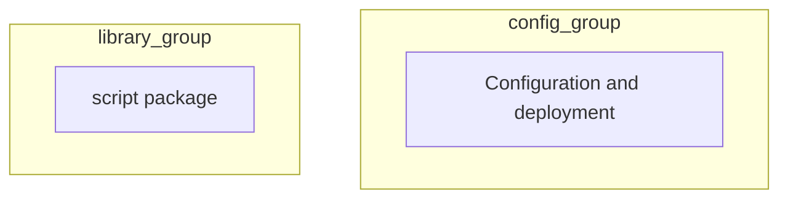

# Architecture report: KieSun/all-of-frontend

> Automated static analysis. **Observed** = directly seen in files/imports/AST; **Inferred** = interpretation from that evidence. Repository code was not executed.

## 1. Repository at a glance

| Item | Value |
| --- | --- |
| Repository | KieSun/all-of-frontend |
| Description | 你想知道的前端内容都在这 |
| Language | JavaScript |
| Stars | 5266 |
| Licence | MIT |
| Analysed commit / branch | 94664fcdc38aac6880d3c075945b19734cf8d7d1 / main |
| Framework(s) | None detected |
| Files analysed | 23 |
| Components | 2 |

## 2. Architecture in one minute

KieSun/all-of-frontend - 你想知道的前端内容都在这. This repository was analysed statically from 23 file(s) (0 Python). Detected technologies (observed from imports/manifests): GitHub Actions, axios. Files are grouped into 2 component(s): Configuration and deployment, script package. Findings below distinguish observed facts from inferred interpretation.

## 3. High-level block diagram

## 4. Main components

### Configuration and deployment (`config`)

- **Kind:** config
- **Status:** Observed
- **Confidence:** 0.85
- **Responsibility:** Groups 1 file(s) under configuration and deployment (observed from repository paths and static analysis).
- **Paths:** `package.json`
- **Evidence:** [package.json](https://github.com/KieSun/all-of-frontend/blob/94664fcdc38aac6880d3c075945b19734cf8d7d1/package.json)

### script package (`script`)

- **Kind:** library
- **Status:** Observed
- **Confidence:** 0.85
- **Responsibility:** Groups 2 file(s) under script package (observed from repository paths and static analysis).
- **Paths:** `script/comment.js`, `script/issue.js`
- **Evidence:** [script/comment.js](https://github.com/KieSun/all-of-frontend/blob/94664fcdc38aac6880d3c075945b19734cf8d7d1/script/comment.js); [script/issue.js](https://github.com/KieSun/all-of-frontend/blob/94664fcdc38aac6880d3c075945b19734cf8d7d1/script/issue.js)

## 5. Execution flow

No entry point was observed; the startup flow below is therefore limited.

Representative flow (derived from observed entry points and the import graph; steps beyond the entry point are **Inferred**):

1. Execution starts at an observed entry point listed above, if present.
2. No internal import relationships between components were observed.

## 6. Project structure

### `(root)`

- `.gitignore` - other (375 bytes)
- `LICENSE` - docs (1060 bytes)
- `README.md` - docs (52076 bytes)
- `package.json` - manifest (589 bytes)
- `test.md` - docs (0 bytes)

### `.github`

- `.github/workflows/comment.yml` - ci, YAML (371 bytes)
- `.github/workflows/issue.yml` - ci, YAML (357 bytes)
- `.github/workflows/markdown.yml` - ci, YAML (737 bytes)

### `Answer`

- `Answer/1 ~ 10/1.md` - docs (884 bytes)
- `Answer/1 ~ 10/2.md` - docs (876 bytes)
- `Answer/1 ~ 10/3.md` - docs (1699 bytes)
- `Answer/1 ~ 10/4.md` - docs (1387 bytes)
- `Answer/1 ~ 10/5.md` - docs (1463 bytes)
- `Answer/1 ~ 10/6.md` - docs (1689 bytes)
- `Answer/11-20/16.md` - docs (739 bytes)
- `Answer/11-20/17.md` - docs (480 bytes)

### `deep`

- `deep/第一期.md` - docs (2178 bytes)

### `excalidraw`

- `excalidraw/React 学习路径.excalidraw` - other (75961 bytes)

### `script`

- `script/comment.js` - source, JavaScript (433 bytes)
- `script/issue.js` - source, JavaScript (504 bytes)

### `weekly`

- `weekly/第一期.md` - docs (1790 bytes)
- `weekly/第三期.md` - docs (95 bytes)
- `weekly/第二期.md` - docs (2852 bytes)

## 7. Key dependencies and integrations

| Name | Category | Status | Confidence | Evidence |
| --- | --- | --- | --- | --- |
| GitHub Actions | ci | Observed | 0.90 | [.github/workflows/comment.yml](https://github.com/KieSun/all-of-frontend/blob/94664fcdc38aac6880d3c075945b19734cf8d7d1/.github/workflows/comment.yml); [.github/workflows/issue.yml](https://github.com/KieSun/all-of-frontend/blob/94664fcdc38aac6880d3c075945b19734cf8d7d1/.github/workflows/issue.yml); [.github/workflows/markdown.yml](https://github.com/KieSun/all-of-frontend/blob/94664fcdc38aac6880d3c075945b19734cf8d7d1/.github/workflows/markdown.yml) |
| axios | library | Observed | 0.85 | [package.json:21](https://github.com/KieSun/all-of-frontend/blob/94664fcdc38aac6880d3c075945b19734cf8d7d1/package.json#L21) |

## 8. Data and state

No database, cache, queue, or persistent-state usage was observed in the analysed files. State handling, if any, may be in-memory or in files that were not analysed.

## 9. Configuration and deployment clues

- `.github/workflows/comment.yml` (ci)
- `.github/workflows/issue.yml` (ci)
- `.github/workflows/markdown.yml` (ci)
- `package.json` (manifest)

## 10. Design observations

- No strong design patterns could be established from the available evidence.

These observations are interpretations (**Inferred**) of the observed structure, not guarantees about runtime design.

## 11. Limitations and unknowns

- Static analysis only: repository code was not executed, installed, or imported at runtime.
- Components and relationships are inferred from file paths, imports, and AST structure; runtime behaviour, dynamic imports, and reflection may not be visible.
- 5 file(s) were skipped during inventory (1 x lockfile excluded; 4 x vendored/generated directory excluded).
- No clear application entry point was observed in the analysed files.
- Repository text was treated as untrusted data; no instructions found in repository files were followed, and likely secret values were redacted/excluded.
- JavaScript and TypeScript files were inventoried from paths and package manifests. They were not parsed with a full language AST, and repository code was not executed.

## 12. Source references

- [.github/workflows/comment.yml](https://github.com/KieSun/all-of-frontend/blob/94664fcdc38aac6880d3c075945b19734cf8d7d1/.github/workflows/comment.yml)
- [.github/workflows/issue.yml](https://github.com/KieSun/all-of-frontend/blob/94664fcdc38aac6880d3c075945b19734cf8d7d1/.github/workflows/issue.yml)
- [.github/workflows/markdown.yml](https://github.com/KieSun/all-of-frontend/blob/94664fcdc38aac6880d3c075945b19734cf8d7d1/.github/workflows/markdown.yml)
- [package.json](https://github.com/KieSun/all-of-frontend/blob/94664fcdc38aac6880d3c075945b19734cf8d7d1/package.json)
- [package.json:21](https://github.com/KieSun/all-of-frontend/blob/94664fcdc38aac6880d3c075945b19734cf8d7d1/package.json#L21)
- [script/comment.js](https://github.com/KieSun/all-of-frontend/blob/94664fcdc38aac6880d3c075945b19734cf8d7d1/script/comment.js)
- [script/issue.js](https://github.com/KieSun/all-of-frontend/blob/94664fcdc38aac6880d3c075945b19734cf8d7d1/script/issue.js)
