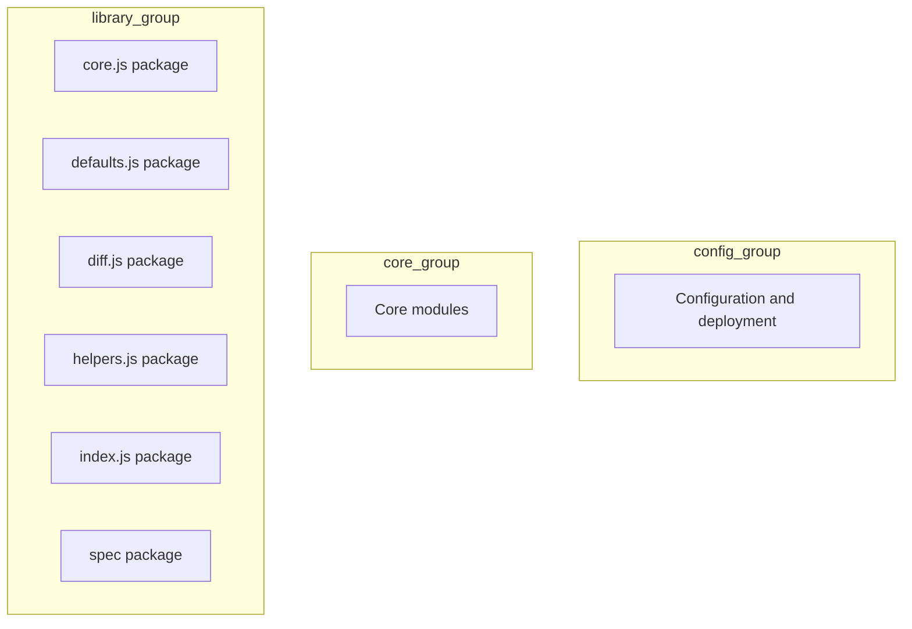

# Architecture report: LogRocket/redux-logger

> Automated static analysis. **Observed** = directly seen in files/imports/AST; **Inferred** = interpretation from that evidence. Repository code was not executed.

## 1. Repository at a glance

| Item | Value |
| --- | --- |
| Repository | LogRocket/redux-logger |
| Description | Logger for Redux |
| Language | JavaScript |
| Stars | 5710 |
| Licence | MIT |
| Analysed commit / branch | 5816a9fc8da9b417589380e381ed66f1114ebd9a / master |
| Framework(s) | None detected |
| Files analysed | 15 |
| Components | 8 |

## 2. Architecture in one minute

LogRocket/redux-logger - Logger for Redux. This repository was analysed statically from 15 file(s) (0 Python). Detected technologies (observed from imports/manifests): Redux. Files are grouped into 8 component(s): Configuration and deployment, Core modules, core.js package, defaults.js package, diff.js package, helpers.js package, index.js package, spec package. Findings below distinguish observed facts from inferred interpretation.

## 3. High-level block diagram

## 4. Main components

### Configuration and deployment (`config`)

- **Kind:** config
- **Status:** Observed
- **Confidence:** 0.85
- **Responsibility:** Groups 1 file(s) under configuration and deployment (observed from repository paths and static analysis).
- **Paths:** `package.json`
- **Evidence:** [package.json](https://github.com/LogRocket/redux-logger/blob/5816a9fc8da9b417589380e381ed66f1114ebd9a/package.json)

### Core modules (`core`)

- **Kind:** core
- **Status:** Observed
- **Confidence:** 0.85
- **Responsibility:** Groups 1 file(s) under core modules (observed from repository paths and static analysis).
- **Paths:** `rollup.config.js`
- **Evidence:** [rollup.config.js](https://github.com/LogRocket/redux-logger/blob/5816a9fc8da9b417589380e381ed66f1114ebd9a/rollup.config.js)

### core.js package (`core_js`)

- **Kind:** library
- **Status:** Observed
- **Confidence:** 0.85
- **Responsibility:** Groups 1 file(s) under core.js package (observed from repository paths and static analysis).
- **Paths:** `src/core.js`
- **Evidence:** [src/core.js](https://github.com/LogRocket/redux-logger/blob/5816a9fc8da9b417589380e381ed66f1114ebd9a/src/core.js)

### defaults.js package (`defaults_js`)

- **Kind:** library
- **Status:** Observed
- **Confidence:** 0.85
- **Responsibility:** Groups 1 file(s) under defaults.js package (observed from repository paths and static analysis).
- **Paths:** `src/defaults.js`
- **Evidence:** [src/defaults.js](https://github.com/LogRocket/redux-logger/blob/5816a9fc8da9b417589380e381ed66f1114ebd9a/src/defaults.js)

### diff.js package (`diff_js`)

- **Kind:** library
- **Status:** Observed
- **Confidence:** 0.85
- **Responsibility:** Groups 1 file(s) under diff.js package (observed from repository paths and static analysis).
- **Paths:** `src/diff.js`
- **Evidence:** [src/diff.js](https://github.com/LogRocket/redux-logger/blob/5816a9fc8da9b417589380e381ed66f1114ebd9a/src/diff.js)

### helpers.js package (`helpers_js`)

- **Kind:** library
- **Status:** Observed
- **Confidence:** 0.85
- **Responsibility:** Groups 1 file(s) under helpers.js package (observed from repository paths and static analysis).
- **Paths:** `src/helpers.js`
- **Evidence:** [src/helpers.js](https://github.com/LogRocket/redux-logger/blob/5816a9fc8da9b417589380e381ed66f1114ebd9a/src/helpers.js)

### index.js package (`index_js`)

- **Kind:** library
- **Status:** Observed
- **Confidence:** 0.85
- **Responsibility:** Groups 1 file(s) under index.js package (observed from repository paths and static analysis).
- **Paths:** `src/index.js`
- **Evidence:** [src/index.js](https://github.com/LogRocket/redux-logger/blob/5816a9fc8da9b417589380e381ed66f1114ebd9a/src/index.js)

### spec package (`spec`)

- **Kind:** library
- **Status:** Observed
- **Confidence:** 0.85
- **Responsibility:** Groups 3 file(s) under spec package (observed from repository paths and static analysis).
- **Paths:** `spec/diff.spec.js`, `spec/helpers.spec.js`, `spec/index.spec.js`
- **Evidence:** [spec/diff.spec.js](https://github.com/LogRocket/redux-logger/blob/5816a9fc8da9b417589380e381ed66f1114ebd9a/spec/diff.spec.js); [spec/helpers.spec.js](https://github.com/LogRocket/redux-logger/blob/5816a9fc8da9b417589380e381ed66f1114ebd9a/spec/helpers.spec.js); [spec/index.spec.js](https://github.com/LogRocket/redux-logger/blob/5816a9fc8da9b417589380e381ed66f1114ebd9a/spec/index.spec.js)

## 5. Execution flow

**Observed** entry point(s):

- [src/index.js](https://github.com/LogRocket/redux-logger/blob/5816a9fc8da9b417589380e381ed66f1114ebd9a/src/index.js)

Representative flow (derived from observed entry points and the import graph; steps beyond the entry point are **Inferred**):

1. Execution starts at an observed entry point listed above, if present.
2. No internal import relationships between components were observed.

## 6. Project structure

### `(root)`

- `.babelrc` - other (28 bytes)
- `.gitignore` - other (101 bytes)
- `LICENSE` - docs (1060 bytes)
- `README.md` - docs (10277 bytes)
- `package.json` - manifest (2572 bytes)
- `rollup.config.js` - source, JavaScript (762 bytes)

### `.circleci`

- `.circleci/config.yml` - ci, YAML (662 bytes)

### `spec`

- `spec/diff.spec.js` - source, JavaScript (3573 bytes)
- `spec/helpers.spec.js` - source, JavaScript (690 bytes)
- `spec/index.spec.js` - source, JavaScript (1179 bytes)

### `src`

- `src/core.js` - source, JavaScript (4444 bytes)
- `src/defaults.js` - source, JavaScript (531 bytes)
- `src/diff.js` - source, JavaScript (1412 bytes)
- `src/helpers.js` - source, JavaScript (547 bytes)
- `src/index.js` - source, JavaScript (4035 bytes)

## 7. Key dependencies and integrations

| Name | Category | Status | Confidence | Evidence |
| --- | --- | --- | --- | --- |
| Redux | library | Observed | 0.85 | [package.json:2](https://github.com/LogRocket/redux-logger/blob/5816a9fc8da9b417589380e381ed66f1114ebd9a/package.json#L2) |

## 8. Data and state

No database, cache, queue, or persistent-state usage was observed in the analysed files. State handling, if any, may be in-memory or in files that were not analysed.

## 9. Configuration and deployment clues

- `.circleci/config.yml` (ci)
- `package.json` (manifest)

## 10. Design observations

- No strong design patterns could be established from the available evidence.

These observations are interpretations (**Inferred**) of the observed structure, not guarantees about runtime design.

## 11. Limitations and unknowns

- Static analysis only: repository code was not executed, installed, or imported at runtime.
- Components and relationships are inferred from file paths, imports, and AST structure; runtime behaviour, dynamic imports, and reflection may not be visible.
- 1 file(s) were skipped during inventory (1 x lockfile excluded).
- No clear application entry point was observed in the analysed files.
- Repository text was treated as untrusted data; no instructions found in repository files were followed, and likely secret values were redacted/excluded.
- JavaScript and TypeScript files were inventoried from paths and package manifests. They were not parsed with a full language AST, and repository code was not executed.

## 12. Source references

- [package.json](https://github.com/LogRocket/redux-logger/blob/5816a9fc8da9b417589380e381ed66f1114ebd9a/package.json)
- [package.json:2](https://github.com/LogRocket/redux-logger/blob/5816a9fc8da9b417589380e381ed66f1114ebd9a/package.json#L2)
- [rollup.config.js](https://github.com/LogRocket/redux-logger/blob/5816a9fc8da9b417589380e381ed66f1114ebd9a/rollup.config.js)
- [spec/diff.spec.js](https://github.com/LogRocket/redux-logger/blob/5816a9fc8da9b417589380e381ed66f1114ebd9a/spec/diff.spec.js)
- [spec/helpers.spec.js](https://github.com/LogRocket/redux-logger/blob/5816a9fc8da9b417589380e381ed66f1114ebd9a/spec/helpers.spec.js)
- [spec/index.spec.js](https://github.com/LogRocket/redux-logger/blob/5816a9fc8da9b417589380e381ed66f1114ebd9a/spec/index.spec.js)
- [src/core.js](https://github.com/LogRocket/redux-logger/blob/5816a9fc8da9b417589380e381ed66f1114ebd9a/src/core.js)
- [src/defaults.js](https://github.com/LogRocket/redux-logger/blob/5816a9fc8da9b417589380e381ed66f1114ebd9a/src/defaults.js)
- [src/diff.js](https://github.com/LogRocket/redux-logger/blob/5816a9fc8da9b417589380e381ed66f1114ebd9a/src/diff.js)
- [src/helpers.js](https://github.com/LogRocket/redux-logger/blob/5816a9fc8da9b417589380e381ed66f1114ebd9a/src/helpers.js)
- [src/index.js](https://github.com/LogRocket/redux-logger/blob/5816a9fc8da9b417589380e381ed66f1114ebd9a/src/index.js)
