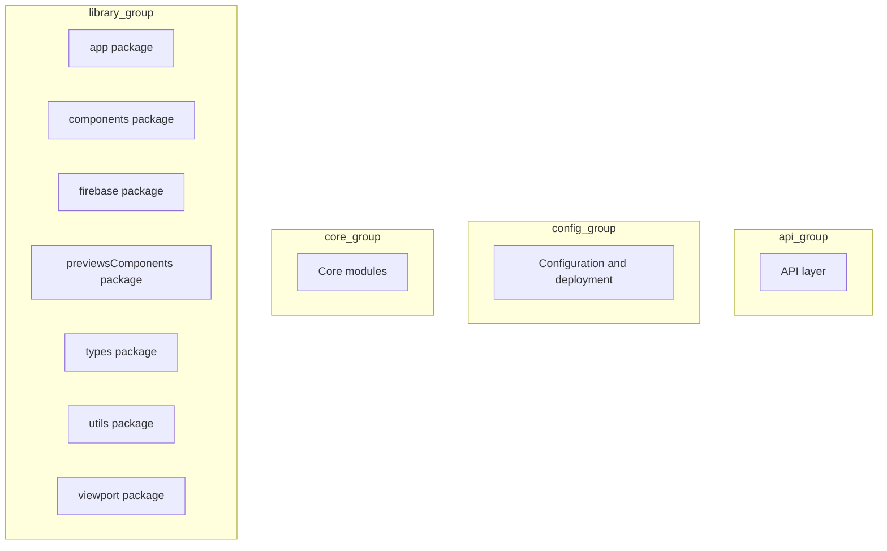

# Architecture report: MarsX-dev/floatui

> Automated static analysis. **Observed** = directly seen in files/imports/AST; **Inferred** = interpretation from that evidence. Repository code was not executed.

## 1. Repository at a glance

| Item | Value |
| --- | --- |
| Repository | MarsX-dev/floatui |
| Description | Beautiful and responsive UI components and templates for React and Vue (soon) with Tailwind CSS. |
| Language | MDX |
| Stars | 3588 |
| Licence | Other |
| Analysed commit / branch | 70824397a5ca6eca3cff1bee37d8a6972d653860 / main |
| Framework(s) | Next.js, React |
| Files analysed | 573 |
| Components | 10 |

## 2. Architecture in one minute

MarsX-dev/floatui - Beautiful and responsive UI components and templates for React and Vue (soon) with Tailwind CSS.. This repository was analysed statically from 573 file(s) (0 Python). Detected technologies (observed from imports/manifests): Next.js, React, axios, Tailwind CSS, TypeScript. Files are grouped into 10 component(s): API layer, app package, components package, Configuration and deployment, Core modules, firebase package, previewsComponents package, types package. Findings below distinguish observed facts from inferred interpretation.

## 3. High-level block diagram

## 4. Main components

### API layer (`api_layer`)

- **Kind:** api
- **Status:** Observed
- **Confidence:** 0.85
- **Responsibility:** Groups 1 file(s) under api layer (observed from repository paths and static analysis).
- **Paths:** `app/api/subscribe/route.ts`
- **Evidence:** [app/api/subscribe/route.ts](https://github.com/MarsX-dev/floatui/blob/70824397a5ca6eca3cff1bee37d8a6972d653860/app/api/subscribe/route.ts)

### app package (`app`)

- **Kind:** library
- **Status:** Observed
- **Confidence:** 0.85
- **Responsibility:** Groups 13 file(s) under app package (observed from repository paths and static analysis).
- **Paths:** `app/blog/[slug]/page.tsx`, `app/blog/page.tsx`, `app/components/[slug]/page.tsx`, `app/components/layout.tsx`, `app/components/page.tsx`, `app/demo/page.tsx`, `app/layout.tsx`, `app/license/page.tsx`, `app/page.tsx`, `app/privacy-policy/page.tsx`, `app/sitemap.xml/route.tsx`, `app/templates/[slug]/page.tsx`, `app/templates/page.tsx`
- **Evidence:** [app/blog/[slug]/page.tsx](https://github.com/MarsX-dev/floatui/blob/70824397a5ca6eca3cff1bee37d8a6972d653860/app/blog/%5Bslug%5D/page.tsx); [app/blog/page.tsx](https://github.com/MarsX-dev/floatui/blob/70824397a5ca6eca3cff1bee37d8a6972d653860/app/blog/page.tsx); [app/components/[slug]/page.tsx](https://github.com/MarsX-dev/floatui/blob/70824397a5ca6eca3cff1bee37d8a6972d653860/app/components/%5Bslug%5D/page.tsx); [app/components/layout.tsx](https://github.com/MarsX-dev/floatui/blob/70824397a5ca6eca3cff1bee37d8a6972d653860/app/components/layout.tsx); [app/components/page.tsx](https://github.com/MarsX-dev/floatui/blob/70824397a5ca6eca3cff1bee37d8a6972d653860/app/components/page.tsx); [app/demo/page.tsx](https://github.com/MarsX-dev/floatui/blob/70824397a5ca6eca3cff1bee37d8a6972d653860/app/demo/page.tsx); [app/layout.tsx](https://github.com/MarsX-dev/floatui/blob/70824397a5ca6eca3cff1bee37d8a6972d653860/app/layout.tsx); [app/license/page.tsx](https://github.com/MarsX-dev/floatui/blob/70824397a5ca6eca3cff1bee37d8a6972d653860/app/license/page.tsx)

### components package (`components`)

- **Kind:** library
- **Status:** Observed
- **Confidence:** 0.85
- **Responsibility:** Groups 64 file(s) under components package (observed from repository paths and static analysis).
- **Paths:** `components/BlurBackground.tsx`, `components/HeroBgGradient.tsx`, `components/HighlightCodeSeobot.tsx`, `components/LazyMotionWrapper.tsx`, `components/MDXRemoteClient.tsx`, `components/SyntaxHeighlight.tsx`, `components/UsermavenSetup.tsx`, `components/icons/IconAlpinejs.tsx`, `components/icons/IconArrowsexpandLeft.tsx`, `components/icons/IconBxCustomize.tsx`, `components/icons/IconGithub.tsx`, `components/icons/IconHTML.tsx`, `components/icons/IconLoading.tsx`, `components/icons/IconPennibLine.tsx`, `components/icons/IconRadix.tsx`, `components/icons/IconRadixVue.tsx`, `components/icons/IconReact.tsx`, `components/icons/IconSvelte.tsx`, `components/icons/IconVue.tsx`, `components/icons/index.ts`, `components/ui/Banner/Banner.tsx`, `components/ui/BgGradient/index.tsx`, `components/ui/BlogCard/index.tsx`, `components/ui/Brand/index.tsx`, `components/ui/Button.tsx`, `components/ui/Button/index.tsx`, `components/ui/CTA/index.tsx`, `components/ui/CodeBlockContainer/index.tsx`, `components/ui/CodeSwitchBar/index.tsx`, `components/ui/DemoHeader/DemoHeader.tsx`, `components/ui/DemoHeader/index.ts`, `components/ui/Features/Card.tsx`, `components/ui/Features/Features.tsx`, `components/ui/Footer/BgGradient.tsx`, `components/ui/Footer/BorderGradient.tsx`, `components/ui/Footer/Footer.tsx`, `components/ui/Footer/index.tsx`, `components/ui/Hero/HeroBgGradient.Client.tsx`, `components/ui/Hero/index.tsx`, `components/ui/Input.tsx`, `components/ui/LinkItem/index.tsx`, `components/ui/Modal.tsx`, `components/ui/Navbar/Navbar.tsx`, `components/ui/Navbar/index.tsx`, `components/ui/NewsletterModal.tsx`, `components/ui/Pagination.tsx`, `components/ui/Preview/PreviewApp.tsx`, `components/ui/Preview/index.tsx`, `components/ui/PreviewSwitch/index.tsx`, `components/ui/Sidebar/NavLink.tsx`, `components/ui/Sidebar/index.tsx`, `components/ui/SupportedFrameworks/FrameworksTabs.tsx`, `components/ui/SupportedFrameworks/PreviewCard.tsx`, `components/ui/SupportedFrameworks/index.tsx`, `components/ui/SupportedLibraries/index.tsx`, `components/ui/Tabs/TabsTrigger.tsx`, `components/ui/TechStackSwitch/index.tsx`, `components/ui/TemplateCTA/BgGradient.tsx`, `components/ui/TemplateCTA/TemplateScoresCard.tsx`, `components/ui/TemplateCTA/TemplatesOverview.tsx`, `components/ui/TemplateCTA/index.tsx`, `components/ui/TemplateCard/index.tsx`, `components/ui/TemplateTechStackGroup/index.tsx`, `components/variants.ts`
- **Evidence:** [components/BlurBackground.tsx](https://github.com/MarsX-dev/floatui/blob/70824397a5ca6eca3cff1bee37d8a6972d653860/components/BlurBackground.tsx); [components/HeroBgGradient.tsx](https://github.com/MarsX-dev/floatui/blob/70824397a5ca6eca3cff1bee37d8a6972d653860/components/HeroBgGradient.tsx); [components/HighlightCodeSeobot.tsx](https://github.com/MarsX-dev/floatui/blob/70824397a5ca6eca3cff1bee37d8a6972d653860/components/HighlightCodeSeobot.tsx); [components/LazyMotionWrapper.tsx](https://github.com/MarsX-dev/floatui/blob/70824397a5ca6eca3cff1bee37d8a6972d653860/components/LazyMotionWrapper.tsx); [components/MDXRemoteClient.tsx](https://github.com/MarsX-dev/floatui/blob/70824397a5ca6eca3cff1bee37d8a6972d653860/components/MDXRemoteClient.tsx); [components/SyntaxHeighlight.tsx](https://github.com/MarsX-dev/floatui/blob/70824397a5ca6eca3cff1bee37d8a6972d653860/components/SyntaxHeighlight.tsx); [components/UsermavenSetup.tsx](https://github.com/MarsX-dev/floatui/blob/70824397a5ca6eca3cff1bee37d8a6972d653860/components/UsermavenSetup.tsx); [components/icons/IconAlpinejs.tsx](https://github.com/MarsX-dev/floatui/blob/70824397a5ca6eca3cff1bee37d8a6972d653860/components/icons/IconAlpinejs.tsx)

### Configuration and deployment (`config`)

- **Kind:** config
- **Status:** Observed
- **Confidence:** 0.85
- **Responsibility:** Groups 3 file(s) under configuration and deployment (observed from repository paths and static analysis).
- **Paths:** `package.json`, `sections/sections.json`, `tsconfig.json`
- **Evidence:** [package.json](https://github.com/MarsX-dev/floatui/blob/70824397a5ca6eca3cff1bee37d8a6972d653860/package.json); [sections/sections.json](https://github.com/MarsX-dev/floatui/blob/70824397a5ca6eca3cff1bee37d8a6972d653860/sections/sections.json); [tsconfig.json](https://github.com/MarsX-dev/floatui/blob/70824397a5ca6eca3cff1bee37d8a6972d653860/tsconfig.json)

### Core modules (`core`)

- **Kind:** core
- **Status:** Observed
- **Confidence:** 0.85
- **Responsibility:** Groups 6 file(s) under core modules (observed from repository paths and static analysis).
- **Paths:** `componentsNames.ts`, `metatag.ts`, `next-env.d.ts`, `next.config.js`, `postcss.config.js`, `tailwind.config.js`
- **Evidence:** [componentsNames.ts](https://github.com/MarsX-dev/floatui/blob/70824397a5ca6eca3cff1bee37d8a6972d653860/componentsNames.ts); [metatag.ts](https://github.com/MarsX-dev/floatui/blob/70824397a5ca6eca3cff1bee37d8a6972d653860/metatag.ts); [next-env.d.ts](https://github.com/MarsX-dev/floatui/blob/70824397a5ca6eca3cff1bee37d8a6972d653860/next-env.d.ts); [next.config.js](https://github.com/MarsX-dev/floatui/blob/70824397a5ca6eca3cff1bee37d8a6972d653860/next.config.js); [postcss.config.js](https://github.com/MarsX-dev/floatui/blob/70824397a5ca6eca3cff1bee37d8a6972d653860/postcss.config.js); [tailwind.config.js](https://github.com/MarsX-dev/floatui/blob/70824397a5ca6eca3cff1bee37d8a6972d653860/tailwind.config.js)

### firebase package (`firebase`)

- **Kind:** library
- **Status:** Observed
- **Confidence:** 0.85
- **Responsibility:** Groups 1 file(s) under firebase package (observed from repository paths and static analysis).
- **Paths:** `firebase/config.ts`
- **Evidence:** [firebase/config.ts](https://github.com/MarsX-dev/floatui/blob/70824397a5ca6eca3cff1bee37d8a6972d653860/firebase/config.ts)

### previewsComponents package (`previewscomponents`)

- **Kind:** library
- **Status:** Observed
- **Confidence:** 0.85
- **Responsibility:** Groups 198 file(s) under previewscomponents package (observed from repository paths and static analysis).
- **Paths:** `previewsComponents/FUI404PageWithImage.jsx`, `previewsComponents/FUI404PageWithListOfItems.jsx`, `previewsComponents/FUI404PageWithLogo.jsx`, `previewsComponents/FUIAlertDanger.jsx`, `previewsComponents/FUIAlertDangerWithDescription.jsx`, `previewsComponents/FUIAlertDangerWithLink.jsx`, `previewsComponents/FUIAlertInfo.jsx`, `previewsComponents/FUIAlertInfoLinear.jsx`, `previewsComponents/FUIAlertInfoWithLink.jsx`, `previewsComponents/FUIAlertSuccess.jsx`, `previewsComponents/FUIAlertSuccessWithLink.jsx`, `previewsComponents/FUIAlertWarning.jsx`, `previewsComponents/FUIAlertWarningWithBorder.jsx`, `previewsComponents/FUIAmountInput.jsx`, `previewsComponents/FUIAmountInputWithSelectInRight.jsx`, `previewsComponents/FUIAvatarGroupStacked.jsx`, `previewsComponents/FUIAvatarGroupStackedWithJoinButton.jsx`, `previewsComponents/FUIAvatarGroupStackedWithText.jsx`, `previewsComponents/FUIAvatarWithLinkAndButton.jsx`, `previewsComponents/FUIAvatars.jsx`, `previewsComponents/FUIAvatarsWithInfo.jsx`, `previewsComponents/FUIAvatarsWithNotification.jsx`, `previewsComponents/FUIBannerCentred.jsx`, `previewsComponents/FUIBannerCentredWithBadge.jsx`, `previewsComponents/FUIBannerCentredWithLink.jsx`, `previewsComponents/FUIBannerWithLink.jsx`, `previewsComponents/FUIBannerWithUnderlineLink.jsx`, `previewsComponents/FUIBasic404Page.jsx`, `previewsComponents/FUIBasicContextMenu.jsx`, `previewsComponents/FUIBasicFeatureSection.jsx`, `previewsComponents/FUIBasicLoginForm.jsx`, `previewsComponents/FUIBasicPricingSection.jsx`, `previewsComponents/FUIBasicRadioGroup.jsx`, `previewsComponents/FUIBasicStats.jsx`, `previewsComponents/FUIBasicSteps.jsx`, `previewsComponents/FUIBasicTable.jsx`, `previewsComponents/FUIBasicTabs.jsx`, `previewsComponents/FUIBlogCardsPrimary.jsx`, `previewsComponents/FUIBlogCardsSecondary.jsx`, `previewsComponents/FUIBlogSectionWithPostsCard.jsx`, `previewsComponents/FUIButtonsWithIconAndText.jsx`, `previewsComponents/FUIButtonsWithIcons.jsx`, `previewsComponents/FUIButtonsWithLowColors.jsx`, `previewsComponents/FUIButtonsWithShadow.jsx`, `previewsComponents/FUICentered404PageWithTowLinks.jsx`, `previewsComponents/FUICenteredContactSection.jsx`, `previewsComponents/FUICentredCta.jsx`, `previewsComponents/FUICentredCtaWithTwoLinks.jsx`, `previewsComponents/FUIColorPickerRadioGroup.jsx`, `previewsComponents/FUIContactSectionWithDividedColumns.jsx`, `previewsComponents/FUIContactSectionWithFourColumns.jsx`, `previewsComponents/FUIContactSectionWithImage.jsx`, `previewsComponents/FUIContactSectionWithInfo.jsx`, `previewsComponents/FUIContextMenuWithSubmenu.jsx`, `previewsComponents/FUICtaWithBlueBackground.jsx`, `previewsComponents/FUICtaWithImage.jsx`, `previewsComponents/FUICtaWithLinkOnTheSide.jsx`, `previewsComponents/FUIDarkContactSection.jsx`, `previewsComponents/FUIDarkCta.jsx`, `previewsComponents/FUIDarkCtaWithLinkOnTheSide.jsx`, `previewsComponents/FUIDarkFaqsWithDividedRows.jsx`, `previewsComponents/FUIDarkFeatureSection.jsx`, `previewsComponents/FUIDarkFooter.jsx`, `previewsComponents/FUIDarkHeroSection.jsx`, `previewsComponents/FUIDarkLogoGrid.jsx`, `previewsComponents/FUIDarkPricingSectionWithTwoPlans.jsx`, `previewsComponents/FUIDarkStats.jsx`, `previewsComponents/FUIDarkStatsWithInCards.jsx`, `previewsComponents/FUIDefaultButtonsWithIcons.jsx`, `previewsComponents/FUIDefaultSelectMenu.jsx`, `previewsComponents/FUIDisabledButtons.jsx`, `previewsComponents/FUIDividedFeatureSection.jsx`, `previewsComponents/FUIDividedLogoGrid.jsx`, `previewsComponents/FUIEmailInput.jsx`, `previewsComponents/FUIFaqsWithDividedRows.jsx`, `previewsComponents/FUIFaqsWithSearchBox.jsx`, `previewsComponents/FUIFaqsWithShadow.jsx`, `previewsComponents/FUIFaqsWithTitles.jsx`, `previewsComponents/FUIFeatureSectionWithCards.jsx`, `previewsComponents/FUIFeatureSectionWithCheckIcons.jsx`, `previewsComponents/FUIFeatureSectionWithImage.jsx`, `previewsComponents/FUIFeatureSectionWithLinks.jsx`, `previewsComponents/FUIFeatureSectionWithThreeColumns.jsx`, `previewsComponents/FUIFooterWithDescriptionAndTitle.jsx`, `previewsComponents/FUIFooterWithDownloadLinks.jsx`, `previewsComponents/FUIFooterWithNewsletter.jsx`, `previewsComponents/FUIHeroSectionWithBottomImage.jsx`, `previewsComponents/FUIHeroSectionWithGradientBackground.jsx`, `previewsComponents/FUIHeroSectionWithImage.jsx`, `previewsComponents/FUIHeroSectionWithLogoClouds.jsx`, `previewsComponents/FUIHeroSectionWithVideo.jsx`, `previewsComponents/FUIIntegrationsCard.jsx`, `previewsComponents/FUIJobCards.jsx`, `previewsComponents/FUIJobCardsWithInformation.jsx`, `previewsComponents/FUILoginWithGoogleProvider.jsx`, `previewsComponents/FUILoginWithGridProvider.jsx`, `previewsComponents/FUILoginWithListedProvider.jsx`, `previewsComponents/FUILogoGridWithHeader.jsx`, `previewsComponents/FUILogoGridWithTitle.jsx`, `previewsComponents/FUILogoGridWithTowRows.jsx`, `previewsComponents/FUIModalDanger.jsx`, `previewsComponents/FUIModalDialog.jsx`, `previewsComponents/FUIModalSuccess.jsx`, `previewsComponents/FUIModalWithNewsletter.jsx`, `previewsComponents/FUIModalWithShareableLink.jsx`, `previewsComponents/FUINavbarWithAdvencedDropdown.jsx`, `previewsComponents/FUINavbarWithBlackButton.jsx`, `previewsComponents/FUINavbarWithDividedItems.jsx`, `previewsComponents/FUINavbarWithSearchBox.jsx`, `previewsComponents/FUINavbarWithSubmenu.jsx`, `previewsComponents/FUINewsletterStacked.jsx`, `previewsComponents/FUINewsletterWithAGradientBackground.jsx`, `previewsComponents/FUINewsletterWithBackground.jsx`, `previewsComponents/FUINewsletterWithDescription.jsx`, `previewsComponents/FUIPaginationStacked.jsx`, `previewsComponents/FUIPaginationWithCurrentPageInfo.jsx`, `previewsComponents/FUIPaginationWithPreviousAndNextLink.jsx`, `previewsComponents/FUIPasswordInput.jsx`, `previewsComponents/FUIPaymentCardsRadioGroup.jsx`, `previewsComponents/FUIPhoneNumberInput.jsx`, `previewsComponents/FUIPricingCardsRadioGroup.jsx`, `previewsComponents/FUIPricingSectionWithBadge.jsx`, `previewsComponents/FUIPricingSectionWithOnePlan.jsx`, `previewsComponents/FUIPricingSectionWithTable.jsx`, `previewsComponents/FUIPricingSectionWithTwoPlans.jsx`, `previewsComponents/FUIPrimaryButtons.jsx`, `previewsComponents/FUIPrimaryCta.jsx`, `previewsComponents/FUIPrimaryFaqs.jsx`, `previewsComponents/FUIPrimaryFooter.jsx`, `previewsComponents/FUIPrimaryHeroSection.jsx`, `previewsComponents/FUIPrimaryNavbar.jsx`, `previewsComponents/FUIPrimaryNewsletter.jsx`, `previewsComponents/FUIPrimarySelectMenu.jsx`, `previewsComponents/FUIRoundedButtons.jsx`, `previewsComponents/FUISearchInput.jsx`, `previewsComponents/FUISearchInputWithSelectMenu.jsx`, `previewsComponents/FUISearchInputWithSelectMenuAndAvatars.jsx`, `previewsComponents/FUISecondaryButtons.jsx`, `previewsComponents/FUISecondaryCta.jsx`, `previewsComponents/FUISecondaryFaqs.jsx`, `previewsComponents/FUISecondaryFooter.jsx`, `previewsComponents/FUISecondaryHeroSection.jsx`, `previewsComponents/FUISecondaryNavbar.jsx`, `previewsComponents/FUISecondaryNewsletter.jsx`, `previewsComponents/FUISectionHeaderWithButtons.jsx`, `previewsComponents/FUISectionHeaderWithButtonsAndNavigations.jsx`, `previewsComponents/FUISectionHeaderWithDescriptionAndButton.jsx`, `previewsComponents/FUISectionHeaderWithNavigations.jsx`, `previewsComponents/FUISectionHeaderWithSearchBox.jsx`, `previewsComponents/FUISelectMenuWithAvatars.jsx`, `previewsComponents/FUISelectMenuWithIcon.jsx`, `previewsComponents/FUISelectMenuWithSearchBox.jsx`, `previewsComponents/FUISelectMenuWithSearchBox2.jsx`, `previewsComponents/FUISidebarWithItemsInBottom.jsx`, `previewsComponents/FUISidebarWithListOfLessons.jsx`, `previewsComponents/FUISidebarWithSubmenu.jsx`, `previewsComponents/FUISidebarWithTooltip.jsx`, `previewsComponents/FUISignUpWithGoogleProvider.jsx`, `previewsComponents/FUISignUpWithLeftBackground.jsx`, `previewsComponents/FUISignUpWithNameEmailPasswordOrGoogle.jsx`, `previewsComponents/FUIStatsOnTheSide.jsx`, `previewsComponents/FUIStatsWithImage.jsx`, `previewsComponents/FUIStatsWithTitleAndDescription.jsx`, `previewsComponents/FUIStatusSelectMenu.jsx`, `previewsComponents/FUIStepsWithChevrons.jsx`, `previewsComponents/FUIStepsWithLine.jsx`, `previewsComponents/FUIStepsWithTitlesOnTheBottom.jsx`, `previewsComponents/FUIStepsWithTitlesOnTheSide.jsx`, `previewsComponents/FUITableWithAvatars.jsx`, `previewsComponents/FUITableWithAvatarsAndEditDelete.jsx`, `previewsComponents/FUITableWithBorderedColumn.jsx`, `previewsComponents/FUITableWithCheckbox.jsx`, `previewsComponents/FUITableWithEditAndDelete.jsx`, `previewsComponents/FUITableWithManageButton.jsx`, `previewsComponents/FUITableWithTabs.jsx`, `previewsComponents/FUITabsWithBackgroundColor.jsx`, `previewsComponents/FUITabsWithIcons.jsx`, `previewsComponents/FUITabsWithoutUnderline.jsx`, `previewsComponents/FUITeamMembersCard.jsx`, `previewsComponents/FUITeamSectionCentredWithLargeImages.jsx`, `previewsComponents/FUITeamSectionWithAvatars.jsx`, `previewsComponents/FUITeamSectionWithCentredAvatars.jsx`, `previewsComponents/FUITeamSectionWithInfo.jsx`, `previewsComponents/FUITeamSectionWithVerticalImages.jsx`, `previewsComponents/FUITeamWithLargeAvatars.jsx`, `previewsComponents/FUITestimonialCentered.jsx`, `previewsComponents/FUITestimonialCenteredWithLogo.jsx`, `previewsComponents/FUITestimonialGrid.jsx`, `previewsComponents/FUITestimonialWithBackgroundColor.jsx`, `previewsComponents/FUITestimonialWithSlider.jsx`, `previewsComponents/FUITestimonialWithThreeColumn.jsx`, `previewsComponents/FUIUploadFileCard.jsx`, `previewsComponents/FUIUsernameInput.jsx`, `previewsComponents/FUIVerificationCodeInput.jsx`, `previewsComponents/FUIVerticalTabs.jsx`, `previewsComponents/FUIVerticalTabsWithoutLine.jsx`, `previewsComponents/FUIWebsiteUrlInput.jsx`, `previewsComponents/FUIWithPreviousAndNextLink.jsx`
- **Evidence:** [previewsComponents/FUI404PageWithImage.jsx](https://github.com/MarsX-dev/floatui/blob/70824397a5ca6eca3cff1bee37d8a6972d653860/previewsComponents/FUI404PageWithImage.jsx); [previewsComponents/FUI404PageWithListOfItems.jsx](https://github.com/MarsX-dev/floatui/blob/70824397a5ca6eca3cff1bee37d8a6972d653860/previewsComponents/FUI404PageWithListOfItems.jsx); [previewsComponents/FUI404PageWithLogo.jsx](https://github.com/MarsX-dev/floatui/blob/70824397a5ca6eca3cff1bee37d8a6972d653860/previewsComponents/FUI404PageWithLogo.jsx); [previewsComponents/FUIAlertDanger.jsx](https://github.com/MarsX-dev/floatui/blob/70824397a5ca6eca3cff1bee37d8a6972d653860/previewsComponents/FUIAlertDanger.jsx); [previewsComponents/FUIAlertDangerWithDescription.jsx](https://github.com/MarsX-dev/floatui/blob/70824397a5ca6eca3cff1bee37d8a6972d653860/previewsComponents/FUIAlertDangerWithDescription.jsx); [previewsComponents/FUIAlertDangerWithLink.jsx](https://github.com/MarsX-dev/floatui/blob/70824397a5ca6eca3cff1bee37d8a6972d653860/previewsComponents/FUIAlertDangerWithLink.jsx); [previewsComponents/FUIAlertInfo.jsx](https://github.com/MarsX-dev/floatui/blob/70824397a5ca6eca3cff1bee37d8a6972d653860/previewsComponents/FUIAlertInfo.jsx); [previewsComponents/FUIAlertInfoLinear.jsx](https://github.com/MarsX-dev/floatui/blob/70824397a5ca6eca3cff1bee37d8a6972d653860/previewsComponents/FUIAlertInfoLinear.jsx)

### types package (`types`)

- **Kind:** library
- **Status:** Observed
- **Confidence:** 0.85
- **Responsibility:** Groups 1 file(s) under types package (observed from repository paths and static analysis).
- **Paths:** `types/types.ts`
- **Evidence:** [types/types.ts](https://github.com/MarsX-dev/floatui/blob/70824397a5ca6eca3cff1bee37d8a6972d653860/types/types.ts)

### utils package (`utils`)

- **Kind:** library
- **Status:** Observed
- **Confidence:** 0.85
- **Responsibility:** Groups 3 file(s) under utils package (observed from repository paths and static analysis).
- **Paths:** `utils/mergeTW.ts`, `utils/seobot.ts`, `utils/supportedFrameworksJSON.ts`
- **Evidence:** [utils/mergeTW.ts](https://github.com/MarsX-dev/floatui/blob/70824397a5ca6eca3cff1bee37d8a6972d653860/utils/mergeTW.ts); [utils/seobot.ts](https://github.com/MarsX-dev/floatui/blob/70824397a5ca6eca3cff1bee37d8a6972d653860/utils/seobot.ts); [utils/supportedFrameworksJSON.ts](https://github.com/MarsX-dev/floatui/blob/70824397a5ca6eca3cff1bee37d8a6972d653860/utils/supportedFrameworksJSON.ts)

### viewport package (`viewport`)

- **Kind:** library
- **Status:** Observed
- **Confidence:** 0.85
- **Responsibility:** Groups 3 file(s) under viewport package (observed from repository paths and static analysis).
- **Paths:** `viewport/components/Viewport.tsx`, `viewport/index.tsx`, `viewport/template/index.ts`
- **Evidence:** [viewport/components/Viewport.tsx](https://github.com/MarsX-dev/floatui/blob/70824397a5ca6eca3cff1bee37d8a6972d653860/viewport/components/Viewport.tsx); [viewport/index.tsx](https://github.com/MarsX-dev/floatui/blob/70824397a5ca6eca3cff1bee37d8a6972d653860/viewport/index.tsx); [viewport/template/index.ts](https://github.com/MarsX-dev/floatui/blob/70824397a5ca6eca3cff1bee37d8a6972d653860/viewport/template/index.ts)

## 5. Execution flow

**Observed** entry point(s):

- [app/blog/[slug]/page.tsx](https://github.com/MarsX-dev/floatui/blob/70824397a5ca6eca3cff1bee37d8a6972d653860/app/blog/%5Bslug%5D/page.tsx)
- [app/blog/page.tsx](https://github.com/MarsX-dev/floatui/blob/70824397a5ca6eca3cff1bee37d8a6972d653860/app/blog/page.tsx)
- [app/components/[slug]/page.tsx](https://github.com/MarsX-dev/floatui/blob/70824397a5ca6eca3cff1bee37d8a6972d653860/app/components/%5Bslug%5D/page.tsx)
- [app/components/page.tsx](https://github.com/MarsX-dev/floatui/blob/70824397a5ca6eca3cff1bee37d8a6972d653860/app/components/page.tsx)
- [app/demo/page.tsx](https://github.com/MarsX-dev/floatui/blob/70824397a5ca6eca3cff1bee37d8a6972d653860/app/demo/page.tsx)
- [app/license/page.tsx](https://github.com/MarsX-dev/floatui/blob/70824397a5ca6eca3cff1bee37d8a6972d653860/app/license/page.tsx)
- [app/page.tsx](https://github.com/MarsX-dev/floatui/blob/70824397a5ca6eca3cff1bee37d8a6972d653860/app/page.tsx)
- [app/privacy-policy/page.tsx](https://github.com/MarsX-dev/floatui/blob/70824397a5ca6eca3cff1bee37d8a6972d653860/app/privacy-policy/page.tsx)
- [app/templates/[slug]/page.tsx](https://github.com/MarsX-dev/floatui/blob/70824397a5ca6eca3cff1bee37d8a6972d653860/app/templates/%5Bslug%5D/page.tsx)
- [app/templates/page.tsx](https://github.com/MarsX-dev/floatui/blob/70824397a5ca6eca3cff1bee37d8a6972d653860/app/templates/page.tsx)
- [components/icons/index.ts](https://github.com/MarsX-dev/floatui/blob/70824397a5ca6eca3cff1bee37d8a6972d653860/components/icons/index.ts)
- [components/ui/BgGradient/index.tsx](https://github.com/MarsX-dev/floatui/blob/70824397a5ca6eca3cff1bee37d8a6972d653860/components/ui/BgGradient/index.tsx)

Representative flow (derived from observed entry points and the import graph; steps beyond the entry point are **Inferred**):

1. Execution starts at an observed entry point listed above, if present.
2. No internal import relationships between components were observed.

## 6. Project structure

### `(root)`

- `.gitignore` - other (391 bytes)
- `CONTRIBUTING.md` - docs (1790 bytes)
- `LICENSE.md` - docs (2517 bytes)
- `README.md` - docs (1929 bytes)
- `componentsNames.ts` - source, TypeScript (24989 bytes)
- `metatag.ts` - source, TypeScript (247 bytes)
- `next-env.d.ts` - source, TypeScript (201 bytes)
- `next.config.js` - source, JavaScript (1324 bytes)
- `package.json` - manifest (1713 bytes)
- `postcss.config.js` - source, JavaScript (82 bytes)
- `tailwind.config.js` - source, JavaScript (515 bytes)
- `tsconfig.json` - config (615 bytes)

### `.vscode`

- `.vscode/settings.json` - config (105 bytes)

### `app`

- `app/api/subscribe/route.ts` - source, TypeScript (865 bytes)
- `app/blog/[slug]/page.tsx` - source, TypeScript (2326 bytes)
- `app/blog/page.tsx` - source, TypeScript (1747 bytes)
- `app/components/[slug]/page.tsx` - source, TypeScript (2553 bytes)
- `app/components/layout.tsx` - source, TypeScript (676 bytes)
- `app/components/page.tsx` - source, TypeScript (1130 bytes)
- `app/customize.css` - other (1283 bytes)
- `app/demo/page.tsx` - source, TypeScript (2710 bytes)
- `app/layout.tsx` - source, TypeScript (1826 bytes)
- `app/license/page.tsx` - source, TypeScript (1195 bytes)
- `app/page.tsx` - source, TypeScript (412 bytes)
- `app/prismjs-theme.css` - other (1632 bytes)
- `app/privacy-policy/page.tsx` - source, TypeScript (3891 bytes)
- `app/robots.txt` - docs (83 bytes)
- `app/sitemap.xml/route.tsx` - source, TypeScript (2324 bytes)
- `app/tailwind.css` - other (2841 bytes)
- `app/templates/[slug]/page.tsx` - source, TypeScript (4400 bytes)
- `app/templates/page.tsx` - source, TypeScript (2136 bytes)

### `components`

- `components/BlurBackground.tsx` - source, TypeScript (505 bytes)
- `components/HeroBgGradient.tsx` - source, TypeScript (1660 bytes)
- `components/HighlightCodeSeobot.tsx` - source, TypeScript (249 bytes)
- `components/LazyMotionWrapper.tsx` - source, TypeScript (234 bytes)
- `components/MDXRemoteClient.tsx` - source, TypeScript (256 bytes)
- `components/SyntaxHeighlight.tsx` - source, TypeScript (416 bytes)
- `components/UsermavenSetup.tsx` - source, TypeScript (382 bytes)
- `components/icons/IconAlpinejs.tsx` - source, TypeScript (401 bytes)
- `components/icons/IconArrowsexpandLeft.tsx` - source, TypeScript (1202 bytes)
- `components/icons/IconBxCustomize.tsx` - source, TypeScript (1999 bytes)
- `components/icons/IconGithub.tsx` - source, TypeScript (3972 bytes)
- `components/icons/IconHTML.tsx` - source, TypeScript (760 bytes)
- `components/icons/IconLoading.tsx` - source, TypeScript (636 bytes)
- `components/icons/IconPennibLine.tsx` - source, TypeScript (2148 bytes)
- `components/icons/IconRadix.tsx` - source, TypeScript (777 bytes)
- `components/icons/IconRadixVue.tsx` - source, TypeScript (3969 bytes)
- `components/icons/IconReact.tsx` - source, TypeScript (4419 bytes)
- `components/icons/IconSvelte.tsx` - source, TypeScript (2908 bytes)
- `components/icons/IconVue.tsx` - source, TypeScript (547 bytes)
- `components/icons/index.ts` - source, TypeScript (377 bytes)
- `components/ui/Banner/Banner.tsx` - source, TypeScript (1551 bytes)
- `components/ui/BgGradient/index.tsx` - source, TypeScript (358 bytes)
- `components/ui/BlogCard/index.tsx` - source, TypeScript (1009 bytes)
- `components/ui/Brand/index.tsx` - source, TypeScript (187 bytes)
- `components/ui/Button.tsx` - source, TypeScript (1363 bytes)
- `components/ui/Button/index.tsx` - source, TypeScript (529 bytes)
- `components/ui/CTA/index.tsx` - source, TypeScript (947 bytes)
- `components/ui/CodeBlockContainer/index.tsx` - source, TypeScript (2575 bytes)
- `components/ui/CodeSwitchBar/index.tsx` - source, TypeScript (1010 bytes)
- `components/ui/DemoHeader/DemoHeader.tsx` - source, TypeScript (621 bytes)
- `components/ui/DemoHeader/index.ts` - source, TypeScript (38 bytes)
- `components/ui/Features/Card.tsx` - source, TypeScript (2278 bytes)
- `components/ui/Features/Features.tsx` - source, TypeScript (1586 bytes)
- `components/ui/Footer/BgGradient.tsx` - source, TypeScript (1416 bytes)
- `components/ui/Footer/BorderGradient.tsx` - source, TypeScript (723 bytes)
- `components/ui/Footer/Footer.tsx` - source, TypeScript (3344 bytes)
- `components/ui/Footer/index.tsx` - source, TypeScript (268 bytes)
- `components/ui/Hero/HeroBgGradient.Client.tsx` - source, TypeScript (467 bytes)
- `components/ui/Hero/index.tsx` - source, TypeScript (1398 bytes)
- `components/ui/Input.tsx` - source, TypeScript (687 bytes)
- `components/ui/LinkItem/index.tsx` - source, TypeScript (585 bytes)
- `components/ui/Modal.tsx` - source, TypeScript (1810 bytes)
- `components/ui/Navbar/Navbar.tsx` - source, TypeScript (4080 bytes)
- `components/ui/Navbar/index.tsx` - source, TypeScript (416 bytes)
- `components/ui/NewsletterModal.tsx` - source, TypeScript (3136 bytes)
- `components/ui/Pagination.tsx` - source, TypeScript (1309 bytes)
- `components/ui/Preview/PreviewApp.tsx` - source, TypeScript (811 bytes)
- `components/ui/Preview/index.tsx` - source, TypeScript (5049 bytes)
- `components/ui/PreviewSwitch/index.tsx` - source, TypeScript (736 bytes)
- `components/ui/Sidebar/NavLink.tsx` - source, TypeScript (987 bytes)
- `components/ui/Sidebar/index.tsx` - source, TypeScript (6092 bytes)
- `components/ui/SupportedFrameworks/FrameworksTabs.tsx` - source, TypeScript (2271 bytes)
- `components/ui/SupportedFrameworks/PreviewCard.tsx` - source, TypeScript (2212 bytes)
- `components/ui/SupportedFrameworks/index.tsx` - source, TypeScript (679 bytes)
- `components/ui/SupportedLibraries/index.tsx` - source, TypeScript (2617 bytes)
- `components/ui/Tabs/TabsTrigger.tsx` - source, TypeScript (922 bytes)
- `components/ui/TechStackSwitch/index.tsx` - source, TypeScript (1466 bytes)
- `components/ui/TemplateCTA/BgGradient.tsx` - source, TypeScript (1605 bytes)
- `components/ui/TemplateCTA/TemplateScoresCard.tsx` - source, TypeScript (2156 bytes)
- `components/ui/TemplateCTA/TemplatesOverview.tsx` - source, TypeScript (1208 bytes)
- `components/ui/TemplateCTA/index.tsx` - source, TypeScript (886 bytes)
- `components/ui/TemplateCard/index.tsx` - source, TypeScript (934 bytes)
- `components/ui/TemplateTechStackGroup/index.tsx` - source, TypeScript (3736 bytes)
- `components/variants.ts` - source, TypeScript (250 bytes)

### `componentsDB`

- `componentsDB/404-pages/404-pages-1d62afb9a2ef.mdx` - other (21972 bytes)
- `componentsDB/404-pages/404-pages-708eee4dee17.mdx` - other (4014 bytes)
- `componentsDB/404-pages/404-pages-7b5bede66a5a.mdx` - other (6758 bytes)
- `componentsDB/404-pages/404-pages-c9848c731519.mdx` - other (7443 bytes)
- `componentsDB/404-pages/404-pages-f1893ab05a18.mdx` - other (6094 bytes)
- `componentsDB/alerts/alerts-33daaccc81a4.mdx` - other (19723 bytes)
- `componentsDB/alerts/alerts-36e2604247e4.mdx` - other (13394 bytes)
- `componentsDB/alerts/alerts-390c5560fd91.mdx` - other (6379 bytes)
- `componentsDB/alerts/alerts-3d27dee362d8.mdx` - other (13124 bytes)
- `componentsDB/alerts/alerts-55b9ab92ee04.mdx` - other (10399 bytes)
- `componentsDB/alerts/alerts-65b5b4c38bb2.mdx` - other (10181 bytes)
- `componentsDB/alerts/alerts-8d1a64022159.mdx` - other (5117 bytes)
- `componentsDB/alerts/alerts-a978a607c455.mdx` - other (7238 bytes)
- `componentsDB/alerts/alerts-e6aaeb7bc81e.mdx` - other (5073 bytes)
- `componentsDB/alerts/alerts-f055417b0bad.mdx` - other (12487 bytes)
- `componentsDB/authentication/authentication-0279bd4dcc2e.mdx` - other (30495 bytes)
- `componentsDB/authentication/authentication-2bb4e0e2d823.mdx` - other (19825 bytes)
- `componentsDB/authentication/authentication-855af584e04d.mdx` - other (32780 bytes)
- `componentsDB/authentication/authentication-ccedb97166eb.mdx` - other (18514 bytes)
- `componentsDB/authentication/authentication-e7cb4f182d2b.mdx` - other (11289 bytes)
- `componentsDB/authentication/authentication-fa7eb93bd2dc.mdx` - other (14716 bytes)
- `componentsDB/authentication/authentication-fff7c32ba871.mdx` - other (45278 bytes)
- `componentsDB/avatars/avatars-4dd84fe1128c.mdx` - other (7782 bytes)
- `componentsDB/avatars/avatars-5049f63b8118.mdx` - other (8874 bytes)
- `componentsDB/avatars/avatars-607a4a2b5277.mdx` - other (5437 bytes)
- `componentsDB/avatars/avatars-b8e20075f87f.mdx` - other (8446 bytes)
- `componentsDB/avatars/avatars-ca5a7f080a8c.mdx` - other (15096 bytes)
- `componentsDB/avatars/avatars-ef97d419a9e5.mdx` - other (4256 bytes)
- `componentsDB/avatars/avatars-fc855c570b20.mdx` - other (9531 bytes)
- `componentsDB/banners/banners-11f7f6dccd6e.mdx` - other (4790 bytes)
- `componentsDB/banners/banners-2e2d3671c0e4.mdx` - other (3652 bytes)
- `componentsDB/banners/banners-46041cc55332.mdx` - other (8852 bytes)
- `componentsDB/banners/banners-53081c4f88bd.mdx` - other (10512 bytes)
- `componentsDB/banners/banners-8d9e23203788.mdx` - other (9074 bytes)
- `componentsDB/buttons/buttons-5fbbbed09f14.mdx` - other (5458 bytes)
- `componentsDB/buttons/buttons-60c1afc75839.mdx` - other (4872 bytes)
- `componentsDB/buttons/buttons-69b2beb4ac19.mdx` - other (14514 bytes)
- `componentsDB/buttons/buttons-a983b34d398a.mdx` - other (4884 bytes)
- `componentsDB/buttons/buttons-aa6606ba23eb.mdx` - other (9379 bytes)
- `componentsDB/buttons/buttons-b066c674da1a.mdx` - other (9445 bytes)
- `componentsDB/buttons/buttons-b77496133191.mdx` - other (10024 bytes)
- `componentsDB/buttons/buttons-e68a4d95ea0b.mdx` - other (6749 bytes)
- `componentsDB/buttons/buttons-f6e5363f7c55.mdx` - other (14611 bytes)
- `componentsDB/cards/cards-061d2f1b44aa.mdx` - other (14018 bytes)
- `componentsDB/cards/cards-3d8d50b659a2.mdx` - other (6295 bytes)
- `componentsDB/cards/cards-547248cd873c.mdx` - other (32219 bytes)
- `componentsDB/cards/cards-7c3fba8fdac8.mdx` - other (42555 bytes)
- `componentsDB/cards/cards-87c624cfe2b7.mdx` - other (47629 bytes)
- `componentsDB/cards/cards-8ea106d2c788.mdx` - other (30387 bytes)
- `componentsDB/cards/cards-903c1360e7a1.mdx` - other (24548 bytes)
- `componentsDB/cards/cards-c787d27b744d.mdx` - other (28497 bytes)
- `componentsDB/contact-sections/contact-sections-003dafb73af4.mdx` - other (25742 bytes)
- `componentsDB/contact-sections/contact-sections-43d51106e45f.mdx` - other (27908 bytes)
- `componentsDB/contact-sections/contact-sections-76753a93c670.mdx` - other (18340 bytes)
- `componentsDB/contact-sections/contact-sections-b12dd074a93c.mdx` - other (19459 bytes)
- `componentsDB/contact-sections/contact-sections-ba7f2ec93e91.mdx` - other (24889 bytes)
- `componentsDB/contact-sections/contact-sections-cdaf2076140b.mdx` - other (17881 bytes)
- `componentsDB/context-menus/context-menus-423e9edb1d58.mdx` - other (16905 bytes)
- `componentsDB/context-menus/context-menus-a6712d74dd3d.mdx` - other (8143 bytes)
- `componentsDB/cta-sections/cta-sections-1342b0427082.mdx` - other (19312 bytes)
- `componentsDB/cta-sections/cta-sections-2e249de5a055.mdx` - other (10644 bytes)
- `componentsDB/cta-sections/cta-sections-409aef4b3a69.mdx` - other (6216 bytes)
- `componentsDB/cta-sections/cta-sections-41e14d6153a5.mdx` - other (6526 bytes)
- `componentsDB/cta-sections/cta-sections-636e1d3a29de.mdx` - other (5197 bytes)
- `componentsDB/cta-sections/cta-sections-86d95ad05b9c.mdx` - other (5223 bytes)
- `componentsDB/cta-sections/cta-sections-89d412ecb171.mdx` - other (6499 bytes)
- `componentsDB/cta-sections/cta-sections-92e2a79c2046.mdx` - other (11043 bytes)
- `componentsDB/cta-sections/cta-sections-c7b9c2dbbf6a.mdx` - other (13438 bytes)
- `componentsDB/faqs/faqs-356f7ea0f73c.mdx` - other (21438 bytes)
- `componentsDB/faqs/faqs-79884cc45412.mdx` - other (20065 bytes)
- `componentsDB/faqs/faqs-7c1180404b4e.mdx` - other (23132 bytes)
- `componentsDB/faqs/faqs-86cc9726a658.mdx` - other (13321 bytes)
- `componentsDB/faqs/faqs-889e74f80cc3.mdx` - other (13586 bytes)
- `componentsDB/faqs/faqs-9a15d33ef2b1.mdx` - other (24553 bytes)
- `componentsDB/faqs/faqs-b513b3100d76.mdx` - other (25622 bytes)
- `componentsDB/feature-sections/feature-sections-213e46f0ea1d.mdx` - other (27499 bytes)
- `componentsDB/feature-sections/feature-sections-2f2324b0f00e.mdx` - other (16815 bytes)
- `componentsDB/feature-sections/feature-sections-7cd43fad37ba.mdx` - other (31147 bytes)
- `componentsDB/feature-sections/feature-sections-833f29c8bf32.mdx` - other (16337 bytes)
- `componentsDB/feature-sections/feature-sections-94f8250449f9.mdx` - other (19606 bytes)
- `componentsDB/feature-sections/feature-sections-afa753ebec53.mdx` - other (32480 bytes)
- `componentsDB/feature-sections/feature-sections-cc6a507c2c59.mdx` - other (27329 bytes)
- `componentsDB/feature-sections/feature-sections-f80a7ff2efcf.mdx` - other (14995 bytes)
- `componentsDB/footers/footers-0da45f93945f.mdx` - other (58897 bytes)
- `componentsDB/footers/footers-181aeccbae3c.mdx` - other (138574 bytes)
- `componentsDB/footers/footers-3477ba81914f.mdx` - other (54832 bytes)
- `componentsDB/footers/footers-4f697cf07807.mdx` - other (13124 bytes)
- `componentsDB/footers/footers-7adb1d10aa04.mdx` - other (74483 bytes)
- `componentsDB/footers/footers-c68b86ce5cab.mdx` - other (54927 bytes)
- `componentsDB/heroes/heroes-40b102808fb4.mdx` - other (51683 bytes)
- `componentsDB/heroes/heroes-6424ed2d84bc.mdx` - other (31011 bytes)
- `componentsDB/heroes/heroes-799910ad7f15.mdx` - other (40009 bytes)
- `componentsDB/heroes/heroes-88a21442bae9.mdx` - other (35862 bytes)
- `componentsDB/heroes/heroes-8cbb7080120b.mdx` - other (95487 bytes)
- `componentsDB/heroes/heroes-acaa71156254.mdx` - other (47489 bytes)
- `componentsDB/heroes/heroes-ce11e6ea7764.mdx` - other (41271 bytes)
- `componentsDB/heroes/heroes-e5fdc83c631d.mdx` - other (9304 bytes)
- `componentsDB/inputs/inputs-076325d8e787.mdx` - other (2968 bytes)
- `componentsDB/inputs/inputs-0abece2c72f5.mdx` - other (3304 bytes)
- `componentsDB/inputs/inputs-65adedb2e30a.mdx` - other (9949 bytes)
- `componentsDB/inputs/inputs-7b42ef3d3325.mdx` - other (4642 bytes)
- `componentsDB/inputs/inputs-97bcab681cbc.mdx` - other (20606 bytes)
- `componentsDB/inputs/inputs-9c0928e9bc52.mdx` - other (5756 bytes)
- `componentsDB/inputs/inputs-a3ba8df65622.mdx` - other (17051 bytes)
- `componentsDB/inputs/inputs-bf0855c269f3.mdx` - other (7194 bytes)
- `componentsDB/inputs/inputs-e9e3f04488a4.mdx` - other (4282 bytes)
- `componentsDB/inputs/inputs-f28b45e133a6.mdx` - other (11386 bytes)
- `componentsDB/inputs/inputs-ff2bb089cf05.mdx` - other (6031 bytes)
- `componentsDB/logo-grid/logo-grid-2edeee98b168.mdx` - other (182881 bytes)
- `componentsDB/logo-grid/logo-grid-332c0905193d.mdx` - other (99514 bytes)
- `componentsDB/logo-grid/logo-grid-3f0796669114.mdx` - other (95611 bytes)
- `componentsDB/logo-grid/logo-grid-b149d44095d0.mdx` - other (180555 bytes)
- `componentsDB/logo-grid/logo-grid-b8ad04c3687b.mdx` - other (96756 bytes)
- `componentsDB/modals/modals-20821fae4e94.mdx` - other (22708 bytes)
- `componentsDB/modals/modals-309ee3e4092f.mdx` - other (24473 bytes)
- `componentsDB/modals/modals-7137f8a56e6f.mdx` - other (20625 bytes)
- `componentsDB/modals/modals-f0ec64cd480f.mdx` - other (17692 bytes)
- `componentsDB/modals/modals-f34e78b6c647.mdx` - other (25415 bytes)
- `componentsDB/navbars/navbars-36483e9519a4.mdx` - other (15941 bytes)
- `componentsDB/navbars/navbars-38e9a45102dd.mdx` - other (9484 bytes)
- `componentsDB/navbars/navbars-5ec32b832d4e.mdx` - other (25065 bytes)
- `componentsDB/navbars/navbars-9a1c9a6ece9c.mdx` - other (32660 bytes)
- `componentsDB/navbars/navbars-b54a69f7bab4.mdx` - other (20101 bytes)
- `componentsDB/navbars/navbars-d6a3586b937a.mdx` - other (32832 bytes)
- `componentsDB/navbars/navbars-fb7b2b1ac194.mdx` - other (8745 bytes)
- `componentsDB/newsletters/newsletters-0f3f45dbf6bd.mdx` - other (18780 bytes)
- `componentsDB/newsletters/newsletters-17b9b4f5c0d1.mdx` - other (15482 bytes)
- `componentsDB/newsletters/newsletters-27789200531b.mdx` - other (11074 bytes)
- `componentsDB/newsletters/newsletters-82b1fb03588f.mdx` - other (10969 bytes)
- `componentsDB/newsletters/newsletters-c6c50b23117d.mdx` - other (10241 bytes)
- `componentsDB/newsletters/newsletters-ea1c994cea5c.mdx` - other (18323 bytes)
- `componentsDB/paginations/paginations-1311e1782604.mdx` - other (15963 bytes)
- `componentsDB/paginations/paginations-1e4d4591c1cb.mdx` - other (3445 bytes)
- `componentsDB/paginations/paginations-7ba0a8fc0441.mdx` - other (13061 bytes)
- `componentsDB/paginations/paginations-dd626f42a498.mdx` - other (18993 bytes)
- `componentsDB/pricing-sections/pricing-sections-12db7f5f43a1.mdx` - other (22268 bytes)
- `componentsDB/pricing-sections/pricing-sections-4ebb20d66a92.mdx` - other (20079 bytes)
- `componentsDB/pricing-sections/pricing-sections-57658d06d0ae.mdx` - other (38037 bytes)
- `componentsDB/pricing-sections/pricing-sections-5a219949cdf6.mdx` - other (24504 bytes)
- `componentsDB/pricing-sections/pricing-sections-97d1254e5c48.mdx` - other (59303 bytes)
- `componentsDB/pricing-sections/pricing-sections-ef544e8e316c.mdx` - other (21410 bytes)
- `componentsDB/radio-groups/radio-groups-10e410e23333.mdx` - other (8770 bytes)
- `componentsDB/radio-groups/radio-groups-2a2ede791219.mdx` - other (36030 bytes)
- `componentsDB/radio-groups/radio-groups-6f7c3873442d.mdx` - other (4527 bytes)
- `componentsDB/radio-groups/radio-groups-da29db262e3a.mdx` - other (7032 bytes)
- `componentsDB/section-headers/section-headers-0e48b8f61cbf.mdx` - other (5048 bytes)
- `componentsDB/section-headers/section-headers-1bb6aac58666.mdx` - other (5769 bytes)
- `componentsDB/section-headers/section-headers-a50f5cf7b48d.mdx` - other (8678 bytes)
- `componentsDB/section-headers/section-headers-bc6f81d07d99.mdx` - other (14254 bytes)
- `componentsDB/section-headers/section-headers-cad019ac8b7d.mdx` - other (7348 bytes)
- `componentsDB/select-menus/select-menus-3b23bd8a97e1.mdx` - other (18851 bytes)
- `componentsDB/select-menus/select-menus-6346a9db37da.mdx` - other (5807 bytes)
- `componentsDB/select-menus/select-menus-757dbb5bff06.mdx` - other (11703 bytes)
- `componentsDB/select-menus/select-menus-8f8830d17b53.mdx` - other (11690 bytes)
- `componentsDB/select-menus/select-menus-97760aa45255.mdx` - other (12441 bytes)
- `componentsDB/select-menus/select-menus-ad8f8006c239.mdx` - other (11841 bytes)
- `componentsDB/select-menus/select-menus-c864235a7a0a.mdx` - other (9202 bytes)
- `componentsDB/sidebars/sidebars-1f142eb36aba.mdx` - other (21536 bytes)
- `componentsDB/sidebars/sidebars-8d301e81fb4d.mdx` - other (36978 bytes)
- `componentsDB/sidebars/sidebars-ad4b5210ef57.mdx` - other (30909 bytes)
- `componentsDB/sidebars/sidebars-f462b4d034da.mdx` - other (35644 bytes)
- `componentsDB/stats/stats-107fcab08c89.mdx` - other (9832 bytes)
- `componentsDB/stats/stats-146359b8ee6f.mdx` - other (7591 bytes)
- `componentsDB/stats/stats-37f2976dd0e8.mdx` - other (8448 bytes)
- `componentsDB/stats/stats-5081ec2639f3.mdx` - other (7997 bytes)
- `componentsDB/stats/stats-7f0b9d26569a.mdx` - other (9703 bytes)
- `componentsDB/stats/stats-aa9fbac873a9.mdx` - other (5082 bytes)
- `componentsDB/steps/steps-12ae72a1a7d4.mdx` - other (8086 bytes)
- `componentsDB/steps/steps-79a787b6535e.mdx` - other (11235 bytes)
- `componentsDB/steps/steps-7b010f6574f6.mdx` - other (15802 bytes)
- `componentsDB/steps/steps-a9dfb5212762.mdx` - other (11206 bytes)
- `componentsDB/steps/steps-dd28d0306f17.mdx` - other (6272 bytes)
- `componentsDB/tables/tables-263cf08c1c36.mdx` - other (13776 bytes)
- `componentsDB/tables/tables-26d85d4a0cc6.mdx` - other (19851 bytes)
- `componentsDB/tables/tables-4fc343d81b73.mdx` - other (24695 bytes)
- `componentsDB/tables/tables-5304dcf25d65.mdx` - other (8721 bytes)
- `componentsDB/tables/tables-7ac34fe1bc83.mdx` - other (13278 bytes)
- `componentsDB/tables/tables-7f4565159e80.mdx` - other (22921 bytes)
- `componentsDB/tables/tables-9513f502a160.mdx` - other (30704 bytes)
- `componentsDB/tables/tables-ee6597e4652c.mdx` - other (19365 bytes)
- `componentsDB/tabs/tabs-47e5f52687cd.mdx` - other (9551 bytes)
- `componentsDB/tabs/tabs-519ce1885d98.mdx` - other (10199 bytes)
- `componentsDB/tabs/tabs-a5e1caa4ba5a.mdx` - other (21834 bytes)
- `componentsDB/tabs/tabs-bb5a5023cf65.mdx` - other (9282 bytes)
- `componentsDB/tabs/tabs-edec7e621082.mdx` - other (5391 bytes)
- `componentsDB/tabs/tabs-ef72b74a807f.mdx` - other (9189 bytes)
- `componentsDB/team-sections/team-sections-5097f1bf7638.mdx` - other (11393 bytes)
- `componentsDB/team-sections/team-sections-55ff68e2a191.mdx` - other (12779 bytes)
- `componentsDB/team-sections/team-sections-569a052486c0.mdx` - other (15529 bytes)
- `componentsDB/team-sections/team-sections-5918c241d485.mdx` - other (41815 bytes)
- `componentsDB/team-sections/team-sections-59fca7b97734.mdx` - other (44700 bytes)
- `componentsDB/team-sections/team-sections-eb43deb82099.mdx` - other (16400 bytes)
- `componentsDB/testimonials/testimonials-534b038c5538.mdx` - other (7964 bytes)
- `componentsDB/testimonials/testimonials-720e7cffa4c1.mdx` - other (6360 bytes)
- `componentsDB/testimonials/testimonials-9bfcf6d81808.mdx` - other (7090 bytes)
- `componentsDB/testimonials/testimonials-a39a1e4c35c3.mdx` - other (17736 bytes)
- `componentsDB/testimonials/testimonials-dd1b11b8b66b.mdx` - other (28821 bytes)
- `componentsDB/testimonials/testimonials-f74dfcd40d23.mdx` - other (14829 bytes)

### `content`

- `content/intro.mdx` - other (963 bytes)
- `content/license.mdx` - other (2566 bytes)

### `demo`

- `demo/alerts-33daaccc81a4.mdx` - other (19723 bytes)
- `demo/alerts-36e2604247e4.mdx` - other (13394 bytes)
- `demo/alerts-3d27dee362d8.mdx` - other (13124 bytes)
- `demo/alerts-8d1a64022159.mdx` - other (5594 bytes)
- `demo/authentication-0279bd4dcc2e.mdx` - other (30495 bytes)
- `demo/authentication-2bb4e0e2d823.mdx` - other (19825 bytes)
- `demo/authentication-855af584e04d.mdx` - other (32780 bytes)
- `demo/banners-2e2d3671c0e4.mdx` - other (3652 bytes)
- `demo/banners-46041cc55332.mdx` - other (8852 bytes)
- `demo/banners-53081c4f88bd.mdx` - other (10512 bytes)
- `demo/cards-547248cd873c.mdx` - other (32219 bytes)
- `demo/cards-7c3fba8fdac8.mdx` - other (42555 bytes)
- `demo/cards-8ea106d2c788.mdx` - other (30387 bytes)
- `demo/cards-903c1360e7a1.mdx` - other (24548 bytes)
- `demo/contact-sections-003dafb73af4.mdx` - other (25742 bytes)
- `demo/contact-sections-b12dd074a93c.mdx` - other (19459 bytes)
- `demo/contact-sections-cdaf2076140b.mdx` - other (17881 bytes)
- `demo/footers-0da45f93945f.mdx` - other (58897 bytes)
- `demo/footers-181aeccbae3c.mdx` - other (138574 bytes)
- `demo/heroes-40b102808fb4.mdx` - other (51683 bytes)
- `demo/heroes-8cbb7080120b.mdx` - other (95487 bytes)
- `demo/heroes-acaa71156254.mdx` - other (47489 bytes)
- `demo/heroes-ce11e6ea7764.mdx` - other (41271 bytes)
- `demo/inputs-0abece2c72f5.mdx` - other (3304 bytes)
- `demo/inputs-97bcab681cbc.mdx` - other (20606 bytes)
- `demo/inputs-e9e3f04488a4.mdx` - other (4282 bytes)
- `demo/inputs-f28b45e133a6.mdx` - other (11386 bytes)
- `demo/modals-20821fae4e94.mdx` - other (22708 bytes)
- `demo/modals-309ee3e4092f.mdx` - other (24473 bytes)
- `demo/modals-f34e78b6c647.mdx` - other (25415 bytes)
- `demo/navbars-36483e9519a4.mdx` - other (15941 bytes)
- `demo/navbars-5ec32b832d4e.mdx` - other (25065 bytes)
- `demo/navbars-fb7b2b1ac194.mdx` - other (8745 bytes)
- `demo/newsletters-17b9b4f5c0d1.mdx` - other (15482 bytes)
- `demo/newsletters-27789200531b.mdx` - other (11074 bytes)
- `demo/newsletters-ea1c994cea5c.mdx` - other (18323 bytes)
- `demo/pricing-sections-4ebb20d66a92.mdx` - other (20079 bytes)
- `demo/pricing-sections-57658d06d0ae.mdx` - other (38037 bytes)
- `demo/pricing-sections-5a219949cdf6.mdx` - other (24504 bytes)
- `demo/pricing-sections-ef544e8e316c.mdx` - other (21410 bytes)
- `demo/steps-12ae72a1a7d4.mdx` - other (8086 bytes)
- `demo/steps-7b010f6574f6.mdx` - other (15802 bytes)
- `demo/steps-dd28d0306f17.mdx` - other (6272 bytes)
- `demo/tables-263cf08c1c36.mdx` - other (13776 bytes)
- `demo/tables-4fc343d81b73.mdx` - other (24695 bytes)
- `demo/tables-7ac34fe1bc83.mdx` - other (13278 bytes)
- `demo/tables-ee6597e4652c.mdx` - other (19365 bytes)
- `demo/tabs-47e5f52687cd.mdx` - other (9551 bytes)
- `demo/tabs-a5e1caa4ba5a.mdx` - other (21834 bytes)
- `demo/tabs-edec7e621082.mdx` - other (5391 bytes)
- `demo/team-sections-55ff68e2a191.mdx` - other (12779 bytes)
- `demo/team-sections-569a052486c0.mdx` - other (15529 bytes)
- `demo/team-sections-eb43deb82099.mdx` - other (16400 bytes)

### `firebase`

- `firebase/config.ts` - source, TypeScript (2711 bytes)

### `posts`

- `posts/getting-started.mdx` - other (7424 bytes)

### `previewsComponents`

- `previewsComponents/FUI404PageWithImage.jsx` - source, JavaScript (2244 bytes)
- `previewsComponents/FUI404PageWithListOfItems.jsx` - source, JavaScript (5245 bytes)
- `previewsComponents/FUI404PageWithLogo.jsx` - source, JavaScript (1168 bytes)
- `previewsComponents/FUIAlertDanger.jsx` - source, JavaScript (2009 bytes)
- `previewsComponents/FUIAlertDangerWithDescription.jsx` - source, JavaScript (1669 bytes)
- `previewsComponents/FUIAlertDangerWithLink.jsx` - source, JavaScript (1375 bytes)
- `previewsComponents/FUIAlertInfo.jsx` - source, JavaScript (2865 bytes)
- `previewsComponents/FUIAlertInfoLinear.jsx` - source, JavaScript (1376 bytes)
- `previewsComponents/FUIAlertInfoWithLink.jsx` - source, JavaScript (2437 bytes)
- `previewsComponents/FUIAlertSuccess.jsx` - source, JavaScript (2036 bytes)
- `previewsComponents/FUIAlertSuccessWithLink.jsx` - source, JavaScript (2924 bytes)
- `previewsComponents/FUIAlertWarning.jsx` - source, JavaScript (1626 bytes)
- `previewsComponents/FUIAlertWarningWithBorder.jsx` - source, JavaScript (1830 bytes)
- `previewsComponents/FUIAmountInput.jsx` - source, JavaScript (1294 bytes)
- `previewsComponents/FUIAmountInputWithSelectInRight.jsx` - source, JavaScript (1448 bytes)
- `previewsComponents/FUIAvatarGroupStacked.jsx` - source, JavaScript (1356 bytes)
- `previewsComponents/FUIAvatarGroupStackedWithJoinButton.jsx` - source, JavaScript (2288 bytes)
- `previewsComponents/FUIAvatarGroupStackedWithText.jsx` - source, JavaScript (1597 bytes)
- `previewsComponents/FUIAvatarWithLinkAndButton.jsx` - source, JavaScript (2125 bytes)
- `previewsComponents/FUIAvatars.jsx` - source, JavaScript (2094 bytes)
- `previewsComponents/FUIAvatarsWithInfo.jsx` - source, JavaScript (1856 bytes)
- `previewsComponents/FUIAvatarsWithNotification.jsx` - source, JavaScript (3367 bytes)
- `previewsComponents/FUIBannerCentred.jsx` - source, JavaScript (1306 bytes)
- `previewsComponents/FUIBannerCentredWithBadge.jsx` - source, JavaScript (2194 bytes)
- `previewsComponents/FUIBannerCentredWithLink.jsx` - source, JavaScript (1085 bytes)
- `previewsComponents/FUIBannerWithLink.jsx` - source, JavaScript (2131 bytes)
- `previewsComponents/FUIBannerWithUnderlineLink.jsx` - source, JavaScript (2467 bytes)
- `previewsComponents/FUIBasic404Page.jsx` - source, JavaScript (1632 bytes)
- `previewsComponents/FUIBasicContextMenu.jsx` - source, JavaScript (3179 bytes)
- `previewsComponents/FUIBasicFeatureSection.jsx` - source, JavaScript (6550 bytes)
- `previewsComponents/FUIBasicLoginForm.jsx` - source, JavaScript (2698 bytes)
- `previewsComponents/FUIBasicPricingSection.jsx` - source, JavaScript (5022 bytes)
- `previewsComponents/FUIBasicRadioGroup.jsx` - source, JavaScript (1739 bytes)
- `previewsComponents/FUIBasicStats.jsx` - source, JavaScript (1474 bytes)
- `previewsComponents/FUIBasicSteps.jsx` - source, JavaScript (2030 bytes)
- `previewsComponents/FUIBasicTable.jsx` - source, JavaScript (3114 bytes)
- `previewsComponents/FUIBasicTabs.jsx` - source, JavaScript (1498 bytes)
- `previewsComponents/FUIBlogCardsPrimary.jsx` - source, JavaScript (5197 bytes)
- `previewsComponents/FUIBlogCardsSecondary.jsx` - source, JavaScript (4226 bytes)
- `previewsComponents/FUIBlogSectionWithPostsCard.jsx` - source, JavaScript (5451 bytes)
- `previewsComponents/FUIButtonsWithIconAndText.jsx` - source, JavaScript (3415 bytes)
- `previewsComponents/FUIButtonsWithIcons.jsx` - source, JavaScript (2991 bytes)
- `previewsComponents/FUIButtonsWithLowColors.jsx` - source, JavaScript (1442 bytes)
- `previewsComponents/FUIButtonsWithShadow.jsx` - source, JavaScript (1683 bytes)
- `previewsComponents/FUICentered404PageWithTowLinks.jsx` - source, JavaScript (1778 bytes)
- `previewsComponents/FUICenteredContactSection.jsx` - source, JavaScript (4996 bytes)
- `previewsComponents/FUICentredCta.jsx` - source, JavaScript (1692 bytes)
- `previewsComponents/FUICentredCtaWithTwoLinks.jsx` - source, JavaScript (1691 bytes)
- `previewsComponents/FUIColorPickerRadioGroup.jsx` - source, JavaScript (2098 bytes)
- `previewsComponents/FUIContactSectionWithDividedColumns.jsx` - source, JavaScript (5689 bytes)
- `previewsComponents/FUIContactSectionWithFourColumns.jsx` - source, JavaScript (3971 bytes)
- `previewsComponents/FUIContactSectionWithImage.jsx` - source, JavaScript (6219 bytes)
- `previewsComponents/FUIContactSectionWithInfo.jsx` - source, JavaScript (6684 bytes)
- `previewsComponents/FUIContextMenuWithSubmenu.jsx` - source, JavaScript (5900 bytes)
- `previewsComponents/FUICtaWithBlueBackground.jsx` - source, JavaScript (1629 bytes)
- `previewsComponents/FUICtaWithImage.jsx` - source, JavaScript (2521 bytes)
- `previewsComponents/FUICtaWithLinkOnTheSide.jsx` - source, JavaScript (1420 bytes)
- `previewsComponents/FUIDarkContactSection.jsx` - source, JavaScript (4668 bytes)
- `previewsComponents/FUIDarkCta.jsx` - source, JavaScript (1964 bytes)
- `previewsComponents/FUIDarkCtaWithLinkOnTheSide.jsx` - source, JavaScript (1427 bytes)
- `previewsComponents/FUIDarkFaqsWithDividedRows.jsx` - source, JavaScript (3312 bytes)
- `previewsComponents/FUIDarkFeatureSection.jsx` - source, JavaScript (4138 bytes)
- `previewsComponents/FUIDarkFooter.jsx` - source, JavaScript (11934 bytes)
- `previewsComponents/FUIDarkHeroSection.jsx` - source, JavaScript (3915 bytes)
- `previewsComponents/FUIDarkLogoGrid.jsx` - source, JavaScript (20335 bytes)
- `previewsComponents/FUIDarkPricingSectionWithTwoPlans.jsx` - source, JavaScript (5482 bytes)
- `previewsComponents/FUIDarkStats.jsx` - source, JavaScript (2430 bytes)
- `previewsComponents/FUIDarkStatsWithInCards.jsx` - source, JavaScript (1992 bytes)
- `previewsComponents/FUIDefaultButtonsWithIcons.jsx` - source, JavaScript (3399 bytes)
- `previewsComponents/FUIDefaultSelectMenu.jsx` - source, JavaScript (1287 bytes)
- `previewsComponents/FUIDisabledButtons.jsx` - source, JavaScript (1356 bytes)
- `previewsComponents/FUIDividedFeatureSection.jsx` - source, JavaScript (4384 bytes)
- `previewsComponents/FUIDividedLogoGrid.jsx` - source, JavaScript (19755 bytes)
- `previewsComponents/FUIEmailInput.jsx` - source, JavaScript (1279 bytes)
- `previewsComponents/FUIFaqsWithDividedRows.jsx` - source, JavaScript (3285 bytes)
- `previewsComponents/FUIFaqsWithSearchBox.jsx` - source, JavaScript (5396 bytes)
- `previewsComponents/FUIFaqsWithShadow.jsx` - source, JavaScript (3497 bytes)
- `previewsComponents/FUIFaqsWithTitles.jsx` - source, JavaScript (4966 bytes)
- `previewsComponents/FUIFeatureSectionWithCards.jsx` - source, JavaScript (6722 bytes)
- `previewsComponents/FUIFeatureSectionWithCheckIcons.jsx` - source, JavaScript (3636 bytes)
- `previewsComponents/FUIFeatureSectionWithImage.jsx` - source, JavaScript (4284 bytes)
- `previewsComponents/FUIFeatureSectionWithLinks.jsx` - source, JavaScript (7622 bytes)
- `previewsComponents/FUIFeatureSectionWithThreeColumns.jsx` - source, JavaScript (6801 bytes)
- `previewsComponents/FUIFooterWithDescriptionAndTitle.jsx` - source, JavaScript (3187 bytes)
- `previewsComponents/FUIFooterWithDownloadLinks.jsx` - source, JavaScript (26518 bytes)
- `previewsComponents/FUIFooterWithNewsletter.jsx` - source, JavaScript (11905 bytes)
- `previewsComponents/FUIHeroSectionWithBottomImage.jsx` - source, JavaScript (2275 bytes)
- `previewsComponents/FUIHeroSectionWithGradientBackground.jsx` - source, JavaScript (9718 bytes)
- `previewsComponents/FUIHeroSectionWithImage.jsx` - source, JavaScript (8939 bytes)
- `previewsComponents/FUIHeroSectionWithLogoClouds.jsx` - source, JavaScript (19875 bytes)
- `previewsComponents/FUIHeroSectionWithVideo.jsx` - source, JavaScript (8210 bytes)
- `previewsComponents/FUIIntegrationsCard.jsx` - source, JavaScript (9638 bytes)
- `previewsComponents/FUIJobCards.jsx` - source, JavaScript (11716 bytes)
- `previewsComponents/FUIJobCardsWithInformation.jsx` - source, JavaScript (6626 bytes)
- `previewsComponents/FUILoginWithGoogleProvider.jsx` - source, JavaScript (5305 bytes)
- `previewsComponents/FUILoginWithGridProvider.jsx` - source, JavaScript (10870 bytes)
- `previewsComponents/FUILoginWithListedProvider.jsx` - source, JavaScript (10133 bytes)
- `previewsComponents/FUILogoGridWithHeader.jsx` - source, JavaScript (36683 bytes)
- `previewsComponents/FUILogoGridWithTitle.jsx` - source, JavaScript (19346 bytes)
- `previewsComponents/FUILogoGridWithTowRows.jsx` - source, JavaScript (36172 bytes)
- `previewsComponents/FUIModalDanger.jsx` - source, JavaScript (3598 bytes)
- `previewsComponents/FUIModalDialog.jsx` - source, JavaScript (3988 bytes)
- `previewsComponents/FUIModalSuccess.jsx` - source, JavaScript (3461 bytes)
- `previewsComponents/FUIModalWithNewsletter.jsx` - source, JavaScript (3966 bytes)
- `previewsComponents/FUIModalWithShareableLink.jsx` - source, JavaScript (4897 bytes)
- `previewsComponents/FUINavbarWithAdvencedDropdown.jsx` - source, JavaScript (16195 bytes)
- `previewsComponents/FUINavbarWithBlackButton.jsx` - source, JavaScript (4777 bytes)
- `previewsComponents/FUINavbarWithDividedItems.jsx` - source, JavaScript (4432 bytes)
- `previewsComponents/FUINavbarWithSearchBox.jsx` - source, JavaScript (6514 bytes)
- `previewsComponents/FUINavbarWithSubmenu.jsx` - source, JavaScript (7901 bytes)
- `previewsComponents/FUINewsletterStacked.jsx` - source, JavaScript (2479 bytes)
- `previewsComponents/FUINewsletterWithAGradientBackground.jsx` - source, JavaScript (2628 bytes)
- `previewsComponents/FUINewsletterWithBackground.jsx` - source, JavaScript (2682 bytes)
- `previewsComponents/FUINewsletterWithDescription.jsx` - source, JavaScript (2651 bytes)
- `previewsComponents/FUIPaginationStacked.jsx` - source, JavaScript (3973 bytes)
- `previewsComponents/FUIPaginationWithCurrentPageInfo.jsx` - source, JavaScript (2881 bytes)
- `previewsComponents/FUIPaginationWithPreviousAndNextLink.jsx` - source, JavaScript (3432 bytes)
- `previewsComponents/FUIPasswordInput.jsx` - source, JavaScript (2610 bytes)
- `previewsComponents/FUIPaymentCardsRadioGroup.jsx` - source, JavaScript (8799 bytes)
- `previewsComponents/FUIPhoneNumberInput.jsx` - source, JavaScript (1339 bytes)
- `previewsComponents/FUIPricingCardsRadioGroup.jsx` - source, JavaScript (2404 bytes)
- `previewsComponents/FUIPricingSectionWithBadge.jsx` - source, JavaScript (5998 bytes)
- `previewsComponents/FUIPricingSectionWithOnePlan.jsx` - source, JavaScript (8663 bytes)
- `previewsComponents/FUIPricingSectionWithTable.jsx` - source, JavaScript (13222 bytes)
- `previewsComponents/FUIPricingSectionWithTwoPlans.jsx` - source, JavaScript (5469 bytes)
- `previewsComponents/FUIPrimaryButtons.jsx` - source, JavaScript (1511 bytes)
- `previewsComponents/FUIPrimaryCta.jsx` - source, JavaScript (1685 bytes)
- `previewsComponents/FUIPrimaryFaqs.jsx` - source, JavaScript (3244 bytes)
- `previewsComponents/FUIPrimaryFooter.jsx` - source, JavaScript (7524 bytes)
- `previewsComponents/FUIPrimaryHeroSection.jsx` - source, JavaScript (4770 bytes)
- `previewsComponents/FUIPrimaryNavbar.jsx` - source, JavaScript (3632 bytes)
- `previewsComponents/FUIPrimaryNewsletter.jsx` - source, JavaScript (2594 bytes)
- `previewsComponents/FUIPrimarySelectMenu.jsx` - source, JavaScript (4088 bytes)
- `previewsComponents/FUIRoundedButtons.jsx` - source, JavaScript (1434 bytes)
- `previewsComponents/FUISearchInput.jsx` - source, JavaScript (1221 bytes)
- `previewsComponents/FUISearchInputWithSelectMenu.jsx` - source, JavaScript (6209 bytes)
- `previewsComponents/FUISearchInputWithSelectMenuAndAvatars.jsx` - source, JavaScript (7276 bytes)
- `previewsComponents/FUISecondaryButtons.jsx` - source, JavaScript (1513 bytes)
- `previewsComponents/FUISecondaryCta.jsx` - source, JavaScript (2207 bytes)
- `previewsComponents/FUISecondaryFaqs.jsx` - source, JavaScript (4418 bytes)
- `previewsComponents/FUISecondaryFooter.jsx` - source, JavaScript (10624 bytes)
- `previewsComponents/FUISecondaryHeroSection.jsx` - source, JavaScript (5340 bytes)
- `previewsComponents/FUISecondaryNavbar.jsx` - source, JavaScript (5426 bytes)
- `previewsComponents/FUISecondaryNewsletter.jsx` - source, JavaScript (2126 bytes)
- `previewsComponents/FUISectionHeaderWithButtons.jsx` - source, JavaScript (1556 bytes)
- `previewsComponents/FUISectionHeaderWithButtonsAndNavigations.jsx` - source, JavaScript (3607 bytes)
- `previewsComponents/FUISectionHeaderWithDescriptionAndButton.jsx` - source, JavaScript (1403 bytes)
- `previewsComponents/FUISectionHeaderWithNavigations.jsx` - source, JavaScript (2324 bytes)
- `previewsComponents/FUISectionHeaderWithSearchBox.jsx` - source, JavaScript (1857 bytes)
- `previewsComponents/FUISelectMenuWithAvatars.jsx` - source, JavaScript (6630 bytes)
- `previewsComponents/FUISelectMenuWithIcon.jsx` - source, JavaScript (6369 bytes)
- `previewsComponents/FUISelectMenuWithSearchBox.jsx` - source, JavaScript (6414 bytes)
- `previewsComponents/FUISelectMenuWithSearchBox2.jsx` - source, JavaScript (6372 bytes)
- `previewsComponents/FUISidebarWithItemsInBottom.jsx` - source, JavaScript (9594 bytes)
- `previewsComponents/FUISidebarWithListOfLessons.jsx` - source, JavaScript (5550 bytes)
- `previewsComponents/FUISidebarWithSubmenu.jsx` - source, JavaScript (15220 bytes)
- `previewsComponents/FUISidebarWithTooltip.jsx` - source, JavaScript (12720 bytes)
- `previewsComponents/FUISignUpWithGoogleProvider.jsx` - source, JavaScript (4275 bytes)
- `previewsComponents/FUISignUpWithLeftBackground.jsx` - source, JavaScript (13471 bytes)
- `previewsComponents/FUISignUpWithNameEmailPasswordOrGoogle.jsx` - source, JavaScript (5246 bytes)
- `previewsComponents/FUIStatsOnTheSide.jsx` - source, JavaScript (2180 bytes)
- `previewsComponents/FUIStatsWithImage.jsx` - source, JavaScript (2523 bytes)
- `previewsComponents/FUIStatsWithTitleAndDescription.jsx` - source, JavaScript (2052 bytes)
- `previewsComponents/FUIStatusSelectMenu.jsx` - source, JavaScript (4547 bytes)
- `previewsComponents/FUIStepsWithChevrons.jsx` - source, JavaScript (3649 bytes)
- `previewsComponents/FUIStepsWithLine.jsx` - source, JavaScript (1653 bytes)
- `previewsComponents/FUIStepsWithTitlesOnTheBottom.jsx` - source, JavaScript (2789 bytes)
- `previewsComponents/FUIStepsWithTitlesOnTheSide.jsx` - source, JavaScript (2858 bytes)
- `previewsComponents/FUITableWithAvatars.jsx` - source, JavaScript (4404 bytes)
- `previewsComponents/FUITableWithAvatarsAndEditDelete.jsx` - source, JavaScript (5685 bytes)
- `previewsComponents/FUITableWithBorderedColumn.jsx` - source, JavaScript (3336 bytes)
- `previewsComponents/FUITableWithCheckbox.jsx` - source, JavaScript (7808 bytes)
- `previewsComponents/FUITableWithEditAndDelete.jsx` - source, JavaScript (4401 bytes)
- `previewsComponents/FUITableWithManageButton.jsx` - source, JavaScript (4635 bytes)
- `previewsComponents/FUITableWithTabs.jsx` - source, JavaScript (5718 bytes)
- `previewsComponents/FUITabsWithBackgroundColor.jsx` - source, JavaScript (2578 bytes)
- `previewsComponents/FUITabsWithIcons.jsx` - source, JavaScript (5819 bytes)
- `previewsComponents/FUITabsWithoutUnderline.jsx` - source, JavaScript (2566 bytes)
- `previewsComponents/FUITeamMembersCard.jsx` - source, JavaScript (3033 bytes)
- `previewsComponents/FUITeamSectionCentredWithLargeImages.jsx` - source, JavaScript (3908 bytes)
- `previewsComponents/FUITeamSectionWithAvatars.jsx` - source, JavaScript (5701 bytes)
- `previewsComponents/FUITeamSectionWithCentredAvatars.jsx` - source, JavaScript (3614 bytes)
- `previewsComponents/FUITeamSectionWithInfo.jsx` - source, JavaScript (9396 bytes)
- `previewsComponents/FUITeamSectionWithVerticalImages.jsx` - source, JavaScript (8572 bytes)
- `previewsComponents/FUITeamWithLargeAvatars.jsx` - source, JavaScript (6373 bytes)
- `previewsComponents/FUITestimonialCentered.jsx` - source, JavaScript (1664 bytes)
- `previewsComponents/FUITestimonialCenteredWithLogo.jsx` - source, JavaScript (1825 bytes)
- `previewsComponents/FUITestimonialGrid.jsx` - source, JavaScript (3402 bytes)
- `previewsComponents/FUITestimonialWithBackgroundColor.jsx` - source, JavaScript (2000 bytes)
- `previewsComponents/FUITestimonialWithSlider.jsx` - source, JavaScript (4109 bytes)
- `previewsComponents/FUITestimonialWithThreeColumn.jsx` - source, JavaScript (6806 bytes)
- `previewsComponents/FUIUploadFileCard.jsx` - source, JavaScript (1589 bytes)
- `previewsComponents/FUIUsernameInput.jsx` - source, JavaScript (1067 bytes)
- `previewsComponents/FUIVerificationCodeInput.jsx` - source, JavaScript (2823 bytes)
- `previewsComponents/FUIVerticalTabs.jsx` - source, JavaScript (2665 bytes)
- `previewsComponents/FUIVerticalTabsWithoutLine.jsx` - source, JavaScript (2597 bytes)
- `previewsComponents/FUIWebsiteUrlInput.jsx` - source, JavaScript (1092 bytes)
- `previewsComponents/FUIWithPreviousAndNextLink.jsx` - source, JavaScript (1153 bytes)

### `public`

- `public/feature-cover.svg` - other (14874 bytes)
- `public/icons/nextjs.svg` - other (2183 bytes)
- `public/icons/reactjs.svg` - other (3933 bytes)
- `public/icons/tailwind.svg` - other (1460 bytes)
- `public/icons/vuejs.svg` - other (340 bytes)
- `public/images/fb-icon.svg` - other (992 bytes)
- `public/images/logo.svg` - other (52423 bytes)
- `public/images/tw-icon.svg` - other (963 bytes)
- `public/logo-dark.svg` - other (5765 bytes)
- `public/logo.svg` - other (5767 bytes)
- `public/robots.txt` - docs (113 bytes)
- `public/tailwind.css` - other (104905 bytes)
- `public/tw-output.css` - other (81255 bytes)
- `public/up-logo.svg` - other (1181 bytes)

### `sections`

- `sections/sections.json` - config (9743 bytes)

### `styles`

- `styles/customize.css` - other (1111 bytes)
- `styles/prismjs-theme.css` - other (1442 bytes)
- `styles/tailwind.css` - other (2321 bytes)

### `types`

- `types/types.ts` - source, TypeScript (1087 bytes)

### `utils`

- `utils/mergeTW.ts` - source, TypeScript (147 bytes)
- `utils/seobot.ts` - source, TypeScript (820 bytes)
- `utils/supportedFrameworksJSON.ts` - source, TypeScript (8428 bytes)

### `viewport`

- `viewport/components/Viewport.tsx` - source, TypeScript (4728 bytes)
- `viewport/index.tsx` - source, TypeScript (70 bytes)
- `viewport/template/index.ts` - source, TypeScript (625 bytes)

## 7. Key dependencies and integrations

| Name | Category | Status | Confidence | Evidence |
| --- | --- | --- | --- | --- |
| Next.js | framework | Observed | 0.85 | [package.json:6](https://github.com/MarsX-dev/floatui/blob/70824397a5ca6eca3cff1bee37d8a6972d653860/package.json#L6) |
| React | framework | Observed | 0.90 | [package.json:13](https://github.com/MarsX-dev/floatui/blob/70824397a5ca6eca3cff1bee37d8a6972d653860/package.json#L13); [package.json:39](https://github.com/MarsX-dev/floatui/blob/70824397a5ca6eca3cff1bee37d8a6972d653860/package.json#L39) |
| axios | library | Observed | 0.85 | [package.json:25](https://github.com/MarsX-dev/floatui/blob/70824397a5ca6eca3cff1bee37d8a6972d653860/package.json#L25) |
| Tailwind CSS | library | Observed | 0.85 | [package.json:9](https://github.com/MarsX-dev/floatui/blob/70824397a5ca6eca3cff1bee37d8a6972d653860/package.json#L9) |
| TypeScript | tooling | Observed | 0.85 | [package.json:57](https://github.com/MarsX-dev/floatui/blob/70824397a5ca6eca3cff1bee37d8a6972d653860/package.json#L57) |

## 8. Data and state

No database, cache, queue, or persistent-state usage was observed in the analysed files. State handling, if any, may be in-memory or in files that were not analysed.

## 9. Configuration and deployment clues

- `.vscode/settings.json` (config)
- `package.json` (manifest)
- `sections/sections.json` (config)
- `tsconfig.json` (config)

## 10. Design observations

- An entry/API layer is separated from other code (Inferred from paths and decorators).

These observations are interpretations (**Inferred**) of the observed structure, not guarantees about runtime design.

## 11. Limitations and unknowns

- Static analysis only: repository code was not executed, installed, or imported at runtime.
- Components and relationships are inferred from file paths, imports, and AST structure; runtime behaviour, dynamic imports, and reflection may not be visible.
- No clear application entry point was observed in the analysed files.
- Repository text was treated as untrusted data; no instructions found in repository files were followed, and likely secret values were redacted/excluded.
- JavaScript and TypeScript files were inventoried from paths and package manifests. They were not parsed with a full language AST, and repository code was not executed.

## 12. Source references

- [app/api/subscribe/route.ts](https://github.com/MarsX-dev/floatui/blob/70824397a5ca6eca3cff1bee37d8a6972d653860/app/api/subscribe/route.ts)
- [app/blog/[slug]/page.tsx](https://github.com/MarsX-dev/floatui/blob/70824397a5ca6eca3cff1bee37d8a6972d653860/app/blog/%5Bslug%5D/page.tsx)
- [app/blog/page.tsx](https://github.com/MarsX-dev/floatui/blob/70824397a5ca6eca3cff1bee37d8a6972d653860/app/blog/page.tsx)
- [app/components/[slug]/page.tsx](https://github.com/MarsX-dev/floatui/blob/70824397a5ca6eca3cff1bee37d8a6972d653860/app/components/%5Bslug%5D/page.tsx)
- [app/components/layout.tsx](https://github.com/MarsX-dev/floatui/blob/70824397a5ca6eca3cff1bee37d8a6972d653860/app/components/layout.tsx)
- [app/components/page.tsx](https://github.com/MarsX-dev/floatui/blob/70824397a5ca6eca3cff1bee37d8a6972d653860/app/components/page.tsx)
- [app/demo/page.tsx](https://github.com/MarsX-dev/floatui/blob/70824397a5ca6eca3cff1bee37d8a6972d653860/app/demo/page.tsx)
- [app/layout.tsx](https://github.com/MarsX-dev/floatui/blob/70824397a5ca6eca3cff1bee37d8a6972d653860/app/layout.tsx)
- [app/license/page.tsx](https://github.com/MarsX-dev/floatui/blob/70824397a5ca6eca3cff1bee37d8a6972d653860/app/license/page.tsx)
- [app/page.tsx](https://github.com/MarsX-dev/floatui/blob/70824397a5ca6eca3cff1bee37d8a6972d653860/app/page.tsx)
- [app/privacy-policy/page.tsx](https://github.com/MarsX-dev/floatui/blob/70824397a5ca6eca3cff1bee37d8a6972d653860/app/privacy-policy/page.tsx)
- [app/templates/[slug]/page.tsx](https://github.com/MarsX-dev/floatui/blob/70824397a5ca6eca3cff1bee37d8a6972d653860/app/templates/%5Bslug%5D/page.tsx)
- [app/templates/page.tsx](https://github.com/MarsX-dev/floatui/blob/70824397a5ca6eca3cff1bee37d8a6972d653860/app/templates/page.tsx)
- [components/BlurBackground.tsx](https://github.com/MarsX-dev/floatui/blob/70824397a5ca6eca3cff1bee37d8a6972d653860/components/BlurBackground.tsx)
- [components/HeroBgGradient.tsx](https://github.com/MarsX-dev/floatui/blob/70824397a5ca6eca3cff1bee37d8a6972d653860/components/HeroBgGradient.tsx)
- [components/HighlightCodeSeobot.tsx](https://github.com/MarsX-dev/floatui/blob/70824397a5ca6eca3cff1bee37d8a6972d653860/components/HighlightCodeSeobot.tsx)
- [components/LazyMotionWrapper.tsx](https://github.com/MarsX-dev/floatui/blob/70824397a5ca6eca3cff1bee37d8a6972d653860/components/LazyMotionWrapper.tsx)
- [components/MDXRemoteClient.tsx](https://github.com/MarsX-dev/floatui/blob/70824397a5ca6eca3cff1bee37d8a6972d653860/components/MDXRemoteClient.tsx)
- [components/SyntaxHeighlight.tsx](https://github.com/MarsX-dev/floatui/blob/70824397a5ca6eca3cff1bee37d8a6972d653860/components/SyntaxHeighlight.tsx)
- [components/UsermavenSetup.tsx](https://github.com/MarsX-dev/floatui/blob/70824397a5ca6eca3cff1bee37d8a6972d653860/components/UsermavenSetup.tsx)
- [components/icons/IconAlpinejs.tsx](https://github.com/MarsX-dev/floatui/blob/70824397a5ca6eca3cff1bee37d8a6972d653860/components/icons/IconAlpinejs.tsx)
- [components/icons/index.ts](https://github.com/MarsX-dev/floatui/blob/70824397a5ca6eca3cff1bee37d8a6972d653860/components/icons/index.ts)
- [components/ui/BgGradient/index.tsx](https://github.com/MarsX-dev/floatui/blob/70824397a5ca6eca3cff1bee37d8a6972d653860/components/ui/BgGradient/index.tsx)
- [componentsNames.ts](https://github.com/MarsX-dev/floatui/blob/70824397a5ca6eca3cff1bee37d8a6972d653860/componentsNames.ts)
- [firebase/config.ts](https://github.com/MarsX-dev/floatui/blob/70824397a5ca6eca3cff1bee37d8a6972d653860/firebase/config.ts)
- [metatag.ts](https://github.com/MarsX-dev/floatui/blob/70824397a5ca6eca3cff1bee37d8a6972d653860/metatag.ts)
- [next-env.d.ts](https://github.com/MarsX-dev/floatui/blob/70824397a5ca6eca3cff1bee37d8a6972d653860/next-env.d.ts)
- [next.config.js](https://github.com/MarsX-dev/floatui/blob/70824397a5ca6eca3cff1bee37d8a6972d653860/next.config.js)
- [package.json](https://github.com/MarsX-dev/floatui/blob/70824397a5ca6eca3cff1bee37d8a6972d653860/package.json)
- [package.json:6](https://github.com/MarsX-dev/floatui/blob/70824397a5ca6eca3cff1bee37d8a6972d653860/package.json#L6)
- [package.json:9](https://github.com/MarsX-dev/floatui/blob/70824397a5ca6eca3cff1bee37d8a6972d653860/package.json#L9)
- [package.json:13](https://github.com/MarsX-dev/floatui/blob/70824397a5ca6eca3cff1bee37d8a6972d653860/package.json#L13)
- [package.json:25](https://github.com/MarsX-dev/floatui/blob/70824397a5ca6eca3cff1bee37d8a6972d653860/package.json#L25)
- [package.json:39](https://github.com/MarsX-dev/floatui/blob/70824397a5ca6eca3cff1bee37d8a6972d653860/package.json#L39)
- [package.json:57](https://github.com/MarsX-dev/floatui/blob/70824397a5ca6eca3cff1bee37d8a6972d653860/package.json#L57)
- [postcss.config.js](https://github.com/MarsX-dev/floatui/blob/70824397a5ca6eca3cff1bee37d8a6972d653860/postcss.config.js)
- [previewsComponents/FUI404PageWithImage.jsx](https://github.com/MarsX-dev/floatui/blob/70824397a5ca6eca3cff1bee37d8a6972d653860/previewsComponents/FUI404PageWithImage.jsx)
- [previewsComponents/FUI404PageWithListOfItems.jsx](https://github.com/MarsX-dev/floatui/blob/70824397a5ca6eca3cff1bee37d8a6972d653860/previewsComponents/FUI404PageWithListOfItems.jsx)
- [previewsComponents/FUI404PageWithLogo.jsx](https://github.com/MarsX-dev/floatui/blob/70824397a5ca6eca3cff1bee37d8a6972d653860/previewsComponents/FUI404PageWithLogo.jsx)
- [previewsComponents/FUIAlertDanger.jsx](https://github.com/MarsX-dev/floatui/blob/70824397a5ca6eca3cff1bee37d8a6972d653860/previewsComponents/FUIAlertDanger.jsx)
- [previewsComponents/FUIAlertDangerWithDescription.jsx](https://github.com/MarsX-dev/floatui/blob/70824397a5ca6eca3cff1bee37d8a6972d653860/previewsComponents/FUIAlertDangerWithDescription.jsx)
- [previewsComponents/FUIAlertDangerWithLink.jsx](https://github.com/MarsX-dev/floatui/blob/70824397a5ca6eca3cff1bee37d8a6972d653860/previewsComponents/FUIAlertDangerWithLink.jsx)
- [previewsComponents/FUIAlertInfo.jsx](https://github.com/MarsX-dev/floatui/blob/70824397a5ca6eca3cff1bee37d8a6972d653860/previewsComponents/FUIAlertInfo.jsx)
- [previewsComponents/FUIAlertInfoLinear.jsx](https://github.com/MarsX-dev/floatui/blob/70824397a5ca6eca3cff1bee37d8a6972d653860/previewsComponents/FUIAlertInfoLinear.jsx)
- [sections/sections.json](https://github.com/MarsX-dev/floatui/blob/70824397a5ca6eca3cff1bee37d8a6972d653860/sections/sections.json)
- [tailwind.config.js](https://github.com/MarsX-dev/floatui/blob/70824397a5ca6eca3cff1bee37d8a6972d653860/tailwind.config.js)
- [tsconfig.json](https://github.com/MarsX-dev/floatui/blob/70824397a5ca6eca3cff1bee37d8a6972d653860/tsconfig.json)
- [types/types.ts](https://github.com/MarsX-dev/floatui/blob/70824397a5ca6eca3cff1bee37d8a6972d653860/types/types.ts)
- [utils/mergeTW.ts](https://github.com/MarsX-dev/floatui/blob/70824397a5ca6eca3cff1bee37d8a6972d653860/utils/mergeTW.ts)
- [utils/seobot.ts](https://github.com/MarsX-dev/floatui/blob/70824397a5ca6eca3cff1bee37d8a6972d653860/utils/seobot.ts)
- [utils/supportedFrameworksJSON.ts](https://github.com/MarsX-dev/floatui/blob/70824397a5ca6eca3cff1bee37d8a6972d653860/utils/supportedFrameworksJSON.ts)
- [viewport/components/Viewport.tsx](https://github.com/MarsX-dev/floatui/blob/70824397a5ca6eca3cff1bee37d8a6972d653860/viewport/components/Viewport.tsx)
- [viewport/index.tsx](https://github.com/MarsX-dev/floatui/blob/70824397a5ca6eca3cff1bee37d8a6972d653860/viewport/index.tsx)
- [viewport/template/index.ts](https://github.com/MarsX-dev/floatui/blob/70824397a5ca6eca3cff1bee37d8a6972d653860/viewport/template/index.ts)
