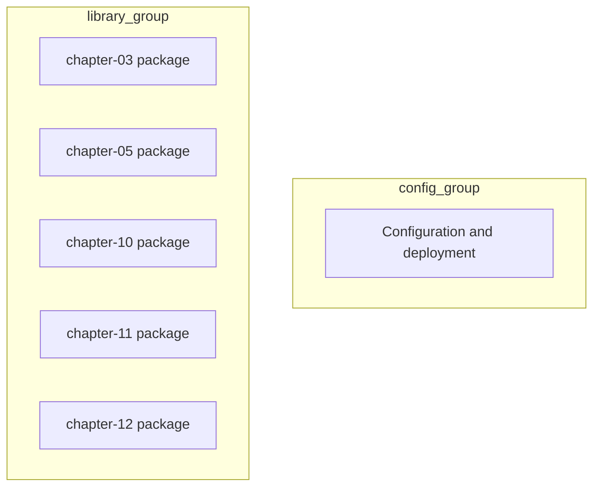

# Architecture report: MoonHighway/learning-react

> Automated static analysis. **Observed** = directly seen in files/imports/AST; **Inferred** = interpretation from that evidence. Repository code was not executed.

## 1. Repository at a glance

| Item | Value |
| --- | --- |
| Repository | MoonHighway/learning-react |
| Description | The code samples for Learning React by Alex Banks and Eve Porcello, published by O'Reilly Media |
| Language | JavaScript |
| Stars | 3749 |
| Licence | Not detected |
| Analysed commit / branch | b783c09ad4c8aa283e4e7adb98605148170e3708 / second-edition |
| Framework(s) | Express, Next.js, React |
| Files analysed | 519 |
| Components | 6 |

## 2. Architecture in one minute

MoonHighway/learning-react - The code samples for Learning React by Alex Banks and Eve Porcello, published by O'Reilly Media. This repository was analysed statically from 519 file(s) (0 Python). Detected technologies (observed from imports/manifests): Express, Next.js, React, React Router, TypeScript, webpack. Files are grouped into 6 component(s): chapter-03 package, chapter-05 package, chapter-10 package, chapter-11 package, chapter-12 package, Configuration and deployment. Findings below distinguish observed facts from inferred interpretation.

## 3. High-level block diagram

## 4. Main components

### chapter-03 package (`chapter_03`)

- **Kind:** library
- **Status:** Observed
- **Confidence:** 0.85
- **Responsibility:** Groups 2 file(s) under chapter-03 package (observed from repository paths and static analysis).
- **Paths:** `chapter-03/08-composition/04-imperative-clock.js`, `chapter-03/08-composition/05-declarative-clock.js`
- **Evidence:** [chapter-03/08-composition/04-imperative-clock.js](https://github.com/MoonHighway/learning-react/blob/b783c09ad4c8aa283e4e7adb98605148170e3708/chapter-03/08-composition/04-imperative-clock.js); [chapter-03/08-composition/05-declarative-clock.js](https://github.com/MoonHighway/learning-react/blob/b783c09ad4c8aa283e4e7adb98605148170e3708/chapter-03/08-composition/05-declarative-clock.js)

### chapter-05 package (`chapter_05`)

- **Kind:** library
- **Status:** Observed
- **Confidence:** 0.85
- **Responsibility:** Groups 8 file(s) under chapter-05 package (observed from repository paths and static analysis).
- **Paths:** `chapter-05/recipe-app/src/components/Ingredient.js`, `chapter-05/recipe-app/src/components/IngredientsList.js`, `chapter-05/recipe-app/src/components/Instructions.js`, `chapter-05/recipe-app/src/components/Menu.js`, `chapter-05/recipe-app/src/components/Recipe.js`, `chapter-05/recipe-app/src/index.js`, `chapter-05/recipe-app/webpack.config.js`, `chapter-05/recipes.js`
- **Evidence:** [chapter-05/recipe-app/src/components/Ingredient.js](https://github.com/MoonHighway/learning-react/blob/b783c09ad4c8aa283e4e7adb98605148170e3708/chapter-05/recipe-app/src/components/Ingredient.js); [chapter-05/recipe-app/src/components/IngredientsList.js](https://github.com/MoonHighway/learning-react/blob/b783c09ad4c8aa283e4e7adb98605148170e3708/chapter-05/recipe-app/src/components/IngredientsList.js); [chapter-05/recipe-app/src/components/Instructions.js](https://github.com/MoonHighway/learning-react/blob/b783c09ad4c8aa283e4e7adb98605148170e3708/chapter-05/recipe-app/src/components/Instructions.js); [chapter-05/recipe-app/src/components/Menu.js](https://github.com/MoonHighway/learning-react/blob/b783c09ad4c8aa283e4e7adb98605148170e3708/chapter-05/recipe-app/src/components/Menu.js); [chapter-05/recipe-app/src/components/Recipe.js](https://github.com/MoonHighway/learning-react/blob/b783c09ad4c8aa283e4e7adb98605148170e3708/chapter-05/recipe-app/src/components/Recipe.js); [chapter-05/recipe-app/src/index.js](https://github.com/MoonHighway/learning-react/blob/b783c09ad4c8aa283e4e7adb98605148170e3708/chapter-05/recipe-app/src/index.js); [chapter-05/recipe-app/webpack.config.js](https://github.com/MoonHighway/learning-react/blob/b783c09ad4c8aa283e4e7adb98605148170e3708/chapter-05/recipe-app/webpack.config.js); [chapter-05/recipes.js](https://github.com/MoonHighway/learning-react/blob/b783c09ad4c8aa283e4e7adb98605148170e3708/chapter-05/recipes.js)

### chapter-10 package (`chapter_10`)

- **Kind:** library
- **Status:** Observed
- **Confidence:** 0.85
- **Responsibility:** Groups 11 file(s) under chapter-10 package (observed from repository paths and static analysis).
- **Paths:** `chapter-10/my-type/src/App.tsx`, `chapter-10/my-type/src/index.tsx`, `chapter-10/my-type/src/react-app-env.d.ts`, `chapter-10/star-testing/src/Checkbox.js`, `chapter-10/star-testing/src/Checkbox.test.js`, `chapter-10/star-testing/src/Star.js`, `chapter-10/star-testing/src/Star.test.js`, `chapter-10/star-testing/src/index.js`, `chapter-10/testing/src/functions.js`, `chapter-10/testing/src/functions.test.js`, `chapter-10/testing/src/index.js`
- **Evidence:** [chapter-10/my-type/src/App.tsx](https://github.com/MoonHighway/learning-react/blob/b783c09ad4c8aa283e4e7adb98605148170e3708/chapter-10/my-type/src/App.tsx); [chapter-10/my-type/src/index.tsx](https://github.com/MoonHighway/learning-react/blob/b783c09ad4c8aa283e4e7adb98605148170e3708/chapter-10/my-type/src/index.tsx); [chapter-10/my-type/src/react-app-env.d.ts](https://github.com/MoonHighway/learning-react/blob/b783c09ad4c8aa283e4e7adb98605148170e3708/chapter-10/my-type/src/react-app-env.d.ts); [chapter-10/star-testing/src/Checkbox.js](https://github.com/MoonHighway/learning-react/blob/b783c09ad4c8aa283e4e7adb98605148170e3708/chapter-10/star-testing/src/Checkbox.js); [chapter-10/star-testing/src/Checkbox.test.js](https://github.com/MoonHighway/learning-react/blob/b783c09ad4c8aa283e4e7adb98605148170e3708/chapter-10/star-testing/src/Checkbox.test.js); [chapter-10/star-testing/src/Star.js](https://github.com/MoonHighway/learning-react/blob/b783c09ad4c8aa283e4e7adb98605148170e3708/chapter-10/star-testing/src/Star.js); [chapter-10/star-testing/src/Star.test.js](https://github.com/MoonHighway/learning-react/blob/b783c09ad4c8aa283e4e7adb98605148170e3708/chapter-10/star-testing/src/Star.test.js); [chapter-10/star-testing/src/index.js](https://github.com/MoonHighway/learning-react/blob/b783c09ad4c8aa283e4e7adb98605148170e3708/chapter-10/star-testing/src/index.js)

### chapter-11 package (`chapter_11`)

- **Kind:** library
- **Status:** Observed
- **Confidence:** 0.85
- **Responsibility:** Groups 12 file(s) under chapter-11 package (observed from repository paths and static analysis).
- **Paths:** `chapter-11/color-organizer/src/Colors/AddColorForm.js`, `chapter-11/color-organizer/src/Colors/Color.js`, `chapter-11/color-organizer/src/Colors/ColorDetails.js`, `chapter-11/color-organizer/src/Colors/ColorList.js`, `chapter-11/color-organizer/src/Colors/Star.js`, `chapter-11/color-organizer/src/Colors/StarRating.js`, `chapter-11/color-organizer/src/Colors/hooks.js`, `chapter-11/color-organizer/src/Colors/index.js`, `chapter-11/color-organizer/src/index.js`, `chapter-11/company-website/src/App.js`, `chapter-11/company-website/src/index.js`, `chapter-11/company-website/src/pages.js`
- **Evidence:** [chapter-11/color-organizer/src/Colors/AddColorForm.js](https://github.com/MoonHighway/learning-react/blob/b783c09ad4c8aa283e4e7adb98605148170e3708/chapter-11/color-organizer/src/Colors/AddColorForm.js); [chapter-11/color-organizer/src/Colors/Color.js](https://github.com/MoonHighway/learning-react/blob/b783c09ad4c8aa283e4e7adb98605148170e3708/chapter-11/color-organizer/src/Colors/Color.js); [chapter-11/color-organizer/src/Colors/ColorDetails.js](https://github.com/MoonHighway/learning-react/blob/b783c09ad4c8aa283e4e7adb98605148170e3708/chapter-11/color-organizer/src/Colors/ColorDetails.js); [chapter-11/color-organizer/src/Colors/ColorList.js](https://github.com/MoonHighway/learning-react/blob/b783c09ad4c8aa283e4e7adb98605148170e3708/chapter-11/color-organizer/src/Colors/ColorList.js); [chapter-11/color-organizer/src/Colors/Star.js](https://github.com/MoonHighway/learning-react/blob/b783c09ad4c8aa283e4e7adb98605148170e3708/chapter-11/color-organizer/src/Colors/Star.js); [chapter-11/color-organizer/src/Colors/StarRating.js](https://github.com/MoonHighway/learning-react/blob/b783c09ad4c8aa283e4e7adb98605148170e3708/chapter-11/color-organizer/src/Colors/StarRating.js); [chapter-11/color-organizer/src/Colors/hooks.js](https://github.com/MoonHighway/learning-react/blob/b783c09ad4c8aa283e4e7adb98605148170e3708/chapter-11/color-organizer/src/Colors/hooks.js); [chapter-11/color-organizer/src/Colors/index.js](https://github.com/MoonHighway/learning-react/blob/b783c09ad4c8aa283e4e7adb98605148170e3708/chapter-11/color-organizer/src/Colors/index.js)

### chapter-12 package (`chapter_12`)

- **Kind:** library
- **Status:** Observed
- **Confidence:** 0.85
- **Responsibility:** Groups 28 file(s) under chapter-12 package (observed from repository paths and static analysis).
- **Paths:** `chapter-12/node-fetching/index.js`, `chapter-12/pets-next/.next/server/init-server.js`, `chapter-12/pets-next/.next/server/on-error-server.js`, `chapter-12/pets-next/.next/server/ssr-module-cache.js`, `chapter-12/pets-next/.next/server/static/development/pages/_app.js`, `chapter-12/pets-next/.next/server/static/development/pages/_document.js`, `chapter-12/pets-next/.next/server/static/development/pages/_error.js`, `chapter-12/pets-next/.next/server/static/development/pages/index.js`, `chapter-12/pets-next/.next/server/static/development/pages/pets.js`, `chapter-12/pets-next/.next/static/chunks/0.js`, `chapter-12/pets-next/.next/static/development/_buildManifest.js`, `chapter-12/pets-next/.next/static/development/_ssgManifest.js`, `chapter-12/pets-next/.next/static/development/pages/_app.js`, `chapter-12/pets-next/.next/static/development/pages/_error.js`, `chapter-12/pets-next/.next/static/development/pages/index.js`, `chapter-12/pets-next/.next/static/development/pages/pets.js`, `chapter-12/pets-next/.next/static/runtime/amp.js`, `chapter-12/pets-next/.next/static/runtime/polyfills.js`, `chapter-12/pets-next/.next/static/runtime/webpack.js`, `chapter-12/pets-next/pages/Header.js`, `chapter-12/pets-next/pages/Layout.js`, `chapter-12/pets-next/pages/Pets.js`, `chapter-12/pets-next/pages/index.js`, `chapter-12/recipes/server-build/index.js`, `chapter-12/recipes/server/index.js`, `chapter-12/recipes/src/Menu.js`, `chapter-12/recipes/src/index.js`, `chapter-12/recipes/webpack.server.js`
- **Evidence:** [chapter-12/node-fetching/index.js](https://github.com/MoonHighway/learning-react/blob/b783c09ad4c8aa283e4e7adb98605148170e3708/chapter-12/node-fetching/index.js); [chapter-12/pets-next/.next/server/init-server.js](https://github.com/MoonHighway/learning-react/blob/b783c09ad4c8aa283e4e7adb98605148170e3708/chapter-12/pets-next/.next/server/init-server.js); [chapter-12/pets-next/.next/server/on-error-server.js](https://github.com/MoonHighway/learning-react/blob/b783c09ad4c8aa283e4e7adb98605148170e3708/chapter-12/pets-next/.next/server/on-error-server.js); [chapter-12/pets-next/.next/server/ssr-module-cache.js](https://github.com/MoonHighway/learning-react/blob/b783c09ad4c8aa283e4e7adb98605148170e3708/chapter-12/pets-next/.next/server/ssr-module-cache.js); [chapter-12/pets-next/.next/server/static/development/pages/_app.js](https://github.com/MoonHighway/learning-react/blob/b783c09ad4c8aa283e4e7adb98605148170e3708/chapter-12/pets-next/.next/server/static/development/pages/_app.js); [chapter-12/pets-next/.next/server/static/development/pages/_document.js](https://github.com/MoonHighway/learning-react/blob/b783c09ad4c8aa283e4e7adb98605148170e3708/chapter-12/pets-next/.next/server/static/development/pages/_document.js); [chapter-12/pets-next/.next/server/static/development/pages/_error.js](https://github.com/MoonHighway/learning-react/blob/b783c09ad4c8aa283e4e7adb98605148170e3708/chapter-12/pets-next/.next/server/static/development/pages/_error.js); [chapter-12/pets-next/.next/server/static/development/pages/index.js](https://github.com/MoonHighway/learning-react/blob/b783c09ad4c8aa283e4e7adb98605148170e3708/chapter-12/pets-next/.next/server/static/development/pages/index.js)

### Configuration and deployment (`config`)

- **Kind:** config
- **Status:** Observed
- **Confidence:** 0.85
- **Responsibility:** Groups 296 file(s) under configuration and deployment (observed from repository paths and static analysis).
- **Paths:** `chapter-05/recipe-app/data/recipes.json`, `chapter-05/recipe-app/package.json`, `chapter-10/my-type/package.json`, `chapter-10/my-type/public/manifest.json`, `chapter-10/my-type/tsconfig.json`, `chapter-10/star-testing/package.json`, `chapter-10/star-testing/public/manifest.json`, `chapter-10/testing/package.json`, `chapter-10/testing/public/manifest.json`, `chapter-11/color-organizer/package.json`, `chapter-11/color-organizer/public/manifest.json`, `chapter-11/color-organizer/src/Colors/default-colors.json`, `chapter-11/company-website/package.json`, `chapter-11/company-website/public/manifest.json`, `chapter-12/node-fetching/package.json`, `chapter-12/pets-next/.next/build-manifest.json`, `chapter-12/pets-next/.next/cache/autodll-webpack-plugin/development_instance_0_a243de3b532980b808da6738e16f9516/dll.manifest.json`, `chapter-12/pets-next/.next/cache/next-babel-loader/0085417bfdb189eaab561f45b7d72cc5.json`, `chapter-12/pets-next/.next/cache/next-babel-loader/020516077cd3e5fbc6c9f50e7a4b1c30.json`, `chapter-12/pets-next/.next/cache/next-babel-loader/03c2204f24a2e9095f64961df018fb76.json`, `chapter-12/pets-next/.next/cache/next-babel-loader/073c4b22ee6209298a39c89b61051c29.json`, `chapter-12/pets-next/.next/cache/next-babel-loader/0780a1a8e4f5d917eac42b427827603f.json`, `chapter-12/pets-next/.next/cache/next-babel-loader/0886fb037d86207139fd92c5247a5408.json`, `chapter-12/pets-next/.next/cache/next-babel-loader/0a4c2534469f8ffcd8b1a35a67bebf03.json`, `chapter-12/pets-next/.next/cache/next-babel-loader/0a7adf89a9db9f246feae400dacf40ee.json`, `chapter-12/pets-next/.next/cache/next-babel-loader/0b3676aacea2cee604acbd28c70eb7fd.json`, `chapter-12/pets-next/.next/cache/next-babel-loader/0cc532bb5d2960587d944f2d848da249.json`, `chapter-12/pets-next/.next/cache/next-babel-loader/0d5b96d35dc34ba2145c66a0ee513b63.json`, `chapter-12/pets-next/.next/cache/next-babel-loader/0d915dcd43a9d7b46ecfb941cda24c9d.json`, `chapter-12/pets-next/.next/cache/next-babel-loader/0ddb73719fac958005a5958e4655cce7.json`, `chapter-12/pets-next/.next/cache/next-babel-loader/0e121ed12dbb1a508d4dfeb2e8293250.json`, `chapter-12/pets-next/.next/cache/next-babel-loader/0e150bf2255c0827c5c1ad74f9c4e6a2.json`, `chapter-12/pets-next/.next/cache/next-babel-loader/0e913e0c583fdda9c4ae84e02689cb26.json`, `chapter-12/pets-next/.next/cache/next-babel-loader/0eaa46c673fd6131248a90c364b5817c.json`, `chapter-12/pets-next/.next/cache/next-babel-loader/0ee4e26f8a0e48a02f5b01db56980928.json`, `chapter-12/pets-next/.next/cache/next-babel-loader/0f498d6ce7c1e23c79340fdcecafd1c4.json`, `chapter-12/pets-next/.next/cache/next-babel-loader/102c4a1cb8d502528f81ad428c8dd669.json`, `chapter-12/pets-next/.next/cache/next-babel-loader/1097ff48988b77b4c755e0f5da713ab4.json`, `chapter-12/pets-next/.next/cache/next-babel-loader/10ef1b3aa0c738609c5969ac2dc50cd6.json`, `chapter-12/pets-next/.next/cache/next-babel-loader/1235c316c154d3e52950f307455d4f92.json`, `chapter-12/pets-next/.next/cache/next-babel-loader/132444063d4831c6c0148d08df0a00f8.json`, `chapter-12/pets-next/.next/cache/next-babel-loader/14a31a61c6a431530b2594cae59dd088.json`, `chapter-12/pets-next/.next/cache/next-babel-loader/17e4250f77e2bc85947b493cf2e5bdfe.json`, `chapter-12/pets-next/.next/cache/next-babel-loader/1874e606c1af761779d7fd7de8cbed93.json`, `chapter-12/pets-next/.next/cache/next-babel-loader/1879cfbfb24646c1e65df310d550d6a8.json`, `chapter-12/pets-next/.next/cache/next-babel-loader/193b586a3efc04a1a30e1a2d56aecd37.json`, `chapter-12/pets-next/.next/cache/next-babel-loader/19af1a4d627da6ef81c233fbfaa482d5.json`, `chapter-12/pets-next/.next/cache/next-babel-loader/1c0dd551f1114fb2640b19bc5e091b4e.json`, `chapter-12/pets-next/.next/cache/next-babel-loader/1ce48ae7b40e5176f0c85d26ad4bf3a8.json`, `chapter-12/pets-next/.next/cache/next-babel-loader/1d450425e7f7973da54a79066b637885.json`, `chapter-12/pets-next/.next/cache/next-babel-loader/1df7d9091f07299a8a464426649dabb3.json`, `chapter-12/pets-next/.next/cache/next-babel-loader/1ed085a5801688e44758d052c4bcbaac.json`, `chapter-12/pets-next/.next/cache/next-babel-loader/1f4a8ae797aa4affcdac0e45c1e4b6f6.json`, `chapter-12/pets-next/.next/cache/next-babel-loader/20d0c340dfd9eb5451b30a0e3122f56a.json`, `chapter-12/pets-next/.next/cache/next-babel-loader/219c079723654b9868b5db1491860441.json`, `chapter-12/pets-next/.next/cache/next-babel-loader/22a4e97d6af42adb4e90951ac70591f5.json`, `chapter-12/pets-next/.next/cache/next-babel-loader/2337eabb95cc94028c58ee031dd2e9f0.json`, `chapter-12/pets-next/.next/cache/next-babel-loader/23e1da02a6ee2611b2445b144646d6aa.json`, `chapter-12/pets-next/.next/cache/next-babel-loader/244132788ea953d10d4cbea8b0d0c958.json`, `chapter-12/pets-next/.next/cache/next-babel-loader/24886fd74634619688e3722453af56d9.json`, `chapter-12/pets-next/.next/cache/next-babel-loader/24a66effba3b487763a015a189a06fbb.json`, `chapter-12/pets-next/.next/cache/next-babel-loader/24c860014e72ad42580c7280f5ae613f.json`, `chapter-12/pets-next/.next/cache/next-babel-loader/24d8891a8c92a10e1dc9a4b47faaa387.json`, `chapter-12/pets-next/.next/cache/next-babel-loader/26466408c67d5d70888ed57b40e3b646.json`, `chapter-12/pets-next/.next/cache/next-babel-loader/2781214898d6a949e2d03242c2404af6.json`, `chapter-12/pets-next/.next/cache/next-babel-loader/27a159b2c56f3050604db353f31df4c9.json`, `chapter-12/pets-next/.next/cache/next-babel-loader/28386338323866c0a73494ee31b10a5e.json`, `chapter-12/pets-next/.next/cache/next-babel-loader/2c2ea513122ddfc4b42173c7515d1844.json`, `chapter-12/pets-next/.next/cache/next-babel-loader/2d00618dfce063cee6e05f8594079759.json`, `chapter-12/pets-next/.next/cache/next-babel-loader/2d4b31ae89b687328389a36d55ea86e4.json`, `chapter-12/pets-next/.next/cache/next-babel-loader/2dbf6701a6099c9df7d22bcd5011ff73.json`, `chapter-12/pets-next/.next/cache/next-babel-loader/2df93626602afe8272ca29e634004945.json`, `chapter-12/pets-next/.next/cache/next-babel-loader/2e0d7b2e3f5d7dc1926fbb5e4994df24.json`, `chapter-12/pets-next/.next/cache/next-babel-loader/2eea7e090b1294fe10e5bba4af7d0787.json`, `chapter-12/pets-next/.next/cache/next-babel-loader/2f987e00c2cd3a9b0beebcfc34266d30.json`, `chapter-12/pets-next/.next/cache/next-babel-loader/31c04910b4aa656fd06813a67b780f1a.json`, `chapter-12/pets-next/.next/cache/next-babel-loader/31c9c83249a28d41a7fea44bdaeb8150.json`, `chapter-12/pets-next/.next/cache/next-babel-loader/321285fa3e7210ea0441a18c23ef14b4.json`, `chapter-12/pets-next/.next/cache/next-babel-loader/33269d2fd738031e691815c73c0a90ea.json`, `chapter-12/pets-next/.next/cache/next-babel-loader/335200dd9be1ac985a1cc38fc7edf44e.json`, `chapter-12/pets-next/.next/cache/next-babel-loader/35026f8f3b0bd213b2d32723b4347210.json`, `chapter-12/pets-next/.next/cache/next-babel-loader/3540d5554ad5ac9ed3145b7c5aa9d94d.json`, `chapter-12/pets-next/.next/cache/next-babel-loader/35c3b28fe939530b97d4abc03a530130.json`, `chapter-12/pets-next/.next/cache/next-babel-loader/36d6cb104bbfcfe53a99ff5c5f77a700.json`, `chapter-12/pets-next/.next/cache/next-babel-loader/36e71f755f8f9f46710756b3ea651b05.json`, `chapter-12/pets-next/.next/cache/next-babel-loader/379c83e2c58fe368bda5ba5a32e834a1.json`, `chapter-12/pets-next/.next/cache/next-babel-loader/391719d94ab9be82cb59d6087ffc73f7.json`, `chapter-12/pets-next/.next/cache/next-babel-loader/3a0950ab7162da8289603d01499f473c.json`, `chapter-12/pets-next/.next/cache/next-babel-loader/3a6c178b5daab2e26e504533a271c77a.json`, `chapter-12/pets-next/.next/cache/next-babel-loader/3af7f8e8740ca4bbe26364720716da39.json`, `chapter-12/pets-next/.next/cache/next-babel-loader/3d91c5490cabdaf1eaac5f0163a2f131.json`, `chapter-12/pets-next/.next/cache/next-babel-loader/3da03308e45561fc958a06e5ec07028a.json`, `chapter-12/pets-next/.next/cache/next-babel-loader/3e96d3515151a1572dd8504a5240d528.json`, `chapter-12/pets-next/.next/cache/next-babel-loader/3efd55bb7605a58976c7765f63ad033d.json`, `chapter-12/pets-next/.next/cache/next-babel-loader/4066f53798f3b543e59dc4c851e13de4.json`, `chapter-12/pets-next/.next/cache/next-babel-loader/4192c0da7019406f96a599c2261de861.json`, `chapter-12/pets-next/.next/cache/next-babel-loader/41bb987cedb5dff2d7551c4b88799868.json`, `chapter-12/pets-next/.next/cache/next-babel-loader/435f7d165130c97b84cb0c14ab224aff.json`, `chapter-12/pets-next/.next/cache/next-babel-loader/43ee2969031bd4deeb6070ff4d5f81b0.json`, `chapter-12/pets-next/.next/cache/next-babel-loader/45649725ceac174ef0a905905696114a.json`, `chapter-12/pets-next/.next/cache/next-babel-loader/46477123cb008af4329bb6f5e7d3a9c6.json`, `chapter-12/pets-next/.next/cache/next-babel-loader/4793843d5fae23d793d610e05471f48c.json`, `chapter-12/pets-next/.next/cache/next-babel-loader/48fb11012e36a38aa59cfcc474ede6bb.json`, `chapter-12/pets-next/.next/cache/next-babel-loader/49575fd45f8d6d3a646740a26812ed77.json`, `chapter-12/pets-next/.next/cache/next-babel-loader/4b2eae5402de6c3126016fd23364a162.json`, `chapter-12/pets-next/.next/cache/next-babel-loader/4b7f9bf4f067f4c7cb75831de0e61a92.json`, `chapter-12/pets-next/.next/cache/next-babel-loader/4c7b145840bec9e6263c50b27f78faf7.json`, `chapter-12/pets-next/.next/cache/next-babel-loader/4deb8dbd4cdb6631a07c3ea16fabf961.json`, `chapter-12/pets-next/.next/cache/next-babel-loader/4f48d90d106ebfe6aaeb71a663357413.json`, `chapter-12/pets-next/.next/cache/next-babel-loader/5104f8780a0958b6a78eb14bffac2561.json`, `chapter-12/pets-next/.next/cache/next-babel-loader/51f90f8c3816deef1feae84c05918322.json`, `chapter-12/pets-next/.next/cache/next-babel-loader/52392163565289aa1432abf377302760.json`, `chapter-12/pets-next/.next/cache/next-babel-loader/524954dd1d04beb8952f01a94eebef31.json`, `chapter-12/pets-next/.next/cache/next-babel-loader/532548e874afbdf944320a19c0b9e4ca.json`, `chapter-12/pets-next/.next/cache/next-babel-loader/535bdb815d751ef06d6dab235414dfe0.json`, `chapter-12/pets-next/.next/cache/next-babel-loader/5373cc6ade841292e619b886b6e59e96.json`, `chapter-12/pets-next/.next/cache/next-babel-loader/569a6cbd8cbb502d86324868c3799018.json`, `chapter-12/pets-next/.next/cache/next-babel-loader/5844d904889eaa6099823d6684879567.json`, `chapter-12/pets-next/.next/cache/next-babel-loader/5acca225edd624453a94ff418138cedb.json`, `chapter-12/pets-next/.next/cache/next-babel-loader/5b70fe7bc8146317956a30e94bb5beb0.json`, `chapter-12/pets-next/.next/cache/next-babel-loader/5bfdc5f63f164e5ae8766a4ed14ae887.json`, `chapter-12/pets-next/.next/cache/next-babel-loader/5c361a997d5091d0b96fb72fa1d3dc8a.json`, `chapter-12/pets-next/.next/cache/next-babel-loader/5cb0b6b495cf7e753443450b10578790.json`, `chapter-12/pets-next/.next/cache/next-babel-loader/5d9d82029b467dcacb478d25781fbdf0.json`, `chapter-12/pets-next/.next/cache/next-babel-loader/5db88397442dae4ef5e14f2f50e3760d.json`, `chapter-12/pets-next/.next/cache/next-babel-loader/5f04b7796303ac1dad4bc2e8627b7a2d.json`, `chapter-12/pets-next/.next/cache/next-babel-loader/5f26e3d7da0ab9fb44c6c53a7c8a5715.json`, `chapter-12/pets-next/.next/cache/next-babel-loader/62527b31a62bf43f7397d65fa9cdf77a.json`, `chapter-12/pets-next/.next/cache/next-babel-loader/627659516e04f9b89f5c68fc3edb85d4.json`, `chapter-12/pets-next/.next/cache/next-babel-loader/62d7eb3f431e82b2ece59eb544501b17.json`, `chapter-12/pets-next/.next/cache/next-babel-loader/62ebb17818cf101f8438dc857a231ccf.json`, `chapter-12/pets-next/.next/cache/next-babel-loader/64f997296949d5e3eceb4f3439b32821.json`, `chapter-12/pets-next/.next/cache/next-babel-loader/683dd02db3e8fe4e4e59672a8d48f75b.json`, `chapter-12/pets-next/.next/cache/next-babel-loader/6924784258878f709932c76bdf625242.json`, `chapter-12/pets-next/.next/cache/next-babel-loader/69cbc75d59e680beb61cd28c7a91cec5.json`, `chapter-12/pets-next/.next/cache/next-babel-loader/6d03cb577c9158b5b77ba9f2bc10e3d3.json`, `chapter-12/pets-next/.next/cache/next-babel-loader/6d22afab36fe50c42c77694e6b67e6db.json`, `chapter-12/pets-next/.next/cache/next-babel-loader/6d769aa74659892182e18bb298b249ef.json`, `chapter-12/pets-next/.next/cache/next-babel-loader/6df11c877451045f49a4d1716004448d.json`, `chapter-12/pets-next/.next/cache/next-babel-loader/6e2e63043f9e6c291b6ded6713b3389d.json`, `chapter-12/pets-next/.next/cache/next-babel-loader/6f28e8d6a0dc557c7bada0556ec8ce02.json`, `chapter-12/pets-next/.next/cache/next-babel-loader/6f6e8713bf79a134516ece4c1e265589.json`, `chapter-12/pets-next/.next/cache/next-babel-loader/6f9d737aa125be39c4ebfba881109239.json`, `chapter-12/pets-next/.next/cache/next-babel-loader/71e3236ff13caa1286ceb107bbe8dff8.json`, `chapter-12/pets-next/.next/cache/next-babel-loader/729eab7a079d8055f8d64da088c1187d.json`, `chapter-12/pets-next/.next/cache/next-babel-loader/7373b64ccef99665f257f16c346773f7.json`, `chapter-12/pets-next/.next/cache/next-babel-loader/774e0606251c754f7df07c42fbcf5413.json`, `chapter-12/pets-next/.next/cache/next-babel-loader/781b7d59aef8bfeb351a5324549faecb.json`, `chapter-12/pets-next/.next/cache/next-babel-loader/79dd31c2219b5065cbd54d4da6a1ce18.json`, `chapter-12/pets-next/.next/cache/next-babel-loader/7b25f1aeeca9a18ea353409a3fde7bc5.json`, `chapter-12/pets-next/.next/cache/next-babel-loader/7c2033769a0a6b6bafabaf463fac68ef.json`, `chapter-12/pets-next/.next/cache/next-babel-loader/7d612c9d53e2b6c658f0856378a31c8f.json`, `chapter-12/pets-next/.next/cache/next-babel-loader/7d83ee4fe51f35a11a57bf1ef985583c.json`, `chapter-12/pets-next/.next/cache/next-babel-loader/7ee96ef6842e472a1db8638e2fcfaff4.json`, `chapter-12/pets-next/.next/cache/next-babel-loader/7f40f429cf6a045e2433764810824f20.json`, `chapter-12/pets-next/.next/cache/next-babel-loader/80e48f63c43118c158628b335ac61c03.json`, `chapter-12/pets-next/.next/cache/next-babel-loader/82cea8045b7103e4c1538adfc227f654.json`, `chapter-12/pets-next/.next/cache/next-babel-loader/82ef7c7976ef592bec5e250925404f8f.json`, `chapter-12/pets-next/.next/cache/next-babel-loader/836651f19640dc1a7b8bee7661a224bb.json`, `chapter-12/pets-next/.next/cache/next-babel-loader/859a4a4e4a4313c30bb4fae9316f58e8.json`, `chapter-12/pets-next/.next/cache/next-babel-loader/85df26b97c5e8308163220afb4d2c3d4.json`, `chapter-12/pets-next/.next/cache/next-babel-loader/8875e6abc476f1df4c1271f66604fc44.json`, `chapter-12/pets-next/.next/cache/next-babel-loader/88e32d3823741d6096cd8c5c45fd9e84.json`, `chapter-12/pets-next/.next/cache/next-babel-loader/8930948abb3671a4bfa22396abc76cc7.json`, `chapter-12/pets-next/.next/cache/next-babel-loader/8c5eeb6f171b66342f34abfd1c830ad7.json`, `chapter-12/pets-next/.next/cache/next-babel-loader/8e0746d0d420f32e4893274fa85dedf1.json`, `chapter-12/pets-next/.next/cache/next-babel-loader/8ec162842945123740e9b3eedbefe9bd.json`, `chapter-12/pets-next/.next/cache/next-babel-loader/8f4390262b07691aecf3d1869452fb87.json`, `chapter-12/pets-next/.next/cache/next-babel-loader/8f4678b14961e23f5581a2c90c4e89db.json`, `chapter-12/pets-next/.next/cache/next-babel-loader/8f53b67f4120df37acf71c6d176148fe.json`, `chapter-12/pets-next/.next/cache/next-babel-loader/905863c9d307d7b9f4058c9468897f1e.json`, `chapter-12/pets-next/.next/cache/next-babel-loader/9322ccdf64191a7e5a78a5cdf43b32de.json`, `chapter-12/pets-next/.next/cache/next-babel-loader/936b5adfd21a1248ca41000a3460d439.json`, `chapter-12/pets-next/.next/cache/next-babel-loader/954fde466b570eb6ffcb0414f81e80e4.json`, `chapter-12/pets-next/.next/cache/next-babel-loader/9565a0b54ec53a41e52041b82a3150b3.json`, `chapter-12/pets-next/.next/cache/next-babel-loader/959bbbf260e05a3f43457f5d67b6c629.json`, `chapter-12/pets-next/.next/cache/next-babel-loader/964a6abbd9c001cfa14d2e0b6e7a9192.json`, `chapter-12/pets-next/.next/cache/next-babel-loader/968294bd7ee34ac5640883aa64b129c6.json`, `chapter-12/pets-next/.next/cache/next-babel-loader/968f41c84c6b1de042f2161c6f7f95ae.json`, `chapter-12/pets-next/.next/cache/next-babel-loader/96cb9779e54ac495f3e57bc0859b2d02.json`, `chapter-12/pets-next/.next/cache/next-babel-loader/96eee93276ae8d921f5aa13365273281.json`, `chapter-12/pets-next/.next/cache/next-babel-loader/97d39f5616359996627288c10dad2786.json`, `chapter-12/pets-next/.next/cache/next-babel-loader/97f6e84e981d8bea52b8abba4d05523d.json`, `chapter-12/pets-next/.next/cache/next-babel-loader/98f722bed3310342493699e03819fb05.json`, `chapter-12/pets-next/.next/cache/next-babel-loader/9924d5cdc226b34ad6715f7737605dc5.json`, `chapter-12/pets-next/.next/cache/next-babel-loader/99d5d5fcec521e5af238caf1866cf15a.json`, `chapter-12/pets-next/.next/cache/next-babel-loader/99fc8845903c3895b8357aaf8b29e803.json`, `chapter-12/pets-next/.next/cache/next-babel-loader/9b997fe08d74d5a27d8f166e8b04475c.json`, `chapter-12/pets-next/.next/cache/next-babel-loader/9dab0693910e67a93bc2506f8054861a.json`, `chapter-12/pets-next/.next/cache/next-babel-loader/9e8cb5fcb7e631cb91020f250cc617b9.json`, `chapter-12/pets-next/.next/cache/next-babel-loader/9ef5b84509b8ef17a229317a33f7a25a.json`, `chapter-12/pets-next/.next/cache/next-babel-loader/a08581d760932f16be2f9024ee7d0d2d.json`, `chapter-12/pets-next/.next/cache/next-babel-loader/a18f82f6481c339f3c2717f784d858b5.json`, `chapter-12/pets-next/.next/cache/next-babel-loader/a2ddbfc5aba88f6b4d642ff7fa8becc2.json`, `chapter-12/pets-next/.next/cache/next-babel-loader/a3972b021ebfb99750b30d18b83c6b02.json`, `chapter-12/pets-next/.next/cache/next-babel-loader/a504c57cb98b38dbfe70ef32b67fc865.json`, `chapter-12/pets-next/.next/cache/next-babel-loader/a6dc45e9df05abed452736700cddc1d0.json`, `chapter-12/pets-next/.next/cache/next-babel-loader/a7eebd6237e264460998d7f4744fe223.json`, `chapter-12/pets-next/.next/cache/next-babel-loader/aa38075bb42d680a00c293392a999866.json`, `chapter-12/pets-next/.next/cache/next-babel-loader/ab39e7dd4259eb8f9f0eb8a049098471.json`, `chapter-12/pets-next/.next/cache/next-babel-loader/ab682532749b90b99ab1a313d3e0de58.json`, `chapter-12/pets-next/.next/cache/next-babel-loader/abcfa2ef9213f235591ba95db3d20588.json`, `chapter-12/pets-next/.next/cache/next-babel-loader/ac7a4841db4e6c841d457ef4d3793c61.json`, `chapter-12/pets-next/.next/cache/next-babel-loader/adf041ff2668ad1dfa7d64543635d597.json`, `chapter-12/pets-next/.next/cache/next-babel-loader/ae4b8b64a60852f57998cac0d5f00f03.json`, `chapter-12/pets-next/.next/cache/next-babel-loader/b027e459db3fc503a35a66dd175999d3.json`, `chapter-12/pets-next/.next/cache/next-babel-loader/b03dfd81d8e7efb99ddd659828641bb4.json`, `chapter-12/pets-next/.next/cache/next-babel-loader/b047aea9f04660e531c7e3274491a8bc.json`, `chapter-12/pets-next/.next/cache/next-babel-loader/b08a604260a72f3f70fcd3dc48c4cfec.json`, `chapter-12/pets-next/.next/cache/next-babel-loader/b2881849baae68b30649cc714436ebdf.json`, `chapter-12/pets-next/.next/cache/next-babel-loader/b4009ddc42beb9f76324fcd4a609dc87.json`, `chapter-12/pets-next/.next/cache/next-babel-loader/b41bf0e66e0811dafb430ed2dc57f4ad.json`, `chapter-12/pets-next/.next/cache/next-babel-loader/b4737a2037bb3ead1f8b398828a9fdec.json`, `chapter-12/pets-next/.next/cache/next-babel-loader/b4e45db21816ec345f29334391178604.json`, `chapter-12/pets-next/.next/cache/next-babel-loader/b4f2fb01c13ec78c72cbfd84e4ce85fd.json`, `chapter-12/pets-next/.next/cache/next-babel-loader/b572861c4b6aa2eafd5186a5e99ff1e7.json`, `chapter-12/pets-next/.next/cache/next-babel-loader/b58be295346f0e6b2c718162d4506ca9.json`, `chapter-12/pets-next/.next/cache/next-babel-loader/b599931b6c64ca9da4c0bc4bb35aa20c.json`, `chapter-12/pets-next/.next/cache/next-babel-loader/b611426417b6767c71a5bb8bcccd72ff.json`, `chapter-12/pets-next/.next/cache/next-babel-loader/b6595ab1484a1474f3777ec448abb828.json`, `chapter-12/pets-next/.next/cache/next-babel-loader/b6a9fcdc0aabe92fd09d44b3827b6ab8.json`, `chapter-12/pets-next/.next/cache/next-babel-loader/b7586076da1a553afc472a2f98ea17b4.json`, `chapter-12/pets-next/.next/cache/next-babel-loader/b8242be6d6adcd40d1c3d81dc4aaf47c.json`, `chapter-12/pets-next/.next/cache/next-babel-loader/b8badd2534c423531427630d175de645.json`, `chapter-12/pets-next/.next/cache/next-babel-loader/bdb78214291eafd929b820804a0655e8.json`, `chapter-12/pets-next/.next/cache/next-babel-loader/bf3a5facc4433594bd4df0ab383167a5.json`, `chapter-12/pets-next/.next/cache/next-babel-loader/bf504d704eb03772a50b60170210fd91.json`, `chapter-12/pets-next/.next/cache/next-babel-loader/bfd839213a0c9483b827fdb3cf461f1a.json`, `chapter-12/pets-next/.next/cache/next-babel-loader/c03f08de8054b082ab7557506b328c87.json`, `chapter-12/pets-next/.next/cache/next-babel-loader/c08a5c072cb817c8206f8dbc65894537.json`, `chapter-12/pets-next/.next/cache/next-babel-loader/c11c0d992a887fa4ae5ee9c4ee2dc476.json`, `chapter-12/pets-next/.next/cache/next-babel-loader/c2251010f92a2ada4b3ddfe47cdbd004.json`, `chapter-12/pets-next/.next/cache/next-babel-loader/c25b615d251da3cd2bf214475c736588.json`, `chapter-12/pets-next/.next/cache/next-babel-loader/c2e3626eebea028cf6bebdde8dfd6eda.json`, `chapter-12/pets-next/.next/cache/next-babel-loader/c388a322dbeb3f7996559b21f99f15d2.json`, `chapter-12/pets-next/.next/cache/next-babel-loader/c562e00cd80dca62a0d1b05b04a61726.json`, `chapter-12/pets-next/.next/cache/next-babel-loader/c5d86d4a558793cf7b1997a5329f4451.json`, `chapter-12/pets-next/.next/cache/next-babel-loader/c671244b95ded9345c3ad40fffcd4b8f.json`, `chapter-12/pets-next/.next/cache/next-babel-loader/cadf2bf94906342e68ef0d67f380267c.json`, `chapter-12/pets-next/.next/cache/next-babel-loader/cd0b05888139edad1b55908b1a427e54.json`, `chapter-12/pets-next/.next/cache/next-babel-loader/cd79f1646702694f5f536ab71ae5a1b0.json`, `chapter-12/pets-next/.next/cache/next-babel-loader/cf5edc60729b852d37142405c423f4c9.json`, `chapter-12/pets-next/.next/cache/next-babel-loader/cfbb6592ae573552f958b8273496ff84.json`, `chapter-12/pets-next/.next/cache/next-babel-loader/d0a95c026ce36f7a98ab5f1eca0e6d49.json`, `chapter-12/pets-next/.next/cache/next-babel-loader/d1121337381936685ad3e8118df3979e.json`, `chapter-12/pets-next/.next/cache/next-babel-loader/d29100e8152ec28d0c85992c7c4f1a5e.json`, `chapter-12/pets-next/.next/cache/next-babel-loader/d2db681c9fd110107bfccde87ab33efe.json`, `chapter-12/pets-next/.next/cache/next-babel-loader/d6096d0c8f2160800500274c327ba7b9.json`, `chapter-12/pets-next/.next/cache/next-babel-loader/d66bfc5861e979ba084f9967548fdc64.json`, `chapter-12/pets-next/.next/cache/next-babel-loader/d83110f3e67d30820e8adf7147438aaf.json`, `chapter-12/pets-next/.next/cache/next-babel-loader/d9d7f82e69b4bdd5604c4862714fe27a.json`, `chapter-12/pets-next/.next/cache/next-babel-loader/daa4a98a7ea33fe91ef36d1046edc0fe.json`, `chapter-12/pets-next/.next/cache/next-babel-loader/db25d1802eac878fffb0482d80f3c082.json`, `chapter-12/pets-next/.next/cache/next-babel-loader/db3cbe5fe7c8bc83767bc5062e142aae.json`, `chapter-12/pets-next/.next/cache/next-babel-loader/dc21ec4284bcc6e0f64afb168c203ed9.json`, `chapter-12/pets-next/.next/cache/next-babel-loader/ddeb59f2750269b29f874f7d9c34bd37.json`, `chapter-12/pets-next/.next/cache/next-babel-loader/dfd7dd08ba12c7b8738685a490eeb052.json`, `chapter-12/pets-next/.next/cache/next-babel-loader/e0f2686866afa7ad54cb78e36eb4a1c6.json`, `chapter-12/pets-next/.next/cache/next-babel-loader/e130420d8ca861bd54b03e4ac7b6c60c.json`, `chapter-12/pets-next/.next/cache/next-babel-loader/e2aa2f965e254570c45d53ab2d65579a.json`, `chapter-12/pets-next/.next/cache/next-babel-loader/e3326f2715b9ad174fd86d560ee4c223.json`, `chapter-12/pets-next/.next/cache/next-babel-loader/e368b15344c81b869a1910e59fd8de4a.json`, `chapter-12/pets-next/.next/cache/next-babel-loader/e479c943f32b23c6dd84ade74b1e97ad.json`, `chapter-12/pets-next/.next/cache/next-babel-loader/e4b814b8d90f4091a5811bdcce896774.json`, `chapter-12/pets-next/.next/cache/next-babel-loader/e54c786fd72fdedbcab8b0cf57ab8ace.json`, `chapter-12/pets-next/.next/cache/next-babel-loader/e648d2acdb42ef8c24e1492c9c67d7c6.json`, `chapter-12/pets-next/.next/cache/next-babel-loader/e6c01fdd5c9fb05d04b4c6e587a7eaba.json`, `chapter-12/pets-next/.next/cache/next-babel-loader/e716f9c0f46a388715f75c590e748575.json`, `chapter-12/pets-next/.next/cache/next-babel-loader/e75c23ec8e2ffe1d8ed51053719eef7e.json`, `chapter-12/pets-next/.next/cache/next-babel-loader/e8d0991af225c0f1b45cf241cfb4aa7f.json`, `chapter-12/pets-next/.next/cache/next-babel-loader/e9106191e5a3cbfa9ed306cf57b70608.json`, `chapter-12/pets-next/.next/cache/next-babel-loader/e95cf760b3d5814586279ea5027cbd5f.json`, `chapter-12/pets-next/.next/cache/next-babel-loader/e9863ba6049d81b85016047932b347b4.json`, `chapter-12/pets-next/.next/cache/next-babel-loader/eb06ea7a919d2dcf09aa473e3981c6c5.json`, `chapter-12/pets-next/.next/cache/next-babel-loader/ed086bf22cb617b7696f1dfd55950e69.json`, `chapter-12/pets-next/.next/cache/next-babel-loader/eeaeb6acccaa6cea21b0f49e9649bb27.json`, `chapter-12/pets-next/.next/cache/next-babel-loader/ef51fb34c79085bcc7e3b271665a4d06.json`, `chapter-12/pets-next/.next/cache/next-babel-loader/f0284a3d53d39a5b331aa87a19219d95.json`, `chapter-12/pets-next/.next/cache/next-babel-loader/f1b552d95433bffdef69815674529c94.json`, `chapter-12/pets-next/.next/cache/next-babel-loader/f1ee2e0ace126168c6e9c5d022305113.json`, `chapter-12/pets-next/.next/cache/next-babel-loader/f44291422a59688d6bc07317952d153c.json`, `chapter-12/pets-next/.next/cache/next-babel-loader/f5c5b253c1fc25ada27124914d673c73.json`, `chapter-12/pets-next/.next/cache/next-babel-loader/f75d71c2f10f65e0ab14731a3bd941aa.json`, `chapter-12/pets-next/.next/cache/next-babel-loader/f836ce9c409f19754f0048becd011ea0.json`, `chapter-12/pets-next/.next/cache/next-babel-loader/f924f21f39e449e86c6282b4dad148b3.json`, `chapter-12/pets-next/.next/cache/next-babel-loader/f9c16918ce812619cb22136c953ed860.json`, `chapter-12/pets-next/.next/cache/next-babel-loader/fc62ba6f3b47e321d2ba3d843c04b12d.json`, `chapter-12/pets-next/.next/cache/next-babel-loader/fd63b43ec3faa24d34dac73d33356cfb.json`, `chapter-12/pets-next/.next/cache/next-babel-loader/ff62c31d1e0e6386331fa897e87d568b.json`, `chapter-12/pets-next/.next/react-loadable-manifest.json`, `chapter-12/pets-next/.next/server/pages-manifest.json`, `chapter-12/pets-next/.next/static/webpack/0292b093dc64ce093240.hot-update.json`, `chapter-12/pets-next/.next/static/webpack/fdaa338e5a22bdbf7699.hot-update.json`, `chapter-12/pets-next/package.json`, `chapter-12/recipes/package.json`, `chapter-12/recipes/public/manifest.json`
- **Evidence:** [chapter-05/recipe-app/data/recipes.json](https://github.com/MoonHighway/learning-react/blob/b783c09ad4c8aa283e4e7adb98605148170e3708/chapter-05/recipe-app/data/recipes.json); [chapter-05/recipe-app/package.json](https://github.com/MoonHighway/learning-react/blob/b783c09ad4c8aa283e4e7adb98605148170e3708/chapter-05/recipe-app/package.json); [chapter-10/my-type/package.json](https://github.com/MoonHighway/learning-react/blob/b783c09ad4c8aa283e4e7adb98605148170e3708/chapter-10/my-type/package.json); [chapter-10/my-type/public/manifest.json](https://github.com/MoonHighway/learning-react/blob/b783c09ad4c8aa283e4e7adb98605148170e3708/chapter-10/my-type/public/manifest.json); [chapter-10/my-type/tsconfig.json](https://github.com/MoonHighway/learning-react/blob/b783c09ad4c8aa283e4e7adb98605148170e3708/chapter-10/my-type/tsconfig.json); [chapter-10/star-testing/package.json](https://github.com/MoonHighway/learning-react/blob/b783c09ad4c8aa283e4e7adb98605148170e3708/chapter-10/star-testing/package.json); [chapter-10/star-testing/public/manifest.json](https://github.com/MoonHighway/learning-react/blob/b783c09ad4c8aa283e4e7adb98605148170e3708/chapter-10/star-testing/public/manifest.json); [chapter-10/testing/package.json](https://github.com/MoonHighway/learning-react/blob/b783c09ad4c8aa283e4e7adb98605148170e3708/chapter-10/testing/package.json)

## 5. Execution flow

**Observed** entry point(s):

- [chapter-05/recipe-app/src/index.js](https://github.com/MoonHighway/learning-react/blob/b783c09ad4c8aa283e4e7adb98605148170e3708/chapter-05/recipe-app/src/index.js)
- [chapter-10/my-type/src/App.tsx](https://github.com/MoonHighway/learning-react/blob/b783c09ad4c8aa283e4e7adb98605148170e3708/chapter-10/my-type/src/App.tsx)
- [chapter-10/my-type/src/index.tsx](https://github.com/MoonHighway/learning-react/blob/b783c09ad4c8aa283e4e7adb98605148170e3708/chapter-10/my-type/src/index.tsx)
- [chapter-10/star-testing/src/index.js](https://github.com/MoonHighway/learning-react/blob/b783c09ad4c8aa283e4e7adb98605148170e3708/chapter-10/star-testing/src/index.js)
- [chapter-10/testing/src/index.js](https://github.com/MoonHighway/learning-react/blob/b783c09ad4c8aa283e4e7adb98605148170e3708/chapter-10/testing/src/index.js)
- [chapter-11/color-organizer/src/index.js](https://github.com/MoonHighway/learning-react/blob/b783c09ad4c8aa283e4e7adb98605148170e3708/chapter-11/color-organizer/src/index.js)
- [chapter-11/company-website/src/App.js](https://github.com/MoonHighway/learning-react/blob/b783c09ad4c8aa283e4e7adb98605148170e3708/chapter-11/company-website/src/App.js)
- [chapter-11/company-website/src/index.js](https://github.com/MoonHighway/learning-react/blob/b783c09ad4c8aa283e4e7adb98605148170e3708/chapter-11/company-website/src/index.js)
- [chapter-12/node-fetching/index.js](https://github.com/MoonHighway/learning-react/blob/b783c09ad4c8aa283e4e7adb98605148170e3708/chapter-12/node-fetching/index.js)
- [chapter-12/pets-next/pages/index.js](https://github.com/MoonHighway/learning-react/blob/b783c09ad4c8aa283e4e7adb98605148170e3708/chapter-12/pets-next/pages/index.js)
- [chapter-12/recipes/server-build/index.js](https://github.com/MoonHighway/learning-react/blob/b783c09ad4c8aa283e4e7adb98605148170e3708/chapter-12/recipes/server-build/index.js)
- [chapter-12/recipes/server/index.js](https://github.com/MoonHighway/learning-react/blob/b783c09ad4c8aa283e4e7adb98605148170e3708/chapter-12/recipes/server/index.js)

Representative flow (derived from observed entry points and the import graph; steps beyond the entry point are **Inferred**):

1. Execution starts at an observed entry point listed above, if present.
2. No internal import relationships between components were observed.

## 6. Project structure

### `(root)`

- `.gitignore` - other (637 bytes)
- `README.md` - docs (4123 bytes)

### `chapter-01`

- `chapter-01/readme.md` - docs (2808 bytes)

### `chapter-02`

- `chapter-02/01-declaring-variables/01-const.html` - other (492 bytes)
- `chapter-02/01-declaring-variables/02-const.html` - other (461 bytes)
- `chapter-02/01-declaring-variables/03-let.html` - other (580 bytes)
- `chapter-02/01-declaring-variables/04-let.html` - other (576 bytes)
- `chapter-02/01-declaring-variables/05-let.html` - other (965 bytes)
- `chapter-02/01-declaring-variables/06-let.html` - other (927 bytes)
- `chapter-02/01-declaring-variables/07-template-strings.html` - other (596 bytes)
- `chapter-02/01-declaring-variables/08-template-strings.html` - other (591 bytes)
- `chapter-02/01-declaring-variables/09-template-strings.html` - other (985 bytes)
- `chapter-02/01-declaring-variables/10-template-strings.html` - other (1013 bytes)
- `chapter-02/02-es6-functions/01-default-parameters.html` - other (554 bytes)
- `chapter-02/02-es6-functions/02-default-parameters.html` - other (675 bytes)
- `chapter-02/03-arrow-functions/01-arrows.html` - other (595 bytes)
- `chapter-02/03-arrow-functions/02-arrows.html` - other (565 bytes)
- `chapter-02/03-arrow-functions/03-arrows.html` - other (614 bytes)
- `chapter-02/03-arrow-functions/04-arrows.html` - other (595 bytes)
- `chapter-02/03-arrow-functions/05-arrows.html` - other (774 bytes)
- `chapter-02/03-arrow-functions/06-arrows.html` - other (723 bytes)
- `chapter-02/03-arrow-functions/07-arrows.html` - other (680 bytes)
- `chapter-02/03-arrow-functions/08-arrows.html` - other (710 bytes)
- `chapter-02/03-arrow-functions/09-arrows.html` - other (690 bytes)
- `chapter-02/03-arrow-functions/10-arrows.html` - other (709 bytes)
- `chapter-02/03-arrow-functions/11-arrows.html` - other (707 bytes)
- `chapter-02/04-objects-and-arrays/01-destructuring.html` - other (767 bytes)
- `chapter-02/04-objects-and-arrays/02-destructuring.html` - other (656 bytes)
- `chapter-02/04-objects-and-arrays/03-destructuring.html` - other (635 bytes)
- `chapter-02/04-objects-and-arrays/04-destructuring.html` - other (518 bytes)
- `chapter-02/04-objects-and-arrays/05-destructuring.html` - other (524 bytes)
- `chapter-02/04-objects-and-arrays/06-object-literal-enhancement.html` - other (559 bytes)
- `chapter-02/04-objects-and-arrays/07-object-literal-enhancement.html` - other (679 bytes)
- `chapter-02/04-objects-and-arrays/08-object-literal-enhancement.html` - other (894 bytes)
- `chapter-02/04-objects-and-arrays/09-object-literal-enhancement.html` - other (857 bytes)
- `chapter-02/04-objects-and-arrays/10-spread-operator.html` - other (591 bytes)
- `chapter-02/04-objects-and-arrays/11-spread-operator.html` - other (586 bytes)
- `chapter-02/04-objects-and-arrays/12-spread-operator.html` - other (617 bytes)
- `chapter-02/04-objects-and-arrays/13-spread-operator.html` - other (587 bytes)
- `chapter-02/04-objects-and-arrays/14-spread-operator.html` - other (929 bytes)
- `chapter-02/04-objects-and-arrays/15-spread-operator.html` - other (684 bytes)
- `chapter-02/05-promises/01-promises.html` - other (1025 bytes)
- `chapter-02/05-promises/02-promises.html` - other (599 bytes)
- `chapter-02/06-es6-class-syntax/01-classes.html` - other (742 bytes)
- `chapter-02/06-es6-class-syntax/02-classes.html` - other (729 bytes)
- `chapter-02/06-es6-class-syntax/03-classes.html` - other (1065 bytes)
- `chapter-02/readme.md` - docs (5083 bytes)

### `chapter-03`

- `chapter-03/01-functional-javascript/01-functional.html` - other (597 bytes)
- `chapter-03/01-functional-javascript/02-functional.html` - other (554 bytes)
- `chapter-03/01-functional-javascript/03-functional.html` - other (666 bytes)
- `chapter-03/01-functional-javascript/04-functional.html` - other (719 bytes)
- `chapter-03/01-functional-javascript/05-functional.html` - other (640 bytes)
- `chapter-03/01-functional-javascript/06-functional.html` - other (888 bytes)
- `chapter-03/01-functional-javascript/07-functional.html` - other (697 bytes)
- `chapter-03/02-imperative-vs-declarative/01-imperative-declarative.html` - other (836 bytes)
- `chapter-03/02-imperative-vs-declarative/02-imperative-declarative.html` - other (664 bytes)
- `chapter-03/03-immutability/01-immutability.html` - other (803 bytes)
- `chapter-03/03-immutability/02-immutability.html` - other (832 bytes)
- `chapter-03/03-immutability/03-immutability.html` - other (791 bytes)
- `chapter-03/03-immutability/04-immutability.html` - other (835 bytes)
- `chapter-03/03-immutability/05-immutability.html` - other (805 bytes)
- `chapter-03/03-immutability/06-immutability.html` - other (795 bytes)
- `chapter-03/04-pure-functions/01-pure-functions.html` - other (842 bytes)
- `chapter-03/04-pure-functions/02-pure-functions.html` - other (841 bytes)
- `chapter-03/04-pure-functions/03-pure-functions.html` - other (874 bytes)
- `chapter-03/04-pure-functions/04-pure-functions.html` - other (618 bytes)
- `chapter-03/04-pure-functions/05-pure-functions.html` - other (815 bytes)
- `chapter-03/05-transforming-data/01-data.html` - other (593 bytes)
- `chapter-03/05-transforming-data/02-data.html` - other (596 bytes)
- `chapter-03/05-transforming-data/03-data.html` - other (690 bytes)
- `chapter-03/05-transforming-data/04-data.html` - other (650 bytes)
- `chapter-03/05-transforming-data/05-data.html` - other (598 bytes)
- `chapter-03/05-transforming-data/06-data.html` - other (987 bytes)
- `chapter-03/05-transforming-data/07-data.html` - other (892 bytes)
- `chapter-03/05-transforming-data/08-data.html` - other (680 bytes)
- `chapter-03/05-transforming-data/09-data.html` - other (684 bytes)
- `chapter-03/05-transforming-data/10-data.html` - other (600 bytes)
- `chapter-03/05-transforming-data/11-data.html` - other (1043 bytes)
- `chapter-03/05-transforming-data/12-data.html` - other (710 bytes)
- `chapter-03/06-higher-order-functions/01-higher-order-fns.html` - other (764 bytes)
- `chapter-03/06-higher-order-functions/02-higher-order-fns.html` - other (1240 bytes)
- `chapter-03/07-recursion/01-recursion.html` - other (570 bytes)
- `chapter-03/07-recursion/02-recursion.html` - other (651 bytes)
- `chapter-03/07-recursion/03-recursion.html` - other (975 bytes)
- `chapter-03/08-composition/01-composition.html` - other (610 bytes)
- `chapter-03/08-composition/02-composition.html` - other (1216 bytes)
- `chapter-03/08-composition/03-composition.html` - other (1235 bytes)
- `chapter-03/08-composition/04-imperative-clock.html` - other (362 bytes)
- `chapter-03/08-composition/04-imperative-clock.js` - source, JavaScript (1252 bytes)
- `chapter-03/08-composition/05-declarative-clock.html` - other (459 bytes)
- `chapter-03/08-composition/05-declarative-clock.js` - source, JavaScript (1747 bytes)
- `chapter-03/readme.md` - docs (3505 bytes)

### `chapter-04`

- `chapter-04/01-page-setup/01-page-setup.html` - other (537 bytes)
- `chapter-04/01-page-setup/02-baked-salmon.html` - other (1100 bytes)
- `chapter-04/02-react-elements/01-elements.html` - other (589 bytes)
- `chapter-04/02-react-elements/02-elements.html` - other (643 bytes)
- `chapter-04/02-react-elements/03-elements.html` - other (1755 bytes)
- `chapter-04/02-react-elements/04-elements.html` - other (942 bytes)
- `chapter-04/02-react-elements/05-elements.html` - other (952 bytes)
- `chapter-04/03-react-components/01-components.html` - other (1243 bytes)
- `chapter-04/03-react-components/02-components.html` - other (1033 bytes)
- `chapter-04/readme.md` - docs (1062 bytes)

### `chapter-05`

- `chapter-05/readme.md` - docs (521 bytes)
- `chapter-05/recipe-app/data/recipes.json` - config (1560 bytes)
- `chapter-05/recipe-app/package.json` - manifest (1101 bytes)
- `chapter-05/recipe-app/readme.md` - docs (811 bytes)
- `chapter-05/recipe-app/src/components/Ingredient.js` - source, JavaScript (169 bytes)
- `chapter-05/recipe-app/src/components/IngredientsList.js` - source, JavaScript (279 bytes)
- `chapter-05/recipe-app/src/components/Instructions.js` - source, JavaScript (264 bytes)
- `chapter-05/recipe-app/src/components/Menu.css` - other (536 bytes)
- `chapter-05/recipe-app/src/components/Menu.js` - source, JavaScript (376 bytes)
- `chapter-05/recipe-app/src/components/Recipe.js` - source, JavaScript (436 bytes)
- `chapter-05/recipe-app/src/index.js` - source, JavaScript (216 bytes)
- `chapter-05/recipe-app/webpack.config.js` - source, JavaScript (532 bytes)
- `chapter-05/recipes.html` - other (687 bytes)
- `chapter-05/recipes.js` - source, JavaScript (2281 bytes)

### `chapter-06`

- `chapter-06/readme.md` - docs (2269 bytes)

### `chapter-07`

- `chapter-07/readme.md` - docs (2526 bytes)

### `chapter-08`

- `chapter-08/readme.md` - docs (2104 bytes)

### `chapter-09`

- `chapter-09/readme.md` - docs (770 bytes)

### `chapter-10`

- `chapter-10/my-type/.gitignore` - other (310 bytes)
- `chapter-10/my-type/README.md` - docs (2101 bytes)
- `chapter-10/my-type/package.json` - manifest (900 bytes)
- `chapter-10/my-type/public/index.html` - other (1721 bytes)
- `chapter-10/my-type/public/manifest.json` - config (492 bytes)
- `chapter-10/my-type/public/robots.txt` - docs (67 bytes)
- `chapter-10/my-type/src/App.tsx` - source, TypeScript (556 bytes)
- `chapter-10/my-type/src/index.css` - other (366 bytes)
- `chapter-10/my-type/src/index.tsx` - source, TypeScript (569 bytes)
- `chapter-10/my-type/src/react-app-env.d.ts` - source, TypeScript (40 bytes)
- `chapter-10/my-type/tsconfig.json` - config (491 bytes)
- `chapter-10/readme.md` - docs (1116 bytes)
- `chapter-10/star-testing/.gitignore` - other (310 bytes)
- `chapter-10/star-testing/README.md` - docs (2891 bytes)
- `chapter-10/star-testing/package.json` - manifest (778 bytes)
- `chapter-10/star-testing/public/index.html` - other (1721 bytes)
- `chapter-10/star-testing/public/manifest.json` - config (492 bytes)
- `chapter-10/star-testing/public/robots.txt` - docs (67 bytes)
- `chapter-10/star-testing/src/Checkbox.js` - source, JavaScript (376 bytes)
- `chapter-10/star-testing/src/Checkbox.test.js` - source, JavaScript (439 bytes)
- `chapter-10/star-testing/src/Star.js` - source, JavaScript (242 bytes)
- `chapter-10/star-testing/src/Star.test.js` - source, JavaScript (663 bytes)
- `chapter-10/star-testing/src/index.css` - other (366 bytes)
- `chapter-10/star-testing/src/index.js` - source, JavaScript (200 bytes)
- `chapter-10/testing/.gitignore` - other (310 bytes)
- `chapter-10/testing/README.md` - docs (2891 bytes)
- `chapter-10/testing/package.json` - manifest (743 bytes)
- `chapter-10/testing/public/index.html` - other (1721 bytes)
- `chapter-10/testing/public/manifest.json` - config (492 bytes)
- `chapter-10/testing/public/robots.txt` - docs (67 bytes)
- `chapter-10/testing/src/functions.js` - source, JavaScript (213 bytes)
- `chapter-10/testing/src/functions.test.js` - source, JavaScript (587 bytes)
- `chapter-10/testing/src/index.js` - source, JavaScript (503 bytes)

### `chapter-11`

- `chapter-11/color-organizer/.gitignore` - other (310 bytes)
- `chapter-11/color-organizer/package.json` - manifest (860 bytes)
- `chapter-11/color-organizer/public/index.html` - other (1721 bytes)
- `chapter-11/color-organizer/public/manifest.json` - config (492 bytes)
- `chapter-11/color-organizer/public/robots.txt` - docs (67 bytes)
- `chapter-11/color-organizer/readme.md` - docs (2884 bytes)
- `chapter-11/color-organizer/src/Colors/AddColorForm.js` - source, JavaScript (675 bytes)
- `chapter-11/color-organizer/src/Colors/Color.js` - source, JavaScript (1169 bytes)
- `chapter-11/color-organizer/src/Colors/ColorDetails.js` - source, JavaScript (516 bytes)
- `chapter-11/color-organizer/src/Colors/ColorList.js` - source, JavaScript (410 bytes)
- `chapter-11/color-organizer/src/Colors/Colors.css` - other (480 bytes)
- `chapter-11/color-organizer/src/Colors/Star.js` - source, JavaScript (217 bytes)
- `chapter-11/color-organizer/src/Colors/StarRating.js` - source, JavaScript (489 bytes)
- `chapter-11/color-organizer/src/Colors/default-colors.json` - config (378 bytes)
- `chapter-11/color-organizer/src/Colors/hooks.js` - source, JavaScript (2049 bytes)
- `chapter-11/color-organizer/src/Colors/index.js` - source, JavaScript (609 bytes)
- `chapter-11/color-organizer/src/index.js` - source, JavaScript (233 bytes)
- `chapter-11/company-website/.gitignore` - other (310 bytes)
- `chapter-11/company-website/README.md` - docs (2884 bytes)
- `chapter-11/company-website/package.json` - manifest (831 bytes)
- `chapter-11/company-website/public/index.html` - other (1721 bytes)
- `chapter-11/company-website/public/manifest.json` - config (492 bytes)
- `chapter-11/company-website/public/robots.txt` - docs (67 bytes)
- `chapter-11/company-website/src/App.js` - source, JavaScript (2157 bytes)
- `chapter-11/company-website/src/index.css` - other (366 bytes)
- `chapter-11/company-website/src/index.js` - source, JavaScript (231 bytes)
- `chapter-11/company-website/src/pages.js` - source, JavaScript (2930 bytes)
- `chapter-11/readme.md` - docs (535 bytes)

### `chapter-12`

- `chapter-12/client-fetching/index.html` - other (592 bytes)
- `chapter-12/node-fetching/index.js` - source, JavaScript (229 bytes)
- `chapter-12/node-fetching/package.json` - manifest (285 bytes)
- `chapter-12/pets-next/.next/build-manifest.json` - config (817 bytes)
- `chapter-12/pets-next/.next/cache/autodll-webpack-plugin/development_instance_0_a243de3b532980b808da6738e16f9516/dll.manifest.json` - config (1587 bytes)
- `chapter-12/pets-next/.next/cache/autodll-webpack-plugin/package.json.hash` - other (351 bytes)
- `chapter-12/pets-next/.next/cache/next-babel-loader/0085417bfdb189eaab561f45b7d72cc5.json` - config (3031 bytes)
- `chapter-12/pets-next/.next/cache/next-babel-loader/020516077cd3e5fbc6c9f50e7a4b1c30.json` - config (15444 bytes)
- `chapter-12/pets-next/.next/cache/next-babel-loader/03c2204f24a2e9095f64961df018fb76.json` - config (4854 bytes)
- `chapter-12/pets-next/.next/cache/next-babel-loader/073c4b22ee6209298a39c89b61051c29.json` - config (1964 bytes)
- `chapter-12/pets-next/.next/cache/next-babel-loader/0780a1a8e4f5d917eac42b427827603f.json` - config (6955 bytes)
- `chapter-12/pets-next/.next/cache/next-babel-loader/0886fb037d86207139fd92c5247a5408.json` - config (278 bytes)
- `chapter-12/pets-next/.next/cache/next-babel-loader/0a4c2534469f8ffcd8b1a35a67bebf03.json` - config (12671 bytes)
- `chapter-12/pets-next/.next/cache/next-babel-loader/0a7adf89a9db9f246feae400dacf40ee.json` - config (10842 bytes)
- `chapter-12/pets-next/.next/cache/next-babel-loader/0b3676aacea2cee604acbd28c70eb7fd.json` - config (9241 bytes)
- `chapter-12/pets-next/.next/cache/next-babel-loader/0cc532bb5d2960587d944f2d848da249.json` - config (13812 bytes)
- `chapter-12/pets-next/.next/cache/next-babel-loader/0d5b96d35dc34ba2145c66a0ee513b63.json` - config (1302 bytes)
- `chapter-12/pets-next/.next/cache/next-babel-loader/0d915dcd43a9d7b46ecfb941cda24c9d.json` - config (1288 bytes)
- `chapter-12/pets-next/.next/cache/next-babel-loader/0ddb73719fac958005a5958e4655cce7.json` - config (481 bytes)
- `chapter-12/pets-next/.next/cache/next-babel-loader/0e121ed12dbb1a508d4dfeb2e8293250.json` - config (3554 bytes)
- `chapter-12/pets-next/.next/cache/next-babel-loader/0e150bf2255c0827c5c1ad74f9c4e6a2.json` - config (659 bytes)
- `chapter-12/pets-next/.next/cache/next-babel-loader/0e913e0c583fdda9c4ae84e02689cb26.json` - config (52169 bytes)
- `chapter-12/pets-next/.next/cache/next-babel-loader/0eaa46c673fd6131248a90c364b5817c.json` - config (22364 bytes)
- `chapter-12/pets-next/.next/cache/next-babel-loader/0ee4e26f8a0e48a02f5b01db56980928.json` - config (1195 bytes)
- `chapter-12/pets-next/.next/cache/next-babel-loader/0f498d6ce7c1e23c79340fdcecafd1c4.json` - config (8296 bytes)
- `chapter-12/pets-next/.next/cache/next-babel-loader/102c4a1cb8d502528f81ad428c8dd669.json` - config (3583 bytes)
- `chapter-12/pets-next/.next/cache/next-babel-loader/1097ff48988b77b4c755e0f5da713ab4.json` - config (1963 bytes)
- `chapter-12/pets-next/.next/cache/next-babel-loader/10ef1b3aa0c738609c5969ac2dc50cd6.json` - config (659 bytes)
- `chapter-12/pets-next/.next/cache/next-babel-loader/1235c316c154d3e52950f307455d4f92.json` - config (2946 bytes)
- `chapter-12/pets-next/.next/cache/next-babel-loader/132444063d4831c6c0148d08df0a00f8.json` - config (368 bytes)
- `chapter-12/pets-next/.next/cache/next-babel-loader/14a31a61c6a431530b2594cae59dd088.json` - config (1060 bytes)
- `chapter-12/pets-next/.next/cache/next-babel-loader/17e4250f77e2bc85947b493cf2e5bdfe.json` - config (2250 bytes)
- `chapter-12/pets-next/.next/cache/next-babel-loader/1874e606c1af761779d7fd7de8cbed93.json` - config (2940 bytes)
- `chapter-12/pets-next/.next/cache/next-babel-loader/1879cfbfb24646c1e65df310d550d6a8.json` - config (2033 bytes)
- `chapter-12/pets-next/.next/cache/next-babel-loader/193b586a3efc04a1a30e1a2d56aecd37.json` - config (1941 bytes)
- `chapter-12/pets-next/.next/cache/next-babel-loader/19af1a4d627da6ef81c233fbfaa482d5.json` - config (257 bytes)
- `chapter-12/pets-next/.next/cache/next-babel-loader/1c0dd551f1114fb2640b19bc5e091b4e.json` - config (15233 bytes)
- `chapter-12/pets-next/.next/cache/next-babel-loader/1ce48ae7b40e5176f0c85d26ad4bf3a8.json` - config (3198 bytes)
- `chapter-12/pets-next/.next/cache/next-babel-loader/1d450425e7f7973da54a79066b637885.json` - config (26799 bytes)
- `chapter-12/pets-next/.next/cache/next-babel-loader/1df7d9091f07299a8a464426649dabb3.json` - config (994 bytes)
- `chapter-12/pets-next/.next/cache/next-babel-loader/1ed085a5801688e44758d052c4bcbaac.json` - config (4616 bytes)
- `chapter-12/pets-next/.next/cache/next-babel-loader/1f4a8ae797aa4affcdac0e45c1e4b6f6.json` - config (1063 bytes)
- `chapter-12/pets-next/.next/cache/next-babel-loader/20d0c340dfd9eb5451b30a0e3122f56a.json` - config (5547 bytes)
- `chapter-12/pets-next/.next/cache/next-babel-loader/219c079723654b9868b5db1491860441.json` - config (1242 bytes)
- `chapter-12/pets-next/.next/cache/next-babel-loader/22a4e97d6af42adb4e90951ac70591f5.json` - config (282 bytes)
- `chapter-12/pets-next/.next/cache/next-babel-loader/2337eabb95cc94028c58ee031dd2e9f0.json` - config (5545 bytes)
- `chapter-12/pets-next/.next/cache/next-babel-loader/23e1da02a6ee2611b2445b144646d6aa.json` - config (11601 bytes)
- `chapter-12/pets-next/.next/cache/next-babel-loader/244132788ea953d10d4cbea8b0d0c958.json` - config (1242 bytes)
- `chapter-12/pets-next/.next/cache/next-babel-loader/24886fd74634619688e3722453af56d9.json` - config (1122 bytes)
- `chapter-12/pets-next/.next/cache/next-babel-loader/24a66effba3b487763a015a189a06fbb.json` - config (622 bytes)
- `chapter-12/pets-next/.next/cache/next-babel-loader/24c860014e72ad42580c7280f5ae613f.json` - config (2002 bytes)
- `chapter-12/pets-next/.next/cache/next-babel-loader/24d8891a8c92a10e1dc9a4b47faaa387.json` - config (4313 bytes)
- `chapter-12/pets-next/.next/cache/next-babel-loader/26466408c67d5d70888ed57b40e3b646.json` - config (1139 bytes)
- `chapter-12/pets-next/.next/cache/next-babel-loader/2781214898d6a949e2d03242c2404af6.json` - config (2228 bytes)
- `chapter-12/pets-next/.next/cache/next-babel-loader/27a159b2c56f3050604db353f31df4c9.json` - config (3137 bytes)
- `chapter-12/pets-next/.next/cache/next-babel-loader/28386338323866c0a73494ee31b10a5e.json` - config (3106 bytes)
- `chapter-12/pets-next/.next/cache/next-babel-loader/2c2ea513122ddfc4b42173c7515d1844.json` - config (14221 bytes)
- `chapter-12/pets-next/.next/cache/next-babel-loader/2d00618dfce063cee6e05f8594079759.json` - config (2341 bytes)
- `chapter-12/pets-next/.next/cache/next-babel-loader/2d4b31ae89b687328389a36d55ea86e4.json` - config (552 bytes)
- `chapter-12/pets-next/.next/cache/next-babel-loader/2dbf6701a6099c9df7d22bcd5011ff73.json` - config (1162 bytes)
- `chapter-12/pets-next/.next/cache/next-babel-loader/2df93626602afe8272ca29e634004945.json` - config (2295 bytes)
- `chapter-12/pets-next/.next/cache/next-babel-loader/2e0d7b2e3f5d7dc1926fbb5e4994df24.json` - config (3217 bytes)
- `chapter-12/pets-next/.next/cache/next-babel-loader/2eea7e090b1294fe10e5bba4af7d0787.json` - config (3331 bytes)
- `chapter-12/pets-next/.next/cache/next-babel-loader/2f987e00c2cd3a9b0beebcfc34266d30.json` - config (1052 bytes)
- `chapter-12/pets-next/.next/cache/next-babel-loader/31c04910b4aa656fd06813a67b780f1a.json` - config (547 bytes)
- `chapter-12/pets-next/.next/cache/next-babel-loader/31c9c83249a28d41a7fea44bdaeb8150.json` - config (557 bytes)
- `chapter-12/pets-next/.next/cache/next-babel-loader/321285fa3e7210ea0441a18c23ef14b4.json` - config (1842 bytes)
- `chapter-12/pets-next/.next/cache/next-babel-loader/33269d2fd738031e691815c73c0a90ea.json` - config (3200 bytes)
- `chapter-12/pets-next/.next/cache/next-babel-loader/335200dd9be1ac985a1cc38fc7edf44e.json` - config (1199 bytes)
- `chapter-12/pets-next/.next/cache/next-babel-loader/35026f8f3b0bd213b2d32723b4347210.json` - config (10794 bytes)
- `chapter-12/pets-next/.next/cache/next-babel-loader/3540d5554ad5ac9ed3145b7c5aa9d94d.json` - config (1988 bytes)
- `chapter-12/pets-next/.next/cache/next-babel-loader/35c3b28fe939530b97d4abc03a530130.json` - config (65271 bytes)
- `chapter-12/pets-next/.next/cache/next-babel-loader/36d6cb104bbfcfe53a99ff5c5f77a700.json` - config (487 bytes)
- `chapter-12/pets-next/.next/cache/next-babel-loader/36e71f755f8f9f46710756b3ea651b05.json` - config (1278 bytes)
- `chapter-12/pets-next/.next/cache/next-babel-loader/379c83e2c58fe368bda5ba5a32e834a1.json` - config (1986 bytes)
- `chapter-12/pets-next/.next/cache/next-babel-loader/391719d94ab9be82cb59d6087ffc73f7.json` - config (1982 bytes)
- `chapter-12/pets-next/.next/cache/next-babel-loader/3a0950ab7162da8289603d01499f473c.json` - config (7986 bytes)
- `chapter-12/pets-next/.next/cache/next-babel-loader/3a6c178b5daab2e26e504533a271c77a.json` - config (1979 bytes)
- `chapter-12/pets-next/.next/cache/next-babel-loader/3af7f8e8740ca4bbe26364720716da39.json` - config (2584 bytes)
- `chapter-12/pets-next/.next/cache/next-babel-loader/3d91c5490cabdaf1eaac5f0163a2f131.json` - config (1195 bytes)
- `chapter-12/pets-next/.next/cache/next-babel-loader/3da03308e45561fc958a06e5ec07028a.json` - config (2751 bytes)
- `chapter-12/pets-next/.next/cache/next-babel-loader/3e96d3515151a1572dd8504a5240d528.json` - config (5028 bytes)
- `chapter-12/pets-next/.next/cache/next-babel-loader/3efd55bb7605a58976c7765f63ad033d.json` - config (13937 bytes)
- `chapter-12/pets-next/.next/cache/next-babel-loader/4066f53798f3b543e59dc4c851e13de4.json` - config (2580 bytes)
- `chapter-12/pets-next/.next/cache/next-babel-loader/4192c0da7019406f96a599c2261de861.json` - config (1972 bytes)
- `chapter-12/pets-next/.next/cache/next-babel-loader/41bb987cedb5dff2d7551c4b88799868.json` - config (1242 bytes)
- `chapter-12/pets-next/.next/cache/next-babel-loader/435f7d165130c97b84cb0c14ab224aff.json` - config (1304 bytes)
- `chapter-12/pets-next/.next/cache/next-babel-loader/43ee2969031bd4deeb6070ff4d5f81b0.json` - config (3329 bytes)
- `chapter-12/pets-next/.next/cache/next-babel-loader/45649725ceac174ef0a905905696114a.json` - config (2682 bytes)
- `chapter-12/pets-next/.next/cache/next-babel-loader/46477123cb008af4329bb6f5e7d3a9c6.json` - config (6953 bytes)
- `chapter-12/pets-next/.next/cache/next-babel-loader/4793843d5fae23d793d610e05471f48c.json` - config (3045 bytes)
- `chapter-12/pets-next/.next/cache/next-babel-loader/48fb11012e36a38aa59cfcc474ede6bb.json` - config (1940 bytes)
- `chapter-12/pets-next/.next/cache/next-babel-loader/49575fd45f8d6d3a646740a26812ed77.json` - config (1055 bytes)
- `chapter-12/pets-next/.next/cache/next-babel-loader/4b2eae5402de6c3126016fd23364a162.json` - config (1278 bytes)
- `chapter-12/pets-next/.next/cache/next-babel-loader/4b7f9bf4f067f4c7cb75831de0e61a92.json` - config (2088 bytes)
- `chapter-12/pets-next/.next/cache/next-babel-loader/4c7b145840bec9e6263c50b27f78faf7.json` - config (542 bytes)
- `chapter-12/pets-next/.next/cache/next-babel-loader/4deb8dbd4cdb6631a07c3ea16fabf961.json` - config (1276 bytes)
- `chapter-12/pets-next/.next/cache/next-babel-loader/4f48d90d106ebfe6aaeb71a663357413.json` - config (2086 bytes)
- `chapter-12/pets-next/.next/cache/next-babel-loader/5104f8780a0958b6a78eb14bffac2561.json` - config (2574 bytes)
- `chapter-12/pets-next/.next/cache/next-babel-loader/51f90f8c3816deef1feae84c05918322.json` - config (2619 bytes)
- `chapter-12/pets-next/.next/cache/next-babel-loader/52392163565289aa1432abf377302760.json` - config (75891 bytes)
- `chapter-12/pets-next/.next/cache/next-babel-loader/524954dd1d04beb8952f01a94eebef31.json` - config (17058 bytes)
- `chapter-12/pets-next/.next/cache/next-babel-loader/532548e874afbdf944320a19c0b9e4ca.json` - config (373 bytes)
- `chapter-12/pets-next/.next/cache/next-babel-loader/535bdb815d751ef06d6dab235414dfe0.json` - config (2343 bytes)
- `chapter-12/pets-next/.next/cache/next-babel-loader/5373cc6ade841292e619b886b6e59e96.json` - config (28348 bytes)
- `chapter-12/pets-next/.next/cache/next-babel-loader/569a6cbd8cbb502d86324868c3799018.json` - config (1981 bytes)
- `chapter-12/pets-next/.next/cache/next-babel-loader/5844d904889eaa6099823d6684879567.json` - config (76185 bytes)
- `chapter-12/pets-next/.next/cache/next-babel-loader/5acca225edd624453a94ff418138cedb.json` - config (9932 bytes)
- `chapter-12/pets-next/.next/cache/next-babel-loader/5b70fe7bc8146317956a30e94bb5beb0.json` - config (2948 bytes)
- `chapter-12/pets-next/.next/cache/next-babel-loader/5bfdc5f63f164e5ae8766a4ed14ae887.json` - config (302 bytes)
- `chapter-12/pets-next/.next/cache/next-babel-loader/5c361a997d5091d0b96fb72fa1d3dc8a.json` - config (1049 bytes)
- `chapter-12/pets-next/.next/cache/next-babel-loader/5cb0b6b495cf7e753443450b10578790.json` - config (1063 bytes)
- `chapter-12/pets-next/.next/cache/next-babel-loader/5d9d82029b467dcacb478d25781fbdf0.json` - config (1060 bytes)
- `chapter-12/pets-next/.next/cache/next-babel-loader/5db88397442dae4ef5e14f2f50e3760d.json` - config (1425 bytes)
- `chapter-12/pets-next/.next/cache/next-babel-loader/5f04b7796303ac1dad4bc2e8627b7a2d.json` - config (1643 bytes)
- `chapter-12/pets-next/.next/cache/next-babel-loader/5f26e3d7da0ab9fb44c6c53a7c8a5715.json` - config (2572 bytes)
- `chapter-12/pets-next/.next/cache/next-babel-loader/62527b31a62bf43f7397d65fa9cdf77a.json` - config (2740 bytes)
- `chapter-12/pets-next/.next/cache/next-babel-loader/627659516e04f9b89f5c68fc3edb85d4.json` - config (70895 bytes)
- `chapter-12/pets-next/.next/cache/next-babel-loader/62d7eb3f431e82b2ece59eb544501b17.json` - config (359 bytes)
- `chapter-12/pets-next/.next/cache/next-babel-loader/62ebb17818cf101f8438dc857a231ccf.json` - config (1012 bytes)
- `chapter-12/pets-next/.next/cache/next-babel-loader/64f997296949d5e3eceb4f3439b32821.json` - config (10234 bytes)
- `chapter-12/pets-next/.next/cache/next-babel-loader/683dd02db3e8fe4e4e59672a8d48f75b.json` - config (2062 bytes)
- `chapter-12/pets-next/.next/cache/next-babel-loader/6924784258878f709932c76bdf625242.json` - config (1182 bytes)
- `chapter-12/pets-next/.next/cache/next-babel-loader/69cbc75d59e680beb61cd28c7a91cec5.json` - config (2824 bytes)
- `chapter-12/pets-next/.next/cache/next-babel-loader/6d03cb577c9158b5b77ba9f2bc10e3d3.json` - config (772 bytes)
- `chapter-12/pets-next/.next/cache/next-babel-loader/6d22afab36fe50c42c77694e6b67e6db.json` - config (75893 bytes)
- `chapter-12/pets-next/.next/cache/next-babel-loader/6d769aa74659892182e18bb298b249ef.json` - config (1451 bytes)
- `chapter-12/pets-next/.next/cache/next-babel-loader/6df11c877451045f49a4d1716004448d.json` - config (2639 bytes)
- `chapter-12/pets-next/.next/cache/next-babel-loader/6e2e63043f9e6c291b6ded6713b3389d.json` - config (1974 bytes)
- `chapter-12/pets-next/.next/cache/next-babel-loader/6f28e8d6a0dc557c7bada0556ec8ce02.json` - config (2780 bytes)
- `chapter-12/pets-next/.next/cache/next-babel-loader/6f6e8713bf79a134516ece4c1e265589.json` - config (861 bytes)
- `chapter-12/pets-next/.next/cache/next-babel-loader/6f9d737aa125be39c4ebfba881109239.json` - config (13939 bytes)
- `chapter-12/pets-next/.next/cache/next-babel-loader/71e3236ff13caa1286ceb107bbe8dff8.json` - config (878 bytes)
- `chapter-12/pets-next/.next/cache/next-babel-loader/729eab7a079d8055f8d64da088c1187d.json` - config (1196 bytes)
- `chapter-12/pets-next/.next/cache/next-babel-loader/7373b64ccef99665f257f16c346773f7.json` - config (351 bytes)
- `chapter-12/pets-next/.next/cache/next-babel-loader/774e0606251c754f7df07c42fbcf5413.json` - config (1260 bytes)
- `chapter-12/pets-next/.next/cache/next-babel-loader/781b7d59aef8bfeb351a5324549faecb.json` - config (34305 bytes)
- `chapter-12/pets-next/.next/cache/next-babel-loader/79dd31c2219b5065cbd54d4da6a1ce18.json` - config (2033 bytes)
- `chapter-12/pets-next/.next/cache/next-babel-loader/7b25f1aeeca9a18ea353409a3fde7bc5.json` - config (2051 bytes)
- `chapter-12/pets-next/.next/cache/next-babel-loader/7c2033769a0a6b6bafabaf463fac68ef.json` - config (3020 bytes)
- `chapter-12/pets-next/.next/cache/next-babel-loader/7d612c9d53e2b6c658f0856378a31c8f.json` - config (52167 bytes)
- `chapter-12/pets-next/.next/cache/next-babel-loader/7d83ee4fe51f35a11a57bf1ef985583c.json` - config (8127 bytes)
- `chapter-12/pets-next/.next/cache/next-babel-loader/7ee96ef6842e472a1db8638e2fcfaff4.json` - config (1980 bytes)
- `chapter-12/pets-next/.next/cache/next-babel-loader/7f40f429cf6a045e2433764810824f20.json` - config (552 bytes)
- `chapter-12/pets-next/.next/cache/next-babel-loader/80e48f63c43118c158628b335ac61c03.json` - config (1939 bytes)
- `chapter-12/pets-next/.next/cache/next-babel-loader/82cea8045b7103e4c1538adfc227f654.json` - config (8125 bytes)
- `chapter-12/pets-next/.next/cache/next-babel-loader/82ef7c7976ef592bec5e250925404f8f.json` - config (274 bytes)
- `chapter-12/pets-next/.next/cache/next-babel-loader/836651f19640dc1a7b8bee7661a224bb.json` - config (1002 bytes)
- `chapter-12/pets-next/.next/cache/next-babel-loader/859a4a4e4a4313c30bb4fae9316f58e8.json` - config (10844 bytes)
- `chapter-12/pets-next/.next/cache/next-babel-loader/85df26b97c5e8308163220afb4d2c3d4.json` - config (3215 bytes)
- `chapter-12/pets-next/.next/cache/next-babel-loader/8875e6abc476f1df4c1271f66604fc44.json` - config (1075 bytes)
- `chapter-12/pets-next/.next/cache/next-babel-loader/88e32d3823741d6096cd8c5c45fd9e84.json` - config (659 bytes)
- `chapter-12/pets-next/.next/cache/next-babel-loader/8930948abb3671a4bfa22396abc76cc7.json` - config (643 bytes)
- `chapter-12/pets-next/.next/cache/next-babel-loader/8c5eeb6f171b66342f34abfd1c830ad7.json` - config (28350 bytes)
- `chapter-12/pets-next/.next/cache/next-babel-loader/8e0746d0d420f32e4893274fa85dedf1.json` - config (371 bytes)
- `chapter-12/pets-next/.next/cache/next-babel-loader/8ec162842945123740e9b3eedbefe9bd.json` - config (8298 bytes)
- `chapter-12/pets-next/.next/cache/next-babel-loader/8f4390262b07691aecf3d1869452fb87.json` - config (31228 bytes)
- `chapter-12/pets-next/.next/cache/next-babel-loader/8f4678b14961e23f5581a2c90c4e89db.json` - config (3135 bytes)
- `chapter-12/pets-next/.next/cache/next-babel-loader/8f53b67f4120df37acf71c6d176148fe.json` - config (3508 bytes)
- `chapter-12/pets-next/.next/cache/next-babel-loader/905863c9d307d7b9f4058c9468897f1e.json` - config (626 bytes)
- `chapter-12/pets-next/.next/cache/next-babel-loader/9322ccdf64191a7e5a78a5cdf43b32de.json` - config (1307 bytes)
- `chapter-12/pets-next/.next/cache/next-babel-loader/936b5adfd21a1248ca41000a3460d439.json` - config (3104 bytes)
- `chapter-12/pets-next/.next/cache/next-babel-loader/954fde466b570eb6ffcb0414f81e80e4.json` - config (76187 bytes)
- `chapter-12/pets-next/.next/cache/next-babel-loader/9565a0b54ec53a41e52041b82a3150b3.json` - config (26801 bytes)
- `chapter-12/pets-next/.next/cache/next-babel-loader/959bbbf260e05a3f43457f5d67b6c629.json` - config (15193 bytes)
- `chapter-12/pets-next/.next/cache/next-babel-loader/964a6abbd9c001cfa14d2e0b6e7a9192.json` - config (2573 bytes)
- `chapter-12/pets-next/.next/cache/next-babel-loader/968294bd7ee34ac5640883aa64b129c6.json` - config (3022 bytes)
- `chapter-12/pets-next/.next/cache/next-babel-loader/968f41c84c6b1de042f2161c6f7f95ae.json` - config (1196 bytes)
- `chapter-12/pets-next/.next/cache/next-babel-loader/96cb9779e54ac495f3e57bc0859b2d02.json` - config (659 bytes)
- `chapter-12/pets-next/.next/cache/next-babel-loader/96eee93276ae8d921f5aa13365273281.json` - config (8765 bytes)
- `chapter-12/pets-next/.next/cache/next-babel-loader/97d39f5616359996627288c10dad2786.json` - config (3410 bytes)
- `chapter-12/pets-next/.next/cache/next-babel-loader/97f6e84e981d8bea52b8abba4d05523d.json` - config (1262 bytes)
- `chapter-12/pets-next/.next/cache/next-babel-loader/98f722bed3310342493699e03819fb05.json` - config (1051 bytes)
- `chapter-12/pets-next/.next/cache/next-babel-loader/9924d5cdc226b34ad6715f7737605dc5.json` - config (1075 bytes)
- `chapter-12/pets-next/.next/cache/next-babel-loader/99d5d5fcec521e5af238caf1866cf15a.json` - config (1453 bytes)
- `chapter-12/pets-next/.next/cache/next-babel-loader/99fc8845903c3895b8357aaf8b29e803.json` - config (1282 bytes)
- `chapter-12/pets-next/.next/cache/next-babel-loader/9b997fe08d74d5a27d8f166e8b04475c.json` - config (643 bytes)
- `chapter-12/pets-next/.next/cache/next-babel-loader/9dab0693910e67a93bc2506f8054861a.json` - config (3260 bytes)
- `chapter-12/pets-next/.next/cache/next-babel-loader/9e8cb5fcb7e631cb91020f250cc617b9.json` - config (3528 bytes)
- `chapter-12/pets-next/.next/cache/next-babel-loader/9ef5b84509b8ef17a229317a33f7a25a.json` - config (21556 bytes)
- `chapter-12/pets-next/.next/cache/next-babel-loader/a08581d760932f16be2f9024ee7d0d2d.json` - config (2680 bytes)
- `chapter-12/pets-next/.next/cache/next-babel-loader/a18f82f6481c339f3c2717f784d858b5.json` - config (4840 bytes)
- `chapter-12/pets-next/.next/cache/next-babel-loader/a2ddbfc5aba88f6b4d642ff7fa8becc2.json` - config (26722 bytes)
- `chapter-12/pets-next/.next/cache/next-babel-loader/a3972b021ebfb99750b30d18b83c6b02.json` - config (1199 bytes)
- `chapter-12/pets-next/.next/cache/next-babel-loader/a504c57cb98b38dbfe70ef32b67fc865.json` - config (643 bytes)
- `chapter-12/pets-next/.next/cache/next-babel-loader/a6dc45e9df05abed452736700cddc1d0.json` - config (14223 bytes)
- `chapter-12/pets-next/.next/cache/next-babel-loader/a7eebd6237e264460998d7f4744fe223.json` - config (3169 bytes)
- `chapter-12/pets-next/.next/cache/next-babel-loader/aa38075bb42d680a00c293392a999866.json` - config (1305 bytes)
- `chapter-12/pets-next/.next/cache/next-babel-loader/ab39e7dd4259eb8f9f0eb8a049098471.json` - config (7984 bytes)
- `chapter-12/pets-next/.next/cache/next-babel-loader/ab682532749b90b99ab1a313d3e0de58.json` - config (1182 bytes)
- `chapter-12/pets-next/.next/cache/next-babel-loader/abcfa2ef9213f235591ba95db3d20588.json` - config (31226 bytes)
- `chapter-12/pets-next/.next/cache/next-babel-loader/ac7a4841db4e6c841d457ef4d3793c61.json` - config (1965 bytes)
- `chapter-12/pets-next/.next/cache/next-babel-loader/adf041ff2668ad1dfa7d64543635d597.json` - config (2738 bytes)
- `chapter-12/pets-next/.next/cache/next-babel-loader/ae4b8b64a60852f57998cac0d5f00f03.json` - config (804 bytes)
- `chapter-12/pets-next/.next/cache/next-babel-loader/b027e459db3fc503a35a66dd175999d3.json` - config (4011 bytes)
- `chapter-12/pets-next/.next/cache/next-babel-loader/b03dfd81d8e7efb99ddd659828641bb4.json` - config (3583 bytes)
- `chapter-12/pets-next/.next/cache/next-babel-loader/b047aea9f04660e531c7e3274491a8bc.json` - config (2779 bytes)
- `chapter-12/pets-next/.next/cache/next-babel-loader/b08a604260a72f3f70fcd3dc48c4cfec.json` - config (2962 bytes)
- `chapter-12/pets-next/.next/cache/next-babel-loader/b2881849baae68b30649cc714436ebdf.json` - config (65273 bytes)
- `chapter-12/pets-next/.next/cache/next-babel-loader/b4009ddc42beb9f76324fcd4a609dc87.json` - config (15446 bytes)
- `chapter-12/pets-next/.next/cache/next-babel-loader/b41bf0e66e0811dafb430ed2dc57f4ad.json` - config (3536 bytes)
- `chapter-12/pets-next/.next/cache/next-babel-loader/b4737a2037bb3ead1f8b398828a9fdec.json` - config (2824 bytes)
- `chapter-12/pets-next/.next/cache/next-babel-loader/b4e45db21816ec345f29334391178604.json` - config (4009 bytes)
- `chapter-12/pets-next/.next/cache/next-babel-loader/b4f2fb01c13ec78c72cbfd84e4ce85fd.json` - config (1286 bytes)
- `chapter-12/pets-next/.next/cache/next-babel-loader/b572861c4b6aa2eafd5186a5e99ff1e7.json` - config (5441 bytes)
- `chapter-12/pets-next/.next/cache/next-babel-loader/b58be295346f0e6b2c718162d4506ca9.json` - config (3043 bytes)
- `chapter-12/pets-next/.next/cache/next-babel-loader/b599931b6c64ca9da4c0bc4bb35aa20c.json` - config (4877 bytes)
- `chapter-12/pets-next/.next/cache/next-babel-loader/b611426417b6767c71a5bb8bcccd72ff.json` - config (9869 bytes)
- `chapter-12/pets-next/.next/cache/next-babel-loader/b6595ab1484a1474f3777ec448abb828.json` - config (298 bytes)
- `chapter-12/pets-next/.next/cache/next-babel-loader/b6a9fcdc0aabe92fd09d44b3827b6ab8.json` - config (1160 bytes)
- `chapter-12/pets-next/.next/cache/next-babel-loader/b7586076da1a553afc472a2f98ea17b4.json` - config (5899 bytes)
- `chapter-12/pets-next/.next/cache/next-babel-loader/b8242be6d6adcd40d1c3d81dc4aaf47c.json` - config (2803 bytes)
- `chapter-12/pets-next/.next/cache/next-babel-loader/b8badd2534c423531427630d175de645.json` - config (2035 bytes)
- `chapter-12/pets-next/.next/cache/next-babel-loader/bdb78214291eafd929b820804a0655e8.json` - config (255 bytes)
- `chapter-12/pets-next/.next/cache/next-babel-loader/bf3a5facc4433594bd4df0ab383167a5.json` - config (278 bytes)
- `chapter-12/pets-next/.next/cache/next-babel-loader/bf504d704eb03772a50b60170210fd91.json` - config (10232 bytes)
- `chapter-12/pets-next/.next/cache/next-babel-loader/bfd839213a0c9483b827fdb3cf461f1a.json` - config (1242 bytes)
- `chapter-12/pets-next/.next/cache/next-babel-loader/c03f08de8054b082ab7557506b328c87.json` - config (1086 bytes)
- `chapter-12/pets-next/.next/cache/next-babel-loader/c08a5c072cb817c8206f8dbc65894537.json` - config (15235 bytes)
- `chapter-12/pets-next/.next/cache/next-babel-loader/c11c0d992a887fa4ae5ee9c4ee2dc476.json` - config (302 bytes)
- `chapter-12/pets-next/.next/cache/next-babel-loader/c2251010f92a2ada4b3ddfe47cdbd004.json` - config (1250 bytes)
- `chapter-12/pets-next/.next/cache/next-babel-loader/c25b615d251da3cd2bf214475c736588.json` - config (12673 bytes)
- `chapter-12/pets-next/.next/cache/next-babel-loader/c2e3626eebea028cf6bebdde8dfd6eda.json` - config (1425 bytes)
- `chapter-12/pets-next/.next/cache/next-babel-loader/c388a322dbeb3f7996559b21f99f15d2.json` - config (2031 bytes)
- `chapter-12/pets-next/.next/cache/next-babel-loader/c562e00cd80dca62a0d1b05b04a61726.json` - config (34303 bytes)
- `chapter-12/pets-next/.next/cache/next-babel-loader/c5d86d4a558793cf7b1997a5329f4451.json` - config (274 bytes)
- `chapter-12/pets-next/.next/cache/next-babel-loader/c671244b95ded9345c3ad40fffcd4b8f.json` - config (3335 bytes)
- `chapter-12/pets-next/.next/cache/next-babel-loader/cadf2bf94906342e68ef0d67f380267c.json` - config (1160 bytes)
- `chapter-12/pets-next/.next/cache/next-babel-loader/cd0b05888139edad1b55908b1a427e54.json` - config (3560 bytes)
- `chapter-12/pets-next/.next/cache/next-babel-loader/cd79f1646702694f5f536ab71ae5a1b0.json` - config (5076 bytes)
- `chapter-12/pets-next/.next/cache/next-babel-loader/cf5edc60729b852d37142405c423f4c9.json` - config (361 bytes)
- `chapter-12/pets-next/.next/cache/next-babel-loader/cfbb6592ae573552f958b8273496ff84.json` - config (298 bytes)
- `chapter-12/pets-next/.next/cache/next-babel-loader/d0a95c026ce36f7a98ab5f1eca0e6d49.json` - config (544 bytes)
- `chapter-12/pets-next/.next/cache/next-babel-loader/d1121337381936685ad3e8118df3979e.json` - config (489 bytes)
- `chapter-12/pets-next/.next/cache/next-babel-loader/d29100e8152ec28d0c85992c7c4f1a5e.json` - config (17056 bytes)
- `chapter-12/pets-next/.next/cache/next-babel-loader/d2db681c9fd110107bfccde87ab33efe.json` - config (13424 bytes)
- `chapter-12/pets-next/.next/cache/next-babel-loader/d6096d0c8f2160800500274c327ba7b9.json` - config (4852 bytes)
- `chapter-12/pets-next/.next/cache/next-babel-loader/d66bfc5861e979ba084f9967548fdc64.json` - config (643 bytes)
- `chapter-12/pets-next/.next/cache/next-babel-loader/d83110f3e67d30820e8adf7147438aaf.json` - config (5022 bytes)
- `chapter-12/pets-next/.next/cache/next-babel-loader/d9d7f82e69b4bdd5604c4862714fe27a.json` - config (1084 bytes)
- `chapter-12/pets-next/.next/cache/next-babel-loader/daa4a98a7ea33fe91ef36d1046edc0fe.json` - config (13814 bytes)
- `chapter-12/pets-next/.next/cache/next-babel-loader/db25d1802eac878fffb0482d80f3c082.json` - config (8763 bytes)
- `chapter-12/pets-next/.next/cache/next-babel-loader/db3cbe5fe7c8bc83767bc5062e142aae.json` - config (1052 bytes)
- `chapter-12/pets-next/.next/cache/next-babel-loader/dc21ec4284bcc6e0f64afb168c203ed9.json` - config (1528 bytes)
- `chapter-12/pets-next/.next/cache/next-babel-loader/ddeb59f2750269b29f874f7d9c34bd37.json` - config (282 bytes)
- `chapter-12/pets-next/.next/cache/next-babel-loader/dfd7dd08ba12c7b8738685a490eeb052.json` - config (794 bytes)
- `chapter-12/pets-next/.next/cache/next-babel-loader/e0f2686866afa7ad54cb78e36eb4a1c6.json` - config (1055 bytes)
- `chapter-12/pets-next/.next/cache/next-babel-loader/e130420d8ca861bd54b03e4ac7b6c60c.json` - config (542 bytes)
- `chapter-12/pets-next/.next/cache/next-babel-loader/e2aa2f965e254570c45d53ab2d65579a.json` - config (1966 bytes)
- `chapter-12/pets-next/.next/cache/next-babel-loader/e3326f2715b9ad174fd86d560ee4c223.json` - config (878 bytes)
- `chapter-12/pets-next/.next/cache/next-babel-loader/e368b15344c81b869a1910e59fd8de4a.json` - config (5443 bytes)
- `chapter-12/pets-next/.next/cache/next-babel-loader/e479c943f32b23c6dd84ade74b1e97ad.json` - config (26801 bytes)
- `chapter-12/pets-next/.next/cache/next-babel-loader/e4b814b8d90f4091a5811bdcce896774.json` - config (772 bytes)
- `chapter-12/pets-next/.next/cache/next-babel-loader/e54c786fd72fdedbcab8b0cf57ab8ace.json` - config (9871 bytes)
- `chapter-12/pets-next/.next/cache/next-babel-loader/e648d2acdb42ef8c24e1492c9c67d7c6.json` - config (125 bytes)
- `chapter-12/pets-next/.next/cache/next-babel-loader/e6c01fdd5c9fb05d04b4c6e587a7eaba.json` - config (3499 bytes)
- `chapter-12/pets-next/.next/cache/next-babel-loader/e716f9c0f46a388715f75c590e748575.json` - config (5249 bytes)
- `chapter-12/pets-next/.next/cache/next-babel-loader/e75c23ec8e2ffe1d8ed51053719eef7e.json` - config (1158 bytes)
- `chapter-12/pets-next/.next/cache/next-babel-loader/e8d0991af225c0f1b45cf241cfb4aa7f.json` - config (2004 bytes)
- `chapter-12/pets-next/.next/cache/next-babel-loader/e9106191e5a3cbfa9ed306cf57b70608.json` - config (2053 bytes)
- `chapter-12/pets-next/.next/cache/next-babel-loader/e95cf760b3d5814586279ea5027cbd5f.json` - config (11603 bytes)
- `chapter-12/pets-next/.next/cache/next-babel-loader/e9863ba6049d81b85016047932b347b4.json` - config (479 bytes)
- `chapter-12/pets-next/.next/cache/next-babel-loader/eb06ea7a919d2dcf09aa473e3981c6c5.json` - config (15191 bytes)
- `chapter-12/pets-next/.next/cache/next-babel-loader/ed086bf22cb617b7696f1dfd55950e69.json` - config (3033 bytes)
- `chapter-12/pets-next/.next/cache/next-babel-loader/eeaeb6acccaa6cea21b0f49e9649bb27.json` - config (70897 bytes)
- `chapter-12/pets-next/.next/cache/next-babel-loader/ef51fb34c79085bcc7e3b271665a4d06.json` - config (988 bytes)
- `chapter-12/pets-next/.next/cache/next-babel-loader/f0284a3d53d39a5b331aa87a19219d95.json` - config (9934 bytes)
- `chapter-12/pets-next/.next/cache/next-babel-loader/f1b552d95433bffdef69815674529c94.json` - config (4311 bytes)
- `chapter-12/pets-next/.next/cache/next-babel-loader/f1ee2e0ace126168c6e9c5d022305113.json` - config (869 bytes)
- `chapter-12/pets-next/.next/cache/next-babel-loader/f44291422a59688d6bc07317952d153c.json` - config (5002 bytes)
- `chapter-12/pets-next/.next/cache/next-babel-loader/f5c5b253c1fc25ada27124914d673c73.json` - config (3497 bytes)
- `chapter-12/pets-next/.next/cache/next-babel-loader/f75d71c2f10f65e0ab14731a3bd941aa.json` - config (1528 bytes)
- `chapter-12/pets-next/.next/cache/next-babel-loader/f836ce9c409f19754f0048becd011ea0.json` - config (5078 bytes)
- `chapter-12/pets-next/.next/cache/next-babel-loader/f924f21f39e449e86c6282b4dad148b3.json` - config (1137 bytes)
- `chapter-12/pets-next/.next/cache/next-babel-loader/f9c16918ce812619cb22136c953ed860.json` - config (4875 bytes)
- `chapter-12/pets-next/.next/cache/next-babel-loader/fc62ba6f3b47e321d2ba3d843c04b12d.json` - config (1645 bytes)
- `chapter-12/pets-next/.next/cache/next-babel-loader/fd63b43ec3faa24d34dac73d33356cfb.json` - config (5251 bytes)
- `chapter-12/pets-next/.next/cache/next-babel-loader/ff62c31d1e0e6386331fa897e87d568b.json` - config (869 bytes)
- `chapter-12/pets-next/.next/cache/next-minifier/a1181319044` - other (4750 bytes)
- `chapter-12/pets-next/.next/cache/next-minifier/a1214342821` - other (4171 bytes)
- `chapter-12/pets-next/.next/cache/next-minifier/a1627515434` - other (3947 bytes)
- `chapter-12/pets-next/.next/cache/next-minifier/a1651489025` - other (4748 bytes)
- `chapter-12/pets-next/.next/cache/next-minifier/a1689647695` - other (3945 bytes)
- `chapter-12/pets-next/.next/cache/next-minifier/a1792046038` - other (6500 bytes)
- `chapter-12/pets-next/.next/cache/next-minifier/a1961788320` - other (1638 bytes)
- `chapter-12/pets-next/.next/cache/next-minifier/a2102651697` - other (4174 bytes)
- `chapter-12/pets-next/.next/cache/next-minifier/a2189364336` - other (4751 bytes)
- `chapter-12/pets-next/.next/cache/next-minifier/a2644109041` - other (29775 bytes)
- `chapter-12/pets-next/.next/cache/next-minifier/a2696691532` - other (130602 bytes)
- `chapter-12/pets-next/.next/cache/next-minifier/a270909093` - other (4175 bytes)
- `chapter-12/pets-next/.next/cache/next-minifier/a3005832449` - other (4752 bytes)
- `chapter-12/pets-next/.next/cache/next-minifier/a3085933467` - other (15453 bytes)
- `chapter-12/pets-next/.next/cache/next-minifier/a3229630982` - other (55793 bytes)
- `chapter-12/pets-next/.next/cache/next-minifier/a3748547463` - other (1558 bytes)
- `chapter-12/pets-next/.next/cache/next-minifier/a3863076992` - other (3729 bytes)
- `chapter-12/pets-next/.next/cache/next-minifier/a39333172` - other (3730 bytes)
- `chapter-12/pets-next/.next/cache/next-minifier/a4103550910` - other (3948 bytes)
- `chapter-12/pets-next/.next/react-loadable-manifest.json` - config (234 bytes)
- `chapter-12/pets-next/.next/server/init-server.js` - source, JavaScript (4660 bytes)
- `chapter-12/pets-next/.next/server/on-error-server.js` - source, JavaScript (4669 bytes)
- `chapter-12/pets-next/.next/server/pages-manifest.json` - config (272 bytes)
- `chapter-12/pets-next/.next/server/ssr-module-cache.js` - source, JavaScript (100 bytes)
- `chapter-12/pets-next/.next/server/static/development/pages/_app.js` - source, JavaScript (12315 bytes)
- `chapter-12/pets-next/.next/server/static/development/pages/_document.js` - source, JavaScript (37974 bytes)
- `chapter-12/pets-next/.next/server/static/development/pages/_error.js` - source, JavaScript (17283 bytes)
- `chapter-12/pets-next/.next/server/static/development/pages/index.js` - source, JavaScript (59888 bytes)
- `chapter-12/pets-next/.next/server/static/development/pages/pets.js` - source, JavaScript (60974 bytes)
- `chapter-12/pets-next/.next/static/chunks/0.js` - source, JavaScript (440 bytes)
- `chapter-12/pets-next/.next/static/development/_buildManifest.js` - source, JavaScript (81 bytes)
- `chapter-12/pets-next/.next/static/development/_ssgManifest.js` - source, JavaScript (76 bytes)
- `chapter-12/pets-next/.next/static/development/pages/_app.js` - source, JavaScript (111502 bytes)
- `chapter-12/pets-next/.next/static/development/pages/_error.js` - source, JavaScript (27947 bytes)
- `chapter-12/pets-next/.next/static/development/pages/index.js` - source, JavaScript (154103 bytes)
- `chapter-12/pets-next/.next/static/development/pages/pets.js` - source, JavaScript (156563 bytes)
- `chapter-12/pets-next/.next/static/runtime/amp.js` - source, JavaScript (62355 bytes)
- `chapter-12/pets-next/.next/static/runtime/polyfills.js` - source, JavaScript (55999 bytes)
- `chapter-12/pets-next/.next/static/runtime/webpack.js` - source, JavaScript (34992 bytes)
- `chapter-12/pets-next/.next/static/webpack/0292b093dc64ce093240.hot-update.json` - config (35 bytes)
- `chapter-12/pets-next/.next/static/webpack/fdaa338e5a22bdbf7699.hot-update.json` - config (35 bytes)
- `chapter-12/pets-next/package.json` - manifest (373 bytes)
- `chapter-12/pets-next/pages/Header.js` - source, JavaScript (318 bytes)
- `chapter-12/pets-next/pages/Layout.js` - source, JavaScript (151 bytes)
- `chapter-12/pets-next/pages/Pets.js` - source, JavaScript (516 bytes)
- `chapter-12/pets-next/pages/index.js` - source, JavaScript (169 bytes)
- `chapter-12/readme.md` - docs (755 bytes)
- `chapter-12/recipes/.babelrc` - other (52 bytes)
- `chapter-12/recipes/.gitignore` - other (310 bytes)
- `chapter-12/recipes/README.md` - docs (0 bytes)
- `chapter-12/recipes/package.json` - manifest (1246 bytes)
- `chapter-12/recipes/public/index.html` - other (1721 bytes)
- `chapter-12/recipes/public/manifest.json` - config (492 bytes)
- `chapter-12/recipes/public/robots.txt` - docs (67 bytes)
- `chapter-12/recipes/server-build/index.js` - source, JavaScript (11173 bytes)
- `chapter-12/recipes/server/index.js` - source, JavaScript (726 bytes)
- `chapter-12/recipes/src/Menu.js` - source, JavaScript (806 bytes)
- `chapter-12/recipes/src/index.css` - other (366 bytes)
- `chapter-12/recipes/src/index.js` - source, JavaScript (1866 bytes)
- `chapter-12/recipes/webpack.server.js` - source, JavaScript (378 bytes)

## 7. Key dependencies and integrations

| Name | Category | Status | Confidence | Evidence |
| --- | --- | --- | --- | --- |
| Express | framework | Observed | 0.85 | [chapter-12/recipes/package.json:9](https://github.com/MoonHighway/learning-react/blob/b783c09ad4c8aa283e4e7adb98605148170e3708/chapter-12/recipes/package.json#L9) |
| Next.js | framework | Observed | 0.85 | [chapter-12/pets-next/package.json:2](https://github.com/MoonHighway/learning-react/blob/b783c09ad4c8aa283e4e7adb98605148170e3708/chapter-12/pets-next/package.json#L2) |
| React | framework | Observed | 0.90 | [chapter-05/recipe-app/package.json:4](https://github.com/MoonHighway/learning-react/blob/b783c09ad4c8aa283e4e7adb98605148170e3708/chapter-05/recipe-app/package.json#L4); [chapter-05/recipe-app/package.json:30](https://github.com/MoonHighway/learning-react/blob/b783c09ad4c8aa283e4e7adb98605148170e3708/chapter-05/recipe-app/package.json#L30); [chapter-10/my-type/package.json:7](https://github.com/MoonHighway/learning-react/blob/b783c09ad4c8aa283e4e7adb98605148170e3708/chapter-10/my-type/package.json#L7); [chapter-10/my-type/package.json:12](https://github.com/MoonHighway/learning-react/blob/b783c09ad4c8aa283e4e7adb98605148170e3708/chapter-10/my-type/package.json#L12) |
| React Router | library | Observed | 0.90 | [chapter-11/color-organizer/package.json:12](https://github.com/MoonHighway/learning-react/blob/b783c09ad4c8aa283e4e7adb98605148170e3708/chapter-11/color-organizer/package.json#L12); [chapter-11/color-organizer/package.json:13](https://github.com/MoonHighway/learning-react/blob/b783c09ad4c8aa283e4e7adb98605148170e3708/chapter-11/color-organizer/package.json#L13); [chapter-11/company-website/package.json:11](https://github.com/MoonHighway/learning-react/blob/b783c09ad4c8aa283e4e7adb98605148170e3708/chapter-11/company-website/package.json#L11); [chapter-11/company-website/package.json:12](https://github.com/MoonHighway/learning-react/blob/b783c09ad4c8aa283e4e7adb98605148170e3708/chapter-11/company-website/package.json#L12) |
| TypeScript | tooling | Observed | 0.85 | [chapter-10/my-type/package.json:16](https://github.com/MoonHighway/learning-react/blob/b783c09ad4c8aa283e4e7adb98605148170e3708/chapter-10/my-type/package.json#L16) |
| webpack | tooling | Observed | 0.90 | [chapter-05/recipe-app/package.json:4](https://github.com/MoonHighway/learning-react/blob/b783c09ad4c8aa283e4e7adb98605148170e3708/chapter-05/recipe-app/package.json#L4); [chapter-12/recipes/package.json:19](https://github.com/MoonHighway/learning-react/blob/b783c09ad4c8aa283e4e7adb98605148170e3708/chapter-12/recipes/package.json#L19) |

## 8. Data and state

No database, cache, queue, or persistent-state usage was observed in the analysed files. State handling, if any, may be in-memory or in files that were not analysed.

## 9. Configuration and deployment clues

- `chapter-05/recipe-app/data/recipes.json` (config)
- `chapter-05/recipe-app/package.json` (manifest)
- `chapter-10/my-type/package.json` (manifest)
- `chapter-10/my-type/public/manifest.json` (config)
- `chapter-10/my-type/tsconfig.json` (config)
- `chapter-10/star-testing/package.json` (manifest)
- `chapter-10/star-testing/public/manifest.json` (config)
- `chapter-10/testing/package.json` (manifest)
- `chapter-10/testing/public/manifest.json` (config)
- `chapter-11/color-organizer/package.json` (manifest)
- `chapter-11/color-organizer/public/manifest.json` (config)
- `chapter-11/color-organizer/src/Colors/default-colors.json` (config)
- `chapter-11/company-website/package.json` (manifest)
- `chapter-11/company-website/public/manifest.json` (config)
- `chapter-12/node-fetching/package.json` (manifest)
- `chapter-12/pets-next/.next/build-manifest.json` (config)
- `chapter-12/pets-next/.next/cache/autodll-webpack-plugin/development_instance_0_a243de3b532980b808da6738e16f9516/dll.manifest.json` (config)
- `chapter-12/pets-next/.next/cache/next-babel-loader/0085417bfdb189eaab561f45b7d72cc5.json` (config)
- `chapter-12/pets-next/.next/cache/next-babel-loader/020516077cd3e5fbc6c9f50e7a4b1c30.json` (config)
- `chapter-12/pets-next/.next/cache/next-babel-loader/03c2204f24a2e9095f64961df018fb76.json` (config)
- `chapter-12/pets-next/.next/cache/next-babel-loader/073c4b22ee6209298a39c89b61051c29.json` (config)
- `chapter-12/pets-next/.next/cache/next-babel-loader/0780a1a8e4f5d917eac42b427827603f.json` (config)
- `chapter-12/pets-next/.next/cache/next-babel-loader/0886fb037d86207139fd92c5247a5408.json` (config)
- `chapter-12/pets-next/.next/cache/next-babel-loader/0a4c2534469f8ffcd8b1a35a67bebf03.json` (config)
- `chapter-12/pets-next/.next/cache/next-babel-loader/0a7adf89a9db9f246feae400dacf40ee.json` (config)
- `chapter-12/pets-next/.next/cache/next-babel-loader/0b3676aacea2cee604acbd28c70eb7fd.json` (config)
- `chapter-12/pets-next/.next/cache/next-babel-loader/0cc532bb5d2960587d944f2d848da249.json` (config)
- `chapter-12/pets-next/.next/cache/next-babel-loader/0d5b96d35dc34ba2145c66a0ee513b63.json` (config)
- `chapter-12/pets-next/.next/cache/next-babel-loader/0d915dcd43a9d7b46ecfb941cda24c9d.json` (config)
- `chapter-12/pets-next/.next/cache/next-babel-loader/0ddb73719fac958005a5958e4655cce7.json` (config)
- `chapter-12/pets-next/.next/cache/next-babel-loader/0e121ed12dbb1a508d4dfeb2e8293250.json` (config)
- `chapter-12/pets-next/.next/cache/next-babel-loader/0e150bf2255c0827c5c1ad74f9c4e6a2.json` (config)
- `chapter-12/pets-next/.next/cache/next-babel-loader/0e913e0c583fdda9c4ae84e02689cb26.json` (config)
- `chapter-12/pets-next/.next/cache/next-babel-loader/0eaa46c673fd6131248a90c364b5817c.json` (config)
- `chapter-12/pets-next/.next/cache/next-babel-loader/0ee4e26f8a0e48a02f5b01db56980928.json` (config)
- `chapter-12/pets-next/.next/cache/next-babel-loader/0f498d6ce7c1e23c79340fdcecafd1c4.json` (config)
- `chapter-12/pets-next/.next/cache/next-babel-loader/102c4a1cb8d502528f81ad428c8dd669.json` (config)
- `chapter-12/pets-next/.next/cache/next-babel-loader/1097ff48988b77b4c755e0f5da713ab4.json` (config)
- `chapter-12/pets-next/.next/cache/next-babel-loader/10ef1b3aa0c738609c5969ac2dc50cd6.json` (config)
- `chapter-12/pets-next/.next/cache/next-babel-loader/1235c316c154d3e52950f307455d4f92.json` (config)
- `chapter-12/pets-next/.next/cache/next-babel-loader/132444063d4831c6c0148d08df0a00f8.json` (config)
- `chapter-12/pets-next/.next/cache/next-babel-loader/14a31a61c6a431530b2594cae59dd088.json` (config)
- `chapter-12/pets-next/.next/cache/next-babel-loader/17e4250f77e2bc85947b493cf2e5bdfe.json` (config)
- `chapter-12/pets-next/.next/cache/next-babel-loader/1874e606c1af761779d7fd7de8cbed93.json` (config)
- `chapter-12/pets-next/.next/cache/next-babel-loader/1879cfbfb24646c1e65df310d550d6a8.json` (config)
- `chapter-12/pets-next/.next/cache/next-babel-loader/193b586a3efc04a1a30e1a2d56aecd37.json` (config)
- `chapter-12/pets-next/.next/cache/next-babel-loader/19af1a4d627da6ef81c233fbfaa482d5.json` (config)
- `chapter-12/pets-next/.next/cache/next-babel-loader/1c0dd551f1114fb2640b19bc5e091b4e.json` (config)
- `chapter-12/pets-next/.next/cache/next-babel-loader/1ce48ae7b40e5176f0c85d26ad4bf3a8.json` (config)
- `chapter-12/pets-next/.next/cache/next-babel-loader/1d450425e7f7973da54a79066b637885.json` (config)
- `chapter-12/pets-next/.next/cache/next-babel-loader/1df7d9091f07299a8a464426649dabb3.json` (config)
- `chapter-12/pets-next/.next/cache/next-babel-loader/1ed085a5801688e44758d052c4bcbaac.json` (config)
- `chapter-12/pets-next/.next/cache/next-babel-loader/1f4a8ae797aa4affcdac0e45c1e4b6f6.json` (config)
- `chapter-12/pets-next/.next/cache/next-babel-loader/20d0c340dfd9eb5451b30a0e3122f56a.json` (config)
- `chapter-12/pets-next/.next/cache/next-babel-loader/219c079723654b9868b5db1491860441.json` (config)
- `chapter-12/pets-next/.next/cache/next-babel-loader/22a4e97d6af42adb4e90951ac70591f5.json` (config)
- `chapter-12/pets-next/.next/cache/next-babel-loader/2337eabb95cc94028c58ee031dd2e9f0.json` (config)
- `chapter-12/pets-next/.next/cache/next-babel-loader/23e1da02a6ee2611b2445b144646d6aa.json` (config)
- `chapter-12/pets-next/.next/cache/next-babel-loader/244132788ea953d10d4cbea8b0d0c958.json` (config)
- `chapter-12/pets-next/.next/cache/next-babel-loader/24886fd74634619688e3722453af56d9.json` (config)
- `chapter-12/pets-next/.next/cache/next-babel-loader/24a66effba3b487763a015a189a06fbb.json` (config)
- `chapter-12/pets-next/.next/cache/next-babel-loader/24c860014e72ad42580c7280f5ae613f.json` (config)
- `chapter-12/pets-next/.next/cache/next-babel-loader/24d8891a8c92a10e1dc9a4b47faaa387.json` (config)
- `chapter-12/pets-next/.next/cache/next-babel-loader/26466408c67d5d70888ed57b40e3b646.json` (config)
- `chapter-12/pets-next/.next/cache/next-babel-loader/2781214898d6a949e2d03242c2404af6.json` (config)
- `chapter-12/pets-next/.next/cache/next-babel-loader/27a159b2c56f3050604db353f31df4c9.json` (config)
- `chapter-12/pets-next/.next/cache/next-babel-loader/28386338323866c0a73494ee31b10a5e.json` (config)
- `chapter-12/pets-next/.next/cache/next-babel-loader/2c2ea513122ddfc4b42173c7515d1844.json` (config)
- `chapter-12/pets-next/.next/cache/next-babel-loader/2d00618dfce063cee6e05f8594079759.json` (config)
- `chapter-12/pets-next/.next/cache/next-babel-loader/2d4b31ae89b687328389a36d55ea86e4.json` (config)
- `chapter-12/pets-next/.next/cache/next-babel-loader/2dbf6701a6099c9df7d22bcd5011ff73.json` (config)
- `chapter-12/pets-next/.next/cache/next-babel-loader/2df93626602afe8272ca29e634004945.json` (config)
- `chapter-12/pets-next/.next/cache/next-babel-loader/2e0d7b2e3f5d7dc1926fbb5e4994df24.json` (config)
- `chapter-12/pets-next/.next/cache/next-babel-loader/2eea7e090b1294fe10e5bba4af7d0787.json` (config)
- `chapter-12/pets-next/.next/cache/next-babel-loader/2f987e00c2cd3a9b0beebcfc34266d30.json` (config)
- `chapter-12/pets-next/.next/cache/next-babel-loader/31c04910b4aa656fd06813a67b780f1a.json` (config)
- `chapter-12/pets-next/.next/cache/next-babel-loader/31c9c83249a28d41a7fea44bdaeb8150.json` (config)
- `chapter-12/pets-next/.next/cache/next-babel-loader/321285fa3e7210ea0441a18c23ef14b4.json` (config)
- `chapter-12/pets-next/.next/cache/next-babel-loader/33269d2fd738031e691815c73c0a90ea.json` (config)
- `chapter-12/pets-next/.next/cache/next-babel-loader/335200dd9be1ac985a1cc38fc7edf44e.json` (config)
- `chapter-12/pets-next/.next/cache/next-babel-loader/35026f8f3b0bd213b2d32723b4347210.json` (config)
- `chapter-12/pets-next/.next/cache/next-babel-loader/3540d5554ad5ac9ed3145b7c5aa9d94d.json` (config)
- `chapter-12/pets-next/.next/cache/next-babel-loader/35c3b28fe939530b97d4abc03a530130.json` (config)
- `chapter-12/pets-next/.next/cache/next-babel-loader/36d6cb104bbfcfe53a99ff5c5f77a700.json` (config)
- `chapter-12/pets-next/.next/cache/next-babel-loader/36e71f755f8f9f46710756b3ea651b05.json` (config)
- `chapter-12/pets-next/.next/cache/next-babel-loader/379c83e2c58fe368bda5ba5a32e834a1.json` (config)
- `chapter-12/pets-next/.next/cache/next-babel-loader/391719d94ab9be82cb59d6087ffc73f7.json` (config)
- `chapter-12/pets-next/.next/cache/next-babel-loader/3a0950ab7162da8289603d01499f473c.json` (config)
- `chapter-12/pets-next/.next/cache/next-babel-loader/3a6c178b5daab2e26e504533a271c77a.json` (config)
- `chapter-12/pets-next/.next/cache/next-babel-loader/3af7f8e8740ca4bbe26364720716da39.json` (config)
- `chapter-12/pets-next/.next/cache/next-babel-loader/3d91c5490cabdaf1eaac5f0163a2f131.json` (config)
- `chapter-12/pets-next/.next/cache/next-babel-loader/3da03308e45561fc958a06e5ec07028a.json` (config)
- `chapter-12/pets-next/.next/cache/next-babel-loader/3e96d3515151a1572dd8504a5240d528.json` (config)
- `chapter-12/pets-next/.next/cache/next-babel-loader/3efd55bb7605a58976c7765f63ad033d.json` (config)
- `chapter-12/pets-next/.next/cache/next-babel-loader/4066f53798f3b543e59dc4c851e13de4.json` (config)
- `chapter-12/pets-next/.next/cache/next-babel-loader/4192c0da7019406f96a599c2261de861.json` (config)
- `chapter-12/pets-next/.next/cache/next-babel-loader/41bb987cedb5dff2d7551c4b88799868.json` (config)
- `chapter-12/pets-next/.next/cache/next-babel-loader/435f7d165130c97b84cb0c14ab224aff.json` (config)
- `chapter-12/pets-next/.next/cache/next-babel-loader/43ee2969031bd4deeb6070ff4d5f81b0.json` (config)
- `chapter-12/pets-next/.next/cache/next-babel-loader/45649725ceac174ef0a905905696114a.json` (config)
- `chapter-12/pets-next/.next/cache/next-babel-loader/46477123cb008af4329bb6f5e7d3a9c6.json` (config)
- `chapter-12/pets-next/.next/cache/next-babel-loader/4793843d5fae23d793d610e05471f48c.json` (config)
- `chapter-12/pets-next/.next/cache/next-babel-loader/48fb11012e36a38aa59cfcc474ede6bb.json` (config)
- `chapter-12/pets-next/.next/cache/next-babel-loader/49575fd45f8d6d3a646740a26812ed77.json` (config)
- `chapter-12/pets-next/.next/cache/next-babel-loader/4b2eae5402de6c3126016fd23364a162.json` (config)
- `chapter-12/pets-next/.next/cache/next-babel-loader/4b7f9bf4f067f4c7cb75831de0e61a92.json` (config)
- `chapter-12/pets-next/.next/cache/next-babel-loader/4c7b145840bec9e6263c50b27f78faf7.json` (config)
- `chapter-12/pets-next/.next/cache/next-babel-loader/4deb8dbd4cdb6631a07c3ea16fabf961.json` (config)
- `chapter-12/pets-next/.next/cache/next-babel-loader/4f48d90d106ebfe6aaeb71a663357413.json` (config)
- `chapter-12/pets-next/.next/cache/next-babel-loader/5104f8780a0958b6a78eb14bffac2561.json` (config)
- `chapter-12/pets-next/.next/cache/next-babel-loader/51f90f8c3816deef1feae84c05918322.json` (config)
- `chapter-12/pets-next/.next/cache/next-babel-loader/52392163565289aa1432abf377302760.json` (config)
- `chapter-12/pets-next/.next/cache/next-babel-loader/524954dd1d04beb8952f01a94eebef31.json` (config)
- `chapter-12/pets-next/.next/cache/next-babel-loader/532548e874afbdf944320a19c0b9e4ca.json` (config)
- `chapter-12/pets-next/.next/cache/next-babel-loader/535bdb815d751ef06d6dab235414dfe0.json` (config)
- `chapter-12/pets-next/.next/cache/next-babel-loader/5373cc6ade841292e619b886b6e59e96.json` (config)
- `chapter-12/pets-next/.next/cache/next-babel-loader/569a6cbd8cbb502d86324868c3799018.json` (config)
- `chapter-12/pets-next/.next/cache/next-babel-loader/5844d904889eaa6099823d6684879567.json` (config)
- `chapter-12/pets-next/.next/cache/next-babel-loader/5acca225edd624453a94ff418138cedb.json` (config)
- `chapter-12/pets-next/.next/cache/next-babel-loader/5b70fe7bc8146317956a30e94bb5beb0.json` (config)
- `chapter-12/pets-next/.next/cache/next-babel-loader/5bfdc5f63f164e5ae8766a4ed14ae887.json` (config)
- `chapter-12/pets-next/.next/cache/next-babel-loader/5c361a997d5091d0b96fb72fa1d3dc8a.json` (config)
- `chapter-12/pets-next/.next/cache/next-babel-loader/5cb0b6b495cf7e753443450b10578790.json` (config)
- `chapter-12/pets-next/.next/cache/next-babel-loader/5d9d82029b467dcacb478d25781fbdf0.json` (config)
- `chapter-12/pets-next/.next/cache/next-babel-loader/5db88397442dae4ef5e14f2f50e3760d.json` (config)
- `chapter-12/pets-next/.next/cache/next-babel-loader/5f04b7796303ac1dad4bc2e8627b7a2d.json` (config)
- `chapter-12/pets-next/.next/cache/next-babel-loader/5f26e3d7da0ab9fb44c6c53a7c8a5715.json` (config)
- `chapter-12/pets-next/.next/cache/next-babel-loader/62527b31a62bf43f7397d65fa9cdf77a.json` (config)
- `chapter-12/pets-next/.next/cache/next-babel-loader/627659516e04f9b89f5c68fc3edb85d4.json` (config)
- `chapter-12/pets-next/.next/cache/next-babel-loader/62d7eb3f431e82b2ece59eb544501b17.json` (config)
- `chapter-12/pets-next/.next/cache/next-babel-loader/62ebb17818cf101f8438dc857a231ccf.json` (config)
- `chapter-12/pets-next/.next/cache/next-babel-loader/64f997296949d5e3eceb4f3439b32821.json` (config)
- `chapter-12/pets-next/.next/cache/next-babel-loader/683dd02db3e8fe4e4e59672a8d48f75b.json` (config)
- `chapter-12/pets-next/.next/cache/next-babel-loader/6924784258878f709932c76bdf625242.json` (config)
- `chapter-12/pets-next/.next/cache/next-babel-loader/69cbc75d59e680beb61cd28c7a91cec5.json` (config)
- `chapter-12/pets-next/.next/cache/next-babel-loader/6d03cb577c9158b5b77ba9f2bc10e3d3.json` (config)
- `chapter-12/pets-next/.next/cache/next-babel-loader/6d22afab36fe50c42c77694e6b67e6db.json` (config)
- `chapter-12/pets-next/.next/cache/next-babel-loader/6d769aa74659892182e18bb298b249ef.json` (config)
- `chapter-12/pets-next/.next/cache/next-babel-loader/6df11c877451045f49a4d1716004448d.json` (config)
- `chapter-12/pets-next/.next/cache/next-babel-loader/6e2e63043f9e6c291b6ded6713b3389d.json` (config)
- `chapter-12/pets-next/.next/cache/next-babel-loader/6f28e8d6a0dc557c7bada0556ec8ce02.json` (config)
- `chapter-12/pets-next/.next/cache/next-babel-loader/6f6e8713bf79a134516ece4c1e265589.json` (config)
- `chapter-12/pets-next/.next/cache/next-babel-loader/6f9d737aa125be39c4ebfba881109239.json` (config)
- `chapter-12/pets-next/.next/cache/next-babel-loader/71e3236ff13caa1286ceb107bbe8dff8.json` (config)
- `chapter-12/pets-next/.next/cache/next-babel-loader/729eab7a079d8055f8d64da088c1187d.json` (config)
- `chapter-12/pets-next/.next/cache/next-babel-loader/7373b64ccef99665f257f16c346773f7.json` (config)
- `chapter-12/pets-next/.next/cache/next-babel-loader/774e0606251c754f7df07c42fbcf5413.json` (config)
- `chapter-12/pets-next/.next/cache/next-babel-loader/781b7d59aef8bfeb351a5324549faecb.json` (config)
- `chapter-12/pets-next/.next/cache/next-babel-loader/79dd31c2219b5065cbd54d4da6a1ce18.json` (config)
- `chapter-12/pets-next/.next/cache/next-babel-loader/7b25f1aeeca9a18ea353409a3fde7bc5.json` (config)
- `chapter-12/pets-next/.next/cache/next-babel-loader/7c2033769a0a6b6bafabaf463fac68ef.json` (config)
- `chapter-12/pets-next/.next/cache/next-babel-loader/7d612c9d53e2b6c658f0856378a31c8f.json` (config)
- `chapter-12/pets-next/.next/cache/next-babel-loader/7d83ee4fe51f35a11a57bf1ef985583c.json` (config)
- `chapter-12/pets-next/.next/cache/next-babel-loader/7ee96ef6842e472a1db8638e2fcfaff4.json` (config)
- `chapter-12/pets-next/.next/cache/next-babel-loader/7f40f429cf6a045e2433764810824f20.json` (config)
- `chapter-12/pets-next/.next/cache/next-babel-loader/80e48f63c43118c158628b335ac61c03.json` (config)
- `chapter-12/pets-next/.next/cache/next-babel-loader/82cea8045b7103e4c1538adfc227f654.json` (config)
- `chapter-12/pets-next/.next/cache/next-babel-loader/82ef7c7976ef592bec5e250925404f8f.json` (config)
- `chapter-12/pets-next/.next/cache/next-babel-loader/836651f19640dc1a7b8bee7661a224bb.json` (config)
- `chapter-12/pets-next/.next/cache/next-babel-loader/859a4a4e4a4313c30bb4fae9316f58e8.json` (config)
- `chapter-12/pets-next/.next/cache/next-babel-loader/85df26b97c5e8308163220afb4d2c3d4.json` (config)
- `chapter-12/pets-next/.next/cache/next-babel-loader/8875e6abc476f1df4c1271f66604fc44.json` (config)
- `chapter-12/pets-next/.next/cache/next-babel-loader/88e32d3823741d6096cd8c5c45fd9e84.json` (config)
- `chapter-12/pets-next/.next/cache/next-babel-loader/8930948abb3671a4bfa22396abc76cc7.json` (config)
- `chapter-12/pets-next/.next/cache/next-babel-loader/8c5eeb6f171b66342f34abfd1c830ad7.json` (config)
- `chapter-12/pets-next/.next/cache/next-babel-loader/8e0746d0d420f32e4893274fa85dedf1.json` (config)
- `chapter-12/pets-next/.next/cache/next-babel-loader/8ec162842945123740e9b3eedbefe9bd.json` (config)
- `chapter-12/pets-next/.next/cache/next-babel-loader/8f4390262b07691aecf3d1869452fb87.json` (config)
- `chapter-12/pets-next/.next/cache/next-babel-loader/8f4678b14961e23f5581a2c90c4e89db.json` (config)
- `chapter-12/pets-next/.next/cache/next-babel-loader/8f53b67f4120df37acf71c6d176148fe.json` (config)
- `chapter-12/pets-next/.next/cache/next-babel-loader/905863c9d307d7b9f4058c9468897f1e.json` (config)
- `chapter-12/pets-next/.next/cache/next-babel-loader/9322ccdf64191a7e5a78a5cdf43b32de.json` (config)
- `chapter-12/pets-next/.next/cache/next-babel-loader/936b5adfd21a1248ca41000a3460d439.json` (config)
- `chapter-12/pets-next/.next/cache/next-babel-loader/954fde466b570eb6ffcb0414f81e80e4.json` (config)
- `chapter-12/pets-next/.next/cache/next-babel-loader/9565a0b54ec53a41e52041b82a3150b3.json` (config)
- `chapter-12/pets-next/.next/cache/next-babel-loader/959bbbf260e05a3f43457f5d67b6c629.json` (config)
- `chapter-12/pets-next/.next/cache/next-babel-loader/964a6abbd9c001cfa14d2e0b6e7a9192.json` (config)
- `chapter-12/pets-next/.next/cache/next-babel-loader/968294bd7ee34ac5640883aa64b129c6.json` (config)
- `chapter-12/pets-next/.next/cache/next-babel-loader/968f41c84c6b1de042f2161c6f7f95ae.json` (config)
- `chapter-12/pets-next/.next/cache/next-babel-loader/96cb9779e54ac495f3e57bc0859b2d02.json` (config)
- `chapter-12/pets-next/.next/cache/next-babel-loader/96eee93276ae8d921f5aa13365273281.json` (config)
- `chapter-12/pets-next/.next/cache/next-babel-loader/97d39f5616359996627288c10dad2786.json` (config)
- `chapter-12/pets-next/.next/cache/next-babel-loader/97f6e84e981d8bea52b8abba4d05523d.json` (config)
- `chapter-12/pets-next/.next/cache/next-babel-loader/98f722bed3310342493699e03819fb05.json` (config)
- `chapter-12/pets-next/.next/cache/next-babel-loader/9924d5cdc226b34ad6715f7737605dc5.json` (config)
- `chapter-12/pets-next/.next/cache/next-babel-loader/99d5d5fcec521e5af238caf1866cf15a.json` (config)
- `chapter-12/pets-next/.next/cache/next-babel-loader/99fc8845903c3895b8357aaf8b29e803.json` (config)
- `chapter-12/pets-next/.next/cache/next-babel-loader/9b997fe08d74d5a27d8f166e8b04475c.json` (config)
- `chapter-12/pets-next/.next/cache/next-babel-loader/9dab0693910e67a93bc2506f8054861a.json` (config)
- `chapter-12/pets-next/.next/cache/next-babel-loader/9e8cb5fcb7e631cb91020f250cc617b9.json` (config)
- `chapter-12/pets-next/.next/cache/next-babel-loader/9ef5b84509b8ef17a229317a33f7a25a.json` (config)
- `chapter-12/pets-next/.next/cache/next-babel-loader/a08581d760932f16be2f9024ee7d0d2d.json` (config)
- `chapter-12/pets-next/.next/cache/next-babel-loader/a18f82f6481c339f3c2717f784d858b5.json` (config)
- `chapter-12/pets-next/.next/cache/next-babel-loader/a2ddbfc5aba88f6b4d642ff7fa8becc2.json` (config)
- `chapter-12/pets-next/.next/cache/next-babel-loader/a3972b021ebfb99750b30d18b83c6b02.json` (config)
- `chapter-12/pets-next/.next/cache/next-babel-loader/a504c57cb98b38dbfe70ef32b67fc865.json` (config)
- `chapter-12/pets-next/.next/cache/next-babel-loader/a6dc45e9df05abed452736700cddc1d0.json` (config)
- `chapter-12/pets-next/.next/cache/next-babel-loader/a7eebd6237e264460998d7f4744fe223.json` (config)
- `chapter-12/pets-next/.next/cache/next-babel-loader/aa38075bb42d680a00c293392a999866.json` (config)
- `chapter-12/pets-next/.next/cache/next-babel-loader/ab39e7dd4259eb8f9f0eb8a049098471.json` (config)
- `chapter-12/pets-next/.next/cache/next-babel-loader/ab682532749b90b99ab1a313d3e0de58.json` (config)
- `chapter-12/pets-next/.next/cache/next-babel-loader/abcfa2ef9213f235591ba95db3d20588.json` (config)
- `chapter-12/pets-next/.next/cache/next-babel-loader/ac7a4841db4e6c841d457ef4d3793c61.json` (config)
- `chapter-12/pets-next/.next/cache/next-babel-loader/adf041ff2668ad1dfa7d64543635d597.json` (config)
- `chapter-12/pets-next/.next/cache/next-babel-loader/ae4b8b64a60852f57998cac0d5f00f03.json` (config)
- `chapter-12/pets-next/.next/cache/next-babel-loader/b027e459db3fc503a35a66dd175999d3.json` (config)
- `chapter-12/pets-next/.next/cache/next-babel-loader/b03dfd81d8e7efb99ddd659828641bb4.json` (config)
- `chapter-12/pets-next/.next/cache/next-babel-loader/b047aea9f04660e531c7e3274491a8bc.json` (config)
- `chapter-12/pets-next/.next/cache/next-babel-loader/b08a604260a72f3f70fcd3dc48c4cfec.json` (config)
- `chapter-12/pets-next/.next/cache/next-babel-loader/b2881849baae68b30649cc714436ebdf.json` (config)
- `chapter-12/pets-next/.next/cache/next-babel-loader/b4009ddc42beb9f76324fcd4a609dc87.json` (config)
- `chapter-12/pets-next/.next/cache/next-babel-loader/b41bf0e66e0811dafb430ed2dc57f4ad.json` (config)
- `chapter-12/pets-next/.next/cache/next-babel-loader/b4737a2037bb3ead1f8b398828a9fdec.json` (config)
- `chapter-12/pets-next/.next/cache/next-babel-loader/b4e45db21816ec345f29334391178604.json` (config)
- `chapter-12/pets-next/.next/cache/next-babel-loader/b4f2fb01c13ec78c72cbfd84e4ce85fd.json` (config)
- `chapter-12/pets-next/.next/cache/next-babel-loader/b572861c4b6aa2eafd5186a5e99ff1e7.json` (config)
- `chapter-12/pets-next/.next/cache/next-babel-loader/b58be295346f0e6b2c718162d4506ca9.json` (config)
- `chapter-12/pets-next/.next/cache/next-babel-loader/b599931b6c64ca9da4c0bc4bb35aa20c.json` (config)
- `chapter-12/pets-next/.next/cache/next-babel-loader/b611426417b6767c71a5bb8bcccd72ff.json` (config)
- `chapter-12/pets-next/.next/cache/next-babel-loader/b6595ab1484a1474f3777ec448abb828.json` (config)
- `chapter-12/pets-next/.next/cache/next-babel-loader/b6a9fcdc0aabe92fd09d44b3827b6ab8.json` (config)
- `chapter-12/pets-next/.next/cache/next-babel-loader/b7586076da1a553afc472a2f98ea17b4.json` (config)
- `chapter-12/pets-next/.next/cache/next-babel-loader/b8242be6d6adcd40d1c3d81dc4aaf47c.json` (config)
- `chapter-12/pets-next/.next/cache/next-babel-loader/b8badd2534c423531427630d175de645.json` (config)
- `chapter-12/pets-next/.next/cache/next-babel-loader/bdb78214291eafd929b820804a0655e8.json` (config)
- `chapter-12/pets-next/.next/cache/next-babel-loader/bf3a5facc4433594bd4df0ab383167a5.json` (config)
- `chapter-12/pets-next/.next/cache/next-babel-loader/bf504d704eb03772a50b60170210fd91.json` (config)
- `chapter-12/pets-next/.next/cache/next-babel-loader/bfd839213a0c9483b827fdb3cf461f1a.json` (config)
- `chapter-12/pets-next/.next/cache/next-babel-loader/c03f08de8054b082ab7557506b328c87.json` (config)
- `chapter-12/pets-next/.next/cache/next-babel-loader/c08a5c072cb817c8206f8dbc65894537.json` (config)
- `chapter-12/pets-next/.next/cache/next-babel-loader/c11c0d992a887fa4ae5ee9c4ee2dc476.json` (config)
- `chapter-12/pets-next/.next/cache/next-babel-loader/c2251010f92a2ada4b3ddfe47cdbd004.json` (config)
- `chapter-12/pets-next/.next/cache/next-babel-loader/c25b615d251da3cd2bf214475c736588.json` (config)
- `chapter-12/pets-next/.next/cache/next-babel-loader/c2e3626eebea028cf6bebdde8dfd6eda.json` (config)
- `chapter-12/pets-next/.next/cache/next-babel-loader/c388a322dbeb3f7996559b21f99f15d2.json` (config)
- `chapter-12/pets-next/.next/cache/next-babel-loader/c562e00cd80dca62a0d1b05b04a61726.json` (config)
- `chapter-12/pets-next/.next/cache/next-babel-loader/c5d86d4a558793cf7b1997a5329f4451.json` (config)
- `chapter-12/pets-next/.next/cache/next-babel-loader/c671244b95ded9345c3ad40fffcd4b8f.json` (config)
- `chapter-12/pets-next/.next/cache/next-babel-loader/cadf2bf94906342e68ef0d67f380267c.json` (config)
- `chapter-12/pets-next/.next/cache/next-babel-loader/cd0b05888139edad1b55908b1a427e54.json` (config)
- `chapter-12/pets-next/.next/cache/next-babel-loader/cd79f1646702694f5f536ab71ae5a1b0.json` (config)
- `chapter-12/pets-next/.next/cache/next-babel-loader/cf5edc60729b852d37142405c423f4c9.json` (config)
- `chapter-12/pets-next/.next/cache/next-babel-loader/cfbb6592ae573552f958b8273496ff84.json` (config)
- `chapter-12/pets-next/.next/cache/next-babel-loader/d0a95c026ce36f7a98ab5f1eca0e6d49.json` (config)
- `chapter-12/pets-next/.next/cache/next-babel-loader/d1121337381936685ad3e8118df3979e.json` (config)
- `chapter-12/pets-next/.next/cache/next-babel-loader/d29100e8152ec28d0c85992c7c4f1a5e.json` (config)
- `chapter-12/pets-next/.next/cache/next-babel-loader/d2db681c9fd110107bfccde87ab33efe.json` (config)
- `chapter-12/pets-next/.next/cache/next-babel-loader/d6096d0c8f2160800500274c327ba7b9.json` (config)
- `chapter-12/pets-next/.next/cache/next-babel-loader/d66bfc5861e979ba084f9967548fdc64.json` (config)
- `chapter-12/pets-next/.next/cache/next-babel-loader/d83110f3e67d30820e8adf7147438aaf.json` (config)
- `chapter-12/pets-next/.next/cache/next-babel-loader/d9d7f82e69b4bdd5604c4862714fe27a.json` (config)
- `chapter-12/pets-next/.next/cache/next-babel-loader/daa4a98a7ea33fe91ef36d1046edc0fe.json` (config)
- `chapter-12/pets-next/.next/cache/next-babel-loader/db25d1802eac878fffb0482d80f3c082.json` (config)
- `chapter-12/pets-next/.next/cache/next-babel-loader/db3cbe5fe7c8bc83767bc5062e142aae.json` (config)
- `chapter-12/pets-next/.next/cache/next-babel-loader/dc21ec4284bcc6e0f64afb168c203ed9.json` (config)
- `chapter-12/pets-next/.next/cache/next-babel-loader/ddeb59f2750269b29f874f7d9c34bd37.json` (config)
- `chapter-12/pets-next/.next/cache/next-babel-loader/dfd7dd08ba12c7b8738685a490eeb052.json` (config)
- `chapter-12/pets-next/.next/cache/next-babel-loader/e0f2686866afa7ad54cb78e36eb4a1c6.json` (config)
- `chapter-12/pets-next/.next/cache/next-babel-loader/e130420d8ca861bd54b03e4ac7b6c60c.json` (config)
- `chapter-12/pets-next/.next/cache/next-babel-loader/e2aa2f965e254570c45d53ab2d65579a.json` (config)
- `chapter-12/pets-next/.next/cache/next-babel-loader/e3326f2715b9ad174fd86d560ee4c223.json` (config)
- `chapter-12/pets-next/.next/cache/next-babel-loader/e368b15344c81b869a1910e59fd8de4a.json` (config)
- `chapter-12/pets-next/.next/cache/next-babel-loader/e479c943f32b23c6dd84ade74b1e97ad.json` (config)
- `chapter-12/pets-next/.next/cache/next-babel-loader/e4b814b8d90f4091a5811bdcce896774.json` (config)
- `chapter-12/pets-next/.next/cache/next-babel-loader/e54c786fd72fdedbcab8b0cf57ab8ace.json` (config)
- `chapter-12/pets-next/.next/cache/next-babel-loader/e648d2acdb42ef8c24e1492c9c67d7c6.json` (config)
- `chapter-12/pets-next/.next/cache/next-babel-loader/e6c01fdd5c9fb05d04b4c6e587a7eaba.json` (config)
- `chapter-12/pets-next/.next/cache/next-babel-loader/e716f9c0f46a388715f75c590e748575.json` (config)
- `chapter-12/pets-next/.next/cache/next-babel-loader/e75c23ec8e2ffe1d8ed51053719eef7e.json` (config)
- `chapter-12/pets-next/.next/cache/next-babel-loader/e8d0991af225c0f1b45cf241cfb4aa7f.json` (config)
- `chapter-12/pets-next/.next/cache/next-babel-loader/e9106191e5a3cbfa9ed306cf57b70608.json` (config)
- `chapter-12/pets-next/.next/cache/next-babel-loader/e95cf760b3d5814586279ea5027cbd5f.json` (config)
- `chapter-12/pets-next/.next/cache/next-babel-loader/e9863ba6049d81b85016047932b347b4.json` (config)
- `chapter-12/pets-next/.next/cache/next-babel-loader/eb06ea7a919d2dcf09aa473e3981c6c5.json` (config)
- `chapter-12/pets-next/.next/cache/next-babel-loader/ed086bf22cb617b7696f1dfd55950e69.json` (config)
- `chapter-12/pets-next/.next/cache/next-babel-loader/eeaeb6acccaa6cea21b0f49e9649bb27.json` (config)
- `chapter-12/pets-next/.next/cache/next-babel-loader/ef51fb34c79085bcc7e3b271665a4d06.json` (config)
- `chapter-12/pets-next/.next/cache/next-babel-loader/f0284a3d53d39a5b331aa87a19219d95.json` (config)
- `chapter-12/pets-next/.next/cache/next-babel-loader/f1b552d95433bffdef69815674529c94.json` (config)
- `chapter-12/pets-next/.next/cache/next-babel-loader/f1ee2e0ace126168c6e9c5d022305113.json` (config)
- `chapter-12/pets-next/.next/cache/next-babel-loader/f44291422a59688d6bc07317952d153c.json` (config)
- `chapter-12/pets-next/.next/cache/next-babel-loader/f5c5b253c1fc25ada27124914d673c73.json` (config)
- `chapter-12/pets-next/.next/cache/next-babel-loader/f75d71c2f10f65e0ab14731a3bd941aa.json` (config)
- `chapter-12/pets-next/.next/cache/next-babel-loader/f836ce9c409f19754f0048becd011ea0.json` (config)
- `chapter-12/pets-next/.next/cache/next-babel-loader/f924f21f39e449e86c6282b4dad148b3.json` (config)
- `chapter-12/pets-next/.next/cache/next-babel-loader/f9c16918ce812619cb22136c953ed860.json` (config)
- `chapter-12/pets-next/.next/cache/next-babel-loader/fc62ba6f3b47e321d2ba3d843c04b12d.json` (config)
- `chapter-12/pets-next/.next/cache/next-babel-loader/fd63b43ec3faa24d34dac73d33356cfb.json` (config)
- `chapter-12/pets-next/.next/cache/next-babel-loader/ff62c31d1e0e6386331fa897e87d568b.json` (config)
- `chapter-12/pets-next/.next/react-loadable-manifest.json` (config)
- `chapter-12/pets-next/.next/server/pages-manifest.json` (config)
- `chapter-12/pets-next/.next/static/webpack/0292b093dc64ce093240.hot-update.json` (config)
- `chapter-12/pets-next/.next/static/webpack/fdaa338e5a22bdbf7699.hot-update.json` (config)
- `chapter-12/pets-next/package.json` (manifest)
- `chapter-12/recipes/package.json` (manifest)
- `chapter-12/recipes/public/manifest.json` (config)

## 10. Design observations

- No strong design patterns could be established from the available evidence.

These observations are interpretations (**Inferred**) of the observed structure, not guarantees about runtime design.

## 11. Limitations and unknowns

- Static analysis only: repository code was not executed, installed, or imported at runtime.
- Components and relationships are inferred from file paths, imports, and AST structure; runtime behaviour, dynamic imports, and reflection may not be visible.
- 3 file(s) were skipped during inventory (1 x likely secret file excluded; 1 x lockfile excluded; 1 x vendored/generated directory excluded).
- No clear application entry point was observed in the analysed files.
- Repository text was treated as untrusted data; no instructions found in repository files were followed, and likely secret values were redacted/excluded.
- JavaScript and TypeScript files were inventoried from paths and package manifests. They were not parsed with a full language AST, and repository code was not executed.

## 12. Source references

- [chapter-03/08-composition/04-imperative-clock.js](https://github.com/MoonHighway/learning-react/blob/b783c09ad4c8aa283e4e7adb98605148170e3708/chapter-03/08-composition/04-imperative-clock.js)
- [chapter-03/08-composition/05-declarative-clock.js](https://github.com/MoonHighway/learning-react/blob/b783c09ad4c8aa283e4e7adb98605148170e3708/chapter-03/08-composition/05-declarative-clock.js)
- [chapter-05/recipe-app/data/recipes.json](https://github.com/MoonHighway/learning-react/blob/b783c09ad4c8aa283e4e7adb98605148170e3708/chapter-05/recipe-app/data/recipes.json)
- [chapter-05/recipe-app/package.json](https://github.com/MoonHighway/learning-react/blob/b783c09ad4c8aa283e4e7adb98605148170e3708/chapter-05/recipe-app/package.json)
- [chapter-05/recipe-app/package.json:4](https://github.com/MoonHighway/learning-react/blob/b783c09ad4c8aa283e4e7adb98605148170e3708/chapter-05/recipe-app/package.json#L4)
- [chapter-05/recipe-app/package.json:30](https://github.com/MoonHighway/learning-react/blob/b783c09ad4c8aa283e4e7adb98605148170e3708/chapter-05/recipe-app/package.json#L30)
- [chapter-05/recipe-app/src/components/Ingredient.js](https://github.com/MoonHighway/learning-react/blob/b783c09ad4c8aa283e4e7adb98605148170e3708/chapter-05/recipe-app/src/components/Ingredient.js)
- [chapter-05/recipe-app/src/components/IngredientsList.js](https://github.com/MoonHighway/learning-react/blob/b783c09ad4c8aa283e4e7adb98605148170e3708/chapter-05/recipe-app/src/components/IngredientsList.js)
- [chapter-05/recipe-app/src/components/Instructions.js](https://github.com/MoonHighway/learning-react/blob/b783c09ad4c8aa283e4e7adb98605148170e3708/chapter-05/recipe-app/src/components/Instructions.js)
- [chapter-05/recipe-app/src/components/Menu.js](https://github.com/MoonHighway/learning-react/blob/b783c09ad4c8aa283e4e7adb98605148170e3708/chapter-05/recipe-app/src/components/Menu.js)
- [chapter-05/recipe-app/src/components/Recipe.js](https://github.com/MoonHighway/learning-react/blob/b783c09ad4c8aa283e4e7adb98605148170e3708/chapter-05/recipe-app/src/components/Recipe.js)
- [chapter-05/recipe-app/src/index.js](https://github.com/MoonHighway/learning-react/blob/b783c09ad4c8aa283e4e7adb98605148170e3708/chapter-05/recipe-app/src/index.js)
- [chapter-05/recipe-app/webpack.config.js](https://github.com/MoonHighway/learning-react/blob/b783c09ad4c8aa283e4e7adb98605148170e3708/chapter-05/recipe-app/webpack.config.js)
- [chapter-05/recipes.js](https://github.com/MoonHighway/learning-react/blob/b783c09ad4c8aa283e4e7adb98605148170e3708/chapter-05/recipes.js)
- [chapter-10/my-type/package.json](https://github.com/MoonHighway/learning-react/blob/b783c09ad4c8aa283e4e7adb98605148170e3708/chapter-10/my-type/package.json)
- [chapter-10/my-type/package.json:7](https://github.com/MoonHighway/learning-react/blob/b783c09ad4c8aa283e4e7adb98605148170e3708/chapter-10/my-type/package.json#L7)
- [chapter-10/my-type/package.json:12](https://github.com/MoonHighway/learning-react/blob/b783c09ad4c8aa283e4e7adb98605148170e3708/chapter-10/my-type/package.json#L12)
- [chapter-10/my-type/package.json:16](https://github.com/MoonHighway/learning-react/blob/b783c09ad4c8aa283e4e7adb98605148170e3708/chapter-10/my-type/package.json#L16)
- [chapter-10/my-type/public/manifest.json](https://github.com/MoonHighway/learning-react/blob/b783c09ad4c8aa283e4e7adb98605148170e3708/chapter-10/my-type/public/manifest.json)
- [chapter-10/my-type/src/App.tsx](https://github.com/MoonHighway/learning-react/blob/b783c09ad4c8aa283e4e7adb98605148170e3708/chapter-10/my-type/src/App.tsx)
- [chapter-10/my-type/src/index.tsx](https://github.com/MoonHighway/learning-react/blob/b783c09ad4c8aa283e4e7adb98605148170e3708/chapter-10/my-type/src/index.tsx)
- [chapter-10/my-type/src/react-app-env.d.ts](https://github.com/MoonHighway/learning-react/blob/b783c09ad4c8aa283e4e7adb98605148170e3708/chapter-10/my-type/src/react-app-env.d.ts)
- [chapter-10/my-type/tsconfig.json](https://github.com/MoonHighway/learning-react/blob/b783c09ad4c8aa283e4e7adb98605148170e3708/chapter-10/my-type/tsconfig.json)
- [chapter-10/star-testing/package.json](https://github.com/MoonHighway/learning-react/blob/b783c09ad4c8aa283e4e7adb98605148170e3708/chapter-10/star-testing/package.json)
- [chapter-10/star-testing/package.json:7](https://github.com/MoonHighway/learning-react/blob/b783c09ad4c8aa283e4e7adb98605148170e3708/chapter-10/star-testing/package.json#L7)
- [chapter-10/star-testing/package.json:10](https://github.com/MoonHighway/learning-react/blob/b783c09ad4c8aa283e4e7adb98605148170e3708/chapter-10/star-testing/package.json#L10)
- [chapter-10/star-testing/public/manifest.json](https://github.com/MoonHighway/learning-react/blob/b783c09ad4c8aa283e4e7adb98605148170e3708/chapter-10/star-testing/public/manifest.json)
- [chapter-10/star-testing/src/Checkbox.js](https://github.com/MoonHighway/learning-react/blob/b783c09ad4c8aa283e4e7adb98605148170e3708/chapter-10/star-testing/src/Checkbox.js)
- [chapter-10/star-testing/src/Checkbox.test.js](https://github.com/MoonHighway/learning-react/blob/b783c09ad4c8aa283e4e7adb98605148170e3708/chapter-10/star-testing/src/Checkbox.test.js)
- [chapter-10/star-testing/src/Star.js](https://github.com/MoonHighway/learning-react/blob/b783c09ad4c8aa283e4e7adb98605148170e3708/chapter-10/star-testing/src/Star.js)
- [chapter-10/star-testing/src/Star.test.js](https://github.com/MoonHighway/learning-react/blob/b783c09ad4c8aa283e4e7adb98605148170e3708/chapter-10/star-testing/src/Star.test.js)
- [chapter-10/star-testing/src/index.js](https://github.com/MoonHighway/learning-react/blob/b783c09ad4c8aa283e4e7adb98605148170e3708/chapter-10/star-testing/src/index.js)
- [chapter-10/testing/package.json](https://github.com/MoonHighway/learning-react/blob/b783c09ad4c8aa283e4e7adb98605148170e3708/chapter-10/testing/package.json)
- [chapter-10/testing/package.json:7](https://github.com/MoonHighway/learning-react/blob/b783c09ad4c8aa283e4e7adb98605148170e3708/chapter-10/testing/package.json#L7)
- [chapter-10/testing/package.json:10](https://github.com/MoonHighway/learning-react/blob/b783c09ad4c8aa283e4e7adb98605148170e3708/chapter-10/testing/package.json#L10)
- [chapter-10/testing/src/index.js](https://github.com/MoonHighway/learning-react/blob/b783c09ad4c8aa283e4e7adb98605148170e3708/chapter-10/testing/src/index.js)
- [chapter-11/color-organizer/package.json:12](https://github.com/MoonHighway/learning-react/blob/b783c09ad4c8aa283e4e7adb98605148170e3708/chapter-11/color-organizer/package.json#L12)
- [chapter-11/color-organizer/package.json:13](https://github.com/MoonHighway/learning-react/blob/b783c09ad4c8aa283e4e7adb98605148170e3708/chapter-11/color-organizer/package.json#L13)
- [chapter-11/color-organizer/src/Colors/AddColorForm.js](https://github.com/MoonHighway/learning-react/blob/b783c09ad4c8aa283e4e7adb98605148170e3708/chapter-11/color-organizer/src/Colors/AddColorForm.js)
- [chapter-11/color-organizer/src/Colors/Color.js](https://github.com/MoonHighway/learning-react/blob/b783c09ad4c8aa283e4e7adb98605148170e3708/chapter-11/color-organizer/src/Colors/Color.js)
- [chapter-11/color-organizer/src/Colors/ColorDetails.js](https://github.com/MoonHighway/learning-react/blob/b783c09ad4c8aa283e4e7adb98605148170e3708/chapter-11/color-organizer/src/Colors/ColorDetails.js)
- [chapter-11/color-organizer/src/Colors/ColorList.js](https://github.com/MoonHighway/learning-react/blob/b783c09ad4c8aa283e4e7adb98605148170e3708/chapter-11/color-organizer/src/Colors/ColorList.js)
- [chapter-11/color-organizer/src/Colors/Star.js](https://github.com/MoonHighway/learning-react/blob/b783c09ad4c8aa283e4e7adb98605148170e3708/chapter-11/color-organizer/src/Colors/Star.js)
- [chapter-11/color-organizer/src/Colors/StarRating.js](https://github.com/MoonHighway/learning-react/blob/b783c09ad4c8aa283e4e7adb98605148170e3708/chapter-11/color-organizer/src/Colors/StarRating.js)
- [chapter-11/color-organizer/src/Colors/hooks.js](https://github.com/MoonHighway/learning-react/blob/b783c09ad4c8aa283e4e7adb98605148170e3708/chapter-11/color-organizer/src/Colors/hooks.js)
- [chapter-11/color-organizer/src/Colors/index.js](https://github.com/MoonHighway/learning-react/blob/b783c09ad4c8aa283e4e7adb98605148170e3708/chapter-11/color-organizer/src/Colors/index.js)
- [chapter-11/color-organizer/src/index.js](https://github.com/MoonHighway/learning-react/blob/b783c09ad4c8aa283e4e7adb98605148170e3708/chapter-11/color-organizer/src/index.js)
- [chapter-11/company-website/package.json:11](https://github.com/MoonHighway/learning-react/blob/b783c09ad4c8aa283e4e7adb98605148170e3708/chapter-11/company-website/package.json#L11)
- [chapter-11/company-website/package.json:12](https://github.com/MoonHighway/learning-react/blob/b783c09ad4c8aa283e4e7adb98605148170e3708/chapter-11/company-website/package.json#L12)
- [chapter-11/company-website/src/App.js](https://github.com/MoonHighway/learning-react/blob/b783c09ad4c8aa283e4e7adb98605148170e3708/chapter-11/company-website/src/App.js)
- [chapter-11/company-website/src/index.js](https://github.com/MoonHighway/learning-react/blob/b783c09ad4c8aa283e4e7adb98605148170e3708/chapter-11/company-website/src/index.js)
- [chapter-12/node-fetching/index.js](https://github.com/MoonHighway/learning-react/blob/b783c09ad4c8aa283e4e7adb98605148170e3708/chapter-12/node-fetching/index.js)
- [chapter-12/pets-next/.next/server/init-server.js](https://github.com/MoonHighway/learning-react/blob/b783c09ad4c8aa283e4e7adb98605148170e3708/chapter-12/pets-next/.next/server/init-server.js)
- [chapter-12/pets-next/.next/server/on-error-server.js](https://github.com/MoonHighway/learning-react/blob/b783c09ad4c8aa283e4e7adb98605148170e3708/chapter-12/pets-next/.next/server/on-error-server.js)
- [chapter-12/pets-next/.next/server/ssr-module-cache.js](https://github.com/MoonHighway/learning-react/blob/b783c09ad4c8aa283e4e7adb98605148170e3708/chapter-12/pets-next/.next/server/ssr-module-cache.js)
- [chapter-12/pets-next/.next/server/static/development/pages/_app.js](https://github.com/MoonHighway/learning-react/blob/b783c09ad4c8aa283e4e7adb98605148170e3708/chapter-12/pets-next/.next/server/static/development/pages/_app.js)
- [chapter-12/pets-next/.next/server/static/development/pages/_document.js](https://github.com/MoonHighway/learning-react/blob/b783c09ad4c8aa283e4e7adb98605148170e3708/chapter-12/pets-next/.next/server/static/development/pages/_document.js)
- [chapter-12/pets-next/.next/server/static/development/pages/_error.js](https://github.com/MoonHighway/learning-react/blob/b783c09ad4c8aa283e4e7adb98605148170e3708/chapter-12/pets-next/.next/server/static/development/pages/_error.js)
- [chapter-12/pets-next/.next/server/static/development/pages/index.js](https://github.com/MoonHighway/learning-react/blob/b783c09ad4c8aa283e4e7adb98605148170e3708/chapter-12/pets-next/.next/server/static/development/pages/index.js)
- [chapter-12/pets-next/package.json:2](https://github.com/MoonHighway/learning-react/blob/b783c09ad4c8aa283e4e7adb98605148170e3708/chapter-12/pets-next/package.json#L2)
- [chapter-12/pets-next/pages/index.js](https://github.com/MoonHighway/learning-react/blob/b783c09ad4c8aa283e4e7adb98605148170e3708/chapter-12/pets-next/pages/index.js)
- [chapter-12/recipes/package.json:9](https://github.com/MoonHighway/learning-react/blob/b783c09ad4c8aa283e4e7adb98605148170e3708/chapter-12/recipes/package.json#L9)
- [chapter-12/recipes/package.json:19](https://github.com/MoonHighway/learning-react/blob/b783c09ad4c8aa283e4e7adb98605148170e3708/chapter-12/recipes/package.json#L19)
- [chapter-12/recipes/server-build/index.js](https://github.com/MoonHighway/learning-react/blob/b783c09ad4c8aa283e4e7adb98605148170e3708/chapter-12/recipes/server-build/index.js)
- [chapter-12/recipes/server/index.js](https://github.com/MoonHighway/learning-react/blob/b783c09ad4c8aa283e4e7adb98605148170e3708/chapter-12/recipes/server/index.js)
