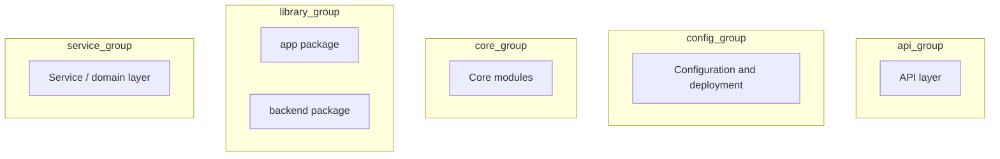

# Architecture report: Musish/Musish

> Automated static analysis. **Observed** = directly seen in files/imports/AST; **Inferred** = interpretation from that evidence. Repository code was not executed.

## 1. Repository at a glance

| Item | Value |
| --- | --- |
| Repository | Musish/Musish |
| Description | Apple Music...ish  |
| Language | TypeScript |
| Stars | 3226 |
| Licence | AGPL-3.0 |
| Analysed commit / branch | 9846878b0a0bb59a627d60784e092e636b933244 / master |
| Framework(s) | React |
| Files analysed | 180 |
| Components | 6 |

## 2. Architecture in one minute

Musish/Musish - Apple Music...ish . This repository was analysed statically from 180 file(s) (0 Python). Detected technologies (observed from imports/manifests): React, axios, React Router, TypeScript. Files are grouped into 6 component(s): API layer, app package, backend package, Configuration and deployment, Core modules, Service / domain layer. Findings below distinguish observed facts from inferred interpretation.

## 3. High-level block diagram

## 4. Main components

### API layer (`api_layer`)

- **Kind:** api
- **Status:** Observed
- **Confidence:** 0.85
- **Responsibility:** Groups 20 file(s) under api layer (observed from repository paths and static analysis).
- **Paths:** `src/app/components/Routes/Album/AlbumPage.tsx`, `src/app/components/Routes/Catalog/Artist/ArtistPage.tsx`, `src/app/components/Routes/Catalog/Browse/BrowsePage.tsx`, `src/app/components/Routes/Catalog/Browse/Genres/Genre/GenrePage.tsx`, `src/app/components/Routes/Catalog/Browse/Genres/Genres.tsx`, `src/app/components/Routes/Catalog/Browse/ItemList.tsx`, `src/app/components/Routes/Catalog/Browse/TopCharts/TopCharts.tsx`, `src/app/components/Routes/Catalog/ForYou/ForYouPage.tsx`, `src/app/components/Routes/Catalog/Radio/RadioPage.tsx`, `src/app/components/Routes/Library/Albums/AlbumsPage.tsx`, `src/app/components/Routes/Library/Artists/ArtistAlbums.tsx`, `src/app/components/Routes/Library/Artists/ArtistsList.tsx`, `src/app/components/Routes/Library/Artists/ArtistsPage.tsx`, `src/app/components/Routes/Library/Playlists/PlaylistsPage.tsx`, `src/app/components/Routes/Library/RecentlyAdded/RecentlyAddedPage.tsx`, `src/app/components/Routes/Library/Songs/SongsPage.tsx`, `src/app/components/Routes/LoginLoader/LoginLoader.tsx`, `src/app/components/Routes/Playlist/PlaylistPage.tsx`, `src/app/components/Routes/Search/SearchPage.tsx`, `src/app/components/Routes/SplashScreen/SplashScreen.tsx`
- **Evidence:** [src/app/components/Routes/Album/AlbumPage.tsx](https://github.com/Musish/Musish/blob/9846878b0a0bb59a627d60784e092e636b933244/src/app/components/Routes/Album/AlbumPage.tsx); [src/app/components/Routes/Catalog/Artist/ArtistPage.tsx](https://github.com/Musish/Musish/blob/9846878b0a0bb59a627d60784e092e636b933244/src/app/components/Routes/Catalog/Artist/ArtistPage.tsx); [src/app/components/Routes/Catalog/Browse/BrowsePage.tsx](https://github.com/Musish/Musish/blob/9846878b0a0bb59a627d60784e092e636b933244/src/app/components/Routes/Catalog/Browse/BrowsePage.tsx); [src/app/components/Routes/Catalog/Browse/Genres/Genre/GenrePage.tsx](https://github.com/Musish/Musish/blob/9846878b0a0bb59a627d60784e092e636b933244/src/app/components/Routes/Catalog/Browse/Genres/Genre/GenrePage.tsx); [src/app/components/Routes/Catalog/Browse/Genres/Genres.tsx](https://github.com/Musish/Musish/blob/9846878b0a0bb59a627d60784e092e636b933244/src/app/components/Routes/Catalog/Browse/Genres/Genres.tsx); [src/app/components/Routes/Catalog/Browse/ItemList.tsx](https://github.com/Musish/Musish/blob/9846878b0a0bb59a627d60784e092e636b933244/src/app/components/Routes/Catalog/Browse/ItemList.tsx); [src/app/components/Routes/Catalog/Browse/TopCharts/TopCharts.tsx](https://github.com/Musish/Musish/blob/9846878b0a0bb59a627d60784e092e636b933244/src/app/components/Routes/Catalog/Browse/TopCharts/TopCharts.tsx); [src/app/components/Routes/Catalog/ForYou/ForYouPage.tsx](https://github.com/Musish/Musish/blob/9846878b0a0bb59a627d60784e092e636b933244/src/app/components/Routes/Catalog/ForYou/ForYouPage.tsx)

### app package (`app`)

- **Kind:** library
- **Status:** Observed
- **Confidence:** 0.85
- **Responsibility:** Groups 69 file(s) under app package (observed from repository paths and static analysis).
- **Paths:** `src/app/components/App.tsx`, `src/app/components/Common/AlbumItem/AlbumItem.tsx`, `src/app/components/Common/AlbumPanel/AlbumPanel.tsx`, `src/app/components/Common/ArtistItem/ArtistItem.tsx`, `src/app/components/Common/ContextMenu/ContextMenu.tsx`, `src/app/components/Common/ContextMenu/ContextMenuTrigger.tsx`, `src/app/components/Common/ContextMenu/Types/Album/AlbumContextMenu.tsx`, `src/app/components/Common/ContextMenu/Types/Playlist/PlaylistContextMenu.tsx`, `src/app/components/Common/ContextMenu/Types/Track/TrackContextMenu.tsx`, `src/app/components/Common/CuratorItem/CuratorItem.tsx`, `src/app/components/Common/GenreItem/GenreItem.tsx`, `src/app/components/Common/InfiniteLoader/InfiniteLoader.tsx`, `src/app/components/Common/InfiniteLoader/InfiniteScroll.tsx`, `src/app/components/Common/Loader/Loader.tsx`, `src/app/components/Common/Modal/Modal.tsx`, `src/app/components/Common/NavigationBar/AuthorizationButton/AuthorizationButton.tsx`, `src/app/components/Common/NavigationBar/NavigationBar.tsx`, `src/app/components/Common/NavigationBar/Search/AlbumResultItem.tsx`, `src/app/components/Common/NavigationBar/Search/ArtistResultItem.tsx`, `src/app/components/Common/NavigationBar/Search/PlaylistResultItem.tsx`, `src/app/components/Common/NavigationBar/Search/SearchBar.tsx`, `src/app/components/Common/NavigationBar/Search/SongResultItem.tsx`, `src/app/components/Common/PageContent/PageContent.tsx`, `src/app/components/Common/PageTitle/PageTitle.tsx`, `src/app/components/Common/Player/Lyrics/Lyrics.tsx`, `src/app/components/Common/Player/Lyrics/LyricsModal.tsx`, `src/app/components/Common/Player/Player.tsx`, `src/app/components/Common/Player/PlayerTime.tsx`, `src/app/components/Common/Player/Queue/Queue.tsx`, `src/app/components/Common/Player/Queue/QueueItem.tsx`, `src/app/components/Common/Player/Queue/QueueList.tsx`, `src/app/components/Common/Player/Rating/Rating.tsx`, `src/app/components/Common/Player/VolumeControl.tsx`, `src/app/components/Common/PlaylistItem/PlaylistItem.tsx`, `src/app/components/Common/PlaylistPanel/PlaylistPanel.tsx`, `src/app/components/Common/PlaylistSelector/PlaylistSelector.tsx`, `src/app/components/Common/Sidebar/Menu/MenuItem/MenuItem.tsx`, `src/app/components/Common/Sidebar/Menu/MenuItem/PlaylistMenuItem.tsx`, `src/app/components/Common/Sidebar/Menu/SidebarLibraryMenu.tsx`, `src/app/components/Common/Sidebar/Menu/SidebarMenu.tsx`, `src/app/components/Common/Sidebar/Sidebar.tsx`, `src/app/components/Common/Tabs/Tab.tsx`, `src/app/components/Common/Tabs/Tabs.tsx`, `src/app/components/Common/Tracks/TracksGrid/TracksGrid.tsx`, `src/app/components/Common/Tracks/TracksList/TrackDecoration.tsx`, `src/app/components/Common/Tracks/TracksList/TracksList.tsx`, `src/app/components/Common/Tracks/TracksList/TracksListItem.tsx`, `src/app/components/Layout.tsx`, `src/app/components/Providers/AuthorizeProvider.tsx`, `src/app/components/Providers/GoogleAnalyticsProvider.tsx`, `src/app/components/Providers/LastfmProvider.tsx`, `src/app/components/Providers/LyricsModalProvider.tsx`, `src/app/components/Providers/ModalProvider.tsx`, `src/app/components/Providers/MusicKitProvider.tsx`, `src/app/components/Providers/PlaylistsProvider.tsx`, `src/app/components/Providers/QueueProvider.tsx`, `src/app/components/Providers/SentryBoundary.tsx`, `src/app/hoc/withContext.tsx`, `src/app/hoc/withMK.tsx`, `src/app/hoc/withPseudoRoute.tsx`, `src/app/hooks/useMK.tsx`, `src/app/index.tsx`, `src/app/types/MusicKit.d.ts`, `src/app/types/mk.d.ts`, `src/app/types/react-ellipsis.d.ts`, `src/app/types/utils.d.ts`, `src/app/utils/Constants/DragDropType.ts`, `src/app/utils/Utils.ts`, `src/app/utils/translations/Translations.tsx`
- **Evidence:** [src/app/components/App.tsx](https://github.com/Musish/Musish/blob/9846878b0a0bb59a627d60784e092e636b933244/src/app/components/App.tsx); [src/app/components/Common/AlbumItem/AlbumItem.tsx](https://github.com/Musish/Musish/blob/9846878b0a0bb59a627d60784e092e636b933244/src/app/components/Common/AlbumItem/AlbumItem.tsx); [src/app/components/Common/AlbumPanel/AlbumPanel.tsx](https://github.com/Musish/Musish/blob/9846878b0a0bb59a627d60784e092e636b933244/src/app/components/Common/AlbumPanel/AlbumPanel.tsx); [src/app/components/Common/ArtistItem/ArtistItem.tsx](https://github.com/Musish/Musish/blob/9846878b0a0bb59a627d60784e092e636b933244/src/app/components/Common/ArtistItem/ArtistItem.tsx); [src/app/components/Common/ContextMenu/ContextMenu.tsx](https://github.com/Musish/Musish/blob/9846878b0a0bb59a627d60784e092e636b933244/src/app/components/Common/ContextMenu/ContextMenu.tsx); [src/app/components/Common/ContextMenu/ContextMenuTrigger.tsx](https://github.com/Musish/Musish/blob/9846878b0a0bb59a627d60784e092e636b933244/src/app/components/Common/ContextMenu/ContextMenuTrigger.tsx); [src/app/components/Common/ContextMenu/Types/Album/AlbumContextMenu.tsx](https://github.com/Musish/Musish/blob/9846878b0a0bb59a627d60784e092e636b933244/src/app/components/Common/ContextMenu/Types/Album/AlbumContextMenu.tsx); [src/app/components/Common/ContextMenu/Types/Playlist/PlaylistContextMenu.tsx](https://github.com/Musish/Musish/blob/9846878b0a0bb59a627d60784e092e636b933244/src/app/components/Common/ContextMenu/Types/Playlist/PlaylistContextMenu.tsx)

### backend package (`backend`)

- **Kind:** library
- **Status:** Observed
- **Confidence:** 0.85
- **Responsibility:** Groups 6 file(s) under backend package (observed from repository paths and static analysis).
- **Paths:** `src/backend/appleMusicApi.js`, `src/backend/browse/browse.js`, `src/backend/genius/artist.js`, `src/backend/genius/song.js`, `src/backend/landing/landing.js`, `src/backend/utils.js`
- **Evidence:** [src/backend/appleMusicApi.js](https://github.com/Musish/Musish/blob/9846878b0a0bb59a627d60784e092e636b933244/src/backend/appleMusicApi.js); [src/backend/browse/browse.js](https://github.com/Musish/Musish/blob/9846878b0a0bb59a627d60784e092e636b933244/src/backend/browse/browse.js); [src/backend/genius/artist.js](https://github.com/Musish/Musish/blob/9846878b0a0bb59a627d60784e092e636b933244/src/backend/genius/artist.js); [src/backend/genius/song.js](https://github.com/Musish/Musish/blob/9846878b0a0bb59a627d60784e092e636b933244/src/backend/genius/song.js); [src/backend/landing/landing.js](https://github.com/Musish/Musish/blob/9846878b0a0bb59a627d60784e092e636b933244/src/backend/landing/landing.js); [src/backend/utils.js](https://github.com/Musish/Musish/blob/9846878b0a0bb59a627d60784e092e636b933244/src/backend/utils.js)

### Configuration and deployment (`config`)

- **Kind:** config
- **Status:** Observed
- **Confidence:** 0.85
- **Responsibility:** Groups 19 file(s) under configuration and deployment (observed from repository paths and static analysis).
- **Paths:** `package.json`, `src/app/components/Common/NavigationBar/Settings/Settings.tsx`, `src/app/components/Routes/Catalog/Browse/browse.json`, `src/app/utils/translations/languages/BrazilianPortuguese.json`, `src/app/utils/translations/languages/English.json`, `src/app/utils/translations/languages/French.json`, `src/app/utils/translations/languages/Greek.json`, `src/app/utils/translations/languages/Hungarian.json`, `src/app/utils/translations/languages/Italian.json`, `src/app/utils/translations/languages/Korean.json`, `src/app/utils/translations/languages/Polish.json`, `src/app/utils/translations/languages/Russian.json`, `src/app/utils/translations/languages/SChinese.json`, `src/app/utils/translations/languages/Turkish.json`, `src/backend/browse/filters.json`, `src/backend/package.json`, `src/backend/serverless.yml`, `tsconfig.json`, `tslint.json`
- **Evidence:** [package.json](https://github.com/Musish/Musish/blob/9846878b0a0bb59a627d60784e092e636b933244/package.json); [src/app/components/Common/NavigationBar/Settings/Settings.tsx](https://github.com/Musish/Musish/blob/9846878b0a0bb59a627d60784e092e636b933244/src/app/components/Common/NavigationBar/Settings/Settings.tsx); [src/app/components/Routes/Catalog/Browse/browse.json](https://github.com/Musish/Musish/blob/9846878b0a0bb59a627d60784e092e636b933244/src/app/components/Routes/Catalog/Browse/browse.json); [src/app/utils/translations/languages/BrazilianPortuguese.json](https://github.com/Musish/Musish/blob/9846878b0a0bb59a627d60784e092e636b933244/src/app/utils/translations/languages/BrazilianPortuguese.json); [src/app/utils/translations/languages/English.json](https://github.com/Musish/Musish/blob/9846878b0a0bb59a627d60784e092e636b933244/src/app/utils/translations/languages/English.json); [src/app/utils/translations/languages/French.json](https://github.com/Musish/Musish/blob/9846878b0a0bb59a627d60784e092e636b933244/src/app/utils/translations/languages/French.json); [src/app/utils/translations/languages/Greek.json](https://github.com/Musish/Musish/blob/9846878b0a0bb59a627d60784e092e636b933244/src/app/utils/translations/languages/Greek.json); [src/app/utils/translations/languages/Hungarian.json](https://github.com/Musish/Musish/blob/9846878b0a0bb59a627d60784e092e636b933244/src/app/utils/translations/languages/Hungarian.json)

### Core modules (`core`)

- **Kind:** core
- **Status:** Observed
- **Confidence:** 0.85
- **Responsibility:** Groups 1 file(s) under core modules (observed from repository paths and static analysis).
- **Paths:** `webpack.config.js`
- **Evidence:** [webpack.config.js](https://github.com/Musish/Musish/blob/9846878b0a0bb59a627d60784e092e636b933244/webpack.config.js)

### Service / domain layer (`service_layer`)

- **Kind:** service
- **Status:** Observed
- **Confidence:** 0.85
- **Responsibility:** Groups 3 file(s) under service / domain layer (observed from repository paths and static analysis).
- **Paths:** `src/app/services/Backend.ts`, `src/app/services/MusicApi.ts`, `src/app/services/MusicPlayerApi.ts`
- **Evidence:** [src/app/services/Backend.ts](https://github.com/Musish/Musish/blob/9846878b0a0bb59a627d60784e092e636b933244/src/app/services/Backend.ts); [src/app/services/MusicApi.ts](https://github.com/Musish/Musish/blob/9846878b0a0bb59a627d60784e092e636b933244/src/app/services/MusicApi.ts); [src/app/services/MusicPlayerApi.ts](https://github.com/Musish/Musish/blob/9846878b0a0bb59a627d60784e092e636b933244/src/app/services/MusicPlayerApi.ts)

## 5. Execution flow

**Observed** entry point(s):

- [src/app/components/App.tsx](https://github.com/Musish/Musish/blob/9846878b0a0bb59a627d60784e092e636b933244/src/app/components/App.tsx)
- [src/app/index.tsx](https://github.com/Musish/Musish/blob/9846878b0a0bb59a627d60784e092e636b933244/src/app/index.tsx)

Representative flow (derived from observed entry points and the import graph; steps beyond the entry point are **Inferred**):

1. Execution starts at an observed entry point listed above, if present.
2. No internal import relationships between components were observed.

## 6. Project structure

### `(root)`

- `.babelrc` - other (99 bytes)
- `.env.example` - config (70 bytes)
- `.gitignore` - other (1563 bytes)
- `.prettierrc` - other (99 bytes)
- `LICENSE` - docs (34523 bytes)
- `README.md` - docs (3865 bytes)
- `package.json` - manifest (2717 bytes)
- `tsconfig.json` - config (954 bytes)
- `tslint.json` - config (397 bytes)
- `webpack.config.js` - source, JavaScript (2501 bytes)

### `.circleci`

- `.circleci/config.yml` - ci, YAML (2605 bytes)
- `.circleci/deploy.sh` - ci, YAML (997 bytes)
- `.circleci/generate_structure.sh` - ci, YAML (59 bytes)

### `.github`

- `.github/FUNDING.yml` - config (24 bytes)
- `.github/ISSUE_TEMPLATE/bug_report.md` - docs (941 bytes)
- `.github/ISSUE_TEMPLATE/feature_request.md` - docs (715 bytes)

### `src`

- `src/app/app.html` - other (1184 bytes)
- `src/app/assets/fonts/musicon.svg` - other (3052 bytes)
- `src/app/assets/images/musish-favicon.svg` - other (3631 bytes)
- `src/app/assets/styles/common.scss` - other (2826 bytes)
- `src/app/assets/styles/musicon.scss` - other (917 bytes)
- `src/app/assets/styles/settings/_colors.scss` - other (647 bytes)
- `src/app/components/App.tsx` - source, TypeScript (6110 bytes)
- `src/app/components/Common/AlbumItem/AlbumItem.scss` - other (1796 bytes)
- `src/app/components/Common/AlbumItem/AlbumItem.tsx` - source, TypeScript (3190 bytes)
- `src/app/components/Common/AlbumPanel/AlbumPanel.scss` - other (2407 bytes)
- `src/app/components/Common/AlbumPanel/AlbumPanel.tsx` - source, TypeScript (8474 bytes)
- `src/app/components/Common/ArtistItem/ArtistItem.scss` - other (1205 bytes)
- `src/app/components/Common/ArtistItem/ArtistItem.tsx` - source, TypeScript (975 bytes)
- `src/app/components/Common/ContextMenu/ContextMenu.tsx` - source, TypeScript (479 bytes)
- `src/app/components/Common/ContextMenu/ContextMenuTrigger.tsx` - source, TypeScript (743 bytes)
- `src/app/components/Common/ContextMenu/Types/Album/AlbumContextMenu.scss` - other (890 bytes)
- `src/app/components/Common/ContextMenu/Types/Album/AlbumContextMenu.tsx` - source, TypeScript (2481 bytes)
- `src/app/components/Common/ContextMenu/Types/Playlist/PlaylistContextMenu.scss` - other (890 bytes)
- `src/app/components/Common/ContextMenu/Types/Playlist/PlaylistContextMenu.tsx` - source, TypeScript (2541 bytes)
- `src/app/components/Common/ContextMenu/Types/Track/TrackContextMenu.scss` - other (890 bytes)
- `src/app/components/Common/ContextMenu/Types/Track/TrackContextMenu.tsx` - source, TypeScript (2381 bytes)
- `src/app/components/Common/CuratorItem/CuratorItem.scss` - other (1088 bytes)
- `src/app/components/Common/CuratorItem/CuratorItem.tsx` - source, TypeScript (1364 bytes)
- `src/app/components/Common/GenreItem/GenreItem.scss` - other (1347 bytes)
- `src/app/components/Common/GenreItem/GenreItem.tsx` - source, TypeScript (1276 bytes)
- `src/app/components/Common/InfiniteLoader/InfiniteLoader.tsx` - source, TypeScript (3891 bytes)
- `src/app/components/Common/InfiniteLoader/InfiniteScroll.scss` - other (51 bytes)
- `src/app/components/Common/InfiniteLoader/InfiniteScroll.tsx` - source, TypeScript (3364 bytes)
- `src/app/components/Common/Loader/Loader.scss` - other (921 bytes)
- `src/app/components/Common/Loader/Loader.tsx` - source, TypeScript (382 bytes)
- `src/app/components/Common/Modal/Modal.scss` - other (998 bytes)
- `src/app/components/Common/Modal/Modal.tsx` - source, TypeScript (665 bytes)
- `src/app/components/Common/NavigationBar/AuthorizationButton/AuthorizationButton.scss` - other (301 bytes)
- `src/app/components/Common/NavigationBar/AuthorizationButton/AuthorizationButton.tsx` - source, TypeScript (952 bytes)
- `src/app/components/Common/NavigationBar/NavigationBar.scss` - other (650 bytes)
- `src/app/components/Common/NavigationBar/NavigationBar.tsx` - source, TypeScript (1035 bytes)
- `src/app/components/Common/NavigationBar/Search/AlbumResultItem.tsx` - source, TypeScript (2102 bytes)
- `src/app/components/Common/NavigationBar/Search/ArtistResultItem.tsx` - source, TypeScript (661 bytes)
- `src/app/components/Common/NavigationBar/Search/PlaylistResultItem.tsx` - source, TypeScript (2201 bytes)
- `src/app/components/Common/NavigationBar/Search/SearchBar.scss` - other (4465 bytes)
- `src/app/components/Common/NavigationBar/Search/SearchBar.tsx` - source, TypeScript (6376 bytes)
- `src/app/components/Common/NavigationBar/Search/SongResultItem.tsx` - source, TypeScript (2327 bytes)
- `src/app/components/Common/NavigationBar/Settings/Settings.scss` - other (1220 bytes)
- `src/app/components/Common/NavigationBar/Settings/Settings.tsx` - source, TypeScript (2394 bytes)
- `src/app/components/Common/PageContent/PageContent.scss` - other (273 bytes)
- `src/app/components/Common/PageContent/PageContent.tsx` - source, TypeScript (866 bytes)
- `src/app/components/Common/PageTitle/PageTitle.scss` - other (230 bytes)
- `src/app/components/Common/PageTitle/PageTitle.tsx` - source, TypeScript (375 bytes)
- `src/app/components/Common/Player/Lyrics/Lyrics.tsx` - source, TypeScript (2929 bytes)
- `src/app/components/Common/Player/Lyrics/LyricsModal.scss` - other (264 bytes)
- `src/app/components/Common/Player/Lyrics/LyricsModal.tsx` - source, TypeScript (1487 bytes)
- `src/app/components/Common/Player/Player.scss` - other (4010 bytes)
- `src/app/components/Common/Player/Player.tsx` - source, TypeScript (6734 bytes)
- `src/app/components/Common/Player/PlayerTime.tsx` - source, TypeScript (3464 bytes)
- `src/app/components/Common/Player/Queue/Queue.scss` - other (2993 bytes)
- `src/app/components/Common/Player/Queue/Queue.tsx` - source, TypeScript (2507 bytes)
- `src/app/components/Common/Player/Queue/QueueItem.tsx` - source, TypeScript (1660 bytes)
- `src/app/components/Common/Player/Queue/QueueList.tsx` - source, TypeScript (2416 bytes)
- `src/app/components/Common/Player/Rating/Rating.tsx` - source, TypeScript (1527 bytes)
- `src/app/components/Common/Player/VolumeControl.tsx` - source, TypeScript (3366 bytes)
- `src/app/components/Common/PlaylistItem/PlaylistItem.scss` - other (1089 bytes)
- `src/app/components/Common/PlaylistItem/PlaylistItem.tsx` - source, TypeScript (2718 bytes)
- `src/app/components/Common/PlaylistPanel/PlaylistPanel.scss` - other (1762 bytes)
- `src/app/components/Common/PlaylistPanel/PlaylistPanel.tsx` - source, TypeScript (5482 bytes)
- `src/app/components/Common/PlaylistSelector/PlaylistSelector.scss` - other (220 bytes)
- `src/app/components/Common/PlaylistSelector/PlaylistSelector.tsx` - source, TypeScript (643 bytes)
- `src/app/components/Common/Sidebar/Menu/MenuItem/MenuItem.tsx` - source, TypeScript (553 bytes)
- `src/app/components/Common/Sidebar/Menu/MenuItem/PlaylistMenuItem.tsx` - source, TypeScript (2102 bytes)
- `src/app/components/Common/Sidebar/Menu/SidebarLibraryMenu.tsx` - source, TypeScript (1949 bytes)
- `src/app/components/Common/Sidebar/Menu/SidebarMenu.tsx` - source, TypeScript (527 bytes)
- `src/app/components/Common/Sidebar/Sidebar.scss` - other (2433 bytes)
- `src/app/components/Common/Sidebar/Sidebar.tsx` - source, TypeScript (3367 bytes)
- `src/app/components/Common/Tabs/Tab.tsx` - source, TypeScript (242 bytes)
- `src/app/components/Common/Tabs/Tabs.scss` - other (653 bytes)
- `src/app/components/Common/Tabs/Tabs.tsx` - source, TypeScript (1454 bytes)
- `src/app/components/Common/Tracks/TracksGrid/TracksGrid.scss` - other (602 bytes)
- `src/app/components/Common/Tracks/TracksGrid/TracksGrid.tsx` - source, TypeScript (1079 bytes)
- `src/app/components/Common/Tracks/TracksList/TrackDecoration.scss` - other (1606 bytes)
- `src/app/components/Common/Tracks/TracksList/TrackDecoration.tsx` - source, TypeScript (1373 bytes)
- `src/app/components/Common/Tracks/TracksList/TracksList.scss` - other (67 bytes)
- `src/app/components/Common/Tracks/TracksList/TracksList.tsx` - source, TypeScript (2318 bytes)
- `src/app/components/Common/Tracks/TracksList/TracksListItem.scss` - other (2820 bytes)
- `src/app/components/Common/Tracks/TracksList/TracksListItem.tsx` - source, TypeScript (4052 bytes)
- `src/app/components/Layout.tsx` - source, TypeScript (946 bytes)
- `src/app/components/Providers/AuthorizeProvider.tsx` - source, TypeScript (2693 bytes)
- `src/app/components/Providers/GoogleAnalyticsProvider.tsx` - source, TypeScript (658 bytes)
- `src/app/components/Providers/LastfmProvider.tsx` - source, TypeScript (7066 bytes)
- `src/app/components/Providers/LyricsModalProvider.tsx` - source, TypeScript (1196 bytes)
- `src/app/components/Providers/ModalProvider.tsx` - source, TypeScript (1984 bytes)
- `src/app/components/Providers/MusicKitProvider.tsx` - source, TypeScript (1431 bytes)
- `src/app/components/Providers/PlaylistsProvider.tsx` - source, TypeScript (737 bytes)
- `src/app/components/Providers/QueueProvider.tsx` - source, TypeScript (1170 bytes)
- `src/app/components/Providers/SentryBoundary.tsx` - source, TypeScript (1011 bytes)
- `src/app/components/Routes/Album/AlbumPage.scss` - other (47 bytes)
- `src/app/components/Routes/Album/AlbumPage.tsx` - source, TypeScript (975 bytes)
- `src/app/components/Routes/Catalog/Artist/ArtistPage.scss` - other (1602 bytes)
- `src/app/components/Routes/Catalog/Artist/ArtistPage.tsx` - source, TypeScript (5155 bytes)
- `src/app/components/Routes/Catalog/Browse/BrowsePage.scss` - other (444 bytes)
- `src/app/components/Routes/Catalog/Browse/BrowsePage.tsx` - source, TypeScript (1087 bytes)
- `src/app/components/Routes/Catalog/Browse/Genres/Genre/GenrePage.scss` - other (930 bytes)
- `src/app/components/Routes/Catalog/Browse/Genres/Genre/GenrePage.tsx` - source, TypeScript (3361 bytes)
- `src/app/components/Routes/Catalog/Browse/Genres/Genres.tsx` - source, TypeScript (1525 bytes)
- `src/app/components/Routes/Catalog/Browse/ItemList.tsx` - source, TypeScript (2400 bytes)
- `src/app/components/Routes/Catalog/Browse/TopCharts/TopCharts.tsx` - source, TypeScript (2004 bytes)
- `src/app/components/Routes/Catalog/Browse/browse.json` - config (7905 bytes)
- `src/app/components/Routes/Catalog/ForYou/ForYouPage.scss` - other (920 bytes)
- `src/app/components/Routes/Catalog/ForYou/ForYouPage.tsx` - source, TypeScript (7713 bytes)
- `src/app/components/Routes/Catalog/Radio/RadioPage.scss` - other (433 bytes)
- `src/app/components/Routes/Catalog/Radio/RadioPage.tsx` - source, TypeScript (465 bytes)
- `src/app/components/Routes/Library/Albums/AlbumsPage.scss` - other (123 bytes)
- `src/app/components/Routes/Library/Albums/AlbumsPage.tsx` - source, TypeScript (2273 bytes)
- `src/app/components/Routes/Library/Artists/ArtistAlbums.scss` - other (61 bytes)
- `src/app/components/Routes/Library/Artists/ArtistAlbums.tsx` - source, TypeScript (1778 bytes)
- `src/app/components/Routes/Library/Artists/ArtistsList.tsx` - source, TypeScript (2222 bytes)
- `src/app/components/Routes/Library/Artists/ArtistsPage.scss` - other (2244 bytes)
- `src/app/components/Routes/Library/Artists/ArtistsPage.tsx` - source, TypeScript (447 bytes)
- `src/app/components/Routes/Library/Playlists/PlaylistsPage.scss` - other (127 bytes)
- `src/app/components/Routes/Library/Playlists/PlaylistsPage.tsx` - source, TypeScript (1329 bytes)
- `src/app/components/Routes/Library/RecentlyAdded/RecentlyAddedPage.scss` - other (128 bytes)
- `src/app/components/Routes/Library/RecentlyAdded/RecentlyAddedPage.tsx` - source, TypeScript (1927 bytes)
- `src/app/components/Routes/Library/Songs/SongsPage.tsx` - source, TypeScript (1173 bytes)
- `src/app/components/Routes/LoginLoader/LoginLoader.scss` - other (63 bytes)
- `src/app/components/Routes/LoginLoader/LoginLoader.tsx` - source, TypeScript (277 bytes)
- `src/app/components/Routes/Playlist/PlaylistPage.tsx` - source, TypeScript (960 bytes)
- `src/app/components/Routes/Search/SearchPage.scss` - other (483 bytes)
- `src/app/components/Routes/Search/SearchPage.tsx` - source, TypeScript (7378 bytes)
- `src/app/components/Routes/SplashScreen/SplashScreen.scss` - other (2791 bytes)
- `src/app/components/Routes/SplashScreen/SplashScreen.tsx` - source, TypeScript (2336 bytes)
- `src/app/hoc/withContext.tsx` - source, TypeScript (417 bytes)
- `src/app/hoc/withMK.tsx` - source, TypeScript (1582 bytes)
- `src/app/hoc/withPseudoRoute.tsx` - source, TypeScript (855 bytes)
- `src/app/hooks/useMK.tsx` - source, TypeScript (1169 bytes)
- `src/app/index.tsx` - source, TypeScript (461 bytes)
- `src/app/services/Backend.ts` - source, TypeScript (124 bytes)
- `src/app/services/MusicApi.ts` - source, TypeScript (5361 bytes)
- `src/app/services/MusicPlayerApi.ts` - source, TypeScript (6809 bytes)
- `src/app/types/MusicKit.d.ts` - source, TypeScript (4099 bytes)
- `src/app/types/mk.d.ts` - source, TypeScript (477 bytes)
- `src/app/types/react-ellipsis.d.ts` - source, TypeScript (558 bytes)
- `src/app/types/utils.d.ts` - source, TypeScript (115 bytes)
- `src/app/utils/Constants/DragDropType.ts` - source, TypeScript (102 bytes)
- `src/app/utils/Utils.ts` - source, TypeScript (2914 bytes)
- `src/app/utils/translations/Translations.tsx` - source, TypeScript (1068 bytes)
- `src/app/utils/translations/languages/BrazilianPortuguese.json` - config (2496 bytes)
- `src/app/utils/translations/languages/English.json` - config (2290 bytes)
- `src/app/utils/translations/languages/French.json` - config (2541 bytes)
- `src/app/utils/translations/languages/Greek.json` - config (3360 bytes)
- `src/app/utils/translations/languages/Hungarian.json` - config (2746 bytes)
- `src/app/utils/translations/languages/Italian.json` - config (2460 bytes)
- `src/app/utils/translations/languages/Korean.json` - config (2691 bytes)
- `src/app/utils/translations/languages/Polish.json` - config (2433 bytes)
- `src/app/utils/translations/languages/Russian.json` - config (3610 bytes)
- `src/app/utils/translations/languages/SChinese.json` - config (2280 bytes)
- `src/app/utils/translations/languages/Turkish.json` - config (2268 bytes)
- `src/backend/appleMusicApi.js` - source, JavaScript (1160 bytes)
- `src/backend/browse/browse.js` - source, JavaScript (928 bytes)
- `src/backend/browse/filters.json` - config (383 bytes)
- `src/backend/genius/artist.js` - source, JavaScript (1740 bytes)
- `src/backend/genius/song.js` - source, JavaScript (1475 bytes)
- `src/backend/landing/landing.js` - source, JavaScript (335 bytes)
- `src/backend/landing/landing.txt` - docs (492 bytes)
- `src/backend/package.json` - manifest (171 bytes)
- `src/backend/serverless.yml` - config (857 bytes)
- `src/backend/utils.js` - source, JavaScript (1220 bytes)

## 7. Key dependencies and integrations

| Name | Category | Status | Confidence | Evidence |
| --- | --- | --- | --- | --- |
| React | framework | Observed | 0.90 | [package.json:14](https://github.com/Musish/Musish/blob/9846878b0a0bb59a627d60784e092e636b933244/package.json#L14); [package.json:25](https://github.com/Musish/Musish/blob/9846878b0a0bb59a627d60784e092e636b933244/package.json#L25) |
| axios | library | Observed | 0.90 | [package.json:30](https://github.com/Musish/Musish/blob/9846878b0a0bb59a627d60784e092e636b933244/package.json#L30); [src/backend/package.json:7](https://github.com/Musish/Musish/blob/9846878b0a0bb59a627d60784e092e636b933244/src/backend/package.json#L7) |
| React Router | library | Observed | 0.85 | [package.json:26](https://github.com/Musish/Musish/blob/9846878b0a0bb59a627d60784e092e636b933244/package.json#L26) |
| TypeScript | tooling | Observed | 0.85 | [package.json:65](https://github.com/Musish/Musish/blob/9846878b0a0bb59a627d60784e092e636b933244/package.json#L65) |

## 8. Data and state

No database, cache, queue, or persistent-state usage was observed in the analysed files. State handling, if any, may be in-memory or in files that were not analysed.

## 9. Configuration and deployment clues

- `.circleci/config.yml` (ci)
- `.circleci/deploy.sh` (ci)
- `.circleci/generate_structure.sh` (ci)
- `.env.example` (config)
- `.github/FUNDING.yml` (config)
- `package.json` (manifest)
- `src/app/components/Routes/Catalog/Browse/browse.json` (config)
- `src/app/utils/translations/languages/BrazilianPortuguese.json` (config)
- `src/app/utils/translations/languages/English.json` (config)
- `src/app/utils/translations/languages/French.json` (config)
- `src/app/utils/translations/languages/Greek.json` (config)
- `src/app/utils/translations/languages/Hungarian.json` (config)
- `src/app/utils/translations/languages/Italian.json` (config)
- `src/app/utils/translations/languages/Korean.json` (config)
- `src/app/utils/translations/languages/Polish.json` (config)
- `src/app/utils/translations/languages/Russian.json` (config)
- `src/app/utils/translations/languages/SChinese.json` (config)
- `src/app/utils/translations/languages/Turkish.json` (config)
- `src/backend/browse/filters.json` (config)
- `src/backend/package.json` (manifest)
- `src/backend/serverless.yml` (config)
- `tsconfig.json` (config)
- `tslint.json` (config)

Environment variable *names* seen in example env files (values never recorded):

- `.env.example`: `APPLE_TOKEN`, `BACKEND_URL`

## 10. Design observations

- An entry/API layer is separated from other code (Inferred from paths and decorators).
- Service/domain code is distinct from entry and data code, suggesting layered separation (Inferred).

These observations are interpretations (**Inferred**) of the observed structure, not guarantees about runtime design.

## 11. Limitations and unknowns

- Static analysis only: repository code was not executed, installed, or imported at runtime.
- Components and relationships are inferred from file paths, imports, and AST structure; runtime behaviour, dynamic imports, and reflection may not be visible.
- 17 file(s) were skipped during inventory (1 x lockfile excluded; 16 x vendored/generated directory excluded).
- No clear application entry point was observed in the analysed files.
- Repository text was treated as untrusted data; no instructions found in repository files were followed, and likely secret values were redacted/excluded.
- JavaScript and TypeScript files were inventoried from paths and package manifests. They were not parsed with a full language AST, and repository code was not executed.

## 12. Source references

- [package.json](https://github.com/Musish/Musish/blob/9846878b0a0bb59a627d60784e092e636b933244/package.json)
- [package.json:14](https://github.com/Musish/Musish/blob/9846878b0a0bb59a627d60784e092e636b933244/package.json#L14)
- [package.json:25](https://github.com/Musish/Musish/blob/9846878b0a0bb59a627d60784e092e636b933244/package.json#L25)
- [package.json:26](https://github.com/Musish/Musish/blob/9846878b0a0bb59a627d60784e092e636b933244/package.json#L26)
- [package.json:30](https://github.com/Musish/Musish/blob/9846878b0a0bb59a627d60784e092e636b933244/package.json#L30)
- [package.json:65](https://github.com/Musish/Musish/blob/9846878b0a0bb59a627d60784e092e636b933244/package.json#L65)
- [src/app/components/App.tsx](https://github.com/Musish/Musish/blob/9846878b0a0bb59a627d60784e092e636b933244/src/app/components/App.tsx)
- [src/app/components/Common/AlbumItem/AlbumItem.tsx](https://github.com/Musish/Musish/blob/9846878b0a0bb59a627d60784e092e636b933244/src/app/components/Common/AlbumItem/AlbumItem.tsx)
- [src/app/components/Common/AlbumPanel/AlbumPanel.tsx](https://github.com/Musish/Musish/blob/9846878b0a0bb59a627d60784e092e636b933244/src/app/components/Common/AlbumPanel/AlbumPanel.tsx)
- [src/app/components/Common/ArtistItem/ArtistItem.tsx](https://github.com/Musish/Musish/blob/9846878b0a0bb59a627d60784e092e636b933244/src/app/components/Common/ArtistItem/ArtistItem.tsx)
- [src/app/components/Common/ContextMenu/ContextMenu.tsx](https://github.com/Musish/Musish/blob/9846878b0a0bb59a627d60784e092e636b933244/src/app/components/Common/ContextMenu/ContextMenu.tsx)
- [src/app/components/Common/ContextMenu/ContextMenuTrigger.tsx](https://github.com/Musish/Musish/blob/9846878b0a0bb59a627d60784e092e636b933244/src/app/components/Common/ContextMenu/ContextMenuTrigger.tsx)
- [src/app/components/Common/ContextMenu/Types/Album/AlbumContextMenu.tsx](https://github.com/Musish/Musish/blob/9846878b0a0bb59a627d60784e092e636b933244/src/app/components/Common/ContextMenu/Types/Album/AlbumContextMenu.tsx)
- [src/app/components/Common/ContextMenu/Types/Playlist/PlaylistContextMenu.tsx](https://github.com/Musish/Musish/blob/9846878b0a0bb59a627d60784e092e636b933244/src/app/components/Common/ContextMenu/Types/Playlist/PlaylistContextMenu.tsx)
- [src/app/components/Common/NavigationBar/Settings/Settings.tsx](https://github.com/Musish/Musish/blob/9846878b0a0bb59a627d60784e092e636b933244/src/app/components/Common/NavigationBar/Settings/Settings.tsx)
- [src/app/components/Routes/Album/AlbumPage.tsx](https://github.com/Musish/Musish/blob/9846878b0a0bb59a627d60784e092e636b933244/src/app/components/Routes/Album/AlbumPage.tsx)
- [src/app/components/Routes/Catalog/Artist/ArtistPage.tsx](https://github.com/Musish/Musish/blob/9846878b0a0bb59a627d60784e092e636b933244/src/app/components/Routes/Catalog/Artist/ArtistPage.tsx)
- [src/app/components/Routes/Catalog/Browse/BrowsePage.tsx](https://github.com/Musish/Musish/blob/9846878b0a0bb59a627d60784e092e636b933244/src/app/components/Routes/Catalog/Browse/BrowsePage.tsx)
- [src/app/components/Routes/Catalog/Browse/Genres/Genre/GenrePage.tsx](https://github.com/Musish/Musish/blob/9846878b0a0bb59a627d60784e092e636b933244/src/app/components/Routes/Catalog/Browse/Genres/Genre/GenrePage.tsx)
- [src/app/components/Routes/Catalog/Browse/Genres/Genres.tsx](https://github.com/Musish/Musish/blob/9846878b0a0bb59a627d60784e092e636b933244/src/app/components/Routes/Catalog/Browse/Genres/Genres.tsx)
- [src/app/components/Routes/Catalog/Browse/ItemList.tsx](https://github.com/Musish/Musish/blob/9846878b0a0bb59a627d60784e092e636b933244/src/app/components/Routes/Catalog/Browse/ItemList.tsx)
- [src/app/components/Routes/Catalog/Browse/TopCharts/TopCharts.tsx](https://github.com/Musish/Musish/blob/9846878b0a0bb59a627d60784e092e636b933244/src/app/components/Routes/Catalog/Browse/TopCharts/TopCharts.tsx)
- [src/app/components/Routes/Catalog/Browse/browse.json](https://github.com/Musish/Musish/blob/9846878b0a0bb59a627d60784e092e636b933244/src/app/components/Routes/Catalog/Browse/browse.json)
- [src/app/components/Routes/Catalog/ForYou/ForYouPage.tsx](https://github.com/Musish/Musish/blob/9846878b0a0bb59a627d60784e092e636b933244/src/app/components/Routes/Catalog/ForYou/ForYouPage.tsx)
- [src/app/index.tsx](https://github.com/Musish/Musish/blob/9846878b0a0bb59a627d60784e092e636b933244/src/app/index.tsx)
- [src/app/services/Backend.ts](https://github.com/Musish/Musish/blob/9846878b0a0bb59a627d60784e092e636b933244/src/app/services/Backend.ts)
- [src/app/services/MusicApi.ts](https://github.com/Musish/Musish/blob/9846878b0a0bb59a627d60784e092e636b933244/src/app/services/MusicApi.ts)
- [src/app/services/MusicPlayerApi.ts](https://github.com/Musish/Musish/blob/9846878b0a0bb59a627d60784e092e636b933244/src/app/services/MusicPlayerApi.ts)
- [src/app/utils/translations/languages/BrazilianPortuguese.json](https://github.com/Musish/Musish/blob/9846878b0a0bb59a627d60784e092e636b933244/src/app/utils/translations/languages/BrazilianPortuguese.json)
- [src/app/utils/translations/languages/English.json](https://github.com/Musish/Musish/blob/9846878b0a0bb59a627d60784e092e636b933244/src/app/utils/translations/languages/English.json)
- [src/app/utils/translations/languages/French.json](https://github.com/Musish/Musish/blob/9846878b0a0bb59a627d60784e092e636b933244/src/app/utils/translations/languages/French.json)
- [src/app/utils/translations/languages/Greek.json](https://github.com/Musish/Musish/blob/9846878b0a0bb59a627d60784e092e636b933244/src/app/utils/translations/languages/Greek.json)
- [src/app/utils/translations/languages/Hungarian.json](https://github.com/Musish/Musish/blob/9846878b0a0bb59a627d60784e092e636b933244/src/app/utils/translations/languages/Hungarian.json)
- [src/backend/appleMusicApi.js](https://github.com/Musish/Musish/blob/9846878b0a0bb59a627d60784e092e636b933244/src/backend/appleMusicApi.js)
- [src/backend/browse/browse.js](https://github.com/Musish/Musish/blob/9846878b0a0bb59a627d60784e092e636b933244/src/backend/browse/browse.js)
- [src/backend/genius/artist.js](https://github.com/Musish/Musish/blob/9846878b0a0bb59a627d60784e092e636b933244/src/backend/genius/artist.js)
- [src/backend/genius/song.js](https://github.com/Musish/Musish/blob/9846878b0a0bb59a627d60784e092e636b933244/src/backend/genius/song.js)
- [src/backend/landing/landing.js](https://github.com/Musish/Musish/blob/9846878b0a0bb59a627d60784e092e636b933244/src/backend/landing/landing.js)
- [src/backend/package.json:7](https://github.com/Musish/Musish/blob/9846878b0a0bb59a627d60784e092e636b933244/src/backend/package.json#L7)
- [src/backend/utils.js](https://github.com/Musish/Musish/blob/9846878b0a0bb59a627d60784e092e636b933244/src/backend/utils.js)
- [webpack.config.js](https://github.com/Musish/Musish/blob/9846878b0a0bb59a627d60784e092e636b933244/webpack.config.js)
