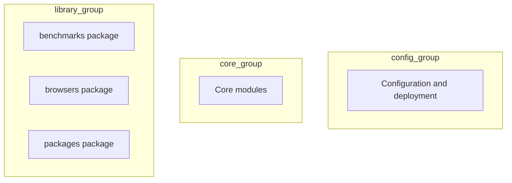

# Architecture report: NervJS/nerv

> Automated static analysis. **Observed** = directly seen in files/imports/AST; **Inferred** = interpretation from that evidence. Repository code was not executed.

## 1. Repository at a glance

| Item | Value |
| --- | --- |
| Repository | NervJS/nerv |
| Description | A blazing fast React alternative, compatible with IE8 and React 16. |
| Language | JavaScript |
| Stars | 5404 |
| Licence | MIT |
| Analysed commit / branch | aaa405e79de5926e30ff07a0bb1b94dc994e9446 / master |
| Framework(s) | None detected |
| Files analysed | 174 |
| Components | 5 |

## 2. Architecture in one minute

NervJS/nerv - A blazing fast React alternative, compatible with IE8 and React 16.. This repository was analysed statically from 174 file(s) (0 Python). Detected technologies (observed from imports/manifests): Redux, Jest, TypeScript, webpack. Files are grouped into 5 component(s): benchmarks package, browsers package, Configuration and deployment, Core modules, packages package. Findings below distinguish observed facts from inferred interpretation.

## 3. High-level block diagram

## 4. Main components

### benchmarks package (`benchmarks`)

- **Kind:** library
- **Status:** Observed
- **Confidence:** 0.85
- **Responsibility:** Groups 12 file(s) under benchmarks package (observed from repository paths and static analysis).
- **Paths:** `benchmarks/DBMonster/ENV.js`, `benchmarks/DBMonster/app.js`, `benchmarks/DBMonster/build.js`, `benchmarks/DBMonster/memory-stats.js`, `benchmarks/DBMonster/monitor.js`, `benchmarks/DBMonster/webpack.config.js`, `benchmarks/js-framwork-bench/src/Main.jsx`, `benchmarks/js-framwork-bench/src/Store.es6.js`, `benchmarks/js-framwork-bench/webpack.config.js`, `benchmarks/uibench/app.js`, `benchmarks/uibench/build.js`, `benchmarks/uibench/rollup.config.js`
- **Evidence:** [benchmarks/DBMonster/ENV.js](https://github.com/NervJS/nerv/blob/aaa405e79de5926e30ff07a0bb1b94dc994e9446/benchmarks/DBMonster/ENV.js); [benchmarks/DBMonster/app.js](https://github.com/NervJS/nerv/blob/aaa405e79de5926e30ff07a0bb1b94dc994e9446/benchmarks/DBMonster/app.js); [benchmarks/DBMonster/build.js](https://github.com/NervJS/nerv/blob/aaa405e79de5926e30ff07a0bb1b94dc994e9446/benchmarks/DBMonster/build.js); [benchmarks/DBMonster/memory-stats.js](https://github.com/NervJS/nerv/blob/aaa405e79de5926e30ff07a0bb1b94dc994e9446/benchmarks/DBMonster/memory-stats.js); [benchmarks/DBMonster/monitor.js](https://github.com/NervJS/nerv/blob/aaa405e79de5926e30ff07a0bb1b94dc994e9446/benchmarks/DBMonster/monitor.js); [benchmarks/DBMonster/webpack.config.js](https://github.com/NervJS/nerv/blob/aaa405e79de5926e30ff07a0bb1b94dc994e9446/benchmarks/DBMonster/webpack.config.js); [benchmarks/js-framwork-bench/src/Main.jsx](https://github.com/NervJS/nerv/blob/aaa405e79de5926e30ff07a0bb1b94dc994e9446/benchmarks/js-framwork-bench/src/Main.jsx); [benchmarks/js-framwork-bench/src/Store.es6.js](https://github.com/NervJS/nerv/blob/aaa405e79de5926e30ff07a0bb1b94dc994e9446/benchmarks/js-framwork-bench/src/Store.es6.js)

### browsers package (`browsers`)

- **Kind:** library
- **Status:** Observed
- **Confidence:** 0.85
- **Responsibility:** Groups 3 file(s) under browsers package (observed from repository paths and static analysis).
- **Paths:** `browsers/ie8.js`, `browsers/karma.js`, `browsers/polyfill.js`
- **Evidence:** [browsers/ie8.js](https://github.com/NervJS/nerv/blob/aaa405e79de5926e30ff07a0bb1b94dc994e9446/browsers/ie8.js); [browsers/karma.js](https://github.com/NervJS/nerv/blob/aaa405e79de5926e30ff07a0bb1b94dc994e9446/browsers/karma.js); [browsers/polyfill.js](https://github.com/NervJS/nerv/blob/aaa405e79de5926e30ff07a0bb1b94dc994e9446/browsers/polyfill.js)

### Configuration and deployment (`config`)

- **Kind:** config
- **Status:** Observed
- **Confidence:** 0.85
- **Responsibility:** Groups 14 file(s) under configuration and deployment (observed from repository paths and static analysis).
- **Paths:** `azure-pipelines.yml`, `lerna.json`, `package.json`, `packages/nerv-create-class/package.json`, `packages/nerv-devtools/package.json`, `packages/nerv-is/package.json`, `packages/nerv-redux/package.json`, `packages/nerv-server/package.json`, `packages/nerv-shared/package.json`, `packages/nerv-test-utils/package.json`, `packages/nerv-utils/package.json`, `packages/nerv/package.json`, `tsconfig.json`, `tslint.json`
- **Evidence:** [azure-pipelines.yml](https://github.com/NervJS/nerv/blob/aaa405e79de5926e30ff07a0bb1b94dc994e9446/azure-pipelines.yml); [lerna.json](https://github.com/NervJS/nerv/blob/aaa405e79de5926e30ff07a0bb1b94dc994e9446/lerna.json); [package.json](https://github.com/NervJS/nerv/blob/aaa405e79de5926e30ff07a0bb1b94dc994e9446/package.json); [packages/nerv-create-class/package.json](https://github.com/NervJS/nerv/blob/aaa405e79de5926e30ff07a0bb1b94dc994e9446/packages/nerv-create-class/package.json); [packages/nerv-devtools/package.json](https://github.com/NervJS/nerv/blob/aaa405e79de5926e30ff07a0bb1b94dc994e9446/packages/nerv-devtools/package.json); [packages/nerv-is/package.json](https://github.com/NervJS/nerv/blob/aaa405e79de5926e30ff07a0bb1b94dc994e9446/packages/nerv-is/package.json); [packages/nerv-redux/package.json](https://github.com/NervJS/nerv/blob/aaa405e79de5926e30ff07a0bb1b94dc994e9446/packages/nerv-redux/package.json); [packages/nerv-server/package.json](https://github.com/NervJS/nerv/blob/aaa405e79de5926e30ff07a0bb1b94dc994e9446/packages/nerv-server/package.json)

### Core modules (`core`)

- **Kind:** core
- **Status:** Observed
- **Confidence:** 0.85
- **Responsibility:** Groups 6 file(s) under core modules (observed from repository paths and static analysis).
- **Paths:** `afterbuild.js`, `index.js`, `jest.config.js`, `karma.conf.js`, `release.js`, `typing.js`
- **Evidence:** [afterbuild.js](https://github.com/NervJS/nerv/blob/aaa405e79de5926e30ff07a0bb1b94dc994e9446/afterbuild.js); [index.js](https://github.com/NervJS/nerv/blob/aaa405e79de5926e30ff07a0bb1b94dc994e9446/index.js); [jest.config.js](https://github.com/NervJS/nerv/blob/aaa405e79de5926e30ff07a0bb1b94dc994e9446/jest.config.js); [karma.conf.js](https://github.com/NervJS/nerv/blob/aaa405e79de5926e30ff07a0bb1b94dc994e9446/karma.conf.js); [release.js](https://github.com/NervJS/nerv/blob/aaa405e79de5926e30ff07a0bb1b94dc994e9446/release.js); [typing.js](https://github.com/NervJS/nerv/blob/aaa405e79de5926e30ff07a0bb1b94dc994e9446/typing.js)

### packages package (`packages`)

- **Kind:** library
- **Status:** Observed
- **Confidence:** 0.85
- **Responsibility:** Groups 102 file(s) under packages package (observed from repository paths and static analysis).
- **Paths:** `packages/nerv-create-class/index.js`, `packages/nerv-create-class/rollup.config.js`, `packages/nerv-create-class/src/index.ts`, `packages/nerv-devtools/index.js`, `packages/nerv-devtools/rollup.config.js`, `packages/nerv-devtools/src/index.ts`, `packages/nerv-devtools/src/renderer.ts`, `packages/nerv-devtools/src/utils.ts`, `packages/nerv-is/index.js`, `packages/nerv-is/rollup.config.js`, `packages/nerv-is/src/index.ts`, `packages/nerv-redux/__tests__/provider.spec.js`, `packages/nerv-redux/__tests__/util.js`, `packages/nerv-redux/index.js`, `packages/nerv-redux/rollup.config.js`, `packages/nerv-redux/src/index.js`, `packages/nerv-redux/src/invariant.js`, `packages/nerv-redux/src/prop-types.js`, `packages/nerv-server/__tests__/render.spec.js`, `packages/nerv-server/index.js`, `packages/nerv-server/rollup.config.js`, `packages/nerv-server/src/index.ts`, `packages/nerv-server/src/is.ts`, `packages/nerv-server/src/utils.ts`, `packages/nerv-shared/index.js`, `packages/nerv-shared/rollup.config.js`, `packages/nerv-shared/src/index.ts`, `packages/nerv-test-utils/__tests__/test.spec.js`, `packages/nerv-test-utils/index.js`, `packages/nerv-test-utils/rollup.config.js`, `packages/nerv-test-utils/src/index.ts`, `packages/nerv-utils/__tests__/next-tick.spec.js`, `packages/nerv-utils/__tests__/shallow-equal.spec.js`, `packages/nerv-utils/__tests__/simple-map.spec.js`, `packages/nerv-utils/__tests__/util.spec.js`, `packages/nerv-utils/index.js`, `packages/nerv-utils/rollup.config.js`, `packages/nerv-utils/src/env.ts`, `packages/nerv-utils/src/index.ts`, `packages/nerv-utils/src/is.ts`, `packages/nerv-utils/src/next-tick.ts`, `packages/nerv-utils/src/shallow-equal.ts`, `packages/nerv-utils/src/simple-map.ts`, `packages/nerv/__tests__/children.spec.js`, `packages/nerv/__tests__/cloneElement.spec.js`, `packages/nerv/__tests__/component.spec.js`, `packages/nerv/__tests__/componentDidCatch.spec.js`, `packages/nerv/__tests__/context.spec.js`, `packages/nerv/__tests__/createContext.spec.js`, `packages/nerv/__tests__/createElement.spec.js`, `packages/nerv/__tests__/dom.spec.js`, `packages/nerv/__tests__/event.spec.js`, `packages/nerv/__tests__/export.spec.js`, `packages/nerv/__tests__/fragments.spec.js`, `packages/nerv/__tests__/h.spec.js`, `packages/nerv/__tests__/hooks.spec.js`, `packages/nerv/__tests__/keys.spec.js`, `packages/nerv/__tests__/lifecycle.spec.js`, `packages/nerv/__tests__/patch.spec.js`, `packages/nerv/__tests__/portal.spec.js`, `packages/nerv/__tests__/refs.spec.js`, `packages/nerv/__tests__/render.spec.js`, `packages/nerv/__tests__/svg.spec.js`, `packages/nerv/__tests__/util/dom.js`, `packages/nerv/__tests__/util/index.js`, `packages/nerv/__tests__/vtypes.spec.js`, `packages/nerv/index.js`, `packages/nerv/rollup.config.js`, `packages/nerv/src/children.ts`, `packages/nerv/src/clone-element.ts`, `packages/nerv/src/component.ts`, `packages/nerv/src/create-context.ts`, `packages/nerv/src/create-element.ts`, `packages/nerv/src/create-ref.ts`, `packages/nerv/src/current-owner.ts`, `packages/nerv/src/dom.ts`, `packages/nerv/src/emiter.ts`, `packages/nerv/src/event.ts`, `packages/nerv/src/fragment.ts`, `packages/nerv/src/full-component.ts`, `packages/nerv/src/hooks.ts`, `packages/nerv/src/hydrate.ts`, `packages/nerv/src/index.ts`, `packages/nerv/src/lifecycle.ts`, `packages/nerv/src/memo.ts`, `packages/nerv/src/options.ts`, `packages/nerv/src/passive-event.ts`, `packages/nerv/src/prop-types.ts`, `packages/nerv/src/pure-component.ts`, `packages/nerv/src/render-queue.ts`, `packages/nerv/src/render.ts`, `packages/nerv/src/vdom/create-element.ts`, `packages/nerv/src/vdom/create-portal.ts`, `packages/nerv/src/vdom/create-vnode.ts`, `packages/nerv/src/vdom/create-void.ts`, `packages/nerv/src/vdom/create-vtext.ts`, `packages/nerv/src/vdom/h.ts`, `packages/nerv/src/vdom/patch.ts`, `packages/nerv/src/vdom/ref.ts`, `packages/nerv/src/vdom/svg-property-config.ts`, `packages/nerv/src/vdom/unmount.ts`, `packages/nerv/src/version.ts`
- **Evidence:** [packages/nerv-create-class/index.js](https://github.com/NervJS/nerv/blob/aaa405e79de5926e30ff07a0bb1b94dc994e9446/packages/nerv-create-class/index.js); [packages/nerv-create-class/rollup.config.js](https://github.com/NervJS/nerv/blob/aaa405e79de5926e30ff07a0bb1b94dc994e9446/packages/nerv-create-class/rollup.config.js); [packages/nerv-create-class/src/index.ts](https://github.com/NervJS/nerv/blob/aaa405e79de5926e30ff07a0bb1b94dc994e9446/packages/nerv-create-class/src/index.ts); [packages/nerv-devtools/index.js](https://github.com/NervJS/nerv/blob/aaa405e79de5926e30ff07a0bb1b94dc994e9446/packages/nerv-devtools/index.js); [packages/nerv-devtools/rollup.config.js](https://github.com/NervJS/nerv/blob/aaa405e79de5926e30ff07a0bb1b94dc994e9446/packages/nerv-devtools/rollup.config.js); [packages/nerv-devtools/src/index.ts](https://github.com/NervJS/nerv/blob/aaa405e79de5926e30ff07a0bb1b94dc994e9446/packages/nerv-devtools/src/index.ts); [packages/nerv-devtools/src/renderer.ts](https://github.com/NervJS/nerv/blob/aaa405e79de5926e30ff07a0bb1b94dc994e9446/packages/nerv-devtools/src/renderer.ts); [packages/nerv-devtools/src/utils.ts](https://github.com/NervJS/nerv/blob/aaa405e79de5926e30ff07a0bb1b94dc994e9446/packages/nerv-devtools/src/utils.ts)

## 5. Execution flow

**Observed** entry point(s):

- [benchmarks/DBMonster/app.js](https://github.com/NervJS/nerv/blob/aaa405e79de5926e30ff07a0bb1b94dc994e9446/benchmarks/DBMonster/app.js)
- [benchmarks/js-framwork-bench/src/Main.jsx](https://github.com/NervJS/nerv/blob/aaa405e79de5926e30ff07a0bb1b94dc994e9446/benchmarks/js-framwork-bench/src/Main.jsx)
- [benchmarks/uibench/app.js](https://github.com/NervJS/nerv/blob/aaa405e79de5926e30ff07a0bb1b94dc994e9446/benchmarks/uibench/app.js)
- [index.js](https://github.com/NervJS/nerv/blob/aaa405e79de5926e30ff07a0bb1b94dc994e9446/index.js)
- [packages/nerv-create-class/index.js](https://github.com/NervJS/nerv/blob/aaa405e79de5926e30ff07a0bb1b94dc994e9446/packages/nerv-create-class/index.js)
- [packages/nerv-is/index.js](https://github.com/NervJS/nerv/blob/aaa405e79de5926e30ff07a0bb1b94dc994e9446/packages/nerv-is/index.js)
- [packages/nerv-redux/index.js](https://github.com/NervJS/nerv/blob/aaa405e79de5926e30ff07a0bb1b94dc994e9446/packages/nerv-redux/index.js)
- [packages/nerv-server/index.js](https://github.com/NervJS/nerv/blob/aaa405e79de5926e30ff07a0bb1b94dc994e9446/packages/nerv-server/index.js)
- [packages/nerv-shared/index.js](https://github.com/NervJS/nerv/blob/aaa405e79de5926e30ff07a0bb1b94dc994e9446/packages/nerv-shared/index.js)
- [packages/nerv-test-utils/index.js](https://github.com/NervJS/nerv/blob/aaa405e79de5926e30ff07a0bb1b94dc994e9446/packages/nerv-test-utils/index.js)
- [packages/nerv-utils/index.js](https://github.com/NervJS/nerv/blob/aaa405e79de5926e30ff07a0bb1b94dc994e9446/packages/nerv-utils/index.js)
- [packages/nerv/index.js](https://github.com/NervJS/nerv/blob/aaa405e79de5926e30ff07a0bb1b94dc994e9446/packages/nerv/index.js)

Representative flow (derived from observed entry points and the import graph; steps beyond the entry point are **Inferred**):

1. Execution starts at an observed entry point listed above, if present.
2. No internal import relationships between components were observed.

## 6. Project structure

### `(root)`

- `.babelrc` - other (399 bytes)
- `.editorconfig` - config (197 bytes)
- `.eslintignore` - other (52 bytes)
- `.eslintrc.js` - source, JavaScript (457 bytes)
- `.gitignore` - other (750 bytes)
- `.travis.yml` - ci, YAML (478 bytes)
- `CHANGELOG.md` - docs (3171 bytes)
- `LICENSE` - docs (1066 bytes)
- `README.md` - docs (7348 bytes)
- `README_CN.md` - docs (7207 bytes)
- `afterbuild.js` - source, JavaScript (628 bytes)
- `azure-pipelines.yml` - ci, YAML (510 bytes)
- `index.js` - source, JavaScript (114 bytes)
- `jest.config.js` - source, JavaScript (1698 bytes)
- `karma.conf.js` - source, JavaScript (6036 bytes)
- `lerna.json` - config (172 bytes)
- `package.json` - manifest (4164 bytes)
- `release.js` - source, JavaScript (999 bytes)
- `tsconfig.json` - config (879 bytes)
- `tslint.json` - config (1118 bytes)
- `typing.js` - source, JavaScript (503 bytes)

### `benchmarks`

- `benchmarks/DBMonster/ENV.js` - source, JavaScript (6247 bytes)
- `benchmarks/DBMonster/app.js` - source, JavaScript (2081 bytes)
- `benchmarks/DBMonster/build.js` - source, JavaScript (29493 bytes)
- `benchmarks/DBMonster/index.html` - other (402 bytes)
- `benchmarks/DBMonster/memory-stats.js` - source, JavaScript (3253 bytes)
- `benchmarks/DBMonster/monitor.js` - source, JavaScript (2111 bytes)
- `benchmarks/DBMonster/readme.md` - docs (203 bytes)
- `benchmarks/DBMonster/style.css` - other (2165 bytes)
- `benchmarks/DBMonster/webpack.config.js` - source, JavaScript (1100 bytes)
- `benchmarks/isomorphic-ui-benchmarks/README.md` - docs (143 bytes)
- `benchmarks/js-framwork-bench/.babelrc` - other (58 bytes)
- `benchmarks/js-framwork-bench/index.html` - other (237 bytes)
- `benchmarks/js-framwork-bench/readme.md` - docs (238 bytes)
- `benchmarks/js-framwork-bench/src/Main.jsx` - source, JavaScript (6349 bytes)
- `benchmarks/js-framwork-bench/src/Store.es6.js` - source, JavaScript (1936 bytes)
- `benchmarks/js-framwork-bench/webpack.config.js` - source, JavaScript (606 bytes)
- `benchmarks/uibench/app.js` - source, JavaScript (4446 bytes)
- `benchmarks/uibench/build.js` - source, JavaScript (28768 bytes)
- `benchmarks/uibench/index.html` - other (370 bytes)
- `benchmarks/uibench/readme.md` - docs (165 bytes)
- `benchmarks/uibench/rollup.config.js` - source, JavaScript (733 bytes)

### `browsers`

- `browsers/ie8.js` - source, JavaScript (1497 bytes)
- `browsers/karma.js` - source, JavaScript (269 bytes)
- `browsers/polyfill.js` - source, JavaScript (25785 bytes)

### `packages`

- `packages/nerv-create-class/.npmignore` - other (67 bytes)
- `packages/nerv-create-class/CHANGELOG.md` - docs (9050 bytes)
- `packages/nerv-create-class/index.js` - source, JavaScript (84 bytes)
- `packages/nerv-create-class/package.json` - manifest (697 bytes)
- `packages/nerv-create-class/rollup.config.js` - source, JavaScript (2434 bytes)
- `packages/nerv-create-class/src/index.ts` - source, TypeScript (4975 bytes)
- `packages/nerv-devtools/.npmignore` - other (67 bytes)
- `packages/nerv-devtools/CHANGELOG.md` - docs (11609 bytes)
- `packages/nerv-devtools/index.js` - source, JavaScript (92 bytes)
- `packages/nerv-devtools/package.json` - manifest (606 bytes)
- `packages/nerv-devtools/rollup.config.js` - source, JavaScript (815 bytes)
- `packages/nerv-devtools/src/index.ts` - source, TypeScript (5385 bytes)
- `packages/nerv-devtools/src/renderer.ts` - source, TypeScript (4633 bytes)
- `packages/nerv-devtools/src/utils.ts` - source, TypeScript (3573 bytes)
- `packages/nerv-is/index.js` - source, JavaScript (84 bytes)
- `packages/nerv-is/package.json` - manifest (277 bytes)
- `packages/nerv-is/rollup.config.js` - source, JavaScript (562 bytes)
- `packages/nerv-is/src/index.ts` - source, TypeScript (1262 bytes)
- `packages/nerv-redux/.npmignore` - other (67 bytes)
- `packages/nerv-redux/CHANGELOG.md` - docs (11565 bytes)
- `packages/nerv-redux/__tests__/provider.spec.js` - source, JavaScript (2576 bytes)
- `packages/nerv-redux/__tests__/util.js` - source, JavaScript (380 bytes)
- `packages/nerv-redux/index.js` - source, JavaScript (92 bytes)
- `packages/nerv-redux/package.json` - manifest (501 bytes)
- `packages/nerv-redux/rollup.config.js` - source, JavaScript (2660 bytes)
- `packages/nerv-redux/src/index.js` - source, JavaScript (351 bytes)
- `packages/nerv-redux/src/invariant.js` - source, JavaScript (30 bytes)
- `packages/nerv-redux/src/prop-types.js` - source, JavaScript (234 bytes)
- `packages/nerv-server/.npmignore` - other (67 bytes)
- `packages/nerv-server/CHANGELOG.md` - docs (9704 bytes)
- `packages/nerv-server/__tests__/render.spec.js` - source, JavaScript (7519 bytes)
- `packages/nerv-server/index.js` - source, JavaScript (84 bytes)
- `packages/nerv-server/package.json` - manifest (578 bytes)
- `packages/nerv-server/rollup.config.js` - source, JavaScript (817 bytes)
- `packages/nerv-server/src/index.ts` - source, TypeScript (5235 bytes)
- `packages/nerv-server/src/is.ts` - source, TypeScript (273 bytes)
- `packages/nerv-server/src/utils.ts` - source, TypeScript (1900 bytes)
- `packages/nerv-shared/.npmignore` - other (67 bytes)
- `packages/nerv-shared/CHANGELOG.md` - docs (14667 bytes)
- `packages/nerv-shared/index.js` - source, JavaScript (84 bytes)
- `packages/nerv-shared/package.json` - manifest (404 bytes)
- `packages/nerv-shared/rollup.config.js` - source, JavaScript (427 bytes)
- `packages/nerv-shared/src/index.ts` - source, TypeScript (4547 bytes)
- `packages/nerv-test-utils/.npmignore` - other (67 bytes)
- `packages/nerv-test-utils/CHANGELOG.md` - docs (6744 bytes)
- `packages/nerv-test-utils/__tests__/__snapshots__/test.spec.js.snap` - other (653 bytes)
- `packages/nerv-test-utils/__tests__/test.spec.js` - source, JavaScript (7605 bytes)
- `packages/nerv-test-utils/index.js` - source, JavaScript (92 bytes)
- `packages/nerv-test-utils/package.json` - manifest (552 bytes)
- `packages/nerv-test-utils/rollup.config.js` - source, JavaScript (874 bytes)
- `packages/nerv-test-utils/src/index.ts` - source, TypeScript (5594 bytes)
- `packages/nerv-utils/.npmignore` - other (67 bytes)
- `packages/nerv-utils/CHANGELOG.md` - docs (7179 bytes)
- `packages/nerv-utils/__tests__/next-tick.spec.js` - source, JavaScript (962 bytes)
- `packages/nerv-utils/__tests__/shallow-equal.spec.js` - source, JavaScript (645 bytes)
- `packages/nerv-utils/__tests__/simple-map.spec.js` - source, JavaScript (928 bytes)
- `packages/nerv-utils/__tests__/util.spec.js` - source, JavaScript (1350 bytes)
- `packages/nerv-utils/index.js` - source, JavaScript (84 bytes)
- `packages/nerv-utils/package.json` - manifest (403 bytes)
- `packages/nerv-utils/rollup.config.js` - source, JavaScript (483 bytes)
- `packages/nerv-utils/src/env.ts` - source, TypeScript (1110 bytes)
- `packages/nerv-utils/src/index.ts` - source, TypeScript (1198 bytes)
- `packages/nerv-utils/src/is.ts` - source, TypeScript (1109 bytes)
- `packages/nerv-utils/src/next-tick.ts` - source, TypeScript (523 bytes)
- `packages/nerv-utils/src/shallow-equal.ts` - source, TypeScript (742 bytes)
- `packages/nerv-utils/src/simple-map.ts` - source, TypeScript (1531 bytes)
- `packages/nerv/.npmignore` - other (67 bytes)
- `packages/nerv/CHANGELOG.md` - docs (51644 bytes)
- `packages/nerv/README.md` - docs (7327 bytes)
- `packages/nerv/__tests__/children.spec.js` - source, JavaScript (2033 bytes)
- `packages/nerv/__tests__/cloneElement.spec.js` - source, JavaScript (3959 bytes)
- `packages/nerv/__tests__/component.spec.js` - source, JavaScript (34529 bytes)
- `packages/nerv/__tests__/componentDidCatch.spec.js` - source, JavaScript (25072 bytes)
- `packages/nerv/__tests__/context.spec.js` - source, JavaScript (5425 bytes)
- `packages/nerv/__tests__/createContext.spec.js` - source, JavaScript (13716 bytes)
- `packages/nerv/__tests__/createElement.spec.js` - source, JavaScript (1068 bytes)
- `packages/nerv/__tests__/dom.spec.js` - source, JavaScript (7962 bytes)
- `packages/nerv/__tests__/event.spec.js` - source, JavaScript (7071 bytes)
- `packages/nerv/__tests__/export.spec.js` - source, JavaScript (776 bytes)
- `packages/nerv/__tests__/fragments.spec.js` - source, JavaScript (55078 bytes)
- `packages/nerv/__tests__/h.spec.js` - source, JavaScript (1240 bytes)
- `packages/nerv/__tests__/hooks.spec.js` - source, JavaScript (21991 bytes)
- `packages/nerv/__tests__/keys.spec.js` - source, JavaScript (3819 bytes)
- `packages/nerv/__tests__/lifecycle.spec.js` - source, JavaScript (56743 bytes)
- `packages/nerv/__tests__/patch.spec.js` - source, JavaScript (5575 bytes)
- `packages/nerv/__tests__/portal.spec.js` - source, JavaScript (3039 bytes)
- `packages/nerv/__tests__/refs.spec.js` - source, JavaScript (15501 bytes)
- `packages/nerv/__tests__/render.spec.js` - source, JavaScript (15233 bytes)
- `packages/nerv/__tests__/svg.spec.js` - source, JavaScript (6318 bytes)
- `packages/nerv/__tests__/util/dom.js` - source, JavaScript (2038 bytes)
- `packages/nerv/__tests__/util/index.js` - source, JavaScript (1141 bytes)
- `packages/nerv/__tests__/vtypes.spec.js` - source, JavaScript (980 bytes)
- `packages/nerv/index.js` - source, JavaScript (92 bytes)
- `packages/nerv/package.json` - manifest (942 bytes)
- `packages/nerv/rollup.config.js` - source, JavaScript (2534 bytes)
- `packages/nerv/src/children.ts` - source, TypeScript (1914 bytes)
- `packages/nerv/src/clone-element.ts` - source, TypeScript (1865 bytes)
- `packages/nerv/src/component.ts` - source, TypeScript (2791 bytes)
- `packages/nerv/src/create-context.ts` - source, TypeScript (2214 bytes)
- `packages/nerv/src/create-element.ts` - source, TypeScript (2501 bytes)
- `packages/nerv/src/create-ref.ts` - source, TypeScript (306 bytes)
- `packages/nerv/src/current-owner.ts` - source, TypeScript (169 bytes)
- `packages/nerv/src/dom.ts` - source, TypeScript (1671 bytes)
- `packages/nerv/src/emiter.ts` - source, TypeScript (405 bytes)
- `packages/nerv/src/event.ts` - source, TypeScript (9425 bytes)
- `packages/nerv/src/fragment.ts` - source, TypeScript (61 bytes)
- `packages/nerv/src/full-component.ts` - source, TypeScript (1724 bytes)
- `packages/nerv/src/hooks.ts` - source, TypeScript (6492 bytes)
- `packages/nerv/src/hydrate.ts` - source, TypeScript (511 bytes)
- `packages/nerv/src/index.ts` - source, TypeScript (2186 bytes)
- `packages/nerv/src/lifecycle.ts` - source, TypeScript (10585 bytes)
- `packages/nerv/src/memo.ts` - source, TypeScript (875 bytes)
- `packages/nerv/src/options.ts` - source, TypeScript (693 bytes)
- `packages/nerv/src/passive-event.ts` - source, TypeScript (1185 bytes)
- `packages/nerv/src/prop-types.ts` - source, TypeScript (516 bytes)
- `packages/nerv/src/pure-component.ts` - source, TypeScript (336 bytes)
- `packages/nerv/src/render-queue.ts` - source, TypeScript (563 bytes)
- `packages/nerv/src/render.ts` - source, TypeScript (904 bytes)
- `packages/nerv/src/vdom/create-element.ts` - source, TypeScript (3976 bytes)
- `packages/nerv/src/vdom/create-portal.ts` - source, TypeScript (232 bytes)
- `packages/nerv/src/vdom/create-vnode.ts` - source, TypeScript (533 bytes)
- `packages/nerv/src/vdom/create-void.ts` - source, TypeScript (122 bytes)
- `packages/nerv/src/vdom/create-vtext.ts` - source, TypeScript (177 bytes)
- `packages/nerv/src/vdom/h.ts` - source, TypeScript (1463 bytes)
- `packages/nerv/src/vdom/patch.ts` - source, TypeScript (17278 bytes)
- `packages/nerv/src/vdom/ref.ts` - source, TypeScript (1484 bytes)
- `packages/nerv/src/vdom/svg-property-config.ts` - source, TypeScript (6791 bytes)
- `packages/nerv/src/vdom/unmount.ts` - source, TypeScript (1476 bytes)
- `packages/nerv/src/version.ts` - source, TypeScript (117 bytes)

## 7. Key dependencies and integrations

| Name | Category | Status | Confidence | Evidence |
| --- | --- | --- | --- | --- |
| Redux | library | Observed | 0.90 | [package.json:104](https://github.com/NervJS/nerv/blob/aaa405e79de5926e30ff07a0bb1b94dc994e9446/package.json#L104); [packages/nerv-redux/package.json:2](https://github.com/NervJS/nerv/blob/aaa405e79de5926e30ff07a0bb1b94dc994e9446/packages/nerv-redux/package.json#L2) |
| Jest | tooling | Observed | 0.85 | [package.json:16](https://github.com/NervJS/nerv/blob/aaa405e79de5926e30ff07a0bb1b94dc994e9446/package.json#L16) |
| TypeScript | tooling | Observed | 0.85 | [package.json:95](https://github.com/NervJS/nerv/blob/aaa405e79de5926e30ff07a0bb1b94dc994e9446/package.json#L95) |
| webpack | tooling | Observed | 0.85 | [package.json:19](https://github.com/NervJS/nerv/blob/aaa405e79de5926e30ff07a0bb1b94dc994e9446/package.json#L19) |

## 8. Data and state

No database, cache, queue, or persistent-state usage was observed in the analysed files. State handling, if any, may be in-memory or in files that were not analysed.

## 9. Configuration and deployment clues

- `.editorconfig` (config)
- `.travis.yml` (ci)
- `azure-pipelines.yml` (ci)
- `lerna.json` (config)
- `package.json` (manifest)
- `packages/nerv-create-class/package.json` (manifest)
- `packages/nerv-devtools/package.json` (manifest)
- `packages/nerv-is/package.json` (manifest)
- `packages/nerv-redux/package.json` (manifest)
- `packages/nerv-server/package.json` (manifest)
- `packages/nerv-shared/package.json` (manifest)
- `packages/nerv-test-utils/package.json` (manifest)
- `packages/nerv-utils/package.json` (manifest)
- `packages/nerv/package.json` (manifest)
- `tsconfig.json` (config)
- `tslint.json` (config)

## 10. Design observations

- No strong design patterns could be established from the available evidence.

These observations are interpretations (**Inferred**) of the observed structure, not guarantees about runtime design.

## 11. Limitations and unknowns

- Static analysis only: repository code was not executed, installed, or imported at runtime.
- Components and relationships are inferred from file paths, imports, and AST structure; runtime behaviour, dynamic imports, and reflection may not be visible.
- 2 file(s) were skipped during inventory (2 x lockfile excluded).
- No clear application entry point was observed in the analysed files.
- Repository text was treated as untrusted data; no instructions found in repository files were followed, and likely secret values were redacted/excluded.
- JavaScript and TypeScript files were inventoried from paths and package manifests. They were not parsed with a full language AST, and repository code was not executed.

## 12. Source references

- [afterbuild.js](https://github.com/NervJS/nerv/blob/aaa405e79de5926e30ff07a0bb1b94dc994e9446/afterbuild.js)
- [azure-pipelines.yml](https://github.com/NervJS/nerv/blob/aaa405e79de5926e30ff07a0bb1b94dc994e9446/azure-pipelines.yml)
- [benchmarks/DBMonster/ENV.js](https://github.com/NervJS/nerv/blob/aaa405e79de5926e30ff07a0bb1b94dc994e9446/benchmarks/DBMonster/ENV.js)
- [benchmarks/DBMonster/app.js](https://github.com/NervJS/nerv/blob/aaa405e79de5926e30ff07a0bb1b94dc994e9446/benchmarks/DBMonster/app.js)
- [benchmarks/DBMonster/build.js](https://github.com/NervJS/nerv/blob/aaa405e79de5926e30ff07a0bb1b94dc994e9446/benchmarks/DBMonster/build.js)
- [benchmarks/DBMonster/memory-stats.js](https://github.com/NervJS/nerv/blob/aaa405e79de5926e30ff07a0bb1b94dc994e9446/benchmarks/DBMonster/memory-stats.js)
- [benchmarks/DBMonster/monitor.js](https://github.com/NervJS/nerv/blob/aaa405e79de5926e30ff07a0bb1b94dc994e9446/benchmarks/DBMonster/monitor.js)
- [benchmarks/DBMonster/webpack.config.js](https://github.com/NervJS/nerv/blob/aaa405e79de5926e30ff07a0bb1b94dc994e9446/benchmarks/DBMonster/webpack.config.js)
- [benchmarks/js-framwork-bench/src/Main.jsx](https://github.com/NervJS/nerv/blob/aaa405e79de5926e30ff07a0bb1b94dc994e9446/benchmarks/js-framwork-bench/src/Main.jsx)
- [benchmarks/js-framwork-bench/src/Store.es6.js](https://github.com/NervJS/nerv/blob/aaa405e79de5926e30ff07a0bb1b94dc994e9446/benchmarks/js-framwork-bench/src/Store.es6.js)
- [benchmarks/uibench/app.js](https://github.com/NervJS/nerv/blob/aaa405e79de5926e30ff07a0bb1b94dc994e9446/benchmarks/uibench/app.js)
- [browsers/ie8.js](https://github.com/NervJS/nerv/blob/aaa405e79de5926e30ff07a0bb1b94dc994e9446/browsers/ie8.js)
- [browsers/karma.js](https://github.com/NervJS/nerv/blob/aaa405e79de5926e30ff07a0bb1b94dc994e9446/browsers/karma.js)
- [browsers/polyfill.js](https://github.com/NervJS/nerv/blob/aaa405e79de5926e30ff07a0bb1b94dc994e9446/browsers/polyfill.js)
- [index.js](https://github.com/NervJS/nerv/blob/aaa405e79de5926e30ff07a0bb1b94dc994e9446/index.js)
- [jest.config.js](https://github.com/NervJS/nerv/blob/aaa405e79de5926e30ff07a0bb1b94dc994e9446/jest.config.js)
- [karma.conf.js](https://github.com/NervJS/nerv/blob/aaa405e79de5926e30ff07a0bb1b94dc994e9446/karma.conf.js)
- [lerna.json](https://github.com/NervJS/nerv/blob/aaa405e79de5926e30ff07a0bb1b94dc994e9446/lerna.json)
- [package.json](https://github.com/NervJS/nerv/blob/aaa405e79de5926e30ff07a0bb1b94dc994e9446/package.json)
- [package.json:16](https://github.com/NervJS/nerv/blob/aaa405e79de5926e30ff07a0bb1b94dc994e9446/package.json#L16)
- [package.json:19](https://github.com/NervJS/nerv/blob/aaa405e79de5926e30ff07a0bb1b94dc994e9446/package.json#L19)
- [package.json:95](https://github.com/NervJS/nerv/blob/aaa405e79de5926e30ff07a0bb1b94dc994e9446/package.json#L95)
- [package.json:104](https://github.com/NervJS/nerv/blob/aaa405e79de5926e30ff07a0bb1b94dc994e9446/package.json#L104)
- [packages/nerv-create-class/index.js](https://github.com/NervJS/nerv/blob/aaa405e79de5926e30ff07a0bb1b94dc994e9446/packages/nerv-create-class/index.js)
- [packages/nerv-create-class/package.json](https://github.com/NervJS/nerv/blob/aaa405e79de5926e30ff07a0bb1b94dc994e9446/packages/nerv-create-class/package.json)
- [packages/nerv-create-class/rollup.config.js](https://github.com/NervJS/nerv/blob/aaa405e79de5926e30ff07a0bb1b94dc994e9446/packages/nerv-create-class/rollup.config.js)
- [packages/nerv-create-class/src/index.ts](https://github.com/NervJS/nerv/blob/aaa405e79de5926e30ff07a0bb1b94dc994e9446/packages/nerv-create-class/src/index.ts)
- [packages/nerv-devtools/index.js](https://github.com/NervJS/nerv/blob/aaa405e79de5926e30ff07a0bb1b94dc994e9446/packages/nerv-devtools/index.js)
- [packages/nerv-devtools/package.json](https://github.com/NervJS/nerv/blob/aaa405e79de5926e30ff07a0bb1b94dc994e9446/packages/nerv-devtools/package.json)
- [packages/nerv-devtools/rollup.config.js](https://github.com/NervJS/nerv/blob/aaa405e79de5926e30ff07a0bb1b94dc994e9446/packages/nerv-devtools/rollup.config.js)
- [packages/nerv-devtools/src/index.ts](https://github.com/NervJS/nerv/blob/aaa405e79de5926e30ff07a0bb1b94dc994e9446/packages/nerv-devtools/src/index.ts)
- [packages/nerv-devtools/src/renderer.ts](https://github.com/NervJS/nerv/blob/aaa405e79de5926e30ff07a0bb1b94dc994e9446/packages/nerv-devtools/src/renderer.ts)
- [packages/nerv-devtools/src/utils.ts](https://github.com/NervJS/nerv/blob/aaa405e79de5926e30ff07a0bb1b94dc994e9446/packages/nerv-devtools/src/utils.ts)
- [packages/nerv-is/index.js](https://github.com/NervJS/nerv/blob/aaa405e79de5926e30ff07a0bb1b94dc994e9446/packages/nerv-is/index.js)
- [packages/nerv-is/package.json](https://github.com/NervJS/nerv/blob/aaa405e79de5926e30ff07a0bb1b94dc994e9446/packages/nerv-is/package.json)
- [packages/nerv-redux/index.js](https://github.com/NervJS/nerv/blob/aaa405e79de5926e30ff07a0bb1b94dc994e9446/packages/nerv-redux/index.js)
- [packages/nerv-redux/package.json](https://github.com/NervJS/nerv/blob/aaa405e79de5926e30ff07a0bb1b94dc994e9446/packages/nerv-redux/package.json)
- [packages/nerv-redux/package.json:2](https://github.com/NervJS/nerv/blob/aaa405e79de5926e30ff07a0bb1b94dc994e9446/packages/nerv-redux/package.json#L2)
- [packages/nerv-server/index.js](https://github.com/NervJS/nerv/blob/aaa405e79de5926e30ff07a0bb1b94dc994e9446/packages/nerv-server/index.js)
- [packages/nerv-server/package.json](https://github.com/NervJS/nerv/blob/aaa405e79de5926e30ff07a0bb1b94dc994e9446/packages/nerv-server/package.json)
- [packages/nerv-shared/index.js](https://github.com/NervJS/nerv/blob/aaa405e79de5926e30ff07a0bb1b94dc994e9446/packages/nerv-shared/index.js)
- [packages/nerv-test-utils/index.js](https://github.com/NervJS/nerv/blob/aaa405e79de5926e30ff07a0bb1b94dc994e9446/packages/nerv-test-utils/index.js)
- [packages/nerv-utils/index.js](https://github.com/NervJS/nerv/blob/aaa405e79de5926e30ff07a0bb1b94dc994e9446/packages/nerv-utils/index.js)
- [packages/nerv/index.js](https://github.com/NervJS/nerv/blob/aaa405e79de5926e30ff07a0bb1b94dc994e9446/packages/nerv/index.js)
- [release.js](https://github.com/NervJS/nerv/blob/aaa405e79de5926e30ff07a0bb1b94dc994e9446/release.js)
- [typing.js](https://github.com/NervJS/nerv/blob/aaa405e79de5926e30ff07a0bb1b94dc994e9446/typing.js)
