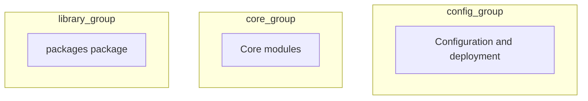

# Architecture report: NotionX/react-notion-x

> Automated static analysis. **Observed** = directly seen in files/imports/AST; **Inferred** = interpretation from that evidence. Repository code was not executed.

## 1. Repository at a glance

| Item | Value |
| --- | --- |
| Repository | NotionX/react-notion-x |
| Description | Fast and accurate React renderer for Notion. TS batteries included. ⚡️ |
| Language | TypeScript |
| Stars | 5442 |
| Licence | MIT |
| Analysed commit / branch | dd4c891997f6c42413623f6ea836c3ba34e042fb / master |
| Framework(s) | Next.js, React |
| Files analysed | 399 |
| Components | 3 |

## 2. Architecture in one minute

NotionX/react-notion-x - Fast and accurate React renderer for Notion. TS batteries included. ⚡️. This repository was analysed statically from 399 file(s) (0 Python). Detected technologies (observed from imports/manifests): GitHub Actions, Next.js, React, TypeScript, Vitest. Files are grouped into 3 component(s): Configuration and deployment, Core modules, packages package. Findings below distinguish observed facts from inferred interpretation.

## 3. High-level block diagram

## 4. Main components

### Configuration and deployment (`config`)

- **Kind:** config
- **Status:** Observed
- **Confidence:** 0.85
- **Responsibility:** Groups 109 file(s) under configuration and deployment (observed from repository paths and static analysis).
- **Paths:** `funding.json`, `package.json`, `packages/notion-client/fixtures/blocks/audio.json`, `packages/notion-client/fixtures/blocks/drive.json`, `packages/notion-client/fixtures/blocks/equation.json`, `packages/notion-client/fixtures/blocks/file.json`, `packages/notion-client/fixtures/blocks/pdf.json`, `packages/notion-client/fixtures/board-results.json`, `packages/notion-client/fixtures/board.json`, `packages/notion-client/fixtures/collection-row-page.json`, `packages/notion-client/fixtures/collection-view-page.json`, `packages/notion-client/fixtures/gallery.json`, `packages/notion-client/fixtures/list.json`, `packages/notion-client/fixtures/page.json`, `packages/notion-client/fixtures/search.json`, `packages/notion-client/fixtures/signed-urls.json`, `packages/notion-client/fixtures/table.json`, `packages/notion-client/package.json`, `packages/notion-client/tsconfig.json`, `packages/notion-compat/package.json`, `packages/notion-compat/tsconfig.json`, `packages/notion-types/package.json`, `packages/notion-types/tsconfig.json`, `packages/notion-utils/fixtures/nba/1a425309-21c0-4ca1-8548-c5915137b566.json`, `packages/notion-utils/fixtures/nba/Atlanta Hawks.json`, `packages/notion-utils/fixtures/nba/Boston Celtics.json`, `packages/notion-utils/fixtures/nba/Brooklyn Nets.json`, `packages/notion-utils/fixtures/nba/Charlotte Hornets.json`, `packages/notion-utils/fixtures/nba/Chicago Bulls.json`, `packages/notion-utils/fixtures/nba/Cleveland Cavaliers.json`, `packages/notion-utils/fixtures/nba/Dallas Mavericks.json`, `packages/notion-utils/fixtures/nba/Denver Nuggest.json`, `packages/notion-utils/fixtures/nba/Detroit Pistons.json`, `packages/notion-utils/fixtures/nba/Duke University.json`, `packages/notion-utils/fixtures/nba/Golden State Warriors.json`, `packages/notion-utils/fixtures/nba/Houston Rockets.json`, `packages/notion-utils/fixtures/nba/Indiana Pacers.json`, `packages/notion-utils/fixtures/nba/List.json`, `packages/notion-utils/fixtures/nba/Los Angeles Clippers.json`, `packages/notion-utils/fixtures/nba/Los Angeles Lakers.json`, `packages/notion-utils/fixtures/nba/Memphis Grizzlies.json`, `packages/notion-utils/fixtures/nba/Miami Heat.json`, `packages/notion-utils/fixtures/nba/Milwaukee Bucks.json`, `packages/notion-utils/fixtures/nba/Minnesota Timberwolves.json`, `packages/notion-utils/fixtures/nba/New Orleans Pelicans.json`, `packages/notion-utils/fixtures/nba/New York Knicks.json`, `packages/notion-utils/fixtures/nba/Oklahoma City Thunder.json`, `packages/notion-utils/fixtures/nba/Orlando Magic.json`, `packages/notion-utils/fixtures/nba/Philadelphia 76ers.json`, `packages/notion-utils/fixtures/nba/Phoenix Suns.json`, `packages/notion-utils/fixtures/nba/Portland Trail Blazers.json`, `packages/notion-utils/fixtures/nba/Raw Table.json`, `packages/notion-utils/fixtures/nba/Sacramento Kings.json`, `packages/notion-utils/fixtures/nba/San Antonio Spurs.json`, `packages/notion-utils/fixtures/nba/Toronto Raptors.json`, `packages/notion-utils/fixtures/nba/UCLA.json`, `packages/notion-utils/fixtures/nba/University of Kentucky.json`, `packages/notion-utils/fixtures/nba/University of North Carolina.json`, `packages/notion-utils/fixtures/nba/University of Texas.json`, `packages/notion-utils/fixtures/nba/Utah Jazz.json`, `packages/notion-utils/fixtures/nba/Washington Wizards.json`, `packages/notion-utils/fixtures/nba/data/1a425309-21c0-4ca1-8548-c5915137b566-048d8535-b957-488a-89f0-ade8d3c4c026.json`, `packages/notion-utils/fixtures/nba/data/1a425309-21c0-4ca1-8548-c5915137b566-1a1863bd-f819-41dc-a228-831ca7a75d2a.json`, `packages/notion-utils/fixtures/nba/data/1a425309-21c0-4ca1-8548-c5915137b566-1d79cc15-d040-43eb-9d65-7e35bafbcf74.json`, `packages/notion-utils/fixtures/nba/data/1a425309-21c0-4ca1-8548-c5915137b566-367ecf41-f124-4652-bb7d-464b3789aefd.json`, `packages/notion-utils/fixtures/nba/data/1a425309-21c0-4ca1-8548-c5915137b566-3815e8d7-e5f2-4399-a761-9ceaed565257.json`, `packages/notion-utils/fixtures/nba/data/1a425309-21c0-4ca1-8548-c5915137b566-385ed123-6a39-46e5-984c-9704bcfd6494.json`, `packages/notion-utils/fixtures/nba/data/1a425309-21c0-4ca1-8548-c5915137b566-43d091fb-a648-40cc-ae10-9d9784c34524.json`, `packages/notion-utils/fixtures/nba/data/1a425309-21c0-4ca1-8548-c5915137b566-448a76b8-847d-4a40-a494-9a6da9c41a58.json`, `packages/notion-utils/fixtures/nba/data/1a425309-21c0-4ca1-8548-c5915137b566-52718a79-d339-4d26-873f-734004af8823.json`, `packages/notion-utils/fixtures/nba/data/1a425309-21c0-4ca1-8548-c5915137b566-5662c1f4-a011-4629-9616-3a2d53f6c9af.json`, `packages/notion-utils/fixtures/nba/data/1a425309-21c0-4ca1-8548-c5915137b566-5742eaed-3c36-495a-bde5-7d33cba0ddb5.json`, `packages/notion-utils/fixtures/nba/data/1a425309-21c0-4ca1-8548-c5915137b566-59a7246f-e923-4faf-9246-75851294365b.json`, `packages/notion-utils/fixtures/nba/data/1a425309-21c0-4ca1-8548-c5915137b566-5ae81e49-33ad-47bf-9c14-14adb9145b4d.json`, `packages/notion-utils/fixtures/nba/data/1a425309-21c0-4ca1-8548-c5915137b566-5c20b593-23d4-4884-9102-3ef3b1049273.json`, `packages/notion-utils/fixtures/nba/data/1a425309-21c0-4ca1-8548-c5915137b566-63717bf3-3af6-4112-989d-acbe665ccf91.json`, `packages/notion-utils/fixtures/nba/data/1a425309-21c0-4ca1-8548-c5915137b566-693b4304-0bbd-4f9a-85f1-7c9cb1768110.json`, `packages/notion-utils/fixtures/nba/data/1a425309-21c0-4ca1-8548-c5915137b566-7687ad1f-ccbe-4abb-8e95-a3685543aefe.json`, `packages/notion-utils/fixtures/nba/data/1a425309-21c0-4ca1-8548-c5915137b566-85e4d626-09cc-45f6-9a28-07d5d490ca1d.json`, `packages/notion-utils/fixtures/nba/data/1a425309-21c0-4ca1-8548-c5915137b566-93fe8a38-e32b-4c6a-87f2-03f1a438de75.json`, `packages/notion-utils/fixtures/nba/data/1a425309-21c0-4ca1-8548-c5915137b566-99cd3dfb-97fb-493d-bfaa-518bd872dda4.json`, `packages/notion-utils/fixtures/nba/data/1a425309-21c0-4ca1-8548-c5915137b566-9a43758f-21c5-4fc2-a4b5-0fc82971b79f.json`, `packages/notion-utils/fixtures/nba/data/1a425309-21c0-4ca1-8548-c5915137b566-9fdf39a1-64c3-464c-a4c9-f3e4d9a9aa2c.json`, `packages/notion-utils/fixtures/nba/data/1a425309-21c0-4ca1-8548-c5915137b566-ab6c9a56-5322-4bd1-a384-7797a81478c5.json`, `packages/notion-utils/fixtures/nba/data/1a425309-21c0-4ca1-8548-c5915137b566-b6c6b669-659e-4487-8d48-8a538b8a0d82.json`, `packages/notion-utils/fixtures/nba/data/1a425309-21c0-4ca1-8548-c5915137b566-bd226193-3647-4ed1-bbe3-a5baa69954c7.json`, `packages/notion-utils/fixtures/nba/data/1a425309-21c0-4ca1-8548-c5915137b566-bdc489ac-13dd-46bd-97f9-86866d76bc43.json`, `packages/notion-utils/fixtures/nba/data/1a425309-21c0-4ca1-8548-c5915137b566-c14e33fe-19d2-4266-a935-0ef6528a77ff.json`, `packages/notion-utils/fixtures/nba/data/1a425309-21c0-4ca1-8548-c5915137b566-c34ab79e-df2d-4a6d-af71-8aef61a65aa7.json`, `packages/notion-utils/fixtures/nba/data/1a425309-21c0-4ca1-8548-c5915137b566-c69e1799-88cb-4135-a10d-1ec4617f0aa6.json`, `packages/notion-utils/fixtures/nba/data/1a425309-21c0-4ca1-8548-c5915137b566-cfe27a86-00d0-4322-b2db-2bc3e69269e2.json`, `packages/notion-utils/fixtures/nba/data/1a425309-21c0-4ca1-8548-c5915137b566-d4102177-3cb3-4d36-8f39-92d84147f825.json`, `packages/notion-utils/fixtures/nba/data/1a425309-21c0-4ca1-8548-c5915137b566-d8f02741-e03a-4e40-91d7-0b821ee4014d.json`, `packages/notion-utils/fixtures/nba/data/1a425309-21c0-4ca1-8548-c5915137b566-dac0d378-1774-47fc-a3a3-103ae120a3c1.json`, `packages/notion-utils/fixtures/nba/data/1a425309-21c0-4ca1-8548-c5915137b566-e1c31992-ad30-4ab5-a497-c69fc579e2ec.json`, `packages/notion-utils/fixtures/nba/data/1a425309-21c0-4ca1-8548-c5915137b566-e3d28d4f-e72e-430a-92f8-263cd01ea452.json`, `packages/notion-utils/fixtures/nba/data/1a425309-21c0-4ca1-8548-c5915137b566-e8feed24-4bf6-41b5-84a7-6134f9160cc1.json`, `packages/notion-utils/fixtures/nba/data/e777a528-9404-4e96-9f26-0014be705592-c01c2f48-5442-47d8-adb3-01c4f8bb8e58.json`, `packages/notion-utils/fixtures/nba/data/e777a528-9404-4e96-9f26-0014be705592-c0d2d91c-e2a5-4ea5-a9b7-2b2d8ae2d591.json`, `packages/notion-utils/fixtures/nba/e777a528-9404-4e96-9f26-0014be705592.json`, `packages/notion-utils/package.json`, `packages/notion-utils/tsconfig.json`, `packages/notion-x-to-md/package.json`, `packages/notion-x-to-md/tsconfig.json`, `packages/react-notion-x/package.json`, `packages/react-notion-x/tsconfig.json`, `pnpm-workspace.yaml`, `tsconfig.json`, `turbo.json`
- **Evidence:** [funding.json](https://github.com/NotionX/react-notion-x/blob/dd4c891997f6c42413623f6ea836c3ba34e042fb/funding.json); [package.json](https://github.com/NotionX/react-notion-x/blob/dd4c891997f6c42413623f6ea836c3ba34e042fb/package.json); [packages/notion-client/fixtures/blocks/audio.json](https://github.com/NotionX/react-notion-x/blob/dd4c891997f6c42413623f6ea836c3ba34e042fb/packages/notion-client/fixtures/blocks/audio.json); [packages/notion-client/fixtures/blocks/drive.json](https://github.com/NotionX/react-notion-x/blob/dd4c891997f6c42413623f6ea836c3ba34e042fb/packages/notion-client/fixtures/blocks/drive.json); [packages/notion-client/fixtures/blocks/equation.json](https://github.com/NotionX/react-notion-x/blob/dd4c891997f6c42413623f6ea836c3ba34e042fb/packages/notion-client/fixtures/blocks/equation.json); [packages/notion-client/fixtures/blocks/file.json](https://github.com/NotionX/react-notion-x/blob/dd4c891997f6c42413623f6ea836c3ba34e042fb/packages/notion-client/fixtures/blocks/file.json); [packages/notion-client/fixtures/blocks/pdf.json](https://github.com/NotionX/react-notion-x/blob/dd4c891997f6c42413623f6ea836c3ba34e042fb/packages/notion-client/fixtures/blocks/pdf.json); [packages/notion-client/fixtures/board-results.json](https://github.com/NotionX/react-notion-x/blob/dd4c891997f6c42413623f6ea836c3ba34e042fb/packages/notion-client/fixtures/board-results.json)

### Core modules (`core`)

- **Kind:** core
- **Status:** Observed
- **Confidence:** 0.85
- **Responsibility:** Groups 2 file(s) under core modules (observed from repository paths and static analysis).
- **Paths:** `oxfmt.config.ts`, `oxlint.config.ts`
- **Evidence:** [oxfmt.config.ts](https://github.com/NotionX/react-notion-x/blob/dd4c891997f6c42413623f6ea836c3ba34e042fb/oxfmt.config.ts); [oxlint.config.ts](https://github.com/NotionX/react-notion-x/blob/dd4c891997f6c42413623f6ea836c3ba34e042fb/oxlint.config.ts)

### packages package (`packages`)

- **Kind:** library
- **Status:** Observed
- **Confidence:** 0.85
- **Responsibility:** Groups 173 file(s) under packages package (observed from repository paths and static analysis).
- **Paths:** `packages/notion-client/src/index.ts`, `packages/notion-client/src/notion-api.test.ts`, `packages/notion-client/src/notion-api.ts`, `packages/notion-client/src/notion-image-live.test.ts`, `packages/notion-client/src/reset.d.ts`, `packages/notion-client/src/retry.test.ts`, `packages/notion-client/src/retry.ts`, `packages/notion-client/src/types.ts`, `packages/notion-client/tsdown.config.ts`, `packages/notion-compat/src/convert-block.ts`, `packages/notion-compat/src/convert-color.ts`, `packages/notion-compat/src/convert-page.ts`, `packages/notion-compat/src/convert-rich-text.ts`, `packages/notion-compat/src/convert-time.ts`, `packages/notion-compat/src/index.ts`, `packages/notion-compat/src/notion-compat-api.test.ts`, `packages/notion-compat/src/notion-compat-api.ts`, `packages/notion-compat/src/reset.d.ts`, `packages/notion-compat/src/types.ts`, `packages/notion-compat/tsdown.config.ts`, `packages/notion-types/src/api.ts`, `packages/notion-types/src/block.ts`, `packages/notion-types/src/collection-view.ts`, `packages/notion-types/src/collection.ts`, `packages/notion-types/src/core.ts`, `packages/notion-types/src/formula.ts`, `packages/notion-types/src/index.ts`, `packages/notion-types/src/maps.ts`, `packages/notion-types/src/reset.d.ts`, `packages/notion-types/src/user.ts`, `packages/notion-types/tsdown.config.ts`, `packages/notion-utils/src/estimate-page-read-time.ts`, `packages/notion-utils/src/format-date.ts`, `packages/notion-utils/src/format-notion-date-time.ts`, `packages/notion-utils/src/get-all-pages-in-space.ts`, `packages/notion-utils/src/get-block-collection-id.ts`, `packages/notion-utils/src/get-block-icon.ts`, `packages/notion-utils/src/get-block-parent-page.ts`, `packages/notion-utils/src/get-block-title.ts`, `packages/notion-utils/src/get-block-value.ts`, `packages/notion-utils/src/get-canonical-page-id.ts`, `packages/notion-utils/src/get-date-value.ts`, `packages/notion-utils/src/get-list-nesting-level.ts`, `packages/notion-utils/src/get-list-number.ts`, `packages/notion-utils/src/get-list-style.ts`, `packages/notion-utils/src/get-page-breadcrumbs.ts`, `packages/notion-utils/src/get-page-content-block-ids.ts`, `packages/notion-utils/src/get-page-image-urls.ts`, `packages/notion-utils/src/get-page-property.ts`, `packages/notion-utils/src/get-page-table-of-contents.ts`, `packages/notion-utils/src/get-page-title.ts`, `packages/notion-utils/src/get-page-tweet-ids.ts`, `packages/notion-utils/src/get-page-tweet-urls.ts`, `packages/notion-utils/src/get-text-content.ts`, `packages/notion-utils/src/group-block-content.ts`, `packages/notion-utils/src/id-to-uuid.ts`, `packages/notion-utils/src/image-url-contract.test.ts`, `packages/notion-utils/src/index.ts`, `packages/notion-utils/src/is-public-notion-page.test.ts`, `packages/notion-utils/src/is-public-notion-page.ts`, `packages/notion-utils/src/is-url.ts`, `packages/notion-utils/src/map-image-url.test.ts`, `packages/notion-utils/src/map-image-url.ts`, `packages/notion-utils/src/map-page-url.ts`, `packages/notion-utils/src/merge-record-maps.ts`, `packages/notion-utils/src/normalize-title.ts`, `packages/notion-utils/src/normalize-url.test.ts`, `packages/notion-utils/src/normalize-url.ts`, `packages/notion-utils/src/parse-page-id.test.ts`, `packages/notion-utils/src/parse-page-id.ts`, `packages/notion-utils/src/reset.d.ts`, `packages/notion-utils/src/uuid-to-id.ts`, `packages/notion-utils/tsdown.config.ts`, `packages/notion-x-to-md/src/block.ts`, `packages/notion-x-to-md/src/cli.ts`, `packages/notion-x-to-md/src/eval-formula.ts`, `packages/notion-x-to-md/src/icon.ts`, `packages/notion-x-to-md/src/index.ts`, `packages/notion-x-to-md/src/notion-page-to-markdown.test.ts`, `packages/notion-x-to-md/src/notion-page-to-markdown.ts`, `packages/notion-x-to-md/src/property.ts`, `packages/notion-x-to-md/src/reset.d.ts`, `packages/notion-x-to-md/src/text.ts`, `packages/notion-x-to-md/tsdown.config.ts`, `packages/react-notion-x/src/block.tsx`, `packages/react-notion-x/src/bookmark.test.tsx`, `packages/react-notion-x/src/components/asset-wrapper.tsx`, `packages/react-notion-x/src/components/asset.tsx`, `packages/react-notion-x/src/components/audio.tsx`, `packages/react-notion-x/src/components/button.tsx`, `packages/react-notion-x/src/components/checkbox.tsx`, `packages/react-notion-x/src/components/eoi.tsx`, `packages/react-notion-x/src/components/file.tsx`, `packages/react-notion-x/src/components/google-drive.tsx`, `packages/react-notion-x/src/components/graceful-image.tsx`, `packages/react-notion-x/src/components/header.tsx`, `packages/react-notion-x/src/components/lazy-image.tsx`, `packages/react-notion-x/src/components/link-mention.tsx`, `packages/react-notion-x/src/components/lite-youtube-embed.tsx`, `packages/react-notion-x/src/components/mention-preview-card.tsx`, `packages/react-notion-x/src/components/page-aside.tsx`, `packages/react-notion-x/src/components/page-icon.tsx`, `packages/react-notion-x/src/components/page-title.tsx`, `packages/react-notion-x/src/components/search-dialog.tsx`, `packages/react-notion-x/src/components/sync-pointer-block.tsx`, `packages/react-notion-x/src/components/tab-block.tsx`, `packages/react-notion-x/src/components/text.test.tsx`, `packages/react-notion-x/src/components/text.tsx`, `packages/react-notion-x/src/context.tsx`, `packages/react-notion-x/src/icons/check.tsx`, `packages/react-notion-x/src/icons/chevron-down-icon.tsx`, `packages/react-notion-x/src/icons/clear-icon.tsx`, `packages/react-notion-x/src/icons/collection-view-board.tsx`, `packages/react-notion-x/src/icons/collection-view-calendar.tsx`, `packages/react-notion-x/src/icons/collection-view-gallery.tsx`, `packages/react-notion-x/src/icons/collection-view-icon.tsx`, `packages/react-notion-x/src/icons/collection-view-list.tsx`, `packages/react-notion-x/src/icons/collection-view-table.tsx`, `packages/react-notion-x/src/icons/copy.tsx`, `packages/react-notion-x/src/icons/default-page-icon.tsx`, `packages/react-notion-x/src/icons/empty-icon.tsx`, `packages/react-notion-x/src/icons/file-icon.tsx`, `packages/react-notion-x/src/icons/link-icon.tsx`, `packages/react-notion-x/src/icons/loading-icon.tsx`, `packages/react-notion-x/src/icons/property-icon.tsx`, `packages/react-notion-x/src/icons/search-icon.tsx`, `packages/react-notion-x/src/icons/type-auto-increment-id.tsx`, `packages/react-notion-x/src/icons/type-checkbox.tsx`, `packages/react-notion-x/src/icons/type-date.tsx`, `packages/react-notion-x/src/icons/type-email.tsx`, `packages/react-notion-x/src/icons/type-file.tsx`, `packages/react-notion-x/src/icons/type-formula.tsx`, `packages/react-notion-x/src/icons/type-github.tsx`, `packages/react-notion-x/src/icons/type-multi-select.tsx`, `packages/react-notion-x/src/icons/type-number.tsx`, `packages/react-notion-x/src/icons/type-person-2.tsx`, `packages/react-notion-x/src/icons/type-person.tsx`, `packages/react-notion-x/src/icons/type-phone-number.tsx`, `packages/react-notion-x/src/icons/type-relation.tsx`, `packages/react-notion-x/src/icons/type-select.tsx`, `packages/react-notion-x/src/icons/type-status.tsx`, `packages/react-notion-x/src/icons/type-text.tsx`, `packages/react-notion-x/src/icons/type-timestamp.tsx`, `packages/react-notion-x/src/icons/type-title.tsx`, `packages/react-notion-x/src/icons/type-url.tsx`, `packages/react-notion-x/src/image-resolution.test.tsx`, `packages/react-notion-x/src/index.ts`, `packages/react-notion-x/src/next.test.tsx`, `packages/react-notion-x/src/next.tsx`, `packages/react-notion-x/src/renderer.tsx`, `packages/react-notion-x/src/reset.d.ts`, `packages/react-notion-x/src/third-party/code.tsx`, `packages/react-notion-x/src/third-party/collection-card.tsx`, `packages/react-notion-x/src/third-party/collection-column-title.tsx`, `packages/react-notion-x/src/third-party/collection-group.tsx`, `packages/react-notion-x/src/third-party/collection-row.tsx`, `packages/react-notion-x/src/third-party/collection-utils.ts`, `packages/react-notion-x/src/third-party/collection-view-board.tsx`, `packages/react-notion-x/src/third-party/collection-view-gallery.tsx`, `packages/react-notion-x/src/third-party/collection-view-list.tsx`, `packages/react-notion-x/src/third-party/collection-view-table.tsx`, `packages/react-notion-x/src/third-party/collection-view.tsx`, `packages/react-notion-x/src/third-party/collection.tsx`, `packages/react-notion-x/src/third-party/equation.tsx`, `packages/react-notion-x/src/third-party/eval-formula.ts`, `packages/react-notion-x/src/third-party/modal.tsx`, `packages/react-notion-x/src/third-party/pdf.tsx`, `packages/react-notion-x/src/third-party/property.tsx`, `packages/react-notion-x/src/third-party/react-use.ts`, `packages/react-notion-x/src/third-party/table-cell-tooltip.tsx`, `packages/react-notion-x/src/types.ts`, `packages/react-notion-x/src/utils.ts`, `packages/react-notion-x/tsdown.config.ts`
- **Evidence:** [packages/notion-client/src/index.ts](https://github.com/NotionX/react-notion-x/blob/dd4c891997f6c42413623f6ea836c3ba34e042fb/packages/notion-client/src/index.ts); [packages/notion-client/src/notion-api.test.ts](https://github.com/NotionX/react-notion-x/blob/dd4c891997f6c42413623f6ea836c3ba34e042fb/packages/notion-client/src/notion-api.test.ts); [packages/notion-client/src/notion-api.ts](https://github.com/NotionX/react-notion-x/blob/dd4c891997f6c42413623f6ea836c3ba34e042fb/packages/notion-client/src/notion-api.ts); [packages/notion-client/src/notion-image-live.test.ts](https://github.com/NotionX/react-notion-x/blob/dd4c891997f6c42413623f6ea836c3ba34e042fb/packages/notion-client/src/notion-image-live.test.ts); [packages/notion-client/src/reset.d.ts](https://github.com/NotionX/react-notion-x/blob/dd4c891997f6c42413623f6ea836c3ba34e042fb/packages/notion-client/src/reset.d.ts); [packages/notion-client/src/retry.test.ts](https://github.com/NotionX/react-notion-x/blob/dd4c891997f6c42413623f6ea836c3ba34e042fb/packages/notion-client/src/retry.test.ts); [packages/notion-client/src/retry.ts](https://github.com/NotionX/react-notion-x/blob/dd4c891997f6c42413623f6ea836c3ba34e042fb/packages/notion-client/src/retry.ts); [packages/notion-client/src/types.ts](https://github.com/NotionX/react-notion-x/blob/dd4c891997f6c42413623f6ea836c3ba34e042fb/packages/notion-client/src/types.ts)

## 5. Execution flow

**Observed** entry point(s):

- [packages/notion-client/src/index.ts](https://github.com/NotionX/react-notion-x/blob/dd4c891997f6c42413623f6ea836c3ba34e042fb/packages/notion-client/src/index.ts)
- [packages/notion-compat/src/index.ts](https://github.com/NotionX/react-notion-x/blob/dd4c891997f6c42413623f6ea836c3ba34e042fb/packages/notion-compat/src/index.ts)
- [packages/notion-types/src/index.ts](https://github.com/NotionX/react-notion-x/blob/dd4c891997f6c42413623f6ea836c3ba34e042fb/packages/notion-types/src/index.ts)
- [packages/notion-utils/src/index.ts](https://github.com/NotionX/react-notion-x/blob/dd4c891997f6c42413623f6ea836c3ba34e042fb/packages/notion-utils/src/index.ts)
- [packages/notion-x-to-md/src/cli.ts](https://github.com/NotionX/react-notion-x/blob/dd4c891997f6c42413623f6ea836c3ba34e042fb/packages/notion-x-to-md/src/cli.ts)
- [packages/notion-x-to-md/src/index.ts](https://github.com/NotionX/react-notion-x/blob/dd4c891997f6c42413623f6ea836c3ba34e042fb/packages/notion-x-to-md/src/index.ts)
- [packages/react-notion-x/src/index.ts](https://github.com/NotionX/react-notion-x/blob/dd4c891997f6c42413623f6ea836c3ba34e042fb/packages/react-notion-x/src/index.ts)

Representative flow (derived from observed entry points and the import graph; steps beyond the entry point are **Inferred**):

1. Execution starts at an observed entry point listed above, if present.
2. No internal import relationships between components were observed.

## 6. Project structure

### `(root)`

- `.editorconfig` - config (147 bytes)
- `.gitignore` - other (367 bytes)
- `AGENTS.md` - docs (170 bytes)
- `CODE_OF_CONDUCT.md` - docs (5481 bytes)
- `GOVERNANCE.md` - docs (1241 bytes)
- `SECURITY.md` - docs (774 bytes)
- `contributing.md` - docs (1986 bytes)
- `funding.json` - config (5341 bytes)
- `license` - docs (1071 bytes)
- `oxfmt.config.ts` - source, TypeScript (230 bytes)
- `oxlint.config.ts` - source, TypeScript (533 bytes)
- `package.json` - manifest (1705 bytes)
- `pnpm-workspace.yaml` - config (1585 bytes)
- `readme.md` - docs (17429 bytes)
- `tsconfig.json` - config (296 bytes)
- `turbo.json` - config (852 bytes)

### `.claude`

- `.claude/settings.local.json` - config (394 bytes)

### `.github`

- `.github/funding.yml` - config (30 bytes)
- `.github/issue_template.md` - docs (318 bytes)
- `.github/pull_request_template.md` - docs (315 bytes)
- `.github/workflows/notion-image-canary.yml` - ci, YAML (857 bytes)
- `.github/workflows/release.yml` - ci, YAML (619 bytes)
- `.github/workflows/test.yml` - ci, YAML (979 bytes)

### `.vscode`

- `.vscode/launch.json` - config (963 bytes)

### `examples`

- `examples/full/components/Loading.tsx` - source, TypeScript (203 bytes)
- `examples/full/components/LoadingIcon.tsx` - source, TypeScript (1545 bytes)
- `examples/full/components/NotionPage.tsx` - source, TypeScript (7528 bytes)
- `examples/full/components/styles.module.css` - other (361 bytes)
- `examples/full/lib/config.ts` - source, TypeScript (1138 bytes)
- `examples/full/lib/notion.ts` - source, TypeScript (1221 bytes)
- `examples/full/lib/preview-images.ts` - source, TypeScript (1727 bytes)
- `examples/full/lib/reset.d.ts` - source, TypeScript (36 bytes)
- `examples/full/next-env.d.ts` - source, TypeScript (290 bytes)
- `examples/full/next.config.js` - source, JavaScript (737 bytes)
- `examples/full/package.json` - manifest (884 bytes)
- `examples/full/pages/[pageId].tsx` - source, TypeScript (2502 bytes)
- `examples/full/pages/_app.tsx` - source, TypeScript (417 bytes)
- `examples/full/pages/_document.tsx` - source, TypeScript (300 bytes)
- `examples/full/pages/index.tsx` - source, TypeScript (952 bytes)
- `examples/full/public/robots.txt` - docs (39 bytes)
- `examples/full/readme.md` - docs (2216 bytes)
- `examples/full/styles/globals.css` - other (69 bytes)
- `examples/full/tsconfig.json` - config (189 bytes)
- `examples/full/turbo.json` - config (112 bytes)
- `examples/minimal/components/NotionPage.tsx` - source, TypeScript (1729 bytes)
- `examples/minimal/lib/config.ts` - source, TypeScript (387 bytes)
- `examples/minimal/lib/image-regression.ts` - source, TypeScript (2645 bytes)
- `examples/minimal/lib/notion.ts` - source, TypeScript (96 bytes)
- `examples/minimal/lib/reset.d.ts` - source, TypeScript (36 bytes)
- `examples/minimal/next-env.d.ts` - source, TypeScript (290 bytes)
- `examples/minimal/next.config.js` - source, JavaScript (737 bytes)
- `examples/minimal/package.json` - manifest (572 bytes)
- `examples/minimal/pages/[pageId].tsx` - source, TypeScript (1063 bytes)
- `examples/minimal/pages/_app.tsx` - source, TypeScript (411 bytes)
- `examples/minimal/pages/_document.tsx` - source, TypeScript (300 bytes)
- `examples/minimal/pages/api/webhook-proxy.ts` - source, TypeScript (1151 bytes)
- `examples/minimal/pages/image-regression.tsx` - source, TypeScript (513 bytes)
- `examples/minimal/pages/index.tsx` - source, TypeScript (801 bytes)
- `examples/minimal/public/robots.txt` - docs (25 bytes)
- `examples/minimal/readme.md` - docs (1129 bytes)
- `examples/minimal/scripts/image-smoke.ts` - source, TypeScript (8343 bytes)
- `examples/minimal/styles/globals.css` - other (69 bytes)
- `examples/minimal/tsconfig.json` - config (138 bytes)
- `examples/minimal/turbo.json` - config (112 bytes)

### `packages`

- `packages/notion-client/fixtures/blocks/audio.json` - config (824 bytes)
- `packages/notion-client/fixtures/blocks/drive.json` - config (1344 bytes)
- `packages/notion-client/fixtures/blocks/equation.json` - config (880 bytes)
- `packages/notion-client/fixtures/blocks/file.json` - config (1133 bytes)
- `packages/notion-client/fixtures/blocks/pdf.json` - config (2595 bytes)
- `packages/notion-client/fixtures/board-results.json` - config (711 bytes)
- `packages/notion-client/fixtures/board.json` - config (26247 bytes)
- `packages/notion-client/fixtures/collection-row-page.json` - config (178691 bytes)
- `packages/notion-client/fixtures/collection-view-page.json` - config (8560 bytes)
- `packages/notion-client/fixtures/gallery.json` - config (25538 bytes)
- `packages/notion-client/fixtures/list.json` - config (25301 bytes)
- `packages/notion-client/fixtures/page.json` - config (28755 bytes)
- `packages/notion-client/fixtures/search.json` - config (950 bytes)
- `packages/notion-client/fixtures/signed-urls.json` - config (817 bytes)
- `packages/notion-client/fixtures/table.json` - config (26336 bytes)
- `packages/notion-client/package.json` - manifest (1130 bytes)
- `packages/notion-client/readme.md` - docs (5387 bytes)
- `packages/notion-client/src/index.ts` - source, TypeScript (77 bytes)
- `packages/notion-client/src/notion-api.test.ts` - source, TypeScript (6406 bytes)
- `packages/notion-client/src/notion-api.ts` - source, TypeScript (26218 bytes)
- `packages/notion-client/src/notion-image-live.test.ts` - source, TypeScript (3723 bytes)
- `packages/notion-client/src/reset.d.ts` - source, TypeScript (36 bytes)
- `packages/notion-client/src/retry.test.ts` - source, TypeScript (5217 bytes)
- `packages/notion-client/src/retry.ts` - source, TypeScript (5520 bytes)
- `packages/notion-client/src/types.ts` - source, TypeScript (517 bytes)
- `packages/notion-client/tsconfig.json` - config (121 bytes)
- `packages/notion-client/tsdown.config.ts` - source, TypeScript (256 bytes)
- `packages/notion-compat/package.json` - manifest (1260 bytes)
- `packages/notion-compat/readme.md` - docs (5314 bytes)
- `packages/notion-compat/src/convert-block.ts` - source, TypeScript (12416 bytes)
- `packages/notion-compat/src/convert-color.ts` - source, TypeScript (278 bytes)
- `packages/notion-compat/src/convert-page.ts` - source, TypeScript (2012 bytes)
- `packages/notion-compat/src/convert-rich-text.ts` - source, TypeScript (2917 bytes)
- `packages/notion-compat/src/convert-time.ts` - source, TypeScript (210 bytes)
- `packages/notion-compat/src/index.ts` - source, TypeScript (198 bytes)
- `packages/notion-compat/src/notion-compat-api.test.ts` - source, TypeScript (1130 bytes)
- `packages/notion-compat/src/notion-compat-api.ts` - source, TypeScript (6294 bytes)
- `packages/notion-compat/src/reset.d.ts` - source, TypeScript (36 bytes)
- `packages/notion-compat/src/types.ts` - source, TypeScript (1045 bytes)
- `packages/notion-compat/tsconfig.json` - config (121 bytes)
- `packages/notion-compat/tsdown.config.ts` - source, TypeScript (256 bytes)
- `packages/notion-types/package.json` - manifest (943 bytes)
- `packages/notion-types/readme.md` - docs (1016 bytes)
- `packages/notion-types/src/api.ts` - source, TypeScript (770 bytes)
- `packages/notion-types/src/block.ts` - source, TypeScript (9538 bytes)
- `packages/notion-types/src/collection-view.ts` - source, TypeScript (2861 bytes)
- `packages/notion-types/src/collection.ts` - source, TypeScript (999 bytes)
- `packages/notion-types/src/core.ts` - source, TypeScript (3545 bytes)
- `packages/notion-types/src/formula.ts` - source, TypeScript (2302 bytes)
- `packages/notion-types/src/index.ts` - source, TypeScript (204 bytes)
- `packages/notion-types/src/maps.ts` - source, TypeScript (3232 bytes)
- `packages/notion-types/src/reset.d.ts` - source, TypeScript (36 bytes)
- `packages/notion-types/src/user.ts` - source, TypeScript (241 bytes)
- `packages/notion-types/tsconfig.json` - config (121 bytes)
- `packages/notion-types/tsdown.config.ts` - source, TypeScript (259 bytes)
- `packages/notion-utils/fixtures/nba/1a425309-21c0-4ca1-8548-c5915137b566.json` - config (10648 bytes)
- `packages/notion-utils/fixtures/nba/Atlanta Hawks.json` - config (2504 bytes)
- `packages/notion-utils/fixtures/nba/Boston Celtics.json` - config (2504 bytes)
- `packages/notion-utils/fixtures/nba/Brooklyn Nets.json` - config (2503 bytes)
- `packages/notion-utils/fixtures/nba/Charlotte Hornets.json` - config (2507 bytes)
- `packages/notion-utils/fixtures/nba/Chicago Bulls.json` - config (2503 bytes)
- `packages/notion-utils/fixtures/nba/Cleveland Cavaliers.json` - config (2509 bytes)
- `packages/notion-utils/fixtures/nba/Dallas Mavericks.json` - config (2506 bytes)
- `packages/notion-utils/fixtures/nba/Denver Nuggest.json` - config (2504 bytes)
- `packages/notion-utils/fixtures/nba/Detroit Pistons.json` - config (2505 bytes)
- `packages/notion-utils/fixtures/nba/Duke University.json` - config (2425 bytes)
- `packages/notion-utils/fixtures/nba/Golden State Warriors.json` - config (2511 bytes)
- `packages/notion-utils/fixtures/nba/Houston Rockets.json` - config (2505 bytes)
- `packages/notion-utils/fixtures/nba/Indiana Pacers.json` - config (2504 bytes)
- `packages/notion-utils/fixtures/nba/List.json` - config (883 bytes)
- `packages/notion-utils/fixtures/nba/Los Angeles Clippers.json` - config (2510 bytes)
- `packages/notion-utils/fixtures/nba/Los Angeles Lakers.json` - config (2508 bytes)
- `packages/notion-utils/fixtures/nba/Memphis Grizzlies.json` - config (2507 bytes)
- `packages/notion-utils/fixtures/nba/Miami Heat.json` - config (2500 bytes)
- `packages/notion-utils/fixtures/nba/Milwaukee Bucks.json` - config (2505 bytes)
- `packages/notion-utils/fixtures/nba/Minnesota Timberwolves.json` - config (2512 bytes)
- `packages/notion-utils/fixtures/nba/New Orleans Pelicans.json` - config (2510 bytes)
- `packages/notion-utils/fixtures/nba/New York Knicks.json` - config (2505 bytes)
- `packages/notion-utils/fixtures/nba/Oklahoma City Thunder.json` - config (2511 bytes)
- `packages/notion-utils/fixtures/nba/Orlando Magic.json` - config (2503 bytes)
- `packages/notion-utils/fixtures/nba/Philadelphia 76ers.json` - config (2508 bytes)
- `packages/notion-utils/fixtures/nba/Phoenix Suns.json` - config (2502 bytes)
- `packages/notion-utils/fixtures/nba/Portland Trail Blazers.json` - config (2512 bytes)
- `packages/notion-utils/fixtures/nba/Raw Table.json` - config (24560 bytes)
- `packages/notion-utils/fixtures/nba/Sacramento Kings.json` - config (2506 bytes)
- `packages/notion-utils/fixtures/nba/San Antonio Spurs.json` - config (2507 bytes)
- `packages/notion-utils/fixtures/nba/Toronto Raptors.json` - config (2505 bytes)
- `packages/notion-utils/fixtures/nba/UCLA.json` - config (2414 bytes)
- `packages/notion-utils/fixtures/nba/University of Kentucky.json` - config (2441 bytes)
- `packages/notion-utils/fixtures/nba/University of North Carolina.json` - config (2459 bytes)
- `packages/notion-utils/fixtures/nba/University of Texas.json` - config (2431 bytes)
- `packages/notion-utils/fixtures/nba/Utah Jazz.json` - config (2499 bytes)
- `packages/notion-utils/fixtures/nba/Washington Wizards.json` - config (2508 bytes)
- `packages/notion-utils/fixtures/nba/data/1a425309-21c0-4ca1-8548-c5915137b566-048d8535-b957-488a-89f0-ade8d3c4c026.json` - config (788 bytes)
- `packages/notion-utils/fixtures/nba/data/1a425309-21c0-4ca1-8548-c5915137b566-1a1863bd-f819-41dc-a228-831ca7a75d2a.json` - config (656 bytes)
- `packages/notion-utils/fixtures/nba/data/1a425309-21c0-4ca1-8548-c5915137b566-1d79cc15-d040-43eb-9d65-7e35bafbcf74.json` - config (1140 bytes)
- `packages/notion-utils/fixtures/nba/data/1a425309-21c0-4ca1-8548-c5915137b566-367ecf41-f124-4652-bb7d-464b3789aefd.json` - config (832 bytes)
- `packages/notion-utils/fixtures/nba/data/1a425309-21c0-4ca1-8548-c5915137b566-3815e8d7-e5f2-4399-a761-9ceaed565257.json` - config (832 bytes)
- `packages/notion-utils/fixtures/nba/data/1a425309-21c0-4ca1-8548-c5915137b566-385ed123-6a39-46e5-984c-9704bcfd6494.json` - config (832 bytes)
- `packages/notion-utils/fixtures/nba/data/1a425309-21c0-4ca1-8548-c5915137b566-43d091fb-a648-40cc-ae10-9d9784c34524.json` - config (1316 bytes)
- `packages/notion-utils/fixtures/nba/data/1a425309-21c0-4ca1-8548-c5915137b566-448a76b8-847d-4a40-a494-9a6da9c41a58.json` - config (832 bytes)
- `packages/notion-utils/fixtures/nba/data/1a425309-21c0-4ca1-8548-c5915137b566-52718a79-d339-4d26-873f-734004af8823.json` - config (832 bytes)
- `packages/notion-utils/fixtures/nba/data/1a425309-21c0-4ca1-8548-c5915137b566-5662c1f4-a011-4629-9616-3a2d53f6c9af.json` - config (832 bytes)
- `packages/notion-utils/fixtures/nba/data/1a425309-21c0-4ca1-8548-c5915137b566-5742eaed-3c36-495a-bde5-7d33cba0ddb5.json` - config (832 bytes)
- `packages/notion-utils/fixtures/nba/data/1a425309-21c0-4ca1-8548-c5915137b566-59a7246f-e923-4faf-9246-75851294365b.json` - config (788 bytes)
- `packages/notion-utils/fixtures/nba/data/1a425309-21c0-4ca1-8548-c5915137b566-5ae81e49-33ad-47bf-9c14-14adb9145b4d.json` - config (788 bytes)
- `packages/notion-utils/fixtures/nba/data/1a425309-21c0-4ca1-8548-c5915137b566-5c20b593-23d4-4884-9102-3ef3b1049273.json` - config (832 bytes)
- `packages/notion-utils/fixtures/nba/data/1a425309-21c0-4ca1-8548-c5915137b566-63717bf3-3af6-4112-989d-acbe665ccf91.json` - config (832 bytes)
- `packages/notion-utils/fixtures/nba/data/1a425309-21c0-4ca1-8548-c5915137b566-693b4304-0bbd-4f9a-85f1-7c9cb1768110.json` - config (788 bytes)
- `packages/notion-utils/fixtures/nba/data/1a425309-21c0-4ca1-8548-c5915137b566-7687ad1f-ccbe-4abb-8e95-a3685543aefe.json` - config (832 bytes)
- `packages/notion-utils/fixtures/nba/data/1a425309-21c0-4ca1-8548-c5915137b566-85e4d626-09cc-45f6-9a28-07d5d490ca1d.json` - config (832 bytes)
- `packages/notion-utils/fixtures/nba/data/1a425309-21c0-4ca1-8548-c5915137b566-93fe8a38-e32b-4c6a-87f2-03f1a438de75.json` - config (832 bytes)
- `packages/notion-utils/fixtures/nba/data/1a425309-21c0-4ca1-8548-c5915137b566-99cd3dfb-97fb-493d-bfaa-518bd872dda4.json` - config (832 bytes)
- `packages/notion-utils/fixtures/nba/data/1a425309-21c0-4ca1-8548-c5915137b566-9a43758f-21c5-4fc2-a4b5-0fc82971b79f.json` - config (700 bytes)
- `packages/notion-utils/fixtures/nba/data/1a425309-21c0-4ca1-8548-c5915137b566-9fdf39a1-64c3-464c-a4c9-f3e4d9a9aa2c.json` - config (832 bytes)
- `packages/notion-utils/fixtures/nba/data/1a425309-21c0-4ca1-8548-c5915137b566-ab6c9a56-5322-4bd1-a384-7797a81478c5.json` - config (832 bytes)
- `packages/notion-utils/fixtures/nba/data/1a425309-21c0-4ca1-8548-c5915137b566-b6c6b669-659e-4487-8d48-8a538b8a0d82.json` - config (832 bytes)
- `packages/notion-utils/fixtures/nba/data/1a425309-21c0-4ca1-8548-c5915137b566-bd226193-3647-4ed1-bbe3-a5baa69954c7.json` - config (920 bytes)
- `packages/notion-utils/fixtures/nba/data/1a425309-21c0-4ca1-8548-c5915137b566-bdc489ac-13dd-46bd-97f9-86866d76bc43.json` - config (832 bytes)
- `packages/notion-utils/fixtures/nba/data/1a425309-21c0-4ca1-8548-c5915137b566-c14e33fe-19d2-4266-a935-0ef6528a77ff.json` - config (832 bytes)
- `packages/notion-utils/fixtures/nba/data/1a425309-21c0-4ca1-8548-c5915137b566-c34ab79e-df2d-4a6d-af71-8aef61a65aa7.json` - config (832 bytes)
- `packages/notion-utils/fixtures/nba/data/1a425309-21c0-4ca1-8548-c5915137b566-c69e1799-88cb-4135-a10d-1ec4617f0aa6.json` - config (788 bytes)
- `packages/notion-utils/fixtures/nba/data/1a425309-21c0-4ca1-8548-c5915137b566-cfe27a86-00d0-4322-b2db-2bc3e69269e2.json` - config (788 bytes)
- `packages/notion-utils/fixtures/nba/data/1a425309-21c0-4ca1-8548-c5915137b566-d4102177-3cb3-4d36-8f39-92d84147f825.json` - config (568 bytes)
- `packages/notion-utils/fixtures/nba/data/1a425309-21c0-4ca1-8548-c5915137b566-d8f02741-e03a-4e40-91d7-0b821ee4014d.json` - config (788 bytes)
- `packages/notion-utils/fixtures/nba/data/1a425309-21c0-4ca1-8548-c5915137b566-dac0d378-1774-47fc-a3a3-103ae120a3c1.json` - config (832 bytes)
- `packages/notion-utils/fixtures/nba/data/1a425309-21c0-4ca1-8548-c5915137b566-e1c31992-ad30-4ab5-a497-c69fc579e2ec.json` - config (22217 bytes)
- `packages/notion-utils/fixtures/nba/data/1a425309-21c0-4ca1-8548-c5915137b566-e3d28d4f-e72e-430a-92f8-263cd01ea452.json` - config (788 bytes)
- `packages/notion-utils/fixtures/nba/data/1a425309-21c0-4ca1-8548-c5915137b566-e8feed24-4bf6-41b5-84a7-6134f9160cc1.json` - config (788 bytes)
- `packages/notion-utils/fixtures/nba/data/e777a528-9404-4e96-9f26-0014be705592-c01c2f48-5442-47d8-adb3-01c4f8bb8e58.json` - config (744 bytes)
- `packages/notion-utils/fixtures/nba/data/e777a528-9404-4e96-9f26-0014be705592-c0d2d91c-e2a5-4ea5-a9b7-2b2d8ae2d591.json` - config (744 bytes)
- `packages/notion-utils/fixtures/nba/e777a528-9404-4e96-9f26-0014be705592.json` - config (846 bytes)
- `packages/notion-utils/package.json` - manifest (1198 bytes)
- `packages/notion-utils/readme.md` - docs (1356 bytes)
- `packages/notion-utils/src/__snapshots__/normalize-url.test.ts.snap` - other (652 bytes)
- `packages/notion-utils/src/__snapshots__/parse-page-id.test.ts.snap` - other (2744 bytes)
- `packages/notion-utils/src/estimate-page-read-time.ts` - source, TypeScript (6137 bytes)
- `packages/notion-utils/src/format-date.ts` - source, TypeScript (286 bytes)
- `packages/notion-utils/src/format-notion-date-time.ts` - source, TypeScript (397 bytes)
- `packages/notion-utils/src/get-all-pages-in-space.ts` - source, TypeScript (4135 bytes)
- `packages/notion-utils/src/get-block-collection-id.ts` - source, TypeScript (719 bytes)
- `packages/notion-utils/src/get-block-icon.ts` - source, TypeScript (732 bytes)
- `packages/notion-utils/src/get-block-parent-page.ts` - source, TypeScript (1182 bytes)
- `packages/notion-utils/src/get-block-title.ts` - source, TypeScript (763 bytes)
- `packages/notion-utils/src/get-block-value.ts` - source, TypeScript (725 bytes)
- `packages/notion-utils/src/get-canonical-page-id.ts` - source, TypeScript (1028 bytes)
- `packages/notion-utils/src/get-date-value.ts` - source, TypeScript (470 bytes)
- `packages/notion-utils/src/get-list-nesting-level.ts` - source, TypeScript (587 bytes)
- `packages/notion-utils/src/get-list-number.ts` - source, TypeScript (606 bytes)
- `packages/notion-utils/src/get-list-style.ts` - source, TypeScript (232 bytes)
- `packages/notion-utils/src/get-page-breadcrumbs.ts` - source, TypeScript (1098 bytes)
- `packages/notion-utils/src/get-page-content-block-ids.ts` - source, TypeScript (2113 bytes)
- `packages/notion-utils/src/get-page-image-urls.ts` - source, TypeScript (2360 bytes)
- `packages/notion-utils/src/get-page-property.ts` - source, TypeScript (3280 bytes)
- `packages/notion-utils/src/get-page-table-of-contents.ts` - source, TypeScript (2820 bytes)
- `packages/notion-utils/src/get-page-title.ts` - source, TypeScript (456 bytes)
- `packages/notion-utils/src/get-page-tweet-ids.ts` - source, TypeScript (518 bytes)
- `packages/notion-utils/src/get-page-tweet-urls.ts` - source, TypeScript (651 bytes)
- `packages/notion-utils/src/get-text-content.ts` - source, TypeScript (571 bytes)
- `packages/notion-utils/src/group-block-content.ts` - source, TypeScript (815 bytes)
- `packages/notion-utils/src/id-to-uuid.ts` - source, TypeScript (134 bytes)
- `packages/notion-utils/src/image-url-contract.test.ts` - source, TypeScript (12455 bytes)
- `packages/notion-utils/src/index.ts` - source, TypeScript (1223 bytes)
- `packages/notion-utils/src/is-public-notion-page.test.ts` - source, TypeScript (3114 bytes)
- `packages/notion-utils/src/is-public-notion-page.ts` - source, TypeScript (2238 bytes)
- `packages/notion-utils/src/is-url.ts` - source, TypeScript (49 bytes)
- `packages/notion-utils/src/map-image-url.test.ts` - source, TypeScript (10964 bytes)
- `packages/notion-utils/src/map-image-url.ts` - source, TypeScript (12502 bytes)
- `packages/notion-utils/src/map-page-url.ts` - source, TypeScript (228 bytes)
- `packages/notion-utils/src/merge-record-maps.ts` - source, TypeScript (906 bytes)
- `packages/notion-utils/src/normalize-title.ts` - source, TypeScript (342 bytes)
- `packages/notion-utils/src/normalize-url.test.ts` - source, TypeScript (1848 bytes)
- `packages/notion-utils/src/normalize-url.ts` - source, TypeScript (1089 bytes)
- `packages/notion-utils/src/parse-page-id.test.ts` - source, TypeScript (2075 bytes)
- `packages/notion-utils/src/parse-page-id.ts` - source, TypeScript (782 bytes)
- `packages/notion-utils/src/reset.d.ts` - source, TypeScript (36 bytes)
- `packages/notion-utils/src/uuid-to-id.ts` - source, TypeScript (67 bytes)
- `packages/notion-utils/tsconfig.json` - config (121 bytes)
- `packages/notion-utils/tsdown.config.ts` - source, TypeScript (259 bytes)
- `packages/notion-x-to-md/examples/067dd719a912471ea9a3ac10710e7fdf.md` - docs (2455 bytes)
- `packages/notion-x-to-md/examples/0be6efce9daf42688f65c76b89f8eb27.md` - docs (1164 bytes)
- `packages/notion-x-to-md/examples/0c322c33381c49bca5083a451c334c39.md` - docs (3863 bytes)
- `packages/notion-x-to-md/examples/17aef37fb4624588ab1ff0e6671acba5.md` - docs (629 bytes)
- `packages/notion-x-to-md/examples/2fea615a97a7401c81be486e4eec2e94.md` - docs (6158 bytes)
- `packages/notion-x-to-md/examples/30bedb27f12481cc9d6afe0976b52e60.md` - docs (387 bytes)
- `packages/notion-x-to-md/examples/3492bd6dbaf44fe7a5cac62c5d402f06.md` - docs (3807 bytes)
- `packages/notion-x-to-md/examples/38fa73d49b8f40aab1f3f8c82332e518.md` - docs (348 bytes)
- `packages/notion-x-to-md/examples/52353862df0f48ba85648db7d0acd1dd.md` - docs (267 bytes)
- `packages/notion-x-to-md/examples/5995506f2c564d81956aa38711e12337.md` - docs (179 bytes)
- `packages/notion-x-to-md/examples/5d4e290ca4604d8fb809af806a6c1749.md` - docs (2169 bytes)
- `packages/notion-x-to-md/examples/7820b2d5300747b38e31344eb06fbd57.md` - docs (942 bytes)
- `packages/notion-x-to-md/examples/7b7f063709034186adbfb46f455d5065.md` - docs (3972 bytes)
- `packages/notion-x-to-md/examples/8bcd65801a5d450fb7218d8890a38c29.md` - docs (606 bytes)
- `packages/notion-x-to-md/examples/912379b0c54440a286619f76446cd753.md` - docs (432 bytes)
- `packages/notion-x-to-md/examples/9cb9716c93164c6c8b4cd0bac3879aeb.md` - docs (195 bytes)
- `packages/notion-x-to-md/examples/9d9814f3220a4b3bbc2481ad6fd7c913.md` - docs (180 bytes)
- `packages/notion-x-to-md/examples/c1c8f540c06f4ac89f831e4a9cc402ae.md` - docs (396 bytes)
- `packages/notion-x-to-md/examples/de14421f13914ac7b528fa2e31eb1455.md` - docs (496 bytes)
- `packages/notion-x-to-md/examples/faafed747a464097a28e462ce4952506.md` - docs (199 bytes)
- `packages/notion-x-to-md/package.json` - manifest (1538 bytes)
- `packages/notion-x-to-md/readme.md` - docs (6226 bytes)
- `packages/notion-x-to-md/src/__snapshots__/index.test.ts.snap` - other (19357 bytes)
- `packages/notion-x-to-md/src/__snapshots__/notion-page-to-markdown.test.ts.snap` - other (2603 bytes)
- `packages/notion-x-to-md/src/block.ts` - source, TypeScript (12337 bytes)
- `packages/notion-x-to-md/src/cli.ts` - source, TypeScript (561 bytes)
- `packages/notion-x-to-md/src/eval-formula.ts` - source, TypeScript (11913 bytes)
- `packages/notion-x-to-md/src/icon.ts` - source, TypeScript (723 bytes)
- `packages/notion-x-to-md/src/index.ts` - source, TypeScript (170 bytes)
- `packages/notion-x-to-md/src/notion-page-to-markdown.test.ts` - source, TypeScript (1879 bytes)
- `packages/notion-x-to-md/src/notion-page-to-markdown.ts` - source, TypeScript (715 bytes)
- `packages/notion-x-to-md/src/property.ts` - source, TypeScript (6537 bytes)
- `packages/notion-x-to-md/src/reset.d.ts` - source, TypeScript (36 bytes)
- `packages/notion-x-to-md/src/text.ts` - source, TypeScript (3562 bytes)
- `packages/notion-x-to-md/tsconfig.json` - config (121 bytes)
- `packages/notion-x-to-md/tsdown.config.ts` - source, TypeScript (254 bytes)
- `packages/react-notion-x/package.json` - manifest (4928 bytes)
- `packages/react-notion-x/readme.md` - docs (945 bytes)
- `packages/react-notion-x/src/block.tsx` - source, TypeScript (26738 bytes)
- `packages/react-notion-x/src/bookmark.test.tsx` - source, TypeScript (1743 bytes)
- `packages/react-notion-x/src/components/asset-wrapper.tsx` - source, TypeScript (2639 bytes)
- `packages/react-notion-x/src/components/asset.tsx` - source, TypeScript (7875 bytes)
- `packages/react-notion-x/src/components/audio.tsx` - source, TypeScript (601 bytes)
- `packages/react-notion-x/src/components/button.tsx` - source, TypeScript (10309 bytes)
- `packages/react-notion-x/src/components/checkbox.tsx` - source, TypeScript (466 bytes)
- `packages/react-notion-x/src/components/eoi.tsx` - source, TypeScript (2404 bytes)
- `packages/react-notion-x/src/components/file.tsx` - source, TypeScript (1244 bytes)
- `packages/react-notion-x/src/components/google-drive.tsx` - source, TypeScript (2298 bytes)
- `packages/react-notion-x/src/components/graceful-image.tsx` - source, TypeScript (349 bytes)
- `packages/react-notion-x/src/components/header.tsx` - source, TypeScript (3864 bytes)
- `packages/react-notion-x/src/components/lazy-image.tsx` - source, TypeScript (4293 bytes)
- `packages/react-notion-x/src/components/link-mention.tsx` - source, TypeScript (2135 bytes)
- `packages/react-notion-x/src/components/lite-youtube-embed.tsx` - source, TypeScript (5214 bytes)
- `packages/react-notion-x/src/components/mention-preview-card.tsx` - source, TypeScript (1714 bytes)
- `packages/react-notion-x/src/components/page-aside.tsx` - source, TypeScript (3433 bytes)
- `packages/react-notion-x/src/components/page-icon.tsx` - source, TypeScript (2626 bytes)
- `packages/react-notion-x/src/components/page-title.tsx` - source, TypeScript (1564 bytes)
- `packages/react-notion-x/src/components/search-dialog.tsx` - source, TypeScript (8263 bytes)
- `packages/react-notion-x/src/components/sync-pointer-block.tsx` - source, TypeScript (734 bytes)
- `packages/react-notion-x/src/components/tab-block.tsx` - source, TypeScript (5717 bytes)
- `packages/react-notion-x/src/components/text.test.tsx` - source, TypeScript (921 bytes)
- `packages/react-notion-x/src/components/text.tsx` - source, TypeScript (9468 bytes)
- `packages/react-notion-x/src/context.tsx` - source, TypeScript (7874 bytes)
- `packages/react-notion-x/src/icons/check.svg` - other (288 bytes)
- `packages/react-notion-x/src/icons/check.tsx` - source, TypeScript (215 bytes)
- `packages/react-notion-x/src/icons/chevron-down-icon.tsx` - source, TypeScript (289 bytes)
- `packages/react-notion-x/src/icons/clear-icon.tsx` - source, TypeScript (441 bytes)
- `packages/react-notion-x/src/icons/collection-view-board.svg` - other (592 bytes)
- `packages/react-notion-x/src/icons/collection-view-board.tsx` - source, TypeScript (382 bytes)
- `packages/react-notion-x/src/icons/collection-view-calendar.svg` - other (4473 bytes)
- `packages/react-notion-x/src/icons/collection-view-calendar.tsx` - source, TypeScript (1878 bytes)
- `packages/react-notion-x/src/icons/collection-view-gallery.svg` - other (663 bytes)
- `packages/react-notion-x/src/icons/collection-view-gallery.tsx` - source, TypeScript (425 bytes)
- `packages/react-notion-x/src/icons/collection-view-icon.tsx` - source, TypeScript (852 bytes)
- `packages/react-notion-x/src/icons/collection-view-list.svg` - other (604 bytes)
- `packages/react-notion-x/src/icons/collection-view-list.tsx` - source, TypeScript (388 bytes)
- `packages/react-notion-x/src/icons/collection-view-table.svg` - other (1086 bytes)
- `packages/react-notion-x/src/icons/collection-view-table.tsx` - source, TypeScript (483 bytes)
- `packages/react-notion-x/src/icons/copy.svg` - other (678 bytes)
- `packages/react-notion-x/src/icons/copy.tsx` - source, TypeScript (777 bytes)
- `packages/react-notion-x/src/icons/default-page-icon.tsx` - source, TypeScript (367 bytes)
- `packages/react-notion-x/src/icons/empty-icon.tsx` - source, TypeScript (906 bytes)
- `packages/react-notion-x/src/icons/file-icon.tsx` - source, TypeScript (446 bytes)
- `packages/react-notion-x/src/icons/link-icon.tsx` - source, TypeScript (665 bytes)
- `packages/react-notion-x/src/icons/loading-icon.tsx` - source, TypeScript (1504 bytes)
- `packages/react-notion-x/src/icons/property-icon.tsx` - source, TypeScript (1546 bytes)
- `packages/react-notion-x/src/icons/search-icon.tsx` - source, TypeScript (915 bytes)
- `packages/react-notion-x/src/icons/type-auto-increment-id.svg` - other (1285 bytes)
- `packages/react-notion-x/src/icons/type-auto-increment-id.tsx` - source, TypeScript (1283 bytes)
- `packages/react-notion-x/src/icons/type-checkbox.svg` - other (961 bytes)
- `packages/react-notion-x/src/icons/type-checkbox.tsx` - source, TypeScript (585 bytes)
- `packages/react-notion-x/src/icons/type-date.svg` - other (778 bytes)
- `packages/react-notion-x/src/icons/type-date.tsx` - source, TypeScript (465 bytes)
- `packages/react-notion-x/src/icons/type-email.svg` - other (2327 bytes)
- `packages/react-notion-x/src/icons/type-email.tsx` - source, TypeScript (1381 bytes)
- `packages/react-notion-x/src/icons/type-file.svg` - other (1145 bytes)
- `packages/react-notion-x/src/icons/type-file.tsx` - source, TypeScript (701 bytes)
- `packages/react-notion-x/src/icons/type-formula.svg` - other (1128 bytes)
- `packages/react-notion-x/src/icons/type-formula.tsx` - source, TypeScript (628 bytes)
- `packages/react-notion-x/src/icons/type-github.tsx` - source, TypeScript (3864 bytes)
- `packages/react-notion-x/src/icons/type-multi-select.svg` - other (994 bytes)
- `packages/react-notion-x/src/icons/type-multi-select.tsx` - source, TypeScript (417 bytes)
- `packages/react-notion-x/src/icons/type-number.svg` - other (1327 bytes)
- `packages/react-notion-x/src/icons/type-number.tsx` - source, TypeScript (569 bytes)
- `packages/react-notion-x/src/icons/type-person-2.svg` - other (744 bytes)
- `packages/react-notion-x/src/icons/type-person-2.tsx` - source, TypeScript (538 bytes)
- `packages/react-notion-x/src/icons/type-person.svg` - other (1625 bytes)
- `packages/react-notion-x/src/icons/type-person.tsx` - source, TypeScript (1055 bytes)
- `packages/react-notion-x/src/icons/type-phone-number.svg` - other (1083 bytes)
- `packages/react-notion-x/src/icons/type-phone-number.tsx` - source, TypeScript (706 bytes)
- `packages/react-notion-x/src/icons/type-relation.svg` - other (269 bytes)
- `packages/react-notion-x/src/icons/type-relation.tsx` - source, TypeScript (236 bytes)
- `packages/react-notion-x/src/icons/type-select.svg` - other (514 bytes)
- `packages/react-notion-x/src/icons/type-select.tsx` - source, TypeScript (308 bytes)
- `packages/react-notion-x/src/icons/type-status.svg` - other (2058 bytes)
- `packages/react-notion-x/src/icons/type-status.tsx` - source, TypeScript (2039 bytes)
- `packages/react-notion-x/src/icons/type-text.svg` - other (1031 bytes)
- `packages/react-notion-x/src/icons/type-text.tsx` - source, TypeScript (520 bytes)
- `packages/react-notion-x/src/icons/type-timestamp.svg` - other (1462 bytes)
- `packages/react-notion-x/src/icons/type-timestamp.tsx` - source, TypeScript (590 bytes)
- `packages/react-notion-x/src/icons/type-title.svg` - other (2399 bytes)
- `packages/react-notion-x/src/icons/type-title.tsx` - source, TypeScript (1014 bytes)
- `packages/react-notion-x/src/icons/type-url.svg` - other (1383 bytes)
- `packages/react-notion-x/src/icons/type-url.tsx` - source, TypeScript (667 bytes)
- `packages/react-notion-x/src/image-resolution.test.tsx` - source, TypeScript (9137 bytes)
- `packages/react-notion-x/src/index.ts` - source, TypeScript (263 bytes)
- `packages/react-notion-x/src/next.test.tsx` - source, TypeScript (1529 bytes)
- `packages/react-notion-x/src/next.tsx` - source, TypeScript (1417 bytes)
- `packages/react-notion-x/src/renderer.tsx` - source, TypeScript (4486 bytes)
- `packages/react-notion-x/src/reset.d.ts` - source, TypeScript (36 bytes)
- `packages/react-notion-x/src/styles.css` - other (71878 bytes)
- `packages/react-notion-x/src/third-party/code.tsx` - source, TypeScript (3164 bytes)
- `packages/react-notion-x/src/third-party/collection-card.tsx` - source, TypeScript (7204 bytes)
- `packages/react-notion-x/src/third-party/collection-column-title.tsx` - source, TypeScript (484 bytes)
- `packages/react-notion-x/src/third-party/collection-group.tsx` - source, TypeScript (883 bytes)
- `packages/react-notion-x/src/third-party/collection-row.tsx` - source, TypeScript (2500 bytes)
- `packages/react-notion-x/src/third-party/collection-utils.ts` - source, TypeScript (1405 bytes)
- `packages/react-notion-x/src/third-party/collection-view-board.tsx` - source, TypeScript (5519 bytes)
- `packages/react-notion-x/src/third-party/collection-view-gallery.tsx` - source, TypeScript (3582 bytes)
- `packages/react-notion-x/src/third-party/collection-view-list.tsx` - source, TypeScript (4824 bytes)
- `packages/react-notion-x/src/third-party/collection-view-table.tsx` - source, TypeScript (7080 bytes)
- `packages/react-notion-x/src/third-party/collection-view.tsx` - source, TypeScript (899 bytes)
- `packages/react-notion-x/src/third-party/collection.tsx` - source, TypeScript (7606 bytes)
- `packages/react-notion-x/src/third-party/collections.md` - docs (796 bytes)
- `packages/react-notion-x/src/third-party/equation.tsx` - source, TypeScript (978 bytes)
- `packages/react-notion-x/src/third-party/eval-formula.ts` - source, TypeScript (11913 bytes)
- `packages/react-notion-x/src/third-party/modal.tsx` - source, TypeScript (118 bytes)
- `packages/react-notion-x/src/third-party/pdf.tsx` - source, TypeScript (872 bytes)
- `packages/react-notion-x/src/third-party/property.tsx` - source, TypeScript (19135 bytes)
- `packages/react-notion-x/src/third-party/react-use.ts` - source, TypeScript (5884 bytes)
- `packages/react-notion-x/src/third-party/readme.md` - docs (508 bytes)
- `packages/react-notion-x/src/third-party/table-cell-tooltip.tsx` - source, TypeScript (3576 bytes)
- `packages/react-notion-x/src/types.ts` - source, TypeScript (2485 bytes)
- `packages/react-notion-x/src/utils.ts` - source, TypeScript (1273 bytes)
- `packages/react-notion-x/tsconfig.json` - config (144 bytes)
- `packages/react-notion-x/tsdown.config.ts` - source, TypeScript (505 bytes)

## 7. Key dependencies and integrations

| Name | Category | Status | Confidence | Evidence |
| --- | --- | --- | --- | --- |
| GitHub Actions | ci | Observed | 0.90 | [.github/workflows/notion-image-canary.yml](https://github.com/NotionX/react-notion-x/blob/dd4c891997f6c42413623f6ea836c3ba34e042fb/.github/workflows/notion-image-canary.yml); [.github/workflows/release.yml](https://github.com/NotionX/react-notion-x/blob/dd4c891997f6c42413623f6ea836c3ba34e042fb/.github/workflows/release.yml); [.github/workflows/test.yml](https://github.com/NotionX/react-notion-x/blob/dd4c891997f6c42413623f6ea836c3ba34e042fb/.github/workflows/test.yml) |
| Next.js | framework | Observed | 0.90 | [examples/full/package.json:7](https://github.com/NotionX/react-notion-x/blob/dd4c891997f6c42413623f6ea836c3ba34e042fb/examples/full/package.json#L7); [examples/minimal/package.json:7](https://github.com/NotionX/react-notion-x/blob/dd4c891997f6c42413623f6ea836c3ba34e042fb/examples/minimal/package.json#L7) |
| React | framework | Observed | 0.90 | [examples/full/package.json:26](https://github.com/NotionX/react-notion-x/blob/dd4c891997f6c42413623f6ea836c3ba34e042fb/examples/full/package.json#L26); [examples/full/package.json:27](https://github.com/NotionX/react-notion-x/blob/dd4c891997f6c42413623f6ea836c3ba34e042fb/examples/full/package.json#L27); [examples/minimal/package.json:18](https://github.com/NotionX/react-notion-x/blob/dd4c891997f6c42413623f6ea836c3ba34e042fb/examples/minimal/package.json#L18); [examples/minimal/package.json:19](https://github.com/NotionX/react-notion-x/blob/dd4c891997f6c42413623f6ea836c3ba34e042fb/examples/minimal/package.json#L19) |
| TypeScript | tooling | Observed | 0.85 | [package.json:45](https://github.com/NotionX/react-notion-x/blob/dd4c891997f6c42413623f6ea836c3ba34e042fb/package.json#L45) |
| Vitest | tooling | Observed | 0.85 | [package.json:46](https://github.com/NotionX/react-notion-x/blob/dd4c891997f6c42413623f6ea836c3ba34e042fb/package.json#L46) |

## 8. Data and state

No database, cache, queue, or persistent-state usage was observed in the analysed files. State handling, if any, may be in-memory or in files that were not analysed.

## 9. Configuration and deployment clues

- `.claude/settings.local.json` (config)
- `.editorconfig` (config)
- `.github/funding.yml` (config)
- `.github/workflows/notion-image-canary.yml` (ci)
- `.github/workflows/release.yml` (ci)
- `.github/workflows/test.yml` (ci)
- `.vscode/launch.json` (config)
- `examples/full/package.json` (manifest)
- `examples/full/tsconfig.json` (config)
- `examples/full/turbo.json` (config)
- `examples/minimal/package.json` (manifest)
- `examples/minimal/tsconfig.json` (config)
- `examples/minimal/turbo.json` (config)
- `funding.json` (config)
- `package.json` (manifest)
- `packages/notion-client/fixtures/blocks/audio.json` (config)
- `packages/notion-client/fixtures/blocks/drive.json` (config)
- `packages/notion-client/fixtures/blocks/equation.json` (config)
- `packages/notion-client/fixtures/blocks/file.json` (config)
- `packages/notion-client/fixtures/blocks/pdf.json` (config)
- `packages/notion-client/fixtures/board-results.json` (config)
- `packages/notion-client/fixtures/board.json` (config)
- `packages/notion-client/fixtures/collection-row-page.json` (config)
- `packages/notion-client/fixtures/collection-view-page.json` (config)
- `packages/notion-client/fixtures/gallery.json` (config)
- `packages/notion-client/fixtures/list.json` (config)
- `packages/notion-client/fixtures/page.json` (config)
- `packages/notion-client/fixtures/search.json` (config)
- `packages/notion-client/fixtures/signed-urls.json` (config)
- `packages/notion-client/fixtures/table.json` (config)
- `packages/notion-client/package.json` (manifest)
- `packages/notion-client/tsconfig.json` (config)
- `packages/notion-compat/package.json` (manifest)
- `packages/notion-compat/tsconfig.json` (config)
- `packages/notion-types/package.json` (manifest)
- `packages/notion-types/tsconfig.json` (config)
- `packages/notion-utils/fixtures/nba/1a425309-21c0-4ca1-8548-c5915137b566.json` (config)
- `packages/notion-utils/fixtures/nba/Atlanta Hawks.json` (config)
- `packages/notion-utils/fixtures/nba/Boston Celtics.json` (config)
- `packages/notion-utils/fixtures/nba/Brooklyn Nets.json` (config)
- `packages/notion-utils/fixtures/nba/Charlotte Hornets.json` (config)
- `packages/notion-utils/fixtures/nba/Chicago Bulls.json` (config)
- `packages/notion-utils/fixtures/nba/Cleveland Cavaliers.json` (config)
- `packages/notion-utils/fixtures/nba/Dallas Mavericks.json` (config)
- `packages/notion-utils/fixtures/nba/Denver Nuggest.json` (config)
- `packages/notion-utils/fixtures/nba/Detroit Pistons.json` (config)
- `packages/notion-utils/fixtures/nba/Duke University.json` (config)
- `packages/notion-utils/fixtures/nba/Golden State Warriors.json` (config)
- `packages/notion-utils/fixtures/nba/Houston Rockets.json` (config)
- `packages/notion-utils/fixtures/nba/Indiana Pacers.json` (config)
- `packages/notion-utils/fixtures/nba/List.json` (config)
- `packages/notion-utils/fixtures/nba/Los Angeles Clippers.json` (config)
- `packages/notion-utils/fixtures/nba/Los Angeles Lakers.json` (config)
- `packages/notion-utils/fixtures/nba/Memphis Grizzlies.json` (config)
- `packages/notion-utils/fixtures/nba/Miami Heat.json` (config)
- `packages/notion-utils/fixtures/nba/Milwaukee Bucks.json` (config)
- `packages/notion-utils/fixtures/nba/Minnesota Timberwolves.json` (config)
- `packages/notion-utils/fixtures/nba/New Orleans Pelicans.json` (config)
- `packages/notion-utils/fixtures/nba/New York Knicks.json` (config)
- `packages/notion-utils/fixtures/nba/Oklahoma City Thunder.json` (config)
- `packages/notion-utils/fixtures/nba/Orlando Magic.json` (config)
- `packages/notion-utils/fixtures/nba/Philadelphia 76ers.json` (config)
- `packages/notion-utils/fixtures/nba/Phoenix Suns.json` (config)
- `packages/notion-utils/fixtures/nba/Portland Trail Blazers.json` (config)
- `packages/notion-utils/fixtures/nba/Raw Table.json` (config)
- `packages/notion-utils/fixtures/nba/Sacramento Kings.json` (config)
- `packages/notion-utils/fixtures/nba/San Antonio Spurs.json` (config)
- `packages/notion-utils/fixtures/nba/Toronto Raptors.json` (config)
- `packages/notion-utils/fixtures/nba/UCLA.json` (config)
- `packages/notion-utils/fixtures/nba/University of Kentucky.json` (config)
- `packages/notion-utils/fixtures/nba/University of North Carolina.json` (config)
- `packages/notion-utils/fixtures/nba/University of Texas.json` (config)
- `packages/notion-utils/fixtures/nba/Utah Jazz.json` (config)
- `packages/notion-utils/fixtures/nba/Washington Wizards.json` (config)
- `packages/notion-utils/fixtures/nba/data/1a425309-21c0-4ca1-8548-c5915137b566-048d8535-b957-488a-89f0-ade8d3c4c026.json` (config)
- `packages/notion-utils/fixtures/nba/data/1a425309-21c0-4ca1-8548-c5915137b566-1a1863bd-f819-41dc-a228-831ca7a75d2a.json` (config)
- `packages/notion-utils/fixtures/nba/data/1a425309-21c0-4ca1-8548-c5915137b566-1d79cc15-d040-43eb-9d65-7e35bafbcf74.json` (config)
- `packages/notion-utils/fixtures/nba/data/1a425309-21c0-4ca1-8548-c5915137b566-367ecf41-f124-4652-bb7d-464b3789aefd.json` (config)
- `packages/notion-utils/fixtures/nba/data/1a425309-21c0-4ca1-8548-c5915137b566-3815e8d7-e5f2-4399-a761-9ceaed565257.json` (config)
- `packages/notion-utils/fixtures/nba/data/1a425309-21c0-4ca1-8548-c5915137b566-385ed123-6a39-46e5-984c-9704bcfd6494.json` (config)
- `packages/notion-utils/fixtures/nba/data/1a425309-21c0-4ca1-8548-c5915137b566-43d091fb-a648-40cc-ae10-9d9784c34524.json` (config)
- `packages/notion-utils/fixtures/nba/data/1a425309-21c0-4ca1-8548-c5915137b566-448a76b8-847d-4a40-a494-9a6da9c41a58.json` (config)
- `packages/notion-utils/fixtures/nba/data/1a425309-21c0-4ca1-8548-c5915137b566-52718a79-d339-4d26-873f-734004af8823.json` (config)
- `packages/notion-utils/fixtures/nba/data/1a425309-21c0-4ca1-8548-c5915137b566-5662c1f4-a011-4629-9616-3a2d53f6c9af.json` (config)
- `packages/notion-utils/fixtures/nba/data/1a425309-21c0-4ca1-8548-c5915137b566-5742eaed-3c36-495a-bde5-7d33cba0ddb5.json` (config)
- `packages/notion-utils/fixtures/nba/data/1a425309-21c0-4ca1-8548-c5915137b566-59a7246f-e923-4faf-9246-75851294365b.json` (config)
- `packages/notion-utils/fixtures/nba/data/1a425309-21c0-4ca1-8548-c5915137b566-5ae81e49-33ad-47bf-9c14-14adb9145b4d.json` (config)
- `packages/notion-utils/fixtures/nba/data/1a425309-21c0-4ca1-8548-c5915137b566-5c20b593-23d4-4884-9102-3ef3b1049273.json` (config)
- `packages/notion-utils/fixtures/nba/data/1a425309-21c0-4ca1-8548-c5915137b566-63717bf3-3af6-4112-989d-acbe665ccf91.json` (config)
- `packages/notion-utils/fixtures/nba/data/1a425309-21c0-4ca1-8548-c5915137b566-693b4304-0bbd-4f9a-85f1-7c9cb1768110.json` (config)
- `packages/notion-utils/fixtures/nba/data/1a425309-21c0-4ca1-8548-c5915137b566-7687ad1f-ccbe-4abb-8e95-a3685543aefe.json` (config)
- `packages/notion-utils/fixtures/nba/data/1a425309-21c0-4ca1-8548-c5915137b566-85e4d626-09cc-45f6-9a28-07d5d490ca1d.json` (config)
- `packages/notion-utils/fixtures/nba/data/1a425309-21c0-4ca1-8548-c5915137b566-93fe8a38-e32b-4c6a-87f2-03f1a438de75.json` (config)
- `packages/notion-utils/fixtures/nba/data/1a425309-21c0-4ca1-8548-c5915137b566-99cd3dfb-97fb-493d-bfaa-518bd872dda4.json` (config)
- `packages/notion-utils/fixtures/nba/data/1a425309-21c0-4ca1-8548-c5915137b566-9a43758f-21c5-4fc2-a4b5-0fc82971b79f.json` (config)
- `packages/notion-utils/fixtures/nba/data/1a425309-21c0-4ca1-8548-c5915137b566-9fdf39a1-64c3-464c-a4c9-f3e4d9a9aa2c.json` (config)
- `packages/notion-utils/fixtures/nba/data/1a425309-21c0-4ca1-8548-c5915137b566-ab6c9a56-5322-4bd1-a384-7797a81478c5.json` (config)
- `packages/notion-utils/fixtures/nba/data/1a425309-21c0-4ca1-8548-c5915137b566-b6c6b669-659e-4487-8d48-8a538b8a0d82.json` (config)
- `packages/notion-utils/fixtures/nba/data/1a425309-21c0-4ca1-8548-c5915137b566-bd226193-3647-4ed1-bbe3-a5baa69954c7.json` (config)
- `packages/notion-utils/fixtures/nba/data/1a425309-21c0-4ca1-8548-c5915137b566-bdc489ac-13dd-46bd-97f9-86866d76bc43.json` (config)
- `packages/notion-utils/fixtures/nba/data/1a425309-21c0-4ca1-8548-c5915137b566-c14e33fe-19d2-4266-a935-0ef6528a77ff.json` (config)
- `packages/notion-utils/fixtures/nba/data/1a425309-21c0-4ca1-8548-c5915137b566-c34ab79e-df2d-4a6d-af71-8aef61a65aa7.json` (config)
- `packages/notion-utils/fixtures/nba/data/1a425309-21c0-4ca1-8548-c5915137b566-c69e1799-88cb-4135-a10d-1ec4617f0aa6.json` (config)
- `packages/notion-utils/fixtures/nba/data/1a425309-21c0-4ca1-8548-c5915137b566-cfe27a86-00d0-4322-b2db-2bc3e69269e2.json` (config)
- `packages/notion-utils/fixtures/nba/data/1a425309-21c0-4ca1-8548-c5915137b566-d4102177-3cb3-4d36-8f39-92d84147f825.json` (config)
- `packages/notion-utils/fixtures/nba/data/1a425309-21c0-4ca1-8548-c5915137b566-d8f02741-e03a-4e40-91d7-0b821ee4014d.json` (config)
- `packages/notion-utils/fixtures/nba/data/1a425309-21c0-4ca1-8548-c5915137b566-dac0d378-1774-47fc-a3a3-103ae120a3c1.json` (config)
- `packages/notion-utils/fixtures/nba/data/1a425309-21c0-4ca1-8548-c5915137b566-e1c31992-ad30-4ab5-a497-c69fc579e2ec.json` (config)
- `packages/notion-utils/fixtures/nba/data/1a425309-21c0-4ca1-8548-c5915137b566-e3d28d4f-e72e-430a-92f8-263cd01ea452.json` (config)
- `packages/notion-utils/fixtures/nba/data/1a425309-21c0-4ca1-8548-c5915137b566-e8feed24-4bf6-41b5-84a7-6134f9160cc1.json` (config)
- `packages/notion-utils/fixtures/nba/data/e777a528-9404-4e96-9f26-0014be705592-c01c2f48-5442-47d8-adb3-01c4f8bb8e58.json` (config)
- `packages/notion-utils/fixtures/nba/data/e777a528-9404-4e96-9f26-0014be705592-c0d2d91c-e2a5-4ea5-a9b7-2b2d8ae2d591.json` (config)
- `packages/notion-utils/fixtures/nba/e777a528-9404-4e96-9f26-0014be705592.json` (config)
- `packages/notion-utils/package.json` (manifest)
- `packages/notion-utils/tsconfig.json` (config)
- `packages/notion-x-to-md/package.json` (manifest)
- `packages/notion-x-to-md/tsconfig.json` (config)
- `packages/react-notion-x/package.json` (manifest)
- `packages/react-notion-x/tsconfig.json` (config)
- `pnpm-workspace.yaml` (config)
- `tsconfig.json` (config)
- `turbo.json` (config)

## 10. Design observations

- No strong design patterns could be established from the available evidence.

These observations are interpretations (**Inferred**) of the observed structure, not guarantees about runtime design.

## 11. Limitations and unknowns

- Static analysis only: repository code was not executed, installed, or imported at runtime.
- Components and relationships are inferred from file paths, imports, and AST structure; runtime behaviour, dynamic imports, and reflection may not be visible.
- 1 file(s) were skipped during inventory (1 x lockfile excluded).
- No clear application entry point was observed in the analysed files.
- Repository text was treated as untrusted data; no instructions found in repository files were followed, and likely secret values were redacted/excluded.
- JavaScript and TypeScript files were inventoried from paths and package manifests. They were not parsed with a full language AST, and repository code was not executed.

## 12. Source references

- [.github/workflows/notion-image-canary.yml](https://github.com/NotionX/react-notion-x/blob/dd4c891997f6c42413623f6ea836c3ba34e042fb/.github/workflows/notion-image-canary.yml)
- [.github/workflows/release.yml](https://github.com/NotionX/react-notion-x/blob/dd4c891997f6c42413623f6ea836c3ba34e042fb/.github/workflows/release.yml)
- [.github/workflows/test.yml](https://github.com/NotionX/react-notion-x/blob/dd4c891997f6c42413623f6ea836c3ba34e042fb/.github/workflows/test.yml)
- [examples/full/package.json:7](https://github.com/NotionX/react-notion-x/blob/dd4c891997f6c42413623f6ea836c3ba34e042fb/examples/full/package.json#L7)
- [examples/full/package.json:26](https://github.com/NotionX/react-notion-x/blob/dd4c891997f6c42413623f6ea836c3ba34e042fb/examples/full/package.json#L26)
- [examples/full/package.json:27](https://github.com/NotionX/react-notion-x/blob/dd4c891997f6c42413623f6ea836c3ba34e042fb/examples/full/package.json#L27)
- [examples/minimal/package.json:7](https://github.com/NotionX/react-notion-x/blob/dd4c891997f6c42413623f6ea836c3ba34e042fb/examples/minimal/package.json#L7)
- [examples/minimal/package.json:18](https://github.com/NotionX/react-notion-x/blob/dd4c891997f6c42413623f6ea836c3ba34e042fb/examples/minimal/package.json#L18)
- [examples/minimal/package.json:19](https://github.com/NotionX/react-notion-x/blob/dd4c891997f6c42413623f6ea836c3ba34e042fb/examples/minimal/package.json#L19)
- [funding.json](https://github.com/NotionX/react-notion-x/blob/dd4c891997f6c42413623f6ea836c3ba34e042fb/funding.json)
- [oxfmt.config.ts](https://github.com/NotionX/react-notion-x/blob/dd4c891997f6c42413623f6ea836c3ba34e042fb/oxfmt.config.ts)
- [oxlint.config.ts](https://github.com/NotionX/react-notion-x/blob/dd4c891997f6c42413623f6ea836c3ba34e042fb/oxlint.config.ts)
- [package.json](https://github.com/NotionX/react-notion-x/blob/dd4c891997f6c42413623f6ea836c3ba34e042fb/package.json)
- [package.json:5](https://github.com/NotionX/react-notion-x/blob/dd4c891997f6c42413623f6ea836c3ba34e042fb/package.json#L5)
- [package.json:30](https://github.com/NotionX/react-notion-x/blob/dd4c891997f6c42413623f6ea836c3ba34e042fb/package.json#L30)
- [package.json:45](https://github.com/NotionX/react-notion-x/blob/dd4c891997f6c42413623f6ea836c3ba34e042fb/package.json#L45)
- [package.json:46](https://github.com/NotionX/react-notion-x/blob/dd4c891997f6c42413623f6ea836c3ba34e042fb/package.json#L46)
- [packages/notion-client/fixtures/blocks/audio.json](https://github.com/NotionX/react-notion-x/blob/dd4c891997f6c42413623f6ea836c3ba34e042fb/packages/notion-client/fixtures/blocks/audio.json)
- [packages/notion-client/fixtures/blocks/drive.json](https://github.com/NotionX/react-notion-x/blob/dd4c891997f6c42413623f6ea836c3ba34e042fb/packages/notion-client/fixtures/blocks/drive.json)
- [packages/notion-client/fixtures/blocks/equation.json](https://github.com/NotionX/react-notion-x/blob/dd4c891997f6c42413623f6ea836c3ba34e042fb/packages/notion-client/fixtures/blocks/equation.json)
- [packages/notion-client/fixtures/blocks/file.json](https://github.com/NotionX/react-notion-x/blob/dd4c891997f6c42413623f6ea836c3ba34e042fb/packages/notion-client/fixtures/blocks/file.json)
- [packages/notion-client/fixtures/blocks/pdf.json](https://github.com/NotionX/react-notion-x/blob/dd4c891997f6c42413623f6ea836c3ba34e042fb/packages/notion-client/fixtures/blocks/pdf.json)
- [packages/notion-client/fixtures/board-results.json](https://github.com/NotionX/react-notion-x/blob/dd4c891997f6c42413623f6ea836c3ba34e042fb/packages/notion-client/fixtures/board-results.json)
- [packages/notion-client/src/index.ts](https://github.com/NotionX/react-notion-x/blob/dd4c891997f6c42413623f6ea836c3ba34e042fb/packages/notion-client/src/index.ts)
- [packages/notion-client/src/notion-api.test.ts](https://github.com/NotionX/react-notion-x/blob/dd4c891997f6c42413623f6ea836c3ba34e042fb/packages/notion-client/src/notion-api.test.ts)
- [packages/notion-client/src/notion-api.ts](https://github.com/NotionX/react-notion-x/blob/dd4c891997f6c42413623f6ea836c3ba34e042fb/packages/notion-client/src/notion-api.ts)
- [packages/notion-client/src/notion-image-live.test.ts](https://github.com/NotionX/react-notion-x/blob/dd4c891997f6c42413623f6ea836c3ba34e042fb/packages/notion-client/src/notion-image-live.test.ts)
- [packages/notion-client/src/reset.d.ts](https://github.com/NotionX/react-notion-x/blob/dd4c891997f6c42413623f6ea836c3ba34e042fb/packages/notion-client/src/reset.d.ts)
- [packages/notion-client/src/retry.test.ts](https://github.com/NotionX/react-notion-x/blob/dd4c891997f6c42413623f6ea836c3ba34e042fb/packages/notion-client/src/retry.test.ts)
- [packages/notion-client/src/retry.ts](https://github.com/NotionX/react-notion-x/blob/dd4c891997f6c42413623f6ea836c3ba34e042fb/packages/notion-client/src/retry.ts)
- [packages/notion-client/src/types.ts](https://github.com/NotionX/react-notion-x/blob/dd4c891997f6c42413623f6ea836c3ba34e042fb/packages/notion-client/src/types.ts)
- [packages/notion-compat/src/index.ts](https://github.com/NotionX/react-notion-x/blob/dd4c891997f6c42413623f6ea836c3ba34e042fb/packages/notion-compat/src/index.ts)
- [packages/notion-types/src/index.ts](https://github.com/NotionX/react-notion-x/blob/dd4c891997f6c42413623f6ea836c3ba34e042fb/packages/notion-types/src/index.ts)
- [packages/notion-utils/src/index.ts](https://github.com/NotionX/react-notion-x/blob/dd4c891997f6c42413623f6ea836c3ba34e042fb/packages/notion-utils/src/index.ts)
- [packages/notion-x-to-md/src/cli.ts](https://github.com/NotionX/react-notion-x/blob/dd4c891997f6c42413623f6ea836c3ba34e042fb/packages/notion-x-to-md/src/cli.ts)
- [packages/notion-x-to-md/src/index.ts](https://github.com/NotionX/react-notion-x/blob/dd4c891997f6c42413623f6ea836c3ba34e042fb/packages/notion-x-to-md/src/index.ts)
- [packages/react-notion-x/package.json:2](https://github.com/NotionX/react-notion-x/blob/dd4c891997f6c42413623f6ea836c3ba34e042fb/packages/react-notion-x/package.json#L2)
- [packages/react-notion-x/package.json:141](https://github.com/NotionX/react-notion-x/blob/dd4c891997f6c42413623f6ea836c3ba34e042fb/packages/react-notion-x/package.json#L141)
- [packages/react-notion-x/src/index.ts](https://github.com/NotionX/react-notion-x/blob/dd4c891997f6c42413623f6ea836c3ba34e042fb/packages/react-notion-x/src/index.ts)
