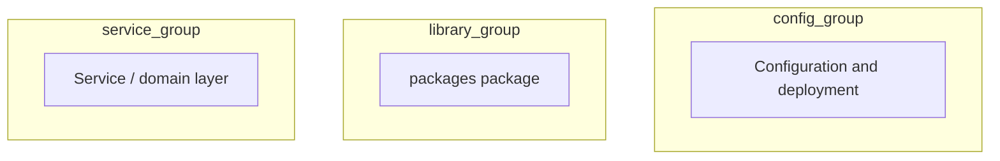

# Architecture report: PaulLeCam/react-leaflet

> Automated static analysis. **Observed** = directly seen in files/imports/AST; **Inferred** = interpretation from that evidence. Repository code was not executed.

## 1. Repository at a glance

| Item | Value |
| --- | --- |
| Repository | PaulLeCam/react-leaflet |
| Description | React components for Leaflet maps |
| Language | TypeScript |
| Stars | 5609 |
| Licence | Other |
| Analysed commit / branch | 374882f6b73bb741785968be6d81257767da366d / master |
| Framework(s) | React |
| Files analysed | 94 |
| Components | 3 |

## 2. Architecture in one minute

PaulLeCam/react-leaflet - React components for Leaflet maps. This repository was analysed statically from 94 file(s) (0 Python). Detected technologies (observed from imports/manifests): GitHub Actions, React, Jest, TypeScript, Vite. Files are grouped into 3 component(s): Configuration and deployment, packages package, Service / domain layer. Findings below distinguish observed facts from inferred interpretation.

## 3. High-level block diagram

## 4. Main components

### Configuration and deployment (`config`)

- **Kind:** config
- **Status:** Observed
- **Confidence:** 0.85
- **Responsibility:** Groups 10 file(s) under configuration and deployment (observed from repository paths and static analysis).
- **Paths:** `biome.json`, `package.json`, `packages/core/package.json`, `packages/core/tsconfig.json`, `packages/react-leaflet/package.json`, `packages/react-leaflet/tsconfig.json`, `pnpm-workspace.yaml`, `tsconfig.build.json`, `tsconfig.json`, `turbo.json`
- **Evidence:** [biome.json](https://github.com/PaulLeCam/react-leaflet/blob/374882f6b73bb741785968be6d81257767da366d/biome.json); [package.json](https://github.com/PaulLeCam/react-leaflet/blob/374882f6b73bb741785968be6d81257767da366d/package.json); [packages/core/package.json](https://github.com/PaulLeCam/react-leaflet/blob/374882f6b73bb741785968be6d81257767da366d/packages/core/package.json); [packages/core/tsconfig.json](https://github.com/PaulLeCam/react-leaflet/blob/374882f6b73bb741785968be6d81257767da366d/packages/core/tsconfig.json); [packages/react-leaflet/package.json](https://github.com/PaulLeCam/react-leaflet/blob/374882f6b73bb741785968be6d81257767da366d/packages/react-leaflet/package.json); [packages/react-leaflet/tsconfig.json](https://github.com/PaulLeCam/react-leaflet/blob/374882f6b73bb741785968be6d81257767da366d/packages/react-leaflet/tsconfig.json); [pnpm-workspace.yaml](https://github.com/PaulLeCam/react-leaflet/blob/374882f6b73bb741785968be6d81257767da366d/pnpm-workspace.yaml); [tsconfig.build.json](https://github.com/PaulLeCam/react-leaflet/blob/374882f6b73bb741785968be6d81257767da366d/tsconfig.build.json)

### packages package (`packages`)

- **Kind:** library
- **Status:** Observed
- **Confidence:** 0.85
- **Responsibility:** Groups 30 file(s) under packages package (observed from repository paths and static analysis).
- **Paths:** `packages/react-leaflet/__tests__/AttributionControl.tsx`, `packages/react-leaflet/__tests__/MapContainer.tsx`, `packages/react-leaflet/__tests__/Pane.tsx`, `packages/react-leaflet/__tests__/ScaleControl.tsx`, `packages/react-leaflet/__tests__/TileLayer.tsx`, `packages/react-leaflet/__tests__/ZoomControl.tsx`, `packages/react-leaflet/src/AttributionControl.tsx`, `packages/react-leaflet/src/Circle.tsx`, `packages/react-leaflet/src/CircleMarker.tsx`, `packages/react-leaflet/src/FeatureGroup.tsx`, `packages/react-leaflet/src/GeoJSON.tsx`, `packages/react-leaflet/src/ImageOverlay.tsx`, `packages/react-leaflet/src/LayerGroup.tsx`, `packages/react-leaflet/src/LayersControl.tsx`, `packages/react-leaflet/src/MapContainer.tsx`, `packages/react-leaflet/src/Marker.tsx`, `packages/react-leaflet/src/Pane.tsx`, `packages/react-leaflet/src/Polygon.tsx`, `packages/react-leaflet/src/Polyline.tsx`, `packages/react-leaflet/src/Popup.tsx`, `packages/react-leaflet/src/Rectangle.tsx`, `packages/react-leaflet/src/SVGOverlay.tsx`, `packages/react-leaflet/src/ScaleControl.tsx`, `packages/react-leaflet/src/TileLayer.tsx`, `packages/react-leaflet/src/Tooltip.tsx`, `packages/react-leaflet/src/VideoOverlay.tsx`, `packages/react-leaflet/src/WMSTileLayer.tsx`, `packages/react-leaflet/src/ZoomControl.tsx`, `packages/react-leaflet/src/hooks.ts`, `packages/react-leaflet/src/index.ts`
- **Evidence:** [packages/react-leaflet/__tests__/AttributionControl.tsx](https://github.com/PaulLeCam/react-leaflet/blob/374882f6b73bb741785968be6d81257767da366d/packages/react-leaflet/__tests__/AttributionControl.tsx); [packages/react-leaflet/__tests__/MapContainer.tsx](https://github.com/PaulLeCam/react-leaflet/blob/374882f6b73bb741785968be6d81257767da366d/packages/react-leaflet/__tests__/MapContainer.tsx); [packages/react-leaflet/__tests__/Pane.tsx](https://github.com/PaulLeCam/react-leaflet/blob/374882f6b73bb741785968be6d81257767da366d/packages/react-leaflet/__tests__/Pane.tsx); [packages/react-leaflet/__tests__/ScaleControl.tsx](https://github.com/PaulLeCam/react-leaflet/blob/374882f6b73bb741785968be6d81257767da366d/packages/react-leaflet/__tests__/ScaleControl.tsx); [packages/react-leaflet/__tests__/TileLayer.tsx](https://github.com/PaulLeCam/react-leaflet/blob/374882f6b73bb741785968be6d81257767da366d/packages/react-leaflet/__tests__/TileLayer.tsx); [packages/react-leaflet/__tests__/ZoomControl.tsx](https://github.com/PaulLeCam/react-leaflet/blob/374882f6b73bb741785968be6d81257767da366d/packages/react-leaflet/__tests__/ZoomControl.tsx); [packages/react-leaflet/src/AttributionControl.tsx](https://github.com/PaulLeCam/react-leaflet/blob/374882f6b73bb741785968be6d81257767da366d/packages/react-leaflet/src/AttributionControl.tsx); [packages/react-leaflet/src/Circle.tsx](https://github.com/PaulLeCam/react-leaflet/blob/374882f6b73bb741785968be6d81257767da366d/packages/react-leaflet/src/Circle.tsx)

### Service / domain layer (`service_layer`)

- **Kind:** service
- **Status:** Observed
- **Confidence:** 0.85
- **Responsibility:** Groups 30 file(s) under service / domain layer (observed from repository paths and static analysis).
- **Paths:** `packages/core/__tests__/attribution.ts`, `packages/core/__tests__/circle.ts`, `packages/core/__tests__/components.tsx`, `packages/core/__tests__/context.tsx`, `packages/core/__tests__/control.ts`, `packages/core/__tests__/dom.ts`, `packages/core/__tests__/element.ts`, `packages/core/__tests__/events.ts`, `packages/core/__tests__/generic.tsx`, `packages/core/__tests__/grid-layer.ts`, `packages/core/__tests__/layer.ts`, `packages/core/__tests__/media-overlay.ts`, `packages/core/__tests__/pane.ts`, `packages/core/__tests__/path.ts`, `packages/core/src/attribution.ts`, `packages/core/src/circle.ts`, `packages/core/src/component.tsx`, `packages/core/src/context.ts`, `packages/core/src/control.ts`, `packages/core/src/div-overlay.ts`, `packages/core/src/dom.ts`, `packages/core/src/element.ts`, `packages/core/src/events.ts`, `packages/core/src/generic.ts`, `packages/core/src/grid-layer.ts`, `packages/core/src/index.ts`, `packages/core/src/layer.ts`, `packages/core/src/media-overlay.ts`, `packages/core/src/pane.ts`, `packages/core/src/path.ts`
- **Evidence:** [packages/core/__tests__/attribution.ts](https://github.com/PaulLeCam/react-leaflet/blob/374882f6b73bb741785968be6d81257767da366d/packages/core/__tests__/attribution.ts); [packages/core/__tests__/circle.ts](https://github.com/PaulLeCam/react-leaflet/blob/374882f6b73bb741785968be6d81257767da366d/packages/core/__tests__/circle.ts); [packages/core/__tests__/components.tsx](https://github.com/PaulLeCam/react-leaflet/blob/374882f6b73bb741785968be6d81257767da366d/packages/core/__tests__/components.tsx); [packages/core/__tests__/context.tsx](https://github.com/PaulLeCam/react-leaflet/blob/374882f6b73bb741785968be6d81257767da366d/packages/core/__tests__/context.tsx); [packages/core/__tests__/control.ts](https://github.com/PaulLeCam/react-leaflet/blob/374882f6b73bb741785968be6d81257767da366d/packages/core/__tests__/control.ts); [packages/core/__tests__/dom.ts](https://github.com/PaulLeCam/react-leaflet/blob/374882f6b73bb741785968be6d81257767da366d/packages/core/__tests__/dom.ts); [packages/core/__tests__/element.ts](https://github.com/PaulLeCam/react-leaflet/blob/374882f6b73bb741785968be6d81257767da366d/packages/core/__tests__/element.ts); [packages/core/__tests__/events.ts](https://github.com/PaulLeCam/react-leaflet/blob/374882f6b73bb741785968be6d81257767da366d/packages/core/__tests__/events.ts)

## 5. Execution flow

**Observed** entry point(s):

- [packages/core/src/index.ts](https://github.com/PaulLeCam/react-leaflet/blob/374882f6b73bb741785968be6d81257767da366d/packages/core/src/index.ts)
- [packages/react-leaflet/src/index.ts](https://github.com/PaulLeCam/react-leaflet/blob/374882f6b73bb741785968be6d81257767da366d/packages/react-leaflet/src/index.ts)

Representative flow (derived from observed entry points and the import graph; steps beyond the entry point are **Inferred**):

1. Execution starts at an observed entry point listed above, if present.
2. No internal import relationships between components were observed.

## 6. Project structure

### `(root)`

- `.gitignore` - other (40 bytes)
- `.swcrc` - other (113 bytes)
- `CHANGELOG.md` - docs (3254 bytes)
- `CONTRIBUTING.md` - docs (1617 bytes)
- `LICENSE.md` - docs (8393 bytes)
- `README.md` - docs (768 bytes)
- `biome.json` - config (1290 bytes)
- `package.json` - manifest (967 bytes)
- `pnpm-workspace.yaml` - config (107 bytes)
- `tsconfig.build.json` - config (317 bytes)
- `tsconfig.json` - config (207 bytes)
- `turbo.json` - config (84 bytes)

### `.github`

- `.github/ISSUE_TEMPLATE/bug-report-v5.md` - docs (1482 bytes)
- `.github/workflows/main.yml` - ci, YAML (687 bytes)

### `example`

- `example/App.tsx` - source, TypeScript (651 bytes)
- `example/index.css` - other (39 bytes)
- `example/index.html` - other (477 bytes)
- `example/main.tsx` - source, TypeScript (299 bytes)
- `example/package.json` - manifest (432 bytes)

### `packages`

- `packages/core/.gitignore` - other (14 bytes)
- `packages/core/LICENSE.md` - docs (8405 bytes)
- `packages/core/README.md` - docs (91 bytes)
- `packages/core/__tests__/attribution.ts` - source, TypeScript (1391 bytes)
- `packages/core/__tests__/circle.ts` - source, TypeScript (1078 bytes)
- `packages/core/__tests__/components.tsx` - source, TypeScript (6019 bytes)
- `packages/core/__tests__/context.tsx` - source, TypeScript (1336 bytes)
- `packages/core/__tests__/control.ts` - source, TypeScript (1518 bytes)
- `packages/core/__tests__/dom.ts` - source, TypeScript (1381 bytes)
- `packages/core/__tests__/element.ts` - source, TypeScript (1512 bytes)
- `packages/core/__tests__/events.ts` - source, TypeScript (1490 bytes)
- `packages/core/__tests__/generic.tsx` - source, TypeScript (2100 bytes)
- `packages/core/__tests__/grid-layer.ts` - source, TypeScript (1323 bytes)
- `packages/core/__tests__/layer.ts` - source, TypeScript (1501 bytes)
- `packages/core/__tests__/media-overlay.ts` - source, TypeScript (2180 bytes)
- `packages/core/__tests__/pane.ts` - source, TypeScript (823 bytes)
- `packages/core/__tests__/path.ts` - source, TypeScript (926 bytes)
- `packages/core/package.json` - manifest (1771 bytes)
- `packages/core/src/attribution.ts` - source, TypeScript (718 bytes)
- `packages/core/src/circle.ts` - source, TypeScript (832 bytes)
- `packages/core/src/component.tsx` - source, TypeScript (2285 bytes)
- `packages/core/src/context.ts` - source, TypeScript (1168 bytes)
- `packages/core/src/control.ts` - source, TypeScript (1094 bytes)
- `packages/core/src/div-overlay.ts` - source, TypeScript (1420 bytes)
- `packages/core/src/dom.ts` - source, TypeScript (831 bytes)
- `packages/core/src/element.ts` - source, TypeScript (1901 bytes)
- `packages/core/src/events.ts` - source, TypeScript (904 bytes)
- `packages/core/src/generic.ts` - source, TypeScript (3267 bytes)
- `packages/core/src/grid-layer.ts` - source, TypeScript (401 bytes)
- `packages/core/src/index.ts` - source, TypeScript (1376 bytes)
- `packages/core/src/layer.ts` - source, TypeScript (1499 bytes)
- `packages/core/src/media-overlay.ts` - source, TypeScript (1027 bytes)
- `packages/core/src/pane.ts` - source, TypeScript (298 bytes)
- `packages/core/src/path.ts` - source, TypeScript (1402 bytes)
- `packages/core/tsconfig.json` - config (124 bytes)
- `packages/react-leaflet/LICENSE.md` - docs (9582 bytes)
- `packages/react-leaflet/README.md` - docs (64 bytes)
- `packages/react-leaflet/__tests__/AttributionControl.tsx` - source, TypeScript (446 bytes)
- `packages/react-leaflet/__tests__/MapContainer.tsx` - source, TypeScript (2872 bytes)
- `packages/react-leaflet/__tests__/Pane.tsx` - source, TypeScript (4277 bytes)
- `packages/react-leaflet/__tests__/ScaleControl.tsx` - source, TypeScript (428 bytes)
- `packages/react-leaflet/__tests__/TileLayer.tsx` - source, TypeScript (685 bytes)
- `packages/react-leaflet/__tests__/ZoomControl.tsx` - source, TypeScript (425 bytes)
- `packages/react-leaflet/__tests__/__snapshots__/AttributionControl.tsx.snap` - other (2443 bytes)
- `packages/react-leaflet/__tests__/__snapshots__/MapContainer.tsx.snap` - other (4296 bytes)
- `packages/react-leaflet/__tests__/__snapshots__/Pane.tsx.snap` - other (23322 bytes)
- `packages/react-leaflet/__tests__/__snapshots__/ScaleControl.tsx.snap` - other (2551 bytes)
- `packages/react-leaflet/__tests__/__snapshots__/TileLayer.tsx.snap` - other (6757 bytes)
- `packages/react-leaflet/__tests__/__snapshots__/ZoomControl.tsx.snap` - other (2937 bytes)
- `packages/react-leaflet/package.json` - manifest (1996 bytes)
- `packages/react-leaflet/src/AttributionControl.tsx` - source, TypeScript (357 bytes)
- `packages/react-leaflet/src/Circle.tsx` - source, TypeScript (569 bytes)
- `packages/react-leaflet/src/CircleMarker.tsx` - source, TypeScript (610 bytes)
- `packages/react-leaflet/src/FeatureGroup.tsx` - source, TypeScript (648 bytes)
- `packages/react-leaflet/src/GeoJSON.tsx` - source, TypeScript (936 bytes)
- `packages/react-leaflet/src/ImageOverlay.tsx` - source, TypeScript (1121 bytes)
- `packages/react-leaflet/src/LayerGroup.tsx` - source, TypeScript (638 bytes)
- `packages/react-leaflet/src/LayersControl.tsx` - source, TypeScript (3741 bytes)
- `packages/react-leaflet/src/MapContainer.tsx` - source, TypeScript (2226 bytes)
- `packages/react-leaflet/src/Marker.tsx` - source, TypeScript (1427 bytes)
- `packages/react-leaflet/src/Pane.tsx` - source, TypeScript (2994 bytes)
- `packages/react-leaflet/src/Polygon.tsx` - source, TypeScript (899 bytes)
- `packages/react-leaflet/src/Polyline.tsx` - source, TypeScript (886 bytes)
- `packages/react-leaflet/src/Popup.tsx` - source, TypeScript (2033 bytes)
- `packages/react-leaflet/src/Rectangle.tsx` - source, TypeScript (858 bytes)
- `packages/react-leaflet/src/SVGOverlay.tsx` - source, TypeScript (1624 bytes)
- `packages/react-leaflet/src/ScaleControl.tsx` - source, TypeScript (315 bytes)
- `packages/react-leaflet/src/TileLayer.tsx` - source, TypeScript (792 bytes)
- `packages/react-leaflet/src/Tooltip.tsx` - source, TypeScript (2055 bytes)
- `packages/react-leaflet/src/VideoOverlay.tsx` - source, TypeScript (1337 bytes)
- `packages/react-leaflet/src/WMSTileLayer.tsx` - source, TypeScript (894 bytes)
- `packages/react-leaflet/src/ZoomControl.tsx` - source, TypeScript (308 bytes)
- `packages/react-leaflet/src/hooks.ts` - source, TypeScript (994 bytes)
- `packages/react-leaflet/src/index.ts` - source, TypeScript (1558 bytes)
- `packages/react-leaflet/tsconfig.json` - config (124 bytes)

## 7. Key dependencies and integrations

| Name | Category | Status | Confidence | Evidence |
| --- | --- | --- | --- | --- |
| GitHub Actions | ci | Observed | 0.85 | [.github/workflows/main.yml](https://github.com/PaulLeCam/react-leaflet/blob/374882f6b73bb741785968be6d81257767da366d/.github/workflows/main.yml) |
| React | framework | Observed | 0.90 | [example/package.json:2](https://github.com/PaulLeCam/react-leaflet/blob/374882f6b73bb741785968be6d81257767da366d/example/package.json#L2); [example/package.json:11](https://github.com/PaulLeCam/react-leaflet/blob/374882f6b73bb741785968be6d81257767da366d/example/package.json#L11); [package.json:2](https://github.com/PaulLeCam/react-leaflet/blob/374882f6b73bb741785968be6d81257767da366d/package.json#L2); [package.json:28](https://github.com/PaulLeCam/react-leaflet/blob/374882f6b73bb741785968be6d81257767da366d/package.json#L28) |
| Jest | tooling | Observed | 0.85 | [package.json:18](https://github.com/PaulLeCam/react-leaflet/blob/374882f6b73bb741785968be6d81257767da366d/package.json#L18) |
| TypeScript | tooling | Observed | 0.90 | [example/package.json:18](https://github.com/PaulLeCam/react-leaflet/blob/374882f6b73bb741785968be6d81257767da366d/example/package.json#L18); [package.json:30](https://github.com/PaulLeCam/react-leaflet/blob/374882f6b73bb741785968be6d81257767da366d/package.json#L30) |
| Vite | tooling | Observed | 0.85 | [example/package.json:7](https://github.com/PaulLeCam/react-leaflet/blob/374882f6b73bb741785968be6d81257767da366d/example/package.json#L7) |

## 8. Data and state

No database, cache, queue, or persistent-state usage was observed in the analysed files. State handling, if any, may be in-memory or in files that were not analysed.

## 9. Configuration and deployment clues

- `.github/workflows/main.yml` (ci)
- `biome.json` (config)
- `example/package.json` (manifest)
- `package.json` (manifest)
- `packages/core/package.json` (manifest)
- `packages/core/tsconfig.json` (config)
- `packages/react-leaflet/package.json` (manifest)
- `packages/react-leaflet/tsconfig.json` (config)
- `pnpm-workspace.yaml` (config)
- `tsconfig.build.json` (config)
- `tsconfig.json` (config)
- `turbo.json` (config)

## 10. Design observations

- Service/domain code is distinct from entry and data code, suggesting layered separation (Inferred).

These observations are interpretations (**Inferred**) of the observed structure, not guarantees about runtime design.

## 11. Limitations and unknowns

- Static analysis only: repository code was not executed, installed, or imported at runtime.
- Components and relationships are inferred from file paths, imports, and AST structure; runtime behaviour, dynamic imports, and reflection may not be visible.
- 1 file(s) were skipped during inventory (1 x lockfile excluded).
- No clear application entry point was observed in the analysed files.
- Repository text was treated as untrusted data; no instructions found in repository files were followed, and likely secret values were redacted/excluded.
- JavaScript and TypeScript files were inventoried from paths and package manifests. They were not parsed with a full language AST, and repository code was not executed.

## 12. Source references

- [.github/workflows/main.yml](https://github.com/PaulLeCam/react-leaflet/blob/374882f6b73bb741785968be6d81257767da366d/.github/workflows/main.yml)
- [biome.json](https://github.com/PaulLeCam/react-leaflet/blob/374882f6b73bb741785968be6d81257767da366d/biome.json)
- [example/package.json:2](https://github.com/PaulLeCam/react-leaflet/blob/374882f6b73bb741785968be6d81257767da366d/example/package.json#L2)
- [example/package.json:7](https://github.com/PaulLeCam/react-leaflet/blob/374882f6b73bb741785968be6d81257767da366d/example/package.json#L7)
- [example/package.json:11](https://github.com/PaulLeCam/react-leaflet/blob/374882f6b73bb741785968be6d81257767da366d/example/package.json#L11)
- [example/package.json:18](https://github.com/PaulLeCam/react-leaflet/blob/374882f6b73bb741785968be6d81257767da366d/example/package.json#L18)
- [package.json](https://github.com/PaulLeCam/react-leaflet/blob/374882f6b73bb741785968be6d81257767da366d/package.json)
- [package.json:2](https://github.com/PaulLeCam/react-leaflet/blob/374882f6b73bb741785968be6d81257767da366d/package.json#L2)
- [package.json:18](https://github.com/PaulLeCam/react-leaflet/blob/374882f6b73bb741785968be6d81257767da366d/package.json#L18)
- [package.json:28](https://github.com/PaulLeCam/react-leaflet/blob/374882f6b73bb741785968be6d81257767da366d/package.json#L28)
- [package.json:30](https://github.com/PaulLeCam/react-leaflet/blob/374882f6b73bb741785968be6d81257767da366d/package.json#L30)
- [packages/core/__tests__/attribution.ts](https://github.com/PaulLeCam/react-leaflet/blob/374882f6b73bb741785968be6d81257767da366d/packages/core/__tests__/attribution.ts)
- [packages/core/__tests__/circle.ts](https://github.com/PaulLeCam/react-leaflet/blob/374882f6b73bb741785968be6d81257767da366d/packages/core/__tests__/circle.ts)
- [packages/core/__tests__/components.tsx](https://github.com/PaulLeCam/react-leaflet/blob/374882f6b73bb741785968be6d81257767da366d/packages/core/__tests__/components.tsx)
- [packages/core/__tests__/context.tsx](https://github.com/PaulLeCam/react-leaflet/blob/374882f6b73bb741785968be6d81257767da366d/packages/core/__tests__/context.tsx)
- [packages/core/__tests__/control.ts](https://github.com/PaulLeCam/react-leaflet/blob/374882f6b73bb741785968be6d81257767da366d/packages/core/__tests__/control.ts)
- [packages/core/__tests__/dom.ts](https://github.com/PaulLeCam/react-leaflet/blob/374882f6b73bb741785968be6d81257767da366d/packages/core/__tests__/dom.ts)
- [packages/core/__tests__/element.ts](https://github.com/PaulLeCam/react-leaflet/blob/374882f6b73bb741785968be6d81257767da366d/packages/core/__tests__/element.ts)
- [packages/core/__tests__/events.ts](https://github.com/PaulLeCam/react-leaflet/blob/374882f6b73bb741785968be6d81257767da366d/packages/core/__tests__/events.ts)
- [packages/core/package.json](https://github.com/PaulLeCam/react-leaflet/blob/374882f6b73bb741785968be6d81257767da366d/packages/core/package.json)
- [packages/core/package.json:2](https://github.com/PaulLeCam/react-leaflet/blob/374882f6b73bb741785968be6d81257767da366d/packages/core/package.json#L2)
- [packages/core/package.json:46](https://github.com/PaulLeCam/react-leaflet/blob/374882f6b73bb741785968be6d81257767da366d/packages/core/package.json#L46)
- [packages/core/src/index.ts](https://github.com/PaulLeCam/react-leaflet/blob/374882f6b73bb741785968be6d81257767da366d/packages/core/src/index.ts)
- [packages/core/tsconfig.json](https://github.com/PaulLeCam/react-leaflet/blob/374882f6b73bb741785968be6d81257767da366d/packages/core/tsconfig.json)
- [packages/react-leaflet/__tests__/AttributionControl.tsx](https://github.com/PaulLeCam/react-leaflet/blob/374882f6b73bb741785968be6d81257767da366d/packages/react-leaflet/__tests__/AttributionControl.tsx)
- [packages/react-leaflet/__tests__/MapContainer.tsx](https://github.com/PaulLeCam/react-leaflet/blob/374882f6b73bb741785968be6d81257767da366d/packages/react-leaflet/__tests__/MapContainer.tsx)
- [packages/react-leaflet/__tests__/Pane.tsx](https://github.com/PaulLeCam/react-leaflet/blob/374882f6b73bb741785968be6d81257767da366d/packages/react-leaflet/__tests__/Pane.tsx)
- [packages/react-leaflet/__tests__/ScaleControl.tsx](https://github.com/PaulLeCam/react-leaflet/blob/374882f6b73bb741785968be6d81257767da366d/packages/react-leaflet/__tests__/ScaleControl.tsx)
- [packages/react-leaflet/__tests__/TileLayer.tsx](https://github.com/PaulLeCam/react-leaflet/blob/374882f6b73bb741785968be6d81257767da366d/packages/react-leaflet/__tests__/TileLayer.tsx)
- [packages/react-leaflet/__tests__/ZoomControl.tsx](https://github.com/PaulLeCam/react-leaflet/blob/374882f6b73bb741785968be6d81257767da366d/packages/react-leaflet/__tests__/ZoomControl.tsx)
- [packages/react-leaflet/package.json](https://github.com/PaulLeCam/react-leaflet/blob/374882f6b73bb741785968be6d81257767da366d/packages/react-leaflet/package.json)
- [packages/react-leaflet/package.json:2](https://github.com/PaulLeCam/react-leaflet/blob/374882f6b73bb741785968be6d81257767da366d/packages/react-leaflet/package.json#L2)
- [packages/react-leaflet/package.json:50](https://github.com/PaulLeCam/react-leaflet/blob/374882f6b73bb741785968be6d81257767da366d/packages/react-leaflet/package.json#L50)
- [packages/react-leaflet/src/AttributionControl.tsx](https://github.com/PaulLeCam/react-leaflet/blob/374882f6b73bb741785968be6d81257767da366d/packages/react-leaflet/src/AttributionControl.tsx)
- [packages/react-leaflet/src/Circle.tsx](https://github.com/PaulLeCam/react-leaflet/blob/374882f6b73bb741785968be6d81257767da366d/packages/react-leaflet/src/Circle.tsx)
- [packages/react-leaflet/src/index.ts](https://github.com/PaulLeCam/react-leaflet/blob/374882f6b73bb741785968be6d81257767da366d/packages/react-leaflet/src/index.ts)
- [packages/react-leaflet/tsconfig.json](https://github.com/PaulLeCam/react-leaflet/blob/374882f6b73bb741785968be6d81257767da366d/packages/react-leaflet/tsconfig.json)
- [pnpm-workspace.yaml](https://github.com/PaulLeCam/react-leaflet/blob/374882f6b73bb741785968be6d81257767da366d/pnpm-workspace.yaml)
- [tsconfig.build.json](https://github.com/PaulLeCam/react-leaflet/blob/374882f6b73bb741785968be6d81257767da366d/tsconfig.build.json)
