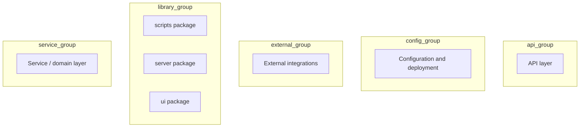

# Architecture report: Raathigesh/majestic

> Automated static analysis. **Observed** = directly seen in files/imports/AST; **Inferred** = interpretation from that evidence. Repository code was not executed.

## 1. Repository at a glance

| Item | Value |
| --- | --- |
| Repository | Raathigesh/majestic |
| Description | ⚡ Zero config GUI for Jest |
| Language | TypeScript |
| Stars | 7437 |
| Licence | MIT |
| Analysed commit / branch | 2bb0047188722610c7251e53717ce731bf5ec65e / master |
| Framework(s) | React |
| Files analysed | 118 |
| Components | 7 |

## 2. Architecture in one minute

Raathigesh/majestic - ⚡ Zero config GUI for Jest. This repository was analysed statically from 118 file(s) (0 Python). Detected technologies (observed from imports/manifests): GitHub Actions, React, Jest, TypeScript, webpack. Files are grouped into 7 component(s): API layer, Configuration and deployment, External integrations, scripts package, server package, Service / domain layer, ui package. Findings below distinguish observed facts from inferred interpretation.

## 3. High-level block diagram

## 4. Main components

### API layer (`api_layer`)

- **Kind:** api
- **Status:** Observed
- **Confidence:** 0.85
- **Responsibility:** Groups 16 file(s) under api layer (observed from repository paths and static analysis).
- **Paths:** `server/api/app/app.ts`, `server/api/app/resolver.ts`, `server/api/index.ts`, `server/api/runner/resolver.ts`, `server/api/runner/status.ts`, `server/api/runner/type.ts`, `server/api/workspace/coverage.ts`, `server/api/workspace/resolver.ts`, `server/api/workspace/summary.ts`, `server/api/workspace/test-file.ts`, `server/api/workspace/test-item.ts`, `server/api/workspace/test-result/console-log.ts`, `server/api/workspace/test-result/file-result.ts`, `server/api/workspace/test-result/test-item-result.ts`, `server/api/workspace/tree.ts`, `server/api/workspace/workspace.ts`
- **Evidence:** [server/api/app/app.ts](https://github.com/Raathigesh/majestic/blob/2bb0047188722610c7251e53717ce731bf5ec65e/server/api/app/app.ts); [server/api/app/resolver.ts](https://github.com/Raathigesh/majestic/blob/2bb0047188722610c7251e53717ce731bf5ec65e/server/api/app/resolver.ts); [server/api/index.ts](https://github.com/Raathigesh/majestic/blob/2bb0047188722610c7251e53717ce731bf5ec65e/server/api/index.ts); [server/api/runner/resolver.ts](https://github.com/Raathigesh/majestic/blob/2bb0047188722610c7251e53717ce731bf5ec65e/server/api/runner/resolver.ts); [server/api/runner/status.ts](https://github.com/Raathigesh/majestic/blob/2bb0047188722610c7251e53717ce731bf5ec65e/server/api/runner/status.ts); [server/api/runner/type.ts](https://github.com/Raathigesh/majestic/blob/2bb0047188722610c7251e53717ce731bf5ec65e/server/api/runner/type.ts); [server/api/workspace/coverage.ts](https://github.com/Raathigesh/majestic/blob/2bb0047188722610c7251e53717ce731bf5ec65e/server/api/workspace/coverage.ts); [server/api/workspace/resolver.ts](https://github.com/Raathigesh/majestic/blob/2bb0047188722610c7251e53717ce731bf5ec65e/server/api/workspace/resolver.ts)

### Configuration and deployment (`config`)

- **Kind:** config
- **Status:** Observed
- **Confidence:** 0.85
- **Responsibility:** Groups 8 file(s) under configuration and deployment (observed from repository paths and static analysis).
- **Paths:** `integration/cypress.json`, `integration/cypress/fixtures/example.json`, `integration/package.json`, `integration/projects/basic/package.json`, `nodemon.json`, `package.json`, `tsconfig.json`, `tsconfig.server.json`
- **Evidence:** [integration/cypress.json](https://github.com/Raathigesh/majestic/blob/2bb0047188722610c7251e53717ce731bf5ec65e/integration/cypress.json); [integration/cypress/fixtures/example.json](https://github.com/Raathigesh/majestic/blob/2bb0047188722610c7251e53717ce731bf5ec65e/integration/cypress/fixtures/example.json); [integration/package.json](https://github.com/Raathigesh/majestic/blob/2bb0047188722610c7251e53717ce731bf5ec65e/integration/package.json); [integration/projects/basic/package.json](https://github.com/Raathigesh/majestic/blob/2bb0047188722610c7251e53717ce731bf5ec65e/integration/projects/basic/package.json); [nodemon.json](https://github.com/Raathigesh/majestic/blob/2bb0047188722610c7251e53717ce731bf5ec65e/nodemon.json); [package.json](https://github.com/Raathigesh/majestic/blob/2bb0047188722610c7251e53717ce731bf5ec65e/package.json); [tsconfig.json](https://github.com/Raathigesh/majestic/blob/2bb0047188722610c7251e53717ce731bf5ec65e/tsconfig.json); [tsconfig.server.json](https://github.com/Raathigesh/majestic/blob/2bb0047188722610c7251e53717ce731bf5ec65e/tsconfig.server.json)

### External integrations (`external_integrations`)

- **Kind:** external
- **Status:** Observed
- **Confidence:** 0.85
- **Responsibility:** Groups 12 file(s) under external integrations (observed from repository paths and static analysis).
- **Paths:** `integration/cypress/integration/basic/basic-functionality.js`, `integration/cypress/plugins/index.js`, `integration/cypress/support/commands.js`, `integration/cypress/support/index.js`, `integration/kill.js`, `integration/projects/basic/app.js`, `integration/projects/basic/babel.config.js`, `integration/projects/basic/test-all-good.spec.js`, `integration/projects/basic/test-few-failure.spec.js`, `integration/projects/basic/test-only.spec.js`, `integration/projects/basic/test-snapshot-failure.spec.js`, `integration/projects/basic/test-snapshot-text.spec.js`
- **Evidence:** [integration/cypress/integration/basic/basic-functionality.js](https://github.com/Raathigesh/majestic/blob/2bb0047188722610c7251e53717ce731bf5ec65e/integration/cypress/integration/basic/basic-functionality.js); [integration/cypress/plugins/index.js](https://github.com/Raathigesh/majestic/blob/2bb0047188722610c7251e53717ce731bf5ec65e/integration/cypress/plugins/index.js); [integration/cypress/support/commands.js](https://github.com/Raathigesh/majestic/blob/2bb0047188722610c7251e53717ce731bf5ec65e/integration/cypress/support/commands.js); [integration/cypress/support/index.js](https://github.com/Raathigesh/majestic/blob/2bb0047188722610c7251e53717ce731bf5ec65e/integration/cypress/support/index.js); [integration/kill.js](https://github.com/Raathigesh/majestic/blob/2bb0047188722610c7251e53717ce731bf5ec65e/integration/kill.js); [integration/projects/basic/app.js](https://github.com/Raathigesh/majestic/blob/2bb0047188722610c7251e53717ce731bf5ec65e/integration/projects/basic/app.js); [integration/projects/basic/babel.config.js](https://github.com/Raathigesh/majestic/blob/2bb0047188722610c7251e53717ce731bf5ec65e/integration/projects/basic/babel.config.js); [integration/projects/basic/test-all-good.spec.js](https://github.com/Raathigesh/majestic/blob/2bb0047188722610c7251e53717ce731bf5ec65e/integration/projects/basic/test-all-good.spec.js)

### scripts package (`scripts`)

- **Kind:** library
- **Status:** Observed
- **Confidence:** 0.85
- **Responsibility:** Groups 2 file(s) under scripts package (observed from repository paths and static analysis).
- **Paths:** `scripts/webpack.server.config.js`, `scripts/webpack.ui.config.js`
- **Evidence:** [scripts/webpack.server.config.js](https://github.com/Raathigesh/majestic/blob/2bb0047188722610c7251e53717ce731bf5ec65e/scripts/webpack.server.config.js); [scripts/webpack.ui.config.js](https://github.com/Raathigesh/majestic/blob/2bb0047188722610c7251e53717ce731bf5ec65e/scripts/webpack.ui.config.js)

### server package (`server`)

- **Kind:** library
- **Status:** Observed
- **Confidence:** 0.85
- **Responsibility:** Groups 5 file(s) under server package (observed from repository paths and static analysis).
- **Paths:** `server/event-emitter/index.ts`, `server/index.ts`, `server/logger.ts`, `server/static-files.ts`, `server/typings.d.ts`
- **Evidence:** [server/event-emitter/index.ts](https://github.com/Raathigesh/majestic/blob/2bb0047188722610c7251e53717ce731bf5ec65e/server/event-emitter/index.ts); [server/index.ts](https://github.com/Raathigesh/majestic/blob/2bb0047188722610c7251e53717ce731bf5ec65e/server/index.ts); [server/logger.ts](https://github.com/Raathigesh/majestic/blob/2bb0047188722610c7251e53717ce731bf5ec65e/server/logger.ts); [server/static-files.ts](https://github.com/Raathigesh/majestic/blob/2bb0047188722610c7251e53717ce731bf5ec65e/server/static-files.ts); [server/typings.d.ts](https://github.com/Raathigesh/majestic/blob/2bb0047188722610c7251e53717ce731bf5ec65e/server/typings.d.ts)

### Service / domain layer (`service_layer`)

- **Kind:** service
- **Status:** Observed
- **Confidence:** 0.85
- **Responsibility:** Groups 13 file(s) under service / domain layer (observed from repository paths and static analysis).
- **Paths:** `server/services/ast/inspector.ts`, `server/services/ast/parser.ts`, `server/services/cli.ts`, `server/services/config-resolver.ts`, `server/services/file-watcher/index.ts`, `server/services/jest-manager/cli-args.ts`, `server/services/jest-manager/index.ts`, `server/services/jest-manager/scripts/patch.js`, `server/services/jest-manager/scripts/reporter.js`, `server/services/project.ts`, `server/services/result-handler-api.ts`, `server/services/results.ts`, `server/services/types.ts`
- **Evidence:** [server/services/ast/inspector.ts](https://github.com/Raathigesh/majestic/blob/2bb0047188722610c7251e53717ce731bf5ec65e/server/services/ast/inspector.ts); [server/services/ast/parser.ts](https://github.com/Raathigesh/majestic/blob/2bb0047188722610c7251e53717ce731bf5ec65e/server/services/ast/parser.ts); [server/services/cli.ts](https://github.com/Raathigesh/majestic/blob/2bb0047188722610c7251e53717ce731bf5ec65e/server/services/cli.ts); [server/services/config-resolver.ts](https://github.com/Raathigesh/majestic/blob/2bb0047188722610c7251e53717ce731bf5ec65e/server/services/config-resolver.ts); [server/services/file-watcher/index.ts](https://github.com/Raathigesh/majestic/blob/2bb0047188722610c7251e53717ce731bf5ec65e/server/services/file-watcher/index.ts); [server/services/jest-manager/cli-args.ts](https://github.com/Raathigesh/majestic/blob/2bb0047188722610c7251e53717ce731bf5ec65e/server/services/jest-manager/cli-args.ts); [server/services/jest-manager/index.ts](https://github.com/Raathigesh/majestic/blob/2bb0047188722610c7251e53717ce731bf5ec65e/server/services/jest-manager/index.ts); [server/services/jest-manager/scripts/patch.js](https://github.com/Raathigesh/majestic/blob/2bb0047188722610c7251e53717ce731bf5ec65e/server/services/jest-manager/scripts/patch.js)

### ui package (`ui`)

- **Kind:** library
- **Status:** Observed
- **Confidence:** 0.85
- **Responsibility:** Groups 28 file(s) under ui package (observed from repository paths and static analysis).
- **Paths:** `ui/apollo-client.ts`, `ui/app.tsx`, `ui/components/button.tsx`, `ui/container.tsx`, `ui/coverage-panel/index.tsx`, `ui/error.tsx`, `ui/hooks/use-keys.ts`, `ui/index.tsx`, `ui/loading.tsx`, `ui/search/index.tsx`, `ui/sidebar/execution-indicator.tsx`, `ui/sidebar/file-item.tsx`, `ui/sidebar/index.tsx`, `ui/sidebar/logo.tsx`, `ui/sidebar/summary/index.tsx`, `ui/sidebar/transformer.ts`, `ui/sidebar/tree.tsx`, `ui/split-panel-style.ts`, `ui/test-file/console-panel/index.tsx`, `ui/test-file/error-panel/index.tsx`, `ui/test-file/index.tsx`, `ui/test-file/summary/index.tsx`, `ui/test-file/test-indicator.tsx`, `ui/test-file/test-item.tsx`, `ui/test-file/transformer.ts`, `ui/test-file/use-subscription.tsx`, `ui/theme.ts`, `ui/typings.d.ts`
- **Evidence:** [ui/apollo-client.ts](https://github.com/Raathigesh/majestic/blob/2bb0047188722610c7251e53717ce731bf5ec65e/ui/apollo-client.ts); [ui/app.tsx](https://github.com/Raathigesh/majestic/blob/2bb0047188722610c7251e53717ce731bf5ec65e/ui/app.tsx); [ui/components/button.tsx](https://github.com/Raathigesh/majestic/blob/2bb0047188722610c7251e53717ce731bf5ec65e/ui/components/button.tsx); [ui/container.tsx](https://github.com/Raathigesh/majestic/blob/2bb0047188722610c7251e53717ce731bf5ec65e/ui/container.tsx); [ui/coverage-panel/index.tsx](https://github.com/Raathigesh/majestic/blob/2bb0047188722610c7251e53717ce731bf5ec65e/ui/coverage-panel/index.tsx); [ui/error.tsx](https://github.com/Raathigesh/majestic/blob/2bb0047188722610c7251e53717ce731bf5ec65e/ui/error.tsx); [ui/hooks/use-keys.ts](https://github.com/Raathigesh/majestic/blob/2bb0047188722610c7251e53717ce731bf5ec65e/ui/hooks/use-keys.ts); [ui/index.tsx](https://github.com/Raathigesh/majestic/blob/2bb0047188722610c7251e53717ce731bf5ec65e/ui/index.tsx)

## 5. Execution flow

**Observed** entry point(s):

- [integration/cypress/plugins/index.js](https://github.com/Raathigesh/majestic/blob/2bb0047188722610c7251e53717ce731bf5ec65e/integration/cypress/plugins/index.js)
- [integration/cypress/support/index.js](https://github.com/Raathigesh/majestic/blob/2bb0047188722610c7251e53717ce731bf5ec65e/integration/cypress/support/index.js)
- [integration/projects/basic/app.js](https://github.com/Raathigesh/majestic/blob/2bb0047188722610c7251e53717ce731bf5ec65e/integration/projects/basic/app.js)
- [server/api/app/app.ts](https://github.com/Raathigesh/majestic/blob/2bb0047188722610c7251e53717ce731bf5ec65e/server/api/app/app.ts)
- [server/api/index.ts](https://github.com/Raathigesh/majestic/blob/2bb0047188722610c7251e53717ce731bf5ec65e/server/api/index.ts)
- [server/event-emitter/index.ts](https://github.com/Raathigesh/majestic/blob/2bb0047188722610c7251e53717ce731bf5ec65e/server/event-emitter/index.ts)
- [server/index.ts](https://github.com/Raathigesh/majestic/blob/2bb0047188722610c7251e53717ce731bf5ec65e/server/index.ts)
- [server/services/file-watcher/index.ts](https://github.com/Raathigesh/majestic/blob/2bb0047188722610c7251e53717ce731bf5ec65e/server/services/file-watcher/index.ts)
- [server/services/jest-manager/index.ts](https://github.com/Raathigesh/majestic/blob/2bb0047188722610c7251e53717ce731bf5ec65e/server/services/jest-manager/index.ts)
- [ui/app.tsx](https://github.com/Raathigesh/majestic/blob/2bb0047188722610c7251e53717ce731bf5ec65e/ui/app.tsx)
- [ui/coverage-panel/index.tsx](https://github.com/Raathigesh/majestic/blob/2bb0047188722610c7251e53717ce731bf5ec65e/ui/coverage-panel/index.tsx)
- [ui/index.tsx](https://github.com/Raathigesh/majestic/blob/2bb0047188722610c7251e53717ce731bf5ec65e/ui/index.tsx)

Representative flow (derived from observed entry points and the import graph; steps beyond the entry point are **Inferred**):

1. Execution starts at an observed entry point listed above, if present.
2. No internal import relationships between components were observed.

## 6. Project structure

### `(root)`

- `.all-contributorsrc` - other (5274 bytes)
- `.babelrc` - other (427 bytes)
- `.gitignore` - other (17 bytes)
- `.prettierrc` - other (52 bytes)
- `CONTRIBUTING.MD` - docs (1541 bytes)
- `LICENSE` - docs (1079 bytes)
- `README.md` - docs (10915 bytes)
- `Troubleshooting.md` - docs (874 bytes)
- `nodemon.json` - config (151 bytes)
- `package.json` - manifest (3799 bytes)
- `tsconfig.json` - config (607 bytes)
- `tsconfig.server.json` - config (715 bytes)

### `.github`

- `.github/issue_template.md` - docs (502 bytes)
- `.github/stale.yml` - config (285 bytes)
- `.github/workflows/nodejs.yml` - ci, YAML (487 bytes)

### `.vscode`

- `.vscode/launch.json` - config (604 bytes)

### `integration`

- `integration/cypress.json` - config (28 bytes)
- `integration/cypress/fixtures/example.json` - config (154 bytes)
- `integration/cypress/integration/basic/basic-functionality.js` - source, JavaScript (1287 bytes)
- `integration/cypress/plugins/index.js` - source, JavaScript (645 bytes)
- `integration/cypress/support/commands.js` - source, JavaScript (888 bytes)
- `integration/cypress/support/index.js` - source, JavaScript (671 bytes)
- `integration/kill.js` - source, JavaScript (207 bytes)
- `integration/package.json` - manifest (865 bytes)
- `integration/projects/basic/__snapshots__/test-snapshot-failure.spec.js.snap` - other (129 bytes)
- `integration/projects/basic/app.js` - source, JavaScript (168 bytes)
- `integration/projects/basic/babel.config.js` - source, JavaScript (181 bytes)
- `integration/projects/basic/package.json` - manifest (425 bytes)
- `integration/projects/basic/test-all-good.spec.js` - source, JavaScript (386 bytes)
- `integration/projects/basic/test-few-failure.spec.js` - source, JavaScript (386 bytes)
- `integration/projects/basic/test-only.spec.js` - source, JavaScript (323 bytes)
- `integration/projects/basic/test-snapshot-failure.spec.js` - source, JavaScript (328 bytes)
- `integration/projects/basic/test-snapshot-text.spec.js` - source, JavaScript (126 bytes)

### `scripts`

- `scripts/webpack.server.config.js` - source, JavaScript (1257 bytes)
- `scripts/webpack.ui.config.js` - source, JavaScript (1646 bytes)

### `server`

- `server/api/app/app.ts` - source, TypeScript (139 bytes)
- `server/api/app/resolver.ts` - source, TypeScript (2347 bytes)
- `server/api/index.ts` - source, TypeScript (348 bytes)
- `server/api/runner/resolver.ts` - source, TypeScript (3292 bytes)
- `server/api/runner/status.ts` - source, TypeScript (251 bytes)
- `server/api/runner/type.ts` - source, TypeScript (152 bytes)
- `server/api/workspace/coverage.ts` - source, TypeScript (308 bytes)
- `server/api/workspace/resolver.ts` - source, TypeScript (6870 bytes)
- `server/api/workspace/summary.ts` - source, TypeScript (740 bytes)
- `server/api/workspace/test-file.ts` - source, TypeScript (184 bytes)
- `server/api/workspace/test-item.ts` - source, TypeScript (330 bytes)
- `server/api/workspace/test-result/console-log.ts` - source, TypeScript (235 bytes)
- `server/api/workspace/test-result/file-result.ts` - source, TypeScript (657 bytes)
- `server/api/workspace/test-result/test-item-result.ts` - source, TypeScript (357 bytes)
- `server/api/workspace/tree.ts` - source, TypeScript (237 bytes)
- `server/api/workspace/workspace.ts` - source, TypeScript (232 bytes)
- `server/event-emitter/index.ts` - source, TypeScript (76 bytes)
- `server/index.ts` - source, TypeScript (1684 bytes)
- `server/logger.ts` - source, TypeScript (478 bytes)
- `server/services/ast/inspector.ts` - source, TypeScript (3637 bytes)
- `server/services/ast/parser.ts` - source, TypeScript (400 bytes)
- `server/services/cli.ts` - source, TypeScript (55 bytes)
- `server/services/config-resolver.ts` - source, TypeScript (3462 bytes)
- `server/services/file-watcher/index.ts` - source, TypeScript (790 bytes)
- `server/services/jest-manager/cli-args.ts` - source, TypeScript (42 bytes)
- `server/services/jest-manager/index.ts` - source, TypeScript (5319 bytes)
- `server/services/jest-manager/scripts/patch.js` - source, JavaScript (128 bytes)
- `server/services/jest-manager/scripts/reporter.js` - source, JavaScript (1730 bytes)
- `server/services/project.ts` - source, TypeScript (1893 bytes)
- `server/services/result-handler-api.ts` - source, TypeScript (1842 bytes)
- `server/services/results.ts` - source, TypeScript (5803 bytes)
- `server/services/types.ts` - source, TypeScript (388 bytes)
- `server/static-files.ts` - source, TypeScript (920 bytes)
- `server/typings.d.ts` - source, TypeScript (265 bytes)

### `ui`

- `ui/apollo-client.ts` - source, TypeScript (1051 bytes)
- `ui/app.gql` - other (33 bytes)
- `ui/app.tsx` - source, TypeScript (4241 bytes)
- `ui/components/button.tsx` - source, TypeScript (914 bytes)
- `ui/container.tsx` - source, TypeScript (1197 bytes)
- `ui/coverage-panel/index.tsx` - source, TypeScript (339 bytes)
- `ui/error.tsx` - source, TypeScript (1858 bytes)
- `ui/hooks/use-keys.ts` - source, TypeScript (1035 bytes)
- `ui/index.tsx` - source, TypeScript (436 bytes)
- `ui/loading.tsx` - source, TypeScript (1580 bytes)
- `ui/query.gql` - other (111 bytes)
- `ui/runner-status-query.gql` - other (65 bytes)
- `ui/runner-status-subs.gql` - other (84 bytes)
- `ui/search/index.tsx` - source, TypeScript (2643 bytes)
- `ui/set-selected-file.gql` - other (98 bytes)
- `ui/sidebar/execution-indicator.tsx` - source, TypeScript (1075 bytes)
- `ui/sidebar/file-item.tsx` - source, TypeScript (2613 bytes)
- `ui/sidebar/index.tsx` - source, TypeScript (8255 bytes)
- `ui/sidebar/logo.tsx` - source, TypeScript (326 bytes)
- `ui/sidebar/run.gql` - other (19 bytes)
- `ui/sidebar/set-collect-coverage.gql` - other (92 bytes)
- `ui/sidebar/set-watch-mode.gql` - other (92 bytes)
- `ui/sidebar/should-collect-coverage.gql` - other (28 bytes)
- `ui/sidebar/summary/index.tsx` - source, TypeScript (4402 bytes)
- `ui/sidebar/transformer.ts` - source, TypeScript (2329 bytes)
- `ui/sidebar/tree.tsx` - source, TypeScript (1370 bytes)
- `ui/split-panel-style.ts` - source, TypeScript (992 bytes)
- `ui/stop-runner.gql` - other (20 bytes)
- `ui/summary-query.gql` - other (263 bytes)
- `ui/summary-subscription.gql` - other (278 bytes)
- `ui/test-file/console-panel/index.tsx` - source, TypeScript (2482 bytes)
- `ui/test-file/error-panel/index.tsx` - source, TypeScript (886 bytes)
- `ui/test-file/file-items-subscription.gql` - other (138 bytes)
- `ui/test-file/index.tsx` - source, TypeScript (4329 bytes)
- `ui/test-file/open-failure.gql` - other (77 bytes)
- `ui/test-file/query.gql` - other (135 bytes)
- `ui/test-file/result.gql` - other (323 bytes)
- `ui/test-file/run-file.gql` - other (60 bytes)
- `ui/test-file/subscription.gql` - other (338 bytes)
- `ui/test-file/summary/index.tsx` - source, TypeScript (5063 bytes)
- `ui/test-file/summary/open-in-editor.gql` - other (70 bytes)
- `ui/test-file/summary/open-snap-in-editor.gql` - other (78 bytes)
- `ui/test-file/test-indicator.tsx` - source, TypeScript (791 bytes)
- `ui/test-file/test-item.tsx` - source, TypeScript (3506 bytes)
- `ui/test-file/transformer.ts` - source, TypeScript (856 bytes)
- `ui/test-file/update-snapshot.gql` - other (74 bytes)
- `ui/test-file/use-subscription.tsx` - source, TypeScript (2073 bytes)
- `ui/theme.ts` - source, TypeScript (250 bytes)
- `ui/typings.d.ts` - source, TypeScript (466 bytes)

## 7. Key dependencies and integrations

| Name | Category | Status | Confidence | Evidence |
| --- | --- | --- | --- | --- |
| GitHub Actions | ci | Observed | 0.85 | [.github/workflows/nodejs.yml](https://github.com/Raathigesh/majestic/blob/2bb0047188722610c7251e53717ce731bf5ec65e/.github/workflows/nodejs.yml) |
| React | framework | Observed | 0.90 | [integration/projects/basic/package.json:10](https://github.com/Raathigesh/majestic/blob/2bb0047188722610c7251e53717ce731bf5ec65e/integration/projects/basic/package.json#L10); [integration/projects/basic/package.json:13](https://github.com/Raathigesh/majestic/blob/2bb0047188722610c7251e53717ce731bf5ec65e/integration/projects/basic/package.json#L13); [package.json:33](https://github.com/Raathigesh/majestic/blob/2bb0047188722610c7251e53717ce731bf5ec65e/package.json#L33); [package.json:42](https://github.com/Raathigesh/majestic/blob/2bb0047188722610c7251e53717ce731bf5ec65e/package.json#L42) |
| Jest | tooling | Observed | 0.85 | [integration/projects/basic/package.json:2](https://github.com/Raathigesh/majestic/blob/2bb0047188722610c7251e53717ce731bf5ec65e/integration/projects/basic/package.json#L2) |
| TypeScript | tooling | Observed | 0.85 | [package.json:34](https://github.com/Raathigesh/majestic/blob/2bb0047188722610c7251e53717ce731bf5ec65e/package.json#L34) |
| webpack | tooling | Observed | 0.85 | [package.json:10](https://github.com/Raathigesh/majestic/blob/2bb0047188722610c7251e53717ce731bf5ec65e/package.json#L10) |

## 8. Data and state

No database, cache, queue, or persistent-state usage was observed in the analysed files. State handling, if any, may be in-memory or in files that were not analysed.

## 9. Configuration and deployment clues

- `.github/stale.yml` (config)
- `.github/workflows/nodejs.yml` (ci)
- `.vscode/launch.json` (config)
- `integration/cypress.json` (config)
- `integration/cypress/fixtures/example.json` (config)
- `integration/package.json` (manifest)
- `integration/projects/basic/package.json` (manifest)
- `nodemon.json` (config)
- `package.json` (manifest)
- `tsconfig.json` (config)
- `tsconfig.server.json` (config)

## 10. Design observations

- An entry/API layer is separated from other code (Inferred from paths and decorators).
- Service/domain code is distinct from entry and data code, suggesting layered separation (Inferred).
- External integrations appear isolated behind a boundary component (Inferred from imports/paths).

These observations are interpretations (**Inferred**) of the observed structure, not guarantees about runtime design.

## 11. Limitations and unknowns

- Static analysis only: repository code was not executed, installed, or imported at runtime.
- Components and relationships are inferred from file paths, imports, and AST structure; runtime behaviour, dynamic imports, and reflection may not be visible.
- 2 file(s) were skipped during inventory (2 x lockfile excluded).
- No clear application entry point was observed in the analysed files.
- Repository text was treated as untrusted data; no instructions found in repository files were followed, and likely secret values were redacted/excluded.
- JavaScript and TypeScript files were inventoried from paths and package manifests. They were not parsed with a full language AST, and repository code was not executed.

## 12. Source references

- [.github/workflows/nodejs.yml](https://github.com/Raathigesh/majestic/blob/2bb0047188722610c7251e53717ce731bf5ec65e/.github/workflows/nodejs.yml)
- [integration/cypress.json](https://github.com/Raathigesh/majestic/blob/2bb0047188722610c7251e53717ce731bf5ec65e/integration/cypress.json)
- [integration/cypress/fixtures/example.json](https://github.com/Raathigesh/majestic/blob/2bb0047188722610c7251e53717ce731bf5ec65e/integration/cypress/fixtures/example.json)
- [integration/cypress/integration/basic/basic-functionality.js](https://github.com/Raathigesh/majestic/blob/2bb0047188722610c7251e53717ce731bf5ec65e/integration/cypress/integration/basic/basic-functionality.js)
- [integration/cypress/plugins/index.js](https://github.com/Raathigesh/majestic/blob/2bb0047188722610c7251e53717ce731bf5ec65e/integration/cypress/plugins/index.js)
- [integration/cypress/support/commands.js](https://github.com/Raathigesh/majestic/blob/2bb0047188722610c7251e53717ce731bf5ec65e/integration/cypress/support/commands.js)
- [integration/cypress/support/index.js](https://github.com/Raathigesh/majestic/blob/2bb0047188722610c7251e53717ce731bf5ec65e/integration/cypress/support/index.js)
- [integration/kill.js](https://github.com/Raathigesh/majestic/blob/2bb0047188722610c7251e53717ce731bf5ec65e/integration/kill.js)
- [integration/package.json](https://github.com/Raathigesh/majestic/blob/2bb0047188722610c7251e53717ce731bf5ec65e/integration/package.json)
- [integration/projects/basic/app.js](https://github.com/Raathigesh/majestic/blob/2bb0047188722610c7251e53717ce731bf5ec65e/integration/projects/basic/app.js)
- [integration/projects/basic/babel.config.js](https://github.com/Raathigesh/majestic/blob/2bb0047188722610c7251e53717ce731bf5ec65e/integration/projects/basic/babel.config.js)
- [integration/projects/basic/package.json](https://github.com/Raathigesh/majestic/blob/2bb0047188722610c7251e53717ce731bf5ec65e/integration/projects/basic/package.json)
- [integration/projects/basic/package.json:2](https://github.com/Raathigesh/majestic/blob/2bb0047188722610c7251e53717ce731bf5ec65e/integration/projects/basic/package.json#L2)
- [integration/projects/basic/package.json:10](https://github.com/Raathigesh/majestic/blob/2bb0047188722610c7251e53717ce731bf5ec65e/integration/projects/basic/package.json#L10)
- [integration/projects/basic/package.json:13](https://github.com/Raathigesh/majestic/blob/2bb0047188722610c7251e53717ce731bf5ec65e/integration/projects/basic/package.json#L13)
- [integration/projects/basic/test-all-good.spec.js](https://github.com/Raathigesh/majestic/blob/2bb0047188722610c7251e53717ce731bf5ec65e/integration/projects/basic/test-all-good.spec.js)
- [nodemon.json](https://github.com/Raathigesh/majestic/blob/2bb0047188722610c7251e53717ce731bf5ec65e/nodemon.json)
- [package.json](https://github.com/Raathigesh/majestic/blob/2bb0047188722610c7251e53717ce731bf5ec65e/package.json)
- [package.json:10](https://github.com/Raathigesh/majestic/blob/2bb0047188722610c7251e53717ce731bf5ec65e/package.json#L10)
- [package.json:33](https://github.com/Raathigesh/majestic/blob/2bb0047188722610c7251e53717ce731bf5ec65e/package.json#L33)
- [package.json:34](https://github.com/Raathigesh/majestic/blob/2bb0047188722610c7251e53717ce731bf5ec65e/package.json#L34)
- [package.json:42](https://github.com/Raathigesh/majestic/blob/2bb0047188722610c7251e53717ce731bf5ec65e/package.json#L42)
- [scripts/webpack.server.config.js](https://github.com/Raathigesh/majestic/blob/2bb0047188722610c7251e53717ce731bf5ec65e/scripts/webpack.server.config.js)
- [scripts/webpack.ui.config.js](https://github.com/Raathigesh/majestic/blob/2bb0047188722610c7251e53717ce731bf5ec65e/scripts/webpack.ui.config.js)
- [server/api/app/app.ts](https://github.com/Raathigesh/majestic/blob/2bb0047188722610c7251e53717ce731bf5ec65e/server/api/app/app.ts)
- [server/api/app/resolver.ts](https://github.com/Raathigesh/majestic/blob/2bb0047188722610c7251e53717ce731bf5ec65e/server/api/app/resolver.ts)
- [server/api/index.ts](https://github.com/Raathigesh/majestic/blob/2bb0047188722610c7251e53717ce731bf5ec65e/server/api/index.ts)
- [server/api/runner/resolver.ts](https://github.com/Raathigesh/majestic/blob/2bb0047188722610c7251e53717ce731bf5ec65e/server/api/runner/resolver.ts)
- [server/api/runner/status.ts](https://github.com/Raathigesh/majestic/blob/2bb0047188722610c7251e53717ce731bf5ec65e/server/api/runner/status.ts)
- [server/api/runner/type.ts](https://github.com/Raathigesh/majestic/blob/2bb0047188722610c7251e53717ce731bf5ec65e/server/api/runner/type.ts)
- [server/api/workspace/coverage.ts](https://github.com/Raathigesh/majestic/blob/2bb0047188722610c7251e53717ce731bf5ec65e/server/api/workspace/coverage.ts)
- [server/api/workspace/resolver.ts](https://github.com/Raathigesh/majestic/blob/2bb0047188722610c7251e53717ce731bf5ec65e/server/api/workspace/resolver.ts)
- [server/event-emitter/index.ts](https://github.com/Raathigesh/majestic/blob/2bb0047188722610c7251e53717ce731bf5ec65e/server/event-emitter/index.ts)
- [server/index.ts](https://github.com/Raathigesh/majestic/blob/2bb0047188722610c7251e53717ce731bf5ec65e/server/index.ts)
- [server/logger.ts](https://github.com/Raathigesh/majestic/blob/2bb0047188722610c7251e53717ce731bf5ec65e/server/logger.ts)
- [server/services/ast/inspector.ts](https://github.com/Raathigesh/majestic/blob/2bb0047188722610c7251e53717ce731bf5ec65e/server/services/ast/inspector.ts)
- [server/services/ast/parser.ts](https://github.com/Raathigesh/majestic/blob/2bb0047188722610c7251e53717ce731bf5ec65e/server/services/ast/parser.ts)
- [server/services/cli.ts](https://github.com/Raathigesh/majestic/blob/2bb0047188722610c7251e53717ce731bf5ec65e/server/services/cli.ts)
- [server/services/config-resolver.ts](https://github.com/Raathigesh/majestic/blob/2bb0047188722610c7251e53717ce731bf5ec65e/server/services/config-resolver.ts)
- [server/services/file-watcher/index.ts](https://github.com/Raathigesh/majestic/blob/2bb0047188722610c7251e53717ce731bf5ec65e/server/services/file-watcher/index.ts)
- [server/services/jest-manager/cli-args.ts](https://github.com/Raathigesh/majestic/blob/2bb0047188722610c7251e53717ce731bf5ec65e/server/services/jest-manager/cli-args.ts)
- [server/services/jest-manager/index.ts](https://github.com/Raathigesh/majestic/blob/2bb0047188722610c7251e53717ce731bf5ec65e/server/services/jest-manager/index.ts)
- [server/services/jest-manager/scripts/patch.js](https://github.com/Raathigesh/majestic/blob/2bb0047188722610c7251e53717ce731bf5ec65e/server/services/jest-manager/scripts/patch.js)
- [server/static-files.ts](https://github.com/Raathigesh/majestic/blob/2bb0047188722610c7251e53717ce731bf5ec65e/server/static-files.ts)
- [server/typings.d.ts](https://github.com/Raathigesh/majestic/blob/2bb0047188722610c7251e53717ce731bf5ec65e/server/typings.d.ts)
- [tsconfig.json](https://github.com/Raathigesh/majestic/blob/2bb0047188722610c7251e53717ce731bf5ec65e/tsconfig.json)
- [tsconfig.server.json](https://github.com/Raathigesh/majestic/blob/2bb0047188722610c7251e53717ce731bf5ec65e/tsconfig.server.json)
- [ui/apollo-client.ts](https://github.com/Raathigesh/majestic/blob/2bb0047188722610c7251e53717ce731bf5ec65e/ui/apollo-client.ts)
- [ui/app.tsx](https://github.com/Raathigesh/majestic/blob/2bb0047188722610c7251e53717ce731bf5ec65e/ui/app.tsx)
- [ui/components/button.tsx](https://github.com/Raathigesh/majestic/blob/2bb0047188722610c7251e53717ce731bf5ec65e/ui/components/button.tsx)
- [ui/container.tsx](https://github.com/Raathigesh/majestic/blob/2bb0047188722610c7251e53717ce731bf5ec65e/ui/container.tsx)
- [ui/coverage-panel/index.tsx](https://github.com/Raathigesh/majestic/blob/2bb0047188722610c7251e53717ce731bf5ec65e/ui/coverage-panel/index.tsx)
- [ui/error.tsx](https://github.com/Raathigesh/majestic/blob/2bb0047188722610c7251e53717ce731bf5ec65e/ui/error.tsx)
- [ui/hooks/use-keys.ts](https://github.com/Raathigesh/majestic/blob/2bb0047188722610c7251e53717ce731bf5ec65e/ui/hooks/use-keys.ts)
- [ui/index.tsx](https://github.com/Raathigesh/majestic/blob/2bb0047188722610c7251e53717ce731bf5ec65e/ui/index.tsx)
