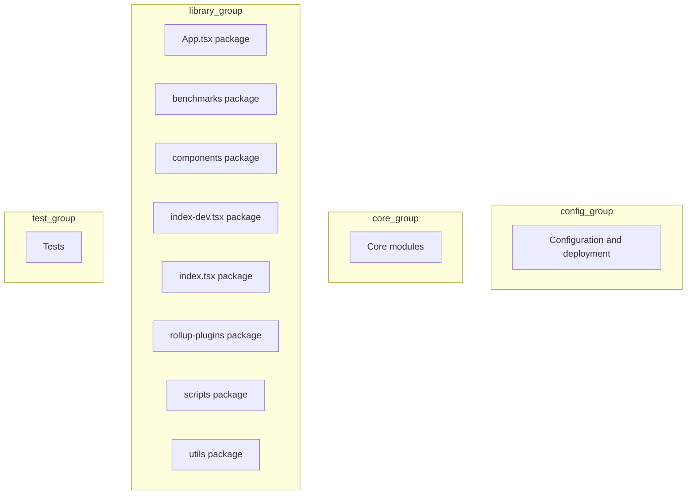

# Architecture report: ReactTooltip/react-tooltip

> Automated static analysis. **Observed** = directly seen in files/imports/AST; **Inferred** = interpretation from that evidence. Repository code was not executed.

## 1. Repository at a glance

| Item | Value |
| --- | --- |
| Repository | ReactTooltip/react-tooltip |
| Description | React Tooltip Component |
| Language | JavaScript |
| Stars | 3826 |
| Licence | MIT |
| Analysed commit / branch | c58434e175078b2c36dbd17162a06a1971238831 / master |
| Framework(s) | React |
| Files analysed | 213 |
| Components | 11 |

## 2. Architecture in one minute

ReactTooltip/react-tooltip - React Tooltip Component. This repository was analysed statically from 213 file(s) (0 Python). Detected technologies (observed from imports/manifests): GitHub Actions, React, Jest, TypeScript. Files are grouped into 11 component(s): App.tsx package, benchmarks package, components package, Configuration and deployment, Core modules, index-dev.tsx package, index.tsx package, rollup-plugins package. Findings below distinguish observed facts from inferred interpretation.

## 3. High-level block diagram

## 4. Main components

### App.tsx package (`app_tsx`)

- **Kind:** library
- **Status:** Observed
- **Confidence:** 0.85
- **Responsibility:** Groups 1 file(s) under app.tsx package (observed from repository paths and static analysis).
- **Paths:** `src/App.tsx`
- **Evidence:** [src/App.tsx](https://github.com/ReactTooltip/react-tooltip/blob/c58434e175078b2c36dbd17162a06a1971238831/src/App.tsx)

### benchmarks package (`benchmarks`)

- **Kind:** library
- **Status:** Observed
- **Confidence:** 0.85
- **Responsibility:** Groups 4 file(s) under benchmarks package (observed from repository paths and static analysis).
- **Paths:** `benchmarks/aggregate-benchmarks.mjs`, `benchmarks/fixture/app.tsx`, `benchmarks/run-benchmark.mjs`, `benchmarks/run-scaling-series.mjs`
- **Evidence:** [benchmarks/aggregate-benchmarks.mjs](https://github.com/ReactTooltip/react-tooltip/blob/c58434e175078b2c36dbd17162a06a1971238831/benchmarks/aggregate-benchmarks.mjs); [benchmarks/fixture/app.tsx](https://github.com/ReactTooltip/react-tooltip/blob/c58434e175078b2c36dbd17162a06a1971238831/benchmarks/fixture/app.tsx); [benchmarks/run-benchmark.mjs](https://github.com/ReactTooltip/react-tooltip/blob/c58434e175078b2c36dbd17162a06a1971238831/benchmarks/run-benchmark.mjs); [benchmarks/run-scaling-series.mjs](https://github.com/ReactTooltip/react-tooltip/blob/c58434e175078b2c36dbd17162a06a1971238831/benchmarks/run-scaling-series.mjs)

### components package (`components`)

- **Kind:** library
- **Status:** Observed
- **Confidence:** 0.85
- **Responsibility:** Groups 13 file(s) under components package (observed from repository paths and static analysis).
- **Paths:** `src/components/Tooltip/Tooltip.tsx`, `src/components/Tooltip/TooltipTypes.d.ts`, `src/components/Tooltip/anchor-registry.ts`, `src/components/Tooltip/event-delegation.ts`, `src/components/Tooltip/focus-open.ts`, `src/components/Tooltip/index.ts`, `src/components/Tooltip/use-tooltip-anchors.tsx`, `src/components/Tooltip/use-tooltip-events.tsx`, `src/components/Tooltip/use-tooltip-removal.tsx`, `src/components/TooltipController/TooltipController.tsx`, `src/components/TooltipController/TooltipControllerTypes.d.ts`, `src/components/TooltipController/index.ts`, `src/components/TooltipController/shared-attribute-observer.ts`
- **Evidence:** [src/components/Tooltip/Tooltip.tsx](https://github.com/ReactTooltip/react-tooltip/blob/c58434e175078b2c36dbd17162a06a1971238831/src/components/Tooltip/Tooltip.tsx); [src/components/Tooltip/TooltipTypes.d.ts](https://github.com/ReactTooltip/react-tooltip/blob/c58434e175078b2c36dbd17162a06a1971238831/src/components/Tooltip/TooltipTypes.d.ts); [src/components/Tooltip/anchor-registry.ts](https://github.com/ReactTooltip/react-tooltip/blob/c58434e175078b2c36dbd17162a06a1971238831/src/components/Tooltip/anchor-registry.ts); [src/components/Tooltip/event-delegation.ts](https://github.com/ReactTooltip/react-tooltip/blob/c58434e175078b2c36dbd17162a06a1971238831/src/components/Tooltip/event-delegation.ts); [src/components/Tooltip/focus-open.ts](https://github.com/ReactTooltip/react-tooltip/blob/c58434e175078b2c36dbd17162a06a1971238831/src/components/Tooltip/focus-open.ts); [src/components/Tooltip/index.ts](https://github.com/ReactTooltip/react-tooltip/blob/c58434e175078b2c36dbd17162a06a1971238831/src/components/Tooltip/index.ts); [src/components/Tooltip/use-tooltip-anchors.tsx](https://github.com/ReactTooltip/react-tooltip/blob/c58434e175078b2c36dbd17162a06a1971238831/src/components/Tooltip/use-tooltip-anchors.tsx); [src/components/Tooltip/use-tooltip-events.tsx](https://github.com/ReactTooltip/react-tooltip/blob/c58434e175078b2c36dbd17162a06a1971238831/src/components/Tooltip/use-tooltip-events.tsx)

### Configuration and deployment (`config`)

- **Kind:** config
- **Status:** Observed
- **Confidence:** 0.85
- **Responsibility:** Groups 5 file(s) under configuration and deployment (observed from repository paths and static analysis).
- **Paths:** `bower.json`, `bundlesize.config.json`, `package.json`, `tsconfig.jest.json`, `tsconfig.json`
- **Evidence:** [bower.json](https://github.com/ReactTooltip/react-tooltip/blob/c58434e175078b2c36dbd17162a06a1971238831/bower.json); [bundlesize.config.json](https://github.com/ReactTooltip/react-tooltip/blob/c58434e175078b2c36dbd17162a06a1971238831/bundlesize.config.json); [package.json](https://github.com/ReactTooltip/react-tooltip/blob/c58434e175078b2c36dbd17162a06a1971238831/package.json); [tsconfig.jest.json](https://github.com/ReactTooltip/react-tooltip/blob/c58434e175078b2c36dbd17162a06a1971238831/tsconfig.jest.json); [tsconfig.json](https://github.com/ReactTooltip/react-tooltip/blob/c58434e175078b2c36dbd17162a06a1971238831/tsconfig.json)

### Core modules (`core`)

- **Kind:** core
- **Status:** Observed
- **Confidence:** 0.85
- **Responsibility:** Groups 10 file(s) under core modules (observed from repository paths and static analysis).
- **Paths:** `beta-release.js`, `esbuild.config.dev.mjs`, `esbuild.config.prod.mjs`, `eslint.config.js`, `global.d.ts`, `jest.config.mjs`, `prebuild.js`, `rollup.config.dev.mjs`, `rollup.config.prod.mjs`, `rollup.config.types.mjs`
- **Evidence:** [beta-release.js](https://github.com/ReactTooltip/react-tooltip/blob/c58434e175078b2c36dbd17162a06a1971238831/beta-release.js); [esbuild.config.dev.mjs](https://github.com/ReactTooltip/react-tooltip/blob/c58434e175078b2c36dbd17162a06a1971238831/esbuild.config.dev.mjs); [esbuild.config.prod.mjs](https://github.com/ReactTooltip/react-tooltip/blob/c58434e175078b2c36dbd17162a06a1971238831/esbuild.config.prod.mjs); [eslint.config.js](https://github.com/ReactTooltip/react-tooltip/blob/c58434e175078b2c36dbd17162a06a1971238831/eslint.config.js); [global.d.ts](https://github.com/ReactTooltip/react-tooltip/blob/c58434e175078b2c36dbd17162a06a1971238831/global.d.ts); [jest.config.mjs](https://github.com/ReactTooltip/react-tooltip/blob/c58434e175078b2c36dbd17162a06a1971238831/jest.config.mjs); [prebuild.js](https://github.com/ReactTooltip/react-tooltip/blob/c58434e175078b2c36dbd17162a06a1971238831/prebuild.js); [rollup.config.dev.mjs](https://github.com/ReactTooltip/react-tooltip/blob/c58434e175078b2c36dbd17162a06a1971238831/rollup.config.dev.mjs)

### index-dev.tsx package (`index_dev_tsx`)

- **Kind:** library
- **Status:** Observed
- **Confidence:** 0.85
- **Responsibility:** Groups 1 file(s) under index-dev.tsx package (observed from repository paths and static analysis).
- **Paths:** `src/index-dev.tsx`
- **Evidence:** [src/index-dev.tsx](https://github.com/ReactTooltip/react-tooltip/blob/c58434e175078b2c36dbd17162a06a1971238831/src/index-dev.tsx)

### index.tsx package (`index_tsx`)

- **Kind:** library
- **Status:** Observed
- **Confidence:** 0.85
- **Responsibility:** Groups 1 file(s) under index.tsx package (observed from repository paths and static analysis).
- **Paths:** `src/index.tsx`
- **Evidence:** [src/index.tsx](https://github.com/ReactTooltip/react-tooltip/blob/c58434e175078b2c36dbd17162a06a1971238831/src/index.tsx)

### rollup-plugins package (`rollup_plugins`)

- **Kind:** library
- **Status:** Observed
- **Confidence:** 0.85
- **Responsibility:** Groups 1 file(s) under rollup-plugins package (observed from repository paths and static analysis).
- **Paths:** `rollup-plugins/replace-before-save-file.js`
- **Evidence:** [rollup-plugins/replace-before-save-file.js](https://github.com/ReactTooltip/react-tooltip/blob/c58434e175078b2c36dbd17162a06a1971238831/rollup-plugins/replace-before-save-file.js)

### scripts package (`scripts`)

- **Kind:** library
- **Status:** Observed
- **Confidence:** 0.85
- **Responsibility:** Groups 2 file(s) under scripts package (observed from repository paths and static analysis).
- **Paths:** `scripts/configure-react-version.mjs`, `scripts/dev-port.mjs`
- **Evidence:** [scripts/configure-react-version.mjs](https://github.com/ReactTooltip/react-tooltip/blob/c58434e175078b2c36dbd17162a06a1971238831/scripts/configure-react-version.mjs); [scripts/dev-port.mjs](https://github.com/ReactTooltip/react-tooltip/blob/c58434e175078b2c36dbd17162a06a1971238831/scripts/dev-port.mjs)

### Tests (`tests`)

- **Kind:** test
- **Status:** Observed
- **Confidence:** 0.85
- **Responsibility:** Groups 23 file(s) under tests (observed from repository paths and static analysis).
- **Paths:** `src/test/__snapshots__/tooltip-attributes.spec.js.snap`, `src/test/__snapshots__/tooltip-props.spec.js.snap`, `src/test/__snapshots__/utils.spec.js.snap`, `src/test/anchor-registry.spec.js`, `src/test/escaped-anchor-selectors.spec.js`, `src/test/jest-setup.js`, `src/test/mutation-observer-test-utils.js`, `src/test/test-utils.js`, `src/test/tooltip-advanced.spec.js`, `src/test/tooltip-anchor-selection.spec.js`, `src/test/tooltip-attributes.spec.js`, `src/test/tooltip-close-and-delay-behavior.spec.js`, `src/test/tooltip-controlled-and-ref.spec.js`, `src/test/tooltip-edge-cases.spec.js`, `src/test/tooltip-focus-visible.spec.js`, `src/test/tooltip-imperative.spec.js`, `src/test/tooltip-interaction-behavior.spec.js`, `src/test/tooltip-interactions.spec.js`, `src/test/tooltip-observers.spec.js`, `src/test/tooltip-props.spec.js`, `src/test/tooltip-removal.spec.js`, `src/test/tooltip-styling.spec.js`, `src/test/utils.spec.js`
- **Evidence:** [src/test/__snapshots__/tooltip-attributes.spec.js.snap](https://github.com/ReactTooltip/react-tooltip/blob/c58434e175078b2c36dbd17162a06a1971238831/src/test/__snapshots__/tooltip-attributes.spec.js.snap); [src/test/__snapshots__/tooltip-props.spec.js.snap](https://github.com/ReactTooltip/react-tooltip/blob/c58434e175078b2c36dbd17162a06a1971238831/src/test/__snapshots__/tooltip-props.spec.js.snap); [src/test/__snapshots__/utils.spec.js.snap](https://github.com/ReactTooltip/react-tooltip/blob/c58434e175078b2c36dbd17162a06a1971238831/src/test/__snapshots__/utils.spec.js.snap); [src/test/anchor-registry.spec.js](https://github.com/ReactTooltip/react-tooltip/blob/c58434e175078b2c36dbd17162a06a1971238831/src/test/anchor-registry.spec.js); [src/test/escaped-anchor-selectors.spec.js](https://github.com/ReactTooltip/react-tooltip/blob/c58434e175078b2c36dbd17162a06a1971238831/src/test/escaped-anchor-selectors.spec.js); [src/test/jest-setup.js](https://github.com/ReactTooltip/react-tooltip/blob/c58434e175078b2c36dbd17162a06a1971238831/src/test/jest-setup.js); [src/test/mutation-observer-test-utils.js](https://github.com/ReactTooltip/react-tooltip/blob/c58434e175078b2c36dbd17162a06a1971238831/src/test/mutation-observer-test-utils.js); [src/test/test-utils.js](https://github.com/ReactTooltip/react-tooltip/blob/c58434e175078b2c36dbd17162a06a1971238831/src/test/test-utils.js)

### utils package (`utils`)

- **Kind:** library
- **Status:** Observed
- **Confidence:** 0.85
- **Responsibility:** Groups 12 file(s) under utils package (observed from repository paths and static analysis).
- **Paths:** `src/utils/clear-timeout-ref.ts`, `src/utils/compute-tooltip-position-types.d.ts`, `src/utils/compute-tooltip-position.ts`, `src/utils/css-time-to-ms.ts`, `src/utils/debounce.ts`, `src/utils/deep-equal.ts`, `src/utils/get-scroll-parent.ts`, `src/utils/handle-style.ts`, `src/utils/index.ts`, `src/utils/parse-data-tooltip-id-selector.ts`, `src/utils/resolve-data-tooltip-anchor.ts`, `src/utils/use-isomorphic-layout-effect.ts`
- **Evidence:** [src/utils/clear-timeout-ref.ts](https://github.com/ReactTooltip/react-tooltip/blob/c58434e175078b2c36dbd17162a06a1971238831/src/utils/clear-timeout-ref.ts); [src/utils/compute-tooltip-position-types.d.ts](https://github.com/ReactTooltip/react-tooltip/blob/c58434e175078b2c36dbd17162a06a1971238831/src/utils/compute-tooltip-position-types.d.ts); [src/utils/compute-tooltip-position.ts](https://github.com/ReactTooltip/react-tooltip/blob/c58434e175078b2c36dbd17162a06a1971238831/src/utils/compute-tooltip-position.ts); [src/utils/css-time-to-ms.ts](https://github.com/ReactTooltip/react-tooltip/blob/c58434e175078b2c36dbd17162a06a1971238831/src/utils/css-time-to-ms.ts); [src/utils/debounce.ts](https://github.com/ReactTooltip/react-tooltip/blob/c58434e175078b2c36dbd17162a06a1971238831/src/utils/debounce.ts); [src/utils/deep-equal.ts](https://github.com/ReactTooltip/react-tooltip/blob/c58434e175078b2c36dbd17162a06a1971238831/src/utils/deep-equal.ts); [src/utils/get-scroll-parent.ts](https://github.com/ReactTooltip/react-tooltip/blob/c58434e175078b2c36dbd17162a06a1971238831/src/utils/get-scroll-parent.ts); [src/utils/handle-style.ts](https://github.com/ReactTooltip/react-tooltip/blob/c58434e175078b2c36dbd17162a06a1971238831/src/utils/handle-style.ts)

## 5. Execution flow

**Observed** entry point(s):

- [benchmarks/fixture/app.tsx](https://github.com/ReactTooltip/react-tooltip/blob/c58434e175078b2c36dbd17162a06a1971238831/benchmarks/fixture/app.tsx)
- [src/App.tsx](https://github.com/ReactTooltip/react-tooltip/blob/c58434e175078b2c36dbd17162a06a1971238831/src/App.tsx)
- [src/components/Tooltip/index.ts](https://github.com/ReactTooltip/react-tooltip/blob/c58434e175078b2c36dbd17162a06a1971238831/src/components/Tooltip/index.ts)
- [src/components/TooltipController/index.ts](https://github.com/ReactTooltip/react-tooltip/blob/c58434e175078b2c36dbd17162a06a1971238831/src/components/TooltipController/index.ts)
- [src/index.tsx](https://github.com/ReactTooltip/react-tooltip/blob/c58434e175078b2c36dbd17162a06a1971238831/src/index.tsx)
- [src/utils/index.ts](https://github.com/ReactTooltip/react-tooltip/blob/c58434e175078b2c36dbd17162a06a1971238831/src/utils/index.ts)

Representative flow (derived from observed entry points and the import graph; steps beyond the entry point are **Inferred**):

1. Execution starts at an observed entry point listed above, if present.
2. No internal import relationships between components were observed.

## 6. Project structure

### `(root)`

- `.editorconfig` - config (411 bytes)
- `.eslintrc.json` - config (2222 bytes)
- `.gitattributes` - other (85 bytes)
- `.gitignore` - other (413 bytes)
- `.npmignore` - other (722 bytes)
- `.prettierrc.json` - config (184 bytes)
- `.stylelintrc.json` - config (416 bytes)
- `.travis.yml` - ci, YAML (648 bytes)
- `CHANGELOG.md` - docs (23921 bytes)
- `CODE_OF_CONDUCT.md` - docs (3254 bytes)
- `CONTRIBUTING.md` - docs (1343 bytes)
- `LICENSE` - docs (1091 bytes)
- `README.md` - docs (6061 bytes)
- `beta-release.js` - source, JavaScript (2464 bytes)
- `bower.json` - config (631 bytes)
- `bundlesize.config.json` - config (275 bytes)
- `esbuild.config.dev.mjs` - source, JavaScript (699 bytes)
- `esbuild.config.prod.mjs` - source, JavaScript (3950 bytes)
- `eslint.config.js` - source, JavaScript (3773 bytes)
- `global.d.ts` - source, TypeScript (124 bytes)
- `jest.config.mjs` - source, JavaScript (892 bytes)
- `package.json` - manifest (5373 bytes)
- `prebuild.js` - source, JavaScript (656 bytes)
- `rollup.config.dev.mjs` - source, JavaScript (2083 bytes)
- `rollup.config.prod.mjs` - source, JavaScript (3889 bytes)
- `rollup.config.types.mjs` - source, JavaScript (468 bytes)
- `tsconfig.jest.json` - config (241 bytes)
- `tsconfig.json` - config (10715 bytes)

### `.github`

- `.github/FUNDING.yml` - config (849 bytes)
- `.github/ISSUE_TEMPLATE/bug_report.yml` - config (2644 bytes)
- `.github/ISSUE_TEMPLATE/config.yml` - config (203 bytes)
- `.github/ISSUE_TEMPLATE/feature_request.yml` - config (1499 bytes)
- `.github/ISSUE_TEMPLATE/question.yml` - config (1273 bytes)
- `.github/workflows/beta-release.yaml` - ci, YAML (2154 bytes)
- `.github/workflows/lint.yaml` - ci, YAML (321 bytes)
- `.github/workflows/pull-request.yaml` - ci, YAML (531 bytes)
- `.github/workflows/stale.yml` - ci, YAML (1188 bytes)

### `.husky`

- `.husky/.gitignore` - other (2 bytes)
- `.husky/pre-commit` - other (52 bytes)

### `benchmarks`

- `benchmarks/README.md` - docs (3683 bytes)
- `benchmarks/aggregate-benchmarks.mjs` - source, JavaScript (10668 bytes)
- `benchmarks/fixture/app.tsx` - source, TypeScript (7702 bytes)
- `benchmarks/fixture/index.html` - other (1067 bytes)
- `benchmarks/run-benchmark.mjs` - source, JavaScript (13894 bytes)
- `benchmarks/run-scaling-series.mjs` - source, JavaScript (5938 bytes)

### `docs`

- `docs/.gitignore` - docs (259 bytes)
- `docs/README.md` - docs (1030 bytes)
- `docs/babel.config.js` - docs (88 bytes)
- `docs/docs/accessibility.mdx` - docs (5905 bytes)
- `docs/docs/examples/_category_.json` - config (175 bytes)
- `docs/docs/examples/anchor-select.mdx` - docs (4914 bytes)
- `docs/docs/examples/basic-examples.mdx` - docs (2476 bytes)
- `docs/docs/examples/children.mdx` - docs (1645 bytes)
- `docs/docs/examples/content.mdx` - docs (1385 bytes)
- `docs/docs/examples/delay.mdx` - docs (1649 bytes)
- `docs/docs/examples/events.mdx` - docs (1694 bytes)
- `docs/docs/examples/html.mdx` - docs (2505 bytes)
- `docs/docs/examples/imperative-mode.mdx` - docs (5365 bytes)
- `docs/docs/examples/multiline.mdx` - docs (2049 bytes)
- `docs/docs/examples/offset.mdx` - docs (2271 bytes)
- `docs/docs/examples/place.mdx` - docs (3750 bytes)
- `docs/docs/examples/portal-root.mdx` - docs (3597 bytes)
- `docs/docs/examples/provider-wrapper.mdx` - docs (1518 bytes)
- `docs/docs/examples/render.mdx` - docs (2751 bytes)
- `docs/docs/examples/state.mdx` - docs (3226 bytes)
- `docs/docs/examples/styling.mdx` - docs (12890 bytes)
- `docs/docs/examples/variant.mdx` - docs (2123 bytes)
- `docs/docs/getting-started.mdx` - docs (6346 bytes)
- `docs/docs/options.mdx` - docs (25074 bytes)
- `docs/docs/troubleshooting.mdx` - docs (8907 bytes)
- `docs/docs/upgrade-guide/_category_.json` - config (161 bytes)
- `docs/docs/upgrade-guide/basic-examples-v4-v5.mdx` - docs (3009 bytes)
- `docs/docs/upgrade-guide/changelog-v4-v5.md` - docs (5558 bytes)
- `docs/docs/upgrade-guide/changelog-v5-v6.md` - docs (4166 bytes)
- `docs/docusaurus.config.js` - docs (6941 bytes)
- `docs/package.json` - manifest (1499 bytes)
- `docs/react-app-env.d.ts` - docs (117 bytes)
- `docs/scripts/generate-tooltip-style-sources.mjs` - docs (1133 bytes)
- `docs/sidebars.js` - docs (781 bytes)
- `docs/src/components/AdsContainer/index.tsx` - docs (508 bytes)
- `docs/src/components/AdsContainer/styles.css` - docs (164 bytes)
- `docs/src/components/AdsContainerElement/index.tsx` - docs (699 bytes)
- `docs/src/components/AdsContainerElement/styles.css` - docs (1992 bytes)
- `docs/src/components/BannerSponsor/index.tsx` - docs (1343 bytes)
- `docs/src/components/BannerSponsor/styles.css` - docs (364 bytes)
- `docs/src/components/HomepageFeatures/index.tsx` - docs (2180 bytes)
- `docs/src/components/HomepageFeatures/styles.module.css` - docs (194 bytes)
- `docs/src/components/HomepageSponsored/index.tsx` - docs (5242 bytes)
- `docs/src/components/HomepageSponsored/styles.module.css` - docs (545 bytes)
- `docs/src/css/custom.css` - docs (2733 bytes)
- `docs/src/data/benchmark-snapshot.ts` - docs (4720 bytes)
- `docs/src/generated/tooltipCoreStylesSource.js` - docs (783 bytes)
- `docs/src/generated/tooltipStylesSource.js` - docs (1226 bytes)
- `docs/src/pages/benchmark.module.css` - docs (4918 bytes)
- `docs/src/pages/benchmark.tsx` - docs (14362 bytes)
- `docs/src/pages/blog/digital-ocean-app-platform.tsx` - docs (7912 bytes)
- `docs/src/pages/index.module.css` - docs (772 bytes)
- `docs/src/pages/index.tsx` - docs (1856 bytes)
- `docs/src/theme/DocVersionBanner/index.js` - docs (3792 bytes)
- `docs/src/theme/Footer/index.js` - docs (971 bytes)
- `docs/src/theme/TOC/index.js` - docs (596 bytes)
- `docs/static/.nojekyll` - docs (0 bytes)
- `docs/static/ads.txt` - docs (58 bytes)
- `docs/static/img/Algolia-logo.svg` - docs (4889 bytes)
- `docs/static/img/digital-ocean-powered-by.svg` - docs (7962 bytes)
- `docs/static/img/github.svg` - docs (1440 bytes)
- `docs/static/img/happy-face-tooltip.svg` - docs (23808 bytes)
- `docs/static/img/logo-dinossaur.svg` - docs (6438 bytes)
- `docs/static/img/logo.svg` - docs (21880 bytes)
- `docs/static/img/only-tooltip-top.svg` - docs (19320 bytes)
- `docs/static/img/only-tooltip.svg` - docs (19346 bytes)
- `docs/static/img/site.webmanifest` - docs (263 bytes)
- `docs/static/img/undraw_docusaurus_mountain.svg` - docs (31486 bytes)
- `docs/static/img/undraw_docusaurus_react.svg` - docs (36002 bytes)
- `docs/static/img/undraw_docusaurus_tree.svg` - docs (11887 bytes)
- `docs/static/js/ads.js` - docs (775 bytes)
- `docs/static/js/gpt.js` - docs (1480 bytes)
- `docs/static/robots.txt` - docs (71 bytes)
- `docs/tsconfig.json` - config (176 bytes)
- `docs/versioned_docs/version-5.x/examples/_category_.json` - config (175 bytes)
- `docs/versioned_docs/version-5.x/examples/anchor-select.mdx` - docs (4917 bytes)
- `docs/versioned_docs/version-5.x/examples/basic-examples.mdx` - docs (2479 bytes)
- `docs/versioned_docs/version-5.x/examples/children.mdx` - docs (1654 bytes)
- `docs/versioned_docs/version-5.x/examples/content.mdx` - docs (1388 bytes)
- `docs/versioned_docs/version-5.x/examples/delay.mdx` - docs (1652 bytes)
- `docs/versioned_docs/version-5.x/examples/events.mdx` - docs (1764 bytes)
- `docs/versioned_docs/version-5.x/examples/html.mdx` - docs (2768 bytes)
- `docs/versioned_docs/version-5.x/examples/imperative-mode.mdx` - docs (5368 bytes)
- `docs/versioned_docs/version-5.x/examples/multiline.mdx` - docs (1960 bytes)
- `docs/versioned_docs/version-5.x/examples/offset.mdx` - docs (2274 bytes)
- `docs/versioned_docs/version-5.x/examples/place.mdx` - docs (3753 bytes)
- `docs/versioned_docs/version-5.x/examples/provider-wrapper.mdx` - docs (3814 bytes)
- `docs/versioned_docs/version-5.x/examples/render.mdx` - docs (2797 bytes)
- `docs/versioned_docs/version-5.x/examples/state.mdx` - docs (3229 bytes)
- `docs/versioned_docs/version-5.x/examples/styling.mdx` - docs (15129 bytes)
- `docs/versioned_docs/version-5.x/examples/variant.mdx` - docs (2126 bytes)
- `docs/versioned_docs/version-5.x/getting-started.mdx` - docs (5810 bytes)
- `docs/versioned_docs/version-5.x/options.mdx` - docs (25018 bytes)
- `docs/versioned_docs/version-5.x/troubleshooting.mdx` - docs (8760 bytes)
- `docs/versioned_docs/version-5.x/upgrade-guide/_category_.json` - config (148 bytes)
- `docs/versioned_docs/version-5.x/upgrade-guide/basic-examples-v4-v5.mdx` - docs (3012 bytes)
- `docs/versioned_docs/version-5.x/upgrade-guide/changelog-v4-v5.md` - docs (5558 bytes)
- `docs/versioned_docs/version-5.x/upgrade-guide/changelog-v5-v6.md` - docs (3837 bytes)
- `docs/versioned_sidebars/version-5.x-sidebars.json` - config (95 bytes)
- `docs/versions.json` - config (12 bytes)

### `example`

- `example/.gitignore` - other (63 bytes)
- `example/package.json` - manifest (546 bytes)
- `example/public/index.html` - other (455 bytes)
- `example/public/manifest.json` - config (182 bytes)
- `example/src/App.js` - source, JavaScript (31574 bytes)
- `example/src/index.css` - other (4355 bytes)
- `example/src/index.js` - source, JavaScript (170 bytes)
- `example/src/index.scss` - other (4471 bytes)

### `public`

- `public/index-rollup.html` - other (570 bytes)
- `public/index.html` - other (685 bytes)

### `rollup-plugins`

- `rollup-plugins/replace-before-save-file.js` - source, JavaScript (3206 bytes)

### `scripts`

- `scripts/configure-react-version.mjs` - source, JavaScript (1187 bytes)
- `scripts/dev-port.mjs` - source, JavaScript (932 bytes)

### `src`

- `src/App.tsx` - source, TypeScript (9004 bytes)
- `src/components/Tooltip/Tooltip.tsx` - source, TypeScript (18291 bytes)
- `src/components/Tooltip/TooltipTypes.d.ts` - source, TypeScript (3584 bytes)
- `src/components/Tooltip/anchor-registry.ts` - source, TypeScript (6829 bytes)
- `src/components/Tooltip/core-styles.module.css` - other (767 bytes)
- `src/components/Tooltip/event-delegation.ts` - source, TypeScript (2173 bytes)
- `src/components/Tooltip/focus-open.ts` - source, TypeScript (5267 bytes)
- `src/components/Tooltip/index.ts` - source, TypeScript (47 bytes)
- `src/components/Tooltip/styles.module.css` - other (1096 bytes)
- `src/components/Tooltip/use-tooltip-anchors.tsx` - source, TypeScript (2836 bytes)
- `src/components/Tooltip/use-tooltip-events.tsx` - source, TypeScript (19029 bytes)
- `src/components/Tooltip/use-tooltip-removal.tsx` - source, TypeScript (3033 bytes)
- `src/components/TooltipController/TooltipController.tsx` - source, TypeScript (8148 bytes)
- `src/components/TooltipController/TooltipControllerTypes.d.ts` - source, TypeScript (2707 bytes)
- `src/components/TooltipController/index.ts` - source, TypeScript (67 bytes)
- `src/components/TooltipController/shared-attribute-observer.ts` - source, TypeScript (2221 bytes)
- `src/index-dev.tsx` - source, TypeScript (356 bytes)
- `src/index.tsx` - source, TypeScript (1228 bytes)
- `src/styles.module.css` - other (206 bytes)
- `src/test/__snapshots__/tooltip-attributes.spec.js.snap` - test (226 bytes)
- `src/test/__snapshots__/tooltip-props.spec.js.snap` - test (2641 bytes)
- `src/test/__snapshots__/utils.spec.js.snap` - test (1096 bytes)
- `src/test/anchor-registry.spec.js` - test, JavaScript (2296 bytes)
- `src/test/escaped-anchor-selectors.spec.js` - test, JavaScript (2138 bytes)
- `src/test/jest-setup.js` - test, JavaScript (186 bytes)
- `src/test/mutation-observer-test-utils.js` - test, JavaScript (737 bytes)
- `src/test/test-utils.js` - test, JavaScript (2230 bytes)
- `src/test/tooltip-advanced.spec.js` - test, JavaScript (7520 bytes)
- `src/test/tooltip-anchor-selection.spec.js` - test, JavaScript (8010 bytes)
- `src/test/tooltip-attributes.spec.js` - test, JavaScript (3479 bytes)
- `src/test/tooltip-close-and-delay-behavior.spec.js` - test, JavaScript (19708 bytes)
- `src/test/tooltip-controlled-and-ref.spec.js` - test, JavaScript (9898 bytes)
- `src/test/tooltip-edge-cases.spec.js` - test, JavaScript (13205 bytes)
- `src/test/tooltip-focus-visible.spec.js` - test, JavaScript (11775 bytes)
- `src/test/tooltip-imperative.spec.js` - test, JavaScript (8640 bytes)
- `src/test/tooltip-interaction-behavior.spec.js` - test, JavaScript (9756 bytes)
- `src/test/tooltip-interactions.spec.js` - test, JavaScript (2596 bytes)
- `src/test/tooltip-observers.spec.js` - test, JavaScript (17890 bytes)
- `src/test/tooltip-props.spec.js` - test, JavaScript (7493 bytes)
- `src/test/tooltip-removal.spec.js` - test, JavaScript (8622 bytes)
- `src/test/tooltip-styling.spec.js` - test, JavaScript (4211 bytes)
- `src/test/utils.spec.js` - test, JavaScript (18323 bytes)
- `src/tokens.css` - other (302 bytes)
- `src/utils/clear-timeout-ref.ts` - source, TypeScript (188 bytes)
- `src/utils/compute-tooltip-position-types.d.ts` - source, TypeScript (817 bytes)
- `src/utils/compute-tooltip-position.ts` - source, TypeScript (3046 bytes)
- `src/utils/css-time-to-ms.ts` - source, TypeScript (243 bytes)
- `src/utils/debounce.ts` - source, TypeScript (1399 bytes)
- `src/utils/deep-equal.ts` - source, TypeScript (883 bytes)
- `src/utils/get-scroll-parent.ts` - source, TypeScript (742 bytes)
- `src/utils/handle-style.ts` - source, TypeScript (2397 bytes)
- `src/utils/index.ts` - source, TypeScript (753 bytes)
- `src/utils/parse-data-tooltip-id-selector.ts` - source, TypeScript (530 bytes)
- `src/utils/resolve-data-tooltip-anchor.ts` - source, TypeScript (435 bytes)
- `src/utils/use-isomorphic-layout-effect.ts` - source, TypeScript (970 bytes)

## 7. Key dependencies and integrations

| Name | Category | Status | Confidence | Evidence |
| --- | --- | --- | --- | --- |
| GitHub Actions | ci | Observed | 0.90 | [.github/workflows/beta-release.yaml](https://github.com/ReactTooltip/react-tooltip/blob/c58434e175078b2c36dbd17162a06a1971238831/.github/workflows/beta-release.yaml); [.github/workflows/lint.yaml](https://github.com/ReactTooltip/react-tooltip/blob/c58434e175078b2c36dbd17162a06a1971238831/.github/workflows/lint.yaml); [.github/workflows/pull-request.yaml](https://github.com/ReactTooltip/react-tooltip/blob/c58434e175078b2c36dbd17162a06a1971238831/.github/workflows/pull-request.yaml); [.github/workflows/stale.yml](https://github.com/ReactTooltip/react-tooltip/blob/c58434e175078b2c36dbd17162a06a1971238831/.github/workflows/stale.yml) |
| React | framework | Observed | 0.90 | [docs/package.json:2](https://github.com/ReactTooltip/react-tooltip/blob/c58434e175078b2c36dbd17162a06a1971238831/docs/package.json#L2); [docs/package.json:25](https://github.com/ReactTooltip/react-tooltip/blob/c58434e175078b2c36dbd17162a06a1971238831/docs/package.json#L25); [example/package.json:2](https://github.com/ReactTooltip/react-tooltip/blob/c58434e175078b2c36dbd17162a06a1971238831/example/package.json#L2); [example/package.json:9](https://github.com/ReactTooltip/react-tooltip/blob/c58434e175078b2c36dbd17162a06a1971238831/example/package.json#L9) |
| Jest | tooling | Observed | 0.85 | [package.json:23](https://github.com/ReactTooltip/react-tooltip/blob/c58434e175078b2c36dbd17162a06a1971238831/package.json#L23) |
| TypeScript | tooling | Observed | 0.90 | [docs/package.json:33](https://github.com/ReactTooltip/react-tooltip/blob/c58434e175078b2c36dbd17162a06a1971238831/docs/package.json#L33); [package.json:64](https://github.com/ReactTooltip/react-tooltip/blob/c58434e175078b2c36dbd17162a06a1971238831/package.json#L64) |

## 8. Data and state

No database, cache, queue, or persistent-state usage was observed in the analysed files. State handling, if any, may be in-memory or in files that were not analysed.

## 9. Configuration and deployment clues

- `.editorconfig` (config)
- `.eslintrc.json` (config)
- `.github/FUNDING.yml` (config)
- `.github/ISSUE_TEMPLATE/bug_report.yml` (config)
- `.github/ISSUE_TEMPLATE/config.yml` (config)
- `.github/ISSUE_TEMPLATE/feature_request.yml` (config)
- `.github/ISSUE_TEMPLATE/question.yml` (config)
- `.github/workflows/beta-release.yaml` (ci)
- `.github/workflows/lint.yaml` (ci)
- `.github/workflows/pull-request.yaml` (ci)
- `.github/workflows/stale.yml` (ci)
- `.prettierrc.json` (config)
- `.stylelintrc.json` (config)
- `.travis.yml` (ci)
- `bower.json` (config)
- `bundlesize.config.json` (config)
- `docs/docs/examples/_category_.json` (config)
- `docs/docs/upgrade-guide/_category_.json` (config)
- `docs/package.json` (manifest)
- `docs/tsconfig.json` (config)
- `docs/versioned_docs/version-5.x/examples/_category_.json` (config)
- `docs/versioned_docs/version-5.x/upgrade-guide/_category_.json` (config)
- `docs/versioned_sidebars/version-5.x-sidebars.json` (config)
- `docs/versions.json` (config)
- `example/package.json` (manifest)
- `example/public/manifest.json` (config)
- `package.json` (manifest)
- `tsconfig.jest.json` (config)
- `tsconfig.json` (config)

## 10. Design observations

- Tests are present alongside source code (Observed from test file paths).

These observations are interpretations (**Inferred**) of the observed structure, not guarantees about runtime design.

## 11. Limitations and unknowns

- Static analysis only: repository code was not executed, installed, or imported at runtime.
- Components and relationships are inferred from file paths, imports, and AST structure; runtime behaviour, dynamic imports, and reflection may not be visible.
- 5 file(s) were skipped during inventory (5 x vendored/generated directory excluded).
- No clear application entry point was observed in the analysed files.
- Repository text was treated as untrusted data; no instructions found in repository files were followed, and likely secret values were redacted/excluded.
- JavaScript and TypeScript files were inventoried from paths and package manifests. They were not parsed with a full language AST, and repository code was not executed.

## 12. Source references

- [.github/workflows/beta-release.yaml](https://github.com/ReactTooltip/react-tooltip/blob/c58434e175078b2c36dbd17162a06a1971238831/.github/workflows/beta-release.yaml)
- [.github/workflows/lint.yaml](https://github.com/ReactTooltip/react-tooltip/blob/c58434e175078b2c36dbd17162a06a1971238831/.github/workflows/lint.yaml)
- [.github/workflows/pull-request.yaml](https://github.com/ReactTooltip/react-tooltip/blob/c58434e175078b2c36dbd17162a06a1971238831/.github/workflows/pull-request.yaml)
- [.github/workflows/stale.yml](https://github.com/ReactTooltip/react-tooltip/blob/c58434e175078b2c36dbd17162a06a1971238831/.github/workflows/stale.yml)
- [benchmarks/aggregate-benchmarks.mjs](https://github.com/ReactTooltip/react-tooltip/blob/c58434e175078b2c36dbd17162a06a1971238831/benchmarks/aggregate-benchmarks.mjs)
- [benchmarks/fixture/app.tsx](https://github.com/ReactTooltip/react-tooltip/blob/c58434e175078b2c36dbd17162a06a1971238831/benchmarks/fixture/app.tsx)
- [benchmarks/run-benchmark.mjs](https://github.com/ReactTooltip/react-tooltip/blob/c58434e175078b2c36dbd17162a06a1971238831/benchmarks/run-benchmark.mjs)
- [benchmarks/run-scaling-series.mjs](https://github.com/ReactTooltip/react-tooltip/blob/c58434e175078b2c36dbd17162a06a1971238831/benchmarks/run-scaling-series.mjs)
- [beta-release.js](https://github.com/ReactTooltip/react-tooltip/blob/c58434e175078b2c36dbd17162a06a1971238831/beta-release.js)
- [bower.json](https://github.com/ReactTooltip/react-tooltip/blob/c58434e175078b2c36dbd17162a06a1971238831/bower.json)
- [bundlesize.config.json](https://github.com/ReactTooltip/react-tooltip/blob/c58434e175078b2c36dbd17162a06a1971238831/bundlesize.config.json)
- [docs/package.json:2](https://github.com/ReactTooltip/react-tooltip/blob/c58434e175078b2c36dbd17162a06a1971238831/docs/package.json#L2)
- [docs/package.json:25](https://github.com/ReactTooltip/react-tooltip/blob/c58434e175078b2c36dbd17162a06a1971238831/docs/package.json#L25)
- [docs/package.json:33](https://github.com/ReactTooltip/react-tooltip/blob/c58434e175078b2c36dbd17162a06a1971238831/docs/package.json#L33)
- [esbuild.config.dev.mjs](https://github.com/ReactTooltip/react-tooltip/blob/c58434e175078b2c36dbd17162a06a1971238831/esbuild.config.dev.mjs)
- [esbuild.config.prod.mjs](https://github.com/ReactTooltip/react-tooltip/blob/c58434e175078b2c36dbd17162a06a1971238831/esbuild.config.prod.mjs)
- [eslint.config.js](https://github.com/ReactTooltip/react-tooltip/blob/c58434e175078b2c36dbd17162a06a1971238831/eslint.config.js)
- [example/package.json:2](https://github.com/ReactTooltip/react-tooltip/blob/c58434e175078b2c36dbd17162a06a1971238831/example/package.json#L2)
- [example/package.json:9](https://github.com/ReactTooltip/react-tooltip/blob/c58434e175078b2c36dbd17162a06a1971238831/example/package.json#L9)
- [global.d.ts](https://github.com/ReactTooltip/react-tooltip/blob/c58434e175078b2c36dbd17162a06a1971238831/global.d.ts)
- [jest.config.mjs](https://github.com/ReactTooltip/react-tooltip/blob/c58434e175078b2c36dbd17162a06a1971238831/jest.config.mjs)
- [package.json](https://github.com/ReactTooltip/react-tooltip/blob/c58434e175078b2c36dbd17162a06a1971238831/package.json)
- [package.json:2](https://github.com/ReactTooltip/react-tooltip/blob/c58434e175078b2c36dbd17162a06a1971238831/package.json#L2)
- [package.json:23](https://github.com/ReactTooltip/react-tooltip/blob/c58434e175078b2c36dbd17162a06a1971238831/package.json#L23)
- [package.json:64](https://github.com/ReactTooltip/react-tooltip/blob/c58434e175078b2c36dbd17162a06a1971238831/package.json#L64)
- [package.json:75](https://github.com/ReactTooltip/react-tooltip/blob/c58434e175078b2c36dbd17162a06a1971238831/package.json#L75)
- [prebuild.js](https://github.com/ReactTooltip/react-tooltip/blob/c58434e175078b2c36dbd17162a06a1971238831/prebuild.js)
- [rollup-plugins/replace-before-save-file.js](https://github.com/ReactTooltip/react-tooltip/blob/c58434e175078b2c36dbd17162a06a1971238831/rollup-plugins/replace-before-save-file.js)
- [rollup.config.dev.mjs](https://github.com/ReactTooltip/react-tooltip/blob/c58434e175078b2c36dbd17162a06a1971238831/rollup.config.dev.mjs)
- [scripts/configure-react-version.mjs](https://github.com/ReactTooltip/react-tooltip/blob/c58434e175078b2c36dbd17162a06a1971238831/scripts/configure-react-version.mjs)
- [scripts/dev-port.mjs](https://github.com/ReactTooltip/react-tooltip/blob/c58434e175078b2c36dbd17162a06a1971238831/scripts/dev-port.mjs)
- [src/App.tsx](https://github.com/ReactTooltip/react-tooltip/blob/c58434e175078b2c36dbd17162a06a1971238831/src/App.tsx)
- [src/components/Tooltip/Tooltip.tsx](https://github.com/ReactTooltip/react-tooltip/blob/c58434e175078b2c36dbd17162a06a1971238831/src/components/Tooltip/Tooltip.tsx)
- [src/components/Tooltip/TooltipTypes.d.ts](https://github.com/ReactTooltip/react-tooltip/blob/c58434e175078b2c36dbd17162a06a1971238831/src/components/Tooltip/TooltipTypes.d.ts)
- [src/components/Tooltip/anchor-registry.ts](https://github.com/ReactTooltip/react-tooltip/blob/c58434e175078b2c36dbd17162a06a1971238831/src/components/Tooltip/anchor-registry.ts)
- [src/components/Tooltip/event-delegation.ts](https://github.com/ReactTooltip/react-tooltip/blob/c58434e175078b2c36dbd17162a06a1971238831/src/components/Tooltip/event-delegation.ts)
- [src/components/Tooltip/focus-open.ts](https://github.com/ReactTooltip/react-tooltip/blob/c58434e175078b2c36dbd17162a06a1971238831/src/components/Tooltip/focus-open.ts)
- [src/components/Tooltip/index.ts](https://github.com/ReactTooltip/react-tooltip/blob/c58434e175078b2c36dbd17162a06a1971238831/src/components/Tooltip/index.ts)
- [src/components/Tooltip/use-tooltip-anchors.tsx](https://github.com/ReactTooltip/react-tooltip/blob/c58434e175078b2c36dbd17162a06a1971238831/src/components/Tooltip/use-tooltip-anchors.tsx)
- [src/components/Tooltip/use-tooltip-events.tsx](https://github.com/ReactTooltip/react-tooltip/blob/c58434e175078b2c36dbd17162a06a1971238831/src/components/Tooltip/use-tooltip-events.tsx)
- [src/components/TooltipController/index.ts](https://github.com/ReactTooltip/react-tooltip/blob/c58434e175078b2c36dbd17162a06a1971238831/src/components/TooltipController/index.ts)
- [src/index-dev.tsx](https://github.com/ReactTooltip/react-tooltip/blob/c58434e175078b2c36dbd17162a06a1971238831/src/index-dev.tsx)
- [src/index.tsx](https://github.com/ReactTooltip/react-tooltip/blob/c58434e175078b2c36dbd17162a06a1971238831/src/index.tsx)
- [src/test/__snapshots__/tooltip-attributes.spec.js.snap](https://github.com/ReactTooltip/react-tooltip/blob/c58434e175078b2c36dbd17162a06a1971238831/src/test/__snapshots__/tooltip-attributes.spec.js.snap)
- [src/test/__snapshots__/tooltip-props.spec.js.snap](https://github.com/ReactTooltip/react-tooltip/blob/c58434e175078b2c36dbd17162a06a1971238831/src/test/__snapshots__/tooltip-props.spec.js.snap)
- [src/test/__snapshots__/utils.spec.js.snap](https://github.com/ReactTooltip/react-tooltip/blob/c58434e175078b2c36dbd17162a06a1971238831/src/test/__snapshots__/utils.spec.js.snap)
- [src/test/anchor-registry.spec.js](https://github.com/ReactTooltip/react-tooltip/blob/c58434e175078b2c36dbd17162a06a1971238831/src/test/anchor-registry.spec.js)
- [src/test/escaped-anchor-selectors.spec.js](https://github.com/ReactTooltip/react-tooltip/blob/c58434e175078b2c36dbd17162a06a1971238831/src/test/escaped-anchor-selectors.spec.js)
- [src/test/jest-setup.js](https://github.com/ReactTooltip/react-tooltip/blob/c58434e175078b2c36dbd17162a06a1971238831/src/test/jest-setup.js)
- [src/test/mutation-observer-test-utils.js](https://github.com/ReactTooltip/react-tooltip/blob/c58434e175078b2c36dbd17162a06a1971238831/src/test/mutation-observer-test-utils.js)
- [src/test/test-utils.js](https://github.com/ReactTooltip/react-tooltip/blob/c58434e175078b2c36dbd17162a06a1971238831/src/test/test-utils.js)
- [src/utils/clear-timeout-ref.ts](https://github.com/ReactTooltip/react-tooltip/blob/c58434e175078b2c36dbd17162a06a1971238831/src/utils/clear-timeout-ref.ts)
- [src/utils/compute-tooltip-position-types.d.ts](https://github.com/ReactTooltip/react-tooltip/blob/c58434e175078b2c36dbd17162a06a1971238831/src/utils/compute-tooltip-position-types.d.ts)
- [src/utils/compute-tooltip-position.ts](https://github.com/ReactTooltip/react-tooltip/blob/c58434e175078b2c36dbd17162a06a1971238831/src/utils/compute-tooltip-position.ts)
- [src/utils/css-time-to-ms.ts](https://github.com/ReactTooltip/react-tooltip/blob/c58434e175078b2c36dbd17162a06a1971238831/src/utils/css-time-to-ms.ts)
- [src/utils/debounce.ts](https://github.com/ReactTooltip/react-tooltip/blob/c58434e175078b2c36dbd17162a06a1971238831/src/utils/debounce.ts)
- [src/utils/deep-equal.ts](https://github.com/ReactTooltip/react-tooltip/blob/c58434e175078b2c36dbd17162a06a1971238831/src/utils/deep-equal.ts)
- [src/utils/get-scroll-parent.ts](https://github.com/ReactTooltip/react-tooltip/blob/c58434e175078b2c36dbd17162a06a1971238831/src/utils/get-scroll-parent.ts)
- [src/utils/handle-style.ts](https://github.com/ReactTooltip/react-tooltip/blob/c58434e175078b2c36dbd17162a06a1971238831/src/utils/handle-style.ts)
- [src/utils/index.ts](https://github.com/ReactTooltip/react-tooltip/blob/c58434e175078b2c36dbd17162a06a1971238831/src/utils/index.ts)
- [tsconfig.jest.json](https://github.com/ReactTooltip/react-tooltip/blob/c58434e175078b2c36dbd17162a06a1971238831/tsconfig.jest.json)
- [tsconfig.json](https://github.com/ReactTooltip/react-tooltip/blob/c58434e175078b2c36dbd17162a06a1971238831/tsconfig.json)
