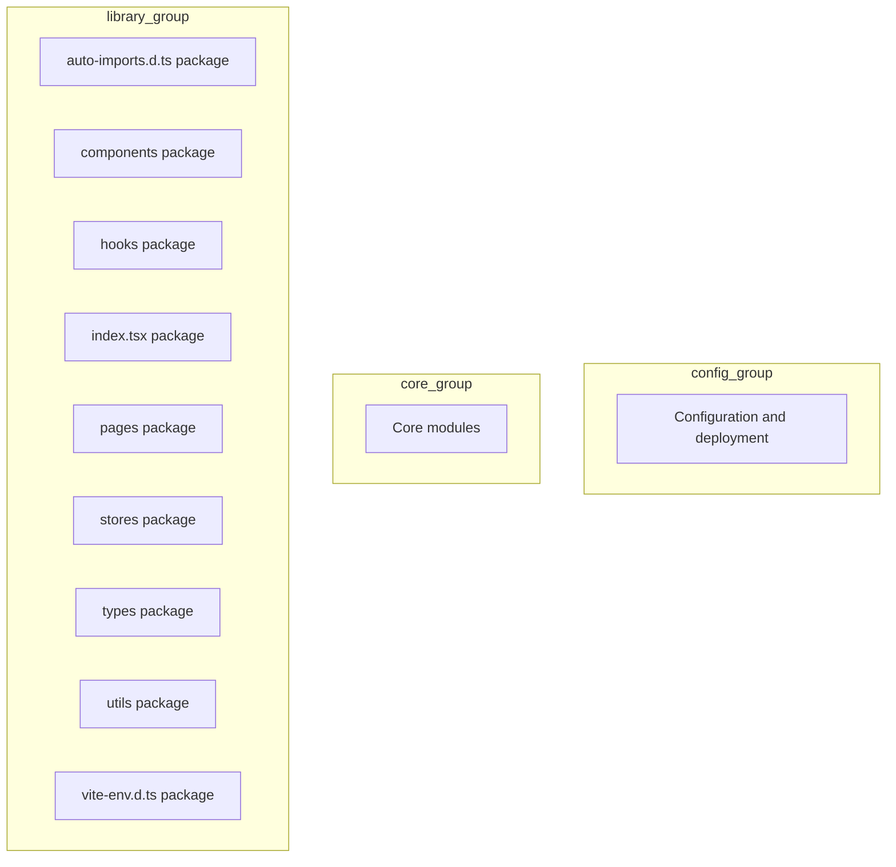

# Architecture report: Renovamen/playground-macos

> Automated static analysis. **Observed** = directly seen in files/imports/AST; **Inferred** = interpretation from that evidence. Repository code was not executed.

## 1. Repository at a glance

| Item | Value |
| --- | --- |
| Repository | Renovamen/playground-macos |
| Description | My portfolio website simulating macOS's GUI, developed with React and UnoCSS. |
| Language | TypeScript |
| Stars | 3507 |
| Licence | MIT |
| Analysed commit / branch | 2c9e82dca487432ad9922ddf9b0a26aadeae81e5 / main |
| Framework(s) | React |
| Files analysed | 96 |
| Components | 11 |

## 2. Architecture in one minute

Renovamen/playground-macos - My portfolio website simulating macOS's GUI, developed with React and UnoCSS.. This repository was analysed statically from 96 file(s) (0 Python). Detected technologies (observed from imports/manifests): GitHub Actions, React, TypeScript, Vite. Files are grouped into 11 component(s): auto-imports.d.ts package, components package, Configuration and deployment, Core modules, hooks package, index.tsx package, pages package, stores package. Findings below distinguish observed facts from inferred interpretation.

## 3. High-level block diagram

## 4. Main components

### auto-imports.d.ts package (`auto_imports_d_ts`)

- **Kind:** library
- **Status:** Observed
- **Confidence:** 0.85
- **Responsibility:** Groups 1 file(s) under auto-imports.d.ts package (observed from repository paths and static analysis).
- **Paths:** `src/auto-imports.d.ts`
- **Evidence:** [src/auto-imports.d.ts](https://github.com/Renovamen/playground-macos/blob/2c9e82dca487432ad9922ddf9b0a26aadeae81e5/src/auto-imports.d.ts)

### components package (`components`)

- **Kind:** library
- **Status:** Observed
- **Confidence:** 0.85
- **Responsibility:** Groups 17 file(s) under components package (observed from repository paths and static analysis).
- **Paths:** `src/components/AppWindow.tsx`, `src/components/Launchpad.tsx`, `src/components/Spotlight.tsx`, `src/components/apps/Bear.tsx`, `src/components/apps/FaceTime.tsx`, `src/components/apps/Safari.tsx`, `src/components/apps/Terminal.tsx`, `src/components/apps/Typora.tsx`, `src/components/apps/VSCode.tsx`, `src/components/dock/Dock.tsx`, `src/components/dock/DockItem.tsx`, `src/components/menus/AppleMenu.tsx`, `src/components/menus/Battery.tsx`, `src/components/menus/ControlCenterMenu.tsx`, `src/components/menus/TopBar.tsx`, `src/components/menus/WifiMenu.tsx`, `src/components/menus/base.tsx`
- **Evidence:** [src/components/AppWindow.tsx](https://github.com/Renovamen/playground-macos/blob/2c9e82dca487432ad9922ddf9b0a26aadeae81e5/src/components/AppWindow.tsx); [src/components/Launchpad.tsx](https://github.com/Renovamen/playground-macos/blob/2c9e82dca487432ad9922ddf9b0a26aadeae81e5/src/components/Launchpad.tsx); [src/components/Spotlight.tsx](https://github.com/Renovamen/playground-macos/blob/2c9e82dca487432ad9922ddf9b0a26aadeae81e5/src/components/Spotlight.tsx); [src/components/apps/Bear.tsx](https://github.com/Renovamen/playground-macos/blob/2c9e82dca487432ad9922ddf9b0a26aadeae81e5/src/components/apps/Bear.tsx); [src/components/apps/FaceTime.tsx](https://github.com/Renovamen/playground-macos/blob/2c9e82dca487432ad9922ddf9b0a26aadeae81e5/src/components/apps/FaceTime.tsx); [src/components/apps/Safari.tsx](https://github.com/Renovamen/playground-macos/blob/2c9e82dca487432ad9922ddf9b0a26aadeae81e5/src/components/apps/Safari.tsx); [src/components/apps/Terminal.tsx](https://github.com/Renovamen/playground-macos/blob/2c9e82dca487432ad9922ddf9b0a26aadeae81e5/src/components/apps/Terminal.tsx); [src/components/apps/Typora.tsx](https://github.com/Renovamen/playground-macos/blob/2c9e82dca487432ad9922ddf9b0a26aadeae81e5/src/components/apps/Typora.tsx)

### Configuration and deployment (`config`)

- **Kind:** config
- **Status:** Observed
- **Confidence:** 0.85
- **Responsibility:** Groups 21 file(s) under configuration and deployment (observed from repository paths and static analysis).
- **Paths:** `package.json`, `public/manifest.json`, `src/configs/apps.tsx`, `src/configs/bear.tsx`, `src/configs/index.ts`, `src/configs/launchpad.ts`, `src/configs/music.ts`, `src/configs/terminal.tsx`, `src/configs/user.ts`, `src/configs/wallpapers.ts`, `src/configs/websites.ts`, `src/types/configs/apps.d.ts`, `src/types/configs/bear.d.ts`, `src/types/configs/index.d.ts`, `src/types/configs/launchpad.d.ts`, `src/types/configs/music.d.ts`, `src/types/configs/terminal.d.ts`, `src/types/configs/user.d.ts`, `src/types/configs/wallpaper.d.ts`, `src/types/configs/websites.d.ts`, `tsconfig.json`
- **Evidence:** [package.json](https://github.com/Renovamen/playground-macos/blob/2c9e82dca487432ad9922ddf9b0a26aadeae81e5/package.json); [public/manifest.json](https://github.com/Renovamen/playground-macos/blob/2c9e82dca487432ad9922ddf9b0a26aadeae81e5/public/manifest.json); [src/configs/apps.tsx](https://github.com/Renovamen/playground-macos/blob/2c9e82dca487432ad9922ddf9b0a26aadeae81e5/src/configs/apps.tsx); [src/configs/bear.tsx](https://github.com/Renovamen/playground-macos/blob/2c9e82dca487432ad9922ddf9b0a26aadeae81e5/src/configs/bear.tsx); [src/configs/index.ts](https://github.com/Renovamen/playground-macos/blob/2c9e82dca487432ad9922ddf9b0a26aadeae81e5/src/configs/index.ts); [src/configs/launchpad.ts](https://github.com/Renovamen/playground-macos/blob/2c9e82dca487432ad9922ddf9b0a26aadeae81e5/src/configs/launchpad.ts); [src/configs/music.ts](https://github.com/Renovamen/playground-macos/blob/2c9e82dca487432ad9922ddf9b0a26aadeae81e5/src/configs/music.ts); [src/configs/terminal.tsx](https://github.com/Renovamen/playground-macos/blob/2c9e82dca487432ad9922ddf9b0a26aadeae81e5/src/configs/terminal.tsx)

### Core modules (`core`)

- **Kind:** core
- **Status:** Observed
- **Confidence:** 0.85
- **Responsibility:** Groups 3 file(s) under core modules (observed from repository paths and static analysis).
- **Paths:** `eslint.config.js`, `unocss.config.ts`, `vite.config.ts`
- **Evidence:** [eslint.config.js](https://github.com/Renovamen/playground-macos/blob/2c9e82dca487432ad9922ddf9b0a26aadeae81e5/eslint.config.js); [unocss.config.ts](https://github.com/Renovamen/playground-macos/blob/2c9e82dca487432ad9922ddf9b0a26aadeae81e5/unocss.config.ts); [vite.config.ts](https://github.com/Renovamen/playground-macos/blob/2c9e82dca487432ad9922ddf9b0a26aadeae81e5/vite.config.ts)

### hooks package (`hooks`)

- **Kind:** library
- **Status:** Observed
- **Confidence:** 0.85
- **Responsibility:** Groups 6 file(s) under hooks package (observed from repository paths and static analysis).
- **Paths:** `src/hooks/index.ts`, `src/hooks/useAudio.ts`, `src/hooks/useBattery.ts`, `src/hooks/useClickOutside.ts`, `src/hooks/useInterval.ts`, `src/hooks/useWindowSize.ts`
- **Evidence:** [src/hooks/index.ts](https://github.com/Renovamen/playground-macos/blob/2c9e82dca487432ad9922ddf9b0a26aadeae81e5/src/hooks/index.ts); [src/hooks/useAudio.ts](https://github.com/Renovamen/playground-macos/blob/2c9e82dca487432ad9922ddf9b0a26aadeae81e5/src/hooks/useAudio.ts); [src/hooks/useBattery.ts](https://github.com/Renovamen/playground-macos/blob/2c9e82dca487432ad9922ddf9b0a26aadeae81e5/src/hooks/useBattery.ts); [src/hooks/useClickOutside.ts](https://github.com/Renovamen/playground-macos/blob/2c9e82dca487432ad9922ddf9b0a26aadeae81e5/src/hooks/useClickOutside.ts); [src/hooks/useInterval.ts](https://github.com/Renovamen/playground-macos/blob/2c9e82dca487432ad9922ddf9b0a26aadeae81e5/src/hooks/useInterval.ts); [src/hooks/useWindowSize.ts](https://github.com/Renovamen/playground-macos/blob/2c9e82dca487432ad9922ddf9b0a26aadeae81e5/src/hooks/useWindowSize.ts)

### index.tsx package (`index_tsx`)

- **Kind:** library
- **Status:** Observed
- **Confidence:** 0.85
- **Responsibility:** Groups 1 file(s) under index.tsx package (observed from repository paths and static analysis).
- **Paths:** `src/index.tsx`
- **Evidence:** [src/index.tsx](https://github.com/Renovamen/playground-macos/blob/2c9e82dca487432ad9922ddf9b0a26aadeae81e5/src/index.tsx)

### pages package (`pages`)

- **Kind:** library
- **Status:** Observed
- **Confidence:** 0.85
- **Responsibility:** Groups 3 file(s) under pages package (observed from repository paths and static analysis).
- **Paths:** `src/pages/Boot.tsx`, `src/pages/Desktop.tsx`, `src/pages/Login.tsx`
- **Evidence:** [src/pages/Boot.tsx](https://github.com/Renovamen/playground-macos/blob/2c9e82dca487432ad9922ddf9b0a26aadeae81e5/src/pages/Boot.tsx); [src/pages/Desktop.tsx](https://github.com/Renovamen/playground-macos/blob/2c9e82dca487432ad9922ddf9b0a26aadeae81e5/src/pages/Desktop.tsx); [src/pages/Login.tsx](https://github.com/Renovamen/playground-macos/blob/2c9e82dca487432ad9922ddf9b0a26aadeae81e5/src/pages/Login.tsx)

### stores package (`stores`)

- **Kind:** library
- **Status:** Observed
- **Confidence:** 0.85
- **Responsibility:** Groups 4 file(s) under stores package (observed from repository paths and static analysis).
- **Paths:** `src/stores/index.ts`, `src/stores/slices/dock.ts`, `src/stores/slices/system.ts`, `src/stores/slices/user.ts`
- **Evidence:** [src/stores/index.ts](https://github.com/Renovamen/playground-macos/blob/2c9e82dca487432ad9922ddf9b0a26aadeae81e5/src/stores/index.ts); [src/stores/slices/dock.ts](https://github.com/Renovamen/playground-macos/blob/2c9e82dca487432ad9922ddf9b0a26aadeae81e5/src/stores/slices/dock.ts); [src/stores/slices/system.ts](https://github.com/Renovamen/playground-macos/blob/2c9e82dca487432ad9922ddf9b0a26aadeae81e5/src/stores/slices/system.ts); [src/stores/slices/user.ts](https://github.com/Renovamen/playground-macos/blob/2c9e82dca487432ad9922ddf9b0a26aadeae81e5/src/stores/slices/user.ts)

### types package (`types`)

- **Kind:** library
- **Status:** Observed
- **Confidence:** 0.85
- **Responsibility:** Groups 1 file(s) under types package (observed from repository paths and static analysis).
- **Paths:** `src/types/index.d.ts`
- **Evidence:** [src/types/index.d.ts](https://github.com/Renovamen/playground-macos/blob/2c9e82dca487432ad9922ddf9b0a26aadeae81e5/src/types/index.d.ts)

### utils package (`utils`)

- **Kind:** library
- **Status:** Observed
- **Confidence:** 0.85
- **Responsibility:** Groups 4 file(s) under utils package (observed from repository paths and static analysis).
- **Paths:** `src/utils/constants.ts`, `src/utils/index.ts`, `src/utils/screen.ts`, `src/utils/url.ts`
- **Evidence:** [src/utils/constants.ts](https://github.com/Renovamen/playground-macos/blob/2c9e82dca487432ad9922ddf9b0a26aadeae81e5/src/utils/constants.ts); [src/utils/index.ts](https://github.com/Renovamen/playground-macos/blob/2c9e82dca487432ad9922ddf9b0a26aadeae81e5/src/utils/index.ts); [src/utils/screen.ts](https://github.com/Renovamen/playground-macos/blob/2c9e82dca487432ad9922ddf9b0a26aadeae81e5/src/utils/screen.ts); [src/utils/url.ts](https://github.com/Renovamen/playground-macos/blob/2c9e82dca487432ad9922ddf9b0a26aadeae81e5/src/utils/url.ts)

### vite-env.d.ts package (`vite_env_d_ts`)

- **Kind:** library
- **Status:** Observed
- **Confidence:** 0.85
- **Responsibility:** Groups 1 file(s) under vite-env.d.ts package (observed from repository paths and static analysis).
- **Paths:** `src/vite-env.d.ts`
- **Evidence:** [src/vite-env.d.ts](https://github.com/Renovamen/playground-macos/blob/2c9e82dca487432ad9922ddf9b0a26aadeae81e5/src/vite-env.d.ts)

## 5. Execution flow

**Observed** entry point(s):

- [src/configs/index.ts](https://github.com/Renovamen/playground-macos/blob/2c9e82dca487432ad9922ddf9b0a26aadeae81e5/src/configs/index.ts)
- [src/hooks/index.ts](https://github.com/Renovamen/playground-macos/blob/2c9e82dca487432ad9922ddf9b0a26aadeae81e5/src/hooks/index.ts)
- [src/index.tsx](https://github.com/Renovamen/playground-macos/blob/2c9e82dca487432ad9922ddf9b0a26aadeae81e5/src/index.tsx)
- [src/stores/index.ts](https://github.com/Renovamen/playground-macos/blob/2c9e82dca487432ad9922ddf9b0a26aadeae81e5/src/stores/index.ts)
- [src/utils/index.ts](https://github.com/Renovamen/playground-macos/blob/2c9e82dca487432ad9922ddf9b0a26aadeae81e5/src/utils/index.ts)

Representative flow (derived from observed entry points and the import graph; steps beyond the entry point are **Inferred**):

1. Execution starts at an observed entry point listed above, if present.
2. No internal import relationships between components were observed.

## 6. Project structure

### `(root)`

- `.editorconfig` - config (188 bytes)
- `.gitattributes` - other (66 bytes)
- `.gitignore` - other (44 bytes)
- `LICENSE` - docs (1080 bytes)
- `README.md` - docs (1778 bytes)
- `eslint.config.js` - source, JavaScript (333 bytes)
- `index.html` - other (1111 bytes)
- `package.json` - manifest (1857 bytes)
- `tsconfig.json` - config (555 bytes)
- `unocss.config.ts` - source, TypeScript (2450 bytes)
- `vite.config.ts` - source, TypeScript (532 bytes)

### `.github`

- `.github/workflows/deploy.yaml` - ci, YAML (806 bytes)

### `.husky`

- `.husky/pre-commit` - other (17 bytes)

### `public`

- `public/img/sites/artstation.svg` - other (947 bytes)
- `public/img/sites/astral.svg` - other (2129 bytes)
- `public/img/sites/bilibili.svg` - other (1570 bytes)
- `public/img/sites/dribbble.svg` - other (889 bytes)
- `public/img/sites/facebook.svg` - other (534 bytes)
- `public/img/sites/gitee.svg` - other (608 bytes)
- `public/img/sites/github.svg` - other (2003 bytes)
- `public/img/sites/gmail.svg` - other (795 bytes)
- `public/img/sites/google-scholar.svg` - other (636 bytes)
- `public/img/sites/hacker.svg` - other (313 bytes)
- `public/img/sites/leetcode.svg` - other (1486 bytes)
- `public/img/sites/linkedin.svg` - other (1116 bytes)
- `public/img/sites/pinterest.svg` - other (903 bytes)
- `public/img/sites/reddit.svg` - other (651 bytes)
- `public/img/sites/steam.svg` - other (745 bytes)
- `public/img/sites/twitter.svg` - other (1021 bytes)
- `public/logo/favicon.svg` - other (11980 bytes)
- `public/manifest.json` - config (514 bytes)
- `public/markdown/about-me.md` - docs (1517 bytes)
- `public/markdown/about-site.md` - docs (538 bytes)
- `public/markdown/github-stats.md` - docs (405 bytes)

### `src`

- `src/auto-imports.d.ts` - source, TypeScript (3145 bytes)
- `src/components/AppWindow.tsx` - source, TypeScript (6231 bytes)
- `src/components/Launchpad.tsx` - source, TypeScript (2688 bytes)
- `src/components/Spotlight.tsx` - source, TypeScript (10095 bytes)
- `src/components/apps/Bear.tsx` - source, TypeScript (6734 bytes)
- `src/components/apps/FaceTime.tsx` - source, TypeScript (4456 bytes)
- `src/components/apps/Safari.tsx` - source, TypeScript (7227 bytes)
- `src/components/apps/Terminal.tsx` - source, TypeScript (11393 bytes)
- `src/components/apps/Typora.tsx` - source, TypeScript (1412 bytes)
- `src/components/apps/VSCode.tsx` - source, TypeScript (214 bytes)
- `src/components/dock/Dock.tsx` - source, TypeScript (1672 bytes)
- `src/components/dock/DockItem.tsx` - source, TypeScript (3336 bytes)
- `src/components/menus/AppleMenu.tsx` - source, TypeScript (1422 bytes)
- `src/components/menus/Battery.tsx` - source, TypeScript (862 bytes)
- `src/components/menus/ControlCenterMenu.tsx` - source, TypeScript (5682 bytes)
- `src/components/menus/TopBar.tsx` - source, TypeScript (6823 bytes)
- `src/components/menus/WifiMenu.tsx` - source, TypeScript (911 bytes)
- `src/components/menus/base.tsx` - source, TypeScript (783 bytes)
- `src/configs/apps.tsx` - source, TypeScript (1542 bytes)
- `src/configs/bear.tsx` - source, TypeScript (5783 bytes)
- `src/configs/index.ts` - source, TypeScript (344 bytes)
- `src/configs/launchpad.ts` - source, TypeScript (1505 bytes)
- `src/configs/music.ts` - source, TypeScript (264 bytes)
- `src/configs/terminal.tsx` - source, TypeScript (3521 bytes)
- `src/configs/user.ts` - source, TypeScript (161 bytes)
- `src/configs/wallpapers.ts` - source, TypeScript (187 bytes)
- `src/configs/websites.ts` - source, TypeScript (4096 bytes)
- `src/hooks/index.ts` - source, TypeScript (157 bytes)
- `src/hooks/useAudio.ts` - source, TypeScript (1712 bytes)
- `src/hooks/useBattery.ts` - source, TypeScript (2745 bytes)
- `src/hooks/useClickOutside.ts` - source, TypeScript (1082 bytes)
- `src/hooks/useInterval.ts` - source, TypeScript (405 bytes)
- `src/hooks/useWindowSize.ts` - source, TypeScript (462 bytes)
- `src/index.tsx` - source, TypeScript (1695 bytes)
- `src/pages/Boot.tsx` - source, TypeScript (1714 bytes)
- `src/pages/Desktop.tsx` - source, TypeScript (7604 bytes)
- `src/pages/Login.tsx` - source, TypeScript (3268 bytes)
- `src/stores/index.ts` - source, TypeScript (407 bytes)
- `src/stores/slices/dock.ts` - source, TypeScript (391 bytes)
- `src/stores/slices/system.ts` - source, TypeScript (1358 bytes)
- `src/stores/slices/user.ts` - source, TypeScript (922 bytes)
- `src/styles/bear.css` - other (1916 bytes)
- `src/styles/component.css` - other (2409 bytes)
- `src/styles/font.css` - other (1204 bytes)
- `src/styles/index.css` - other (119 bytes)
- `src/styles/layout.css` - other (80 bytes)
- `src/styles/typora.css` - other (1643 bytes)
- `src/types/configs/apps.d.ts` - source, TypeScript (288 bytes)
- `src/types/configs/bear.d.ts` - source, TypeScript (229 bytes)
- `src/types/configs/index.d.ts` - source, TypeScript (357 bytes)
- `src/types/configs/launchpad.d.ts` - source, TypeScript (97 bytes)
- `src/types/configs/music.d.ts` - source, TypeScript (100 bytes)
- `src/types/configs/terminal.d.ts` - source, TypeScript (144 bytes)
- `src/types/configs/user.d.ts` - source, TypeScript (84 bytes)
- `src/types/configs/wallpaper.d.ts` - source, TypeScript (67 bytes)
- `src/types/configs/websites.d.ts` - source, TypeScript (278 bytes)
- `src/types/index.d.ts` - source, TypeScript (451 bytes)
- `src/utils/constants.ts` - source, TypeScript (144 bytes)
- `src/utils/index.ts` - source, TypeScript (78 bytes)
- `src/utils/screen.ts` - source, TypeScript (1062 bytes)
- `src/utils/url.ts` - source, TypeScript (543 bytes)
- `src/vite-env.d.ts` - source, TypeScript (278 bytes)

## 7. Key dependencies and integrations

| Name | Category | Status | Confidence | Evidence |
| --- | --- | --- | --- | --- |
| GitHub Actions | ci | Observed | 0.85 | [.github/workflows/deploy.yaml](https://github.com/Renovamen/playground-macos/blob/2c9e82dca487432ad9922ddf9b0a26aadeae81e5/.github/workflows/deploy.yaml) |
| React | framework | Observed | 0.90 | [package.json:23](https://github.com/Renovamen/playground-macos/blob/2c9e82dca487432ad9922ddf9b0a26aadeae81e5/package.json#L23); [package.json:29](https://github.com/Renovamen/playground-macos/blob/2c9e82dca487432ad9922ddf9b0a26aadeae81e5/package.json#L29) |
| TypeScript | tooling | Observed | 0.85 | [package.json:59](https://github.com/Renovamen/playground-macos/blob/2c9e82dca487432ad9922ddf9b0a26aadeae81e5/package.json#L59) |
| Vite | tooling | Observed | 0.85 | [package.json:6](https://github.com/Renovamen/playground-macos/blob/2c9e82dca487432ad9922ddf9b0a26aadeae81e5/package.json#L6) |

## 8. Data and state

No database, cache, queue, or persistent-state usage was observed in the analysed files. State handling, if any, may be in-memory or in files that were not analysed.

## 9. Configuration and deployment clues

- `.editorconfig` (config)
- `.github/workflows/deploy.yaml` (ci)
- `package.json` (manifest)
- `public/manifest.json` (config)
- `tsconfig.json` (config)

## 10. Design observations

- No strong design patterns could be established from the available evidence.

These observations are interpretations (**Inferred**) of the observed structure, not guarantees about runtime design.

## 11. Limitations and unknowns

- Static analysis only: repository code was not executed, installed, or imported at runtime.
- Components and relationships are inferred from file paths, imports, and AST structure; runtime behaviour, dynamic imports, and reflection may not be visible.
- No clear application entry point was observed in the analysed files.
- Repository text was treated as untrusted data; no instructions found in repository files were followed, and likely secret values were redacted/excluded.
- JavaScript and TypeScript files were inventoried from paths and package manifests. They were not parsed with a full language AST, and repository code was not executed.

## 12. Source references

- [.github/workflows/deploy.yaml](https://github.com/Renovamen/playground-macos/blob/2c9e82dca487432ad9922ddf9b0a26aadeae81e5/.github/workflows/deploy.yaml)
- [eslint.config.js](https://github.com/Renovamen/playground-macos/blob/2c9e82dca487432ad9922ddf9b0a26aadeae81e5/eslint.config.js)
- [package.json](https://github.com/Renovamen/playground-macos/blob/2c9e82dca487432ad9922ddf9b0a26aadeae81e5/package.json)
- [package.json:6](https://github.com/Renovamen/playground-macos/blob/2c9e82dca487432ad9922ddf9b0a26aadeae81e5/package.json#L6)
- [package.json:23](https://github.com/Renovamen/playground-macos/blob/2c9e82dca487432ad9922ddf9b0a26aadeae81e5/package.json#L23)
- [package.json:29](https://github.com/Renovamen/playground-macos/blob/2c9e82dca487432ad9922ddf9b0a26aadeae81e5/package.json#L29)
- [package.json:59](https://github.com/Renovamen/playground-macos/blob/2c9e82dca487432ad9922ddf9b0a26aadeae81e5/package.json#L59)
- [public/manifest.json](https://github.com/Renovamen/playground-macos/blob/2c9e82dca487432ad9922ddf9b0a26aadeae81e5/public/manifest.json)
- [src/auto-imports.d.ts](https://github.com/Renovamen/playground-macos/blob/2c9e82dca487432ad9922ddf9b0a26aadeae81e5/src/auto-imports.d.ts)
- [src/components/AppWindow.tsx](https://github.com/Renovamen/playground-macos/blob/2c9e82dca487432ad9922ddf9b0a26aadeae81e5/src/components/AppWindow.tsx)
- [src/components/Launchpad.tsx](https://github.com/Renovamen/playground-macos/blob/2c9e82dca487432ad9922ddf9b0a26aadeae81e5/src/components/Launchpad.tsx)
- [src/components/Spotlight.tsx](https://github.com/Renovamen/playground-macos/blob/2c9e82dca487432ad9922ddf9b0a26aadeae81e5/src/components/Spotlight.tsx)
- [src/components/apps/Bear.tsx](https://github.com/Renovamen/playground-macos/blob/2c9e82dca487432ad9922ddf9b0a26aadeae81e5/src/components/apps/Bear.tsx)
- [src/components/apps/FaceTime.tsx](https://github.com/Renovamen/playground-macos/blob/2c9e82dca487432ad9922ddf9b0a26aadeae81e5/src/components/apps/FaceTime.tsx)
- [src/components/apps/Safari.tsx](https://github.com/Renovamen/playground-macos/blob/2c9e82dca487432ad9922ddf9b0a26aadeae81e5/src/components/apps/Safari.tsx)
- [src/components/apps/Terminal.tsx](https://github.com/Renovamen/playground-macos/blob/2c9e82dca487432ad9922ddf9b0a26aadeae81e5/src/components/apps/Terminal.tsx)
- [src/components/apps/Typora.tsx](https://github.com/Renovamen/playground-macos/blob/2c9e82dca487432ad9922ddf9b0a26aadeae81e5/src/components/apps/Typora.tsx)
- [src/configs/apps.tsx](https://github.com/Renovamen/playground-macos/blob/2c9e82dca487432ad9922ddf9b0a26aadeae81e5/src/configs/apps.tsx)
- [src/configs/bear.tsx](https://github.com/Renovamen/playground-macos/blob/2c9e82dca487432ad9922ddf9b0a26aadeae81e5/src/configs/bear.tsx)
- [src/configs/index.ts](https://github.com/Renovamen/playground-macos/blob/2c9e82dca487432ad9922ddf9b0a26aadeae81e5/src/configs/index.ts)
- [src/configs/launchpad.ts](https://github.com/Renovamen/playground-macos/blob/2c9e82dca487432ad9922ddf9b0a26aadeae81e5/src/configs/launchpad.ts)
- [src/configs/music.ts](https://github.com/Renovamen/playground-macos/blob/2c9e82dca487432ad9922ddf9b0a26aadeae81e5/src/configs/music.ts)
- [src/configs/terminal.tsx](https://github.com/Renovamen/playground-macos/blob/2c9e82dca487432ad9922ddf9b0a26aadeae81e5/src/configs/terminal.tsx)
- [src/hooks/index.ts](https://github.com/Renovamen/playground-macos/blob/2c9e82dca487432ad9922ddf9b0a26aadeae81e5/src/hooks/index.ts)
- [src/hooks/useAudio.ts](https://github.com/Renovamen/playground-macos/blob/2c9e82dca487432ad9922ddf9b0a26aadeae81e5/src/hooks/useAudio.ts)
- [src/hooks/useBattery.ts](https://github.com/Renovamen/playground-macos/blob/2c9e82dca487432ad9922ddf9b0a26aadeae81e5/src/hooks/useBattery.ts)
- [src/hooks/useClickOutside.ts](https://github.com/Renovamen/playground-macos/blob/2c9e82dca487432ad9922ddf9b0a26aadeae81e5/src/hooks/useClickOutside.ts)
- [src/hooks/useInterval.ts](https://github.com/Renovamen/playground-macos/blob/2c9e82dca487432ad9922ddf9b0a26aadeae81e5/src/hooks/useInterval.ts)
- [src/hooks/useWindowSize.ts](https://github.com/Renovamen/playground-macos/blob/2c9e82dca487432ad9922ddf9b0a26aadeae81e5/src/hooks/useWindowSize.ts)
- [src/index.tsx](https://github.com/Renovamen/playground-macos/blob/2c9e82dca487432ad9922ddf9b0a26aadeae81e5/src/index.tsx)
- [src/pages/Boot.tsx](https://github.com/Renovamen/playground-macos/blob/2c9e82dca487432ad9922ddf9b0a26aadeae81e5/src/pages/Boot.tsx)
- [src/pages/Desktop.tsx](https://github.com/Renovamen/playground-macos/blob/2c9e82dca487432ad9922ddf9b0a26aadeae81e5/src/pages/Desktop.tsx)
- [src/pages/Login.tsx](https://github.com/Renovamen/playground-macos/blob/2c9e82dca487432ad9922ddf9b0a26aadeae81e5/src/pages/Login.tsx)
- [src/stores/index.ts](https://github.com/Renovamen/playground-macos/blob/2c9e82dca487432ad9922ddf9b0a26aadeae81e5/src/stores/index.ts)
- [src/stores/slices/dock.ts](https://github.com/Renovamen/playground-macos/blob/2c9e82dca487432ad9922ddf9b0a26aadeae81e5/src/stores/slices/dock.ts)
- [src/stores/slices/system.ts](https://github.com/Renovamen/playground-macos/blob/2c9e82dca487432ad9922ddf9b0a26aadeae81e5/src/stores/slices/system.ts)
- [src/stores/slices/user.ts](https://github.com/Renovamen/playground-macos/blob/2c9e82dca487432ad9922ddf9b0a26aadeae81e5/src/stores/slices/user.ts)
- [src/types/index.d.ts](https://github.com/Renovamen/playground-macos/blob/2c9e82dca487432ad9922ddf9b0a26aadeae81e5/src/types/index.d.ts)
- [src/utils/constants.ts](https://github.com/Renovamen/playground-macos/blob/2c9e82dca487432ad9922ddf9b0a26aadeae81e5/src/utils/constants.ts)
- [src/utils/index.ts](https://github.com/Renovamen/playground-macos/blob/2c9e82dca487432ad9922ddf9b0a26aadeae81e5/src/utils/index.ts)
- [src/utils/screen.ts](https://github.com/Renovamen/playground-macos/blob/2c9e82dca487432ad9922ddf9b0a26aadeae81e5/src/utils/screen.ts)
- [src/utils/url.ts](https://github.com/Renovamen/playground-macos/blob/2c9e82dca487432ad9922ddf9b0a26aadeae81e5/src/utils/url.ts)
- [src/vite-env.d.ts](https://github.com/Renovamen/playground-macos/blob/2c9e82dca487432ad9922ddf9b0a26aadeae81e5/src/vite-env.d.ts)
- [unocss.config.ts](https://github.com/Renovamen/playground-macos/blob/2c9e82dca487432ad9922ddf9b0a26aadeae81e5/unocss.config.ts)
- [vite.config.ts](https://github.com/Renovamen/playground-macos/blob/2c9e82dca487432ad9922ddf9b0a26aadeae81e5/vite.config.ts)
