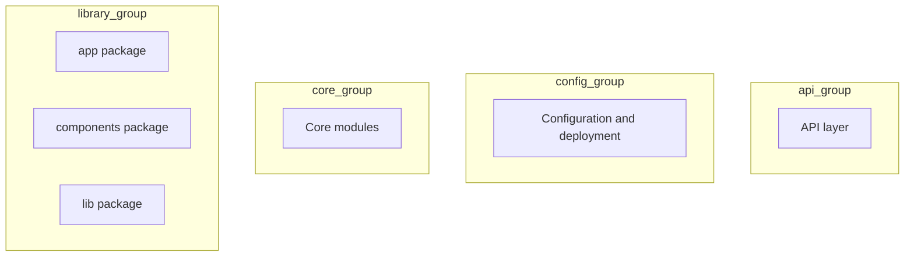

# Architecture report: SawyerHood/draw-a-ui

> Automated static analysis. **Observed** = directly seen in files/imports/AST; **Inferred** = interpretation from that evidence. Repository code was not executed.

## 1. Repository at a glance

| Item | Value |
| --- | --- |
| Repository | SawyerHood/draw-a-ui |
| Description | Draw a mockup and generate html for it |
| Language | TypeScript |
| Stars | 13567 |
| Licence | MIT |
| Analysed commit / branch | 1aca63b4d54a3065fe72fe9784c91265510fbe19 / main |
| Framework(s) | Next.js, React |
| Files analysed | 21 |
| Components | 6 |

## 2. Architecture in one minute

SawyerHood/draw-a-ui - Draw a mockup and generate html for it. This repository was analysed statically from 21 file(s) (0 Python). Detected technologies (observed from imports/manifests): GitHub Actions, Next.js, React, Tailwind CSS, TypeScript. Files are grouped into 6 component(s): API layer, app package, components package, Configuration and deployment, Core modules, lib package. Findings below distinguish observed facts from inferred interpretation.

## 3. High-level block diagram

## 4. Main components

### API layer (`api_layer`)

- **Kind:** api
- **Status:** Observed
- **Confidence:** 0.85
- **Responsibility:** Groups 1 file(s) under api layer (observed from repository paths and static analysis).
- **Paths:** `app/api/toHtml/route.ts`
- **Evidence:** [app/api/toHtml/route.ts](https://github.com/SawyerHood/draw-a-ui/blob/1aca63b4d54a3065fe72fe9784c91265510fbe19/app/api/toHtml/route.ts)

### app package (`app`)

- **Kind:** library
- **Status:** Observed
- **Confidence:** 0.85
- **Responsibility:** Groups 2 file(s) under app package (observed from repository paths and static analysis).
- **Paths:** `app/layout.tsx`, `app/page.tsx`
- **Evidence:** [app/layout.tsx](https://github.com/SawyerHood/draw-a-ui/blob/1aca63b4d54a3065fe72fe9784c91265510fbe19/app/layout.tsx); [app/page.tsx](https://github.com/SawyerHood/draw-a-ui/blob/1aca63b4d54a3065fe72fe9784c91265510fbe19/app/page.tsx)

### components package (`components`)

- **Kind:** library
- **Status:** Observed
- **Confidence:** 0.85
- **Responsibility:** Groups 1 file(s) under components package (observed from repository paths and static analysis).
- **Paths:** `components/PreviewModal.tsx`
- **Evidence:** [components/PreviewModal.tsx](https://github.com/SawyerHood/draw-a-ui/blob/1aca63b4d54a3065fe72fe9784c91265510fbe19/components/PreviewModal.tsx)

### Configuration and deployment (`config`)

- **Kind:** config
- **Status:** Observed
- **Confidence:** 0.85
- **Responsibility:** Groups 2 file(s) under configuration and deployment (observed from repository paths and static analysis).
- **Paths:** `package.json`, `tsconfig.json`
- **Evidence:** [package.json](https://github.com/SawyerHood/draw-a-ui/blob/1aca63b4d54a3065fe72fe9784c91265510fbe19/package.json); [tsconfig.json](https://github.com/SawyerHood/draw-a-ui/blob/1aca63b4d54a3065fe72fe9784c91265510fbe19/tsconfig.json)

### Core modules (`core`)

- **Kind:** core
- **Status:** Observed
- **Confidence:** 0.85
- **Responsibility:** Groups 3 file(s) under core modules (observed from repository paths and static analysis).
- **Paths:** `next.config.js`, `postcss.config.js`, `tailwind.config.ts`
- **Evidence:** [next.config.js](https://github.com/SawyerHood/draw-a-ui/blob/1aca63b4d54a3065fe72fe9784c91265510fbe19/next.config.js); [postcss.config.js](https://github.com/SawyerHood/draw-a-ui/blob/1aca63b4d54a3065fe72fe9784c91265510fbe19/postcss.config.js); [tailwind.config.ts](https://github.com/SawyerHood/draw-a-ui/blob/1aca63b4d54a3065fe72fe9784c91265510fbe19/tailwind.config.ts)

### lib package (`lib`)

- **Kind:** library
- **Status:** Observed
- **Confidence:** 0.85
- **Responsibility:** Groups 4 file(s) under lib package (observed from repository paths and static analysis).
- **Paths:** `lib/blobToBase64.ts`, `lib/getBrowserCanvasMaxSize.ts`, `lib/getSvgAsImage.ts`, `lib/png.ts`
- **Evidence:** [lib/blobToBase64.ts](https://github.com/SawyerHood/draw-a-ui/blob/1aca63b4d54a3065fe72fe9784c91265510fbe19/lib/blobToBase64.ts); [lib/getBrowserCanvasMaxSize.ts](https://github.com/SawyerHood/draw-a-ui/blob/1aca63b4d54a3065fe72fe9784c91265510fbe19/lib/getBrowserCanvasMaxSize.ts); [lib/getSvgAsImage.ts](https://github.com/SawyerHood/draw-a-ui/blob/1aca63b4d54a3065fe72fe9784c91265510fbe19/lib/getSvgAsImage.ts); [lib/png.ts](https://github.com/SawyerHood/draw-a-ui/blob/1aca63b4d54a3065fe72fe9784c91265510fbe19/lib/png.ts)

## 5. Execution flow

**Observed** entry point(s):

- [app/page.tsx](https://github.com/SawyerHood/draw-a-ui/blob/1aca63b4d54a3065fe72fe9784c91265510fbe19/app/page.tsx)

Representative flow (derived from observed entry points and the import graph; steps beyond the entry point are **Inferred**):

1. Execution starts at an observed entry point listed above, if present.
2. No internal import relationships between components were observed.

## 6. Project structure

### `(root)`

- `.eslintrc.json` - config (40 bytes)
- `.gitignore` - other (391 bytes)
- `LICENSE` - docs (1068 bytes)
- `README.md` - docs (1094 bytes)
- `next.config.js` - source, JavaScript (92 bytes)
- `package.json` - manifest (792 bytes)
- `postcss.config.js` - source, JavaScript (82 bytes)
- `tailwind.config.ts` - source, TypeScript (495 bytes)
- `tsconfig.json` - config (595 bytes)

### `.github`

- `.github/workflows/ci.yml` - ci, YAML (492 bytes)

### `app`

- `app/api/toHtml/route.ts` - source, TypeScript (1184 bytes)
- `app/globals.css` - other (159 bytes)
- `app/layout.tsx` - source, TypeScript (617 bytes)
- `app/page.tsx` - source, TypeScript (3298 bytes)

### `components`

- `components/PreviewModal.tsx` - source, TypeScript (2829 bytes)

### `lib`

- `lib/blobToBase64.ts` - source, TypeScript (212 bytes)
- `lib/getBrowserCanvasMaxSize.ts` - source, TypeScript (751 bytes)
- `lib/getSvgAsImage.ts` - source, TypeScript (3942 bytes)
- `lib/png.ts` - source, TypeScript (6883 bytes)

### `public`

- `public/next.svg` - other (1375 bytes)
- `public/vercel.svg` - other (629 bytes)

## 7. Key dependencies and integrations

| Name | Category | Status | Confidence | Evidence |
| --- | --- | --- | --- | --- |
| GitHub Actions | ci | Observed | 0.85 | [.github/workflows/ci.yml](https://github.com/SawyerHood/draw-a-ui/blob/1aca63b4d54a3065fe72fe9784c91265510fbe19/.github/workflows/ci.yml) |
| Next.js | framework | Observed | 0.85 | [package.json:6](https://github.com/SawyerHood/draw-a-ui/blob/1aca63b4d54a3065fe72fe9784c91265510fbe19/package.json#L6) |
| React | framework | Observed | 0.90 | [package.json:17](https://github.com/SawyerHood/draw-a-ui/blob/1aca63b4d54a3065fe72fe9784c91265510fbe19/package.json#L17); [package.json:18](https://github.com/SawyerHood/draw-a-ui/blob/1aca63b4d54a3065fe72fe9784c91265510fbe19/package.json#L18) |
| Tailwind CSS | library | Observed | 0.85 | [package.json:30](https://github.com/SawyerHood/draw-a-ui/blob/1aca63b4d54a3065fe72fe9784c91265510fbe19/package.json#L30) |
| TypeScript | tooling | Observed | 0.85 | [package.json:31](https://github.com/SawyerHood/draw-a-ui/blob/1aca63b4d54a3065fe72fe9784c91265510fbe19/package.json#L31) |

## 8. Data and state

No database, cache, queue, or persistent-state usage was observed in the analysed files. State handling, if any, may be in-memory or in files that were not analysed.

## 9. Configuration and deployment clues

- `.eslintrc.json` (config)
- `.github/workflows/ci.yml` (ci)
- `package.json` (manifest)
- `tsconfig.json` (config)

## 10. Design observations

- An entry/API layer is separated from other code (Inferred from paths and decorators).

These observations are interpretations (**Inferred**) of the observed structure, not guarantees about runtime design.

## 11. Limitations and unknowns

- Static analysis only: repository code was not executed, installed, or imported at runtime.
- Components and relationships are inferred from file paths, imports, and AST structure; runtime behaviour, dynamic imports, and reflection may not be visible.
- No clear application entry point was observed in the analysed files.
- Repository text was treated as untrusted data; no instructions found in repository files were followed, and likely secret values were redacted/excluded.
- JavaScript and TypeScript files were inventoried from paths and package manifests. They were not parsed with a full language AST, and repository code was not executed.

## 12. Source references

- [.github/workflows/ci.yml](https://github.com/SawyerHood/draw-a-ui/blob/1aca63b4d54a3065fe72fe9784c91265510fbe19/.github/workflows/ci.yml)
- [app/api/toHtml/route.ts](https://github.com/SawyerHood/draw-a-ui/blob/1aca63b4d54a3065fe72fe9784c91265510fbe19/app/api/toHtml/route.ts)
- [app/layout.tsx](https://github.com/SawyerHood/draw-a-ui/blob/1aca63b4d54a3065fe72fe9784c91265510fbe19/app/layout.tsx)
- [app/page.tsx](https://github.com/SawyerHood/draw-a-ui/blob/1aca63b4d54a3065fe72fe9784c91265510fbe19/app/page.tsx)
- [components/PreviewModal.tsx](https://github.com/SawyerHood/draw-a-ui/blob/1aca63b4d54a3065fe72fe9784c91265510fbe19/components/PreviewModal.tsx)
- [lib/blobToBase64.ts](https://github.com/SawyerHood/draw-a-ui/blob/1aca63b4d54a3065fe72fe9784c91265510fbe19/lib/blobToBase64.ts)
- [lib/getBrowserCanvasMaxSize.ts](https://github.com/SawyerHood/draw-a-ui/blob/1aca63b4d54a3065fe72fe9784c91265510fbe19/lib/getBrowserCanvasMaxSize.ts)
- [lib/getSvgAsImage.ts](https://github.com/SawyerHood/draw-a-ui/blob/1aca63b4d54a3065fe72fe9784c91265510fbe19/lib/getSvgAsImage.ts)
- [lib/png.ts](https://github.com/SawyerHood/draw-a-ui/blob/1aca63b4d54a3065fe72fe9784c91265510fbe19/lib/png.ts)
- [next.config.js](https://github.com/SawyerHood/draw-a-ui/blob/1aca63b4d54a3065fe72fe9784c91265510fbe19/next.config.js)
- [package.json](https://github.com/SawyerHood/draw-a-ui/blob/1aca63b4d54a3065fe72fe9784c91265510fbe19/package.json)
- [package.json:6](https://github.com/SawyerHood/draw-a-ui/blob/1aca63b4d54a3065fe72fe9784c91265510fbe19/package.json#L6)
- [package.json:17](https://github.com/SawyerHood/draw-a-ui/blob/1aca63b4d54a3065fe72fe9784c91265510fbe19/package.json#L17)
- [package.json:18](https://github.com/SawyerHood/draw-a-ui/blob/1aca63b4d54a3065fe72fe9784c91265510fbe19/package.json#L18)
- [package.json:30](https://github.com/SawyerHood/draw-a-ui/blob/1aca63b4d54a3065fe72fe9784c91265510fbe19/package.json#L30)
- [package.json:31](https://github.com/SawyerHood/draw-a-ui/blob/1aca63b4d54a3065fe72fe9784c91265510fbe19/package.json#L31)
- [postcss.config.js](https://github.com/SawyerHood/draw-a-ui/blob/1aca63b4d54a3065fe72fe9784c91265510fbe19/postcss.config.js)
- [tailwind.config.ts](https://github.com/SawyerHood/draw-a-ui/blob/1aca63b4d54a3065fe72fe9784c91265510fbe19/tailwind.config.ts)
- [tsconfig.json](https://github.com/SawyerHood/draw-a-ui/blob/1aca63b4d54a3065fe72fe9784c91265510fbe19/tsconfig.json)
