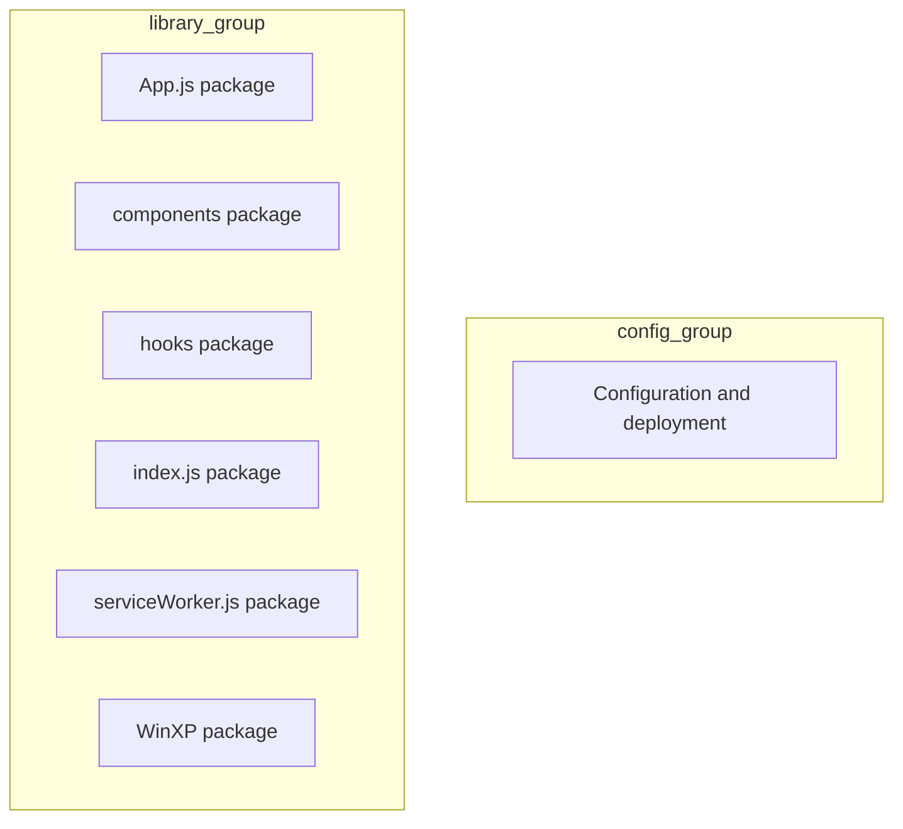

# Architecture report: ShizukuIchi/winXP

> Automated static analysis. **Observed** = directly seen in files/imports/AST; **Inferred** = interpretation from that evidence. Repository code was not executed.

## 1. Repository at a glance

| Item | Value |
| --- | --- |
| Repository | ShizukuIchi/winXP |
| Description | 🏁 Web based Windows XP desktop recreation.  |
| Language | JavaScript |
| Stars | 5865 |
| Licence | MIT |
| Analysed commit / branch | 856bb554b3667f62078010b4cee10cc2645761e1 / master |
| Framework(s) | React |
| Files analysed | 55 |
| Components | 7 |

## 2. Architecture in one minute

ShizukuIchi/winXP - 🏁 Web based Windows XP desktop recreation. . This repository was analysed statically from 55 file(s) (0 Python). Detected technologies (observed from imports/manifests): React. Files are grouped into 7 component(s): App.js package, components package, Configuration and deployment, hooks package, index.js package, serviceWorker.js package, WinXP package. Findings below distinguish observed facts from inferred interpretation.

## 3. High-level block diagram

## 4. Main components

### App.js package (`app_js`)

- **Kind:** library
- **Status:** Observed
- **Confidence:** 0.85
- **Responsibility:** Groups 1 file(s) under app.js package (observed from repository paths and static analysis).
- **Paths:** `src/App.js`
- **Evidence:** [src/App.js](https://github.com/ShizukuIchi/winXP/blob/856bb554b3667f62078010b4cee10cc2645761e1/src/App.js)

### components package (`components`)

- **Kind:** library
- **Status:** Observed
- **Confidence:** 0.85
- **Responsibility:** Groups 9 file(s) under components package (observed from repository paths and static analysis).
- **Paths:** `src/components/Balloon/index.js`, `src/components/DashedBox/index.js`, `src/components/Google/Main.js`, `src/components/Google/Search.js`, `src/components/Google/index.js`, `src/components/SubMenu/index.js`, `src/components/WindowDropDowns/WindowDropDown.js`, `src/components/WindowDropDowns/index.js`, `src/components/index.js`
- **Evidence:** [src/components/Balloon/index.js](https://github.com/ShizukuIchi/winXP/blob/856bb554b3667f62078010b4cee10cc2645761e1/src/components/Balloon/index.js); [src/components/DashedBox/index.js](https://github.com/ShizukuIchi/winXP/blob/856bb554b3667f62078010b4cee10cc2645761e1/src/components/DashedBox/index.js); [src/components/Google/Main.js](https://github.com/ShizukuIchi/winXP/blob/856bb554b3667f62078010b4cee10cc2645761e1/src/components/Google/Main.js); [src/components/Google/Search.js](https://github.com/ShizukuIchi/winXP/blob/856bb554b3667f62078010b4cee10cc2645761e1/src/components/Google/Search.js); [src/components/Google/index.js](https://github.com/ShizukuIchi/winXP/blob/856bb554b3667f62078010b4cee10cc2645761e1/src/components/Google/index.js); [src/components/SubMenu/index.js](https://github.com/ShizukuIchi/winXP/blob/856bb554b3667f62078010b4cee10cc2645761e1/src/components/SubMenu/index.js); [src/components/WindowDropDowns/WindowDropDown.js](https://github.com/ShizukuIchi/winXP/blob/856bb554b3667f62078010b4cee10cc2645761e1/src/components/WindowDropDowns/WindowDropDown.js); [src/components/WindowDropDowns/index.js](https://github.com/ShizukuIchi/winXP/blob/856bb554b3667f62078010b4cee10cc2645761e1/src/components/WindowDropDowns/index.js)

### Configuration and deployment (`config`)

- **Kind:** config
- **Status:** Observed
- **Confidence:** 0.85
- **Responsibility:** Groups 4 file(s) under configuration and deployment (observed from repository paths and static analysis).
- **Paths:** `jsconfig.json`, `now.json`, `package.json`, `public/manifest.json`
- **Evidence:** [jsconfig.json](https://github.com/ShizukuIchi/winXP/blob/856bb554b3667f62078010b4cee10cc2645761e1/jsconfig.json); [now.json](https://github.com/ShizukuIchi/winXP/blob/856bb554b3667f62078010b4cee10cc2645761e1/now.json); [package.json](https://github.com/ShizukuIchi/winXP/blob/856bb554b3667f62078010b4cee10cc2645761e1/package.json); [public/manifest.json](https://github.com/ShizukuIchi/winXP/blob/856bb554b3667f62078010b4cee10cc2645761e1/public/manifest.json)

### hooks package (`hooks`)

- **Kind:** library
- **Status:** Observed
- **Confidence:** 0.85
- **Responsibility:** Groups 3 file(s) under hooks package (observed from repository paths and static analysis).
- **Paths:** `src/hooks/index.js`, `src/hooks/useElementResize.js`, `src/hooks/useGA.js`
- **Evidence:** [src/hooks/index.js](https://github.com/ShizukuIchi/winXP/blob/856bb554b3667f62078010b4cee10cc2645761e1/src/hooks/index.js); [src/hooks/useElementResize.js](https://github.com/ShizukuIchi/winXP/blob/856bb554b3667f62078010b4cee10cc2645761e1/src/hooks/useElementResize.js); [src/hooks/useGA.js](https://github.com/ShizukuIchi/winXP/blob/856bb554b3667f62078010b4cee10cc2645761e1/src/hooks/useGA.js)

### index.js package (`index_js`)

- **Kind:** library
- **Status:** Observed
- **Confidence:** 0.85
- **Responsibility:** Groups 1 file(s) under index.js package (observed from repository paths and static analysis).
- **Paths:** `src/index.js`
- **Evidence:** [src/index.js](https://github.com/ShizukuIchi/winXP/blob/856bb554b3667f62078010b4cee10cc2645761e1/src/index.js)

### serviceWorker.js package (`serviceworker_js`)

- **Kind:** library
- **Status:** Observed
- **Confidence:** 0.85
- **Responsibility:** Groups 1 file(s) under serviceworker.js package (observed from repository paths and static analysis).
- **Paths:** `src/serviceWorker.js`
- **Evidence:** [src/serviceWorker.js](https://github.com/ShizukuIchi/winXP/blob/856bb554b3667f62078010b4cee10cc2645761e1/src/serviceWorker.js)

### WinXP package (`winxp`)

- **Kind:** library
- **Status:** Observed
- **Confidence:** 0.85
- **Responsibility:** Groups 25 file(s) under winxp package (observed from repository paths and static analysis).
- **Paths:** `src/WinXP/Footer/FooterMenu.js`, `src/WinXP/Footer/FooterMenuData.js`, `src/WinXP/Footer/index.js`, `src/WinXP/Icons/index.js`, `src/WinXP/Modal/index.js`, `src/WinXP/Windows/HeaderButtons.js`, `src/WinXP/Windows/index.js`, `src/WinXP/apps/ErrorBox/index.js`, `src/WinXP/apps/InternetExplorer/dropDownData.js`, `src/WinXP/apps/InternetExplorer/index.js`, `src/WinXP/apps/Minesweeper/MinesweeperView.js`, `src/WinXP/apps/Minesweeper/config.js`, `src/WinXP/apps/Minesweeper/dropDownData.js`, `src/WinXP/apps/Minesweeper/index.js`, `src/WinXP/apps/MyComputer/dropDownData.js`, `src/WinXP/apps/MyComputer/index.js`, `src/WinXP/apps/Notepad/dropDownData.js`, `src/WinXP/apps/Notepad/index.js`, `src/WinXP/apps/Paint/index.js`, `src/WinXP/apps/Winamp/config.js`, `src/WinXP/apps/Winamp/index.js`, `src/WinXP/apps/index.js`, `src/WinXP/constants/actions.js`, `src/WinXP/constants/index.js`, `src/WinXP/index.js`
- **Evidence:** [src/WinXP/Footer/FooterMenu.js](https://github.com/ShizukuIchi/winXP/blob/856bb554b3667f62078010b4cee10cc2645761e1/src/WinXP/Footer/FooterMenu.js); [src/WinXP/Footer/FooterMenuData.js](https://github.com/ShizukuIchi/winXP/blob/856bb554b3667f62078010b4cee10cc2645761e1/src/WinXP/Footer/FooterMenuData.js); [src/WinXP/Footer/index.js](https://github.com/ShizukuIchi/winXP/blob/856bb554b3667f62078010b4cee10cc2645761e1/src/WinXP/Footer/index.js); [src/WinXP/Icons/index.js](https://github.com/ShizukuIchi/winXP/blob/856bb554b3667f62078010b4cee10cc2645761e1/src/WinXP/Icons/index.js); [src/WinXP/Modal/index.js](https://github.com/ShizukuIchi/winXP/blob/856bb554b3667f62078010b4cee10cc2645761e1/src/WinXP/Modal/index.js); [src/WinXP/Windows/HeaderButtons.js](https://github.com/ShizukuIchi/winXP/blob/856bb554b3667f62078010b4cee10cc2645761e1/src/WinXP/Windows/HeaderButtons.js); [src/WinXP/Windows/index.js](https://github.com/ShizukuIchi/winXP/blob/856bb554b3667f62078010b4cee10cc2645761e1/src/WinXP/Windows/index.js); [src/WinXP/apps/ErrorBox/index.js](https://github.com/ShizukuIchi/winXP/blob/856bb554b3667f62078010b4cee10cc2645761e1/src/WinXP/apps/ErrorBox/index.js)

## 5. Execution flow

**Observed** entry point(s):

- [src/App.js](https://github.com/ShizukuIchi/winXP/blob/856bb554b3667f62078010b4cee10cc2645761e1/src/App.js)
- [src/WinXP/Footer/index.js](https://github.com/ShizukuIchi/winXP/blob/856bb554b3667f62078010b4cee10cc2645761e1/src/WinXP/Footer/index.js)
- [src/WinXP/Icons/index.js](https://github.com/ShizukuIchi/winXP/blob/856bb554b3667f62078010b4cee10cc2645761e1/src/WinXP/Icons/index.js)
- [src/WinXP/Modal/index.js](https://github.com/ShizukuIchi/winXP/blob/856bb554b3667f62078010b4cee10cc2645761e1/src/WinXP/Modal/index.js)
- [src/WinXP/Windows/index.js](https://github.com/ShizukuIchi/winXP/blob/856bb554b3667f62078010b4cee10cc2645761e1/src/WinXP/Windows/index.js)
- [src/WinXP/apps/index.js](https://github.com/ShizukuIchi/winXP/blob/856bb554b3667f62078010b4cee10cc2645761e1/src/WinXP/apps/index.js)
- [src/WinXP/constants/index.js](https://github.com/ShizukuIchi/winXP/blob/856bb554b3667f62078010b4cee10cc2645761e1/src/WinXP/constants/index.js)
- [src/WinXP/index.js](https://github.com/ShizukuIchi/winXP/blob/856bb554b3667f62078010b4cee10cc2645761e1/src/WinXP/index.js)
- [src/components/Balloon/index.js](https://github.com/ShizukuIchi/winXP/blob/856bb554b3667f62078010b4cee10cc2645761e1/src/components/Balloon/index.js)
- [src/components/DashedBox/index.js](https://github.com/ShizukuIchi/winXP/blob/856bb554b3667f62078010b4cee10cc2645761e1/src/components/DashedBox/index.js)
- [src/components/Google/Main.js](https://github.com/ShizukuIchi/winXP/blob/856bb554b3667f62078010b4cee10cc2645761e1/src/components/Google/Main.js)
- [src/components/Google/index.js](https://github.com/ShizukuIchi/winXP/blob/856bb554b3667f62078010b4cee10cc2645761e1/src/components/Google/index.js)

Representative flow (derived from observed entry points and the import graph; steps beyond the entry point are **Inferred**):

1. Execution starts at an observed entry point listed above, if present.
2. No internal import relationships between components were observed.

## 6. Project structure

### `(root)`

- `.gitignore` - other (318 bytes)
- `.prettierrc` - other (52 bytes)
- `LICENSE` - docs (1079 bytes)
- `README.md` - docs (946 bytes)
- `jsconfig.json` - config (74 bytes)
- `now.json` - config (676 bytes)
- `package.json` - manifest (1056 bytes)

### `public`

- `public/index.html` - other (1515 bytes)
- `public/manifest.json` - config (302 bytes)

### `src`

- `src/App.js` - source, JavaScript (120 bytes)
- `src/WinXP/Footer/FooterMenu.js` - source, JavaScript (12546 bytes)
- `src/WinXP/Footer/FooterMenuData.js` - source, JavaScript (9875 bytes)
- `src/WinXP/Footer/index.js` - source, JavaScript (6364 bytes)
- `src/WinXP/Icons/index.js` - source, JavaScript (3409 bytes)
- `src/WinXP/Modal/index.js` - source, JavaScript (5265 bytes)
- `src/WinXP/Windows/HeaderButtons.js` - source, JavaScript (3902 bytes)
- `src/WinXP/Windows/index.js` - source, JavaScript (5608 bytes)
- `src/WinXP/apps/ErrorBox/index.js` - source, JavaScript (1780 bytes)
- `src/WinXP/apps/InternetExplorer/dropDownData.js` - source, JavaScript (8567 bytes)
- `src/WinXP/apps/InternetExplorer/index.js` - source, JavaScript (13043 bytes)
- `src/WinXP/apps/Minesweeper/MinesweeperView.js` - source, JavaScript (11315 bytes)
- `src/WinXP/apps/Minesweeper/config.js` - source, JavaScript (269 bytes)
- `src/WinXP/apps/Minesweeper/dropDownData.js` - source, JavaScript (1017 bytes)
- `src/WinXP/apps/Minesweeper/index.js` - source, JavaScript (9200 bytes)
- `src/WinXP/apps/MyComputer/dropDownData.js` - source, JavaScript (6056 bytes)
- `src/WinXP/apps/MyComputer/index.js` - source, JavaScript (23059 bytes)
- `src/WinXP/apps/Notepad/dropDownData.js` - source, JavaScript (1803 bytes)
- `src/WinXP/apps/Notepad/index.js` - source, JavaScript (2285 bytes)
- `src/WinXP/apps/Paint/index.js` - source, JavaScript (766 bytes)
- `src/WinXP/apps/Winamp/config.js` - source, JavaScript (3238 bytes)
- `src/WinXP/apps/Winamp/index.js` - source, JavaScript (890 bytes)
- `src/WinXP/apps/index.js` - source, JavaScript (5701 bytes)
- `src/WinXP/constants/actions.js` - source, JavaScript (512 bytes)
- `src/WinXP/constants/index.js` - source, JavaScript (183 bytes)
- `src/WinXP/index.js` - source, JavaScript (9725 bytes)
- `src/assets/clear.css` - other (135 bytes)
- `src/assets/font.css` - other (290 bytes)
- `src/assets/windowsIcons/.directory` - other (59 bytes)
- `src/components/Balloon/index.js` - source, JavaScript (3874 bytes)
- `src/components/DashedBox/index.js` - source, JavaScript (622 bytes)
- `src/components/Google/Main.js` - source, JavaScript (5705 bytes)
- `src/components/Google/Search.js` - source, JavaScript (6968 bytes)
- `src/components/Google/find.svg` - other (319 bytes)
- `src/components/Google/index.js` - source, JavaScript (324 bytes)
- `src/components/Google/smile.svg` - other (1663 bytes)
- `src/components/SubMenu/index.js` - source, JavaScript (3247 bytes)
- `src/components/WindowDropDowns/WindowDropDown.js` - source, JavaScript (5769 bytes)
- `src/components/WindowDropDowns/index.js` - source, JavaScript (1969 bytes)
- `src/components/index.js` - source, JavaScript (258 bytes)
- `src/hooks/index.js` - source, JavaScript (66 bytes)
- `src/hooks/useElementResize.js` - source, JavaScript (16065 bytes)
- `src/hooks/useGA.js` - source, JavaScript (202 bytes)
- `src/index.css` - other (26 bytes)
- `src/index.js` - source, JavaScript (532 bytes)
- `src/serviceWorker.js` - source, JavaScript (4956 bytes)

## 7. Key dependencies and integrations

| Name | Category | Status | Confidence | Evidence |
| --- | --- | --- | --- | --- |
| React | framework | Observed | 0.90 | [package.json:9](https://github.com/ShizukuIchi/winXP/blob/856bb554b3667f62078010b4cee10cc2645761e1/package.json#L9); [package.json:10](https://github.com/ShizukuIchi/winXP/blob/856bb554b3667f62078010b4cee10cc2645761e1/package.json#L10) |

## 8. Data and state

No database, cache, queue, or persistent-state usage was observed in the analysed files. State handling, if any, may be in-memory or in files that were not analysed.

## 9. Configuration and deployment clues

- `jsconfig.json` (config)
- `now.json` (config)
- `package.json` (manifest)
- `public/manifest.json` (config)

## 10. Design observations

- No strong design patterns could be established from the available evidence.

These observations are interpretations (**Inferred**) of the observed structure, not guarantees about runtime design.

## 11. Limitations and unknowns

- Static analysis only: repository code was not executed, installed, or imported at runtime.
- Components and relationships are inferred from file paths, imports, and AST structure; runtime behaviour, dynamic imports, and reflection may not be visible.
- No clear application entry point was observed in the analysed files.
- Repository text was treated as untrusted data; no instructions found in repository files were followed, and likely secret values were redacted/excluded.
- JavaScript and TypeScript files were inventoried from paths and package manifests. They were not parsed with a full language AST, and repository code was not executed.

## 12. Source references

- [jsconfig.json](https://github.com/ShizukuIchi/winXP/blob/856bb554b3667f62078010b4cee10cc2645761e1/jsconfig.json)
- [now.json](https://github.com/ShizukuIchi/winXP/blob/856bb554b3667f62078010b4cee10cc2645761e1/now.json)
- [package.json](https://github.com/ShizukuIchi/winXP/blob/856bb554b3667f62078010b4cee10cc2645761e1/package.json)
- [package.json:9](https://github.com/ShizukuIchi/winXP/blob/856bb554b3667f62078010b4cee10cc2645761e1/package.json#L9)
- [package.json:10](https://github.com/ShizukuIchi/winXP/blob/856bb554b3667f62078010b4cee10cc2645761e1/package.json#L10)
- [public/manifest.json](https://github.com/ShizukuIchi/winXP/blob/856bb554b3667f62078010b4cee10cc2645761e1/public/manifest.json)
- [src/App.js](https://github.com/ShizukuIchi/winXP/blob/856bb554b3667f62078010b4cee10cc2645761e1/src/App.js)
- [src/WinXP/Footer/FooterMenu.js](https://github.com/ShizukuIchi/winXP/blob/856bb554b3667f62078010b4cee10cc2645761e1/src/WinXP/Footer/FooterMenu.js)
- [src/WinXP/Footer/FooterMenuData.js](https://github.com/ShizukuIchi/winXP/blob/856bb554b3667f62078010b4cee10cc2645761e1/src/WinXP/Footer/FooterMenuData.js)
- [src/WinXP/Footer/index.js](https://github.com/ShizukuIchi/winXP/blob/856bb554b3667f62078010b4cee10cc2645761e1/src/WinXP/Footer/index.js)
- [src/WinXP/Icons/index.js](https://github.com/ShizukuIchi/winXP/blob/856bb554b3667f62078010b4cee10cc2645761e1/src/WinXP/Icons/index.js)
- [src/WinXP/Modal/index.js](https://github.com/ShizukuIchi/winXP/blob/856bb554b3667f62078010b4cee10cc2645761e1/src/WinXP/Modal/index.js)
- [src/WinXP/Windows/HeaderButtons.js](https://github.com/ShizukuIchi/winXP/blob/856bb554b3667f62078010b4cee10cc2645761e1/src/WinXP/Windows/HeaderButtons.js)
- [src/WinXP/Windows/index.js](https://github.com/ShizukuIchi/winXP/blob/856bb554b3667f62078010b4cee10cc2645761e1/src/WinXP/Windows/index.js)
- [src/WinXP/apps/ErrorBox/index.js](https://github.com/ShizukuIchi/winXP/blob/856bb554b3667f62078010b4cee10cc2645761e1/src/WinXP/apps/ErrorBox/index.js)
- [src/WinXP/apps/index.js](https://github.com/ShizukuIchi/winXP/blob/856bb554b3667f62078010b4cee10cc2645761e1/src/WinXP/apps/index.js)
- [src/WinXP/constants/index.js](https://github.com/ShizukuIchi/winXP/blob/856bb554b3667f62078010b4cee10cc2645761e1/src/WinXP/constants/index.js)
- [src/WinXP/index.js](https://github.com/ShizukuIchi/winXP/blob/856bb554b3667f62078010b4cee10cc2645761e1/src/WinXP/index.js)
- [src/components/Balloon/index.js](https://github.com/ShizukuIchi/winXP/blob/856bb554b3667f62078010b4cee10cc2645761e1/src/components/Balloon/index.js)
- [src/components/DashedBox/index.js](https://github.com/ShizukuIchi/winXP/blob/856bb554b3667f62078010b4cee10cc2645761e1/src/components/DashedBox/index.js)
- [src/components/Google/Main.js](https://github.com/ShizukuIchi/winXP/blob/856bb554b3667f62078010b4cee10cc2645761e1/src/components/Google/Main.js)
- [src/components/Google/Search.js](https://github.com/ShizukuIchi/winXP/blob/856bb554b3667f62078010b4cee10cc2645761e1/src/components/Google/Search.js)
- [src/components/Google/index.js](https://github.com/ShizukuIchi/winXP/blob/856bb554b3667f62078010b4cee10cc2645761e1/src/components/Google/index.js)
- [src/components/SubMenu/index.js](https://github.com/ShizukuIchi/winXP/blob/856bb554b3667f62078010b4cee10cc2645761e1/src/components/SubMenu/index.js)
- [src/components/WindowDropDowns/WindowDropDown.js](https://github.com/ShizukuIchi/winXP/blob/856bb554b3667f62078010b4cee10cc2645761e1/src/components/WindowDropDowns/WindowDropDown.js)
- [src/components/WindowDropDowns/index.js](https://github.com/ShizukuIchi/winXP/blob/856bb554b3667f62078010b4cee10cc2645761e1/src/components/WindowDropDowns/index.js)
- [src/hooks/index.js](https://github.com/ShizukuIchi/winXP/blob/856bb554b3667f62078010b4cee10cc2645761e1/src/hooks/index.js)
- [src/hooks/useElementResize.js](https://github.com/ShizukuIchi/winXP/blob/856bb554b3667f62078010b4cee10cc2645761e1/src/hooks/useElementResize.js)
- [src/hooks/useGA.js](https://github.com/ShizukuIchi/winXP/blob/856bb554b3667f62078010b4cee10cc2645761e1/src/hooks/useGA.js)
- [src/index.js](https://github.com/ShizukuIchi/winXP/blob/856bb554b3667f62078010b4cee10cc2645761e1/src/index.js)
- [src/serviceWorker.js](https://github.com/ShizukuIchi/winXP/blob/856bb554b3667f62078010b4cee10cc2645761e1/src/serviceWorker.js)
