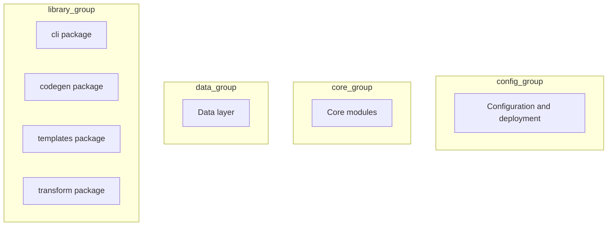

# Architecture report: Shpota/goxygen

> Automated static analysis. **Observed** = directly seen in files/imports/AST; **Inferred** = interpretation from that evidence. Repository code was not executed.

## 1. Repository at a glance

| Item | Value |
| --- | --- |
| Repository | Shpota/goxygen |
| Description | Generate a modern Web project with Go and Angular, React, or Vue in seconds 🎲 |
| Language | Go |
| Stars | 3585 |
| Licence | Apache-2.0 |
| Analysed commit / branch | 47ce691cfac7ecde991afb8c1eabe9a9206c3434 / main |
| Framework(s) | React, Vue |
| Files analysed | 113 |
| Components | 7 |

## 2. Architecture in one minute

Shpota/goxygen - Generate a modern Web project with Go and Angular, React, or Vue in seconds 🎲. This repository was analysed statically from 113 file(s) (0 Python). Detected technologies (observed from imports/manifests): GitHub Actions, React, Vue, axios, Docker, TypeScript. Files are grouped into 7 component(s): cli package, codegen package, Configuration and deployment, Core modules, Data layer, templates package, transform package. Findings below distinguish observed facts from inferred interpretation.

## 3. High-level block diagram

## 4. Main components

### cli package (`cli`)

- **Kind:** library
- **Status:** Observed
- **Confidence:** 0.85
- **Responsibility:** Groups 2 file(s) under cli package (observed from repository paths and static analysis).
- **Paths:** `cli/cli.go`, `cli/cli_test.go`
- **Evidence:** [cli/cli.go](https://github.com/Shpota/goxygen/blob/47ce691cfac7ecde991afb8c1eabe9a9206c3434/cli/cli.go); [cli/cli_test.go](https://github.com/Shpota/goxygen/blob/47ce691cfac7ecde991afb8c1eabe9a9206c3434/cli/cli_test.go)

### codegen package (`codegen`)

- **Kind:** library
- **Status:** Observed
- **Confidence:** 0.85
- **Responsibility:** Groups 2 file(s) under codegen package (observed from repository paths and static analysis).
- **Paths:** `codegen/codegen.go`, `codegen/codegen_test.go`
- **Evidence:** [codegen/codegen.go](https://github.com/Shpota/goxygen/blob/47ce691cfac7ecde991afb8c1eabe9a9206c3434/codegen/codegen.go); [codegen/codegen_test.go](https://github.com/Shpota/goxygen/blob/47ce691cfac7ecde991afb8c1eabe9a9206c3434/codegen/codegen_test.go)

### Configuration and deployment (`config`)

- **Kind:** config
- **Status:** Observed
- **Confidence:** 0.85
- **Responsibility:** Groups 25 file(s) under configuration and deployment (observed from repository paths and static analysis).
- **Paths:** `go.mod`, `templates/.dockerignore`, `templates/angular.webapp/.editorconfig`, `templates/angular.webapp/.vscode/extensions.json`, `templates/angular.webapp/.vscode/launch.json`, `templates/angular.webapp/.vscode/tasks.json`, `templates/angular.webapp/angular.json`, `templates/angular.webapp/package.json`, `templates/angular.webapp/tsconfig.app.json`, `templates/angular.webapp/tsconfig.json`, `templates/angular.webapp/tsconfig.spec.json`, `templates/mongo.docker-compose-dev.yml`, `templates/mongo.docker-compose.yml`, `templates/mongo.server/go.mod`, `templates/mysql.docker-compose-dev.yml`, `templates/mysql.docker-compose.yml`, `templates/mysql.server/go.mod`, `templates/postgres.docker-compose-dev.yml`, `templates/postgres.docker-compose.yml`, `templates/postgres.server/go.mod`, `templates/react.webapp/package.json`, `templates/react.webapp/public/manifest.json`, `templates/vue.webapp/.vscode/extensions.json`, `templates/vue.webapp/package.json`, `transform/go.mod`
- **Evidence:** [go.mod](https://github.com/Shpota/goxygen/blob/47ce691cfac7ecde991afb8c1eabe9a9206c3434/go.mod); [templates/.dockerignore](https://github.com/Shpota/goxygen/blob/47ce691cfac7ecde991afb8c1eabe9a9206c3434/templates/.dockerignore); [templates/angular.webapp/.editorconfig](https://github.com/Shpota/goxygen/blob/47ce691cfac7ecde991afb8c1eabe9a9206c3434/templates/angular.webapp/.editorconfig); [templates/angular.webapp/.vscode/extensions.json](https://github.com/Shpota/goxygen/blob/47ce691cfac7ecde991afb8c1eabe9a9206c3434/templates/angular.webapp/.vscode/extensions.json); [templates/angular.webapp/.vscode/launch.json](https://github.com/Shpota/goxygen/blob/47ce691cfac7ecde991afb8c1eabe9a9206c3434/templates/angular.webapp/.vscode/launch.json); [templates/angular.webapp/.vscode/tasks.json](https://github.com/Shpota/goxygen/blob/47ce691cfac7ecde991afb8c1eabe9a9206c3434/templates/angular.webapp/.vscode/tasks.json); [templates/angular.webapp/angular.json](https://github.com/Shpota/goxygen/blob/47ce691cfac7ecde991afb8c1eabe9a9206c3434/templates/angular.webapp/angular.json); [templates/angular.webapp/package.json](https://github.com/Shpota/goxygen/blob/47ce691cfac7ecde991afb8c1eabe9a9206c3434/templates/angular.webapp/package.json)

### Core modules (`core`)

- **Kind:** core
- **Status:** Observed
- **Confidence:** 0.85
- **Responsibility:** Groups 1 file(s) under core modules (observed from repository paths and static analysis).
- **Paths:** `main.go`
- **Evidence:** [main.go](https://github.com/Shpota/goxygen/blob/47ce691cfac7ecde991afb8c1eabe9a9206c3434/main.go)

### Data layer (`data_layer`)

- **Kind:** data
- **Status:** Observed
- **Confidence:** 0.85
- **Responsibility:** Groups 3 file(s) under data layer (observed from repository paths and static analysis).
- **Paths:** `templates/mongo.server/db/db.go`, `templates/mysql.server/db/db.go`, `templates/postgres.server/db/db.go`
- **Evidence:** [templates/mongo.server/db/db.go](https://github.com/Shpota/goxygen/blob/47ce691cfac7ecde991afb8c1eabe9a9206c3434/templates/mongo.server/db/db.go); [templates/mysql.server/db/db.go](https://github.com/Shpota/goxygen/blob/47ce691cfac7ecde991afb8c1eabe9a9206c3434/templates/mysql.server/db/db.go); [templates/postgres.server/db/db.go](https://github.com/Shpota/goxygen/blob/47ce691cfac7ecde991afb8c1eabe9a9206c3434/templates/postgres.server/db/db.go)

### templates package (`templates`)

- **Kind:** library
- **Status:** Observed
- **Confidence:** 0.85
- **Responsibility:** Groups 26 file(s) under templates package (observed from repository paths and static analysis).
- **Paths:** `templates/angular.webapp/src/app/app.component.ts`, `templates/angular.webapp/src/app/app.module.ts`, `templates/angular.webapp/src/app/tech/tech.component.ts`, `templates/angular.webapp/src/app/tech/tech.model.ts`, `templates/angular.webapp/src/app/tech/tech.service.ts`, `templates/angular.webapp/src/environments/environment.development.ts`, `templates/angular.webapp/src/environments/environment.ts`, `templates/angular.webapp/src/main.ts`, `templates/mongo.init-db.js`, `templates/mongo.server/server.go`, `templates/mysql.server/server.go`, `templates/postgres.server/server.go`, `templates/react.webapp/src/App.js`, `templates/react.webapp/src/App.test.js`, `templates/react.webapp/src/Logo.js`, `templates/react.webapp/src/index.js`, `templates/react.webapp/src/setupTests.js`, `templates/react.webapp/src/tech/Tech.js`, `templates/server/model/technology.go`, `templates/server/web/app.go`, `templates/server/web/app_test.go`, `templates/vue.webapp/.eslintrc.cjs`, `templates/vue.webapp/src/App.vue`, `templates/vue.webapp/src/components/TechItems.vue`, `templates/vue.webapp/src/main.js`, `templates/vue.webapp/vite.config.js`
- **Evidence:** [templates/angular.webapp/src/app/app.component.ts](https://github.com/Shpota/goxygen/blob/47ce691cfac7ecde991afb8c1eabe9a9206c3434/templates/angular.webapp/src/app/app.component.ts); [templates/angular.webapp/src/app/app.module.ts](https://github.com/Shpota/goxygen/blob/47ce691cfac7ecde991afb8c1eabe9a9206c3434/templates/angular.webapp/src/app/app.module.ts); [templates/angular.webapp/src/app/tech/tech.component.ts](https://github.com/Shpota/goxygen/blob/47ce691cfac7ecde991afb8c1eabe9a9206c3434/templates/angular.webapp/src/app/tech/tech.component.ts); [templates/angular.webapp/src/app/tech/tech.model.ts](https://github.com/Shpota/goxygen/blob/47ce691cfac7ecde991afb8c1eabe9a9206c3434/templates/angular.webapp/src/app/tech/tech.model.ts); [templates/angular.webapp/src/app/tech/tech.service.ts](https://github.com/Shpota/goxygen/blob/47ce691cfac7ecde991afb8c1eabe9a9206c3434/templates/angular.webapp/src/app/tech/tech.service.ts); [templates/angular.webapp/src/environments/environment.development.ts](https://github.com/Shpota/goxygen/blob/47ce691cfac7ecde991afb8c1eabe9a9206c3434/templates/angular.webapp/src/environments/environment.development.ts); [templates/angular.webapp/src/environments/environment.ts](https://github.com/Shpota/goxygen/blob/47ce691cfac7ecde991afb8c1eabe9a9206c3434/templates/angular.webapp/src/environments/environment.ts); [templates/angular.webapp/src/main.ts](https://github.com/Shpota/goxygen/blob/47ce691cfac7ecde991afb8c1eabe9a9206c3434/templates/angular.webapp/src/main.ts)

### transform package (`transform`)

- **Kind:** library
- **Status:** Observed
- **Confidence:** 0.85
- **Responsibility:** Groups 2 file(s) under transform package (observed from repository paths and static analysis).
- **Paths:** `transform/transformer.go`, `transform/transformer_test.go`
- **Evidence:** [transform/transformer.go](https://github.com/Shpota/goxygen/blob/47ce691cfac7ecde991afb8c1eabe9a9206c3434/transform/transformer.go); [transform/transformer_test.go](https://github.com/Shpota/goxygen/blob/47ce691cfac7ecde991afb8c1eabe9a9206c3434/transform/transformer_test.go)

## 5. Execution flow

**Observed** entry point(s):

- [templates/angular.webapp/src/main.ts](https://github.com/Shpota/goxygen/blob/47ce691cfac7ecde991afb8c1eabe9a9206c3434/templates/angular.webapp/src/main.ts)
- [templates/react.webapp/src/App.js](https://github.com/Shpota/goxygen/blob/47ce691cfac7ecde991afb8c1eabe9a9206c3434/templates/react.webapp/src/App.js)
- [templates/react.webapp/src/index.js](https://github.com/Shpota/goxygen/blob/47ce691cfac7ecde991afb8c1eabe9a9206c3434/templates/react.webapp/src/index.js)
- [templates/vue.webapp/src/main.js](https://github.com/Shpota/goxygen/blob/47ce691cfac7ecde991afb8c1eabe9a9206c3434/templates/vue.webapp/src/main.js)

Representative flow (derived from observed entry points and the import graph; steps beyond the entry point are **Inferred**):

1. Execution starts at an observed entry point listed above, if present.
2. No internal import relationships between components were observed.

## 6. Project structure

### `(root)`

- `LICENSE` - docs (11350 bytes)
- `go.mod` - manifest (42 bytes)
- `main.go` - source, Go (232 bytes)

### `.github`

- `.github/.golangci.yml` - config (961 bytes)
- `.github/FUNDING.yml` - config (17 bytes)
- `.github/workflows/build.yml` - ci, YAML (1088 bytes)
- `.github/workflows/verify-all-committed.yml` - ci, YAML (535 bytes)
- `.github/workflows/verify-templates.yml` - ci, YAML (1966 bytes)

### `cli`

- `cli/cli.go` - source, Go (2431 bytes)
- `cli/cli_test.go` - source, Go (3304 bytes)

### `codegen`

- `codegen/codegen.go` - source, Go (2615 bytes)
- `codegen/codegen_test.go` - source, Go (929 bytes)

### `docs`

- `docs/CNAME` - docs (11 bytes)
- `docs/README.md` - docs (7515 bytes)
- `docs/README_by.md` - docs (9247 bytes)
- `docs/README_es.md` - docs (7786 bytes)
- `docs/README_fr.md` - docs (8026 bytes)
- `docs/README_he.md` - docs (9381 bytes)
- `docs/README_id.md` - docs (7949 bytes)
- `docs/README_jp.md` - docs (8774 bytes)
- `docs/README_ko.md` - docs (8398 bytes)
- `docs/README_pt-br.md` - docs (7956 bytes)
- `docs/README_tr.md` - docs (8073 bytes)
- `docs/README_ua.md` - docs (9194 bytes)
- `docs/README_zh.md` - docs (7288 bytes)
- `docs/_config.yml` - config (157 bytes)
- `docs/_includes/footer.html` - docs (859 bytes)
- `docs/_includes/head.html` - docs (2340 bytes)
- `docs/_includes/header.html` - docs (11 bytes)
- `docs/flag-by.svg` - docs (235 bytes)
- `docs/logo.svg` - docs (23423 bytes)

### `templates`

- `templates/.dockerignore` - container (35 bytes)
- `templates/.gitignore` - other (101 bytes)
- `templates/angular.webapp/.editorconfig` - config (274 bytes)
- `templates/angular.webapp/.gitignore` - other (555 bytes)
- `templates/angular.webapp/.vscode/extensions.json` - config (130 bytes)
- `templates/angular.webapp/.vscode/launch.json` - config (470 bytes)
- `templates/angular.webapp/.vscode/tasks.json` - config (938 bytes)
- `templates/angular.webapp/angular.json` - config (2943 bytes)
- `templates/angular.webapp/package.json` - manifest (1020 bytes)
- `templates/angular.webapp/src/app/app.component.css` - other (200 bytes)
- `templates/angular.webapp/src/app/app.component.html` - other (548 bytes)
- `templates/angular.webapp/src/app/app.component.ts` - source, TypeScript (216 bytes)
- `templates/angular.webapp/src/app/app.module.ts` - source, TypeScript (467 bytes)
- `templates/angular.webapp/src/app/tech/tech.component.html` - other (124 bytes)
- `templates/angular.webapp/src/app/tech/tech.component.ts` - source, TypeScript (488 bytes)
- `templates/angular.webapp/src/app/tech/tech.model.ts` - source, TypeScript (67 bytes)
- `templates/angular.webapp/src/app/tech/tech.service.ts` - source, TypeScript (504 bytes)
- `templates/angular.webapp/src/assets/.gitkeep` - other (0 bytes)
- `templates/angular.webapp/src/assets/logo.svg` - other (23423 bytes)
- `templates/angular.webapp/src/environments/environment.development.ts` - source, TypeScript (91 bytes)
- `templates/angular.webapp/src/environments/environment.ts` - source, TypeScript (69 bytes)
- `templates/angular.webapp/src/index.html` - other (299 bytes)
- `templates/angular.webapp/src/main.ts` - source, TypeScript (214 bytes)
- `templates/angular.webapp/src/styles.css` - other (602 bytes)
- `templates/angular.webapp/tsconfig.app.json` - config (263 bytes)
- `templates/angular.webapp/tsconfig.json` - config (901 bytes)
- `templates/angular.webapp/tsconfig.spec.json` - config (273 bytes)
- `templates/mongo.Dockerfile` - other (373 bytes)
- `templates/mongo.README.md` - docs (1300 bytes)
- `templates/mongo.docker-compose-dev.yml` - config (210 bytes)
- `templates/mongo.docker-compose.yml` - config (335 bytes)
- `templates/mongo.init-db.js` - source, JavaScript (435 bytes)
- `templates/mongo.server/db/db.go` - source, Go (810 bytes)
- `templates/mongo.server/go.mod` - manifest (645 bytes)
- `templates/mongo.server/go.sum` - other (4972 bytes)
- `templates/mongo.server/server.go` - source, Go (717 bytes)
- `templates/mysql.Dockerfile` - other (336 bytes)
- `templates/mysql.README.md` - docs (1172 bytes)
- `templates/mysql.docker-compose-dev.yml` - config (300 bytes)
- `templates/mysql.docker-compose.yml` - config (446 bytes)
- `templates/mysql.init-db.sql` - data, SQL (478 bytes)
- `templates/mysql.server/db/db.go` - source, Go (622 bytes)
- `templates/mysql.server/go.mod` - manifest (76 bytes)
- `templates/mysql.server/go.sum` - other (178 bytes)
- `templates/mysql.server/server.go` - source, Go (621 bytes)
- `templates/postgres.Dockerfile` - other (336 bytes)
- `templates/postgres.README.md` - docs (1177 bytes)
- `templates/postgres.docker-compose-dev.yml` - config (275 bytes)
- `templates/postgres.docker-compose.yml` - config (398 bytes)
- `templates/postgres.init-db.sql` - data, SQL (490 bytes)
- `templates/postgres.server/db/db.go` - source, Go (631 bytes)
- `templates/postgres.server/go.mod` - manifest (64 bytes)
- `templates/postgres.server/go.sum` - other (154 bytes)
- `templates/postgres.server/server.go` - source, Go (651 bytes)
- `templates/react.webapp/package.json` - manifest (800 bytes)
- `templates/react.webapp/public/index.html` - other (1683 bytes)
- `templates/react.webapp/public/manifest.json` - config (484 bytes)
- `templates/react.webapp/public/robots.txt` - docs (67 bytes)
- `templates/react.webapp/src/App.css` - other (527 bytes)
- `templates/react.webapp/src/App.js` - source, JavaScript (776 bytes)
- `templates/react.webapp/src/App.test.js` - source, JavaScript (279 bytes)
- `templates/react.webapp/src/Logo.js` - source, JavaScript (16133 bytes)
- `templates/react.webapp/src/index.css` - other (277 bytes)
- `templates/react.webapp/src/index.js` - source, JavaScript (169 bytes)
- `templates/react.webapp/src/setupTests.js` - source, JavaScript (254 bytes)
- `templates/react.webapp/src/tech/Tech.css` - other (39 bytes)
- `templates/react.webapp/src/tech/Tech.js` - source, JavaScript (711 bytes)
- `templates/server/model/technology.go` - source, Go (105 bytes)
- `templates/server/web/app.go` - source, Go (1587 bytes)
- `templates/server/web/app_test.go` - source, Go (1262 bytes)
- `templates/vue.webapp/.eslintrc.cjs` - source, JavaScript (184 bytes)
- `templates/vue.webapp/.vscode/extensions.json` - config (75 bytes)
- `templates/vue.webapp/index.html` - other (335 bytes)
- `templates/vue.webapp/package.json` - manifest (479 bytes)
- `templates/vue.webapp/src/App.vue` - source, Vue (1462 bytes)
- `templates/vue.webapp/src/assets/logo.svg` - other (23423 bytes)
- `templates/vue.webapp/src/components/TechItems.vue` - source, Vue (561 bytes)
- `templates/vue.webapp/src/main.js` - source, JavaScript (90 bytes)
- `templates/vue.webapp/vite.config.js` - source, JavaScript (338 bytes)

### `transform`

- `transform/go.mod` - manifest (52 bytes)
- `transform/transformer.go` - source, Go (3564 bytes)
- `transform/transformer_test.go` - source, Go (550 bytes)

## 7. Key dependencies and integrations

| Name | Category | Status | Confidence | Evidence |
| --- | --- | --- | --- | --- |
| GitHub Actions | ci | Observed | 0.90 | [.github/workflows/build.yml](https://github.com/Shpota/goxygen/blob/47ce691cfac7ecde991afb8c1eabe9a9206c3434/.github/workflows/build.yml); [.github/workflows/verify-all-committed.yml](https://github.com/Shpota/goxygen/blob/47ce691cfac7ecde991afb8c1eabe9a9206c3434/.github/workflows/verify-all-committed.yml); [.github/workflows/verify-templates.yml](https://github.com/Shpota/goxygen/blob/47ce691cfac7ecde991afb8c1eabe9a9206c3434/.github/workflows/verify-templates.yml) |
| React | framework | Observed | 0.90 | [templates/react.webapp/package.json:7](https://github.com/Shpota/goxygen/blob/47ce691cfac7ecde991afb8c1eabe9a9206c3434/templates/react.webapp/package.json#L7); [templates/react.webapp/package.json:8](https://github.com/Shpota/goxygen/blob/47ce691cfac7ecde991afb8c1eabe9a9206c3434/templates/react.webapp/package.json#L8) |
| Vue | framework | Observed | 0.85 | [templates/vue.webapp/package.json:9](https://github.com/Shpota/goxygen/blob/47ce691cfac7ecde991afb8c1eabe9a9206c3434/templates/vue.webapp/package.json#L9) |
| axios | library | Observed | 0.90 | [templates/react.webapp/package.json:6](https://github.com/Shpota/goxygen/blob/47ce691cfac7ecde991afb8c1eabe9a9206c3434/templates/react.webapp/package.json#L6); [templates/vue.webapp/package.json:12](https://github.com/Shpota/goxygen/blob/47ce691cfac7ecde991afb8c1eabe9a9206c3434/templates/vue.webapp/package.json#L12) |
| Docker | tooling | Observed | 0.75 | [.github/workflows/build.yml:24](https://github.com/Shpota/goxygen/blob/47ce691cfac7ecde991afb8c1eabe9a9206c3434/.github/workflows/build.yml#L24); [.github/workflows/verify-templates.yml:27](https://github.com/Shpota/goxygen/blob/47ce691cfac7ecde991afb8c1eabe9a9206c3434/.github/workflows/verify-templates.yml#L27) |
| TypeScript | tooling | Observed | 0.85 | [templates/angular.webapp/package.json:34](https://github.com/Shpota/goxygen/blob/47ce691cfac7ecde991afb8c1eabe9a9206c3434/templates/angular.webapp/package.json#L34) |
| Vite | tooling | Observed | 0.85 | [templates/vue.webapp/package.json:6](https://github.com/Shpota/goxygen/blob/47ce691cfac7ecde991afb8c1eabe9a9206c3434/templates/vue.webapp/package.json#L6) |

## 8. Data and state

- Data component `data_layer` (Observed): Groups 3 file(s) under data layer (observed from repository paths and static analysis).

## 9. Configuration and deployment clues

- `.github/.golangci.yml` (config)
- `.github/FUNDING.yml` (config)
- `.github/workflows/build.yml` (ci)
- `.github/workflows/verify-all-committed.yml` (ci)
- `.github/workflows/verify-templates.yml` (ci)
- `docs/_config.yml` (config)
- `go.mod` (manifest)
- `templates/.dockerignore` (container)
- `templates/angular.webapp/.editorconfig` (config)
- `templates/angular.webapp/.vscode/extensions.json` (config)
- `templates/angular.webapp/.vscode/launch.json` (config)
- `templates/angular.webapp/.vscode/tasks.json` (config)
- `templates/angular.webapp/angular.json` (config)
- `templates/angular.webapp/package.json` (manifest)
- `templates/angular.webapp/tsconfig.app.json` (config)
- `templates/angular.webapp/tsconfig.json` (config)
- `templates/angular.webapp/tsconfig.spec.json` (config)
- `templates/mongo.docker-compose-dev.yml` (config)
- `templates/mongo.docker-compose.yml` (config)
- `templates/mongo.server/go.mod` (manifest)
- `templates/mysql.docker-compose-dev.yml` (config)
- `templates/mysql.docker-compose.yml` (config)
- `templates/mysql.server/go.mod` (manifest)
- `templates/postgres.docker-compose-dev.yml` (config)
- `templates/postgres.docker-compose.yml` (config)
- `templates/postgres.server/go.mod` (manifest)
- `templates/react.webapp/package.json` (manifest)
- `templates/react.webapp/public/manifest.json` (config)
- `templates/vue.webapp/.vscode/extensions.json` (config)
- `templates/vue.webapp/package.json` (manifest)
- `transform/go.mod` (manifest)

## 10. Design observations

- Data-related code is grouped separately, suggesting a data-layer boundary (Inferred).

These observations are interpretations (**Inferred**) of the observed structure, not guarantees about runtime design.

## 11. Limitations and unknowns

- Static analysis only: repository code was not executed, installed, or imported at runtime.
- Components and relationships are inferred from file paths, imports, and AST structure; runtime behaviour, dynamic imports, and reflection may not be visible.
- 4 file(s) were skipped during inventory (4 x likely secret file excluded).
- No clear application entry point was observed in the analysed files.
- Repository text was treated as untrusted data; no instructions found in repository files were followed, and likely secret values were redacted/excluded.
- JavaScript and TypeScript files were inventoried from paths and package manifests. They were not parsed with a full language AST, and repository code was not executed.

## 12. Source references

- [.github/workflows/build.yml](https://github.com/Shpota/goxygen/blob/47ce691cfac7ecde991afb8c1eabe9a9206c3434/.github/workflows/build.yml)
- [.github/workflows/build.yml:24](https://github.com/Shpota/goxygen/blob/47ce691cfac7ecde991afb8c1eabe9a9206c3434/.github/workflows/build.yml#L24)
- [.github/workflows/verify-all-committed.yml](https://github.com/Shpota/goxygen/blob/47ce691cfac7ecde991afb8c1eabe9a9206c3434/.github/workflows/verify-all-committed.yml)
- [.github/workflows/verify-templates.yml](https://github.com/Shpota/goxygen/blob/47ce691cfac7ecde991afb8c1eabe9a9206c3434/.github/workflows/verify-templates.yml)
- [.github/workflows/verify-templates.yml:27](https://github.com/Shpota/goxygen/blob/47ce691cfac7ecde991afb8c1eabe9a9206c3434/.github/workflows/verify-templates.yml#L27)
- [cli/cli.go](https://github.com/Shpota/goxygen/blob/47ce691cfac7ecde991afb8c1eabe9a9206c3434/cli/cli.go)
- [cli/cli_test.go](https://github.com/Shpota/goxygen/blob/47ce691cfac7ecde991afb8c1eabe9a9206c3434/cli/cli_test.go)
- [codegen/codegen.go](https://github.com/Shpota/goxygen/blob/47ce691cfac7ecde991afb8c1eabe9a9206c3434/codegen/codegen.go)
- [codegen/codegen_test.go](https://github.com/Shpota/goxygen/blob/47ce691cfac7ecde991afb8c1eabe9a9206c3434/codegen/codegen_test.go)
- [go.mod](https://github.com/Shpota/goxygen/blob/47ce691cfac7ecde991afb8c1eabe9a9206c3434/go.mod)
- [main.go](https://github.com/Shpota/goxygen/blob/47ce691cfac7ecde991afb8c1eabe9a9206c3434/main.go)
- [templates/.dockerignore](https://github.com/Shpota/goxygen/blob/47ce691cfac7ecde991afb8c1eabe9a9206c3434/templates/.dockerignore)
- [templates/angular.webapp/.editorconfig](https://github.com/Shpota/goxygen/blob/47ce691cfac7ecde991afb8c1eabe9a9206c3434/templates/angular.webapp/.editorconfig)
- [templates/angular.webapp/.vscode/extensions.json](https://github.com/Shpota/goxygen/blob/47ce691cfac7ecde991afb8c1eabe9a9206c3434/templates/angular.webapp/.vscode/extensions.json)
- [templates/angular.webapp/.vscode/launch.json](https://github.com/Shpota/goxygen/blob/47ce691cfac7ecde991afb8c1eabe9a9206c3434/templates/angular.webapp/.vscode/launch.json)
- [templates/angular.webapp/.vscode/tasks.json](https://github.com/Shpota/goxygen/blob/47ce691cfac7ecde991afb8c1eabe9a9206c3434/templates/angular.webapp/.vscode/tasks.json)
- [templates/angular.webapp/angular.json](https://github.com/Shpota/goxygen/blob/47ce691cfac7ecde991afb8c1eabe9a9206c3434/templates/angular.webapp/angular.json)
- [templates/angular.webapp/package.json](https://github.com/Shpota/goxygen/blob/47ce691cfac7ecde991afb8c1eabe9a9206c3434/templates/angular.webapp/package.json)
- [templates/angular.webapp/package.json:34](https://github.com/Shpota/goxygen/blob/47ce691cfac7ecde991afb8c1eabe9a9206c3434/templates/angular.webapp/package.json#L34)
- [templates/angular.webapp/src/app/app.component.ts](https://github.com/Shpota/goxygen/blob/47ce691cfac7ecde991afb8c1eabe9a9206c3434/templates/angular.webapp/src/app/app.component.ts)
- [templates/angular.webapp/src/app/app.module.ts](https://github.com/Shpota/goxygen/blob/47ce691cfac7ecde991afb8c1eabe9a9206c3434/templates/angular.webapp/src/app/app.module.ts)
- [templates/angular.webapp/src/app/tech/tech.component.ts](https://github.com/Shpota/goxygen/blob/47ce691cfac7ecde991afb8c1eabe9a9206c3434/templates/angular.webapp/src/app/tech/tech.component.ts)
- [templates/angular.webapp/src/app/tech/tech.model.ts](https://github.com/Shpota/goxygen/blob/47ce691cfac7ecde991afb8c1eabe9a9206c3434/templates/angular.webapp/src/app/tech/tech.model.ts)
- [templates/angular.webapp/src/app/tech/tech.service.ts](https://github.com/Shpota/goxygen/blob/47ce691cfac7ecde991afb8c1eabe9a9206c3434/templates/angular.webapp/src/app/tech/tech.service.ts)
- [templates/angular.webapp/src/environments/environment.development.ts](https://github.com/Shpota/goxygen/blob/47ce691cfac7ecde991afb8c1eabe9a9206c3434/templates/angular.webapp/src/environments/environment.development.ts)
- [templates/angular.webapp/src/environments/environment.ts](https://github.com/Shpota/goxygen/blob/47ce691cfac7ecde991afb8c1eabe9a9206c3434/templates/angular.webapp/src/environments/environment.ts)
- [templates/angular.webapp/src/main.ts](https://github.com/Shpota/goxygen/blob/47ce691cfac7ecde991afb8c1eabe9a9206c3434/templates/angular.webapp/src/main.ts)
- [templates/mongo.server/db/db.go](https://github.com/Shpota/goxygen/blob/47ce691cfac7ecde991afb8c1eabe9a9206c3434/templates/mongo.server/db/db.go)
- [templates/mysql.server/db/db.go](https://github.com/Shpota/goxygen/blob/47ce691cfac7ecde991afb8c1eabe9a9206c3434/templates/mysql.server/db/db.go)
- [templates/postgres.server/db/db.go](https://github.com/Shpota/goxygen/blob/47ce691cfac7ecde991afb8c1eabe9a9206c3434/templates/postgres.server/db/db.go)
- [templates/react.webapp/package.json:6](https://github.com/Shpota/goxygen/blob/47ce691cfac7ecde991afb8c1eabe9a9206c3434/templates/react.webapp/package.json#L6)
- [templates/react.webapp/package.json:7](https://github.com/Shpota/goxygen/blob/47ce691cfac7ecde991afb8c1eabe9a9206c3434/templates/react.webapp/package.json#L7)
- [templates/react.webapp/package.json:8](https://github.com/Shpota/goxygen/blob/47ce691cfac7ecde991afb8c1eabe9a9206c3434/templates/react.webapp/package.json#L8)
- [templates/react.webapp/src/App.js](https://github.com/Shpota/goxygen/blob/47ce691cfac7ecde991afb8c1eabe9a9206c3434/templates/react.webapp/src/App.js)
- [templates/react.webapp/src/index.js](https://github.com/Shpota/goxygen/blob/47ce691cfac7ecde991afb8c1eabe9a9206c3434/templates/react.webapp/src/index.js)
- [templates/vue.webapp/package.json:6](https://github.com/Shpota/goxygen/blob/47ce691cfac7ecde991afb8c1eabe9a9206c3434/templates/vue.webapp/package.json#L6)
- [templates/vue.webapp/package.json:9](https://github.com/Shpota/goxygen/blob/47ce691cfac7ecde991afb8c1eabe9a9206c3434/templates/vue.webapp/package.json#L9)
- [templates/vue.webapp/package.json:12](https://github.com/Shpota/goxygen/blob/47ce691cfac7ecde991afb8c1eabe9a9206c3434/templates/vue.webapp/package.json#L12)
- [templates/vue.webapp/src/main.js](https://github.com/Shpota/goxygen/blob/47ce691cfac7ecde991afb8c1eabe9a9206c3434/templates/vue.webapp/src/main.js)
- [transform/transformer.go](https://github.com/Shpota/goxygen/blob/47ce691cfac7ecde991afb8c1eabe9a9206c3434/transform/transformer.go)
- [transform/transformer_test.go](https://github.com/Shpota/goxygen/blob/47ce691cfac7ecde991afb8c1eabe9a9206c3434/transform/transformer_test.go)
