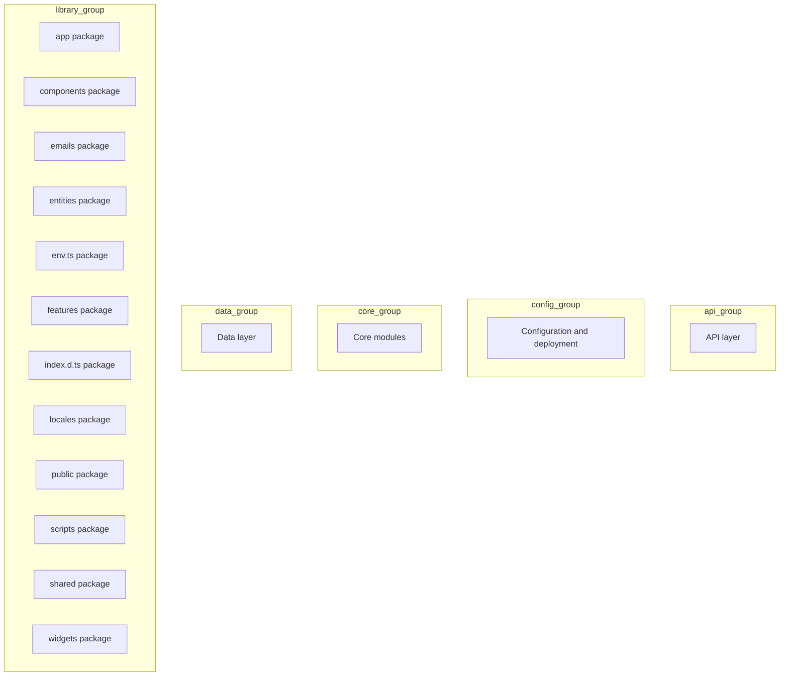

# Architecture report: Snouzy/workout-cool

> Automated static analysis. **Observed** = directly seen in files/imports/AST; **Inferred** = interpretation from that evidence. Repository code was not executed.

## 1. Repository at a glance

| Item | Value |
| --- | --- |
| Repository | Snouzy/workout-cool |
| Description | 🏋 Modern open-source fitness coaching platform. Create workout plans, track progress, and access a comprehensive exercise database. |
| Language | TypeScript |
| Stars | 8688 |
| Licence | MIT |
| Analysed commit / branch | d52f9f62d2a5fcbb78d67a95dc8763f9a34dbf9e / main |
| Framework(s) | Next.js, React |
| Files analysed | 737 |
| Components | 16 |

## 2. Architecture in one minute

Snouzy/workout-cool - 🏋 Modern open-source fitness coaching platform. Create workout plans, track progress, and access a comprehensive exercise database.. This repository was analysed statically from 737 file(s) (0 Python). Detected technologies (observed from imports/manifests): GitHub Actions, Database (unspecified), PostgreSQL, Next.js, React, Prisma. Files are grouped into 16 component(s): API layer, app package, components package, Configuration and deployment, Core modules, Data layer, emails package, entities package. Findings below distinguish observed facts from inferred interpretation.

## 3. High-level block diagram

## 4. Main components

### API layer (`api_layer`)

- **Kind:** api
- **Status:** Observed
- **Confidence:** 0.85
- **Responsibility:** Groups 42 file(s) under api layer (observed from repository paths and static analysis).
- **Paths:** `app/api/analytics/premium/route.ts`, `app/api/auth/[...all]/route.ts`, `app/api/auth/signup/route.ts`, `app/api/billing/status/route.ts`, `app/api/exercises/[exerciseId]/statistics/one-rep-max/route.ts`, `app/api/exercises/[exerciseId]/statistics/route.ts`, `app/api/exercises/[exerciseId]/statistics/volume/route.ts`, `app/api/exercises/[exerciseId]/statistics/weight-progression/route.ts`, `app/api/exercises/all/route.ts`, `app/api/exercises/route.ts`, `app/api/exercises/shuffle/route.ts`, `app/api/premium/billing-portal/route.ts`, `app/api/premium/checkout/route.ts`, `app/api/premium/plans/route.ts`, `app/api/premium/status/route.ts`, `app/api/programs/[slug]/enroll/route.ts`, `app/api/programs/[slug]/progress/route.ts`, `app/api/programs/[slug]/route.ts`, `app/api/programs/[slug]/sessions/[sessionSlug]/route.ts`, `app/api/programs/route.ts`, `app/api/programs/session-progress/[progressId]/complete/route.ts`, `app/api/programs/session-progress/start/route.ts`, `app/api/revenuecat/link-user/route.ts`, `app/api/revenuecat/sync-status/route.ts`, `app/api/revenuecat/webhook/route.ts`, `app/api/user/password/route.ts`, `app/api/user/preferences/route.ts`, `app/api/user/profile/route.ts`, `app/api/webhooks/revenuecat/route.ts`, `app/api/webhooks/stripe/route.ts`, `app/api/workout-sessions/[sessionId]/feedback/route.ts`, `app/api/workout-sessions/[sessionId]/rating/route.ts`, `app/api/workout-sessions/[sessionId]/route.ts`, `app/api/workout-sessions/[sessionId]/summary/route.ts`, `app/api/workout-sessions/sync/route.ts`, `app/api/workout-sessions/user/[userId]/route.ts`, `src/shared/api/createHandler.ts`, `src/shared/api/handlers.ts`, `src/shared/api/mobile-auth.ts`, `src/shared/api/mobile-cookie-utils.ts`, `src/shared/api/mobile-safe-actions.ts`, `src/shared/api/safe-actions.ts`
- **Evidence:** [app/api/analytics/premium/route.ts](https://github.com/Snouzy/workout-cool/blob/d52f9f62d2a5fcbb78d67a95dc8763f9a34dbf9e/app/api/analytics/premium/route.ts); [app/api/auth/[...all]/route.ts](https://github.com/Snouzy/workout-cool/blob/d52f9f62d2a5fcbb78d67a95dc8763f9a34dbf9e/app/api/auth/%5B...all%5D/route.ts); [app/api/auth/signup/route.ts](https://github.com/Snouzy/workout-cool/blob/d52f9f62d2a5fcbb78d67a95dc8763f9a34dbf9e/app/api/auth/signup/route.ts); [app/api/billing/status/route.ts](https://github.com/Snouzy/workout-cool/blob/d52f9f62d2a5fcbb78d67a95dc8763f9a34dbf9e/app/api/billing/status/route.ts); [app/api/exercises/[exerciseId]/statistics/one-rep-max/route.ts](https://github.com/Snouzy/workout-cool/blob/d52f9f62d2a5fcbb78d67a95dc8763f9a34dbf9e/app/api/exercises/%5BexerciseId%5D/statistics/one-rep-max/route.ts); [app/api/exercises/[exerciseId]/statistics/route.ts](https://github.com/Snouzy/workout-cool/blob/d52f9f62d2a5fcbb78d67a95dc8763f9a34dbf9e/app/api/exercises/%5BexerciseId%5D/statistics/route.ts); [app/api/exercises/[exerciseId]/statistics/volume/route.ts](https://github.com/Snouzy/workout-cool/blob/d52f9f62d2a5fcbb78d67a95dc8763f9a34dbf9e/app/api/exercises/%5BexerciseId%5D/statistics/volume/route.ts); [app/api/exercises/[exerciseId]/statistics/weight-progression/route.ts](https://github.com/Snouzy/workout-cool/blob/d52f9f62d2a5fcbb78d67a95dc8763f9a34dbf9e/app/api/exercises/%5BexerciseId%5D/statistics/weight-progression/route.ts)

### app package (`app`)

- **Kind:** library
- **Status:** Observed
- **Confidence:** 0.85
- **Responsibility:** Groups 130 file(s) under app package (observed from repository paths and static analysis).
- **Paths:** `app/[locale]/(admin)/admin/[...catchAll]/not-found.tsx`, `app/[locale]/(admin)/admin/[...catchAll]/page.tsx`, `app/[locale]/(admin)/admin/dashboard/page.tsx`, `app/[locale]/(admin)/admin/layout.tsx`, `app/[locale]/(admin)/admin/not-found.tsx`, `app/[locale]/(admin)/admin/programs/[id]/edit/page.tsx`, `app/[locale]/(admin)/admin/programs/page.tsx`, `app/[locale]/(admin)/admin/users/page.tsx`, `app/[locale]/(app)/(legal-and-payment)/layout.tsx`, `app/[locale]/(app)/(legal-and-payment)/legal/privacy/page.tsx`, `app/[locale]/(app)/(legal-and-payment)/legal/sales-terms/page.tsx`, `app/[locale]/(app)/(legal-and-payment)/legal/terms/page.tsx`, `app/[locale]/(app)/[slug]/layout.tsx`, `app/[locale]/(app)/about/page.tsx`, `app/[locale]/(app)/auth/(auth-layout)/forgot-password/page.tsx`, `app/[locale]/(app)/auth/(auth-layout)/layout.tsx`, `app/[locale]/(app)/auth/(auth-layout)/reset-password/page.tsx`, `app/[locale]/(app)/auth/(auth-layout)/signin/page.tsx`, `app/[locale]/(app)/auth/(auth-layout)/signup/page.tsx`, `app/[locale]/(app)/auth/error.tsx`, `app/[locale]/(app)/auth/error/page.tsx`, `app/[locale]/(app)/auth/layout.tsx`, `app/[locale]/(app)/auth/signout/page.tsx`, `app/[locale]/(app)/auth/verify-email/layout.tsx`, `app/[locale]/(app)/auth/verify-email/page.tsx`, `app/[locale]/(app)/auth/verify-request/page.tsx`, `app/[locale]/(app)/download/page.tsx`, `app/[locale]/(app)/layout.tsx`, `app/[locale]/(app)/leaderboard/page.tsx`, `app/[locale]/(app)/onboarding/layout.tsx`, `app/[locale]/(app)/onboarding/page.tsx`, `app/[locale]/(app)/page.tsx`, `app/[locale]/(app)/premium/page.tsx`, `app/[locale]/(app)/profile/page.tsx`, `app/[locale]/(app)/programs/[slug]/page.tsx`, `app/[locale]/(app)/programs/[slug]/session/[sessionSlug]/ProgramSessionClient.tsx`, `app/[locale]/(app)/programs/[slug]/session/[sessionSlug]/page.tsx`, `app/[locale]/(app)/programs/page.tsx`, `app/[locale]/(app)/sponsor/onboarding/page.tsx`, `app/[locale]/(app)/statistics/page.tsx`, `app/[locale]/(app)/tools/bmi-calculator/bmi-calculator.utils.ts`, `app/[locale]/(app)/tools/bmi-calculator/page.tsx`, `app/[locale]/(app)/tools/bmi-calculator/shared/BmiCalculatorClient.tsx`, `app/[locale]/(app)/tools/bmi-calculator/shared/components/BmiEducationalContent.tsx`, `app/[locale]/(app)/tools/bmi-calculator/shared/components/BmiHeightInput.tsx`, `app/[locale]/(app)/tools/bmi-calculator/shared/components/BmiResultsDisplay.tsx`, `app/[locale]/(app)/tools/bmi-calculator/shared/components/BmiUnitSelector.tsx`, `app/[locale]/(app)/tools/bmi-calculator/shared/components/BmiWeightInput.tsx`, `app/[locale]/(app)/tools/bmi-calculator/shared/components/MathEquation.tsx`, `app/[locale]/(app)/tools/calorie-calculator/CalorieCalculatorHub.tsx`, `app/[locale]/(app)/tools/calorie-calculator/calorie-calculator-comparison/CalorieCalculatorComparison.tsx`, `app/[locale]/(app)/tools/calorie-calculator/calorie-calculator-comparison/page.tsx`, `app/[locale]/(app)/tools/calorie-calculator/calorie-calculator.utils.ts`, `app/[locale]/(app)/tools/calorie-calculator/cunningham-calculator/page.tsx`, `app/[locale]/(app)/tools/calorie-calculator/harris-benedict-calculator/page.tsx`, `app/[locale]/(app)/tools/calorie-calculator/katch-mcardle-calculator/page.tsx`, `app/[locale]/(app)/tools/calorie-calculator/mifflin-st-jeor-calculator/page.tsx`, `app/[locale]/(app)/tools/calorie-calculator/oxford-calculator/page.tsx`, `app/[locale]/(app)/tools/calorie-calculator/page.tsx`, `app/[locale]/(app)/tools/calorie-calculator/shared/CalorieCalculatorClient.tsx`, `app/[locale]/(app)/tools/calorie-calculator/shared/calculator-configs.ts`, `app/[locale]/(app)/tools/calorie-calculator/shared/calorie-formulas.utils.ts`, `app/[locale]/(app)/tools/calorie-calculator/shared/components/ActivityLevelSelector.tsx`, `app/[locale]/(app)/tools/calorie-calculator/shared/components/AgeInput.tsx`, `app/[locale]/(app)/tools/calorie-calculator/shared/components/BodyFatInput.tsx`, `app/[locale]/(app)/tools/calorie-calculator/shared/components/FAQSection.tsx`, `app/[locale]/(app)/tools/calorie-calculator/shared/components/GenderSelector.tsx`, `app/[locale]/(app)/tools/calorie-calculator/shared/components/GoalSelector.tsx`, `app/[locale]/(app)/tools/calorie-calculator/shared/components/HeightInput.tsx`, `app/[locale]/(app)/tools/calorie-calculator/shared/components/InfoButton.tsx`, `app/[locale]/(app)/tools/calorie-calculator/shared/components/InfoModal.tsx`, `app/[locale]/(app)/tools/calorie-calculator/shared/components/ResultsDisplay.tsx`, `app/[locale]/(app)/tools/calorie-calculator/shared/components/UnitSelector.tsx`, `app/[locale]/(app)/tools/calorie-calculator/shared/components/WeightInput.tsx`, `app/[locale]/(app)/tools/calorie-calculator/shared/components/index.ts`, `app/[locale]/(app)/tools/calorie-calculator/shared/types/index.ts`, `app/[locale]/(app)/tools/heart-rate-zones/lib/utils.ts`, `app/[locale]/(app)/tools/heart-rate-zones/page.tsx`, `app/[locale]/(app)/tools/heart-rate-zones/seo/config.ts`, `app/[locale]/(app)/tools/heart-rate-zones/seo/page-content.ts`, `app/[locale]/(app)/tools/heart-rate-zones/ui/HeartRateZonesCalculatorClient.tsx`, `app/[locale]/(app)/tools/heart-rate-zones/ui/components/EducationalContent.tsx`, `app/[locale]/(app)/tools/heart-rate-zones/ui/components/EducationalContentServer.tsx`, `app/[locale]/(app)/tools/heart-rate-zones/ui/components/FAQAccordion.tsx`, `app/[locale]/(app)/tools/heart-rate-zones/ui/components/SEOOptimizedContentServer.tsx`, `app/[locale]/(app)/tools/heart-rate-zones/ui/components/ScrollToTopButton.tsx`, `app/[locale]/(app)/tools/page.tsx`, `app/[locale]/(app)/tools/peptide-calculator/lib/calculate.test.ts`, `app/[locale]/(app)/tools/peptide-calculator/lib/calculate.ts`, `app/[locale]/(app)/tools/peptide-calculator/lib/classes.ts`, `app/[locale]/(app)/tools/peptide-calculator/lib/formatNumber.test.ts`, `app/[locale]/(app)/tools/peptide-calculator/lib/formatNumber.ts`, `app/[locale]/(app)/tools/peptide-calculator/lib/labels.ts`, `app/[locale]/(app)/tools/peptide-calculator/lib/motion.ts`, `app/[locale]/(app)/tools/peptide-calculator/lib/presets.test.ts`, `app/[locale]/(app)/tools/peptide-calculator/lib/presets.ts`, `app/[locale]/(app)/tools/peptide-calculator/lib/readout.ts`, `app/[locale]/(app)/tools/peptide-calculator/lib/types.ts`, `app/[locale]/(app)/tools/peptide-calculator/page.tsx`, `app/[locale]/(app)/tools/peptide-calculator/seo/config.ts`, `app/[locale]/(app)/tools/peptide-calculator/seo/page-content.ts`, `app/[locale]/(app)/tools/peptide-calculator/ui/PeptideCalculatorClient.tsx`, `app/[locale]/(app)/tools/peptide-calculator/ui/components/AnimatedNumber.tsx`, `app/[locale]/(app)/tools/peptide-calculator/ui/components/DoseField.tsx`, `app/[locale]/(app)/tools/peptide-calculator/ui/components/FAQAccordion.tsx`, `app/[locale]/(app)/tools/peptide-calculator/ui/components/NumberField.tsx`, `app/[locale]/(app)/tools/peptide-calculator/ui/components/Recap.tsx`, `app/[locale]/(app)/tools/peptide-calculator/ui/components/ResultAlerts.tsx`, `app/[locale]/(app)/tools/peptide-calculator/ui/components/ResultHeadline.tsx`, `app/[locale]/(app)/tools/peptide-calculator/ui/components/ResultPanel.tsx`, `app/[locale]/(app)/tools/peptide-calculator/ui/components/ResultSheet.tsx`, `app/[locale]/(app)/tools/peptide-calculator/ui/components/SEOContentServer.tsx`, `app/[locale]/(app)/tools/peptide-calculator/ui/components/SegmentedControl.tsx`, `app/[locale]/(app)/tools/peptide-calculator/ui/components/SettingRow.tsx`, `app/[locale]/(app)/tools/peptide-calculator/ui/components/StatTiles.tsx`, `app/[locale]/(app)/tools/peptide-calculator/ui/components/StickyResultBar.tsx`, `app/[locale]/(app)/tools/peptide-calculator/ui/components/SyringeChoice.tsx`, `app/[locale]/(app)/tools/peptide-calculator/ui/components/SyringeGauge.tsx`, `app/[locale]/(app)/tools/peptide-calculator/ui/components/ValueChips.tsx`, `app/[locale]/(app)/tools/peptide-calculator/ui/components/Vial.tsx`, `app/[locale]/(app)/tools/peptide-calculator/ui/components/VialGlass.tsx`, `app/[locale]/(app)/tools/peptide-calculator/ui/usePeptideUrlState.ts`, `app/[locale]/@modal/(.)auth/login/page.tsx`, `app/[locale]/@modal/default.tsx`, `app/[locale]/layout.tsx`, `app/[locale]/manifest.json/route.ts`, `app/[locale]/not-found.tsx`, `app/[locale]/providers.tsx`, `app/ads.txt/route.ts`, `app/sitemap.ts`
- **Evidence:** [app/[locale]/(admin)/admin/[...catchAll]/not-found.tsx](https://github.com/Snouzy/workout-cool/blob/d52f9f62d2a5fcbb78d67a95dc8763f9a34dbf9e/app/%5Blocale%5D/%28admin%29/admin/%5B...catchAll%5D/not-found.tsx); [app/[locale]/(admin)/admin/[...catchAll]/page.tsx](https://github.com/Snouzy/workout-cool/blob/d52f9f62d2a5fcbb78d67a95dc8763f9a34dbf9e/app/%5Blocale%5D/%28admin%29/admin/%5B...catchAll%5D/page.tsx); [app/[locale]/(admin)/admin/dashboard/page.tsx](https://github.com/Snouzy/workout-cool/blob/d52f9f62d2a5fcbb78d67a95dc8763f9a34dbf9e/app/%5Blocale%5D/%28admin%29/admin/dashboard/page.tsx); [app/[locale]/(admin)/admin/layout.tsx](https://github.com/Snouzy/workout-cool/blob/d52f9f62d2a5fcbb78d67a95dc8763f9a34dbf9e/app/%5Blocale%5D/%28admin%29/admin/layout.tsx); [app/[locale]/(admin)/admin/not-found.tsx](https://github.com/Snouzy/workout-cool/blob/d52f9f62d2a5fcbb78d67a95dc8763f9a34dbf9e/app/%5Blocale%5D/%28admin%29/admin/not-found.tsx); [app/[locale]/(admin)/admin/programs/[id]/edit/page.tsx](https://github.com/Snouzy/workout-cool/blob/d52f9f62d2a5fcbb78d67a95dc8763f9a34dbf9e/app/%5Blocale%5D/%28admin%29/admin/programs/%5Bid%5D/edit/page.tsx); [app/[locale]/(admin)/admin/programs/page.tsx](https://github.com/Snouzy/workout-cool/blob/d52f9f62d2a5fcbb78d67a95dc8763f9a34dbf9e/app/%5Blocale%5D/%28admin%29/admin/programs/page.tsx); [app/[locale]/(admin)/admin/users/page.tsx](https://github.com/Snouzy/workout-cool/blob/d52f9f62d2a5fcbb78d67a95dc8763f9a34dbf9e/app/%5Blocale%5D/%28admin%29/admin/users/page.tsx)

### components package (`components`)

- **Kind:** library
- **Status:** Observed
- **Confidence:** 0.85
- **Responsibility:** Groups 109 file(s) under components package (observed from repository paths and static analysis).
- **Paths:** `src/components/ads/AdBlockerForPremium.tsx`, `src/components/ads/AdPlaceholder.tsx`, `src/components/ads/AdScripts.test.tsx`, `src/components/ads/AdScripts.tsx`, `src/components/ads/AdSenseAutoAds.tsx`, `src/components/ads/AdWrapper.tsx`, `src/components/ads/EzoicAd.tsx`, `src/components/ads/GoogleAdSense.tsx`, `src/components/ads/HorizontalAdBanner.tsx`, `src/components/ads/HorizontalBottomBanner.tsx`, `src/components/ads/HorizontalTopBanner.tsx`, `src/components/ads/InArticle.tsx`, `src/components/ads/ResponsiveAdBanner.tsx`, `src/components/ads/VerticalAdBanner.tsx`, `src/components/ads/VerticalLeftBanner.tsx`, `src/components/ads/VerticalRightBanner.tsx`, `src/components/ads/custom/RewardedAdGate.tsx`, `src/components/ads/custom/index.ts`, `src/components/ads/custom/sponsor-card.tsx`, `src/components/ads/custom/sponsor-config.ts`, `src/components/ads/custom/sponsor-dialog.tsx`, `src/components/ads/custom/sponsor-horizontal-banner.tsx`, `src/components/ads/custom/sponsor-sidebar.tsx`, `src/components/ads/index.ts`, `src/components/ads/nutripure-affiliate-banner.tsx`, `src/components/premium/RemoveAdsText.tsx`, `src/components/pwa/ServiceWorkerRegistration.tsx`, `src/components/seo/SEOHead.tsx`, `src/components/seo/breadcrumbs.tsx`, `src/components/seo/duration-badge.tsx`, `src/components/seo/rich-snippet-rating.tsx`, `src/components/seo/session-rich-snippets.tsx`, `src/components/svg/BrokenLink.tsx`, `src/components/svg/Calendly.tsx`, `src/components/svg/CircleSvg.tsx`, `src/components/svg/DiscordSvg.tsx`, `src/components/svg/DotPattern.tsx`, `src/components/svg/GoogleSvg.tsx`, `src/components/svg/IconCheckboxCheck.tsx`, `src/components/svg/LogoSvg.tsx`, `src/components/svg/UnderlineSvg.tsx`, `src/components/svg/VerifiedBadge.tsx`, `src/components/svg/Youtube.tsx`, `src/components/tools/RelatedTools.tsx`, `src/components/ui/404-page-not-found.tsx`, `src/components/ui/Bento.tsx`, `src/components/ui/ToastSonner.tsx`, `src/components/ui/accordion.tsx`, `src/components/ui/alert-dialog.tsx`, `src/components/ui/alert.tsx`, `src/components/ui/animated-button/ShinyButton.tsx`, `src/components/ui/aspect-ratio.tsx`, `src/components/ui/avatar.tsx`, `src/components/ui/badge.tsx`, `src/components/ui/bottom-sheet-vaul.tsx`, `src/components/ui/bottom-sheet.tsx`, `src/components/ui/button.tsx`, `src/components/ui/card-styled.tsx`, `src/components/ui/card.tsx`, `src/components/ui/collapsible.tsx`, `src/components/ui/dialog-stack.tsx`, `src/components/ui/dialog.tsx`, `src/components/ui/divider.tsx`, `src/components/ui/donation-alert.tsx`, `src/components/ui/dropdown-menu.tsx`, `src/components/ui/form.tsx`, `src/components/ui/hover-card.tsx`, `src/components/ui/input-password-strength.tsx`, `src/components/ui/input.tsx`, `src/components/ui/iphone-mockup.tsx`, `src/components/ui/label.tsx`, `src/components/ui/link.tsx`, `src/components/ui/loader.tsx`, `src/components/ui/local-alert.tsx`, `src/components/ui/moving-border.tsx`, `src/components/ui/navigation-menu.tsx`, `src/components/ui/next-top-loader.tsx`, `src/components/ui/pagination.tsx`, `src/components/ui/phone-frame-preview.tsx`, `src/components/ui/popover.tsx`, `src/components/ui/premium-gate.tsx`, `src/components/ui/premium-upsell-alert.tsx`, `src/components/ui/radio-group.tsx`, `src/components/ui/scroll-area.tsx`, `src/components/ui/select.tsx`, `src/components/ui/separator.tsx`, `src/components/ui/sheet.tsx`, `src/components/ui/shine-border.tsx`, `src/components/ui/simple-select.tsx`, `src/components/ui/skeleton.tsx`, `src/components/ui/slider.tsx`, `src/components/ui/sonner.tsx`, `src/components/ui/star-button.tsx`, `src/components/ui/switch.tsx`, `src/components/ui/table.tsx`, `src/components/ui/tabs.tsx`, `src/components/ui/textarea.tsx`, `src/components/ui/theme-provider.tsx`, `src/components/ui/timer.tsx`, `src/components/ui/title-with-dot.tsx`, `src/components/ui/toast.tsx`, `src/components/ui/toaster.tsx`, `src/components/ui/tooltip.tsx`, `src/components/ui/typography.tsx`, `src/components/ui/use-toast.ts`, `src/components/ui/workout-lol.tsx`, `src/components/utils/ErrorBoundaries.tsx`, `src/components/utils/TailwindIndicator.tsx`, `src/components/version.tsx`
- **Evidence:** [src/components/ads/AdBlockerForPremium.tsx](https://github.com/Snouzy/workout-cool/blob/d52f9f62d2a5fcbb78d67a95dc8763f9a34dbf9e/src/components/ads/AdBlockerForPremium.tsx); [src/components/ads/AdPlaceholder.tsx](https://github.com/Snouzy/workout-cool/blob/d52f9f62d2a5fcbb78d67a95dc8763f9a34dbf9e/src/components/ads/AdPlaceholder.tsx); [src/components/ads/AdScripts.test.tsx](https://github.com/Snouzy/workout-cool/blob/d52f9f62d2a5fcbb78d67a95dc8763f9a34dbf9e/src/components/ads/AdScripts.test.tsx); [src/components/ads/AdScripts.tsx](https://github.com/Snouzy/workout-cool/blob/d52f9f62d2a5fcbb78d67a95dc8763f9a34dbf9e/src/components/ads/AdScripts.tsx); [src/components/ads/AdSenseAutoAds.tsx](https://github.com/Snouzy/workout-cool/blob/d52f9f62d2a5fcbb78d67a95dc8763f9a34dbf9e/src/components/ads/AdSenseAutoAds.tsx); [src/components/ads/AdWrapper.tsx](https://github.com/Snouzy/workout-cool/blob/d52f9f62d2a5fcbb78d67a95dc8763f9a34dbf9e/src/components/ads/AdWrapper.tsx); [src/components/ads/EzoicAd.tsx](https://github.com/Snouzy/workout-cool/blob/d52f9f62d2a5fcbb78d67a95dc8763f9a34dbf9e/src/components/ads/EzoicAd.tsx); [src/components/ads/GoogleAdSense.tsx](https://github.com/Snouzy/workout-cool/blob/d52f9f62d2a5fcbb78d67a95dc8763f9a34dbf9e/src/components/ads/GoogleAdSense.tsx)

### Configuration and deployment (`config`)

- **Kind:** config
- **Status:** Observed
- **Confidence:** 0.85
- **Responsibility:** Groups 10 file(s) under configuration and deployment (observed from repository paths and static analysis).
- **Paths:** `Dockerfile`, `app/[locale]/(admin)/admin/settings/page.tsx`, `components.json`, `docker-compose.yml`, `package.json`, `prisma/migrations_backup/migration_lock.toml`, `public/manifest.json`, `src/shared/config/localized-metadata.ts`, `src/shared/config/site-config.ts`, `tsconfig.json`
- **Evidence:** [Dockerfile](https://github.com/Snouzy/workout-cool/blob/d52f9f62d2a5fcbb78d67a95dc8763f9a34dbf9e/Dockerfile); [app/[locale]/(admin)/admin/settings/page.tsx](https://github.com/Snouzy/workout-cool/blob/d52f9f62d2a5fcbb78d67a95dc8763f9a34dbf9e/app/%5Blocale%5D/%28admin%29/admin/settings/page.tsx); [components.json](https://github.com/Snouzy/workout-cool/blob/d52f9f62d2a5fcbb78d67a95dc8763f9a34dbf9e/components.json); [docker-compose.yml](https://github.com/Snouzy/workout-cool/blob/d52f9f62d2a5fcbb78d67a95dc8763f9a34dbf9e/docker-compose.yml); [package.json](https://github.com/Snouzy/workout-cool/blob/d52f9f62d2a5fcbb78d67a95dc8763f9a34dbf9e/package.json); [prisma/migrations_backup/migration_lock.toml](https://github.com/Snouzy/workout-cool/blob/d52f9f62d2a5fcbb78d67a95dc8763f9a34dbf9e/prisma/migrations_backup/migration_lock.toml); [public/manifest.json](https://github.com/Snouzy/workout-cool/blob/d52f9f62d2a5fcbb78d67a95dc8763f9a34dbf9e/public/manifest.json); [src/shared/config/localized-metadata.ts](https://github.com/Snouzy/workout-cool/blob/d52f9f62d2a5fcbb78d67a95dc8763f9a34dbf9e/src/shared/config/localized-metadata.ts)

### Core modules (`core`)

- **Kind:** core
- **Status:** Observed
- **Confidence:** 0.85
- **Responsibility:** Groups 7 file(s) under core modules (observed from repository paths and static analysis).
- **Paths:** `eslint.config.mjs`, `next.config.ts`, `nextauth.d.ts`, `postcss.config.mjs`, `proxy.ts`, `tailwind.config.ts`, `vitest.config.ts`
- **Evidence:** [eslint.config.mjs](https://github.com/Snouzy/workout-cool/blob/d52f9f62d2a5fcbb78d67a95dc8763f9a34dbf9e/eslint.config.mjs); [next.config.ts](https://github.com/Snouzy/workout-cool/blob/d52f9f62d2a5fcbb78d67a95dc8763f9a34dbf9e/next.config.ts); [nextauth.d.ts](https://github.com/Snouzy/workout-cool/blob/d52f9f62d2a5fcbb78d67a95dc8763f9a34dbf9e/nextauth.d.ts); [postcss.config.mjs](https://github.com/Snouzy/workout-cool/blob/d52f9f62d2a5fcbb78d67a95dc8763f9a34dbf9e/postcss.config.mjs); [proxy.ts](https://github.com/Snouzy/workout-cool/blob/d52f9f62d2a5fcbb78d67a95dc8763f9a34dbf9e/proxy.ts); [tailwind.config.ts](https://github.com/Snouzy/workout-cool/blob/d52f9f62d2a5fcbb78d67a95dc8763f9a34dbf9e/tailwind.config.ts); [vitest.config.ts](https://github.com/Snouzy/workout-cool/blob/d52f9f62d2a5fcbb78d67a95dc8763f9a34dbf9e/vitest.config.ts)

### Data layer (`data_layer`)

- **Kind:** data
- **Status:** Observed
- **Confidence:** 0.85
- **Responsibility:** Groups 1 file(s) under data layer (observed from repository paths and static analysis).
- **Paths:** `src/features/leaderboard/models/types.ts`
- **Evidence:** [src/features/leaderboard/models/types.ts](https://github.com/Snouzy/workout-cool/blob/d52f9f62d2a5fcbb78d67a95dc8763f9a34dbf9e/src/features/leaderboard/models/types.ts)

### emails package (`emails`)

- **Kind:** library
- **Status:** Observed
- **Confidence:** 0.85
- **Responsibility:** Groups 6 file(s) under emails package (observed from repository paths and static analysis).
- **Paths:** `emails/ContactSupportEmail.tsx`, `emails/DeleteAccountEmail.tsx`, `emails/ResetPasswordEmail.tsx`, `emails/SponsorOnboardingEmail.tsx`, `emails/VerifyEmail.tsx`, `emails/utils/BaseEmailLayout.tsx`
- **Evidence:** [emails/ContactSupportEmail.tsx](https://github.com/Snouzy/workout-cool/blob/d52f9f62d2a5fcbb78d67a95dc8763f9a34dbf9e/emails/ContactSupportEmail.tsx); [emails/DeleteAccountEmail.tsx](https://github.com/Snouzy/workout-cool/blob/d52f9f62d2a5fcbb78d67a95dc8763f9a34dbf9e/emails/DeleteAccountEmail.tsx); [emails/ResetPasswordEmail.tsx](https://github.com/Snouzy/workout-cool/blob/d52f9f62d2a5fcbb78d67a95dc8763f9a34dbf9e/emails/ResetPasswordEmail.tsx); [emails/SponsorOnboardingEmail.tsx](https://github.com/Snouzy/workout-cool/blob/d52f9f62d2a5fcbb78d67a95dc8763f9a34dbf9e/emails/SponsorOnboardingEmail.tsx); [emails/VerifyEmail.tsx](https://github.com/Snouzy/workout-cool/blob/d52f9f62d2a5fcbb78d67a95dc8763f9a34dbf9e/emails/VerifyEmail.tsx); [emails/utils/BaseEmailLayout.tsx](https://github.com/Snouzy/workout-cool/blob/d52f9f62d2a5fcbb78d67a95dc8763f9a34dbf9e/emails/utils/BaseEmailLayout.tsx)

### entities package (`entities`)

- **Kind:** library
- **Status:** Observed
- **Confidence:** 0.85
- **Responsibility:** Groups 15 file(s) under entities package (observed from repository paths and static analysis).
- **Paths:** `src/entities/exercise/shared/muscles.tsx`, `src/entities/exercise/types/exercise.types.ts`, `src/entities/program-session/types/program-session.types.ts`, `src/entities/program/types/program.types.ts`, `src/entities/user/lib/display-name.ts`, `src/entities/user/model/get-server-session-user.ts`, `src/entities/user/model/get-users.actions.ts`, `src/entities/user/model/update-user-locale.ts`, `src/entities/user/model/update-user.action.ts`, `src/entities/user/model/use-auto-locale.ts`, `src/entities/user/model/useCurrentSession.ts`, `src/entities/user/model/useCurrentUser.ts`, `src/entities/user/schemas/get-user.schema.ts`, `src/entities/user/schemas/update-user.schema.ts`, `src/entities/user/types/session-user.ts`
- **Evidence:** [src/entities/exercise/shared/muscles.tsx](https://github.com/Snouzy/workout-cool/blob/d52f9f62d2a5fcbb78d67a95dc8763f9a34dbf9e/src/entities/exercise/shared/muscles.tsx); [src/entities/exercise/types/exercise.types.ts](https://github.com/Snouzy/workout-cool/blob/d52f9f62d2a5fcbb78d67a95dc8763f9a34dbf9e/src/entities/exercise/types/exercise.types.ts); [src/entities/program-session/types/program-session.types.ts](https://github.com/Snouzy/workout-cool/blob/d52f9f62d2a5fcbb78d67a95dc8763f9a34dbf9e/src/entities/program-session/types/program-session.types.ts); [src/entities/program/types/program.types.ts](https://github.com/Snouzy/workout-cool/blob/d52f9f62d2a5fcbb78d67a95dc8763f9a34dbf9e/src/entities/program/types/program.types.ts); [src/entities/user/lib/display-name.ts](https://github.com/Snouzy/workout-cool/blob/d52f9f62d2a5fcbb78d67a95dc8763f9a34dbf9e/src/entities/user/lib/display-name.ts); [src/entities/user/model/get-server-session-user.ts](https://github.com/Snouzy/workout-cool/blob/d52f9f62d2a5fcbb78d67a95dc8763f9a34dbf9e/src/entities/user/model/get-server-session-user.ts); [src/entities/user/model/get-users.actions.ts](https://github.com/Snouzy/workout-cool/blob/d52f9f62d2a5fcbb78d67a95dc8763f9a34dbf9e/src/entities/user/model/get-users.actions.ts); [src/entities/user/model/update-user-locale.ts](https://github.com/Snouzy/workout-cool/blob/d52f9f62d2a5fcbb78d67a95dc8763f9a34dbf9e/src/entities/user/model/update-user-locale.ts)

### env.ts package (`env_ts`)

- **Kind:** library
- **Status:** Observed
- **Confidence:** 0.85
- **Responsibility:** Groups 1 file(s) under env.ts package (observed from repository paths and static analysis).
- **Paths:** `src/env.ts`
- **Evidence:** [src/env.ts](https://github.com/Snouzy/workout-cool/blob/d52f9f62d2a5fcbb78d67a95dc8763f9a34dbf9e/src/env.ts)

### features package (`features`)

- **Kind:** library
- **Status:** Observed
- **Confidence:** 0.85
- **Responsibility:** Groups 219 file(s) under features package (observed from repository paths and static analysis).
- **Paths:** `src/features/admin/layout/admin-header.tsx`, `src/features/admin/layout/admin-sidebar/ui/admin-header.tsx`, `src/features/admin/layout/admin-sidebar/ui/admin-sidebar.tsx`, `src/features/admin/programs/actions/add-exercise.action.ts`, `src/features/admin/programs/actions/add-session.action.ts`, `src/features/admin/programs/actions/add-week.action.ts`, `src/features/admin/programs/actions/create-program.action.ts`, `src/features/admin/programs/actions/delete-program.action.ts`, `src/features/admin/programs/actions/get-programs.action.ts`, `src/features/admin/programs/actions/update-exercise-sets.action.ts`, `src/features/admin/programs/actions/update-program-visibility.action.ts`, `src/features/admin/programs/actions/update-program.action.ts`, `src/features/admin/programs/actions/update-session.action.ts`, `src/features/admin/programs/actions/update-week.action.ts`, `src/features/admin/programs/types/program.types.ts`, `src/features/admin/programs/ui/add-exercise-modal.tsx`, `src/features/admin/programs/ui/add-session-modal.tsx`, `src/features/admin/programs/ui/add-week-modal.tsx`, `src/features/admin/programs/ui/create-program-button.tsx`, `src/features/admin/programs/ui/create-program-form.tsx`, `src/features/admin/programs/ui/create-program-modal.tsx`, `src/features/admin/programs/ui/delete-program-button.tsx`, `src/features/admin/programs/ui/edit-program-modal.tsx`, `src/features/admin/programs/ui/edit-session-modal.tsx`, `src/features/admin/programs/ui/edit-sets-modal.tsx`, `src/features/admin/programs/ui/edit-week-modal.tsx`, `src/features/admin/programs/ui/program-builder.tsx`, `src/features/admin/programs/ui/programs-list.tsx`, `src/features/admin/programs/ui/session-card.tsx`, `src/features/admin/programs/ui/visibility-badge.tsx`, `src/features/admin/programs/ui/week-card.tsx`, `src/features/admin/users/list/ui/users-table.tsx`, `src/features/ads/hooks/useUserSubscription.ts`, `src/features/auth/forgot-password/forgot-password.schema.ts`, `src/features/auth/forgot-password/model/useForgotPassword.tsx`, `src/features/auth/forgot-password/ui/forgot-password-form.tsx`, `src/features/auth/lib/auth-client.ts`, `src/features/auth/lib/better-auth.ts`, `src/features/auth/model/useLogout.ts`, `src/features/auth/reset-password/model/useResetPassword.ts`, `src/features/auth/reset-password/schema/reset-password.schema.ts`, `src/features/auth/reset-password/ui/reset-password-form.tsx`, `src/features/auth/signin/model/useSignIn.ts`, `src/features/auth/signin/schema/signin.schema.ts`, `src/features/auth/signin/ui/CredentialsLoginForm.tsx`, `src/features/auth/signup/model/signup.action.ts`, `src/features/auth/signup/model/useSignUp.ts`, `src/features/auth/signup/schema/signup.schema.ts`, `src/features/auth/signup/ui/signup-form.tsx`, `src/features/auth/ui/AuthButtonServer.tsx`, `src/features/auth/ui/LoggedInButton.tsx`, `src/features/auth/ui/ProviderButton.tsx`, `src/features/auth/ui/SignInButton.tsx`, `src/features/auth/ui/SignUpButton.tsx`, `src/features/auth/verify-email/constants.ts`, `src/features/auth/verify-email/model/useResendEmail.ts`, `src/features/auth/verify-email/ui/verify-email-page.tsx`, `src/features/consent-banner/model/tracking-consent.action.ts`, `src/features/consent-banner/schema/tracking-consent.schema.ts`, `src/features/consent-banner/ui/consent-banner.tsx`, `src/features/contact-feedback/model/contact-feedback.action.ts`, `src/features/contact-feedback/model/contact-feedback.schema.ts`, `src/features/contact-feedback/ui/ReviewInput.tsx`, `src/features/contact-feedback/ui/contact-feedback-popover.tsx`, `src/features/contact/support/ContactSupportDialog.tsx`, `src/features/contact/support/contact-support.action.ts`, `src/features/contact/support/contact-support.schema.ts`, `src/features/dialogs-provider/DialogProvider.tsx`, `src/features/dialogs-provider/DialogProviderDialog.tsx`, `src/features/download/copy.ts`, `src/features/download/ui/download-hero.tsx`, `src/features/email/EmailForm.tsx`, `src/features/email/email.action.ts`, `src/features/email/email.schema.ts`, `src/features/form/SubmitButton.tsx`, `src/features/layout/BottomNavigation.tsx`, `src/features/layout/Footer.tsx`, `src/features/layout/Header.tsx`, `src/features/layout/model/use-sidebar.store.tsx`, `src/features/layout/nav-link.tsx`, `src/features/layout/page-heading.tsx`, `src/features/layout/useSidebarToggle.ts`, `src/features/layout/workout-streak-header.tsx`, `src/features/leaderboard/actions/get-top-workout-users.action.ts`, `src/features/leaderboard/actions/get-user-position.action.ts`, `src/features/leaderboard/hooks/use-top-workout-users.ts`, `src/features/leaderboard/hooks/use-user-position.ts`, `src/features/leaderboard/lib/utils.ts`, `src/features/leaderboard/ui/leaderboard-item.tsx`, `src/features/leaderboard/ui/leaderboard-page.tsx`, `src/features/leaderboard/ui/leaderboard-skeleton.tsx`, `src/features/leaderboard/ui/user-leaderboard-position.tsx`, `src/features/page/layout.tsx`, `src/features/premium/ui/conversion-flow-notification.tsx`, `src/features/premium/ui/feature-comparison-table.tsx`, `src/features/premium/ui/index.ts`, `src/features/premium/ui/premium-upgrade-card.tsx`, `src/features/premium/ui/pricing-faq.tsx`, `src/features/premium/ui/pricing-hero-section.tsx`, `src/features/premium/ui/pricing-testimonials.tsx`, `src/features/programs/actions/complete-program-session.action.ts`, `src/features/programs/actions/enroll-program.action.ts`, `src/features/programs/actions/get-program-by-slug.action.ts`, `src/features/programs/actions/get-program-progress-by-slug.action.ts`, `src/features/programs/actions/get-program-progress.action.ts`, `src/features/programs/actions/get-public-programs.action.ts`, `src/features/programs/actions/get-session-by-slug.action.ts`, `src/features/programs/actions/get-sitemap-data.action.ts`, `src/features/programs/actions/start-program-session.action.ts`, `src/features/programs/hooks/use-program-share.ts`, `src/features/programs/lib/program-metadata.ts`, `src/features/programs/lib/session-metadata.ts`, `src/features/programs/lib/suggested-sets-helpers.ts`, `src/features/programs/lib/translations-mapper.ts`, `src/features/programs/ui/program-card.tsx`, `src/features/programs/ui/program-detail-page.tsx`, `src/features/programs/ui/program-progress.tsx`, `src/features/programs/ui/programs-page.tsx`, `src/features/programs/ui/session-access-guard.tsx`, `src/features/programs/ui/share-button.tsx`, `src/features/programs/ui/welcome-modal.tsx`, `src/features/release-notes/hooks/index.ts`, `src/features/release-notes/hooks/use-changelog-notification.ts`, `src/features/release-notes/index.ts`, `src/features/release-notes/lib/date-utils.ts`, `src/features/release-notes/model/changelog-notification.local.ts`, `src/features/release-notes/model/notes.ts`, `src/features/release-notes/types/notification.ts`, `src/features/release-notes/ui/changelog-notification-badge.tsx`, `src/features/release-notes/ui/index.ts`, `src/features/release-notes/ui/release-notes-dialog.tsx`, `src/features/sponsor/onboarding/SponsorOnboardingForm.tsx`, `src/features/sponsor/onboarding/sponsor-onboarding.action.ts`, `src/features/sponsor/onboarding/sponsor-onboarding.schema.ts`, `src/features/statistics/components/ExerciseSelection.tsx`, `src/features/statistics/components/ExerciseStatisticsTab.tsx`, `src/features/statistics/components/ExercisesBrowser.tsx`, `src/features/statistics/components/OneRepMaxChart.tsx`, `src/features/statistics/components/StatisticsPreviewOverlay.tsx`, `src/features/statistics/components/TimeframeSelector.tsx`, `src/features/statistics/components/VolumeChart.tsx`, `src/features/statistics/components/WeightProgressionChart.tsx`, `src/features/statistics/components/index.ts`, `src/features/statistics/hooks/use-chart-theme.ts`, `src/features/statistics/hooks/use-exercise-statistics.ts`, `src/features/statistics/types/index.ts`, `src/features/theme/ThemeProviders.tsx`, `src/features/theme/ThemeToggle.tsx`, `src/features/theme/ui/ThemeSynchronizer.tsx`, `src/features/update-password/lib/hash.ts`, `src/features/update-password/lib/validate-password.ts`, `src/features/update-password/model/update-password.action.ts`, `src/features/update-password/model/update-password.schema.ts`, `src/features/update-password/ui/password-form.tsx`, `src/features/user/ui/UserDropdown.tsx`, `src/features/workout-builder/actions/get-exercises-by-muscle.action.ts`, `src/features/workout-builder/actions/get-exercises.action.ts`, `src/features/workout-builder/actions/get-favorite-exercises.action.ts`, `src/features/workout-builder/actions/pick-exercise.action.ts`, `src/features/workout-builder/actions/shuffle-exercise.action.ts`, `src/features/workout-builder/actions/sync-favorite-exercises.action.ts`, `src/features/workout-builder/hooks/use-exercises.ts`, `src/features/workout-builder/hooks/use-favorite-exercises.service.ts`, `src/features/workout-builder/hooks/use-favorites-modal.ts`, `src/features/workout-builder/hooks/use-sync-favorite-exercises.ts`, `src/features/workout-builder/hooks/use-workout-session.ts`, `src/features/workout-builder/hooks/use-workout-stepper.ts`, `src/features/workout-builder/index.ts`, `src/features/workout-builder/model/equipment-config.ts`, `src/features/workout-builder/model/favorite-exercises-synchronizer.tsx`, `src/features/workout-builder/model/favorite-exercises.local.ts`, `src/features/workout-builder/model/workout-builder.store.ts`, `src/features/workout-builder/schema/get-exercises.schema.ts`, `src/features/workout-builder/types/index.ts`, `src/features/workout-builder/ui/add-exercise-modal.tsx`, `src/features/workout-builder/ui/equipment-selection.tsx`, `src/features/workout-builder/ui/exercise-card.tsx`, `src/features/workout-builder/ui/exercise-list-item.tsx`, `src/features/workout-builder/ui/exercise-pick-modal.tsx`, `src/features/workout-builder/ui/exercise-video-modal.tsx`, `src/features/workout-builder/ui/exercises-selection.tsx`, `src/features/workout-builder/ui/favorite-button.tsx`, `src/features/workout-builder/ui/favorite-exercise-button.tsx`, `src/features/workout-builder/ui/muscle-selection.tsx`, `src/features/workout-builder/ui/muscles/abdominals-group.tsx`, `src/features/workout-builder/ui/muscles/back-group.tsx`, `src/features/workout-builder/ui/muscles/biceps-group.tsx`, `src/features/workout-builder/ui/muscles/calves-group.tsx`, `src/features/workout-builder/ui/muscles/chest-group.tsx`, `src/features/workout-builder/ui/muscles/forearms-group.tsx`, `src/features/workout-builder/ui/muscles/glutes-group.tsx`, `src/features/workout-builder/ui/muscles/hamstrings-group.tsx`, `src/features/workout-builder/ui/muscles/obliques-group.tsx`, `src/features/workout-builder/ui/muscles/quadriceps-group.tsx`, `src/features/workout-builder/ui/muscles/shoulders-group.tsx`, `src/features/workout-builder/ui/muscles/traps-group.tsx`, `src/features/workout-builder/ui/muscles/triceps-group.tsx`, `src/features/workout-builder/ui/quit-workout-dialog.tsx`, `src/features/workout-builder/ui/stepper-header.tsx`, `src/features/workout-builder/ui/workout-stepper-footer.tsx`, `src/features/workout-builder/ui/workout-stepper.tsx`, `src/features/workout-session/actions/delete-workout-session.action.ts`, `src/features/workout-session/actions/get-workout-sessions.action.ts`, `src/features/workout-session/actions/sync-workout-sessions.action.ts`, `src/features/workout-session/hooks/use-donation-modal.ts`, `src/features/workout-session/lib/workout-set-labels.ts`, `src/features/workout-session/model/use-sync-workout-sessions.ts`, `src/features/workout-session/model/use-workout-session.ts`, `src/features/workout-session/model/use-workout-sessions.ts`, `src/features/workout-session/model/workout-session.store.ts`, `src/features/workout-session/types/workout-set.ts`, `src/features/workout-session/ui/donation-modal.tsx`, `src/features/workout-session/ui/workout-session-header.tsx`, `src/features/workout-session/ui/workout-session-heatmap.tsx`, `src/features/workout-session/ui/workout-session-list.tsx`, `src/features/workout-session/ui/workout-session-set.tsx`, `src/features/workout-session/ui/workout-session-sets.tsx`, `src/features/workout-session/ui/workout-session-timer.tsx`, `src/features/workout-session/ui/workout-sessions-synchronizer.tsx`
- **Evidence:** [src/features/admin/layout/admin-header.tsx](https://github.com/Snouzy/workout-cool/blob/d52f9f62d2a5fcbb78d67a95dc8763f9a34dbf9e/src/features/admin/layout/admin-header.tsx); [src/features/admin/layout/admin-sidebar/ui/admin-header.tsx](https://github.com/Snouzy/workout-cool/blob/d52f9f62d2a5fcbb78d67a95dc8763f9a34dbf9e/src/features/admin/layout/admin-sidebar/ui/admin-header.tsx); [src/features/admin/layout/admin-sidebar/ui/admin-sidebar.tsx](https://github.com/Snouzy/workout-cool/blob/d52f9f62d2a5fcbb78d67a95dc8763f9a34dbf9e/src/features/admin/layout/admin-sidebar/ui/admin-sidebar.tsx); [src/features/admin/programs/actions/add-exercise.action.ts](https://github.com/Snouzy/workout-cool/blob/d52f9f62d2a5fcbb78d67a95dc8763f9a34dbf9e/src/features/admin/programs/actions/add-exercise.action.ts); [src/features/admin/programs/actions/add-session.action.ts](https://github.com/Snouzy/workout-cool/blob/d52f9f62d2a5fcbb78d67a95dc8763f9a34dbf9e/src/features/admin/programs/actions/add-session.action.ts); [src/features/admin/programs/actions/add-week.action.ts](https://github.com/Snouzy/workout-cool/blob/d52f9f62d2a5fcbb78d67a95dc8763f9a34dbf9e/src/features/admin/programs/actions/add-week.action.ts); [src/features/admin/programs/actions/create-program.action.ts](https://github.com/Snouzy/workout-cool/blob/d52f9f62d2a5fcbb78d67a95dc8763f9a34dbf9e/src/features/admin/programs/actions/create-program.action.ts); [src/features/admin/programs/actions/delete-program.action.ts](https://github.com/Snouzy/workout-cool/blob/d52f9f62d2a5fcbb78d67a95dc8763f9a34dbf9e/src/features/admin/programs/actions/delete-program.action.ts)

### index.d.ts package (`index_d_ts`)

- **Kind:** library
- **Status:** Observed
- **Confidence:** 0.85
- **Responsibility:** Groups 1 file(s) under index.d.ts package (observed from repository paths and static analysis).
- **Paths:** `src/index.d.ts`
- **Evidence:** [src/index.d.ts](https://github.com/Snouzy/workout-cool/blob/d52f9f62d2a5fcbb78d67a95dc8763f9a34dbf9e/src/index.d.ts)

### locales package (`locales`)

- **Kind:** library
- **Status:** Observed
- **Confidence:** 0.85
- **Responsibility:** Groups 10 file(s) under locales package (observed from repository paths and static analysis).
- **Paths:** `locales/client.ts`, `locales/en.ts`, `locales/es.ts`, `locales/fr.ts`, `locales/heart-rate-zones-translations.ts`, `locales/pt.ts`, `locales/ru.ts`, `locales/server.ts`, `locales/types.ts`, `locales/zh-CN.ts`
- **Evidence:** [locales/client.ts](https://github.com/Snouzy/workout-cool/blob/d52f9f62d2a5fcbb78d67a95dc8763f9a34dbf9e/locales/client.ts); [locales/en.ts](https://github.com/Snouzy/workout-cool/blob/d52f9f62d2a5fcbb78d67a95dc8763f9a34dbf9e/locales/en.ts); [locales/es.ts](https://github.com/Snouzy/workout-cool/blob/d52f9f62d2a5fcbb78d67a95dc8763f9a34dbf9e/locales/es.ts); [locales/fr.ts](https://github.com/Snouzy/workout-cool/blob/d52f9f62d2a5fcbb78d67a95dc8763f9a34dbf9e/locales/fr.ts); [locales/heart-rate-zones-translations.ts](https://github.com/Snouzy/workout-cool/blob/d52f9f62d2a5fcbb78d67a95dc8763f9a34dbf9e/locales/heart-rate-zones-translations.ts); [locales/pt.ts](https://github.com/Snouzy/workout-cool/blob/d52f9f62d2a5fcbb78d67a95dc8763f9a34dbf9e/locales/pt.ts); [locales/ru.ts](https://github.com/Snouzy/workout-cool/blob/d52f9f62d2a5fcbb78d67a95dc8763f9a34dbf9e/locales/ru.ts); [locales/server.ts](https://github.com/Snouzy/workout-cool/blob/d52f9f62d2a5fcbb78d67a95dc8763f9a34dbf9e/locales/server.ts)

### public package (`public`)

- **Kind:** library
- **Status:** Observed
- **Confidence:** 0.85
- **Responsibility:** Groups 1 file(s) under public package (observed from repository paths and static analysis).
- **Paths:** `public/sw.js`
- **Evidence:** [public/sw.js](https://github.com/Snouzy/workout-cool/blob/d52f9f62d2a5fcbb78d67a95dc8763f9a34dbf9e/public/sw.js)

### scripts package (`scripts`)

- **Kind:** library
- **Status:** Observed
- **Confidence:** 0.85
- **Responsibility:** Groups 7 file(s) under scripts package (observed from repository paths and static analysis).
- **Paths:** `scripts/check-pricing-config.ts`, `scripts/import-exercises-with-attributes.ts`, `scripts/seed-leaderboard-data.ts`, `scripts/seed-multi-region-plans.ts`, `scripts/seed-subscription-plans-simple.ts`, `scripts/seed-workout-data-advanced.ts`, `scripts/setup.sh`
- **Evidence:** [scripts/check-pricing-config.ts](https://github.com/Snouzy/workout-cool/blob/d52f9f62d2a5fcbb78d67a95dc8763f9a34dbf9e/scripts/check-pricing-config.ts); [scripts/import-exercises-with-attributes.ts](https://github.com/Snouzy/workout-cool/blob/d52f9f62d2a5fcbb78d67a95dc8763f9a34dbf9e/scripts/import-exercises-with-attributes.ts); [scripts/seed-leaderboard-data.ts](https://github.com/Snouzy/workout-cool/blob/d52f9f62d2a5fcbb78d67a95dc8763f9a34dbf9e/scripts/seed-leaderboard-data.ts); [scripts/seed-multi-region-plans.ts](https://github.com/Snouzy/workout-cool/blob/d52f9f62d2a5fcbb78d67a95dc8763f9a34dbf9e/scripts/seed-multi-region-plans.ts); [scripts/seed-subscription-plans-simple.ts](https://github.com/Snouzy/workout-cool/blob/d52f9f62d2a5fcbb78d67a95dc8763f9a34dbf9e/scripts/seed-subscription-plans-simple.ts); [scripts/seed-workout-data-advanced.ts](https://github.com/Snouzy/workout-cool/blob/d52f9f62d2a5fcbb78d67a95dc8763f9a34dbf9e/scripts/seed-workout-data-advanced.ts); [scripts/setup.sh](https://github.com/Snouzy/workout-cool/blob/d52f9f62d2a5fcbb78d67a95dc8763f9a34dbf9e/scripts/setup.sh)

### shared package (`shared`)

- **Kind:** library
- **Status:** Observed
- **Confidence:** 0.85
- **Responsibility:** Groups 70 file(s) under shared package (observed from repository paths and static analysis).
- **Paths:** `src/shared/constants/cookies.ts`, `src/shared/constants/errors.ts`, `src/shared/constants/paths.ts`, `src/shared/constants/placeholders.ts`, `src/shared/constants/regexs.ts`, `src/shared/constants/screen.ts`, `src/shared/constants/social-platforms.tsx`, `src/shared/constants/statistics.ts`, `src/shared/constants/success.ts`, `src/shared/constants/workout-set-types.ts`, `src/shared/hooks/use-clipboard.ts`, `src/shared/hooks/use-drag-feedback.ts`, `src/shared/hooks/use-premium-plans.ts`, `src/shared/hooks/use-workout-feedback.ts`, `src/shared/hooks/useBoolean.ts`, `src/shared/hooks/useIsMobile.ts`, `src/shared/hooks/useScrollToTop.ts`, `src/shared/lib/access-control.ts`, `src/shared/lib/analytics/client.tsx`, `src/shared/lib/analytics/events.ts`, `src/shared/lib/analytics/proxy.ts`, `src/shared/lib/analytics/server.ts`, `src/shared/lib/attribute-value-translation.ts`, `src/shared/lib/audio-feedback.ts`, `src/shared/lib/date.ts`, `src/shared/lib/format.ts`, `src/shared/lib/guards.ts`, `src/shared/lib/i18n-mapper.ts`, `src/shared/lib/locale-slug.ts`, `src/shared/lib/location/eu-countries.ts`, `src/shared/lib/location/location.ts`, `src/shared/lib/logger.ts`, `src/shared/lib/mail/sendEmail.ts`, `src/shared/lib/mdx/load-mdx.ts`, `src/shared/lib/network/use-network-status.ts`, `src/shared/lib/premium/premium.manager.ts`, `src/shared/lib/premium/premium.service.ts`, `src/shared/lib/premium/providers/base-provider.ts`, `src/shared/lib/premium/providers/stripe-provider.ts`, `src/shared/lib/premium/use-pending-checkout.ts`, `src/shared/lib/premium/use-premium-redirect.ts`, `src/shared/lib/premium/use-premium.ts`, `src/shared/lib/prisma.ts`, `src/shared/lib/revenuecat/index.ts`, `src/shared/lib/revenuecat/revenuecat.api.ts`, `src/shared/lib/revenuecat/revenuecat.config.ts`, `src/shared/lib/revenuecat/revenuecat.mapping.ts`, `src/shared/lib/server-url.ts`, `src/shared/lib/slug.ts`, `src/shared/lib/stores/download-redirect.test.ts`, `src/shared/lib/stores/download-redirect.ts`, `src/shared/lib/stores/store-links.test.ts`, `src/shared/lib/stores/store-links.ts`, `src/shared/lib/structured-data.ts`, `src/shared/lib/utils.ts`, `src/shared/lib/version.ts`, `src/shared/lib/web-share.ts`, `src/shared/lib/weight-conversion.ts`, `src/shared/lib/workout-session/equipments.ts`, `src/shared/lib/workout-session/types/workout-session.ts`, `src/shared/lib/workout-session/use-workout-session.service.ts`, `src/shared/lib/workout-session/workout-session.api.ts`, `src/shared/lib/workout-session/workout-session.local.ts`, `src/shared/lib/youtube.ts`, `src/shared/schemas/url.ts`, `src/shared/types/i18n.types.ts`, `src/shared/types/next.ts`, `src/shared/types/premium.types.ts`, `src/shared/types/statistics.types.ts`, `src/shared/types/storage.ts`
- **Evidence:** [src/shared/constants/cookies.ts](https://github.com/Snouzy/workout-cool/blob/d52f9f62d2a5fcbb78d67a95dc8763f9a34dbf9e/src/shared/constants/cookies.ts); [src/shared/constants/errors.ts](https://github.com/Snouzy/workout-cool/blob/d52f9f62d2a5fcbb78d67a95dc8763f9a34dbf9e/src/shared/constants/errors.ts); [src/shared/constants/paths.ts](https://github.com/Snouzy/workout-cool/blob/d52f9f62d2a5fcbb78d67a95dc8763f9a34dbf9e/src/shared/constants/paths.ts); [src/shared/constants/placeholders.ts](https://github.com/Snouzy/workout-cool/blob/d52f9f62d2a5fcbb78d67a95dc8763f9a34dbf9e/src/shared/constants/placeholders.ts); [src/shared/constants/regexs.ts](https://github.com/Snouzy/workout-cool/blob/d52f9f62d2a5fcbb78d67a95dc8763f9a34dbf9e/src/shared/constants/regexs.ts); [src/shared/constants/screen.ts](https://github.com/Snouzy/workout-cool/blob/d52f9f62d2a5fcbb78d67a95dc8763f9a34dbf9e/src/shared/constants/screen.ts); [src/shared/constants/social-platforms.tsx](https://github.com/Snouzy/workout-cool/blob/d52f9f62d2a5fcbb78d67a95dc8763f9a34dbf9e/src/shared/constants/social-platforms.tsx); [src/shared/constants/statistics.ts](https://github.com/Snouzy/workout-cool/blob/d52f9f62d2a5fcbb78d67a95dc8763f9a34dbf9e/src/shared/constants/statistics.ts)

### widgets package (`widgets`)

- **Kind:** library
- **Status:** Observed
- **Confidence:** 0.85
- **Responsibility:** Groups 2 file(s) under widgets package (observed from repository paths and static analysis).
- **Paths:** `src/widgets/404.tsx`, `src/widgets/language-selector/language-selector.tsx`
- **Evidence:** [src/widgets/404.tsx](https://github.com/Snouzy/workout-cool/blob/d52f9f62d2a5fcbb78d67a95dc8763f9a34dbf9e/src/widgets/404.tsx); [src/widgets/language-selector/language-selector.tsx](https://github.com/Snouzy/workout-cool/blob/d52f9f62d2a5fcbb78d67a95dc8763f9a34dbf9e/src/widgets/language-selector/language-selector.tsx)

## 5. Execution flow

**Observed** entry point(s):

- [app/[locale]/(app)/page.tsx](https://github.com/Snouzy/workout-cool/blob/d52f9f62d2a5fcbb78d67a95dc8763f9a34dbf9e/app/%5Blocale%5D/%28app%29/page.tsx)
- [locales/server.ts](https://github.com/Snouzy/workout-cool/blob/d52f9f62d2a5fcbb78d67a95dc8763f9a34dbf9e/locales/server.ts)
- [src/components/ads/index.ts](https://github.com/Snouzy/workout-cool/blob/d52f9f62d2a5fcbb78d67a95dc8763f9a34dbf9e/src/components/ads/index.ts)
- [src/features/release-notes/index.ts](https://github.com/Snouzy/workout-cool/blob/d52f9f62d2a5fcbb78d67a95dc8763f9a34dbf9e/src/features/release-notes/index.ts)
- [src/features/workout-builder/index.ts](https://github.com/Snouzy/workout-cool/blob/d52f9f62d2a5fcbb78d67a95dc8763f9a34dbf9e/src/features/workout-builder/index.ts)

Representative flow (derived from observed entry points and the import graph; steps beyond the entry point are **Inferred**):

1. Execution starts at an observed entry point listed above, if present.
2. No internal import relationships between components were observed.

## 6. Project structure

### `(root)`

- `.cursorrules` - other (5694 bytes)
- `.env.example` - config (2604 bytes)
- `.gitignore` - other (636 bytes)
- `.prettierrc` - other (117 bytes)
- `AGENTS.md` - docs (1813 bytes)
- `CLAUDE.md` - docs (2122 bytes)
- `CONTRIBUTING.md` - docs (1048 bytes)
- `Dockerfile` - container (872 bytes)
- `LICENSE` - docs (1075 bytes)
- `Makefile` - other (924 bytes)
- `README.md` - docs (14373 bytes)
- `components.json` - config (463 bytes)
- `docker-compose.yml` - container (532 bytes)
- `eslint.config.mjs` - source, JavaScript (6425 bytes)
- `next.config.ts` - source, TypeScript (546 bytes)
- `nextauth.d.ts` - source, TypeScript (235 bytes)
- `package.json` - manifest (5153 bytes)
- `postcss.config.mjs` - source, JavaScript (135 bytes)
- `proxy.ts` - source, TypeScript (3962 bytes)
- `tailwind.config.ts` - source, TypeScript (7357 bytes)
- `tsconfig.json` - config (999 bytes)
- `vitest.config.ts` - source, TypeScript (283 bytes)
- `workout-cool.code-workspace` - other (158 bytes)

### `.github`

- `.github/FUNDING.yml` - config (66 bytes)
- `.github/ISSUE_TEMPLATE/bug_report.md` - docs (829 bytes)
- `.github/ISSUE_TEMPLATE/config.yml` - config (203 bytes)
- `.github/ISSUE_TEMPLATE/feature_request.md` - docs (596 bytes)
- `.github/pull_request_template.md` - docs (498 bytes)
- `.github/workflows/ci.yml` - ci, YAML (5977 bytes)
- `.github/workflows/notify-discord-issues.yml` - ci, YAML (6698 bytes)
- `.github/workflows/notify-discord-pr.yml` - ci, YAML (9968 bytes)
- `.github/workflows/notify-discord.yml` - ci, YAML (5857 bytes)
- `.github/workflows/publish-ghcr-image.yml` - ci, YAML (1498 bytes)

### `.vscode`

- `.vscode/settings.json` - config (183 bytes)

### `app`

- `app/[locale]/(admin)/admin/[...catchAll]/not-found.tsx` - source, TypeScript (107 bytes)
- `app/[locale]/(admin)/admin/[...catchAll]/page.tsx` - source, TypeScript (108 bytes)
- `app/[locale]/(admin)/admin/dashboard/page.tsx` - source, TypeScript (9690 bytes)
- `app/[locale]/(admin)/admin/layout.tsx` - source, TypeScript (1147 bytes)
- `app/[locale]/(admin)/admin/not-found.tsx` - source, TypeScript (107 bytes)
- `app/[locale]/(admin)/admin/programs/[id]/edit/page.tsx` - source, TypeScript (531 bytes)
- `app/[locale]/(admin)/admin/programs/page.tsx` - source, TypeScript (704 bytes)
- `app/[locale]/(admin)/admin/settings/page.tsx` - source, TypeScript (297 bytes)
- `app/[locale]/(admin)/admin/users/page.tsx` - source, TypeScript (1993 bytes)
- `app/[locale]/(app)/(legal-and-payment)/layout.tsx` - source, TypeScript (578 bytes)
- `app/[locale]/(app)/(legal-and-payment)/legal/privacy/page.tsx` - source, TypeScript (1088 bytes)
- `app/[locale]/(app)/(legal-and-payment)/legal/sales-terms/page.tsx` - source, TypeScript (1244 bytes)
- `app/[locale]/(app)/(legal-and-payment)/legal/terms/page.tsx` - source, TypeScript (1231 bytes)
- `app/[locale]/(app)/[slug]/layout.tsx` - source, TypeScript (287 bytes)
- `app/[locale]/(app)/about/page.tsx` - source, TypeScript (525 bytes)
- `app/[locale]/(app)/auth/(auth-layout)/forgot-password/page.tsx` - source, TypeScript (183 bytes)
- `app/[locale]/(app)/auth/(auth-layout)/layout.tsx` - source, TypeScript (1297 bytes)
- `app/[locale]/(app)/auth/(auth-layout)/reset-password/page.tsx` - source, TypeScript (172 bytes)
- `app/[locale]/(app)/auth/(auth-layout)/signin/page.tsx` - source, TypeScript (174 bytes)
- `app/[locale]/(app)/auth/(auth-layout)/signup/page.tsx` - source, TypeScript (1040 bytes)
- `app/[locale]/(app)/auth/error.tsx` - source, TypeScript (719 bytes)
- `app/[locale]/(app)/auth/error/page.tsx` - source, TypeScript (743 bytes)
- `app/[locale]/(app)/auth/layout.tsx` - source, TypeScript (110 bytes)
- `app/[locale]/(app)/auth/signout/page.tsx` - source, TypeScript (83 bytes)
- `app/[locale]/(app)/auth/verify-email/layout.tsx` - source, TypeScript (591 bytes)
- `app/[locale]/(app)/auth/verify-email/page.tsx` - source, TypeScript (181 bytes)
- `app/[locale]/(app)/auth/verify-request/page.tsx` - source, TypeScript (1256 bytes)
- `app/[locale]/(app)/download/page.tsx` - source, TypeScript (1628 bytes)
- `app/[locale]/(app)/layout.tsx` - source, TypeScript (839 bytes)
- `app/[locale]/(app)/leaderboard/page.tsx` - source, TypeScript (967 bytes)
- `app/[locale]/(app)/onboarding/layout.tsx` - source, TypeScript (187 bytes)
- `app/[locale]/(app)/onboarding/page.tsx` - source, TypeScript (194 bytes)
- `app/[locale]/(app)/page.tsx` - source, TypeScript (1945 bytes)
- `app/[locale]/(app)/premium/page.tsx` - source, TypeScript (1208 bytes)
- `app/[locale]/(app)/profile/page.tsx` - source, TypeScript (1972 bytes)
- `app/[locale]/(app)/programs/[slug]/page.tsx` - source, TypeScript (3581 bytes)
- `app/[locale]/(app)/programs/[slug]/session/[sessionSlug]/ProgramSessionClient.tsx` - source, TypeScript (11888 bytes)
- `app/[locale]/(app)/programs/[slug]/session/[sessionSlug]/page.tsx` - source, TypeScript (5505 bytes)
- `app/[locale]/(app)/programs/page.tsx` - source, TypeScript (937 bytes)
- `app/[locale]/(app)/sponsor/onboarding/page.tsx` - source, TypeScript (1263 bytes)
- `app/[locale]/(app)/statistics/page.tsx` - source, TypeScript (1851 bytes)
- `app/[locale]/(app)/tools/bmi-calculator/bmi-calculator.utils.ts` - source, TypeScript (11371 bytes)
- `app/[locale]/(app)/tools/bmi-calculator/page.tsx` - source, TypeScript (5091 bytes)
- `app/[locale]/(app)/tools/bmi-calculator/shared/BmiCalculatorClient.tsx` - source, TypeScript (2762 bytes)
- `app/[locale]/(app)/tools/bmi-calculator/shared/components/BmiEducationalContent.tsx` - source, TypeScript (19279 bytes)
- `app/[locale]/(app)/tools/bmi-calculator/shared/components/BmiHeightInput.tsx` - source, TypeScript (3497 bytes)
- `app/[locale]/(app)/tools/bmi-calculator/shared/components/BmiResultsDisplay.tsx` - source, TypeScript (13053 bytes)
- `app/[locale]/(app)/tools/bmi-calculator/shared/components/BmiUnitSelector.tsx` - source, TypeScript (2079 bytes)
- `app/[locale]/(app)/tools/bmi-calculator/shared/components/BmiWeightInput.tsx` - source, TypeScript (1515 bytes)
- `app/[locale]/(app)/tools/bmi-calculator/shared/components/MathEquation.tsx` - source, TypeScript (2416 bytes)
- `app/[locale]/(app)/tools/calorie-calculator/CalorieCalculatorHub.tsx` - source, TypeScript (8942 bytes)
- `app/[locale]/(app)/tools/calorie-calculator/calorie-calculator-comparison/CalorieCalculatorComparison.tsx` - source, TypeScript (11173 bytes)
- `app/[locale]/(app)/tools/calorie-calculator/calorie-calculator-comparison/page.tsx` - source, TypeScript (5288 bytes)
- `app/[locale]/(app)/tools/calorie-calculator/calorie-calculator.utils.ts` - source, TypeScript (3510 bytes)
- `app/[locale]/(app)/tools/calorie-calculator/cunningham-calculator/page.tsx` - source, TypeScript (5730 bytes)
- `app/[locale]/(app)/tools/calorie-calculator/harris-benedict-calculator/page.tsx` - source, TypeScript (5650 bytes)
- `app/[locale]/(app)/tools/calorie-calculator/katch-mcardle-calculator/page.tsx` - source, TypeScript (5757 bytes)
- `app/[locale]/(app)/tools/calorie-calculator/mifflin-st-jeor-calculator/page.tsx` - source, TypeScript (5637 bytes)
- `app/[locale]/(app)/tools/calorie-calculator/oxford-calculator/page.tsx` - source, TypeScript (5570 bytes)
- `app/[locale]/(app)/tools/calorie-calculator/page.tsx` - source, TypeScript (3261 bytes)
- `app/[locale]/(app)/tools/calorie-calculator/shared/CalorieCalculatorClient.tsx` - source, TypeScript (4710 bytes)
- `app/[locale]/(app)/tools/calorie-calculator/shared/calculator-configs.ts` - source, TypeScript (1458 bytes)
- `app/[locale]/(app)/tools/calorie-calculator/shared/calorie-formulas.utils.ts` - source, TypeScript (4841 bytes)
- `app/[locale]/(app)/tools/calorie-calculator/shared/components/ActivityLevelSelector.tsx` - source, TypeScript (4024 bytes)
- `app/[locale]/(app)/tools/calorie-calculator/shared/components/AgeInput.tsx` - source, TypeScript (2187 bytes)
- `app/[locale]/(app)/tools/calorie-calculator/shared/components/BodyFatInput.tsx` - source, TypeScript (2182 bytes)
- `app/[locale]/(app)/tools/calorie-calculator/shared/components/FAQSection.tsx` - source, TypeScript (2517 bytes)
- `app/[locale]/(app)/tools/calorie-calculator/shared/components/GenderSelector.tsx` - source, TypeScript (3518 bytes)
- `app/[locale]/(app)/tools/calorie-calculator/shared/components/GoalSelector.tsx` - source, TypeScript (3852 bytes)
- `app/[locale]/(app)/tools/calorie-calculator/shared/components/HeightInput.tsx` - source, TypeScript (3547 bytes)
- `app/[locale]/(app)/tools/calorie-calculator/shared/components/InfoButton.tsx` - source, TypeScript (1071 bytes)
- `app/[locale]/(app)/tools/calorie-calculator/shared/components/InfoModal.tsx` - source, TypeScript (1815 bytes)
- `app/[locale]/(app)/tools/calorie-calculator/shared/components/ResultsDisplay.tsx` - source, TypeScript (9876 bytes)
- `app/[locale]/(app)/tools/calorie-calculator/shared/components/UnitSelector.tsx` - source, TypeScript (3415 bytes)
- `app/[locale]/(app)/tools/calorie-calculator/shared/components/WeightInput.tsx` - source, TypeScript (1551 bytes)
- `app/[locale]/(app)/tools/calorie-calculator/shared/components/index.ts` - source, TypeScript (549 bytes)
- `app/[locale]/(app)/tools/calorie-calculator/shared/types/index.ts` - source, TypeScript (336 bytes)
- `app/[locale]/(app)/tools/calorie-calculator/styles.css` - other (2295 bytes)
- `app/[locale]/(app)/tools/heart-rate-zones/lib/utils.ts` - source, TypeScript (2138 bytes)
- `app/[locale]/(app)/tools/heart-rate-zones/page.tsx` - source, TypeScript (8944 bytes)
- `app/[locale]/(app)/tools/heart-rate-zones/seo/config.ts` - source, TypeScript (4848 bytes)
- `app/[locale]/(app)/tools/heart-rate-zones/seo/page-content.ts` - source, TypeScript (1324 bytes)
- `app/[locale]/(app)/tools/heart-rate-zones/ui/HeartRateZonesCalculatorClient.tsx` - source, TypeScript (10638 bytes)
- `app/[locale]/(app)/tools/heart-rate-zones/ui/components/EducationalContent.tsx` - source, TypeScript (10519 bytes)
- `app/[locale]/(app)/tools/heart-rate-zones/ui/components/EducationalContentServer.tsx` - source, TypeScript (10197 bytes)
- `app/[locale]/(app)/tools/heart-rate-zones/ui/components/FAQAccordion.tsx` - source, TypeScript (1559 bytes)
- `app/[locale]/(app)/tools/heart-rate-zones/ui/components/SEOOptimizedContentServer.tsx` - source, TypeScript (18890 bytes)
- `app/[locale]/(app)/tools/heart-rate-zones/ui/components/ScrollToTopButton.tsx` - source, TypeScript (560 bytes)
- `app/[locale]/(app)/tools/heart-rate-zones/ui/styles.css` - other (2196 bytes)
- `app/[locale]/(app)/tools/page.tsx` - source, TypeScript (10391 bytes)
- `app/[locale]/(app)/tools/peptide-calculator/lib/calculate.test.ts` - source, TypeScript (3107 bytes)
- `app/[locale]/(app)/tools/peptide-calculator/lib/calculate.ts` - source, TypeScript (2143 bytes)
- `app/[locale]/(app)/tools/peptide-calculator/lib/classes.ts` - source, TypeScript (977 bytes)
- `app/[locale]/(app)/tools/peptide-calculator/lib/formatNumber.test.ts` - source, TypeScript (3529 bytes)
- `app/[locale]/(app)/tools/peptide-calculator/lib/formatNumber.ts` - source, TypeScript (2303 bytes)
- `app/[locale]/(app)/tools/peptide-calculator/lib/labels.ts` - source, TypeScript (780 bytes)
- `app/[locale]/(app)/tools/peptide-calculator/lib/motion.ts` - source, TypeScript (1433 bytes)
- `app/[locale]/(app)/tools/peptide-calculator/lib/presets.test.ts` - source, TypeScript (919 bytes)
- `app/[locale]/(app)/tools/peptide-calculator/lib/presets.ts` - source, TypeScript (1146 bytes)
- `app/[locale]/(app)/tools/peptide-calculator/lib/readout.ts` - source, TypeScript (1858 bytes)
- `app/[locale]/(app)/tools/peptide-calculator/lib/types.ts` - source, TypeScript (538 bytes)
- `app/[locale]/(app)/tools/peptide-calculator/page.tsx` - source, TypeScript (5228 bytes)
- `app/[locale]/(app)/tools/peptide-calculator/seo/config.ts` - source, TypeScript (3968 bytes)
- `app/[locale]/(app)/tools/peptide-calculator/seo/page-content.ts` - source, TypeScript (93665 bytes)
- `app/[locale]/(app)/tools/peptide-calculator/ui/PeptideCalculatorClient.tsx` - source, TypeScript (9623 bytes)
- `app/[locale]/(app)/tools/peptide-calculator/ui/components/AnimatedNumber.tsx` - source, TypeScript (1493 bytes)
- `app/[locale]/(app)/tools/peptide-calculator/ui/components/DoseField.tsx` - source, TypeScript (2889 bytes)
- `app/[locale]/(app)/tools/peptide-calculator/ui/components/FAQAccordion.tsx` - source, TypeScript (841 bytes)
- `app/[locale]/(app)/tools/peptide-calculator/ui/components/NumberField.tsx` - source, TypeScript (2254 bytes)
- `app/[locale]/(app)/tools/peptide-calculator/ui/components/Recap.tsx` - source, TypeScript (1281 bytes)
- `app/[locale]/(app)/tools/peptide-calculator/ui/components/ResultAlerts.tsx` - source, TypeScript (2364 bytes)
- `app/[locale]/(app)/tools/peptide-calculator/ui/components/ResultHeadline.tsx` - source, TypeScript (1944 bytes)
- `app/[locale]/(app)/tools/peptide-calculator/ui/components/ResultPanel.tsx` - source, TypeScript (2479 bytes)
- `app/[locale]/(app)/tools/peptide-calculator/ui/components/ResultSheet.tsx` - source, TypeScript (3841 bytes)
- `app/[locale]/(app)/tools/peptide-calculator/ui/components/SEOContentServer.tsx` - source, TypeScript (2160 bytes)
- `app/[locale]/(app)/tools/peptide-calculator/ui/components/SegmentedControl.tsx` - source, TypeScript (2410 bytes)
- `app/[locale]/(app)/tools/peptide-calculator/ui/components/SettingRow.tsx` - source, TypeScript (1576 bytes)
- `app/[locale]/(app)/tools/peptide-calculator/ui/components/StatTiles.tsx` - source, TypeScript (1395 bytes)
- `app/[locale]/(app)/tools/peptide-calculator/ui/components/StickyResultBar.tsx` - source, TypeScript (2263 bytes)
- `app/[locale]/(app)/tools/peptide-calculator/ui/components/SyringeChoice.tsx` - source, TypeScript (3099 bytes)
- `app/[locale]/(app)/tools/peptide-calculator/ui/components/SyringeGauge.tsx` - source, TypeScript (4012 bytes)
- `app/[locale]/(app)/tools/peptide-calculator/ui/components/ValueChips.tsx` - source, TypeScript (3559 bytes)
- `app/[locale]/(app)/tools/peptide-calculator/ui/components/Vial.tsx` - source, TypeScript (3095 bytes)
- `app/[locale]/(app)/tools/peptide-calculator/ui/components/VialGlass.tsx` - source, TypeScript (3520 bytes)
- `app/[locale]/(app)/tools/peptide-calculator/ui/usePeptideUrlState.ts` - source, TypeScript (1652 bytes)
- `app/[locale]/@modal/(.)auth/login/page.tsx` - source, TypeScript (350 bytes)
- `app/[locale]/@modal/default.tsx` - source, TypeScript (53 bytes)
- `app/[locale]/layout.tsx` - source, TypeScript (12019 bytes)
- `app/[locale]/manifest.json/route.ts` - source, TypeScript (1518 bytes)
- `app/[locale]/not-found.tsx` - source, TypeScript (107 bytes)
- `app/[locale]/providers.tsx` - source, TypeScript (1509 bytes)
- `app/ads.txt/route.ts` - source, TypeScript (1357 bytes)
- `app/api/analytics/premium/route.ts` - source, TypeScript (2459 bytes)
- `app/api/auth/[...all]/route.ts` - source, TypeScript (165 bytes)
- `app/api/auth/signup/route.ts` - source, TypeScript (1601 bytes)
- `app/api/billing/status/route.ts` - source, TypeScript (1626 bytes)
- `app/api/exercises/[exerciseId]/statistics/one-rep-max/route.ts` - source, TypeScript (6213 bytes)
- `app/api/exercises/[exerciseId]/statistics/route.ts` - source, TypeScript (2905 bytes)
- `app/api/exercises/[exerciseId]/statistics/volume/route.ts` - source, TypeScript (7034 bytes)
- `app/api/exercises/[exerciseId]/statistics/weight-progression/route.ts` - source, TypeScript (5669 bytes)
- `app/api/exercises/all/route.ts` - source, TypeScript (4216 bytes)
- `app/api/exercises/route.ts` - source, TypeScript (1312 bytes)
- `app/api/exercises/shuffle/route.ts` - source, TypeScript (1464 bytes)
- `app/api/premium/billing-portal/route.ts` - source, TypeScript (1096 bytes)
- `app/api/premium/checkout/route.ts` - source, TypeScript (1035 bytes)
- `app/api/premium/plans/route.ts` - source, TypeScript (7818 bytes)
- `app/api/premium/status/route.ts` - source, TypeScript (2844 bytes)
- `app/api/programs/[slug]/enroll/route.ts` - source, TypeScript (3180 bytes)
- `app/api/programs/[slug]/progress/route.ts` - source, TypeScript (2438 bytes)
- `app/api/programs/[slug]/route.ts` - source, TypeScript (639 bytes)
- `app/api/programs/[slug]/sessions/[sessionSlug]/route.ts` - source, TypeScript (826 bytes)
- `app/api/programs/route.ts` - source, TypeScript (430 bytes)
- `app/api/programs/session-progress/[progressId]/complete/route.ts` - source, TypeScript (3411 bytes)
- `app/api/programs/session-progress/start/route.ts` - source, TypeScript (2659 bytes)
- `app/api/revenuecat/link-user/route.ts` - source, TypeScript (1086 bytes)
- `app/api/revenuecat/sync-status/route.ts` - source, TypeScript (5035 bytes)
- `app/api/revenuecat/webhook/route.ts` - source, TypeScript (7232 bytes)
- `app/api/user/password/route.ts` - source, TypeScript (1538 bytes)
- `app/api/user/preferences/route.ts` - source, TypeScript (2012 bytes)
- `app/api/user/profile/route.ts` - source, TypeScript (2482 bytes)
- `app/api/webhooks/revenuecat/route.ts` - source, TypeScript (10545 bytes)
- `app/api/webhooks/stripe/route.ts` - source, TypeScript (1036 bytes)
- `app/api/workout-sessions/[sessionId]/feedback/route.ts` - source, TypeScript (2082 bytes)
- `app/api/workout-sessions/[sessionId]/rating/route.ts` - source, TypeScript (1983 bytes)
- `app/api/workout-sessions/[sessionId]/route.ts` - source, TypeScript (1506 bytes)
- `app/api/workout-sessions/[sessionId]/summary/route.ts` - source, TypeScript (3825 bytes)
- `app/api/workout-sessions/sync/route.ts` - source, TypeScript (1363 bytes)
- `app/api/workout-sessions/user/[userId]/route.ts` - source, TypeScript (3034 bytes)
- `app/robots.txt` - docs (560 bytes)
- `app/sitemap.ts` - source, TypeScript (7239 bytes)

### `content`

- `content/about/en.mdx` - other (2028 bytes)
- `content/about/es.mdx` - other (2232 bytes)
- `content/about/fr.mdx` - other (2251 bytes)
- `content/about/pt.mdx` - other (2193 bytes)
- `content/about/ru.mdx` - other (3597 bytes)
- `content/about/zh-CN.mdx` - other (1921 bytes)
- `content/privacy-policy/en.mdx` - other (5016 bytes)
- `content/privacy-policy/es.mdx` - other (5669 bytes)
- `content/privacy-policy/fr.mdx` - other (6112 bytes)
- `content/privacy-policy/pt.mdx` - other (5536 bytes)
- `content/privacy-policy/ru.mdx` - other (9682 bytes)
- `content/privacy-policy/zh-CN.mdx` - other (4571 bytes)
- `content/sales-terms/en.mdx` - other (4482 bytes)
- `content/sales-terms/es.mdx` - other (5149 bytes)
- `content/sales-terms/fr.mdx` - other (5195 bytes)
- `content/sales-terms/pt.mdx` - other (4987 bytes)
- `content/sales-terms/ru.mdx` - other (8600 bytes)
- `content/sales-terms/zh-CN.mdx` - other (3755 bytes)
- `content/terms/en.mdx` - other (5343 bytes)
- `content/terms/es.mdx` - other (6054 bytes)
- `content/terms/fr.mdx` - other (6227 bytes)
- `content/terms/pt.mdx` - other (5850 bytes)
- `content/terms/ru.mdx` - other (10306 bytes)
- `content/terms/zh-CN.mdx` - other (4450 bytes)

### `data`

- `data/sample-exercises.csv` - data (36183 bytes)

### `docs`

- `docs/SELF-HOSTING.md` - docs (8305 bytes)
- `docs/superpowers/plans/2026-07-29-peptide-calculator.md` - docs (72079 bytes)
- `docs/superpowers/specs/2026-07-29-peptide-calculator-design.md` - docs (13166 bytes)

### `emails`

- `emails/ContactSupportEmail.tsx` - source, TypeScript (1486 bytes)
- `emails/DeleteAccountEmail.tsx` - source, TypeScript (1071 bytes)
- `emails/ResetPasswordEmail.tsx` - source, TypeScript (2047 bytes)
- `emails/SponsorOnboardingEmail.tsx` - source, TypeScript (2498 bytes)
- `emails/VerifyEmail.tsx` - source, TypeScript (1878 bytes)
- `emails/utils/BaseEmailLayout.tsx` - source, TypeScript (2868 bytes)

### `locales`

- `locales/client.ts` - source, TypeScript (1557 bytes)
- `locales/en.ts` - source, TypeScript (96507 bytes)
- `locales/es.ts` - source, TypeScript (105042 bytes)
- `locales/fr.ts` - source, TypeScript (108852 bytes)
- `locales/heart-rate-zones-translations.ts` - source, TypeScript (10293 bytes)
- `locales/pt.ts` - source, TypeScript (103692 bytes)
- `locales/ru.ts` - source, TypeScript (144749 bytes)
- `locales/server.ts` - source, TypeScript (533 bytes)
- `locales/types.ts` - source, TypeScript (1534 bytes)
- `locales/zh-CN.ts` - source, TypeScript (88146 bytes)

### `prisma`

- `prisma/migrations/0_init/migration.sql` - data, SQL (23945 bytes)
- `prisma/migrations_backup/20240726_simplify_subscription_model/migration.sql` - data, SQL (242 bytes)
- `prisma/migrations_backup/20250101000000_baseline/migration.sql` - data, SQL (23945 bytes)
- `prisma/migrations_backup/20250117000000_add_statistics_indexes/migration.sql` - data, SQL (822 bytes)
- `prisma/migrations_backup/20250414120436_init/migration.sql` - data, SQL (1870 bytes)
- `prisma/migrations_backup/20250414170807_add_feedbacks/migration.sql` - data, SQL (484 bytes)
- `prisma/migrations_backup/20250414174246_rename_feedbacks/migration.sql` - data, SQL (741 bytes)
- `prisma/migrations_backup/20250414232816_add_first_name_and_last_name/migration.sql` - data, SQL (138 bytes)
- `prisma/migrations_backup/20250416160303_add_plans/migration.sql` - data, SQL (1642 bytes)
- `prisma/migrations_backup/20250416160502_map/migration.sql` - data, SQL (2401 bytes)
- `prisma/migrations_backup/20250505114841_add_user_role/migration.sql` - data, SQL (344 bytes)
- `prisma/migrations_backup/20250505191954_admin_and_user_lowercase/migration.sql` - data, SQL (641 bytes)
- `prisma/migrations_backup/20250610182024_add_exercises_and_attributes/migration.sql` - data, SQL (4329 bytes)
- `prisma/migrations_backup/20250610182815_add_exercise_enums/migration.sql` - data, SQL (1942 bytes)
- `prisma/migrations_backup/20250610184725_simplified_exercises/migration.sql` - data, SQL (2778 bytes)
- `prisma/migrations_backup/20250611190228_convert_text_to_enums/migration.sql` - data, SQL (1915 bytes)
- `prisma/migrations_backup/20250611210106_add_enum_values/migration.sql` - data, SQL (4869 bytes)
- `prisma/migrations_backup/20250612213546_workout_session_sets/migration.sql` - data, SQL (1856 bytes)
- `prisma/migrations_backup/20250613095031_add_multi_column_support/migration.sql` - data, SQL (327 bytes)
- `prisma/migrations_backup/20250614125347_add_table_maps/migration.sql` - data, SQL (2921 bytes)
- `prisma/migrations_backup/20250614153656_remove_value_int_value_sec_unit_from_workoutset/migration.sql` - data, SQL (479 bytes)
- `prisma/migrations_backup/20250615160343_add_muscle_to_a_workout_session/migration.sql` - data, SQL (150 bytes)
- `prisma/migrations_backup/20250615170916_add_cascade_delete_workout_sessions/migration.sql` - data, SQL (690 bytes)
- `prisma/migrations_backup/20250623142458_add_billing_and_subscriptions/migration.sql` - data, SQL (4859 bytes)
- `prisma/migrations_backup/20250623143952_remove_webhook_events/migration.sql` - data, SQL (222 bytes)
- `prisma/migrations_backup/20250623144324_add_webhook_events/migration.sql` - data, SQL (904 bytes)
- `prisma/migrations_backup/20250625155932_add_admin/migration.sql` - data, SQL (8004 bytes)
- `prisma/migrations_backup/20250625195907_add_program_visibility/migration.sql` - data, SQL (202 bytes)
- `prisma/migrations_backup/20250626102058_add_i18n_slugs_on_program/migration.sql` - data, SQL (4948 bytes)
- `prisma/migrations_backup/20250626134345_remove_emoji_on_program/migration.sql` - data, SQL (189 bytes)
- `prisma/migrations_backup/20250626182857_cleanup_billing_system/migration.sql` - data, SQL (2692 bytes)
- `prisma/migrations_backup/20250626204136_remove_payment_table/migration.sql` - data, SQL (300 bytes)
- `prisma/migrations_backup/20250626205121_remove_legacy_premium_fields/migration.sql` - data, SQL (331 bytes)
- `prisma/migrations_backup/20250626205904_remove_payment_table_keep_ispremium/migration.sql` - data, SQL (83 bytes)
- `prisma/migrations_backup/20250707114920_add_user_favorite_exercises/migration.sql` - data, SQL (785 bytes)
- `prisma/migrations_backup/20250708214116_add_rating_to_wkt_sessions/migration.sql` - data, SQL (115 bytes)
- `prisma/migrations_backup/20250709_add_revenuecat_fields/migration.sql` - data, SQL (1353 bytes)
- `prisma/migrations_backup/migration_lock.toml` - config (128 bytes)
- `prisma/schema.prisma` - other (19107 bytes)

### `public`

- `public/_ads.txt` - docs (58 bytes)
- `public/images/stores/app-store-en.svg` - other (10804 bytes)
- `public/images/stores/app-store-es.svg` - other (11355 bytes)
- `public/images/stores/app-store-fr.svg` - other (12638 bytes)
- `public/images/stores/app-store-pt.svg` - other (9892 bytes)
- `public/images/stores/app-store-ru.svg` - other (10488 bytes)
- `public/images/stores/app-store-zh-CN.svg` - other (8641 bytes)
- `public/images/stores/qr-download.svg` - other (1675 bytes)
- `public/manifest.json` - config (1031 bytes)
- `public/sw.js` - source, JavaScript (1418 bytes)

### `scripts`

- `scripts/check-pricing-config.ts` - source, TypeScript (3505 bytes)
- `scripts/import-exercises-with-attributes.prompt.md` - docs (1775 bytes)
- `scripts/import-exercises-with-attributes.ts` - source, TypeScript (7910 bytes)
- `scripts/seed-leaderboard-data.ts` - source, TypeScript (5296 bytes)
- `scripts/seed-multi-region-plans.ts` - source, TypeScript (5653 bytes)
- `scripts/seed-subscription-plans-simple.ts` - source, TypeScript (3716 bytes)
- `scripts/seed-workout-data-advanced.ts` - source, TypeScript (8291 bytes)
- `scripts/setup.sh` - source, Shell (608 bytes)

### `src`

- `src/components/ads/AdBlockerForPremium.tsx` - source, TypeScript (1705 bytes)
- `src/components/ads/AdPlaceholder.tsx` - source, TypeScript (525 bytes)
- `src/components/ads/AdScripts.test.tsx` - source, TypeScript (1288 bytes)
- `src/components/ads/AdScripts.tsx` - source, TypeScript (1751 bytes)
- `src/components/ads/AdSenseAutoAds.tsx` - source, TypeScript (1698 bytes)
- `src/components/ads/AdWrapper.tsx` - source, TypeScript (981 bytes)
- `src/components/ads/EzoicAd.tsx` - source, TypeScript (1308 bytes)
- `src/components/ads/GoogleAdSense.tsx` - source, TypeScript (3425 bytes)
- `src/components/ads/HorizontalAdBanner.tsx` - source, TypeScript (3325 bytes)
- `src/components/ads/HorizontalBottomBanner.tsx` - source, TypeScript (368 bytes)
- `src/components/ads/HorizontalTopBanner.tsx` - source, TypeScript (329 bytes)
- `src/components/ads/InArticle.tsx` - source, TypeScript (1661 bytes)
- `src/components/ads/ResponsiveAdBanner.tsx` - source, TypeScript (1830 bytes)
- `src/components/ads/VerticalAdBanner.tsx` - source, TypeScript (1422 bytes)
- `src/components/ads/VerticalLeftBanner.tsx` - source, TypeScript (1069 bytes)
- `src/components/ads/VerticalRightBanner.tsx` - source, TypeScript (1075 bytes)
- `src/components/ads/custom/RewardedAdGate.tsx` - source, TypeScript (4067 bytes)
- `src/components/ads/custom/index.ts` - source, TypeScript (268 bytes)
- `src/components/ads/custom/sponsor-card.tsx` - source, TypeScript (4497 bytes)
- `src/components/ads/custom/sponsor-config.ts` - source, TypeScript (2279 bytes)
- `src/components/ads/custom/sponsor-dialog.tsx` - source, TypeScript (12997 bytes)
- `src/components/ads/custom/sponsor-horizontal-banner.tsx` - source, TypeScript (905 bytes)
- `src/components/ads/custom/sponsor-sidebar.tsx` - source, TypeScript (1920 bytes)
- `src/components/ads/index.ts` - source, TypeScript (495 bytes)
- `src/components/ads/nutripure-affiliate-banner.tsx` - source, TypeScript (16560 bytes)
- `src/components/premium/RemoveAdsText.tsx` - source, TypeScript (753 bytes)
- `src/components/pwa/ServiceWorkerRegistration.tsx` - source, TypeScript (535 bytes)
- `src/components/seo/SEOHead.tsx` - source, TypeScript (6005 bytes)
- `src/components/seo/breadcrumbs.tsx` - source, TypeScript (2059 bytes)
- `src/components/seo/duration-badge.tsx` - source, TypeScript (1537 bytes)
- `src/components/seo/rich-snippet-rating.tsx` - source, TypeScript (1862 bytes)
- `src/components/seo/session-rich-snippets.tsx` - source, TypeScript (1368 bytes)
- `src/components/svg/BrokenLink.tsx` - source, TypeScript (3440 bytes)
- `src/components/svg/Calendly.tsx` - source, TypeScript (346 bytes)
- `src/components/svg/CircleSvg.tsx` - source, TypeScript (2202 bytes)
- `src/components/svg/DiscordSvg.tsx` - source, TypeScript (1289 bytes)
- `src/components/svg/DotPattern.tsx` - source, TypeScript (654 bytes)
- `src/components/svg/GoogleSvg.tsx` - source, TypeScript (1125 bytes)
- `src/components/svg/IconCheckboxCheck.tsx` - source, TypeScript (425 bytes)
- `src/components/svg/LogoSvg.tsx` - source, TypeScript (866 bytes)
- `src/components/svg/UnderlineSvg.tsx` - source, TypeScript (457 bytes)
- `src/components/svg/VerifiedBadge.tsx` - source, TypeScript (739 bytes)
- `src/components/svg/Youtube.tsx` - source, TypeScript (330 bytes)
- `src/components/tools/RelatedTools.tsx` - source, TypeScript (685 bytes)
- `src/components/ui/404-page-not-found.tsx` - source, TypeScript (1385 bytes)
- `src/components/ui/Bento.tsx` - source, TypeScript (1080 bytes)
- `src/components/ui/ToastSonner.tsx` - source, TypeScript (1117 bytes)
- `src/components/ui/accordion.tsx` - source, TypeScript (2292 bytes)
- `src/components/ui/alert-dialog.tsx` - source, TypeScript (4331 bytes)
- `src/components/ui/alert.tsx` - source, TypeScript (2701 bytes)
- `src/components/ui/animated-button/ShinyButton.tsx` - source, TypeScript (1807 bytes)
- `src/components/ui/aspect-ratio.tsx` - source, TypeScript (158 bytes)
- `src/components/ui/avatar.tsx` - source, TypeScript (1376 bytes)
- `src/components/ui/badge.tsx` - source, TypeScript (1745 bytes)
- `src/components/ui/bottom-sheet-vaul.tsx` - source, TypeScript (3450 bytes)
- `src/components/ui/bottom-sheet.tsx` - source, TypeScript (5803 bytes)
- `src/components/ui/button.tsx` - source, TypeScript (2613 bytes)
- `src/components/ui/card-styled.tsx` - source, TypeScript (9633 bytes)
- `src/components/ui/card.tsx` - source, TypeScript (1672 bytes)
- `src/components/ui/collapsible.tsx` - source, TypeScript (335 bytes)
- `src/components/ui/dialog-stack.tsx` - source, TypeScript (10295 bytes)
- `src/components/ui/dialog.tsx` - source, TypeScript (3947 bytes)
- `src/components/ui/divider.tsx` - source, TypeScript (608 bytes)
- `src/components/ui/donation-alert.tsx` - source, TypeScript (1320 bytes)
- `src/components/ui/dropdown-menu.tsx` - source, TypeScript (7477 bytes)
- `src/components/ui/form.tsx` - source, TypeScript (5282 bytes)
- `src/components/ui/hover-card.tsx` - source, TypeScript (1296 bytes)
- `src/components/ui/input-password-strength.tsx` - source, TypeScript (3255 bytes)
- `src/components/ui/input.tsx` - source, TypeScript (3229 bytes)
- `src/components/ui/iphone-mockup.tsx` - source, TypeScript (1395 bytes)
- `src/components/ui/label.tsx` - source, TypeScript (697 bytes)
- `src/components/ui/link.tsx` - source, TypeScript (1236 bytes)
- `src/components/ui/loader.tsx` - source, TypeScript (278 bytes)
- `src/components/ui/local-alert.tsx` - source, TypeScript (1084 bytes)
- `src/components/ui/moving-border.tsx` - source, TypeScript (2876 bytes)
- `src/components/ui/navigation-menu.tsx` - source, TypeScript (5790 bytes)
- `src/components/ui/next-top-loader.tsx` - source, TypeScript (5200 bytes)
- `src/components/ui/pagination.tsx` - source, TypeScript (3130 bytes)
- `src/components/ui/phone-frame-preview.tsx` - source, TypeScript (973 bytes)
- `src/components/ui/popover.tsx` - source, TypeScript (1366 bytes)
- `src/components/ui/premium-gate.tsx` - source, TypeScript (4646 bytes)
- `src/components/ui/premium-upsell-alert.tsx` - source, TypeScript (2533 bytes)
- `src/components/ui/radio-group.tsx` - source, TypeScript (4327 bytes)
- `src/components/ui/scroll-area.tsx` - source, TypeScript (1771 bytes)
- `src/components/ui/select.tsx` - source, TypeScript (6244 bytes)
- `src/components/ui/separator.tsx` - source, TypeScript (720 bytes)
- `src/components/ui/sheet.tsx` - source, TypeScript (4171 bytes)
- `src/components/ui/shine-border.tsx` - source, TypeScript (2296 bytes)
- `src/components/ui/simple-select.tsx` - source, TypeScript (1597 bytes)
- `src/components/ui/skeleton.tsx` - source, TypeScript (539 bytes)
- `src/components/ui/slider.tsx` - source, TypeScript (3380 bytes)
- `src/components/ui/sonner.tsx` - source, TypeScript (1096 bytes)
- `src/components/ui/star-button.tsx` - source, TypeScript (713 bytes)
- `src/components/ui/switch.tsx` - source, TypeScript (4752 bytes)
- `src/components/ui/table.tsx` - source, TypeScript (3274 bytes)
- `src/components/ui/tabs.tsx` - source, TypeScript (2112 bytes)
- `src/components/ui/textarea.tsx` - source, TypeScript (846 bytes)
- `src/components/ui/theme-provider.tsx` - source, TypeScript (295 bytes)
- `src/components/ui/timer.tsx` - source, TypeScript (1308 bytes)
- `src/components/ui/title-with-dot.tsx` - source, TypeScript (410 bytes)
- `src/components/ui/toast.tsx` - source, TypeScript (6592 bytes)
- `src/components/ui/toaster.tsx` - source, TypeScript (1076 bytes)
- `src/components/ui/tooltip.tsx` - source, TypeScript (2004 bytes)
- `src/components/ui/typography.tsx` - source, TypeScript (2341 bytes)
- `src/components/ui/use-toast.ts` - source, TypeScript (4096 bytes)
- `src/components/ui/workout-lol.tsx` - source, TypeScript (1351 bytes)
- `src/components/utils/ErrorBoundaries.tsx` - source, TypeScript (2057 bytes)
- `src/components/utils/TailwindIndicator.tsx` - source, TypeScript (604 bytes)
- `src/components/version.tsx` - source, TypeScript (240 bytes)
- `src/entities/exercise/shared/muscles.tsx` - source, TypeScript (1227 bytes)
- `src/entities/exercise/types/exercise.types.ts` - source, TypeScript (1168 bytes)
- `src/entities/program-session/types/program-session.types.ts` - source, TypeScript (1057 bytes)
- `src/entities/program/types/program.types.ts` - source, TypeScript (2382 bytes)
- `src/entities/user/lib/display-name.ts` - source, TypeScript (797 bytes)
- `src/entities/user/model/get-server-session-user.ts` - source, TypeScript (576 bytes)
- `src/entities/user/model/get-users.actions.ts` - source, TypeScript (2852 bytes)
- `src/entities/user/model/update-user-locale.ts` - source, TypeScript (808 bytes)
- `src/entities/user/model/update-user.action.ts` - source, TypeScript (1229 bytes)
- `src/entities/user/model/use-auto-locale.ts` - source, TypeScript (1071 bytes)
- `src/entities/user/model/useCurrentSession.ts` - source, TypeScript (242 bytes)
- `src/entities/user/model/useCurrentUser.ts` - source, TypeScript (224 bytes)
- `src/entities/user/schemas/get-user.schema.ts` - source, TypeScript (168 bytes)
- `src/entities/user/schemas/update-user.schema.ts` - source, TypeScript (315 bytes)
- `src/entities/user/types/session-user.ts` - source, TypeScript (300 bytes)
- `src/env.ts` - source, TypeScript (16263 bytes)
- `src/features/admin/layout/admin-header.tsx` - source, TypeScript (3338 bytes)
- `src/features/admin/layout/admin-sidebar/ui/admin-header.tsx` - source, TypeScript (3337 bytes)
- `src/features/admin/layout/admin-sidebar/ui/admin-sidebar.tsx` - source, TypeScript (2931 bytes)
- `src/features/admin/programs/actions/add-exercise.action.ts` - source, TypeScript (3053 bytes)
- `src/features/admin/programs/actions/add-session.action.ts` - source, TypeScript (2390 bytes)
- `src/features/admin/programs/actions/add-week.action.ts` - source, TypeScript (1852 bytes)
- `src/features/admin/programs/actions/create-program.action.ts` - source, TypeScript (3076 bytes)
- `src/features/admin/programs/actions/delete-program.action.ts` - source, TypeScript (1077 bytes)
- `src/features/admin/programs/actions/get-programs.action.ts` - source, TypeScript (3018 bytes)
- `src/features/admin/programs/actions/update-exercise-sets.action.ts` - source, TypeScript (1704 bytes)
- `src/features/admin/programs/actions/update-program-visibility.action.ts` - source, TypeScript (1374 bytes)
- `src/features/admin/programs/actions/update-program.action.ts` - source, TypeScript (4026 bytes)
- `src/features/admin/programs/actions/update-session.action.ts` - source, TypeScript (3269 bytes)
- `src/features/admin/programs/actions/update-week.action.ts` - source, TypeScript (1663 bytes)
- `src/features/admin/programs/types/program.types.ts` - source, TypeScript (2029 bytes)
- `src/features/admin/programs/ui/add-exercise-modal.tsx` - source, TypeScript (20648 bytes)
- `src/features/admin/programs/ui/add-session-modal.tsx` - source, TypeScript (13189 bytes)
- `src/features/admin/programs/ui/add-week-modal.tsx` - source, TypeScript (12568 bytes)
- `src/features/admin/programs/ui/create-program-button.tsx` - source, TypeScript (571 bytes)
- `src/features/admin/programs/ui/create-program-form.tsx` - source, TypeScript (21190 bytes)
- `src/features/admin/programs/ui/create-program-modal.tsx` - source, TypeScript (3888 bytes)
- `src/features/admin/programs/ui/delete-program-button.tsx` - source, TypeScript (2992 bytes)
- `src/features/admin/programs/ui/edit-program-modal.tsx` - source, TypeScript (20815 bytes)
- `src/features/admin/programs/ui/edit-session-modal.tsx` - source, TypeScript (12694 bytes)
- `src/features/admin/programs/ui/edit-sets-modal.tsx` - source, TypeScript (11967 bytes)
- `src/features/admin/programs/ui/edit-week-modal.tsx` - source, TypeScript (12015 bytes)
- `src/features/admin/programs/ui/program-builder.tsx` - source, TypeScript (8166 bytes)
- `src/features/admin/programs/ui/programs-list.tsx` - source, TypeScript (4123 bytes)
- `src/features/admin/programs/ui/session-card.tsx` - source, TypeScript (5657 bytes)
- `src/features/admin/programs/ui/visibility-badge.tsx` - source, TypeScript (2553 bytes)
- `src/features/admin/programs/ui/week-card.tsx` - source, TypeScript (3301 bytes)
- `src/features/admin/users/list/ui/users-table.tsx` - source, TypeScript (12265 bytes)
- `src/features/ads/hooks/useUserSubscription.ts` - source, TypeScript (260 bytes)
- `src/features/auth/forgot-password/forgot-password.schema.ts` - source, TypeScript (205 bytes)
- `src/features/auth/forgot-password/model/useForgotPassword.tsx` - source, TypeScript (1056 bytes)
- `src/features/auth/forgot-password/ui/forgot-password-form.tsx` - source, TypeScript (2537 bytes)
- `src/features/auth/lib/auth-client.ts` - source, TypeScript (757 bytes)
- `src/features/auth/lib/better-auth.ts` - source, TypeScript (4010 bytes)
- `src/features/auth/model/useLogout.ts` - source, TypeScript (521 bytes)
- `src/features/auth/reset-password/model/useResetPassword.ts` - source, TypeScript (1448 bytes)
- `src/features/auth/reset-password/schema/reset-password.schema.ts` - source, TypeScript (675 bytes)
- `src/features/auth/reset-password/ui/reset-password-form.tsx` - source, TypeScript (2815 bytes)
- `src/features/auth/signin/model/useSignIn.ts` - source, TypeScript (918 bytes)
- `src/features/auth/signin/schema/signin.schema.ts` - source, TypeScript (184 bytes)
- `src/features/auth/signin/ui/CredentialsLoginForm.tsx` - source, TypeScript (3922 bytes)
- `src/features/auth/signup/model/signup.action.ts` - source, TypeScript (1402 bytes)
- `src/features/auth/signup/model/useSignUp.ts` - source, TypeScript (1379 bytes)
- `src/features/auth/signup/schema/signup.schema.ts` - source, TypeScript (273 bytes)
- `src/features/auth/signup/ui/signup-form.tsx` - source, TypeScript (4403 bytes)
- `src/features/auth/ui/AuthButtonServer.tsx` - source, TypeScript (539 bytes)
- `src/features/auth/ui/LoggedInButton.tsx` - source, TypeScript (881 bytes)
- `src/features/auth/ui/ProviderButton.tsx` - source, TypeScript (1934 bytes)
- `src/features/auth/ui/SignInButton.tsx` - source, TypeScript (355 bytes)
- `src/features/auth/ui/SignUpButton.tsx` - source, TypeScript (338 bytes)
- `src/features/auth/verify-email/constants.ts` - source, TypeScript (79 bytes)
- `src/features/auth/verify-email/model/useResendEmail.ts` - source, TypeScript (1440 bytes)
- `src/features/auth/verify-email/ui/verify-email-page.tsx` - source, TypeScript (2170 bytes)
- `src/features/consent-banner/model/tracking-consent.action.ts` - source, TypeScript (675 bytes)
- `src/features/consent-banner/schema/tracking-consent.schema.ts` - source, TypeScript (76 bytes)
- `src/features/consent-banner/ui/consent-banner.tsx` - source, TypeScript (1346 bytes)
- `src/features/contact-feedback/model/contact-feedback.action.ts` - source, TypeScript (1057 bytes)
- `src/features/contact-feedback/model/contact-feedback.schema.ts` - source, TypeScript (246 bytes)
- `src/features/contact-feedback/ui/ReviewInput.tsx` - source, TypeScript (1144 bytes)
- `src/features/contact-feedback/ui/contact-feedback-popover.tsx` - source, TypeScript (3868 bytes)
- `src/features/contact/support/ContactSupportDialog.tsx` - source, TypeScript (3897 bytes)
- `src/features/contact/support/contact-support.action.ts` - source, TypeScript (830 bytes)
- `src/features/contact/support/contact-support.schema.ts` - source, TypeScript (222 bytes)
- `src/features/dialogs-provider/DialogProvider.tsx` - source, TypeScript (2576 bytes)
- `src/features/dialogs-provider/DialogProviderDialog.tsx` - source, TypeScript (1640 bytes)
- `src/features/download/copy.ts` - source, TypeScript (5545 bytes)
- `src/features/download/ui/download-hero.tsx` - source, TypeScript (2627 bytes)
- `src/features/email/EmailForm.tsx` - source, TypeScript (3420 bytes)
- `src/features/email/email.action.ts` - source, TypeScript (832 bytes)
- `src/features/email/email.schema.ts` - source, TypeScript (175 bytes)
- `src/features/form/SubmitButton.tsx` - source, TypeScript (1012 bytes)
- `src/features/layout/BottomNavigation.tsx` - source, TypeScript (8711 bytes)
- `src/features/layout/Footer.tsx` - source, TypeScript (2795 bytes)
- `src/features/layout/Header.tsx` - source, TypeScript (7292 bytes)
- `src/features/layout/model/use-sidebar.store.tsx` - source, TypeScript (320 bytes)
- `src/features/layout/nav-link.tsx` - source, TypeScript (2003 bytes)
- `src/features/layout/page-heading.tsx` - source, TypeScript (457 bytes)
- `src/features/layout/useSidebarToggle.ts` - source, TypeScript (522 bytes)
- `src/features/layout/workout-streak-header.tsx` - source, TypeScript (7177 bytes)
- `src/features/leaderboard/actions/get-top-workout-users.action.ts` - source, TypeScript (3059 bytes)
- `src/features/leaderboard/actions/get-user-position.action.ts` - source, TypeScript (2422 bytes)
- `src/features/leaderboard/hooks/use-top-workout-users.ts` - source, TypeScript (731 bytes)
- `src/features/leaderboard/hooks/use-user-position.ts` - source, TypeScript (791 bytes)
- `src/features/leaderboard/lib/utils.ts` - source, TypeScript (1095 bytes)
- `src/features/leaderboard/models/types.ts` - source, TypeScript (212 bytes)
- `src/features/leaderboard/ui/leaderboard-item.tsx` - source, TypeScript (3547 bytes)
- `src/features/leaderboard/ui/leaderboard-page.tsx` - source, TypeScript (9688 bytes)
- `src/features/leaderboard/ui/leaderboard-skeleton.tsx` - source, TypeScript (740 bytes)
- `src/features/leaderboard/ui/user-leaderboard-position.tsx` - source, TypeScript (4263 bytes)
- `src/features/page/layout.tsx` - source, TypeScript (1114 bytes)
- `src/features/premium/ui/README.md` - docs (5697 bytes)
- `src/features/premium/ui/conversion-flow-notification.tsx` - source, TypeScript (1367 bytes)
- `src/features/premium/ui/feature-comparison-table.tsx` - source, TypeScript (7395 bytes)
- `src/features/premium/ui/index.ts` - source, TypeScript (493 bytes)
- `src/features/premium/ui/premium-upgrade-card.tsx` - source, TypeScript (22122 bytes)
- `src/features/premium/ui/pricing-faq.tsx` - source, TypeScript (4770 bytes)
- `src/features/premium/ui/pricing-hero-section.tsx` - source, TypeScript (4427 bytes)
- `src/features/premium/ui/pricing-testimonials.tsx` - source, TypeScript (11060 bytes)
- `src/features/programs/actions/complete-program-session.action.ts` - source, TypeScript (3069 bytes)
- `src/features/programs/actions/enroll-program.action.ts` - source, TypeScript (1806 bytes)
- `src/features/programs/actions/get-program-by-slug.action.ts` - source, TypeScript (5698 bytes)
- `src/features/programs/actions/get-program-progress-by-slug.action.ts` - source, TypeScript (2252 bytes)
- `src/features/programs/actions/get-program-progress.action.ts` - source, TypeScript (1813 bytes)
- `src/features/programs/actions/get-public-programs.action.ts` - source, TypeScript (3187 bytes)
- `src/features/programs/actions/get-session-by-slug.action.ts` - source, TypeScript (7634 bytes)
- `src/features/programs/actions/get-sitemap-data.action.ts` - source, TypeScript (1665 bytes)
- `src/features/programs/actions/start-program-session.action.ts` - source, TypeScript (2375 bytes)
- `src/features/programs/hooks/use-program-share.ts` - source, TypeScript (1646 bytes)
- `src/features/programs/lib/program-metadata.ts` - source, TypeScript (1348 bytes)
- `src/features/programs/lib/session-metadata.ts` - source, TypeScript (3885 bytes)
- `src/features/programs/lib/suggested-sets-helpers.ts` - source, TypeScript (1517 bytes)
- `src/features/programs/lib/translations-mapper.ts` - source, TypeScript (2228 bytes)
- `src/features/programs/ui/program-card.tsx` - source, TypeScript (8612 bytes)
- `src/features/programs/ui/program-detail-page.tsx` - source, TypeScript (28340 bytes)
- `src/features/programs/ui/program-progress.tsx` - source, TypeScript (2574 bytes)
- `src/features/programs/ui/programs-page.tsx` - source, TypeScript (7752 bytes)
- `src/features/programs/ui/session-access-guard.tsx` - source, TypeScript (5230 bytes)
- `src/features/programs/ui/share-button.tsx` - source, TypeScript (2164 bytes)
- `src/features/programs/ui/welcome-modal.tsx` - source, TypeScript (6116 bytes)
- `src/features/release-notes/hooks/index.ts` - source, TypeScript (185 bytes)
- `src/features/release-notes/hooks/use-changelog-notification.ts` - source, TypeScript (4228 bytes)
- `src/features/release-notes/index.ts` - source, TypeScript (506 bytes)
- `src/features/release-notes/lib/date-utils.ts` - source, TypeScript (1793 bytes)
- `src/features/release-notes/model/changelog-notification.local.ts` - source, TypeScript (4391 bytes)
- `src/features/release-notes/model/notes.ts` - source, TypeScript (1845 bytes)
- `src/features/release-notes/types/notification.ts` - source, TypeScript (3790 bytes)
- `src/features/release-notes/ui/changelog-notification-badge.tsx` - source, TypeScript (1381 bytes)
- `src/features/release-notes/ui/index.ts` - source, TypeScript (163 bytes)
- `src/features/release-notes/ui/release-notes-dialog.tsx` - source, TypeScript (2758 bytes)
- `src/features/sponsor/onboarding/SponsorOnboardingForm.tsx` - source, TypeScript (4721 bytes)
- `src/features/sponsor/onboarding/sponsor-onboarding.action.ts` - source, TypeScript (849 bytes)
- `src/features/sponsor/onboarding/sponsor-onboarding.schema.ts` - source, TypeScript (432 bytes)
- `src/features/statistics/components/ExerciseSelection.tsx` - source, TypeScript (7127 bytes)
- `src/features/statistics/components/ExerciseStatisticsTab.tsx` - source, TypeScript (4194 bytes)
- `src/features/statistics/components/ExercisesBrowser.tsx` - source, TypeScript (16078 bytes)
- `src/features/statistics/components/OneRepMaxChart.tsx` - source, TypeScript (5042 bytes)
- `src/features/statistics/components/StatisticsPreviewOverlay.tsx` - source, TypeScript (10506 bytes)
- `src/features/statistics/components/TimeframeSelector.tsx` - source, TypeScript (1395 bytes)
- `src/features/statistics/components/VolumeChart.tsx` - source, TypeScript (5219 bytes)
- `src/features/statistics/components/WeightProgressionChart.tsx` - source, TypeScript (4500 bytes)
- `src/features/statistics/components/index.ts` - source, TypeScript (335 bytes)
- `src/features/statistics/hooks/use-chart-theme.ts` - source, TypeScript (729 bytes)
- `src/features/statistics/hooks/use-exercise-statistics.ts` - source, TypeScript (3295 bytes)
- `src/features/statistics/types/index.ts` - source, TypeScript (493 bytes)
- `src/features/theme/ThemeProviders.tsx` - source, TypeScript (254 bytes)
- `src/features/theme/ThemeToggle.tsx` - source, TypeScript (1269 bytes)
- `src/features/theme/ui/ThemeSynchronizer.tsx` - source, TypeScript (753 bytes)
- `src/features/update-password/lib/hash.ts` - source, TypeScript (283 bytes)
- `src/features/update-password/lib/validate-password.ts` - source, TypeScript (160 bytes)
- `src/features/update-password/model/update-password.action.ts` - source, TypeScript (2083 bytes)
- `src/features/update-password/model/update-password.schema.ts` - source, TypeScript (187 bytes)
- `src/features/update-password/ui/password-form.tsx` - source, TypeScript (4522 bytes)
- `src/features/user/ui/UserDropdown.tsx` - source, TypeScript (1803 bytes)
- `src/features/workout-builder/actions/get-exercises-by-muscle.action.ts` - source, TypeScript (3586 bytes)
- `src/features/workout-builder/actions/get-exercises.action.ts` - source, TypeScript (7066 bytes)
- `src/features/workout-builder/actions/get-favorite-exercises.action.ts` - source, TypeScript (883 bytes)
- `src/features/workout-builder/actions/pick-exercise.action.ts` - source, TypeScript (797 bytes)
- `src/features/workout-builder/actions/shuffle-exercise.action.ts` - source, TypeScript (4487 bytes)
- `src/features/workout-builder/actions/sync-favorite-exercises.action.ts` - source, TypeScript (1195 bytes)
- `src/features/workout-builder/hooks/use-exercises.ts` - source, TypeScript (983 bytes)
- `src/features/workout-builder/hooks/use-favorite-exercises.service.ts` - source, TypeScript (2428 bytes)
- `src/features/workout-builder/hooks/use-favorites-modal.ts` - source, TypeScript (3234 bytes)
- `src/features/workout-builder/hooks/use-sync-favorite-exercises.ts` - source, TypeScript (3351 bytes)
- `src/features/workout-builder/hooks/use-workout-session.ts` - source, TypeScript (387 bytes)
- `src/features/workout-builder/hooks/use-workout-stepper.ts` - source, TypeScript (1394 bytes)
- `src/features/workout-builder/index.ts` - source, TypeScript (390 bytes)
- `src/features/workout-builder/model/equipment-config.ts` - source, TypeScript (2403 bytes)
- `src/features/workout-builder/model/favorite-exercises-synchronizer.tsx` - source, TypeScript (477 bytes)
- `src/features/workout-builder/model/favorite-exercises.local.ts` - source, TypeScript (1926 bytes)
- `src/features/workout-builder/model/workout-builder.store.ts` - source, TypeScript (6414 bytes)
- `src/features/workout-builder/schema/get-exercises.schema.ts` - source, TypeScript (469 bytes)
- `src/features/workout-builder/types/index.ts` - source, TypeScript (1192 bytes)
- `src/features/workout-builder/ui/add-exercise-modal.tsx` - source, TypeScript (19899 bytes)
- `src/features/workout-builder/ui/equipment-selection.tsx` - source, TypeScript (5938 bytes)
- `src/features/workout-builder/ui/exercise-card.tsx` - source, TypeScript (8022 bytes)
- `src/features/workout-builder/ui/exercise-list-item.tsx` - source, TypeScript (7846 bytes)
- `src/features/workout-builder/ui/exercise-pick-modal.tsx` - source, TypeScript (6072 bytes)
- `src/features/workout-builder/ui/exercise-video-modal.tsx` - source, TypeScript (11872 bytes)
- `src/features/workout-builder/ui/exercises-selection.tsx` - source, TypeScript (7063 bytes)
- `src/features/workout-builder/ui/favorite-button.tsx` - source, TypeScript (733 bytes)
- `src/features/workout-builder/ui/favorite-exercise-button.tsx` - source, TypeScript (2287 bytes)
- `src/features/workout-builder/ui/muscle-selection.tsx` - source, TypeScript (61244 bytes)
- `src/features/workout-builder/ui/muscles.module.css` - other (579 bytes)
- `src/features/workout-builder/ui/muscles/abdominals-group.tsx` - source, TypeScript (9280 bytes)
- `src/features/workout-builder/ui/muscles/back-group.tsx` - source, TypeScript (14739 bytes)
- `src/features/workout-builder/ui/muscles/biceps-group.tsx` - source, TypeScript (6032 bytes)
- `src/features/workout-builder/ui/muscles/calves-group.tsx` - source, TypeScript (18936 bytes)
- `src/features/workout-builder/ui/muscles/chest-group.tsx` - source, TypeScript (5119 bytes)
- `src/features/workout-builder/ui/muscles/forearms-group.tsx` - source, TypeScript (15996 bytes)
- `src/features/workout-builder/ui/muscles/glutes-group.tsx` - source, TypeScript (4438 bytes)
- `src/features/workout-builder/ui/muscles/hamstrings-group.tsx` - source, TypeScript (12152 bytes)
- `src/features/workout-builder/ui/muscles/obliques-group.tsx` - source, TypeScript (9153 bytes)
- `src/features/workout-builder/ui/muscles/quadriceps-group.tsx` - source, TypeScript (11782 bytes)
- `src/features/workout-builder/ui/muscles/shoulders-group.tsx` - source, TypeScript (7902 bytes)
- `src/features/workout-builder/ui/muscles/traps-group.tsx` - source, TypeScript (10776 bytes)
- `src/features/workout-builder/ui/muscles/triceps-group.tsx` - source, TypeScript (6927 bytes)
- `src/features/workout-builder/ui/quit-workout-dialog.tsx` - source, TypeScript (3368 bytes)
- `src/features/workout-builder/ui/stepper-header.tsx` - source, TypeScript (5738 bytes)
- `src/features/workout-builder/ui/workout-stepper-footer.tsx` - source, TypeScript (3127 bytes)
- `src/features/workout-builder/ui/workout-stepper.tsx` - source, TypeScript (12562 bytes)
- `src/features/workout-session/actions/delete-workout-session.action.ts` - source, TypeScript (1104 bytes)
- `src/features/workout-session/actions/get-workout-sessions.action.ts` - source, TypeScript (1178 bytes)
- `src/features/workout-session/actions/sync-workout-sessions.action.ts` - source, TypeScript (4160 bytes)
- `src/features/workout-session/hooks/use-donation-modal.ts` - source, TypeScript (322 bytes)
- `src/features/workout-session/lib/workout-set-labels.ts` - source, TypeScript (418 bytes)
- `src/features/workout-session/model/use-sync-workout-sessions.ts` - source, TypeScript (2499 bytes)
- `src/features/workout-session/model/use-workout-session.ts` - source, TypeScript (157 bytes)
- `src/features/workout-session/model/use-workout-sessions.ts` - source, TypeScript (502 bytes)
- `src/features/workout-session/model/workout-session.store.ts` - source, TypeScript (14415 bytes)
- `src/features/workout-session/types/workout-set.ts` - source, TypeScript (657 bytes)
- `src/features/workout-session/ui/donation-modal.tsx` - source, TypeScript (7826 bytes)
- `src/features/workout-session/ui/workout-session-header.tsx` - source, TypeScript (7186 bytes)
- `src/features/workout-session/ui/workout-session-heatmap.tsx` - source, TypeScript (7834 bytes)
- `src/features/workout-session/ui/workout-session-list.tsx` - source, TypeScript (9430 bytes)
- `src/features/workout-session/ui/workout-session-set.tsx` - source, TypeScript (10481 bytes)
- `src/features/workout-session/ui/workout-session-sets.tsx` - source, TypeScript (12876 bytes)
- `src/features/workout-session/ui/workout-session-timer.tsx` - source, TypeScript (2149 bytes)
- `src/features/workout-session/ui/workout-sessions-synchronizer.tsx` - source, TypeScript (505 bytes)
- `src/index.d.ts` - source, TypeScript (94 bytes)
- `src/shared/api/README.md` - docs (2435 bytes)
- `src/shared/api/createHandler.ts` - source, TypeScript (4685 bytes)
- `src/shared/api/handlers.ts` - source, TypeScript (1294 bytes)
- `src/shared/api/mobile-auth.ts` - source, TypeScript (1425 bytes)
- `src/shared/api/mobile-cookie-utils.ts` - source, TypeScript (1372 bytes)
- `src/shared/api/mobile-safe-actions.ts` - source, TypeScript (1938 bytes)
- `src/shared/api/safe-actions.ts` - source, TypeScript (1098 bytes)
- `src/shared/config/localized-metadata.ts` - source, TypeScript (3863 bytes)
- `src/shared/config/site-config.ts` - source, TypeScript (1395 bytes)
- `src/shared/constants/cookies.ts` - source, TypeScript (76 bytes)
- `src/shared/constants/errors.ts` - source, TypeScript (391 bytes)
- `src/shared/constants/paths.ts` - source, TypeScript (348 bytes)
- `src/shared/constants/placeholders.ts` - source, TypeScript (271 bytes)
- `src/shared/constants/regexs.ts` - source, TypeScript (63 bytes)
- `src/shared/constants/screen.ts` - source, TypeScript (124 bytes)
- `src/shared/constants/social-platforms.tsx` - source, TypeScript (2689 bytes)
- `src/shared/constants/statistics.ts` - source, TypeScript (939 bytes)
- `src/shared/constants/success.ts` - source, TypeScript (73 bytes)
- `src/shared/constants/workout-set-types.ts` - source, TypeScript (293 bytes)
- `src/shared/hooks/use-clipboard.ts` - source, TypeScript (2875 bytes)
- `src/shared/hooks/use-drag-feedback.ts` - source, TypeScript (2657 bytes)
- `src/shared/hooks/use-premium-plans.ts` - source, TypeScript (1085 bytes)
- `src/shared/hooks/use-workout-feedback.ts` - source, TypeScript (3400 bytes)
- `src/shared/hooks/useBoolean.ts` - source, TypeScript (644 bytes)
- `src/shared/hooks/useIsMobile.ts` - source, TypeScript (629 bytes)
- `src/shared/hooks/useScrollToTop.ts` - source, TypeScript (2319 bytes)
- `src/shared/lib/access-control.ts` - source, TypeScript (1380 bytes)
- `src/shared/lib/analytics/client.tsx` - source, TypeScript (894 bytes)
- `src/shared/lib/analytics/events.ts` - source, TypeScript (620 bytes)
- `src/shared/lib/analytics/proxy.ts` - source, TypeScript (760 bytes)
- `src/shared/lib/analytics/server.ts` - source, TypeScript (1291 bytes)
- `src/shared/lib/attribute-value-translation.ts` - source, TypeScript (4517 bytes)
- `src/shared/lib/audio-feedback.ts` - source, TypeScript (1388 bytes)
- `src/shared/lib/date.ts` - source, TypeScript (2576 bytes)
- `src/shared/lib/format.ts` - source, TypeScript (116 bytes)
- `src/shared/lib/guards.ts` - source, TypeScript (162 bytes)
- `src/shared/lib/i18n-mapper.ts` - source, TypeScript (965 bytes)
- `src/shared/lib/locale-slug.ts` - source, TypeScript (1249 bytes)
- `src/shared/lib/location/eu-countries.ts` - source, TypeScript (501 bytes)
- `src/shared/lib/location/location.ts` - source, TypeScript (435 bytes)
- `src/shared/lib/logger.ts` - source, TypeScript (224 bytes)
- `src/shared/lib/mail/sendEmail.ts` - source, TypeScript (826 bytes)
- `src/shared/lib/mdx/load-mdx.ts` - source, TypeScript (613 bytes)
- `src/shared/lib/network/use-network-status.ts` - source, TypeScript (641 bytes)
- `src/shared/lib/premium/premium.manager.ts` - source, TypeScript (7206 bytes)
- `src/shared/lib/premium/premium.service.ts` - source, TypeScript (14770 bytes)
- `src/shared/lib/premium/providers/base-provider.ts` - source, TypeScript (1201 bytes)
- `src/shared/lib/premium/providers/stripe-provider.ts` - source, TypeScript (14887 bytes)
- `src/shared/lib/premium/use-pending-checkout.ts` - source, TypeScript (1438 bytes)
- `src/shared/lib/premium/use-premium-redirect.ts` - source, TypeScript (686 bytes)
- `src/shared/lib/premium/use-premium.ts` - source, TypeScript (1581 bytes)
- `src/shared/lib/prisma.ts` - source, TypeScript (441 bytes)
- `src/shared/lib/revenuecat/index.ts` - source, TypeScript (386 bytes)
- `src/shared/lib/revenuecat/revenuecat.api.ts` - source, TypeScript (7232 bytes)
- `src/shared/lib/revenuecat/revenuecat.config.ts` - source, TypeScript (1864 bytes)
- `src/shared/lib/revenuecat/revenuecat.mapping.ts` - source, TypeScript (2932 bytes)
- `src/shared/lib/server-url.ts` - source, TypeScript (638 bytes)
- `src/shared/lib/slug.ts` - source, TypeScript (1756 bytes)
- `src/shared/lib/stores/download-redirect.test.ts` - source, TypeScript (2398 bytes)
- `src/shared/lib/stores/download-redirect.ts` - source, TypeScript (1351 bytes)
- `src/shared/lib/stores/store-links.test.ts` - source, TypeScript (4407 bytes)
- `src/shared/lib/stores/store-links.ts` - source, TypeScript (2201 bytes)
- `src/shared/lib/structured-data.ts` - source, TypeScript (28324 bytes)
- `src/shared/lib/utils.ts` - source, TypeScript (169 bytes)
- `src/shared/lib/version.ts` - source, TypeScript (80 bytes)
- `src/shared/lib/web-share.ts` - source, TypeScript (2102 bytes)
- `src/shared/lib/weight-conversion.ts` - source, TypeScript (1638 bytes)
- `src/shared/lib/workout-session/equipments.ts` - source, TypeScript (1173 bytes)
- `src/shared/lib/workout-session/types/workout-session.ts` - source, TypeScript (677 bytes)
- `src/shared/lib/workout-session/use-workout-session.service.ts` - source, TypeScript (3870 bytes)
- `src/shared/lib/workout-session/workout-session.api.ts` - source, TypeScript (633 bytes)
- `src/shared/lib/workout-session/workout-session.local.ts` - source, TypeScript (1616 bytes)
- `src/shared/lib/youtube.ts` - source, TypeScript (4143 bytes)
- `src/shared/schemas/url.ts` - source, TypeScript (132 bytes)
- `src/shared/styles/additional-styles/highlights.css` - other (1570 bytes)
- `src/shared/styles/additional-styles/utility-patterns.css` - other (292 bytes)
- `src/shared/styles/globals.css` - other (12954 bytes)
- `src/shared/types/i18n.types.ts` - source, TypeScript (1424 bytes)
- `src/shared/types/next.ts` - source, TypeScript (1197 bytes)
- `src/shared/types/premium.types.ts` - source, TypeScript (2046 bytes)
- `src/shared/types/statistics.types.ts` - source, TypeScript (2355 bytes)
- `src/shared/types/storage.ts` - source, TypeScript (267 bytes)
- `src/widgets/404.tsx` - source, TypeScript (1332 bytes)
- `src/widgets/language-selector/language-selector.tsx` - source, TypeScript (2705 bytes)

## 7. Key dependencies and integrations

| Name | Category | Status | Confidence | Evidence |
| --- | --- | --- | --- | --- |
| GitHub Actions | ci | Observed | 0.90 | [.github/workflows/ci.yml](https://github.com/Snouzy/workout-cool/blob/d52f9f62d2a5fcbb78d67a95dc8763f9a34dbf9e/.github/workflows/ci.yml); [.github/workflows/notify-discord-issues.yml](https://github.com/Snouzy/workout-cool/blob/d52f9f62d2a5fcbb78d67a95dc8763f9a34dbf9e/.github/workflows/notify-discord-issues.yml); [.github/workflows/notify-discord-pr.yml](https://github.com/Snouzy/workout-cool/blob/d52f9f62d2a5fcbb78d67a95dc8763f9a34dbf9e/.github/workflows/notify-discord-pr.yml); [.github/workflows/notify-discord.yml](https://github.com/Snouzy/workout-cool/blob/d52f9f62d2a5fcbb78d67a95dc8763f9a34dbf9e/.github/workflows/notify-discord.yml) |
| Database (unspecified) | database | Inferred | 0.45 | [.env.example:8](https://github.com/Snouzy/workout-cool/blob/d52f9f62d2a5fcbb78d67a95dc8763f9a34dbf9e/.env.example#L8) |
| PostgreSQL | database | Observed | 0.80 | [.env.example:2](https://github.com/Snouzy/workout-cool/blob/d52f9f62d2a5fcbb78d67a95dc8763f9a34dbf9e/.env.example#L2); [.env.example:3](https://github.com/Snouzy/workout-cool/blob/d52f9f62d2a5fcbb78d67a95dc8763f9a34dbf9e/.env.example#L3); [.env.example:4](https://github.com/Snouzy/workout-cool/blob/d52f9f62d2a5fcbb78d67a95dc8763f9a34dbf9e/.env.example#L4); [docker-compose.yml:2](https://github.com/Snouzy/workout-cool/blob/d52f9f62d2a5fcbb78d67a95dc8763f9a34dbf9e/docker-compose.yml#L2) |
| Next.js | framework | Observed | 0.85 | [package.json:6](https://github.com/Snouzy/workout-cool/blob/d52f9f62d2a5fcbb78d67a95dc8763f9a34dbf9e/package.json#L6) |
| React | framework | Observed | 0.90 | [package.json:38](https://github.com/Snouzy/workout-cool/blob/d52f9f62d2a5fcbb78d67a95dc8763f9a34dbf9e/package.json#L38); [package.json:100](https://github.com/Snouzy/workout-cool/blob/d52f9f62d2a5fcbb78d67a95dc8763f9a34dbf9e/package.json#L100) |
| Prisma | library | Observed | 0.85 | [package.json:12](https://github.com/Snouzy/workout-cool/blob/d52f9f62d2a5fcbb78d67a95dc8763f9a34dbf9e/package.json#L12) |
| Tailwind CSS | library | Observed | 0.85 | [package.json:66](https://github.com/Snouzy/workout-cool/blob/d52f9f62d2a5fcbb78d67a95dc8763f9a34dbf9e/package.json#L66) |
| Docker | tooling | Observed | 0.90 | [.github/workflows/publish-ghcr-image.yml:1](https://github.com/Snouzy/workout-cool/blob/d52f9f62d2a5fcbb78d67a95dc8763f9a34dbf9e/.github/workflows/publish-ghcr-image.yml#L1); [Dockerfile](https://github.com/Snouzy/workout-cool/blob/d52f9f62d2a5fcbb78d67a95dc8763f9a34dbf9e/Dockerfile) |
| Docker Compose | tooling | Observed | 0.85 | [docker-compose.yml](https://github.com/Snouzy/workout-cool/blob/d52f9f62d2a5fcbb78d67a95dc8763f9a34dbf9e/docker-compose.yml) |
| TypeScript | tooling | Observed | 0.85 | [package.json:127](https://github.com/Snouzy/workout-cool/blob/d52f9f62d2a5fcbb78d67a95dc8763f9a34dbf9e/package.json#L127) |
| Vitest | tooling | Observed | 0.85 | [package.json:22](https://github.com/Snouzy/workout-cool/blob/d52f9f62d2a5fcbb78d67a95dc8763f9a34dbf9e/package.json#L22) |

## 8. Data and state

- **Database (unspecified)** (Inferred, confidence 0.45) - evidence: [.env.example:8](https://github.com/Snouzy/workout-cool/blob/d52f9f62d2a5fcbb78d67a95dc8763f9a34dbf9e/.env.example#L8)
- **PostgreSQL** (Observed, confidence 0.80) - evidence: [.env.example:2](https://github.com/Snouzy/workout-cool/blob/d52f9f62d2a5fcbb78d67a95dc8763f9a34dbf9e/.env.example#L2); [.env.example:3](https://github.com/Snouzy/workout-cool/blob/d52f9f62d2a5fcbb78d67a95dc8763f9a34dbf9e/.env.example#L3); [.env.example:4](https://github.com/Snouzy/workout-cool/blob/d52f9f62d2a5fcbb78d67a95dc8763f9a34dbf9e/.env.example#L4); [docker-compose.yml:2](https://github.com/Snouzy/workout-cool/blob/d52f9f62d2a5fcbb78d67a95dc8763f9a34dbf9e/docker-compose.yml#L2)
- Data component `data_layer` (Observed): Groups 1 file(s) under data layer (observed from repository paths and static analysis).

## 9. Configuration and deployment clues

- `.env.example` (config)
- `.github/FUNDING.yml` (config)
- `.github/ISSUE_TEMPLATE/config.yml` (config)
- `.github/workflows/ci.yml` (ci)
- `.github/workflows/notify-discord-issues.yml` (ci)
- `.github/workflows/notify-discord-pr.yml` (ci)
- `.github/workflows/notify-discord.yml` (ci)
- `.github/workflows/publish-ghcr-image.yml` (ci)
- `.vscode/settings.json` (config)
- `Dockerfile` (container)
- `components.json` (config)
- `docker-compose.yml` (container)
- `package.json` (manifest)
- `prisma/migrations_backup/migration_lock.toml` (config)
- `public/manifest.json` (config)
- `tsconfig.json` (config)

Environment variable *names* seen in example env files (values never recorded):

- `.env.example`: `APP_STORE_PROVIDER_TOKEN`, `BETTER_AUTH_SECRET`, `BETTER_AUTH_URL`, `DATABASE_URL`, `DB_HOST`, `DB_PORT`, `DEFAULT_BILLING_MODE`, `GOOGLE_CLIENT_ID`, `GOOGLE_CLIENT_SECRET`, `NEXT_PUBLIC_APP_URL`, `NEXT_PUBLIC_OPENPANEL_CLIENT_ID`, `NEXT_PUBLIC_STRIPE_PRICE_MONTHLY_BR`, `NEXT_PUBLIC_STRIPE_PRICE_MONTHLY_CN`, `NEXT_PUBLIC_STRIPE_PRICE_MONTHLY_EU`, `NEXT_PUBLIC_STRIPE_PRICE_MONTHLY_LATAM`, `NEXT_PUBLIC_STRIPE_PRICE_MONTHLY_RU`, `NEXT_PUBLIC_STRIPE_PRICE_MONTHLY_US`, `NEXT_PUBLIC_STRIPE_PRICE_YEARLY_BR`, `NEXT_PUBLIC_STRIPE_PRICE_YEARLY_CN`, `NEXT_PUBLIC_STRIPE_PRICE_YEARLY_EU`, `NEXT_PUBLIC_STRIPE_PRICE_YEARLY_LATAM`, `NEXT_PUBLIC_STRIPE_PRICE_YEARLY_RU`, `NEXT_PUBLIC_STRIPE_PRICE_YEARLY_US`, `NEXT_PUBLIC_STRIPE_PUBLISHABLE_KEY`, `NODE_ENV`, `OPENPANEL_SECRET_KEY`, `POSTGRES_DB`, `POSTGRES_PASSWORD`, `POSTGRES_USER`, `REVENUECAT_API_KEY`, `REVENUECAT_SECRET_KEY`, `REVENUECAT_WEBHOOK_SECRET`, `SEED_SAMPLE_DATA`, `SMTP_FROM`, `SMTP_HOST`, `SMTP_PASS`, `SMTP_PORT`, `SMTP_SECURE`, `SMTP_USER`, `STRIPE_SECRET_KEY`, `STRIPE_WEBHOOK_SECRET`

## 10. Design observations

- An entry/API layer is separated from other code (Inferred from paths and decorators).
- Data-related code is grouped separately, suggesting a data-layer boundary (Inferred).

These observations are interpretations (**Inferred**) of the observed structure, not guarantees about runtime design.

## 11. Limitations and unknowns

- Static analysis only: repository code was not executed, installed, or imported at runtime.
- Components and relationships are inferred from file paths, imports, and AST structure; runtime behaviour, dynamic imports, and reflection may not be visible.
- 1 file(s) were skipped during inventory (1 x likely secret file excluded).
- No clear application entry point was observed in the analysed files.
- Repository text was treated as untrusted data; no instructions found in repository files were followed, and likely secret values were redacted/excluded.
- JavaScript and TypeScript files were inventoried from paths and package manifests. They were not parsed with a full language AST, and repository code was not executed.

## 12. Source references

- [.env.example:2](https://github.com/Snouzy/workout-cool/blob/d52f9f62d2a5fcbb78d67a95dc8763f9a34dbf9e/.env.example#L2)
- [.env.example:3](https://github.com/Snouzy/workout-cool/blob/d52f9f62d2a5fcbb78d67a95dc8763f9a34dbf9e/.env.example#L3)
- [.env.example:4](https://github.com/Snouzy/workout-cool/blob/d52f9f62d2a5fcbb78d67a95dc8763f9a34dbf9e/.env.example#L4)
- [.env.example:8](https://github.com/Snouzy/workout-cool/blob/d52f9f62d2a5fcbb78d67a95dc8763f9a34dbf9e/.env.example#L8)
- [.github/workflows/ci.yml](https://github.com/Snouzy/workout-cool/blob/d52f9f62d2a5fcbb78d67a95dc8763f9a34dbf9e/.github/workflows/ci.yml)
- [.github/workflows/notify-discord-issues.yml](https://github.com/Snouzy/workout-cool/blob/d52f9f62d2a5fcbb78d67a95dc8763f9a34dbf9e/.github/workflows/notify-discord-issues.yml)
- [.github/workflows/notify-discord-pr.yml](https://github.com/Snouzy/workout-cool/blob/d52f9f62d2a5fcbb78d67a95dc8763f9a34dbf9e/.github/workflows/notify-discord-pr.yml)
- [.github/workflows/notify-discord.yml](https://github.com/Snouzy/workout-cool/blob/d52f9f62d2a5fcbb78d67a95dc8763f9a34dbf9e/.github/workflows/notify-discord.yml)
- [.github/workflows/publish-ghcr-image.yml](https://github.com/Snouzy/workout-cool/blob/d52f9f62d2a5fcbb78d67a95dc8763f9a34dbf9e/.github/workflows/publish-ghcr-image.yml)
- [.github/workflows/publish-ghcr-image.yml:1](https://github.com/Snouzy/workout-cool/blob/d52f9f62d2a5fcbb78d67a95dc8763f9a34dbf9e/.github/workflows/publish-ghcr-image.yml#L1)
- [Dockerfile](https://github.com/Snouzy/workout-cool/blob/d52f9f62d2a5fcbb78d67a95dc8763f9a34dbf9e/Dockerfile)
- [app/[locale]/(admin)/admin/[...catchAll]/not-found.tsx](https://github.com/Snouzy/workout-cool/blob/d52f9f62d2a5fcbb78d67a95dc8763f9a34dbf9e/app/%5Blocale%5D/%28admin%29/admin/%5B...catchAll%5D/not-found.tsx)
- [app/[locale]/(admin)/admin/[...catchAll]/page.tsx](https://github.com/Snouzy/workout-cool/blob/d52f9f62d2a5fcbb78d67a95dc8763f9a34dbf9e/app/%5Blocale%5D/%28admin%29/admin/%5B...catchAll%5D/page.tsx)
- [app/[locale]/(admin)/admin/dashboard/page.tsx](https://github.com/Snouzy/workout-cool/blob/d52f9f62d2a5fcbb78d67a95dc8763f9a34dbf9e/app/%5Blocale%5D/%28admin%29/admin/dashboard/page.tsx)
- [app/[locale]/(admin)/admin/layout.tsx](https://github.com/Snouzy/workout-cool/blob/d52f9f62d2a5fcbb78d67a95dc8763f9a34dbf9e/app/%5Blocale%5D/%28admin%29/admin/layout.tsx)
- [app/[locale]/(admin)/admin/not-found.tsx](https://github.com/Snouzy/workout-cool/blob/d52f9f62d2a5fcbb78d67a95dc8763f9a34dbf9e/app/%5Blocale%5D/%28admin%29/admin/not-found.tsx)
- [app/[locale]/(admin)/admin/programs/[id]/edit/page.tsx](https://github.com/Snouzy/workout-cool/blob/d52f9f62d2a5fcbb78d67a95dc8763f9a34dbf9e/app/%5Blocale%5D/%28admin%29/admin/programs/%5Bid%5D/edit/page.tsx)
- [app/[locale]/(admin)/admin/programs/page.tsx](https://github.com/Snouzy/workout-cool/blob/d52f9f62d2a5fcbb78d67a95dc8763f9a34dbf9e/app/%5Blocale%5D/%28admin%29/admin/programs/page.tsx)
- [app/[locale]/(admin)/admin/settings/page.tsx](https://github.com/Snouzy/workout-cool/blob/d52f9f62d2a5fcbb78d67a95dc8763f9a34dbf9e/app/%5Blocale%5D/%28admin%29/admin/settings/page.tsx)
- [app/[locale]/(admin)/admin/users/page.tsx](https://github.com/Snouzy/workout-cool/blob/d52f9f62d2a5fcbb78d67a95dc8763f9a34dbf9e/app/%5Blocale%5D/%28admin%29/admin/users/page.tsx)
- [app/[locale]/(app)/page.tsx](https://github.com/Snouzy/workout-cool/blob/d52f9f62d2a5fcbb78d67a95dc8763f9a34dbf9e/app/%5Blocale%5D/%28app%29/page.tsx)
- [app/api/analytics/premium/route.ts](https://github.com/Snouzy/workout-cool/blob/d52f9f62d2a5fcbb78d67a95dc8763f9a34dbf9e/app/api/analytics/premium/route.ts)
- [app/api/auth/[...all]/route.ts](https://github.com/Snouzy/workout-cool/blob/d52f9f62d2a5fcbb78d67a95dc8763f9a34dbf9e/app/api/auth/%5B...all%5D/route.ts)
- [app/api/auth/signup/route.ts](https://github.com/Snouzy/workout-cool/blob/d52f9f62d2a5fcbb78d67a95dc8763f9a34dbf9e/app/api/auth/signup/route.ts)
- [app/api/billing/status/route.ts](https://github.com/Snouzy/workout-cool/blob/d52f9f62d2a5fcbb78d67a95dc8763f9a34dbf9e/app/api/billing/status/route.ts)
- [app/api/exercises/[exerciseId]/statistics/one-rep-max/route.ts](https://github.com/Snouzy/workout-cool/blob/d52f9f62d2a5fcbb78d67a95dc8763f9a34dbf9e/app/api/exercises/%5BexerciseId%5D/statistics/one-rep-max/route.ts)
- [app/api/exercises/[exerciseId]/statistics/route.ts](https://github.com/Snouzy/workout-cool/blob/d52f9f62d2a5fcbb78d67a95dc8763f9a34dbf9e/app/api/exercises/%5BexerciseId%5D/statistics/route.ts)
- [app/api/exercises/[exerciseId]/statistics/volume/route.ts](https://github.com/Snouzy/workout-cool/blob/d52f9f62d2a5fcbb78d67a95dc8763f9a34dbf9e/app/api/exercises/%5BexerciseId%5D/statistics/volume/route.ts)
- [app/api/exercises/[exerciseId]/statistics/weight-progression/route.ts](https://github.com/Snouzy/workout-cool/blob/d52f9f62d2a5fcbb78d67a95dc8763f9a34dbf9e/app/api/exercises/%5BexerciseId%5D/statistics/weight-progression/route.ts)
- [components.json](https://github.com/Snouzy/workout-cool/blob/d52f9f62d2a5fcbb78d67a95dc8763f9a34dbf9e/components.json)
- [docker-compose.yml](https://github.com/Snouzy/workout-cool/blob/d52f9f62d2a5fcbb78d67a95dc8763f9a34dbf9e/docker-compose.yml)
- [docker-compose.yml:2](https://github.com/Snouzy/workout-cool/blob/d52f9f62d2a5fcbb78d67a95dc8763f9a34dbf9e/docker-compose.yml#L2)
- [emails/ContactSupportEmail.tsx](https://github.com/Snouzy/workout-cool/blob/d52f9f62d2a5fcbb78d67a95dc8763f9a34dbf9e/emails/ContactSupportEmail.tsx)
- [emails/DeleteAccountEmail.tsx](https://github.com/Snouzy/workout-cool/blob/d52f9f62d2a5fcbb78d67a95dc8763f9a34dbf9e/emails/DeleteAccountEmail.tsx)
- [emails/ResetPasswordEmail.tsx](https://github.com/Snouzy/workout-cool/blob/d52f9f62d2a5fcbb78d67a95dc8763f9a34dbf9e/emails/ResetPasswordEmail.tsx)
- [emails/SponsorOnboardingEmail.tsx](https://github.com/Snouzy/workout-cool/blob/d52f9f62d2a5fcbb78d67a95dc8763f9a34dbf9e/emails/SponsorOnboardingEmail.tsx)
- [emails/VerifyEmail.tsx](https://github.com/Snouzy/workout-cool/blob/d52f9f62d2a5fcbb78d67a95dc8763f9a34dbf9e/emails/VerifyEmail.tsx)
- [emails/utils/BaseEmailLayout.tsx](https://github.com/Snouzy/workout-cool/blob/d52f9f62d2a5fcbb78d67a95dc8763f9a34dbf9e/emails/utils/BaseEmailLayout.tsx)
- [eslint.config.mjs](https://github.com/Snouzy/workout-cool/blob/d52f9f62d2a5fcbb78d67a95dc8763f9a34dbf9e/eslint.config.mjs)
- [locales/client.ts](https://github.com/Snouzy/workout-cool/blob/d52f9f62d2a5fcbb78d67a95dc8763f9a34dbf9e/locales/client.ts)
- [locales/en.ts](https://github.com/Snouzy/workout-cool/blob/d52f9f62d2a5fcbb78d67a95dc8763f9a34dbf9e/locales/en.ts)
- [locales/es.ts](https://github.com/Snouzy/workout-cool/blob/d52f9f62d2a5fcbb78d67a95dc8763f9a34dbf9e/locales/es.ts)
- [locales/fr.ts](https://github.com/Snouzy/workout-cool/blob/d52f9f62d2a5fcbb78d67a95dc8763f9a34dbf9e/locales/fr.ts)
- [locales/heart-rate-zones-translations.ts](https://github.com/Snouzy/workout-cool/blob/d52f9f62d2a5fcbb78d67a95dc8763f9a34dbf9e/locales/heart-rate-zones-translations.ts)
- [locales/pt.ts](https://github.com/Snouzy/workout-cool/blob/d52f9f62d2a5fcbb78d67a95dc8763f9a34dbf9e/locales/pt.ts)
- [locales/ru.ts](https://github.com/Snouzy/workout-cool/blob/d52f9f62d2a5fcbb78d67a95dc8763f9a34dbf9e/locales/ru.ts)
- [locales/server.ts](https://github.com/Snouzy/workout-cool/blob/d52f9f62d2a5fcbb78d67a95dc8763f9a34dbf9e/locales/server.ts)
- [next.config.ts](https://github.com/Snouzy/workout-cool/blob/d52f9f62d2a5fcbb78d67a95dc8763f9a34dbf9e/next.config.ts)
- [nextauth.d.ts](https://github.com/Snouzy/workout-cool/blob/d52f9f62d2a5fcbb78d67a95dc8763f9a34dbf9e/nextauth.d.ts)
- [package.json](https://github.com/Snouzy/workout-cool/blob/d52f9f62d2a5fcbb78d67a95dc8763f9a34dbf9e/package.json)
- [package.json:6](https://github.com/Snouzy/workout-cool/blob/d52f9f62d2a5fcbb78d67a95dc8763f9a34dbf9e/package.json#L6)
- [package.json:12](https://github.com/Snouzy/workout-cool/blob/d52f9f62d2a5fcbb78d67a95dc8763f9a34dbf9e/package.json#L12)
- [package.json:22](https://github.com/Snouzy/workout-cool/blob/d52f9f62d2a5fcbb78d67a95dc8763f9a34dbf9e/package.json#L22)
- [package.json:38](https://github.com/Snouzy/workout-cool/blob/d52f9f62d2a5fcbb78d67a95dc8763f9a34dbf9e/package.json#L38)
- [package.json:66](https://github.com/Snouzy/workout-cool/blob/d52f9f62d2a5fcbb78d67a95dc8763f9a34dbf9e/package.json#L66)
- [package.json:100](https://github.com/Snouzy/workout-cool/blob/d52f9f62d2a5fcbb78d67a95dc8763f9a34dbf9e/package.json#L100)
- [package.json:127](https://github.com/Snouzy/workout-cool/blob/d52f9f62d2a5fcbb78d67a95dc8763f9a34dbf9e/package.json#L127)
- [postcss.config.mjs](https://github.com/Snouzy/workout-cool/blob/d52f9f62d2a5fcbb78d67a95dc8763f9a34dbf9e/postcss.config.mjs)
- [prisma/migrations_backup/migration_lock.toml](https://github.com/Snouzy/workout-cool/blob/d52f9f62d2a5fcbb78d67a95dc8763f9a34dbf9e/prisma/migrations_backup/migration_lock.toml)
- [proxy.ts](https://github.com/Snouzy/workout-cool/blob/d52f9f62d2a5fcbb78d67a95dc8763f9a34dbf9e/proxy.ts)
- [public/manifest.json](https://github.com/Snouzy/workout-cool/blob/d52f9f62d2a5fcbb78d67a95dc8763f9a34dbf9e/public/manifest.json)
- [public/sw.js](https://github.com/Snouzy/workout-cool/blob/d52f9f62d2a5fcbb78d67a95dc8763f9a34dbf9e/public/sw.js)
- [scripts/check-pricing-config.ts](https://github.com/Snouzy/workout-cool/blob/d52f9f62d2a5fcbb78d67a95dc8763f9a34dbf9e/scripts/check-pricing-config.ts)
- [scripts/import-exercises-with-attributes.ts](https://github.com/Snouzy/workout-cool/blob/d52f9f62d2a5fcbb78d67a95dc8763f9a34dbf9e/scripts/import-exercises-with-attributes.ts)
- [scripts/seed-leaderboard-data.ts](https://github.com/Snouzy/workout-cool/blob/d52f9f62d2a5fcbb78d67a95dc8763f9a34dbf9e/scripts/seed-leaderboard-data.ts)
- [scripts/seed-multi-region-plans.ts](https://github.com/Snouzy/workout-cool/blob/d52f9f62d2a5fcbb78d67a95dc8763f9a34dbf9e/scripts/seed-multi-region-plans.ts)
- [scripts/seed-subscription-plans-simple.ts](https://github.com/Snouzy/workout-cool/blob/d52f9f62d2a5fcbb78d67a95dc8763f9a34dbf9e/scripts/seed-subscription-plans-simple.ts)
- [scripts/seed-workout-data-advanced.ts](https://github.com/Snouzy/workout-cool/blob/d52f9f62d2a5fcbb78d67a95dc8763f9a34dbf9e/scripts/seed-workout-data-advanced.ts)
- [scripts/setup.sh](https://github.com/Snouzy/workout-cool/blob/d52f9f62d2a5fcbb78d67a95dc8763f9a34dbf9e/scripts/setup.sh)
- [src/components/ads/AdBlockerForPremium.tsx](https://github.com/Snouzy/workout-cool/blob/d52f9f62d2a5fcbb78d67a95dc8763f9a34dbf9e/src/components/ads/AdBlockerForPremium.tsx)
- [src/components/ads/AdPlaceholder.tsx](https://github.com/Snouzy/workout-cool/blob/d52f9f62d2a5fcbb78d67a95dc8763f9a34dbf9e/src/components/ads/AdPlaceholder.tsx)
- [src/components/ads/AdScripts.test.tsx](https://github.com/Snouzy/workout-cool/blob/d52f9f62d2a5fcbb78d67a95dc8763f9a34dbf9e/src/components/ads/AdScripts.test.tsx)
- [src/components/ads/AdScripts.tsx](https://github.com/Snouzy/workout-cool/blob/d52f9f62d2a5fcbb78d67a95dc8763f9a34dbf9e/src/components/ads/AdScripts.tsx)
- [src/components/ads/AdSenseAutoAds.tsx](https://github.com/Snouzy/workout-cool/blob/d52f9f62d2a5fcbb78d67a95dc8763f9a34dbf9e/src/components/ads/AdSenseAutoAds.tsx)
- [src/components/ads/AdWrapper.tsx](https://github.com/Snouzy/workout-cool/blob/d52f9f62d2a5fcbb78d67a95dc8763f9a34dbf9e/src/components/ads/AdWrapper.tsx)
- [src/components/ads/EzoicAd.tsx](https://github.com/Snouzy/workout-cool/blob/d52f9f62d2a5fcbb78d67a95dc8763f9a34dbf9e/src/components/ads/EzoicAd.tsx)
- [src/components/ads/GoogleAdSense.tsx](https://github.com/Snouzy/workout-cool/blob/d52f9f62d2a5fcbb78d67a95dc8763f9a34dbf9e/src/components/ads/GoogleAdSense.tsx)
- [src/components/ads/index.ts](https://github.com/Snouzy/workout-cool/blob/d52f9f62d2a5fcbb78d67a95dc8763f9a34dbf9e/src/components/ads/index.ts)
- [src/entities/exercise/shared/muscles.tsx](https://github.com/Snouzy/workout-cool/blob/d52f9f62d2a5fcbb78d67a95dc8763f9a34dbf9e/src/entities/exercise/shared/muscles.tsx)
- [src/entities/exercise/types/exercise.types.ts](https://github.com/Snouzy/workout-cool/blob/d52f9f62d2a5fcbb78d67a95dc8763f9a34dbf9e/src/entities/exercise/types/exercise.types.ts)
- [src/entities/program-session/types/program-session.types.ts](https://github.com/Snouzy/workout-cool/blob/d52f9f62d2a5fcbb78d67a95dc8763f9a34dbf9e/src/entities/program-session/types/program-session.types.ts)
- [src/entities/program/types/program.types.ts](https://github.com/Snouzy/workout-cool/blob/d52f9f62d2a5fcbb78d67a95dc8763f9a34dbf9e/src/entities/program/types/program.types.ts)
- [src/entities/user/lib/display-name.ts](https://github.com/Snouzy/workout-cool/blob/d52f9f62d2a5fcbb78d67a95dc8763f9a34dbf9e/src/entities/user/lib/display-name.ts)
- [src/entities/user/model/get-server-session-user.ts](https://github.com/Snouzy/workout-cool/blob/d52f9f62d2a5fcbb78d67a95dc8763f9a34dbf9e/src/entities/user/model/get-server-session-user.ts)
- [src/entities/user/model/get-users.actions.ts](https://github.com/Snouzy/workout-cool/blob/d52f9f62d2a5fcbb78d67a95dc8763f9a34dbf9e/src/entities/user/model/get-users.actions.ts)
- [src/entities/user/model/update-user-locale.ts](https://github.com/Snouzy/workout-cool/blob/d52f9f62d2a5fcbb78d67a95dc8763f9a34dbf9e/src/entities/user/model/update-user-locale.ts)
- [src/env.ts](https://github.com/Snouzy/workout-cool/blob/d52f9f62d2a5fcbb78d67a95dc8763f9a34dbf9e/src/env.ts)
- [src/features/admin/layout/admin-header.tsx](https://github.com/Snouzy/workout-cool/blob/d52f9f62d2a5fcbb78d67a95dc8763f9a34dbf9e/src/features/admin/layout/admin-header.tsx)
- [src/features/admin/layout/admin-sidebar/ui/admin-header.tsx](https://github.com/Snouzy/workout-cool/blob/d52f9f62d2a5fcbb78d67a95dc8763f9a34dbf9e/src/features/admin/layout/admin-sidebar/ui/admin-header.tsx)
- [src/features/admin/layout/admin-sidebar/ui/admin-sidebar.tsx](https://github.com/Snouzy/workout-cool/blob/d52f9f62d2a5fcbb78d67a95dc8763f9a34dbf9e/src/features/admin/layout/admin-sidebar/ui/admin-sidebar.tsx)
- [src/features/admin/programs/actions/add-exercise.action.ts](https://github.com/Snouzy/workout-cool/blob/d52f9f62d2a5fcbb78d67a95dc8763f9a34dbf9e/src/features/admin/programs/actions/add-exercise.action.ts)
- [src/features/admin/programs/actions/add-session.action.ts](https://github.com/Snouzy/workout-cool/blob/d52f9f62d2a5fcbb78d67a95dc8763f9a34dbf9e/src/features/admin/programs/actions/add-session.action.ts)
- [src/features/admin/programs/actions/add-week.action.ts](https://github.com/Snouzy/workout-cool/blob/d52f9f62d2a5fcbb78d67a95dc8763f9a34dbf9e/src/features/admin/programs/actions/add-week.action.ts)
- [src/features/admin/programs/actions/create-program.action.ts](https://github.com/Snouzy/workout-cool/blob/d52f9f62d2a5fcbb78d67a95dc8763f9a34dbf9e/src/features/admin/programs/actions/create-program.action.ts)
- [src/features/admin/programs/actions/delete-program.action.ts](https://github.com/Snouzy/workout-cool/blob/d52f9f62d2a5fcbb78d67a95dc8763f9a34dbf9e/src/features/admin/programs/actions/delete-program.action.ts)
- [src/features/leaderboard/models/types.ts](https://github.com/Snouzy/workout-cool/blob/d52f9f62d2a5fcbb78d67a95dc8763f9a34dbf9e/src/features/leaderboard/models/types.ts)
- [src/features/release-notes/index.ts](https://github.com/Snouzy/workout-cool/blob/d52f9f62d2a5fcbb78d67a95dc8763f9a34dbf9e/src/features/release-notes/index.ts)
- [src/features/workout-builder/index.ts](https://github.com/Snouzy/workout-cool/blob/d52f9f62d2a5fcbb78d67a95dc8763f9a34dbf9e/src/features/workout-builder/index.ts)
- [src/index.d.ts](https://github.com/Snouzy/workout-cool/blob/d52f9f62d2a5fcbb78d67a95dc8763f9a34dbf9e/src/index.d.ts)
- [src/shared/config/localized-metadata.ts](https://github.com/Snouzy/workout-cool/blob/d52f9f62d2a5fcbb78d67a95dc8763f9a34dbf9e/src/shared/config/localized-metadata.ts)
- [src/shared/constants/cookies.ts](https://github.com/Snouzy/workout-cool/blob/d52f9f62d2a5fcbb78d67a95dc8763f9a34dbf9e/src/shared/constants/cookies.ts)
- [src/shared/constants/errors.ts](https://github.com/Snouzy/workout-cool/blob/d52f9f62d2a5fcbb78d67a95dc8763f9a34dbf9e/src/shared/constants/errors.ts)
- [src/shared/constants/paths.ts](https://github.com/Snouzy/workout-cool/blob/d52f9f62d2a5fcbb78d67a95dc8763f9a34dbf9e/src/shared/constants/paths.ts)
- [src/shared/constants/placeholders.ts](https://github.com/Snouzy/workout-cool/blob/d52f9f62d2a5fcbb78d67a95dc8763f9a34dbf9e/src/shared/constants/placeholders.ts)
- [src/shared/constants/regexs.ts](https://github.com/Snouzy/workout-cool/blob/d52f9f62d2a5fcbb78d67a95dc8763f9a34dbf9e/src/shared/constants/regexs.ts)
- [src/shared/constants/screen.ts](https://github.com/Snouzy/workout-cool/blob/d52f9f62d2a5fcbb78d67a95dc8763f9a34dbf9e/src/shared/constants/screen.ts)
- [src/shared/constants/social-platforms.tsx](https://github.com/Snouzy/workout-cool/blob/d52f9f62d2a5fcbb78d67a95dc8763f9a34dbf9e/src/shared/constants/social-platforms.tsx)
- [src/shared/constants/statistics.ts](https://github.com/Snouzy/workout-cool/blob/d52f9f62d2a5fcbb78d67a95dc8763f9a34dbf9e/src/shared/constants/statistics.ts)
- [src/widgets/404.tsx](https://github.com/Snouzy/workout-cool/blob/d52f9f62d2a5fcbb78d67a95dc8763f9a34dbf9e/src/widgets/404.tsx)
- [src/widgets/language-selector/language-selector.tsx](https://github.com/Snouzy/workout-cool/blob/d52f9f62d2a5fcbb78d67a95dc8763f9a34dbf9e/src/widgets/language-selector/language-selector.tsx)
- [tailwind.config.ts](https://github.com/Snouzy/workout-cool/blob/d52f9f62d2a5fcbb78d67a95dc8763f9a34dbf9e/tailwind.config.ts)
- [vitest.config.ts](https://github.com/Snouzy/workout-cool/blob/d52f9f62d2a5fcbb78d67a95dc8763f9a34dbf9e/vitest.config.ts)
