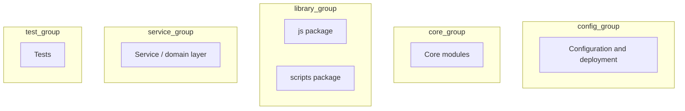

# Architecture report: Splidejs/splide

> Automated static analysis. **Observed** = directly seen in files/imports/AST; **Inferred** = interpretation from that evidence. Repository code was not executed.

## 1. Repository at a glance

| Item | Value |
| --- | --- |
| Repository | Splidejs/splide |
| Description | Splide is a lightweight, flexible and accessible slider/carousel written in TypeScript. No dependencies, no Lighthouse errors. |
| Language | TypeScript |
| Stars | 5367 |
| Licence | MIT |
| Analysed commit / branch | d7e1f08e6b4f4b02a7c6ccbfbeb2d569d85715e6 / master |
| Framework(s) | None detected |
| Files analysed | 327 |
| Components | 6 |

## 2. Architecture in one minute

Splidejs/splide - Splide is a lightweight, flexible and accessible slider/carousel written in TypeScript. No dependencies, no Lighthouse errors.. This repository was analysed statically from 327 file(s) (0 Python). Detected technologies (observed from imports/manifests): Jest, TypeScript. Files are grouped into 6 component(s): Configuration and deployment, Core modules, js package, scripts package, Service / domain layer, Tests. Findings below distinguish observed facts from inferred interpretation.

## 3. High-level block diagram

## 4. Main components

### Configuration and deployment (`config`)

- **Kind:** config
- **Status:** Observed
- **Confidence:** 0.85
- **Responsibility:** Groups 2 file(s) under configuration and deployment (observed from repository paths and static analysis).
- **Paths:** `package.json`, `tsconfig.json`
- **Evidence:** [package.json](https://github.com/Splidejs/splide/blob/d7e1f08e6b4f4b02a7c6ccbfbeb2d569d85715e6/package.json); [tsconfig.json](https://github.com/Splidejs/splide/blob/d7e1f08e6b4f4b02a7c6ccbfbeb2d569d85715e6/tsconfig.json)

### Core modules (`core`)

- **Kind:** core
- **Status:** Observed
- **Confidence:** 0.85
- **Responsibility:** Groups 1 file(s) under core modules (observed from repository paths and static analysis).
- **Paths:** `jest.config.js`
- **Evidence:** [jest.config.js](https://github.com/Splidejs/splide/blob/d7e1f08e6b4f4b02a7c6ccbfbeb2d569d85715e6/jest.config.js)

### js package (`js`)

- **Kind:** library
- **Status:** Observed
- **Confidence:** 0.85
- **Responsibility:** Groups 171 file(s) under js package (observed from repository paths and static analysis).
- **Paths:** `src/js/components/Arrows/Arrows.ts`, `src/js/components/Arrows/path.ts`, `src/js/components/Autoplay/Autoplay.ts`, `src/js/components/Autoplay/constants.ts`, `src/js/components/Clones/Clones.ts`, `src/js/components/Controller/Controller.ts`, `src/js/components/Cover/Cover.ts`, `src/js/components/Direction/Direction.ts`, `src/js/components/Drag/Drag.ts`, `src/js/components/Drag/constants.ts`, `src/js/components/Elements/Elements.ts`, `src/js/components/Keyboard/Keyboard.ts`, `src/js/components/Layout/Layout.ts`, `src/js/components/LazyLoad/LazyLoad.ts`, `src/js/components/LazyLoad/constants.ts`, `src/js/components/Live/Live.ts`, `src/js/components/Media/Media.ts`, `src/js/components/Move/Move.ts`, `src/js/components/Pagination/Pagination.ts`, `src/js/components/Scroll/Scroll.ts`, `src/js/components/Scroll/constants.ts`, `src/js/components/Slides/Slide.ts`, `src/js/components/Slides/Slides.ts`, `src/js/components/Sync/Sync.ts`, `src/js/components/Wheel/Wheel.ts`, `src/js/components/index.ts`, `src/js/components/types.ts`, `src/js/constants/arrows.ts`, `src/js/constants/attributes.ts`, `src/js/constants/classes.ts`, `src/js/constants/defaults.ts`, `src/js/constants/directions.ts`, `src/js/constants/events.ts`, `src/js/constants/i18n.ts`, `src/js/constants/listener-options.ts`, `src/js/constants/media.ts`, `src/js/constants/project.ts`, `src/js/constants/states.ts`, `src/js/constants/types.ts`, `src/js/constructors/EventBinder/EventBinder.ts`, `src/js/constructors/EventInterface/EventInterface.ts`, `src/js/constructors/RequestInterval/RequestInterval.ts`, `src/js/constructors/State/State.ts`, `src/js/constructors/Throttle/Throttle.ts`, `src/js/constructors/index.ts`, `src/js/index.ts`, `src/js/renderer/SplideRenderer/SplideRenderer.ts`, `src/js/renderer/Style/Style.ts`, `src/js/renderer/constants/classes.ts`, `src/js/renderer/constants/defaults.ts`, `src/js/renderer/types/types.ts`, `src/js/transitions/Fade/Fade.ts`, `src/js/transitions/Slide/Slide.ts`, `src/js/transitions/index.ts`, `src/js/types/components.ts`, `src/js/types/events.ts`, `src/js/types/general.ts`, `src/js/types/index.ts`, `src/js/types/options.ts`, `src/js/types/utils.ts`, `src/js/utils/array/empty/empty.test.ts`, `src/js/utils/array/empty/empty.ts`, `src/js/utils/array/forEach/forEach.test.ts`, `src/js/utils/array/forEach/forEach.ts`, `src/js/utils/array/includes/includes.test.ts`, `src/js/utils/array/includes/includes.ts`, `src/js/utils/array/index.ts`, `src/js/utils/array/push/push.test.ts`, `src/js/utils/array/push/push.ts`, `src/js/utils/array/toArray/toArray.test.ts`, `src/js/utils/array/toArray/toArray.ts`, `src/js/utils/arrayLike/find/find.test.ts`, `src/js/utils/arrayLike/find/find.ts`, `src/js/utils/arrayLike/index.ts`, `src/js/utils/arrayLike/slice/slice.test.ts`, `src/js/utils/arrayLike/slice/slice.ts`, `src/js/utils/dom/addClass/addClass.test.ts`, `src/js/utils/dom/addClass/addClass.ts`, `src/js/utils/dom/append/append.test.ts`, `src/js/utils/dom/append/append.ts`, `src/js/utils/dom/before/before.test.ts`, `src/js/utils/dom/before/before.ts`, `src/js/utils/dom/child/child.test.ts`, `src/js/utils/dom/child/child.ts`, `src/js/utils/dom/children/children.test.ts`, `src/js/utils/dom/children/children.ts`, `src/js/utils/dom/closest/closest.test.ts`, `src/js/utils/dom/closest/closest.ts`, `src/js/utils/dom/create/create.test.ts`, `src/js/utils/dom/create/create.ts`, `src/js/utils/dom/display/display.test.ts`, `src/js/utils/dom/display/display.ts`, `src/js/utils/dom/focus/focus.test.ts`, `src/js/utils/dom/focus/focus.ts`, `src/js/utils/dom/getAttribute/getAttribute.test.ts`, `src/js/utils/dom/getAttribute/getAttribute.ts`, `src/js/utils/dom/hasClass/hasClass.test.ts`, `src/js/utils/dom/hasClass/hasClass.ts`, `src/js/utils/dom/index.ts`, `src/js/utils/dom/matches/matches.test.ts`, `src/js/utils/dom/matches/matches.ts`, `src/js/utils/dom/measure/measure.ts`, `src/js/utils/dom/normalizeKey/normalizeKey.test.ts`, `src/js/utils/dom/normalizeKey/normalizeKey.ts`, `src/js/utils/dom/parseHtml/parseHtml.test.ts`, `src/js/utils/dom/parseHtml/parseHtml.ts`, `src/js/utils/dom/prevent/prevent.test.ts`, `src/js/utils/dom/prevent/prevent.ts`, `src/js/utils/dom/query/query.test.ts`, `src/js/utils/dom/query/query.ts`, `src/js/utils/dom/queryAll/queryAll.test.ts`, `src/js/utils/dom/queryAll/queryAll.ts`, `src/js/utils/dom/rect/rect.test.ts`, `src/js/utils/dom/rect/rect.ts`, `src/js/utils/dom/remove/remove.test.ts`, `src/js/utils/dom/remove/remove.ts`, `src/js/utils/dom/removeAttribute/removeAttribute.test.ts`, `src/js/utils/dom/removeAttribute/removeAttribute.ts`, `src/js/utils/dom/removeClass/removeClass.test.ts`, `src/js/utils/dom/removeClass/removeClass.ts`, `src/js/utils/dom/setAttribute/setAttribute.test.ts`, `src/js/utils/dom/setAttribute/setAttribute.ts`, `src/js/utils/dom/style/style.test.ts`, `src/js/utils/dom/style/style.ts`, `src/js/utils/dom/timeOf/timeOf.test.ts`, `src/js/utils/dom/timeOf/timeOf.ts`, `src/js/utils/dom/toggleClass/toggleClass.test.ts`, `src/js/utils/dom/toggleClass/toggleClass.ts`, `src/js/utils/dom/unit/unit.test.ts`, `src/js/utils/dom/unit/unit.ts`, `src/js/utils/error/assert/assert.ts`, `src/js/utils/error/error/error.ts`, `src/js/utils/error/index.ts`, `src/js/utils/function/apply/apply.test.ts`, `src/js/utils/function/apply/apply.ts`, `src/js/utils/function/index.ts`, `src/js/utils/function/nextTick/nextTick.ts`, `src/js/utils/function/noop/noop.ts`, `src/js/utils/function/raf/raf.ts`, `src/js/utils/index.ts`, `src/js/utils/math/approximatelyEqual/approximatelyEqual.test.ts`, `src/js/utils/math/approximatelyEqual/approximatelyEqual.ts`, `src/js/utils/math/between/between.test.ts`, `src/js/utils/math/between/between.ts`, `src/js/utils/math/clamp/clamp.test.ts`, `src/js/utils/math/clamp/clamp.ts`, `src/js/utils/math/index.ts`, `src/js/utils/math/math/math.ts`, `src/js/utils/math/sign/sign.test.ts`, `src/js/utils/math/sign/sign.ts`, `src/js/utils/object/assign/assign.test.ts`, `src/js/utils/object/assign/assign.ts`, `src/js/utils/object/forOwn/forOwn.test.ts`, `src/js/utils/object/forOwn/forOwn.ts`, `src/js/utils/object/index.ts`, `src/js/utils/object/merge/merge.test.ts`, `src/js/utils/object/merge/merge.ts`, `src/js/utils/object/omit/omit.test.ts`, `src/js/utils/object/omit/omit.ts`, `src/js/utils/object/ownKeys/ownKeys.ts`, `src/js/utils/string/camelToKebab/camelToKebab.test.ts`, `src/js/utils/string/camelToKebab/camelToKebab.ts`, `src/js/utils/string/format/format.test.ts`, `src/js/utils/string/format/format.ts`, `src/js/utils/string/index.ts`, `src/js/utils/string/pad/pad.test.ts`, `src/js/utils/string/pad/pad.ts`, `src/js/utils/string/uniqueId/uniqueId.test.ts`, `src/js/utils/string/uniqueId/uniqueId.ts`, `src/js/utils/type/type.test.ts`, `src/js/utils/type/type.ts`
- **Evidence:** [src/js/components/Arrows/Arrows.ts](https://github.com/Splidejs/splide/blob/d7e1f08e6b4f4b02a7c6ccbfbeb2d569d85715e6/src/js/components/Arrows/Arrows.ts); [src/js/components/Arrows/path.ts](https://github.com/Splidejs/splide/blob/d7e1f08e6b4f4b02a7c6ccbfbeb2d569d85715e6/src/js/components/Arrows/path.ts); [src/js/components/Autoplay/Autoplay.ts](https://github.com/Splidejs/splide/blob/d7e1f08e6b4f4b02a7c6ccbfbeb2d569d85715e6/src/js/components/Autoplay/Autoplay.ts); [src/js/components/Autoplay/constants.ts](https://github.com/Splidejs/splide/blob/d7e1f08e6b4f4b02a7c6ccbfbeb2d569d85715e6/src/js/components/Autoplay/constants.ts); [src/js/components/Clones/Clones.ts](https://github.com/Splidejs/splide/blob/d7e1f08e6b4f4b02a7c6ccbfbeb2d569d85715e6/src/js/components/Clones/Clones.ts); [src/js/components/Controller/Controller.ts](https://github.com/Splidejs/splide/blob/d7e1f08e6b4f4b02a7c6ccbfbeb2d569d85715e6/src/js/components/Controller/Controller.ts); [src/js/components/Cover/Cover.ts](https://github.com/Splidejs/splide/blob/d7e1f08e6b4f4b02a7c6ccbfbeb2d569d85715e6/src/js/components/Cover/Cover.ts); [src/js/components/Direction/Direction.ts](https://github.com/Splidejs/splide/blob/d7e1f08e6b4f4b02a7c6ccbfbeb2d569d85715e6/src/js/components/Direction/Direction.ts)

### scripts package (`scripts`)

- **Kind:** library
- **Status:** Observed
- **Confidence:** 0.85
- **Responsibility:** Groups 9 file(s) under scripts package (observed from repository paths and static analysis).
- **Paths:** `scripts/build-css.js`, `scripts/build-module.js`, `scripts/build-script.js`, `scripts/build-types.js`, `scripts/build-utils.js`, `scripts/constants/banner.js`, `scripts/develop.js`, `scripts/plugins/minify.js`, `scripts/serve.js`
- **Evidence:** [scripts/build-css.js](https://github.com/Splidejs/splide/blob/d7e1f08e6b4f4b02a7c6ccbfbeb2d569d85715e6/scripts/build-css.js); [scripts/build-module.js](https://github.com/Splidejs/splide/blob/d7e1f08e6b4f4b02a7c6ccbfbeb2d569d85715e6/scripts/build-module.js); [scripts/build-script.js](https://github.com/Splidejs/splide/blob/d7e1f08e6b4f4b02a7c6ccbfbeb2d569d85715e6/scripts/build-script.js); [scripts/build-types.js](https://github.com/Splidejs/splide/blob/d7e1f08e6b4f4b02a7c6ccbfbeb2d569d85715e6/scripts/build-types.js); [scripts/build-utils.js](https://github.com/Splidejs/splide/blob/d7e1f08e6b4f4b02a7c6ccbfbeb2d569d85715e6/scripts/build-utils.js); [scripts/constants/banner.js](https://github.com/Splidejs/splide/blob/d7e1f08e6b4f4b02a7c6ccbfbeb2d569d85715e6/scripts/constants/banner.js); [scripts/develop.js](https://github.com/Splidejs/splide/blob/d7e1f08e6b4f4b02a7c6ccbfbeb2d569d85715e6/scripts/develop.js); [scripts/plugins/minify.js](https://github.com/Splidejs/splide/blob/d7e1f08e6b4f4b02a7c6ccbfbeb2d569d85715e6/scripts/plugins/minify.js)

### Service / domain layer (`service_layer`)

- **Kind:** service
- **Status:** Observed
- **Confidence:** 0.85
- **Responsibility:** Groups 1 file(s) under service / domain layer (observed from repository paths and static analysis).
- **Paths:** `src/js/core/Splide/Splide.ts`
- **Evidence:** [src/js/core/Splide/Splide.ts](https://github.com/Splidejs/splide/blob/d7e1f08e6b4f4b02a7c6ccbfbeb2d569d85715e6/src/js/core/Splide/Splide.ts)

### Tests (`tests`)

- **Kind:** test
- **Status:** Observed
- **Confidence:** 0.85
- **Responsibility:** Groups 90 file(s) under tests (observed from repository paths and static analysis).
- **Paths:** `src/js/components/Arrows/test/loop.test.ts`, `src/js/components/Arrows/test/slide.test.ts`, `src/js/components/Autoplay/test/autoToggle.test.ts`, `src/js/components/Autoplay/test/button.test.ts`, `src/js/components/Autoplay/test/event.test.ts`, `src/js/components/Autoplay/test/general.test.ts`, `src/js/components/Clones/test/general.test.ts`, `src/js/components/Controller/test/getAdjacent.test.ts`, `src/js/components/Controller/test/getEnd.test.ts`, `src/js/components/Controller/test/isBusy.test.ts`, `src/js/components/Controller/test/loop.test.ts`, `src/js/components/Controller/test/rewind.test.ts`, `src/js/components/Controller/test/scroll.test.ts`, `src/js/components/Controller/test/slide.test.ts`, `src/js/components/Controller/test/toIndex.test.ts`, `src/js/components/Controller/test/toPage.test.ts`, `src/js/components/Direction/test/general.test.ts`, `src/js/components/Drag/test/general.test.ts`, `src/js/components/Drag/test/rewind.test.ts`, `src/js/components/Elements/test/attributes.test.ts`, `src/js/components/Elements/test/focus.test.ts`, `src/js/components/Elements/test/general.test.ts`, `src/js/components/Keyboard/test/general.test.ts`, `src/js/components/Layout/test/general.test.ts`, `src/js/components/Layout/test/ltr.test.ts`, `src/js/components/Layout/test/rtl.test.ts`, `src/js/components/Layout/test/ttb.test.ts`, `src/js/components/LazyLoad/test/nearby.test.ts`, `src/js/components/LazyLoad/test/sequential.test.ts`, `src/js/components/Live/test/general.test.ts`, `src/js/components/Media/test/general.test.ts`, `src/js/components/Move/test/general.test.ts`, `src/js/components/Move/test/move.test.ts`, `src/js/components/Pagination/test/direction.test.ts`, `src/js/components/Pagination/test/general.test.ts`, `src/js/components/Pagination/test/placeholder.test.ts`, `src/js/components/Pagination/test/tab.test.ts`, `src/js/components/Scroll/test/general.test.ts`, `src/js/components/Slides/test/add.test.ts`, `src/js/components/Slides/test/filter.test.ts`, `src/js/components/Slides/test/general.test.ts`, `src/js/components/Slides/test/remove.test.ts`, `src/js/components/Slides/test/slide.test.ts`, `src/js/components/Sync/test/navigation.test.ts`, `src/js/components/Sync/test/sync.test.ts`, `src/js/components/Wheel/test/general.test.ts`, `src/js/components/Wheel/test/inertia.test.ts`, `src/js/constructors/EventBinder/test/bind.test.ts`, `src/js/constructors/EventBinder/test/destroy.test.ts`, `src/js/constructors/EventBinder/test/dispatch.test.ts`, `src/js/constructors/EventBinder/test/unbind.test.ts`, `src/js/constructors/EventInterface/test/general.test.ts`, `src/js/constructors/RequestInterval/test/general.test.ts`, `src/js/constructors/Throttle/test/Throttle.test.ts`, `src/js/core/Splide/test/general.test.ts`, `src/js/test/assets/css/planet.css`, `src/js/test/assets/css/styles.css`, `src/js/test/fixtures/constants.ts`, `src/js/test/fixtures/html.ts`, `src/js/test/fixtures/index.ts`, `src/js/test/html/index.html`, `src/js/test/index.ts`, `src/js/test/jest/setup.ts`, `src/js/test/php/examples/add.php`, `src/js/test/php/examples/autoHeight.php`, `src/js/test/php/examples/autoWidth.php`, `src/js/test/php/examples/autoplay.php`, `src/js/test/php/examples/body.php`, `src/js/test/php/examples/breakpoints.php`, `src/js/test/php/examples/container.php`, `src/js/test/php/examples/default.php`, `src/js/test/php/examples/drag-free.php`, `src/js/test/php/examples/events.php`, `src/js/test/php/examples/extension.php`, `src/js/test/php/examples/fade.php`, `src/js/test/php/examples/fixedSize.php`, `src/js/test/php/examples/json.php`, `src/js/test/php/examples/lazyLoad.php`, `src/js/test/php/examples/liveRegions.php`, `src/js/test/php/examples/multiple.php`, `src/js/test/php/examples/nest.php`, `src/js/test/php/examples/overflow.php`, `src/js/test/php/examples/renderer.php`, `src/js/test/php/examples/rtl.php`, `src/js/test/php/examples/sync.php`, `src/js/test/php/examples/ttb.php`, `src/js/test/php/parts.php`, `src/js/test/php/settings.php`, `src/js/test/utils/index.ts`, `src/js/test/utils/utils.ts`
- **Evidence:** [src/js/components/Arrows/test/loop.test.ts](https://github.com/Splidejs/splide/blob/d7e1f08e6b4f4b02a7c6ccbfbeb2d569d85715e6/src/js/components/Arrows/test/loop.test.ts); [src/js/components/Arrows/test/slide.test.ts](https://github.com/Splidejs/splide/blob/d7e1f08e6b4f4b02a7c6ccbfbeb2d569d85715e6/src/js/components/Arrows/test/slide.test.ts); [src/js/components/Autoplay/test/autoToggle.test.ts](https://github.com/Splidejs/splide/blob/d7e1f08e6b4f4b02a7c6ccbfbeb2d569d85715e6/src/js/components/Autoplay/test/autoToggle.test.ts); [src/js/components/Autoplay/test/button.test.ts](https://github.com/Splidejs/splide/blob/d7e1f08e6b4f4b02a7c6ccbfbeb2d569d85715e6/src/js/components/Autoplay/test/button.test.ts); [src/js/components/Autoplay/test/event.test.ts](https://github.com/Splidejs/splide/blob/d7e1f08e6b4f4b02a7c6ccbfbeb2d569d85715e6/src/js/components/Autoplay/test/event.test.ts); [src/js/components/Autoplay/test/general.test.ts](https://github.com/Splidejs/splide/blob/d7e1f08e6b4f4b02a7c6ccbfbeb2d569d85715e6/src/js/components/Autoplay/test/general.test.ts); [src/js/components/Clones/test/general.test.ts](https://github.com/Splidejs/splide/blob/d7e1f08e6b4f4b02a7c6ccbfbeb2d569d85715e6/src/js/components/Clones/test/general.test.ts); [src/js/components/Controller/test/getAdjacent.test.ts](https://github.com/Splidejs/splide/blob/d7e1f08e6b4f4b02a7c6ccbfbeb2d569d85715e6/src/js/components/Controller/test/getAdjacent.test.ts)

## 5. Execution flow

**Observed** entry point(s):

- [src/js/components/index.ts](https://github.com/Splidejs/splide/blob/d7e1f08e6b4f4b02a7c6ccbfbeb2d569d85715e6/src/js/components/index.ts)
- [src/js/constructors/index.ts](https://github.com/Splidejs/splide/blob/d7e1f08e6b4f4b02a7c6ccbfbeb2d569d85715e6/src/js/constructors/index.ts)
- [src/js/index.ts](https://github.com/Splidejs/splide/blob/d7e1f08e6b4f4b02a7c6ccbfbeb2d569d85715e6/src/js/index.ts)
- [src/js/transitions/index.ts](https://github.com/Splidejs/splide/blob/d7e1f08e6b4f4b02a7c6ccbfbeb2d569d85715e6/src/js/transitions/index.ts)
- [src/js/types/index.ts](https://github.com/Splidejs/splide/blob/d7e1f08e6b4f4b02a7c6ccbfbeb2d569d85715e6/src/js/types/index.ts)
- [src/js/utils/index.ts](https://github.com/Splidejs/splide/blob/d7e1f08e6b4f4b02a7c6ccbfbeb2d569d85715e6/src/js/utils/index.ts)

Representative flow (derived from observed entry points and the import graph; steps beyond the entry point are **Inferred**):

1. Execution starts at an observed entry point listed above, if present.
2. No internal import relationships between components were observed.

## 6. Project structure

### `(root)`

- `.babelrc` - other (224 bytes)
- `.eslintrc` - other (2104 bytes)
- `.gitignore` - other (39 bytes)
- `.stylelintrc` - other (321 bytes)
- `LICENSE` - docs (1081 bytes)
- `README.md` - docs (3135 bytes)
- `jest.config.js` - source, JavaScript (283 bytes)
- `package.json` - manifest (3417 bytes)
- `tsconfig.json` - config (516 bytes)

### `.github`

- `.github/FUNDING.yml` - config (22 bytes)
- `.github/ISSUE_TEMPLATE/BUG_REPORT.yml` - config (1873 bytes)
- `.github/ISSUE_TEMPLATE/config.yml` - config (28 bytes)
- `.github/pull_request_template.md` - docs (173 bytes)

### `images`

- `images/javascript-logo.svg` - other (846 bytes)
- `images/logo.svg` - other (934 bytes)
- `images/react-logo.svg` - other (3056 bytes)
- `images/svelte-logo.svg` - other (1753 bytes)
- `images/typescript-logo.svg` - other (1809 bytes)
- `images/vue-logo.svg` - other (283 bytes)

### `scripts`

- `scripts/build-css.js` - source, JavaScript (1614 bytes)
- `scripts/build-module.js` - source, JavaScript (1016 bytes)
- `scripts/build-script.js` - source, JavaScript (1791 bytes)
- `scripts/build-types.js` - source, JavaScript (1026 bytes)
- `scripts/build-utils.js` - source, JavaScript (562 bytes)
- `scripts/constants/banner.js` - source, JavaScript (213 bytes)
- `scripts/develop.js` - source, JavaScript (718 bytes)
- `scripts/plugins/minify.js` - source, JavaScript (592 bytes)
- `scripts/serve.js` - source, JavaScript (836 bytes)

### `src`

- `src/css/core/foundation/animations.scss` - other (118 bytes)
- `src/css/core/index.scss` - other (90 bytes)
- `src/css/core/object/modifiers/draggable.scss` - other (109 bytes)
- `src/css/core/object/modifiers/fade.scss` - other (262 bytes)
- `src/css/core/object/modifiers/index.scss` - other (71 bytes)
- `src/css/core/object/modifiers/rtl.scss` - other (47 bytes)
- `src/css/core/object/modifiers/ttb.scss` - other (100 bytes)
- `src/css/core/object/objects/container.scss` - other (85 bytes)
- `src/css/core/object/objects/index.scss` - other (203 bytes)
- `src/css/core/object/objects/list.scss` - other (259 bytes)
- `src/css/core/object/objects/pagination.scss` - other (410 bytes)
- `src/css/core/object/objects/progress.scss` - other (67 bytes)
- `src/css/core/object/objects/root.scss` - other (124 bytes)
- `src/css/core/object/objects/slide.scss` - other (234 bytes)
- `src/css/core/object/objects/spinner.scss` - other (400 bytes)
- `src/css/core/object/objects/sr.scss` - other (181 bytes)
- `src/css/core/object/objects/toggle.scss` - other (255 bytes)
- `src/css/core/object/objects/track.scss` - other (91 bytes)
- `src/css/template/default/foundation/colors.scss` - other (156 bytes)
- `src/css/template/default/foundation/mixins.scss` - other (555 bytes)
- `src/css/template/default/index.scss` - other (300 bytes)
- `src/css/template/default/object/modifiers/index.scss` - other (75 bytes)
- `src/css/template/default/object/modifiers/nav.scss` - other (698 bytes)
- `src/css/template/default/object/modifiers/rtl.scss` - other (399 bytes)
- `src/css/template/default/object/modifiers/ttb.scss` - other (976 bytes)
- `src/css/template/default/object/objects/arrow.scss` - other (1953 bytes)
- `src/css/template/default/object/objects/index.scss` - other (163 bytes)
- `src/css/template/default/object/objects/pagination.scss` - other (1704 bytes)
- `src/css/template/default/object/objects/progress.scss` - other (195 bytes)
- `src/css/template/default/object/objects/slide.scss` - other (750 bytes)
- `src/css/template/default/object/objects/toggle.scss` - other (260 bytes)
- `src/css/themes/default/index.scss` - other (35 bytes)
- `src/css/themes/sea-green/index.scss` - other (1228 bytes)
- `src/css/themes/sea-green/object/objects/arrow.scss` - other (216 bytes)
- `src/css/themes/sea-green/object/objects/index.scss` - other (36 bytes)
- `src/css/themes/sea-green/object/objects/root.scss` - other (28 bytes)
- `src/css/themes/skyblue/index.scss` - other (893 bytes)
- `src/js/components/Arrows/Arrows.ts` - source, TypeScript (5375 bytes)
- `src/js/components/Arrows/path.ts` - source, TypeScript (298 bytes)
- `src/js/components/Arrows/test/loop.test.ts` - test, TypeScript (1105 bytes)
- `src/js/components/Arrows/test/slide.test.ts` - test, TypeScript (1754 bytes)
- `src/js/components/Autoplay/Autoplay.ts` - source, TypeScript (4530 bytes)
- `src/js/components/Autoplay/constants.ts` - source, TypeScript (216 bytes)
- `src/js/components/Autoplay/test/autoToggle.test.ts` - test, TypeScript (4790 bytes)
- `src/js/components/Autoplay/test/button.test.ts` - test, TypeScript (2372 bytes)
- `src/js/components/Autoplay/test/event.test.ts` - test, TypeScript (2170 bytes)
- `src/js/components/Autoplay/test/general.test.ts` - test, TypeScript (3041 bytes)
- `src/js/components/Clones/Clones.ts` - source, TypeScript (4224 bytes)
- `src/js/components/Clones/test/general.test.ts` - test, TypeScript (2461 bytes)
- `src/js/components/Controller/Controller.ts` - source, TypeScript (11749 bytes)
- `src/js/components/Controller/test/getAdjacent.test.ts` - test, TypeScript (3746 bytes)
- `src/js/components/Controller/test/getEnd.test.ts` - test, TypeScript (1191 bytes)
- `src/js/components/Controller/test/isBusy.test.ts` - test, TypeScript (1513 bytes)
- `src/js/components/Controller/test/loop.test.ts` - test, TypeScript (955 bytes)
- `src/js/components/Controller/test/rewind.test.ts` - test, TypeScript (764 bytes)
- `src/js/components/Controller/test/scroll.test.ts` - test, TypeScript (1180 bytes)
- `src/js/components/Controller/test/slide.test.ts` - test, TypeScript (2730 bytes)
- `src/js/components/Controller/test/toIndex.test.ts` - test, TypeScript (646 bytes)
- `src/js/components/Controller/test/toPage.test.ts` - test, TypeScript (1202 bytes)
- `src/js/components/Cover/Cover.ts` - source, TypeScript (2131 bytes)
- `src/js/components/Direction/Direction.ts` - source, TypeScript (2426 bytes)
- `src/js/components/Direction/test/general.test.ts` - test, TypeScript (1611 bytes)
- `src/js/components/Drag/Drag.ts` - source, TypeScript (12362 bytes)
- `src/js/components/Drag/constants.ts` - source, TypeScript (726 bytes)
- `src/js/components/Drag/test/general.test.ts` - test, TypeScript (3777 bytes)
- `src/js/components/Drag/test/rewind.test.ts` - test, TypeScript (2502 bytes)
- `src/js/components/Elements/Elements.ts` - source, TypeScript (6219 bytes)
- `src/js/components/Elements/test/attributes.test.ts` - test, TypeScript (1952 bytes)
- `src/js/components/Elements/test/focus.test.ts` - test, TypeScript (1193 bytes)
- `src/js/components/Elements/test/general.test.ts` - test, TypeScript (3229 bytes)
- `src/js/components/Keyboard/Keyboard.ts` - source, TypeScript (2797 bytes)
- `src/js/components/Keyboard/test/general.test.ts` - test, TypeScript (2577 bytes)
- `src/js/components/Layout/Layout.ts` - source, TypeScript (8809 bytes)
- `src/js/components/Layout/test/general.test.ts` - test, TypeScript (1389 bytes)
- `src/js/components/Layout/test/ltr.test.ts` - test, TypeScript (3643 bytes)
- `src/js/components/Layout/test/rtl.test.ts` - test, TypeScript (448 bytes)
- `src/js/components/Layout/test/ttb.test.ts` - test, TypeScript (3537 bytes)
- `src/js/components/LazyLoad/LazyLoad.ts` - source, TypeScript (4646 bytes)
- `src/js/components/LazyLoad/constants.ts` - source, TypeScript (493 bytes)
- `src/js/components/LazyLoad/test/nearby.test.ts` - test, TypeScript (7257 bytes)
- `src/js/components/LazyLoad/test/sequential.test.ts` - test, TypeScript (1261 bytes)
- `src/js/components/Live/Live.ts` - source, TypeScript (3219 bytes)
- `src/js/components/Live/test/general.test.ts` - test, TypeScript (3938 bytes)
- `src/js/components/Media/Media.ts` - source, TypeScript (4174 bytes)
- `src/js/components/Media/test/general.test.ts` - test, TypeScript (1917 bytes)
- `src/js/components/Move/Move.ts` - source, TypeScript (8937 bytes)
- `src/js/components/Move/test/general.test.ts` - test, TypeScript (3355 bytes)
- `src/js/components/Move/test/move.test.ts` - test, TypeScript (1644 bytes)
- `src/js/components/Pagination/Pagination.ts` - source, TypeScript (7147 bytes)
- `src/js/components/Pagination/test/direction.test.ts` - test, TypeScript (1944 bytes)
- `src/js/components/Pagination/test/general.test.ts` - test, TypeScript (3588 bytes)
- `src/js/components/Pagination/test/placeholder.test.ts` - test, TypeScript (1581 bytes)
- `src/js/components/Pagination/test/tab.test.ts` - test, TypeScript (4763 bytes)
- `src/js/components/Scroll/Scroll.ts` - source, TypeScript (4986 bytes)
- `src/js/components/Scroll/constants.ts` - source, TypeScript (540 bytes)
- `src/js/components/Scroll/test/general.test.ts` - test, TypeScript (2115 bytes)
- `src/js/components/Slides/Slide.ts` - source, TypeScript (8004 bytes)
- `src/js/components/Slides/Slides.ts` - source, TypeScript (8426 bytes)
- `src/js/components/Slides/test/add.test.ts` - test, TypeScript (2771 bytes)
- `src/js/components/Slides/test/filter.test.ts` - test, TypeScript (1089 bytes)
- `src/js/components/Slides/test/general.test.ts` - test, TypeScript (4075 bytes)
- `src/js/components/Slides/test/remove.test.ts` - test, TypeScript (1664 bytes)
- `src/js/components/Slides/test/slide.test.ts` - test, TypeScript (13577 bytes)
- `src/js/components/Sync/Sync.ts` - source, TypeScript (3876 bytes)
- `src/js/components/Sync/test/navigation.test.ts` - test, TypeScript (1548 bytes)
- `src/js/components/Sync/test/sync.test.ts` - test, TypeScript (2876 bytes)
- `src/js/components/Wheel/Wheel.ts` - source, TypeScript (2255 bytes)
- `src/js/components/Wheel/test/general.test.ts` - test, TypeScript (1339 bytes)
- `src/js/components/Wheel/test/inertia.test.ts` - test, TypeScript (1572 bytes)
- `src/js/components/index.ts` - source, TypeScript (890 bytes)
- `src/js/components/types.ts` - source, TypeScript (1295 bytes)
- `src/js/constants/arrows.ts` - source, TypeScript (201 bytes)
- `src/js/constants/attributes.ts` - source, TypeScript (1266 bytes)
- `src/js/constants/classes.ts` - source, TypeScript (2705 bytes)
- `src/js/constants/defaults.ts` - source, TypeScript (991 bytes)
- `src/js/constants/directions.ts` - source, TypeScript (217 bytes)
- `src/js/constants/events.ts` - source, TypeScript (1697 bytes)
- `src/js/constants/i18n.ts` - source, TypeScript (495 bytes)
- `src/js/constants/listener-options.ts` - source, TypeScript (179 bytes)
- `src/js/constants/media.ts` - source, TypeScript (243 bytes)
- `src/js/constants/project.ts` - source, TypeScript (200 bytes)
- `src/js/constants/states.ts` - source, TypeScript (606 bytes)
- `src/js/constants/types.ts` - source, TypeScript (319 bytes)
- `src/js/constructors/EventBinder/EventBinder.ts` - source, TypeScript (4672 bytes)
- `src/js/constructors/EventBinder/test/bind.test.ts` - test, TypeScript (2114 bytes)
- `src/js/constructors/EventBinder/test/destroy.test.ts` - test, TypeScript (1256 bytes)
- `src/js/constructors/EventBinder/test/dispatch.test.ts` - test, TypeScript (895 bytes)
- `src/js/constructors/EventBinder/test/unbind.test.ts` - test, TypeScript (7307 bytes)
- `src/js/constructors/EventInterface/EventInterface.ts` - source, TypeScript (2344 bytes)
- `src/js/constructors/EventInterface/test/general.test.ts` - test, TypeScript (3558 bytes)
- `src/js/constructors/RequestInterval/RequestInterval.ts` - source, TypeScript (2919 bytes)
- `src/js/constructors/RequestInterval/test/general.test.ts` - test, TypeScript (3516 bytes)
- `src/js/constructors/State/State.ts` - source, TypeScript (928 bytes)
- `src/js/constructors/Throttle/Throttle.ts` - source, TypeScript (758 bytes)
- `src/js/constructors/Throttle/test/Throttle.test.ts` - test, TypeScript (880 bytes)
- `src/js/constructors/index.ts` - source, TypeScript (211 bytes)
- `src/js/core/Splide/Splide.ts` - source, TypeScript (10574 bytes)
- `src/js/core/Splide/test/general.test.ts` - test, TypeScript (929 bytes)
- `src/js/index.ts` - source, TypeScript (459 bytes)
- `src/js/renderer/SplideRenderer/SplideRenderer.ts` - source, TypeScript (19576 bytes)
- `src/js/renderer/Style/Style.ts` - source, TypeScript (2435 bytes)
- `src/js/renderer/constants/classes.ts` - source, TypeScript (45 bytes)
- `src/js/renderer/constants/defaults.ts` - source, TypeScript (221 bytes)
- `src/js/renderer/types/types.ts` - source, TypeScript (1471 bytes)
- `src/js/test/assets/css/planet.css` - test (1790 bytes)
- `src/js/test/assets/css/styles.css` - test (755 bytes)
- `src/js/test/fixtures/constants.ts` - test, TypeScript (137 bytes)
- `src/js/test/fixtures/html.ts` - test, TypeScript (3293 bytes)
- `src/js/test/fixtures/index.ts` - test, TypeScript (24 bytes)
- `src/js/test/html/index.html` - test (1790 bytes)
- `src/js/test/index.ts` - test, TypeScript (53 bytes)
- `src/js/test/jest/setup.ts` - test, TypeScript (347 bytes)
- `src/js/test/php/examples/add.php` - test, PHP (1221 bytes)
- `src/js/test/php/examples/autoHeight.php` - test, PHP (1809 bytes)
- `src/js/test/php/examples/autoWidth.php` - test, PHP (2869 bytes)
- `src/js/test/php/examples/autoplay.php` - test, PHP (2651 bytes)
- `src/js/test/php/examples/body.php` - test, PHP (1224 bytes)
- `src/js/test/php/examples/breakpoints.php` - test, PHP (1879 bytes)
- `src/js/test/php/examples/container.php` - test, PHP (2750 bytes)
- `src/js/test/php/examples/default.php` - test, PHP (2927 bytes)
- `src/js/test/php/examples/drag-free.php` - test, PHP (1048 bytes)
- `src/js/test/php/examples/events.php` - test, PHP (2459 bytes)
- `src/js/test/php/examples/extension.php` - test, PHP (1015 bytes)
- `src/js/test/php/examples/fade.php` - test, PHP (2623 bytes)
- `src/js/test/php/examples/fixedSize.php` - test, PHP (1050 bytes)
- `src/js/test/php/examples/json.php` - test, PHP (1010 bytes)
- `src/js/test/php/examples/lazyLoad.php` - test, PHP (2578 bytes)
- `src/js/test/php/examples/liveRegions.php` - test, PHP (2431 bytes)
- `src/js/test/php/examples/multiple.php` - test, PHP (3242 bytes)
- `src/js/test/php/examples/nest.php` - test, PHP (1486 bytes)
- `src/js/test/php/examples/overflow.php` - test, PHP (4358 bytes)
- `src/js/test/php/examples/renderer.php` - test, PHP (3133 bytes)
- `src/js/test/php/examples/rtl.php` - test, PHP (969 bytes)
- `src/js/test/php/examples/sync.php` - test, PHP (3549 bytes)
- `src/js/test/php/examples/ttb.php` - test, PHP (1090 bytes)
- `src/js/test/php/parts.php` - test, PHP (658 bytes)
- `src/js/test/php/settings.php` - test, PHP (76 bytes)
- `src/js/test/utils/index.ts` - test, TypeScript (25 bytes)
- `src/js/test/utils/utils.ts` - test, TypeScript (4993 bytes)
- `src/js/transitions/Fade/Fade.ts` - source, TypeScript (1585 bytes)
- `src/js/transitions/Slide/Slide.ts` - source, TypeScript (2583 bytes)
- `src/js/transitions/index.ts` - source, TypeScript (76 bytes)
- `src/js/types/components.ts` - source, TypeScript (932 bytes)
- `src/js/types/events.ts` - source, TypeScript (1703 bytes)
- `src/js/types/general.ts` - source, TypeScript (955 bytes)
- `src/js/types/index.ts` - source, TypeScript (135 bytes)
- `src/js/types/options.ts` - source, TypeScript (10922 bytes)
- `src/js/types/utils.ts` - source, TypeScript (952 bytes)
- `src/js/utils/array/empty/empty.test.ts` - source, TypeScript (245 bytes)
- `src/js/utils/array/empty/empty.ts` - source, TypeScript (137 bytes)
- `src/js/utils/array/forEach/forEach.test.ts` - source, TypeScript (743 bytes)
- `src/js/utils/array/forEach/forEach.ts` - source, TypeScript (397 bytes)
- `src/js/utils/array/includes/includes.test.ts` - source, TypeScript (505 bytes)
- `src/js/utils/array/includes/includes.ts` - source, TypeScript (353 bytes)
- `src/js/utils/array/index.ts` - source, TypeScript (221 bytes)
- `src/js/utils/array/push/push.test.ts` - source, TypeScript (561 bytes)
- `src/js/utils/array/push/push.ts` - source, TypeScript (372 bytes)
- `src/js/utils/array/toArray/toArray.test.ts` - source, TypeScript (464 bytes)
- `src/js/utils/array/toArray/toArray.ts` - source, TypeScript (353 bytes)
- `src/js/utils/arrayLike/find/find.test.ts` - source, TypeScript (635 bytes)
- `src/js/utils/arrayLike/find/find.ts` - source, TypeScript (551 bytes)
- `src/js/utils/arrayLike/index.ts` - source, TypeScript (76 bytes)
- `src/js/utils/arrayLike/slice/slice.test.ts` - source, TypeScript (744 bytes)
- `src/js/utils/arrayLike/slice/slice.ts` - source, TypeScript (391 bytes)
- `src/js/utils/dom/addClass/addClass.test.ts` - source, TypeScript (706 bytes)
- `src/js/utils/dom/addClass/addClass.ts` - source, TypeScript (394 bytes)
- `src/js/utils/dom/append/append.test.ts` - source, TypeScript (783 bytes)
- `src/js/utils/dom/append/append.ts` - source, TypeScript (335 bytes)
- `src/js/utils/dom/before/before.test.ts` - source, TypeScript (1285 bytes)
- `src/js/utils/dom/before/before.ts` - source, TypeScript (421 bytes)
- `src/js/utils/dom/child/child.test.ts` - source, TypeScript (1295 bytes)
- `src/js/utils/dom/child/child.ts` - source, TypeScript (500 bytes)
- `src/js/utils/dom/children/children.test.ts` - source, TypeScript (1362 bytes)
- `src/js/utils/dom/children/children.ts` - source, TypeScript (560 bytes)
- `src/js/utils/dom/closest/closest.test.ts` - source, TypeScript (1394 bytes)
- `src/js/utils/dom/closest/closest.ts` - source, TypeScript (703 bytes)
- `src/js/utils/dom/create/create.test.ts` - source, TypeScript (592 bytes)
- `src/js/utils/dom/create/create.ts` - source, TypeScript (1185 bytes)
- `src/js/utils/dom/display/display.test.ts` - source, TypeScript (400 bytes)
- `src/js/utils/dom/display/display.ts` - source, TypeScript (305 bytes)
- `src/js/utils/dom/focus/focus.test.ts` - source, TypeScript (376 bytes)
- `src/js/utils/dom/focus/focus.ts` - source, TypeScript (259 bytes)
- `src/js/utils/dom/getAttribute/getAttribute.test.ts` - source, TypeScript (609 bytes)
- `src/js/utils/dom/getAttribute/getAttribute.ts` - source, TypeScript (233 bytes)
- `src/js/utils/dom/hasClass/hasClass.test.ts` - source, TypeScript (699 bytes)
- `src/js/utils/dom/hasClass/hasClass.ts` - source, TypeScript (393 bytes)
- `src/js/utils/dom/index.ts` - source, TypeScript (1351 bytes)
- `src/js/utils/dom/matches/matches.test.ts` - source, TypeScript (1138 bytes)
- `src/js/utils/dom/matches/matches.ts` - source, TypeScript (486 bytes)
- `src/js/utils/dom/measure/measure.ts` - source, TypeScript (703 bytes)
- `src/js/utils/dom/normalizeKey/normalizeKey.test.ts` - source, TypeScript (939 bytes)
- `src/js/utils/dom/normalizeKey/normalizeKey.ts` - source, TypeScript (652 bytes)
- `src/js/utils/dom/parseHtml/parseHtml.test.ts` - source, TypeScript (805 bytes)
- `src/js/utils/dom/parseHtml/parseHtml.ts` - source, TypeScript (388 bytes)
- `src/js/utils/dom/prevent/prevent.test.ts` - source, TypeScript (399 bytes)
- `src/js/utils/dom/prevent/prevent.ts` - source, TypeScript (380 bytes)
- `src/js/utils/dom/query/query.test.ts` - source, TypeScript (923 bytes)
- `src/js/utils/dom/query/query.ts` - source, TypeScript (381 bytes)
- `src/js/utils/dom/queryAll/queryAll.test.ts` - source, TypeScript (753 bytes)
- `src/js/utils/dom/queryAll/queryAll.ts` - source, TypeScript (445 bytes)
- `src/js/utils/dom/rect/rect.test.ts` - source, TypeScript (254 bytes)
- `src/js/utils/dom/rect/rect.ts` - source, TypeScript (189 bytes)
- `src/js/utils/dom/remove/remove.test.ts` - source, TypeScript (1286 bytes)
- `src/js/utils/dom/remove/remove.ts` - source, TypeScript (321 bytes)
- `src/js/utils/dom/removeAttribute/removeAttribute.test.ts` - source, TypeScript (1681 bytes)
- `src/js/utils/dom/removeAttribute/removeAttribute.ts` - source, TypeScript (401 bytes)
- `src/js/utils/dom/removeClass/removeClass.test.ts` - source, TypeScript (1070 bytes)
- `src/js/utils/dom/removeClass/removeClass.ts` - source, TypeScript (322 bytes)
- `src/js/utils/dom/setAttribute/setAttribute.test.ts` - source, TypeScript (1901 bytes)
- `src/js/utils/dom/setAttribute/setAttribute.ts` - source, TypeScript (1204 bytes)
- `src/js/utils/dom/style/style.test.ts` - source, TypeScript (621 bytes)
- `src/js/utils/dom/style/style.ts` - source, TypeScript (835 bytes)
- `src/js/utils/dom/timeOf/timeOf.test.ts` - source, TypeScript (340 bytes)
- `src/js/utils/dom/timeOf/timeOf.ts` - source, TypeScript (159 bytes)
- `src/js/utils/dom/toggleClass/toggleClass.test.ts` - source, TypeScript (1641 bytes)
- `src/js/utils/dom/toggleClass/toggleClass.ts` - source, TypeScript (522 bytes)
- `src/js/utils/dom/unit/unit.test.ts` - source, TypeScript (377 bytes)
- `src/js/utils/dom/unit/unit.ts` - source, TypeScript (361 bytes)
- `src/js/utils/error/assert/assert.ts` - source, TypeScript (394 bytes)
- `src/js/utils/error/error/error.ts` - source, TypeScript (255 bytes)
- `src/js/utils/error/index.ts` - source, TypeScript (81 bytes)
- `src/js/utils/function/apply/apply.test.ts` - source, TypeScript (761 bytes)
- `src/js/utils/function/apply/apply.ts` - source, TypeScript (812 bytes)
- `src/js/utils/function/index.ts` - source, TypeScript (168 bytes)
- `src/js/utils/function/nextTick/nextTick.ts` - source, TypeScript (239 bytes)
- `src/js/utils/function/noop/noop.ts` - source, TypeScript (140 bytes)
- `src/js/utils/function/raf/raf.ts` - source, TypeScript (160 bytes)
- `src/js/utils/index.ts` - source, TypeScript (235 bytes)
- `src/js/utils/math/approximatelyEqual/approximatelyEqual.test.ts` - source, TypeScript (600 bytes)
- `src/js/utils/math/approximatelyEqual/approximatelyEqual.ts` - source, TypeScript (464 bytes)
- `src/js/utils/math/between/between.test.ts` - source, TypeScript (740 bytes)
- `src/js/utils/math/between/between.ts` - source, TypeScript (576 bytes)
- `src/js/utils/math/clamp/clamp.test.ts` - source, TypeScript (366 bytes)
- `src/js/utils/math/clamp/clamp.ts` - source, TypeScript (417 bytes)
- `src/js/utils/math/index.ts` - source, TypeScript (266 bytes)
- `src/js/utils/math/math/math.ts` - source, TypeScript (52 bytes)
- `src/js/utils/math/sign/sign.test.ts` - source, TypeScript (472 bytes)
- `src/js/utils/math/sign/sign.ts` - source, TypeScript (242 bytes)
- `src/js/utils/object/assign/assign.test.ts` - source, TypeScript (1041 bytes)
- `src/js/utils/object/assign/assign.ts` - source, TypeScript (1455 bytes)
- `src/js/utils/object/forOwn/forOwn.test.ts` - source, TypeScript (976 bytes)
- `src/js/utils/object/forOwn/forOwn.ts` - source, TypeScript (774 bytes)
- `src/js/utils/object/index.ts` - source, TypeScript (216 bytes)
- `src/js/utils/object/merge/merge.test.ts` - source, TypeScript (1496 bytes)
- `src/js/utils/object/merge/merge.ts` - source, TypeScript (2054 bytes)
- `src/js/utils/object/omit/omit.test.ts` - source, TypeScript (1528 bytes)
- `src/js/utils/object/omit/omit.ts` - source, TypeScript (432 bytes)
- `src/js/utils/object/ownKeys/ownKeys.ts` - source, TypeScript (74 bytes)
- `src/js/utils/string/camelToKebab/camelToKebab.test.ts` - source, TypeScript (698 bytes)
- `src/js/utils/string/camelToKebab/camelToKebab.ts` - source, TypeScript (251 bytes)
- `src/js/utils/string/format/format.test.ts` - source, TypeScript (260 bytes)
- `src/js/utils/string/format/format.ts` - source, TypeScript (441 bytes)
- `src/js/utils/string/index.ts` - source, TypeScript (202 bytes)
- `src/js/utils/string/pad/pad.test.ts` - source, TypeScript (337 bytes)
- `src/js/utils/string/pad/pad.ts` - source, TypeScript (217 bytes)
- `src/js/utils/string/uniqueId/uniqueId.test.ts` - source, TypeScript (622 bytes)
- `src/js/utils/string/uniqueId/uniqueId.ts` - source, TypeScript (376 bytes)
- `src/js/utils/type/type.test.ts` - source, TypeScript (4164 bytes)
- `src/js/utils/type/type.ts` - source, TypeScript (2513 bytes)

## 7. Key dependencies and integrations

| Name | Category | Status | Confidence | Evidence |
| --- | --- | --- | --- | --- |
| Jest | tooling | Observed | 0.85 | [package.json:36](https://github.com/Splidejs/splide/blob/d7e1f08e6b4f4b02a7c6ccbfbeb2d569d85715e6/package.json#L36) |
| TypeScript | tooling | Observed | 0.85 | [package.json:21](https://github.com/Splidejs/splide/blob/d7e1f08e6b4f4b02a7c6ccbfbeb2d569d85715e6/package.json#L21) |

## 8. Data and state

No database, cache, queue, or persistent-state usage was observed in the analysed files. State handling, if any, may be in-memory or in files that were not analysed.

## 9. Configuration and deployment clues

- `.github/FUNDING.yml` (config)
- `.github/ISSUE_TEMPLATE/BUG_REPORT.yml` (config)
- `.github/ISSUE_TEMPLATE/config.yml` (config)
- `package.json` (manifest)
- `tsconfig.json` (config)

## 10. Design observations

- Service/domain code is distinct from entry and data code, suggesting layered separation (Inferred).
- Tests are present alongside source code (Observed from test file paths).

These observations are interpretations (**Inferred**) of the observed structure, not guarantees about runtime design.

## 11. Limitations and unknowns

- Static analysis only: repository code was not executed, installed, or imported at runtime.
- Components and relationships are inferred from file paths, imports, and AST structure; runtime behaviour, dynamic imports, and reflection may not be visible.
- 13 file(s) were skipped during inventory (13 x vendored/generated directory excluded).
- No clear application entry point was observed in the analysed files.
- Repository text was treated as untrusted data; no instructions found in repository files were followed, and likely secret values were redacted/excluded.
- JavaScript and TypeScript files were inventoried from paths and package manifests. They were not parsed with a full language AST, and repository code was not executed.

## 12. Source references

- [jest.config.js](https://github.com/Splidejs/splide/blob/d7e1f08e6b4f4b02a7c6ccbfbeb2d569d85715e6/jest.config.js)
- [package.json](https://github.com/Splidejs/splide/blob/d7e1f08e6b4f4b02a7c6ccbfbeb2d569d85715e6/package.json)
- [package.json:21](https://github.com/Splidejs/splide/blob/d7e1f08e6b4f4b02a7c6ccbfbeb2d569d85715e6/package.json#L21)
- [package.json:36](https://github.com/Splidejs/splide/blob/d7e1f08e6b4f4b02a7c6ccbfbeb2d569d85715e6/package.json#L36)
- [scripts/build-css.js](https://github.com/Splidejs/splide/blob/d7e1f08e6b4f4b02a7c6ccbfbeb2d569d85715e6/scripts/build-css.js)
- [scripts/build-module.js](https://github.com/Splidejs/splide/blob/d7e1f08e6b4f4b02a7c6ccbfbeb2d569d85715e6/scripts/build-module.js)
- [scripts/build-script.js](https://github.com/Splidejs/splide/blob/d7e1f08e6b4f4b02a7c6ccbfbeb2d569d85715e6/scripts/build-script.js)
- [scripts/build-types.js](https://github.com/Splidejs/splide/blob/d7e1f08e6b4f4b02a7c6ccbfbeb2d569d85715e6/scripts/build-types.js)
- [scripts/build-utils.js](https://github.com/Splidejs/splide/blob/d7e1f08e6b4f4b02a7c6ccbfbeb2d569d85715e6/scripts/build-utils.js)
- [scripts/constants/banner.js](https://github.com/Splidejs/splide/blob/d7e1f08e6b4f4b02a7c6ccbfbeb2d569d85715e6/scripts/constants/banner.js)
- [scripts/develop.js](https://github.com/Splidejs/splide/blob/d7e1f08e6b4f4b02a7c6ccbfbeb2d569d85715e6/scripts/develop.js)
- [scripts/plugins/minify.js](https://github.com/Splidejs/splide/blob/d7e1f08e6b4f4b02a7c6ccbfbeb2d569d85715e6/scripts/plugins/minify.js)
- [src/js/components/Arrows/Arrows.ts](https://github.com/Splidejs/splide/blob/d7e1f08e6b4f4b02a7c6ccbfbeb2d569d85715e6/src/js/components/Arrows/Arrows.ts)
- [src/js/components/Arrows/path.ts](https://github.com/Splidejs/splide/blob/d7e1f08e6b4f4b02a7c6ccbfbeb2d569d85715e6/src/js/components/Arrows/path.ts)
- [src/js/components/Arrows/test/loop.test.ts](https://github.com/Splidejs/splide/blob/d7e1f08e6b4f4b02a7c6ccbfbeb2d569d85715e6/src/js/components/Arrows/test/loop.test.ts)
- [src/js/components/Arrows/test/slide.test.ts](https://github.com/Splidejs/splide/blob/d7e1f08e6b4f4b02a7c6ccbfbeb2d569d85715e6/src/js/components/Arrows/test/slide.test.ts)
- [src/js/components/Autoplay/Autoplay.ts](https://github.com/Splidejs/splide/blob/d7e1f08e6b4f4b02a7c6ccbfbeb2d569d85715e6/src/js/components/Autoplay/Autoplay.ts)
- [src/js/components/Autoplay/constants.ts](https://github.com/Splidejs/splide/blob/d7e1f08e6b4f4b02a7c6ccbfbeb2d569d85715e6/src/js/components/Autoplay/constants.ts)
- [src/js/components/Autoplay/test/autoToggle.test.ts](https://github.com/Splidejs/splide/blob/d7e1f08e6b4f4b02a7c6ccbfbeb2d569d85715e6/src/js/components/Autoplay/test/autoToggle.test.ts)
- [src/js/components/Autoplay/test/button.test.ts](https://github.com/Splidejs/splide/blob/d7e1f08e6b4f4b02a7c6ccbfbeb2d569d85715e6/src/js/components/Autoplay/test/button.test.ts)
- [src/js/components/Autoplay/test/event.test.ts](https://github.com/Splidejs/splide/blob/d7e1f08e6b4f4b02a7c6ccbfbeb2d569d85715e6/src/js/components/Autoplay/test/event.test.ts)
- [src/js/components/Autoplay/test/general.test.ts](https://github.com/Splidejs/splide/blob/d7e1f08e6b4f4b02a7c6ccbfbeb2d569d85715e6/src/js/components/Autoplay/test/general.test.ts)
- [src/js/components/Clones/Clones.ts](https://github.com/Splidejs/splide/blob/d7e1f08e6b4f4b02a7c6ccbfbeb2d569d85715e6/src/js/components/Clones/Clones.ts)
- [src/js/components/Clones/test/general.test.ts](https://github.com/Splidejs/splide/blob/d7e1f08e6b4f4b02a7c6ccbfbeb2d569d85715e6/src/js/components/Clones/test/general.test.ts)
- [src/js/components/Controller/Controller.ts](https://github.com/Splidejs/splide/blob/d7e1f08e6b4f4b02a7c6ccbfbeb2d569d85715e6/src/js/components/Controller/Controller.ts)
- [src/js/components/Controller/test/getAdjacent.test.ts](https://github.com/Splidejs/splide/blob/d7e1f08e6b4f4b02a7c6ccbfbeb2d569d85715e6/src/js/components/Controller/test/getAdjacent.test.ts)
- [src/js/components/Cover/Cover.ts](https://github.com/Splidejs/splide/blob/d7e1f08e6b4f4b02a7c6ccbfbeb2d569d85715e6/src/js/components/Cover/Cover.ts)
- [src/js/components/Direction/Direction.ts](https://github.com/Splidejs/splide/blob/d7e1f08e6b4f4b02a7c6ccbfbeb2d569d85715e6/src/js/components/Direction/Direction.ts)
- [src/js/components/index.ts](https://github.com/Splidejs/splide/blob/d7e1f08e6b4f4b02a7c6ccbfbeb2d569d85715e6/src/js/components/index.ts)
- [src/js/constructors/index.ts](https://github.com/Splidejs/splide/blob/d7e1f08e6b4f4b02a7c6ccbfbeb2d569d85715e6/src/js/constructors/index.ts)
- [src/js/core/Splide/Splide.ts](https://github.com/Splidejs/splide/blob/d7e1f08e6b4f4b02a7c6ccbfbeb2d569d85715e6/src/js/core/Splide/Splide.ts)
- [src/js/index.ts](https://github.com/Splidejs/splide/blob/d7e1f08e6b4f4b02a7c6ccbfbeb2d569d85715e6/src/js/index.ts)
- [src/js/transitions/index.ts](https://github.com/Splidejs/splide/blob/d7e1f08e6b4f4b02a7c6ccbfbeb2d569d85715e6/src/js/transitions/index.ts)
- [src/js/types/index.ts](https://github.com/Splidejs/splide/blob/d7e1f08e6b4f4b02a7c6ccbfbeb2d569d85715e6/src/js/types/index.ts)
- [src/js/utils/index.ts](https://github.com/Splidejs/splide/blob/d7e1f08e6b4f4b02a7c6ccbfbeb2d569d85715e6/src/js/utils/index.ts)
- [tsconfig.json](https://github.com/Splidejs/splide/blob/d7e1f08e6b4f4b02a7c6ccbfbeb2d569d85715e6/tsconfig.json)
