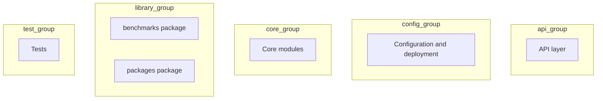

# Architecture report: TanStack/virtual

> Automated static analysis. **Observed** = directly seen in files/imports/AST; **Inferred** = interpretation from that evidence. Repository code was not executed.

## 1. Repository at a glance

| Item | Value |
| --- | --- |
| Repository | TanStack/virtual |
| Description | 🤖 Headless UI for Virtualizing Large Element Lists in JS/TS, React, Solid, Vue and Svelte |
| Language | TypeScript |
| Stars | 7198 |
| Licence | MIT |
| Analysed commit / branch | 54a3f7d3cc32b373187b3802d81cb4b24ae08b0b / main |
| Framework(s) | React, Svelte, Vue |
| Files analysed | 799 |
| Components | 6 |

## 2. Architecture in one minute

TanStack/virtual - 🤖 Headless UI for Virtualizing Large Element Lists in JS/TS, React, Solid, Vue and Svelte. This repository was analysed statically from 799 file(s) (0 Python). Detected technologies (observed from imports/manifests): GitHub Actions, React, Svelte, Vue, TypeScript, Vite. Files are grouped into 6 component(s): API layer, benchmarks package, Configuration and deployment, Core modules, packages package, Tests. Findings below distinguish observed facts from inferred interpretation.

## 3. High-level block diagram

## 4. Main components

### API layer (`api_layer`)

- **Kind:** api
- **Status:** Observed
- **Confidence:** 0.85
- **Responsibility:** Groups 1 file(s) under api layer (observed from repository paths and static analysis).
- **Paths:** `packages/marko-virtual/e2e/app/src/routes/api/reply/+handler.ts`
- **Evidence:** [packages/marko-virtual/e2e/app/src/routes/api/reply/+handler.ts](https://github.com/TanStack/virtual/blob/54a3f7d3cc32b373187b3802d81cb4b24ae08b0b/packages/marko-virtual/e2e/app/src/routes/api/reply/%2Bhandler.ts)

### benchmarks package (`benchmarks`)

- **Kind:** library
- **Status:** Observed
- **Confidence:** 0.85
- **Responsibility:** Groups 16 file(s) under benchmarks package (observed from repository paths and static analysis).
- **Paths:** `benchmarks/runner/run.mjs`, `benchmarks/src/lib/dataset.ts`, `benchmarks/src/lib/harness.ts`, `benchmarks/src/lib/itemRow.tsx`, `benchmarks/src/lib/racBench.ts`, `benchmarks/src/main.tsx`, `benchmarks/src/pages/RacListboxPage.tsx`, `benchmarks/src/pages/RacPage.tsx`, `benchmarks/src/pages/TanstackPage.tsx`, `benchmarks/src/pages/TanstackRacPage.tsx`, `benchmarks/src/pages/VirtuaPage.tsx`, `benchmarks/src/pages/VirtuosoPage.tsx`, `benchmarks/src/pages/WindowPage.tsx`, `benchmarks/src/scenarios/libScenarioExclusions.mjs`, `benchmarks/src/scenarios/types.ts`, `benchmarks/vite.config.ts`
- **Evidence:** [benchmarks/runner/run.mjs](https://github.com/TanStack/virtual/blob/54a3f7d3cc32b373187b3802d81cb4b24ae08b0b/benchmarks/runner/run.mjs); [benchmarks/src/lib/dataset.ts](https://github.com/TanStack/virtual/blob/54a3f7d3cc32b373187b3802d81cb4b24ae08b0b/benchmarks/src/lib/dataset.ts); [benchmarks/src/lib/harness.ts](https://github.com/TanStack/virtual/blob/54a3f7d3cc32b373187b3802d81cb4b24ae08b0b/benchmarks/src/lib/harness.ts); [benchmarks/src/lib/itemRow.tsx](https://github.com/TanStack/virtual/blob/54a3f7d3cc32b373187b3802d81cb4b24ae08b0b/benchmarks/src/lib/itemRow.tsx); [benchmarks/src/lib/racBench.ts](https://github.com/TanStack/virtual/blob/54a3f7d3cc32b373187b3802d81cb4b24ae08b0b/benchmarks/src/lib/racBench.ts); [benchmarks/src/main.tsx](https://github.com/TanStack/virtual/blob/54a3f7d3cc32b373187b3802d81cb4b24ae08b0b/benchmarks/src/main.tsx); [benchmarks/src/pages/RacListboxPage.tsx](https://github.com/TanStack/virtual/blob/54a3f7d3cc32b373187b3802d81cb4b24ae08b0b/benchmarks/src/pages/RacListboxPage.tsx); [benchmarks/src/pages/RacPage.tsx](https://github.com/TanStack/virtual/blob/54a3f7d3cc32b373187b3802d81cb4b24ae08b0b/benchmarks/src/pages/RacPage.tsx)

### Configuration and deployment (`config`)

- **Kind:** config
- **Status:** Observed
- **Confidence:** 0.85
- **Responsibility:** Groups 27 file(s) under configuration and deployment (observed from repository paths and static analysis).
- **Paths:** `benchmarks/package.json`, `benchmarks/results/SAMPLE.json`, `benchmarks/tsconfig.json`, `knip.json`, `nx.json`, `package.json`, `packages/angular-virtual/angular.json`, `packages/angular-virtual/e2e/app/angular.json`, `packages/angular-virtual/e2e/app/tsconfig.app.json`, `packages/angular-virtual/e2e/app/tsconfig.json`, `packages/angular-virtual/package.json`, `packages/angular-virtual/tsconfig.json`, `packages/lit-virtual/package.json`, `packages/lit-virtual/tsconfig.json`, `packages/marko-virtual/e2e/app/marko.json`, `packages/marko-virtual/e2e/app/package.json`, `packages/marko-virtual/e2e/app/tsconfig.json`, `packages/marko-virtual/marko.json`, `packages/marko-virtual/package.json`, `packages/marko-virtual/tsconfig.json`, `packages/marko-virtual/tsconfig.tags.json`, `packages/marko-virtual/tsconfig.typecheck.json`, `packages/react-virtual/e2e/app/tsconfig.json`, `packages/react-virtual/package.json`, `packages/react-virtual/tsconfig.json`, `packages/solid-virtual/package.json`, `packages/solid-virtual/tsconfig.json`
- **Evidence:** [benchmarks/package.json](https://github.com/TanStack/virtual/blob/54a3f7d3cc32b373187b3802d81cb4b24ae08b0b/benchmarks/package.json); [benchmarks/results/SAMPLE.json](https://github.com/TanStack/virtual/blob/54a3f7d3cc32b373187b3802d81cb4b24ae08b0b/benchmarks/results/SAMPLE.json); [benchmarks/tsconfig.json](https://github.com/TanStack/virtual/blob/54a3f7d3cc32b373187b3802d81cb4b24ae08b0b/benchmarks/tsconfig.json); [knip.json](https://github.com/TanStack/virtual/blob/54a3f7d3cc32b373187b3802d81cb4b24ae08b0b/knip.json); [nx.json](https://github.com/TanStack/virtual/blob/54a3f7d3cc32b373187b3802d81cb4b24ae08b0b/nx.json); [package.json](https://github.com/TanStack/virtual/blob/54a3f7d3cc32b373187b3802d81cb4b24ae08b0b/package.json); [packages/angular-virtual/angular.json](https://github.com/TanStack/virtual/blob/54a3f7d3cc32b373187b3802d81cb4b24ae08b0b/packages/angular-virtual/angular.json); [packages/angular-virtual/e2e/app/angular.json](https://github.com/TanStack/virtual/blob/54a3f7d3cc32b373187b3802d81cb4b24ae08b0b/packages/angular-virtual/e2e/app/angular.json)

### Core modules (`core`)

- **Kind:** core
- **Status:** Observed
- **Confidence:** 0.85
- **Responsibility:** Groups 1 file(s) under core modules (observed from repository paths and static analysis).
- **Paths:** `eslint.config.js`
- **Evidence:** [eslint.config.js](https://github.com/TanStack/virtual/blob/54a3f7d3cc32b373187b3802d81cb4b24ae08b0b/eslint.config.js)

### packages package (`packages`)

- **Kind:** library
- **Status:** Observed
- **Confidence:** 0.85
- **Responsibility:** Groups 69 file(s) under packages package (observed from repository paths and static analysis).
- **Paths:** `packages/angular-virtual/e2e/app/src/app/app.component.ts`, `packages/angular-virtual/e2e/app/src/app/app.config.ts`, `packages/angular-virtual/e2e/app/src/app/app.routes.ts`, `packages/angular-virtual/e2e/app/src/app/measure-element.component.ts`, `packages/angular-virtual/e2e/app/src/app/scroll.component.ts`, `packages/angular-virtual/e2e/app/src/app/smooth-scroll.component.ts`, `packages/angular-virtual/e2e/app/src/app/stale-index.component.ts`, `packages/angular-virtual/e2e/app/src/main.ts`, `packages/angular-virtual/eslint.config.js`, `packages/angular-virtual/playwright.config.ts`, `packages/angular-virtual/src/index.ts`, `packages/angular-virtual/src/proxy.ts`, `packages/angular-virtual/src/types.ts`, `packages/angular-virtual/vite.config.ts`, `packages/lit-virtual/eslint.config.js`, `packages/lit-virtual/src/index.ts`, `packages/lit-virtual/vite.config.ts`, `packages/marko-virtual/e2e/app/e2e/chat-pretext.spec.ts`, `packages/marko-virtual/e2e/app/e2e/chat.spec.ts`, `packages/marko-virtual/e2e/app/e2e/dynamic.spec.ts`, `packages/marko-virtual/e2e/app/e2e/fixed.spec.ts`, `packages/marko-virtual/e2e/app/e2e/grid.spec.ts`, `packages/marko-virtual/e2e/app/e2e/infinite-scroll.spec.ts`, `packages/marko-virtual/e2e/app/e2e/option-gates.spec.ts`, `packages/marko-virtual/e2e/app/e2e/padding.spec.ts`, `packages/marko-virtual/e2e/app/e2e/pretext.spec.ts`, `packages/marko-virtual/e2e/app/e2e/scroll-padding.spec.ts`, `packages/marko-virtual/e2e/app/e2e/smooth-scroll.spec.ts`, `packages/marko-virtual/e2e/app/e2e/ssr-fetch.spec.ts`, `packages/marko-virtual/e2e/app/e2e/ssr-restore.spec.ts`, `packages/marko-virtual/e2e/app/e2e/ssr-slice.spec.ts`, `packages/marko-virtual/e2e/app/e2e/ssr.spec.ts`, `packages/marko-virtual/e2e/app/e2e/sticky.spec.ts`, `packages/marko-virtual/e2e/app/e2e/table.spec.ts`, `packages/marko-virtual/e2e/app/e2e/variable.spec.ts`, `packages/marko-virtual/e2e/app/e2e/window-ssr-slice.spec.ts`, `packages/marko-virtual/e2e/app/e2e/window.spec.ts`, `packages/marko-virtual/e2e/app/playwright.config.ts`, `packages/marko-virtual/e2e/app/vite.config.ts`, `packages/marko-virtual/eslint.config.js`, `packages/marko-virtual/src/index.ts`, `packages/marko-virtual/src/tags/virtualizer/options.ts`, `packages/marko-virtual/src/tags/window-virtualizer/options.ts`, `packages/marko-virtual/vite.config.ts`, `packages/marko-virtual/vitest.config.ts`, `packages/react-virtual/e2e/app/cached-measurements/main.tsx`, `packages/react-virtual/e2e/app/chat-resize/main.tsx`, `packages/react-virtual/e2e/app/chat/main.tsx`, `packages/react-virtual/e2e/app/command-retire/main.tsx`, `packages/react-virtual/e2e/app/direct-dom-updates/main.tsx`, `packages/react-virtual/e2e/app/ios-deferral/main.tsx`, `packages/react-virtual/e2e/app/lanes-change/main.tsx`, `packages/react-virtual/e2e/app/measure-element/main.tsx`, `packages/react-virtual/e2e/app/react-compiler-vite.config.ts`, `packages/react-virtual/e2e/app/react-compiler/main.tsx`, `packages/react-virtual/e2e/app/resize-delivery/main.tsx`, `packages/react-virtual/e2e/app/scroll-anchor/main.tsx`, `packages/react-virtual/e2e/app/scroll/main.tsx`, `packages/react-virtual/e2e/app/smooth-prepend/main.tsx`, `packages/react-virtual/e2e/app/smooth-scroll/main.tsx`, `packages/react-virtual/e2e/app/stale-index/main.tsx`, `packages/react-virtual/e2e/app/vite.config.ts`, `packages/react-virtual/eslint.config.js`, `packages/react-virtual/playwright.config.ts`, `packages/react-virtual/src/index.tsx`, `packages/react-virtual/vite.config.ts`, `packages/solid-virtual/eslint.config.js`, `packages/solid-virtual/src/index.tsx`, `packages/solid-virtual/vite.config.ts`
- **Evidence:** [packages/angular-virtual/e2e/app/src/app/app.component.ts](https://github.com/TanStack/virtual/blob/54a3f7d3cc32b373187b3802d81cb4b24ae08b0b/packages/angular-virtual/e2e/app/src/app/app.component.ts); [packages/angular-virtual/e2e/app/src/app/app.config.ts](https://github.com/TanStack/virtual/blob/54a3f7d3cc32b373187b3802d81cb4b24ae08b0b/packages/angular-virtual/e2e/app/src/app/app.config.ts); [packages/angular-virtual/e2e/app/src/app/app.routes.ts](https://github.com/TanStack/virtual/blob/54a3f7d3cc32b373187b3802d81cb4b24ae08b0b/packages/angular-virtual/e2e/app/src/app/app.routes.ts); [packages/angular-virtual/e2e/app/src/app/measure-element.component.ts](https://github.com/TanStack/virtual/blob/54a3f7d3cc32b373187b3802d81cb4b24ae08b0b/packages/angular-virtual/e2e/app/src/app/measure-element.component.ts); [packages/angular-virtual/e2e/app/src/app/scroll.component.ts](https://github.com/TanStack/virtual/blob/54a3f7d3cc32b373187b3802d81cb4b24ae08b0b/packages/angular-virtual/e2e/app/src/app/scroll.component.ts); [packages/angular-virtual/e2e/app/src/app/smooth-scroll.component.ts](https://github.com/TanStack/virtual/blob/54a3f7d3cc32b373187b3802d81cb4b24ae08b0b/packages/angular-virtual/e2e/app/src/app/smooth-scroll.component.ts); [packages/angular-virtual/e2e/app/src/app/stale-index.component.ts](https://github.com/TanStack/virtual/blob/54a3f7d3cc32b373187b3802d81cb4b24ae08b0b/packages/angular-virtual/e2e/app/src/app/stale-index.component.ts); [packages/angular-virtual/e2e/app/src/main.ts](https://github.com/TanStack/virtual/blob/54a3f7d3cc32b373187b3802d81cb4b24ae08b0b/packages/angular-virtual/e2e/app/src/main.ts)

### Tests (`tests`)

- **Kind:** test
- **Status:** Observed
- **Confidence:** 0.85
- **Responsibility:** Groups 36 file(s) under tests (observed from repository paths and static analysis).
- **Paths:** `packages/angular-virtual/e2e/app/test/measure-element.spec.ts`, `packages/angular-virtual/e2e/app/test/no-deprecated-effect-options.spec.ts`, `packages/angular-virtual/e2e/app/test/scroll.spec.ts`, `packages/angular-virtual/e2e/app/test/smooth-scroll.spec.ts`, `packages/angular-virtual/e2e/app/test/stale-index.spec.ts`, `packages/lit-virtual/tests/index.test.ts`, `packages/lit-virtual/tests/re-exports.test.ts`, `packages/lit-virtual/tests/set-options.test.ts`, `packages/marko-virtual/tests/fixtures/count-update-fixture.marko`, `packages/marko-virtual/tests/fixtures/surface-fixture.marko`, `packages/marko-virtual/tests/fixtures/virtualizer-fixture.marko`, `packages/marko-virtual/tests/fixtures/window-virtualizer-fixture.marko`, `packages/marko-virtual/tests/index.test.ts`, `packages/marko-virtual/tests/marko.d.ts`, `packages/marko-virtual/tests/marko.json`, `packages/marko-virtual/tests/options.test.ts`, `packages/marko-virtual/tests/render-slice.test.ts`, `packages/marko-virtual/tests/setup.ts`, `packages/marko-virtual/tests/tags.test.ts`, `packages/react-virtual/e2e/app/test/cached-measurements.spec.ts`, `packages/react-virtual/e2e/app/test/chat.spec.ts`, `packages/react-virtual/e2e/app/test/command-retire.spec.ts`, `packages/react-virtual/e2e/app/test/direct-dom-updates.spec.ts`, `packages/react-virtual/e2e/app/test/ios-programmatic-landing.spec.ts`, `packages/react-virtual/e2e/app/test/lanes-change.spec.ts`, `packages/react-virtual/e2e/app/test/measure-element.spec.ts`, `packages/react-virtual/e2e/app/test/react-compiler.spec.ts`, `packages/react-virtual/e2e/app/test/resize-delivery.spec.ts`, `packages/react-virtual/e2e/app/test/scroll-anchor.spec.ts`, `packages/react-virtual/e2e/app/test/scroll.spec.ts`, `packages/react-virtual/e2e/app/test/smooth-prepend.spec.ts`, `packages/react-virtual/e2e/app/test/smooth-scroll.spec.ts`, `packages/react-virtual/e2e/app/test/stale-index.spec.ts`, `packages/react-virtual/tests/index.test.tsx`, `packages/react-virtual/tests/test-setup.ts`, `packages/solid-virtual/tests/index.test.ts`
- **Evidence:** [packages/angular-virtual/e2e/app/test/measure-element.spec.ts](https://github.com/TanStack/virtual/blob/54a3f7d3cc32b373187b3802d81cb4b24ae08b0b/packages/angular-virtual/e2e/app/test/measure-element.spec.ts); [packages/angular-virtual/e2e/app/test/no-deprecated-effect-options.spec.ts](https://github.com/TanStack/virtual/blob/54a3f7d3cc32b373187b3802d81cb4b24ae08b0b/packages/angular-virtual/e2e/app/test/no-deprecated-effect-options.spec.ts); [packages/angular-virtual/e2e/app/test/scroll.spec.ts](https://github.com/TanStack/virtual/blob/54a3f7d3cc32b373187b3802d81cb4b24ae08b0b/packages/angular-virtual/e2e/app/test/scroll.spec.ts); [packages/angular-virtual/e2e/app/test/smooth-scroll.spec.ts](https://github.com/TanStack/virtual/blob/54a3f7d3cc32b373187b3802d81cb4b24ae08b0b/packages/angular-virtual/e2e/app/test/smooth-scroll.spec.ts); [packages/angular-virtual/e2e/app/test/stale-index.spec.ts](https://github.com/TanStack/virtual/blob/54a3f7d3cc32b373187b3802d81cb4b24ae08b0b/packages/angular-virtual/e2e/app/test/stale-index.spec.ts); [packages/lit-virtual/tests/index.test.ts](https://github.com/TanStack/virtual/blob/54a3f7d3cc32b373187b3802d81cb4b24ae08b0b/packages/lit-virtual/tests/index.test.ts); [packages/lit-virtual/tests/re-exports.test.ts](https://github.com/TanStack/virtual/blob/54a3f7d3cc32b373187b3802d81cb4b24ae08b0b/packages/lit-virtual/tests/re-exports.test.ts); [packages/lit-virtual/tests/set-options.test.ts](https://github.com/TanStack/virtual/blob/54a3f7d3cc32b373187b3802d81cb4b24ae08b0b/packages/lit-virtual/tests/set-options.test.ts)

## 5. Execution flow

**Observed** entry point(s):

- [benchmarks/src/main.tsx](https://github.com/TanStack/virtual/blob/54a3f7d3cc32b373187b3802d81cb4b24ae08b0b/benchmarks/src/main.tsx)
- [packages/angular-virtual/src/index.ts](https://github.com/TanStack/virtual/blob/54a3f7d3cc32b373187b3802d81cb4b24ae08b0b/packages/angular-virtual/src/index.ts)
- [packages/lit-virtual/src/index.ts](https://github.com/TanStack/virtual/blob/54a3f7d3cc32b373187b3802d81cb4b24ae08b0b/packages/lit-virtual/src/index.ts)
- [packages/marko-virtual/src/index.ts](https://github.com/TanStack/virtual/blob/54a3f7d3cc32b373187b3802d81cb4b24ae08b0b/packages/marko-virtual/src/index.ts)
- [packages/react-virtual/src/index.tsx](https://github.com/TanStack/virtual/blob/54a3f7d3cc32b373187b3802d81cb4b24ae08b0b/packages/react-virtual/src/index.tsx)
- [packages/solid-virtual/src/index.tsx](https://github.com/TanStack/virtual/blob/54a3f7d3cc32b373187b3802d81cb4b24ae08b0b/packages/solid-virtual/src/index.tsx)

Representative flow (derived from observed entry points and the import graph; steps beyond the entry point are **Inferred**):

1. Execution starts at an observed entry point listed above, if present.
2. No internal import relationships between components were observed.

## 6. Project structure

### `(root)`

- `.gitattributes` - other (73 bytes)
- `.gitignore` - other (669 bytes)
- `.nvmrc` - other (7 bytes)
- `.prettierignore` - other (121 bytes)
- `CONTRIBUTING.md` - docs (6215 bytes)
- `LICENSE` - docs (1079 bytes)
- `README.md` - docs (5226 bytes)
- `eslint.config.js` - source, JavaScript (371 bytes)
- `knip.json` - config (543 bytes)
- `nx.json` - config (1875 bytes)
- `package.json` - manifest (2508 bytes)

### `.changeset`

- `.changeset/config.json` - config (456 bytes)
- `.changeset/shared-scroller-offscreen-range.md` - docs (329 bytes)

### `.claude`

- `.claude/scheduled_tasks.lock` - other (130 bytes)

### `.github`

- `.github/CODEOWNERS` - other (204 bytes)
- `.github/FUNDING.yml` - config (22 bytes)
- `.github/ISSUE_TEMPLATE/bug_report.yml` - config (5805 bytes)
- `.github/ISSUE_TEMPLATE/config.yml` - config (457 bytes)
- `.github/pull_request_template.md` - docs (540 bytes)
- `.github/renovate.json` - config (564 bytes)
- `.github/workflows/autofix.yml` - ci, YAML (875 bytes)
- `.github/workflows/pr.yml` - ci, YAML (2428 bytes)
- `.github/workflows/release.yml` - ci, YAML (1568 bytes)
- `.github/workflows/zizmor.yml` - ci, YAML (545 bytes)

### `benchmarks`

- `benchmarks/.gitignore` - other (90 bytes)
- `benchmarks/CHANGELOG.md` - docs (3314 bytes)
- `benchmarks/README.md` - docs (16717 bytes)
- `benchmarks/index.html` - other (798 bytes)
- `benchmarks/package.json` - manifest (769 bytes)
- `benchmarks/results/.gitkeep` - other (0 bytes)
- `benchmarks/results/SAMPLE.json` - config (63718 bytes)
- `benchmarks/runner/run.mjs` - source, JavaScript (10616 bytes)
- `benchmarks/src/lib/dataset.ts` - source, TypeScript (2422 bytes)
- `benchmarks/src/lib/harness.ts` - source, TypeScript (12448 bytes)
- `benchmarks/src/lib/itemRow.tsx` - source, TypeScript (436 bytes)
- `benchmarks/src/lib/racBench.ts` - source, TypeScript (3417 bytes)
- `benchmarks/src/main.tsx` - source, TypeScript (2017 bytes)
- `benchmarks/src/pages/RacListboxPage.tsx` - source, TypeScript (2882 bytes)
- `benchmarks/src/pages/RacPage.tsx` - source, TypeScript (2875 bytes)
- `benchmarks/src/pages/TanstackPage.tsx` - source, TypeScript (3366 bytes)
- `benchmarks/src/pages/TanstackRacPage.tsx` - source, TypeScript (3474 bytes)
- `benchmarks/src/pages/VirtuaPage.tsx` - source, TypeScript (2775 bytes)
- `benchmarks/src/pages/VirtuosoPage.tsx` - source, TypeScript (2712 bytes)
- `benchmarks/src/pages/WindowPage.tsx` - source, TypeScript (2597 bytes)
- `benchmarks/src/scenarios/libScenarioExclusions.d.mts` - other (149 bytes)
- `benchmarks/src/scenarios/libScenarioExclusions.mjs` - source, JavaScript (170 bytes)
- `benchmarks/src/scenarios/types.ts` - source, TypeScript (4870 bytes)
- `benchmarks/tsconfig.json` - config (442 bytes)
- `benchmarks/vite.config.ts` - source, TypeScript (226 bytes)

### `docs`

- `docs/api/virtual-item.md` - docs (2002 bytes)
- `docs/api/virtualizer.md` - docs (26204 bytes)
- `docs/chat.md` - docs (4690 bytes)
- `docs/config.json` - config (9967 bytes)
- `docs/framework/angular/angular-virtual.md` - docs (1522 bytes)
- `docs/framework/lit/lit-virtual.md` - docs (2241 bytes)
- `docs/framework/marko/marko-virtual.md` - docs (17870 bytes)
- `docs/framework/react/react-virtual.md` - docs (5793 bytes)
- `docs/framework/solid/solid-virtual.md` - docs (958 bytes)
- `docs/framework/svelte/svelte-virtual.md` - docs (960 bytes)
- `docs/framework/vue/vue-virtual.md` - docs (942 bytes)
- `docs/installation.md` - docs (722 bytes)
- `docs/introduction.md` - docs (2327 bytes)
- `docs/pretext.md` - docs (4635 bytes)

### `examples`

- `examples/angular/chat/README.md` - docs (445 bytes)
- `examples/angular/chat/angular.json` - config (1598 bytes)
- `examples/angular/chat/package.json` - manifest (854 bytes)
- `examples/angular/chat/src/app/app.component.ts` - source, TypeScript (6725 bytes)
- `examples/angular/chat/src/index.html` - other (288 bytes)
- `examples/angular/chat/src/main.ts` - source, TypeScript (191 bytes)
- `examples/angular/chat/src/styles.css` - other (1659 bytes)
- `examples/angular/chat/tsconfig.app.json` - config (170 bytes)
- `examples/angular/chat/tsconfig.json` - config (824 bytes)
- `examples/angular/dynamic/.devcontainer/devcontainer.json` - config (89 bytes)
- `examples/angular/dynamic/.gitignore` - other (587 bytes)
- `examples/angular/dynamic/README.md` - docs (1092 bytes)
- `examples/angular/dynamic/angular.json` - config (1911 bytes)
- `examples/angular/dynamic/package.json` - manifest (890 bytes)
- `examples/angular/dynamic/src/app/app.component.ts` - source, TypeScript (838 bytes)
- `examples/angular/dynamic/src/app/app.config.ts` - source, TypeScript (224 bytes)
- `examples/angular/dynamic/src/app/app.routes.ts` - source, TypeScript (677 bytes)
- `examples/angular/dynamic/src/app/column-virtualizer-dynamic.component.ts` - source, TypeScript (1939 bytes)
- `examples/angular/dynamic/src/app/grid-virtualizer-dynamic.component.ts` - source, TypeScript (3372 bytes)
- `examples/angular/dynamic/src/app/row-virtualizer-dynamic-window.component.ts` - source, TypeScript (2246 bytes)
- `examples/angular/dynamic/src/app/row-virtualizer-dynamic.component.ts` - source, TypeScript (2452 bytes)
- `examples/angular/dynamic/src/app/utils.ts` - source, TypeScript (958 bytes)
- `examples/angular/dynamic/src/index.html` - other (352 bytes)
- `examples/angular/dynamic/src/main.ts` - source, TypeScript (243 bytes)
- `examples/angular/dynamic/src/styles.css` - other (327 bytes)
- `examples/angular/dynamic/tsconfig.app.json` - config (247 bytes)
- `examples/angular/dynamic/tsconfig.json` - config (911 bytes)
- `examples/angular/fixed/.devcontainer/devcontainer.json` - config (89 bytes)
- `examples/angular/fixed/.gitignore` - other (587 bytes)
- `examples/angular/fixed/README.md` - docs (1090 bytes)
- `examples/angular/fixed/angular.json` - config (1901 bytes)
- `examples/angular/fixed/package.json` - manifest (855 bytes)
- `examples/angular/fixed/src/app/app.component.ts` - source, TypeScript (813 bytes)
- `examples/angular/fixed/src/app/column-virtualizer-fixed.component.ts` - source, TypeScript (1445 bytes)
- `examples/angular/fixed/src/app/grid-virtualizer-fixed.component.ts` - source, TypeScript (2285 bytes)
- `examples/angular/fixed/src/app/row-virtualizer-fixed.component.ts` - source, TypeScript (1413 bytes)
- `examples/angular/fixed/src/index.html` - other (350 bytes)
- `examples/angular/fixed/src/main.ts` - source, TypeScript (187 bytes)
- `examples/angular/fixed/src/styles.css` - other (393 bytes)
- `examples/angular/fixed/tsconfig.app.json` - config (247 bytes)
- `examples/angular/fixed/tsconfig.json` - config (839 bytes)
- `examples/angular/infinite-scroll/.devcontainer/devcontainer.json` - config (89 bytes)
- `examples/angular/infinite-scroll/.gitignore` - other (587 bytes)
- `examples/angular/infinite-scroll/README.md` - docs (1099 bytes)
- `examples/angular/infinite-scroll/angular.json` - config (1951 bytes)
- `examples/angular/infinite-scroll/package.json` - manifest (919 bytes)
- `examples/angular/infinite-scroll/src/app/app.component.ts` - source, TypeScript (3601 bytes)
- `examples/angular/infinite-scroll/src/index.html` - other (359 bytes)
- `examples/angular/infinite-scroll/src/main.ts` - source, TypeScript (187 bytes)
- `examples/angular/infinite-scroll/src/styles.css` - other (431 bytes)
- `examples/angular/infinite-scroll/tsconfig.app.json` - config (247 bytes)
- `examples/angular/infinite-scroll/tsconfig.json` - config (839 bytes)
- `examples/angular/padding/.devcontainer/devcontainer.json` - config (89 bytes)
- `examples/angular/padding/.gitignore` - other (587 bytes)
- `examples/angular/padding/README.md` - docs (1092 bytes)
- `examples/angular/padding/angular.json` - config (1911 bytes)
- `examples/angular/padding/package.json` - manifest (857 bytes)
- `examples/angular/padding/src/app/app.component.ts` - source, TypeScript (1343 bytes)
- `examples/angular/padding/src/app/column-virtualizer-padding.component.ts` - source, TypeScript (1840 bytes)
- `examples/angular/padding/src/app/grid-virtualizer-padding.component.ts` - source, TypeScript (3405 bytes)
- `examples/angular/padding/src/app/row-virtualizer-padding.component.ts` - source, TypeScript (1781 bytes)
- `examples/angular/padding/src/index.html` - other (352 bytes)
- `examples/angular/padding/src/main.ts` - source, TypeScript (187 bytes)
- `examples/angular/padding/src/styles.css` - other (431 bytes)
- `examples/angular/padding/tsconfig.app.json` - config (247 bytes)
- `examples/angular/padding/tsconfig.json` - config (839 bytes)
- `examples/angular/smooth-scroll/.devcontainer/devcontainer.json` - config (89 bytes)
- `examples/angular/smooth-scroll/.gitignore` - other (587 bytes)
- `examples/angular/smooth-scroll/README.md` - docs (1097 bytes)
- `examples/angular/smooth-scroll/angular.json` - config (1941 bytes)
- `examples/angular/smooth-scroll/package.json` - manifest (863 bytes)
- `examples/angular/smooth-scroll/src/app/app.component.ts` - source, TypeScript (2814 bytes)
- `examples/angular/smooth-scroll/src/index.html` - other (357 bytes)
- `examples/angular/smooth-scroll/src/main.ts` - source, TypeScript (187 bytes)
- `examples/angular/smooth-scroll/src/styles.css` - other (431 bytes)
- `examples/angular/smooth-scroll/tsconfig.app.json` - config (247 bytes)
- `examples/angular/smooth-scroll/tsconfig.json` - config (839 bytes)
- `examples/angular/sticky/.devcontainer/devcontainer.json` - config (89 bytes)
- `examples/angular/sticky/.gitignore` - other (587 bytes)
- `examples/angular/sticky/README.md` - docs (1091 bytes)
- `examples/angular/sticky/angular.json` - config (1906 bytes)
- `examples/angular/sticky/package.json` - manifest (889 bytes)
- `examples/angular/sticky/src/app/app.component.ts` - source, TypeScript (2746 bytes)
- `examples/angular/sticky/src/index.html` - other (351 bytes)
- `examples/angular/sticky/src/main.ts` - source, TypeScript (187 bytes)
- `examples/angular/sticky/src/styles.css` - other (431 bytes)
- `examples/angular/sticky/tsconfig.app.json` - config (247 bytes)
- `examples/angular/sticky/tsconfig.json` - config (839 bytes)
- `examples/angular/table/.devcontainer/devcontainer.json` - config (89 bytes)
- `examples/angular/table/.gitignore` - other (587 bytes)
- `examples/angular/table/README.md` - docs (1090 bytes)
- `examples/angular/table/angular.json` - config (1901 bytes)
- `examples/angular/table/package.json` - manifest (929 bytes)
- `examples/angular/table/src/app/app.component.ts` - source, TypeScript (5954 bytes)
- `examples/angular/table/src/app/make-data.ts` - source, TypeScript (1089 bytes)
- `examples/angular/table/src/index.html` - other (350 bytes)
- `examples/angular/table/src/main.ts` - source, TypeScript (187 bytes)
- `examples/angular/table/src/styles.css` - other (431 bytes)
- `examples/angular/table/tsconfig.app.json` - config (247 bytes)
- `examples/angular/table/tsconfig.json` - config (839 bytes)
- `examples/angular/variable/.devcontainer/devcontainer.json` - config (89 bytes)
- `examples/angular/variable/.gitignore` - other (587 bytes)
- `examples/angular/variable/README.md` - docs (1093 bytes)
- `examples/angular/variable/angular.json` - config (1916 bytes)
- `examples/angular/variable/package.json` - manifest (858 bytes)
- `examples/angular/variable/src/app/app.component.ts` - source, TypeScript (1128 bytes)
- `examples/angular/variable/src/app/column-virtualizer-variable.component.ts` - source, TypeScript (1524 bytes)
- `examples/angular/variable/src/app/grid-virtualizer-variable.component.ts` - source, TypeScript (2423 bytes)
- `examples/angular/variable/src/app/row-virtualizer-variable.component.ts` - source, TypeScript (1500 bytes)
- `examples/angular/variable/src/index.html` - other (353 bytes)
- `examples/angular/variable/src/main.ts` - source, TypeScript (187 bytes)
- `examples/angular/variable/src/styles.css` - other (431 bytes)
- `examples/angular/variable/tsconfig.app.json` - config (247 bytes)
- `examples/angular/variable/tsconfig.json` - config (839 bytes)
- `examples/angular/window/.devcontainer/devcontainer.json` - config (89 bytes)
- `examples/angular/window/.gitignore` - other (587 bytes)
- `examples/angular/window/README.md` - docs (1091 bytes)
- `examples/angular/window/angular.json` - config (1906 bytes)
- `examples/angular/window/package.json` - manifest (856 bytes)
- `examples/angular/window/src/app/app.component.ts` - source, TypeScript (1815 bytes)
- `examples/angular/window/src/index.html` - other (351 bytes)
- `examples/angular/window/src/main.ts` - source, TypeScript (187 bytes)
- `examples/angular/window/src/styles.css` - other (431 bytes)
- `examples/angular/window/tsconfig.app.json` - config (247 bytes)
- `examples/angular/window/tsconfig.json` - config (839 bytes)
- `examples/lit/dynamic/.gitignore` - other (45 bytes)
- `examples/lit/dynamic/README.md` - docs (95 bytes)
- `examples/lit/dynamic/index.html` - other (288 bytes)
- `examples/lit/dynamic/package.json` - manifest (459 bytes)
- `examples/lit/dynamic/src/index.css` - other (82 bytes)
- `examples/lit/dynamic/src/main.ts` - source, TypeScript (10556 bytes)
- `examples/lit/dynamic/tsconfig.json` - config (309 bytes)
- `examples/lit/dynamic/vite.config.js` - source, JavaScript (115 bytes)
- `examples/lit/fixed/.gitignore` - other (45 bytes)
- `examples/lit/fixed/README.md` - docs (95 bytes)
- `examples/lit/fixed/index.html` - other (288 bytes)
- `examples/lit/fixed/package.json` - manifest (457 bytes)
- `examples/lit/fixed/src/index.css` - other (82 bytes)
- `examples/lit/fixed/src/main.ts` - source, TypeScript (8609 bytes)
- `examples/lit/fixed/tsconfig.json` - config (309 bytes)
- `examples/lit/fixed/vite.config.js` - source, JavaScript (115 bytes)
- `examples/marko/chat-pretext/marko.json` - config (59 bytes)
- `examples/marko/chat-pretext/package.json` - manifest (555 bytes)
- `examples/marko/chat-pretext/src/routes/+page.marko` - other (15512 bytes)
- `examples/marko/chat-pretext/src/routes/api/reply/+handler.ts` - source, TypeScript (1240 bytes)
- `examples/marko/chat-pretext/tsconfig.json` - config (430 bytes)
- `examples/marko/chat-pretext/vite.config.ts` - source, TypeScript (533 bytes)
- `examples/marko/chat/marko.json` - config (59 bytes)
- `examples/marko/chat/package.json` - manifest (512 bytes)
- `examples/marko/chat/src/routes/+page.marko` - other (10683 bytes)
- `examples/marko/chat/src/routes/api/reply/+handler.ts` - source, TypeScript (1240 bytes)
- `examples/marko/chat/tsconfig.json` - config (430 bytes)
- `examples/marko/chat/vite.config.ts` - source, TypeScript (533 bytes)
- `examples/marko/dynamic/marko.json` - config (59 bytes)
- `examples/marko/dynamic/package.json` - manifest (515 bytes)
- `examples/marko/dynamic/src/routes/+page.marko` - other (2032 bytes)
- `examples/marko/dynamic/tsconfig.json` - config (430 bytes)
- `examples/marko/dynamic/vite.config.ts` - source, TypeScript (533 bytes)
- `examples/marko/fixed/marko.json` - config (59 bytes)
- `examples/marko/fixed/package.json` - manifest (513 bytes)
- `examples/marko/fixed/src/routes/+page.marko` - other (4118 bytes)
- `examples/marko/fixed/tsconfig.json` - config (430 bytes)
- `examples/marko/fixed/vite.config.ts` - source, TypeScript (533 bytes)
- `examples/marko/grid/marko.json` - config (59 bytes)
- `examples/marko/grid/package.json` - manifest (512 bytes)
- `examples/marko/grid/src/routes/+page.marko` - other (2000 bytes)
- `examples/marko/grid/tsconfig.json` - config (430 bytes)
- `examples/marko/grid/vite.config.ts` - source, TypeScript (533 bytes)
- `examples/marko/infinite-scroll/marko.json` - config (59 bytes)
- `examples/marko/infinite-scroll/package.json` - manifest (523 bytes)
- `examples/marko/infinite-scroll/src/routes/+page.marko` - other (3155 bytes)
- `examples/marko/infinite-scroll/tsconfig.json` - config (430 bytes)
- `examples/marko/infinite-scroll/vite.config.ts` - source, TypeScript (533 bytes)
- `examples/marko/padding/marko.json` - config (59 bytes)
- `examples/marko/padding/package.json` - manifest (515 bytes)
- `examples/marko/padding/src/routes/+page.marko` - other (7000 bytes)
- `examples/marko/padding/src/seeded.ts` - source, TypeScript (865 bytes)
- `examples/marko/padding/tsconfig.json` - config (430 bytes)
- `examples/marko/padding/vite.config.ts` - source, TypeScript (533 bytes)
- `examples/marko/pretext/marko.json` - config (59 bytes)
- `examples/marko/pretext/package.json` - manifest (550 bytes)
- `examples/marko/pretext/src/routes/+page.marko` - other (9691 bytes)
- `examples/marko/pretext/tsconfig.json` - config (430 bytes)
- `examples/marko/pretext/vite.config.ts` - source, TypeScript (533 bytes)
- `examples/marko/scroll-padding/marko.json` - config (59 bytes)
- `examples/marko/scroll-padding/package.json` - manifest (522 bytes)
- `examples/marko/scroll-padding/src/routes/+page.marko` - other (3777 bytes)
- `examples/marko/scroll-padding/tsconfig.json` - config (430 bytes)
- `examples/marko/scroll-padding/vite.config.ts` - source, TypeScript (533 bytes)
- `examples/marko/smooth-scroll/marko.json` - config (59 bytes)
- `examples/marko/smooth-scroll/package.json` - manifest (521 bytes)
- `examples/marko/smooth-scroll/src/routes/+page.marko` - other (2420 bytes)
- `examples/marko/smooth-scroll/tsconfig.json` - config (430 bytes)
- `examples/marko/smooth-scroll/vite.config.ts` - source, TypeScript (533 bytes)
- `examples/marko/ssr-fetch/marko.json` - config (59 bytes)
- `examples/marko/ssr-fetch/package.json` - manifest (517 bytes)
- `examples/marko/ssr-fetch/src/data.ts` - source, TypeScript (732 bytes)
- `examples/marko/ssr-fetch/src/routes/+page.marko` - other (2966 bytes)
- `examples/marko/ssr-fetch/tsconfig.json` - config (430 bytes)
- `examples/marko/ssr-fetch/vite.config.ts` - source, TypeScript (533 bytes)
- `examples/marko/ssr-restore/marko.json` - config (59 bytes)
- `examples/marko/ssr-restore/package.json` - manifest (519 bytes)
- `examples/marko/ssr-restore/src/data.ts` - source, TypeScript (732 bytes)
- `examples/marko/ssr-restore/src/routes/+page.marko` - other (3674 bytes)
- `examples/marko/ssr-restore/tsconfig.json` - config (430 bytes)
- `examples/marko/ssr-restore/vite.config.ts` - source, TypeScript (533 bytes)
- `examples/marko/ssr-slice/marko.json` - config (59 bytes)
- `examples/marko/ssr-slice/package.json` - manifest (517 bytes)
- `examples/marko/ssr-slice/src/data.ts` - source, TypeScript (732 bytes)
- `examples/marko/ssr-slice/src/routes/+page.marko` - other (3095 bytes)
- `examples/marko/ssr-slice/tsconfig.json` - config (430 bytes)
- `examples/marko/ssr-slice/vite.config.ts` - source, TypeScript (533 bytes)
- `examples/marko/ssr/marko.json` - config (59 bytes)
- `examples/marko/ssr/package.json` - manifest (511 bytes)
- `examples/marko/ssr/src/routes/+page.marko` - other (1951 bytes)
- `examples/marko/ssr/tsconfig.json` - config (430 bytes)
- `examples/marko/ssr/vite.config.ts` - source, TypeScript (533 bytes)
- `examples/marko/sticky/marko.json` - config (59 bytes)
- `examples/marko/sticky/package.json` - manifest (514 bytes)
- `examples/marko/sticky/src/routes/+page.marko` - other (4445 bytes)
- `examples/marko/sticky/tsconfig.json` - config (430 bytes)
- `examples/marko/sticky/vite.config.ts` - source, TypeScript (533 bytes)
- `examples/marko/table/marko.json` - config (59 bytes)
- `examples/marko/table/package.json` - manifest (513 bytes)
- `examples/marko/table/src/rng.ts` - source, TypeScript (577 bytes)
- `examples/marko/table/src/routes/+page.marko` - other (6978 bytes)
- `examples/marko/table/tsconfig.json` - config (430 bytes)
- `examples/marko/table/vite.config.ts` - source, TypeScript (533 bytes)
- `examples/marko/variable/marko.json` - config (59 bytes)
- `examples/marko/variable/package.json` - manifest (516 bytes)
- `examples/marko/variable/src/routes/+page.marko` - other (3726 bytes)
- `examples/marko/variable/tsconfig.json` - config (430 bytes)
- `examples/marko/variable/vite.config.ts` - source, TypeScript (533 bytes)
- `examples/marko/window-ssr-slice/marko.json` - config (59 bytes)
- `examples/marko/window-ssr-slice/package.json` - manifest (524 bytes)
- `examples/marko/window-ssr-slice/src/data.ts` - source, TypeScript (732 bytes)
- `examples/marko/window-ssr-slice/src/routes/+page.marko` - other (2759 bytes)
- `examples/marko/window-ssr-slice/tsconfig.json` - config (430 bytes)
- `examples/marko/window-ssr-slice/vite.config.ts` - source, TypeScript (533 bytes)
- `examples/marko/window/marko.json` - config (59 bytes)
- `examples/marko/window/package.json` - manifest (514 bytes)
- `examples/marko/window/src/routes/+page.marko` - other (2513 bytes)
- `examples/marko/window/tsconfig.json` - config (430 bytes)
- `examples/marko/window/vite.config.ts` - source, TypeScript (533 bytes)
- `examples/react/chat/.gitignore` - other (18 bytes)
- `examples/react/chat/README.md` - docs (668 bytes)
- `examples/react/chat/index.html` - other (316 bytes)
- `examples/react/chat/package.json` - manifest (532 bytes)
- `examples/react/chat/src/api.ts` - source, TypeScript (7487 bytes)
- `examples/react/chat/src/index.css` - other (5756 bytes)
- `examples/react/chat/src/main.tsx` - source, TypeScript (11045 bytes)
- `examples/react/chat/src/queries.ts` - source, TypeScript (3280 bytes)
- `examples/react/chat/tsconfig.json` - config (531 bytes)
- `examples/react/chat/vite.config.js` - source, JavaScript (133 bytes)
- `examples/react/dynamic/.gitignore` - other (45 bytes)
- `examples/react/dynamic/README.md` - docs (95 bytes)
- `examples/react/dynamic/index.html` - other (267 bytes)
- `examples/react/dynamic/package.json` - manifest (558 bytes)
- `examples/react/dynamic/src/index.css` - other (241 bytes)
- `examples/react/dynamic/src/main.tsx` - source, TypeScript (11984 bytes)
- `examples/react/dynamic/tsconfig.json` - config (572 bytes)
- `examples/react/dynamic/vite.config.js` - source, JavaScript (163 bytes)
- `examples/react/fixed/.gitignore` - other (45 bytes)
- `examples/react/fixed/README.md` - docs (93 bytes)
- `examples/react/fixed/index.html` - other (267 bytes)
- `examples/react/fixed/package.json` - manifest (523 bytes)
- `examples/react/fixed/src/index.css` - other (327 bytes)
- `examples/react/fixed/src/main.tsx` - source, TypeScript (5590 bytes)
- `examples/react/fixed/tsconfig.json` - config (572 bytes)
- `examples/react/fixed/vite.config.js` - source, JavaScript (163 bytes)
- `examples/react/infinite-scroll/.gitignore` - other (45 bytes)
- `examples/react/infinite-scroll/README.md` - docs (93 bytes)
- `examples/react/infinite-scroll/index.html` - other (372 bytes)
- `examples/react/infinite-scroll/package.json` - manifest (542 bytes)
- `examples/react/infinite-scroll/src/index.css` - other (327 bytes)
- `examples/react/infinite-scroll/src/main.tsx` - source, TypeScript (4199 bytes)
- `examples/react/infinite-scroll/tsconfig.json` - config (572 bytes)
- `examples/react/infinite-scroll/vite.config.js` - source, JavaScript (133 bytes)
- `examples/react/padding/.gitignore` - other (45 bytes)
- `examples/react/padding/README.md` - docs (93 bytes)
- `examples/react/padding/index.html` - other (372 bytes)
- `examples/react/padding/package.json` - manifest (494 bytes)
- `examples/react/padding/src/index.css` - other (327 bytes)
- `examples/react/padding/src/main.tsx` - source, TypeScript (7412 bytes)
- `examples/react/padding/tsconfig.json` - config (572 bytes)
- `examples/react/padding/vite.config.js` - source, JavaScript (133 bytes)
- `examples/react/pretext/README.md` - docs (111 bytes)
- `examples/react/pretext/index.html` - other (267 bytes)
- `examples/react/pretext/package.json` - manifest (560 bytes)
- `examples/react/pretext/src/index.css` - other (1703 bytes)
- `examples/react/pretext/src/main.tsx` - source, TypeScript (8013 bytes)
- `examples/react/pretext/tsconfig.json` - config (572 bytes)
- `examples/react/pretext/vite.config.js` - source, JavaScript (163 bytes)
- `examples/react/scroll-padding/.gitignore` - other (45 bytes)
- `examples/react/scroll-padding/README.md` - docs (93 bytes)
- `examples/react/scroll-padding/index.html` - other (372 bytes)
- `examples/react/scroll-padding/package.json` - manifest (536 bytes)
- `examples/react/scroll-padding/src/index.css` - other (664 bytes)
- `examples/react/scroll-padding/src/main.tsx` - source, TypeScript (2738 bytes)
- `examples/react/scroll-padding/tsconfig.json` - config (572 bytes)
- `examples/react/scroll-padding/vite.config.js` - source, JavaScript (133 bytes)
- `examples/react/smooth-scroll/.gitignore` - other (45 bytes)
- `examples/react/smooth-scroll/README.md` - docs (93 bytes)
- `examples/react/smooth-scroll/index.html` - other (372 bytes)
- `examples/react/smooth-scroll/package.json` - manifest (500 bytes)
- `examples/react/smooth-scroll/src/index.css` - other (327 bytes)
- `examples/react/smooth-scroll/src/main.tsx` - source, TypeScript (3395 bytes)
- `examples/react/smooth-scroll/tsconfig.json` - config (572 bytes)
- `examples/react/smooth-scroll/vite.config.js` - source, JavaScript (133 bytes)
- `examples/react/sticky/.gitignore` - other (45 bytes)
- `examples/react/sticky/README.md` - docs (93 bytes)
- `examples/react/sticky/index.html` - other (372 bytes)
- `examples/react/sticky/package.json` - manifest (585 bytes)
- `examples/react/sticky/src/index.css` - other (327 bytes)
- `examples/react/sticky/src/main.tsx` - source, TypeScript (3355 bytes)
- `examples/react/sticky/tsconfig.json` - config (572 bytes)
- `examples/react/sticky/vite.config.js` - source, JavaScript (133 bytes)
- `examples/react/table/.gitignore` - other (45 bytes)
- `examples/react/table/README.md` - docs (95 bytes)
- `examples/react/table/index.html` - other (295 bytes)
- `examples/react/table/package.json` - manifest (565 bytes)
- `examples/react/table/src/index.css` - other (312 bytes)
- `examples/react/table/src/main.tsx` - source, TypeScript (5613 bytes)
- `examples/react/table/src/makeData.ts` - source, TypeScript (1089 bytes)
- `examples/react/table/tsconfig.json` - config (572 bytes)
- `examples/react/table/vite.config.js` - source, JavaScript (163 bytes)
- `examples/react/variable/.gitignore` - other (45 bytes)
- `examples/react/variable/README.md` - docs (93 bytes)
- `examples/react/variable/index.html` - other (372 bytes)
- `examples/react/variable/package.json` - manifest (495 bytes)
- `examples/react/variable/src/index.css` - other (327 bytes)
- `examples/react/variable/src/main.tsx` - source, TypeScript (9080 bytes)
- `examples/react/variable/tsconfig.json` - config (572 bytes)
- `examples/react/variable/vite.config.js` - source, JavaScript (133 bytes)
- `examples/react/window/.gitignore` - other (45 bytes)
- `examples/react/window/README.md` - docs (93 bytes)
- `examples/react/window/index.html` - other (267 bytes)
- `examples/react/window/package.json` - manifest (524 bytes)
- `examples/react/window/src/index.css` - other (327 bytes)
- `examples/react/window/src/main.tsx` - source, TypeScript (2299 bytes)
- `examples/react/window/tsconfig.json` - config (572 bytes)
- `examples/react/window/vite.config.js` - source, JavaScript (163 bytes)
- `examples/svelte/dynamic/.gitignore` - other (253 bytes)
- `examples/svelte/dynamic/README.md` - docs (89 bytes)
- `examples/svelte/dynamic/index.html` - other (265 bytes)
- `examples/svelte/dynamic/package.json` - manifest (582 bytes)
- `examples/svelte/dynamic/src/App.svelte` - source, Svelte (1279 bytes)
- `examples/svelte/dynamic/src/ColumnVirtualizerDynamic.svelte` - source, Svelte (1564 bytes)
- `examples/svelte/dynamic/src/GridVirtualizerDynamic.svelte` - source, Svelte (1465 bytes)
- `examples/svelte/dynamic/src/RowVirtualizerDynamic.svelte` - source, Svelte (2163 bytes)
- `examples/svelte/dynamic/src/RowVirtualizerDynamicWindow.svelte` - source, Svelte (1638 bytes)
- `examples/svelte/dynamic/src/app.css` - other (333 bytes)
- `examples/svelte/dynamic/src/main.ts` - source, TypeScript (139 bytes)
- `examples/svelte/dynamic/src/vite-env.d.ts` - source, TypeScript (71 bytes)
- `examples/svelte/dynamic/svelte.config.js` - source, JavaScript (228 bytes)
- `examples/svelte/dynamic/tsconfig.json` - config (638 bytes)
- `examples/svelte/dynamic/tsconfig.node.json` - config (171 bytes)
- `examples/svelte/dynamic/vite.config.ts` - source, TypeScript (177 bytes)
- `examples/svelte/fixed/.gitignore` - other (253 bytes)
- `examples/svelte/fixed/README.md` - docs (89 bytes)
- `examples/svelte/fixed/index.html` - other (265 bytes)
- `examples/svelte/fixed/package.json` - manifest (547 bytes)
- `examples/svelte/fixed/src/App.svelte` - source, Svelte (608 bytes)
- `examples/svelte/fixed/src/ColumnVirtualizerFixed.svelte` - source, Svelte (972 bytes)
- `examples/svelte/fixed/src/GridVirtualizerFixed.svelte` - source, Svelte (1465 bytes)
- `examples/svelte/fixed/src/RowVirtualizerFixed.svelte` - source, Svelte (946 bytes)
- `examples/svelte/fixed/src/app.css` - other (333 bytes)
- `examples/svelte/fixed/src/main.ts` - source, TypeScript (139 bytes)
- `examples/svelte/fixed/src/vite-env.d.ts` - source, TypeScript (71 bytes)
- `examples/svelte/fixed/svelte.config.js` - source, JavaScript (228 bytes)
- `examples/svelte/fixed/tsconfig.json` - config (638 bytes)
- `examples/svelte/fixed/tsconfig.node.json` - config (171 bytes)
- `examples/svelte/fixed/vite.config.ts` - source, TypeScript (177 bytes)
- `examples/svelte/infinite-scroll/.gitignore` - other (253 bytes)
- `examples/svelte/infinite-scroll/README.md` - docs (89 bytes)
- `examples/svelte/infinite-scroll/index.html` - other (265 bytes)
- `examples/svelte/infinite-scroll/package.json` - manifest (598 bytes)
- `examples/svelte/infinite-scroll/src/App.svelte` - source, Svelte (283 bytes)
- `examples/svelte/infinite-scroll/src/InfiniteRows.svelte` - source, Svelte (2902 bytes)
- `examples/svelte/infinite-scroll/src/app.css` - other (333 bytes)
- `examples/svelte/infinite-scroll/src/main.ts` - source, TypeScript (139 bytes)
- `examples/svelte/infinite-scroll/src/vite-env.d.ts` - source, TypeScript (71 bytes)
- `examples/svelte/infinite-scroll/svelte.config.js` - source, JavaScript (228 bytes)
- `examples/svelte/infinite-scroll/tsconfig.json` - config (638 bytes)
- `examples/svelte/infinite-scroll/tsconfig.node.json` - config (171 bytes)
- `examples/svelte/infinite-scroll/vite.config.ts` - source, TypeScript (177 bytes)
- `examples/svelte/smooth-scroll/.gitignore` - other (253 bytes)
- `examples/svelte/smooth-scroll/README.md` - docs (89 bytes)
- `examples/svelte/smooth-scroll/index.html` - other (265 bytes)
- `examples/svelte/smooth-scroll/package.json` - manifest (588 bytes)
- `examples/svelte/smooth-scroll/src/App.svelte` - source, Svelte (2577 bytes)
- `examples/svelte/smooth-scroll/src/app.css` - other (333 bytes)
- `examples/svelte/smooth-scroll/src/main.ts` - source, TypeScript (139 bytes)
- `examples/svelte/smooth-scroll/src/vite-env.d.ts` - source, TypeScript (71 bytes)
- `examples/svelte/smooth-scroll/svelte.config.js` - source, JavaScript (228 bytes)
- `examples/svelte/smooth-scroll/tsconfig.json` - config (638 bytes)
- `examples/svelte/smooth-scroll/tsconfig.node.json` - config (171 bytes)
- `examples/svelte/smooth-scroll/vite.config.ts` - source, TypeScript (177 bytes)
- `examples/svelte/sticky/.gitignore` - other (253 bytes)
- `examples/svelte/sticky/README.md` - docs (89 bytes)
- `examples/svelte/sticky/index.html` - other (265 bytes)
- `examples/svelte/sticky/package.json` - manifest (607 bytes)
- `examples/svelte/sticky/src/App.svelte` - source, Svelte (2300 bytes)
- `examples/svelte/sticky/src/app.css` - other (333 bytes)
- `examples/svelte/sticky/src/main.ts` - source, TypeScript (139 bytes)
- `examples/svelte/sticky/src/vite-env.d.ts` - source, TypeScript (71 bytes)
- `examples/svelte/sticky/svelte.config.js` - source, JavaScript (228 bytes)
- `examples/svelte/sticky/tsconfig.json` - config (638 bytes)
- `examples/svelte/sticky/tsconfig.node.json` - config (171 bytes)
- `examples/svelte/sticky/vite.config.ts` - source, TypeScript (177 bytes)
- `examples/svelte/table/.gitignore` - other (253 bytes)
- `examples/svelte/table/README.md` - docs (89 bytes)
- `examples/svelte/table/index.html` - other (265 bytes)
- `examples/svelte/table/package.json` - manifest (621 bytes)
- `examples/svelte/table/src/App.svelte` - source, Svelte (5331 bytes)
- `examples/svelte/table/src/app.css` - other (333 bytes)
- `examples/svelte/table/src/main.ts` - source, TypeScript (139 bytes)
- `examples/svelte/table/src/makeData.ts` - source, TypeScript (1089 bytes)
- `examples/svelte/table/src/vite-env.d.ts` - source, TypeScript (71 bytes)
- `examples/svelte/table/svelte.config.js` - source, JavaScript (228 bytes)
- `examples/svelte/table/tsconfig.json` - config (638 bytes)
- `examples/svelte/table/tsconfig.node.json` - config (171 bytes)
- `examples/svelte/table/vite.config.ts` - source, TypeScript (177 bytes)
- `examples/vue/dynamic/.gitignore` - other (253 bytes)
- `examples/vue/dynamic/README.md` - docs (89 bytes)
- `examples/vue/dynamic/index.html` - other (362 bytes)
- `examples/vue/dynamic/package.json` - manifest (497 bytes)
- `examples/vue/dynamic/public/vite.svg` - other (1497 bytes)
- `examples/vue/dynamic/src/App.vue` - source, Vue (1412 bytes)
- `examples/vue/dynamic/src/components/ColumnVirtualizerDynamic.vue` - source, Vue (1796 bytes)
- `examples/vue/dynamic/src/components/GridVirtualizerDynamic.vue` - source, Vue (3270 bytes)
- `examples/vue/dynamic/src/components/RowVirtualizerDynamic.vue` - source, Vue (2259 bytes)
- `examples/vue/dynamic/src/components/RowVirtualizerDynamicWindow.vue` - source, Vue (1958 bytes)
- `examples/vue/dynamic/src/components/utils.ts` - source, TypeScript (940 bytes)
- `examples/vue/dynamic/src/main.ts` - source, TypeScript (111 bytes)
- `examples/vue/dynamic/src/style.css` - other (241 bytes)
- `examples/vue/dynamic/src/vite-env.d.ts` - source, TypeScript (38 bytes)
- `examples/vue/dynamic/tsconfig.json` - config (526 bytes)
- `examples/vue/dynamic/tsconfig.node.json` - config (184 bytes)
- `examples/vue/dynamic/vite.config.ts` - source, TypeScript (157 bytes)
- `examples/vue/fixed/.gitignore` - other (253 bytes)
- `examples/vue/fixed/README.md` - docs (89 bytes)
- `examples/vue/fixed/index.html` - other (362 bytes)
- `examples/vue/fixed/package.json` - manifest (462 bytes)
- `examples/vue/fixed/public/vite.svg` - other (1497 bytes)
- `examples/vue/fixed/src/App.vue` - source, Vue (695 bytes)
- `examples/vue/fixed/src/components/ColumnVirtualizerFixed.vue` - source, Vue (1233 bytes)
- `examples/vue/fixed/src/components/GridVirtualizerFixed.vue` - source, Vue (1890 bytes)
- `examples/vue/fixed/src/components/RowVirtualizerFixed.vue` - source, Vue (1145 bytes)
- `examples/vue/fixed/src/main.ts` - source, TypeScript (111 bytes)
- `examples/vue/fixed/src/style.css` - other (327 bytes)
- `examples/vue/fixed/src/vite-env.d.ts` - source, TypeScript (38 bytes)
- `examples/vue/fixed/tsconfig.json` - config (488 bytes)
- `examples/vue/fixed/tsconfig.node.json` - config (184 bytes)
- `examples/vue/fixed/vite.config.ts` - source, TypeScript (157 bytes)
- `examples/vue/infinite-scroll/.gitignore` - other (253 bytes)
- `examples/vue/infinite-scroll/README.md` - docs (89 bytes)
- `examples/vue/infinite-scroll/index.html` - other (362 bytes)
- `examples/vue/infinite-scroll/package.json` - manifest (510 bytes)
- `examples/vue/infinite-scroll/public/vite.svg` - other (1497 bytes)
- `examples/vue/infinite-scroll/src/App.vue` - source, Vue (3166 bytes)
- `examples/vue/infinite-scroll/src/main.ts` - source, TypeScript (204 bytes)
- `examples/vue/infinite-scroll/src/style.css` - other (327 bytes)
- `examples/vue/infinite-scroll/src/vite-env.d.ts` - source, TypeScript (38 bytes)
- `examples/vue/infinite-scroll/tsconfig.json` - config (488 bytes)
- `examples/vue/infinite-scroll/tsconfig.node.json` - config (184 bytes)
- `examples/vue/infinite-scroll/vite.config.ts` - source, TypeScript (157 bytes)
- `examples/vue/padding/.gitignore` - other (253 bytes)
- `examples/vue/padding/README.md` - docs (89 bytes)
- `examples/vue/padding/index.html` - other (362 bytes)
- `examples/vue/padding/package.json` - manifest (464 bytes)
- `examples/vue/padding/public/vite.svg` - other (1497 bytes)
- `examples/vue/padding/src/App.vue` - source, Vue (921 bytes)
- `examples/vue/padding/src/components/ColumnVirtualizerPadding.vue` - source, Vue (1394 bytes)
- `examples/vue/padding/src/components/GridVirtualizerPadding.vue` - source, Vue (2562 bytes)
- `examples/vue/padding/src/components/RowVirtualizerPadding.vue` - source, Vue (1301 bytes)
- `examples/vue/padding/src/main.ts` - source, TypeScript (111 bytes)
- `examples/vue/padding/src/style.css` - other (327 bytes)
- `examples/vue/padding/src/vite-env.d.ts` - source, TypeScript (38 bytes)
- `examples/vue/padding/tsconfig.json` - config (488 bytes)
- `examples/vue/padding/tsconfig.node.json` - config (184 bytes)
- `examples/vue/padding/vite.config.ts` - source, TypeScript (157 bytes)
- `examples/vue/scroll-padding/.gitignore` - other (253 bytes)
- `examples/vue/scroll-padding/README.md` - docs (89 bytes)
- `examples/vue/scroll-padding/index.html` - other (362 bytes)
- `examples/vue/scroll-padding/package.json` - manifest (502 bytes)
- `examples/vue/scroll-padding/public/vite.svg` - other (1497 bytes)
- `examples/vue/scroll-padding/src/App.vue` - source, Vue (1980 bytes)
- `examples/vue/scroll-padding/src/main.ts` - source, TypeScript (111 bytes)
- `examples/vue/scroll-padding/src/style.css` - other (664 bytes)
- `examples/vue/scroll-padding/src/vite-env.d.ts` - source, TypeScript (38 bytes)
- `examples/vue/scroll-padding/tsconfig.json` - config (488 bytes)
- `examples/vue/scroll-padding/tsconfig.node.json` - config (184 bytes)
- `examples/vue/scroll-padding/vite.config.ts` - source, TypeScript (157 bytes)
- `examples/vue/smooth-scroll/.gitignore` - other (253 bytes)
- `examples/vue/smooth-scroll/README.md` - docs (89 bytes)
- `examples/vue/smooth-scroll/index.html` - other (362 bytes)
- `examples/vue/smooth-scroll/package.json` - manifest (470 bytes)
- `examples/vue/smooth-scroll/public/vite.svg` - other (1497 bytes)
- `examples/vue/smooth-scroll/src/App.vue` - source, Vue (2947 bytes)
- `examples/vue/smooth-scroll/src/main.ts` - source, TypeScript (111 bytes)
- `examples/vue/smooth-scroll/src/style.css` - other (327 bytes)
- `examples/vue/smooth-scroll/src/vite-env.d.ts` - source, TypeScript (38 bytes)
- `examples/vue/smooth-scroll/tsconfig.json` - config (488 bytes)
- `examples/vue/smooth-scroll/tsconfig.node.json` - config (184 bytes)
- `examples/vue/smooth-scroll/vite.config.ts` - source, TypeScript (157 bytes)
- `examples/vue/sticky/.gitignore` - other (253 bytes)
- `examples/vue/sticky/README.md` - docs (89 bytes)
- `examples/vue/sticky/index.html` - other (362 bytes)
- `examples/vue/sticky/package.json` - manifest (555 bytes)
- `examples/vue/sticky/public/vite.svg` - other (1497 bytes)
- `examples/vue/sticky/src/App.vue` - source, Vue (2596 bytes)
- `examples/vue/sticky/src/main.ts` - source, TypeScript (111 bytes)
- `examples/vue/sticky/src/style.css` - other (327 bytes)
- `examples/vue/sticky/src/vite-env.d.ts` - source, TypeScript (38 bytes)
- `examples/vue/sticky/tsconfig.json` - config (488 bytes)
- `examples/vue/sticky/tsconfig.node.json` - config (184 bytes)
- `examples/vue/sticky/vite.config.ts` - source, TypeScript (157 bytes)
- `examples/vue/table/.gitignore` - other (253 bytes)
- `examples/vue/table/README.md` - docs (89 bytes)
- `examples/vue/table/index.html` - other (362 bytes)
- `examples/vue/table/package.json` - manifest (533 bytes)
- `examples/vue/table/public/vite.svg` - other (1497 bytes)
- `examples/vue/table/src/App.vue` - source, Vue (5050 bytes)
- `examples/vue/table/src/main.ts` - source, TypeScript (111 bytes)
- `examples/vue/table/src/makeData.ts` - source, TypeScript (1089 bytes)
- `examples/vue/table/src/style.css` - other (427 bytes)
- `examples/vue/table/src/vite-env.d.ts` - source, TypeScript (38 bytes)
- `examples/vue/table/tsconfig.json` - config (488 bytes)
- `examples/vue/table/tsconfig.node.json` - config (184 bytes)
- `examples/vue/table/vite.config.ts` - source, TypeScript (157 bytes)
- `examples/vue/variable/.gitignore` - other (253 bytes)
- `examples/vue/variable/README.md` - docs (89 bytes)
- `examples/vue/variable/index.html` - other (362 bytes)
- `examples/vue/variable/package.json` - manifest (465 bytes)
- `examples/vue/variable/public/vite.svg` - other (1497 bytes)
- `examples/vue/variable/src/App.vue` - source, Vue (1402 bytes)
- `examples/vue/variable/src/components/ColumnVirtualizerVariable.vue` - source, Vue (1394 bytes)
- `examples/vue/variable/src/components/GridVirtualizerVariable.vue` - source, Vue (2219 bytes)
- `examples/vue/variable/src/components/MasonryHorizontalVirtualizerVariable.vue` - source, Vue (1433 bytes)
- `examples/vue/variable/src/components/MasonryVerticalVirtualizerVariable.vue` - source, Vue (1361 bytes)
- `examples/vue/variable/src/components/RowVirtualizerVariable.vue` - source, Vue (1287 bytes)
- `examples/vue/variable/src/main.ts` - source, TypeScript (111 bytes)
- `examples/vue/variable/src/style.css` - other (327 bytes)
- `examples/vue/variable/src/vite-env.d.ts` - source, TypeScript (37 bytes)
- `examples/vue/variable/tsconfig.json` - config (488 bytes)
- `examples/vue/variable/tsconfig.node.json` - config (184 bytes)
- `examples/vue/variable/vite.config.ts` - source, TypeScript (157 bytes)

### `media`

- `media/partner_logo.svg` - other (894 bytes)

### `packages`

- `packages/angular-virtual/CHANGELOG.md` - docs (14649 bytes)
- `packages/angular-virtual/README.md` - docs (4188 bytes)
- `packages/angular-virtual/angular.json` - config (1592 bytes)
- `packages/angular-virtual/e2e/app/angular.json` - config (1540 bytes)
- `packages/angular-virtual/e2e/app/src/app/app.component.ts` - source, TypeScript (783 bytes)
- `packages/angular-virtual/e2e/app/src/app/app.config.ts` - source, TypeScript (228 bytes)
- `packages/angular-virtual/e2e/app/src/app/app.routes.ts` - source, TypeScript (687 bytes)
- `packages/angular-virtual/e2e/app/src/app/measure-element.component.ts` - source, TypeScript (3207 bytes)
- `packages/angular-virtual/e2e/app/src/app/scroll.component.ts` - source, TypeScript (2831 bytes)
- `packages/angular-virtual/e2e/app/src/app/smooth-scroll.component.ts` - source, TypeScript (3221 bytes)
- `packages/angular-virtual/e2e/app/src/app/stale-index.component.ts` - source, TypeScript (2745 bytes)
- `packages/angular-virtual/e2e/app/src/index.html` - other (270 bytes)
- `packages/angular-virtual/e2e/app/src/main.ts` - source, TypeScript (243 bytes)
- `packages/angular-virtual/e2e/app/src/styles.css` - other (137 bytes)
- `packages/angular-virtual/e2e/app/test/measure-element.spec.ts` - test, TypeScript (1670 bytes)
- `packages/angular-virtual/e2e/app/test/no-deprecated-effect-options.spec.ts` - test, TypeScript (1024 bytes)
- `packages/angular-virtual/e2e/app/test/scroll.spec.ts` - test, TypeScript (4418 bytes)
- `packages/angular-virtual/e2e/app/test/smooth-scroll.spec.ts` - test, TypeScript (4865 bytes)
- `packages/angular-virtual/e2e/app/test/stale-index.spec.ts` - test, TypeScript (1274 bytes)
- `packages/angular-virtual/e2e/app/tsconfig.app.json` - config (176 bytes)
- `packages/angular-virtual/e2e/app/tsconfig.json` - config (935 bytes)
- `packages/angular-virtual/eslint.config.js` - source, JavaScript (94 bytes)
- `packages/angular-virtual/package.json` - manifest (1759 bytes)
- `packages/angular-virtual/playwright.config.ts` - source, TypeScript (562 bytes)
- `packages/angular-virtual/src/index.ts` - source, TypeScript (6533 bytes)
- `packages/angular-virtual/src/proxy.ts` - source, TypeScript (3652 bytes)
- `packages/angular-virtual/src/types.ts` - source, TypeScript (1394 bytes)
- `packages/angular-virtual/tsconfig.json` - config (110 bytes)
- `packages/angular-virtual/vite.config.ts` - source, TypeScript (419 bytes)
- `packages/lit-virtual/CHANGELOG.md` - docs (15868 bytes)
- `packages/lit-virtual/README.md` - docs (3296 bytes)
- `packages/lit-virtual/eslint.config.js` - source, JavaScript (94 bytes)
- `packages/lit-virtual/package.json` - manifest (1495 bytes)
- `packages/lit-virtual/src/index.ts` - source, TypeScript (5121 bytes)
- `packages/lit-virtual/tests/index.test.ts` - test, TypeScript (5616 bytes)
- `packages/lit-virtual/tests/re-exports.test.ts` - test, TypeScript (1305 bytes)
- `packages/lit-virtual/tests/set-options.test.ts` - test, TypeScript (5840 bytes)
- `packages/lit-virtual/tsconfig.json` - config (142 bytes)
- `packages/lit-virtual/vite.config.ts` - source, TypeScript (419 bytes)
- `packages/marko-virtual/CHANGELOG.md` - docs (8768 bytes)
- `packages/marko-virtual/README.md` - docs (29646 bytes)
- `packages/marko-virtual/e2e/app/README.md` - docs (4893 bytes)
- `packages/marko-virtual/e2e/app/e2e/chat-pretext.spec.ts` - source, TypeScript (12719 bytes)
- `packages/marko-virtual/e2e/app/e2e/chat.spec.ts` - source, TypeScript (9598 bytes)
- `packages/marko-virtual/e2e/app/e2e/dynamic.spec.ts` - source, TypeScript (3354 bytes)
- `packages/marko-virtual/e2e/app/e2e/fixed.spec.ts` - source, TypeScript (2831 bytes)
- `packages/marko-virtual/e2e/app/e2e/grid.spec.ts` - source, TypeScript (2034 bytes)
- `packages/marko-virtual/e2e/app/e2e/infinite-scroll.spec.ts` - source, TypeScript (3288 bytes)
- `packages/marko-virtual/e2e/app/e2e/option-gates.spec.ts` - source, TypeScript (13525 bytes)
- `packages/marko-virtual/e2e/app/e2e/padding.spec.ts` - source, TypeScript (5041 bytes)
- `packages/marko-virtual/e2e/app/e2e/pretext.spec.ts` - source, TypeScript (4239 bytes)
- `packages/marko-virtual/e2e/app/e2e/scroll-padding.spec.ts` - source, TypeScript (3083 bytes)
- `packages/marko-virtual/e2e/app/e2e/smooth-scroll.spec.ts` - source, TypeScript (2109 bytes)
- `packages/marko-virtual/e2e/app/e2e/ssr-fetch.spec.ts` - source, TypeScript (3283 bytes)
- `packages/marko-virtual/e2e/app/e2e/ssr-restore.spec.ts` - source, TypeScript (4152 bytes)
- `packages/marko-virtual/e2e/app/e2e/ssr-slice.spec.ts` - source, TypeScript (6749 bytes)
- `packages/marko-virtual/e2e/app/e2e/ssr.spec.ts` - source, TypeScript (3167 bytes)
- `packages/marko-virtual/e2e/app/e2e/sticky.spec.ts` - source, TypeScript (3875 bytes)
- `packages/marko-virtual/e2e/app/e2e/table.spec.ts` - source, TypeScript (5806 bytes)
- `packages/marko-virtual/e2e/app/e2e/variable.spec.ts` - source, TypeScript (2768 bytes)
- `packages/marko-virtual/e2e/app/e2e/window-ssr-slice.spec.ts` - source, TypeScript (3621 bytes)
- `packages/marko-virtual/e2e/app/e2e/window.spec.ts` - source, TypeScript (2984 bytes)
- `packages/marko-virtual/e2e/app/marko.json` - config (33 bytes)
- `packages/marko-virtual/e2e/app/package.json` - manifest (858 bytes)
- `packages/marko-virtual/e2e/app/playwright.config.ts` - source, TypeScript (2678 bytes)
- `packages/marko-virtual/e2e/app/src/routes/+page.marko` - other (260 bytes)
- `packages/marko-virtual/e2e/app/src/routes/api/reply/+handler.ts` - source, TypeScript (415 bytes)
- `packages/marko-virtual/e2e/app/src/routes/cached/+page.marko` - other (2518 bytes)
- `packages/marko-virtual/e2e/app/src/routes/chat-pretext/+page.marko` - other (99 bytes)
- `packages/marko-virtual/e2e/app/src/routes/chat/+page.marko` - other (91 bytes)
- `packages/marko-virtual/e2e/app/src/routes/debug/+page.marko` - other (926 bytes)
- `packages/marko-virtual/e2e/app/src/routes/dynamic/+page.marko` - other (94 bytes)
- `packages/marko-virtual/e2e/app/src/routes/enabled/+page.marko` - other (1017 bytes)
- `packages/marko-virtual/e2e/app/src/routes/fixed/+page.marko` - other (92 bytes)
- `packages/marko-virtual/e2e/app/src/routes/grid/+page.marko` - other (91 bytes)
- `packages/marko-virtual/e2e/app/src/routes/infinite-scroll/+page.marko` - other (102 bytes)
- `packages/marko-virtual/e2e/app/src/routes/lanes-mode/+page.marko` - other (1434 bytes)
- `packages/marko-virtual/e2e/app/src/routes/measure-element/+page.marko` - other (1307 bytes)
- `packages/marko-virtual/e2e/app/src/routes/padding/+page.marko` - other (94 bytes)
- `packages/marko-virtual/e2e/app/src/routes/pretext/+page.marko` - other (94 bytes)
- `packages/marko-virtual/e2e/app/src/routes/rtl/+page.marko` - other (1218 bytes)
- `packages/marko-virtual/e2e/app/src/routes/scroll-events/+page.marko` - other (1228 bytes)
- `packages/marko-virtual/e2e/app/src/routes/scroll-margin/+page.marko` - other (1225 bytes)
- `packages/marko-virtual/e2e/app/src/routes/scroll-padding/+page.marko` - other (101 bytes)
- `packages/marko-virtual/e2e/app/src/routes/smooth-scroll/+page.marko` - other (100 bytes)
- `packages/marko-virtual/e2e/app/src/routes/ssr-fetch/+page.marko` - other (96 bytes)
- `packages/marko-virtual/e2e/app/src/routes/ssr-restore/+page.marko` - other (98 bytes)
- `packages/marko-virtual/e2e/app/src/routes/ssr-slice/+page.marko` - other (96 bytes)
- `packages/marko-virtual/e2e/app/src/routes/ssr/+page.marko` - other (90 bytes)
- `packages/marko-virtual/e2e/app/src/routes/sticky/+page.marko` - other (93 bytes)
- `packages/marko-virtual/e2e/app/src/routes/table/+page.marko` - other (92 bytes)
- `packages/marko-virtual/e2e/app/src/routes/variable/+page.marko` - other (95 bytes)
- `packages/marko-virtual/e2e/app/src/routes/window-example/+page.marko` - other (2485 bytes)
- `packages/marko-virtual/e2e/app/src/routes/window-horizontal/+page.marko` - other (818 bytes)
- `packages/marko-virtual/e2e/app/src/routes/window-initial-offset/+page.marko` - other (984 bytes)
- `packages/marko-virtual/e2e/app/src/routes/window-ssr-slice/+page.marko` - other (103 bytes)
- `packages/marko-virtual/e2e/app/src/routes/window/+page.marko` - other (93 bytes)
- `packages/marko-virtual/e2e/app/tsconfig.json` - config (488 bytes)
- `packages/marko-virtual/e2e/app/vite.config.ts` - source, TypeScript (1103 bytes)
- `packages/marko-virtual/eslint.config.js` - source, JavaScript (94 bytes)
- `packages/marko-virtual/marko.json` - config (29 bytes)
- `packages/marko-virtual/package.json` - manifest (1864 bytes)
- `packages/marko-virtual/src/index.ts` - source, TypeScript (1764 bytes)
- `packages/marko-virtual/src/tags/virtualizer/index.marko` - other (4158 bytes)
- `packages/marko-virtual/src/tags/virtualizer/options.ts` - source, TypeScript (7021 bytes)
- `packages/marko-virtual/src/tags/window-virtualizer/index.marko` - other (3936 bytes)
- `packages/marko-virtual/src/tags/window-virtualizer/options.ts` - source, TypeScript (7415 bytes)
- `packages/marko-virtual/tests/fixtures/count-update-fixture.marko` - test (1120 bytes)
- `packages/marko-virtual/tests/fixtures/surface-fixture.marko` - test (1730 bytes)
- `packages/marko-virtual/tests/fixtures/virtualizer-fixture.marko` - test (1135 bytes)
- `packages/marko-virtual/tests/fixtures/window-virtualizer-fixture.marko` - test (752 bytes)
- `packages/marko-virtual/tests/index.test.ts` - test, TypeScript (10643 bytes)
- `packages/marko-virtual/tests/marko.d.ts` - test, TypeScript (1115 bytes)
- `packages/marko-virtual/tests/marko.json` - test (30 bytes)
- `packages/marko-virtual/tests/options.test.ts` - test, TypeScript (14092 bytes)
- `packages/marko-virtual/tests/render-slice.test.ts` - test, TypeScript (5144 bytes)
- `packages/marko-virtual/tests/setup.ts` - test, TypeScript (2206 bytes)
- `packages/marko-virtual/tests/tags.test.ts` - test, TypeScript (14998 bytes)
- `packages/marko-virtual/tsconfig.json` - config (144 bytes)
- `packages/marko-virtual/tsconfig.tags.json` - config (331 bytes)
- `packages/marko-virtual/tsconfig.typecheck.json` - config (326 bytes)
- `packages/marko-virtual/vite.config.ts` - source, TypeScript (498 bytes)
- `packages/marko-virtual/vitest.config.ts` - source, TypeScript (500 bytes)
- `packages/react-virtual/CHANGELOG.md` - docs (17324 bytes)
- `packages/react-virtual/e2e/app/cached-measurements/index.html` - other (187 bytes)
- `packages/react-virtual/e2e/app/cached-measurements/main.tsx` - source, TypeScript (2800 bytes)
- `packages/react-virtual/e2e/app/chat-resize/index.html` - other (187 bytes)
- `packages/react-virtual/e2e/app/chat-resize/main.tsx` - source, TypeScript (2636 bytes)
- `packages/react-virtual/e2e/app/chat/index.html` - other (187 bytes)
- `packages/react-virtual/e2e/app/chat/main.tsx` - source, TypeScript (3931 bytes)
- `packages/react-virtual/e2e/app/command-retire/index.html` - other (187 bytes)
- `packages/react-virtual/e2e/app/command-retire/main.tsx` - source, TypeScript (2451 bytes)
- `packages/react-virtual/e2e/app/direct-dom-updates/index.html` - other (187 bytes)
- `packages/react-virtual/e2e/app/direct-dom-updates/main.tsx` - source, TypeScript (2188 bytes)
- `packages/react-virtual/e2e/app/ios-deferral/index.html` - other (262 bytes)
- `packages/react-virtual/e2e/app/ios-deferral/main.tsx` - source, TypeScript (10349 bytes)
- `packages/react-virtual/e2e/app/lanes-change/index.html` - other (187 bytes)
- `packages/react-virtual/e2e/app/lanes-change/main.tsx` - source, TypeScript (2286 bytes)
- `packages/react-virtual/e2e/app/measure-element/index.html` - other (187 bytes)
- `packages/react-virtual/e2e/app/measure-element/main.tsx` - source, TypeScript (3235 bytes)
- `packages/react-virtual/e2e/app/react-compiler-vite.config.ts` - source, TypeScript (717 bytes)
- `packages/react-virtual/e2e/app/react-compiler/index.html` - other (187 bytes)
- `packages/react-virtual/e2e/app/react-compiler/main.tsx` - source, TypeScript (2665 bytes)
- `packages/react-virtual/e2e/app/resize-delivery/index.html` - other (525 bytes)
- `packages/react-virtual/e2e/app/resize-delivery/main.tsx` - source, TypeScript (1101 bytes)
- `packages/react-virtual/e2e/app/scroll-anchor/index.html` - other (187 bytes)
- `packages/react-virtual/e2e/app/scroll-anchor/main.tsx` - source, TypeScript (1750 bytes)
- `packages/react-virtual/e2e/app/scroll/index.html` - other (187 bytes)
- `packages/react-virtual/e2e/app/scroll/main.tsx` - source, TypeScript (2432 bytes)
- `packages/react-virtual/e2e/app/smooth-prepend/index.html` - other (187 bytes)
- `packages/react-virtual/e2e/app/smooth-prepend/main.tsx` - source, TypeScript (3400 bytes)
- `packages/react-virtual/e2e/app/smooth-scroll/index.html` - other (187 bytes)
- `packages/react-virtual/e2e/app/smooth-scroll/main.tsx` - source, TypeScript (3439 bytes)
- `packages/react-virtual/e2e/app/stale-index/index.html` - other (187 bytes)
- `packages/react-virtual/e2e/app/stale-index/main.tsx` - source, TypeScript (2727 bytes)
- `packages/react-virtual/e2e/app/test/cached-measurements.spec.ts` - test, TypeScript (2247 bytes)
- `packages/react-virtual/e2e/app/test/chat.spec.ts` - test, TypeScript (5743 bytes)
- `packages/react-virtual/e2e/app/test/command-retire.spec.ts` - test, TypeScript (1918 bytes)
- `packages/react-virtual/e2e/app/test/direct-dom-updates.spec.ts` - test, TypeScript (4617 bytes)
- `packages/react-virtual/e2e/app/test/ios-programmatic-landing.spec.ts` - test, TypeScript (2356 bytes)
- `packages/react-virtual/e2e/app/test/lanes-change.spec.ts` - test, TypeScript (2170 bytes)
- `packages/react-virtual/e2e/app/test/measure-element.spec.ts` - test, TypeScript (1670 bytes)
- `packages/react-virtual/e2e/app/test/react-compiler.spec.ts` - test, TypeScript (2899 bytes)
- `packages/react-virtual/e2e/app/test/resize-delivery.spec.ts` - test, TypeScript (3501 bytes)
- `packages/react-virtual/e2e/app/test/scroll-anchor.spec.ts` - test, TypeScript (4289 bytes)
- `packages/react-virtual/e2e/app/test/scroll.spec.ts` - test, TypeScript (4336 bytes)
- `packages/react-virtual/e2e/app/test/smooth-prepend.spec.ts` - test, TypeScript (2287 bytes)
- `packages/react-virtual/e2e/app/test/smooth-scroll.spec.ts` - test, TypeScript (5120 bytes)
- `packages/react-virtual/e2e/app/test/stale-index.spec.ts` - test, TypeScript (1274 bytes)
- `packages/react-virtual/e2e/app/tsconfig.json` - config (303 bytes)
- `packages/react-virtual/e2e/app/vite.config.ts` - source, TypeScript (1683 bytes)
- `packages/react-virtual/eslint.config.js` - source, JavaScript (94 bytes)
- `packages/react-virtual/package.json` - manifest (1890 bytes)
- `packages/react-virtual/playwright.config.ts` - source, TypeScript (1229 bytes)
- `packages/react-virtual/src/index.tsx` - source, TypeScript (12004 bytes)
- `packages/react-virtual/tests/index.test.tsx` - test, TypeScript (10795 bytes)
- `packages/react-virtual/tests/test-setup.ts` - test, TypeScript (318 bytes)
- `packages/react-virtual/tsconfig.json` - config (150 bytes)
- `packages/react-virtual/vite.config.ts` - source, TypeScript (526 bytes)
- `packages/solid-virtual/CHANGELOG.md` - docs (13830 bytes)
- `packages/solid-virtual/eslint.config.js` - source, JavaScript (94 bytes)
- `packages/solid-virtual/package.json` - manifest (1540 bytes)
- `packages/solid-virtual/src/index.tsx` - source, TypeScript (3597 bytes)
- `packages/solid-virtual/tests/index.test.ts` - test, TypeScript (812 bytes)
- `packages/solid-virtual/tsconfig.json` - config (164 bytes)
- `packages/solid-virtual/vite.config.ts` - source, TypeScript (332 bytes)
- `packages/svelte-virtual/CHANGELOG.md` - docs (14162 bytes)

## 7. Key dependencies and integrations

| Name | Category | Status | Confidence | Evidence |
| --- | --- | --- | --- | --- |
| GitHub Actions | ci | Observed | 0.90 | [.github/workflows/autofix.yml](https://github.com/TanStack/virtual/blob/54a3f7d3cc32b373187b3802d81cb4b24ae08b0b/.github/workflows/autofix.yml); [.github/workflows/pr.yml](https://github.com/TanStack/virtual/blob/54a3f7d3cc32b373187b3802d81cb4b24ae08b0b/.github/workflows/pr.yml); [.github/workflows/release.yml](https://github.com/TanStack/virtual/blob/54a3f7d3cc32b373187b3802d81cb4b24ae08b0b/.github/workflows/release.yml); [.github/workflows/zizmor.yml](https://github.com/TanStack/virtual/blob/54a3f7d3cc32b373187b3802d81cb4b24ae08b0b/.github/workflows/zizmor.yml) |
| React | framework | Observed | 0.90 | [benchmarks/package.json:14](https://github.com/TanStack/virtual/blob/54a3f7d3cc32b373187b3802d81cb4b24ae08b0b/benchmarks/package.json#L14); [benchmarks/package.json:17](https://github.com/TanStack/virtual/blob/54a3f7d3cc32b373187b3802d81cb4b24ae08b0b/benchmarks/package.json#L17); [examples/react/chat/package.json:2](https://github.com/TanStack/virtual/blob/54a3f7d3cc32b373187b3802d81cb4b24ae08b0b/examples/react/chat/package.json#L2); [examples/react/chat/package.json:14](https://github.com/TanStack/virtual/blob/54a3f7d3cc32b373187b3802d81cb4b24ae08b0b/examples/react/chat/package.json#L14) |
| Svelte | framework | Observed | 0.90 | [examples/svelte/dynamic/package.json:2](https://github.com/TanStack/virtual/blob/54a3f7d3cc32b373187b3802d81cb4b24ae08b0b/examples/svelte/dynamic/package.json#L2); [examples/svelte/fixed/package.json:2](https://github.com/TanStack/virtual/blob/54a3f7d3cc32b373187b3802d81cb4b24ae08b0b/examples/svelte/fixed/package.json#L2); [examples/svelte/infinite-scroll/package.json:2](https://github.com/TanStack/virtual/blob/54a3f7d3cc32b373187b3802d81cb4b24ae08b0b/examples/svelte/infinite-scroll/package.json#L2); [examples/svelte/smooth-scroll/package.json:2](https://github.com/TanStack/virtual/blob/54a3f7d3cc32b373187b3802d81cb4b24ae08b0b/examples/svelte/smooth-scroll/package.json#L2) |
| Vue | framework | Observed | 0.90 | [examples/vue/dynamic/package.json:2](https://github.com/TanStack/virtual/blob/54a3f7d3cc32b373187b3802d81cb4b24ae08b0b/examples/vue/dynamic/package.json#L2); [examples/vue/fixed/package.json:2](https://github.com/TanStack/virtual/blob/54a3f7d3cc32b373187b3802d81cb4b24ae08b0b/examples/vue/fixed/package.json#L2); [examples/vue/infinite-scroll/package.json:2](https://github.com/TanStack/virtual/blob/54a3f7d3cc32b373187b3802d81cb4b24ae08b0b/examples/vue/infinite-scroll/package.json#L2); [examples/vue/padding/package.json:2](https://github.com/TanStack/virtual/blob/54a3f7d3cc32b373187b3802d81cb4b24ae08b0b/examples/vue/padding/package.json#L2) |
| TypeScript | tooling | Observed | 0.90 | [benchmarks/package.json:27](https://github.com/TanStack/virtual/blob/54a3f7d3cc32b373187b3802d81cb4b24ae08b0b/benchmarks/package.json#L27); [examples/angular/chat/package.json:29](https://github.com/TanStack/virtual/blob/54a3f7d3cc32b373187b3802d81cb4b24ae08b0b/examples/angular/chat/package.json#L29); [examples/angular/dynamic/package.json:30](https://github.com/TanStack/virtual/blob/54a3f7d3cc32b373187b3802d81cb4b24ae08b0b/examples/angular/dynamic/package.json#L30); [examples/angular/fixed/package.json:29](https://github.com/TanStack/virtual/blob/54a3f7d3cc32b373187b3802d81cb4b24ae08b0b/examples/angular/fixed/package.json#L29) |
| Vite | tooling | Observed | 0.90 | [benchmarks/package.json:7](https://github.com/TanStack/virtual/blob/54a3f7d3cc32b373187b3802d81cb4b24ae08b0b/benchmarks/package.json#L7); [examples/lit/dynamic/package.json:6](https://github.com/TanStack/virtual/blob/54a3f7d3cc32b373187b3802d81cb4b24ae08b0b/examples/lit/dynamic/package.json#L6); [examples/lit/fixed/package.json:6](https://github.com/TanStack/virtual/blob/54a3f7d3cc32b373187b3802d81cb4b24ae08b0b/examples/lit/fixed/package.json#L6); [examples/marko/chat-pretext/package.json:21](https://github.com/TanStack/virtual/blob/54a3f7d3cc32b373187b3802d81cb4b24ae08b0b/examples/marko/chat-pretext/package.json#L21) |
| Vitest | tooling | Observed | 0.85 | [package.json:66](https://github.com/TanStack/virtual/blob/54a3f7d3cc32b373187b3802d81cb4b24ae08b0b/package.json#L66) |

## 8. Data and state

No database, cache, queue, or persistent-state usage was observed in the analysed files. State handling, if any, may be in-memory or in files that were not analysed.

## 9. Configuration and deployment clues

- `.changeset/config.json` (config)
- `.github/FUNDING.yml` (config)
- `.github/ISSUE_TEMPLATE/bug_report.yml` (config)
- `.github/ISSUE_TEMPLATE/config.yml` (config)
- `.github/renovate.json` (config)
- `.github/workflows/autofix.yml` (ci)
- `.github/workflows/pr.yml` (ci)
- `.github/workflows/release.yml` (ci)
- `.github/workflows/zizmor.yml` (ci)
- `benchmarks/package.json` (manifest)
- `benchmarks/results/SAMPLE.json` (config)
- `benchmarks/tsconfig.json` (config)
- `docs/config.json` (config)
- `examples/angular/chat/angular.json` (config)
- `examples/angular/chat/package.json` (manifest)
- `examples/angular/chat/tsconfig.app.json` (config)
- `examples/angular/chat/tsconfig.json` (config)
- `examples/angular/dynamic/.devcontainer/devcontainer.json` (config)
- `examples/angular/dynamic/angular.json` (config)
- `examples/angular/dynamic/package.json` (manifest)
- `examples/angular/dynamic/tsconfig.app.json` (config)
- `examples/angular/dynamic/tsconfig.json` (config)
- `examples/angular/fixed/.devcontainer/devcontainer.json` (config)
- `examples/angular/fixed/angular.json` (config)
- `examples/angular/fixed/package.json` (manifest)
- `examples/angular/fixed/tsconfig.app.json` (config)
- `examples/angular/fixed/tsconfig.json` (config)
- `examples/angular/infinite-scroll/.devcontainer/devcontainer.json` (config)
- `examples/angular/infinite-scroll/angular.json` (config)
- `examples/angular/infinite-scroll/package.json` (manifest)
- `examples/angular/infinite-scroll/tsconfig.app.json` (config)
- `examples/angular/infinite-scroll/tsconfig.json` (config)
- `examples/angular/padding/.devcontainer/devcontainer.json` (config)
- `examples/angular/padding/angular.json` (config)
- `examples/angular/padding/package.json` (manifest)
- `examples/angular/padding/tsconfig.app.json` (config)
- `examples/angular/padding/tsconfig.json` (config)
- `examples/angular/smooth-scroll/.devcontainer/devcontainer.json` (config)
- `examples/angular/smooth-scroll/angular.json` (config)
- `examples/angular/smooth-scroll/package.json` (manifest)
- `examples/angular/smooth-scroll/tsconfig.app.json` (config)
- `examples/angular/smooth-scroll/tsconfig.json` (config)
- `examples/angular/sticky/.devcontainer/devcontainer.json` (config)
- `examples/angular/sticky/angular.json` (config)
- `examples/angular/sticky/package.json` (manifest)
- `examples/angular/sticky/tsconfig.app.json` (config)
- `examples/angular/sticky/tsconfig.json` (config)
- `examples/angular/table/.devcontainer/devcontainer.json` (config)
- `examples/angular/table/angular.json` (config)
- `examples/angular/table/package.json` (manifest)
- `examples/angular/table/tsconfig.app.json` (config)
- `examples/angular/table/tsconfig.json` (config)
- `examples/angular/variable/.devcontainer/devcontainer.json` (config)
- `examples/angular/variable/angular.json` (config)
- `examples/angular/variable/package.json` (manifest)
- `examples/angular/variable/tsconfig.app.json` (config)
- `examples/angular/variable/tsconfig.json` (config)
- `examples/angular/window/.devcontainer/devcontainer.json` (config)
- `examples/angular/window/angular.json` (config)
- `examples/angular/window/package.json` (manifest)
- `examples/angular/window/tsconfig.app.json` (config)
- `examples/angular/window/tsconfig.json` (config)
- `examples/lit/dynamic/package.json` (manifest)
- `examples/lit/dynamic/tsconfig.json` (config)
- `examples/lit/fixed/package.json` (manifest)
- `examples/lit/fixed/tsconfig.json` (config)
- `examples/marko/chat-pretext/marko.json` (config)
- `examples/marko/chat-pretext/package.json` (manifest)
- `examples/marko/chat-pretext/tsconfig.json` (config)
- `examples/marko/chat/marko.json` (config)
- `examples/marko/chat/package.json` (manifest)
- `examples/marko/chat/tsconfig.json` (config)
- `examples/marko/dynamic/marko.json` (config)
- `examples/marko/dynamic/package.json` (manifest)
- `examples/marko/dynamic/tsconfig.json` (config)
- `examples/marko/fixed/marko.json` (config)
- `examples/marko/fixed/package.json` (manifest)
- `examples/marko/fixed/tsconfig.json` (config)
- `examples/marko/grid/marko.json` (config)
- `examples/marko/grid/package.json` (manifest)
- `examples/marko/grid/tsconfig.json` (config)
- `examples/marko/infinite-scroll/marko.json` (config)
- `examples/marko/infinite-scroll/package.json` (manifest)
- `examples/marko/infinite-scroll/tsconfig.json` (config)
- `examples/marko/padding/marko.json` (config)
- `examples/marko/padding/package.json` (manifest)
- `examples/marko/padding/tsconfig.json` (config)
- `examples/marko/pretext/marko.json` (config)
- `examples/marko/pretext/package.json` (manifest)
- `examples/marko/pretext/tsconfig.json` (config)
- `examples/marko/scroll-padding/marko.json` (config)
- `examples/marko/scroll-padding/package.json` (manifest)
- `examples/marko/scroll-padding/tsconfig.json` (config)
- `examples/marko/smooth-scroll/marko.json` (config)
- `examples/marko/smooth-scroll/package.json` (manifest)
- `examples/marko/smooth-scroll/tsconfig.json` (config)
- `examples/marko/ssr-fetch/marko.json` (config)
- `examples/marko/ssr-fetch/package.json` (manifest)
- `examples/marko/ssr-fetch/tsconfig.json` (config)
- `examples/marko/ssr-restore/marko.json` (config)
- `examples/marko/ssr-restore/package.json` (manifest)
- `examples/marko/ssr-restore/tsconfig.json` (config)
- `examples/marko/ssr-slice/marko.json` (config)
- `examples/marko/ssr-slice/package.json` (manifest)
- `examples/marko/ssr-slice/tsconfig.json` (config)
- `examples/marko/ssr/marko.json` (config)
- `examples/marko/ssr/package.json` (manifest)
- `examples/marko/ssr/tsconfig.json` (config)
- `examples/marko/sticky/marko.json` (config)
- `examples/marko/sticky/package.json` (manifest)
- `examples/marko/sticky/tsconfig.json` (config)
- `examples/marko/table/marko.json` (config)
- `examples/marko/table/package.json` (manifest)
- `examples/marko/table/tsconfig.json` (config)
- `examples/marko/variable/marko.json` (config)
- `examples/marko/variable/package.json` (manifest)
- `examples/marko/variable/tsconfig.json` (config)
- `examples/marko/window-ssr-slice/marko.json` (config)
- `examples/marko/window-ssr-slice/package.json` (manifest)
- `examples/marko/window-ssr-slice/tsconfig.json` (config)
- `examples/marko/window/marko.json` (config)
- `examples/marko/window/package.json` (manifest)
- `examples/marko/window/tsconfig.json` (config)
- `examples/react/chat/package.json` (manifest)
- `examples/react/chat/tsconfig.json` (config)
- `examples/react/dynamic/package.json` (manifest)
- `examples/react/dynamic/tsconfig.json` (config)
- `examples/react/fixed/package.json` (manifest)
- `examples/react/fixed/tsconfig.json` (config)
- `examples/react/infinite-scroll/package.json` (manifest)
- `examples/react/infinite-scroll/tsconfig.json` (config)
- `examples/react/padding/package.json` (manifest)
- `examples/react/padding/tsconfig.json` (config)
- `examples/react/pretext/package.json` (manifest)
- `examples/react/pretext/tsconfig.json` (config)
- `examples/react/scroll-padding/package.json` (manifest)
- `examples/react/scroll-padding/tsconfig.json` (config)
- `examples/react/smooth-scroll/package.json` (manifest)
- `examples/react/smooth-scroll/tsconfig.json` (config)
- `examples/react/sticky/package.json` (manifest)
- `examples/react/sticky/tsconfig.json` (config)
- `examples/react/table/package.json` (manifest)
- `examples/react/table/tsconfig.json` (config)
- `examples/react/variable/package.json` (manifest)
- `examples/react/variable/tsconfig.json` (config)
- `examples/react/window/package.json` (manifest)
- `examples/react/window/tsconfig.json` (config)
- `examples/svelte/dynamic/package.json` (manifest)
- `examples/svelte/dynamic/tsconfig.json` (config)
- `examples/svelte/dynamic/tsconfig.node.json` (config)
- `examples/svelte/fixed/package.json` (manifest)
- `examples/svelte/fixed/tsconfig.json` (config)
- `examples/svelte/fixed/tsconfig.node.json` (config)
- `examples/svelte/infinite-scroll/package.json` (manifest)
- `examples/svelte/infinite-scroll/tsconfig.json` (config)
- `examples/svelte/infinite-scroll/tsconfig.node.json` (config)
- `examples/svelte/smooth-scroll/package.json` (manifest)
- `examples/svelte/smooth-scroll/tsconfig.json` (config)
- `examples/svelte/smooth-scroll/tsconfig.node.json` (config)
- `examples/svelte/sticky/package.json` (manifest)
- `examples/svelte/sticky/tsconfig.json` (config)
- `examples/svelte/sticky/tsconfig.node.json` (config)
- `examples/svelte/table/package.json` (manifest)
- `examples/svelte/table/tsconfig.json` (config)
- `examples/svelte/table/tsconfig.node.json` (config)
- `examples/vue/dynamic/package.json` (manifest)
- `examples/vue/dynamic/tsconfig.json` (config)
- `examples/vue/dynamic/tsconfig.node.json` (config)
- `examples/vue/fixed/package.json` (manifest)
- `examples/vue/fixed/tsconfig.json` (config)
- `examples/vue/fixed/tsconfig.node.json` (config)
- `examples/vue/infinite-scroll/package.json` (manifest)
- `examples/vue/infinite-scroll/tsconfig.json` (config)
- `examples/vue/infinite-scroll/tsconfig.node.json` (config)
- `examples/vue/padding/package.json` (manifest)
- `examples/vue/padding/tsconfig.json` (config)
- `examples/vue/padding/tsconfig.node.json` (config)
- `examples/vue/scroll-padding/package.json` (manifest)
- `examples/vue/scroll-padding/tsconfig.json` (config)
- `examples/vue/scroll-padding/tsconfig.node.json` (config)
- `examples/vue/smooth-scroll/package.json` (manifest)
- `examples/vue/smooth-scroll/tsconfig.json` (config)
- `examples/vue/smooth-scroll/tsconfig.node.json` (config)
- `examples/vue/sticky/package.json` (manifest)
- `examples/vue/sticky/tsconfig.json` (config)
- `examples/vue/sticky/tsconfig.node.json` (config)
- `examples/vue/table/package.json` (manifest)
- `examples/vue/table/tsconfig.json` (config)
- `examples/vue/table/tsconfig.node.json` (config)
- `examples/vue/variable/package.json` (manifest)
- `examples/vue/variable/tsconfig.json` (config)
- `examples/vue/variable/tsconfig.node.json` (config)
- `knip.json` (config)
- `nx.json` (config)
- `package.json` (manifest)
- `packages/angular-virtual/angular.json` (config)
- `packages/angular-virtual/e2e/app/angular.json` (config)
- `packages/angular-virtual/e2e/app/tsconfig.app.json` (config)
- `packages/angular-virtual/e2e/app/tsconfig.json` (config)
- `packages/angular-virtual/package.json` (manifest)
- `packages/angular-virtual/tsconfig.json` (config)
- `packages/lit-virtual/package.json` (manifest)
- `packages/lit-virtual/tsconfig.json` (config)
- `packages/marko-virtual/e2e/app/marko.json` (config)
- `packages/marko-virtual/e2e/app/package.json` (manifest)
- `packages/marko-virtual/e2e/app/tsconfig.json` (config)
- `packages/marko-virtual/marko.json` (config)
- `packages/marko-virtual/package.json` (manifest)
- `packages/marko-virtual/tsconfig.json` (config)
- `packages/marko-virtual/tsconfig.tags.json` (config)
- `packages/marko-virtual/tsconfig.typecheck.json` (config)
- `packages/react-virtual/e2e/app/tsconfig.json` (config)
- `packages/react-virtual/package.json` (manifest)
- `packages/react-virtual/tsconfig.json` (config)
- `packages/solid-virtual/package.json` (manifest)
- `packages/solid-virtual/tsconfig.json` (config)

## 10. Design observations

- An entry/API layer is separated from other code (Inferred from paths and decorators).
- Tests are present alongside source code (Observed from test file paths).

These observations are interpretations (**Inferred**) of the observed structure, not guarantees about runtime design.

## 11. Limitations and unknowns

- Static analysis only: repository code was not executed, installed, or imported at runtime.
- Components and relationships are inferred from file paths, imports, and AST structure; runtime behaviour, dynamic imports, and reflection may not be visible.
- 1 file(s) were skipped during inventory (1 x likely secret file excluded).
- No clear application entry point was observed in the analysed files.
- Repository text was treated as untrusted data; no instructions found in repository files were followed, and likely secret values were redacted/excluded.
- JavaScript and TypeScript files were inventoried from paths and package manifests. They were not parsed with a full language AST, and repository code was not executed.

## 12. Source references

- [.github/workflows/autofix.yml](https://github.com/TanStack/virtual/blob/54a3f7d3cc32b373187b3802d81cb4b24ae08b0b/.github/workflows/autofix.yml)
- [.github/workflows/pr.yml](https://github.com/TanStack/virtual/blob/54a3f7d3cc32b373187b3802d81cb4b24ae08b0b/.github/workflows/pr.yml)
- [.github/workflows/release.yml](https://github.com/TanStack/virtual/blob/54a3f7d3cc32b373187b3802d81cb4b24ae08b0b/.github/workflows/release.yml)
- [.github/workflows/zizmor.yml](https://github.com/TanStack/virtual/blob/54a3f7d3cc32b373187b3802d81cb4b24ae08b0b/.github/workflows/zizmor.yml)
- [benchmarks/package.json](https://github.com/TanStack/virtual/blob/54a3f7d3cc32b373187b3802d81cb4b24ae08b0b/benchmarks/package.json)
- [benchmarks/package.json:7](https://github.com/TanStack/virtual/blob/54a3f7d3cc32b373187b3802d81cb4b24ae08b0b/benchmarks/package.json#L7)
- [benchmarks/package.json:14](https://github.com/TanStack/virtual/blob/54a3f7d3cc32b373187b3802d81cb4b24ae08b0b/benchmarks/package.json#L14)
- [benchmarks/package.json:17](https://github.com/TanStack/virtual/blob/54a3f7d3cc32b373187b3802d81cb4b24ae08b0b/benchmarks/package.json#L17)
- [benchmarks/package.json:27](https://github.com/TanStack/virtual/blob/54a3f7d3cc32b373187b3802d81cb4b24ae08b0b/benchmarks/package.json#L27)
- [benchmarks/results/SAMPLE.json](https://github.com/TanStack/virtual/blob/54a3f7d3cc32b373187b3802d81cb4b24ae08b0b/benchmarks/results/SAMPLE.json)
- [benchmarks/runner/run.mjs](https://github.com/TanStack/virtual/blob/54a3f7d3cc32b373187b3802d81cb4b24ae08b0b/benchmarks/runner/run.mjs)
- [benchmarks/src/lib/dataset.ts](https://github.com/TanStack/virtual/blob/54a3f7d3cc32b373187b3802d81cb4b24ae08b0b/benchmarks/src/lib/dataset.ts)
- [benchmarks/src/lib/harness.ts](https://github.com/TanStack/virtual/blob/54a3f7d3cc32b373187b3802d81cb4b24ae08b0b/benchmarks/src/lib/harness.ts)
- [benchmarks/src/lib/itemRow.tsx](https://github.com/TanStack/virtual/blob/54a3f7d3cc32b373187b3802d81cb4b24ae08b0b/benchmarks/src/lib/itemRow.tsx)
- [benchmarks/src/lib/racBench.ts](https://github.com/TanStack/virtual/blob/54a3f7d3cc32b373187b3802d81cb4b24ae08b0b/benchmarks/src/lib/racBench.ts)
- [benchmarks/src/main.tsx](https://github.com/TanStack/virtual/blob/54a3f7d3cc32b373187b3802d81cb4b24ae08b0b/benchmarks/src/main.tsx)
- [benchmarks/src/pages/RacListboxPage.tsx](https://github.com/TanStack/virtual/blob/54a3f7d3cc32b373187b3802d81cb4b24ae08b0b/benchmarks/src/pages/RacListboxPage.tsx)
- [benchmarks/src/pages/RacPage.tsx](https://github.com/TanStack/virtual/blob/54a3f7d3cc32b373187b3802d81cb4b24ae08b0b/benchmarks/src/pages/RacPage.tsx)
- [benchmarks/tsconfig.json](https://github.com/TanStack/virtual/blob/54a3f7d3cc32b373187b3802d81cb4b24ae08b0b/benchmarks/tsconfig.json)
- [eslint.config.js](https://github.com/TanStack/virtual/blob/54a3f7d3cc32b373187b3802d81cb4b24ae08b0b/eslint.config.js)
- [examples/angular/chat/package.json:29](https://github.com/TanStack/virtual/blob/54a3f7d3cc32b373187b3802d81cb4b24ae08b0b/examples/angular/chat/package.json#L29)
- [examples/angular/dynamic/package.json:30](https://github.com/TanStack/virtual/blob/54a3f7d3cc32b373187b3802d81cb4b24ae08b0b/examples/angular/dynamic/package.json#L30)
- [examples/angular/fixed/package.json:29](https://github.com/TanStack/virtual/blob/54a3f7d3cc32b373187b3802d81cb4b24ae08b0b/examples/angular/fixed/package.json#L29)
- [examples/angular/infinite-scroll/package.json:30](https://github.com/TanStack/virtual/blob/54a3f7d3cc32b373187b3802d81cb4b24ae08b0b/examples/angular/infinite-scroll/package.json#L30)
- [examples/angular/padding/package.json:29](https://github.com/TanStack/virtual/blob/54a3f7d3cc32b373187b3802d81cb4b24ae08b0b/examples/angular/padding/package.json#L29)
- [examples/angular/smooth-scroll/package.json:29](https://github.com/TanStack/virtual/blob/54a3f7d3cc32b373187b3802d81cb4b24ae08b0b/examples/angular/smooth-scroll/package.json#L29)
- [examples/angular/sticky/package.json:30](https://github.com/TanStack/virtual/blob/54a3f7d3cc32b373187b3802d81cb4b24ae08b0b/examples/angular/sticky/package.json#L30)
- [examples/lit/dynamic/package.json:6](https://github.com/TanStack/virtual/blob/54a3f7d3cc32b373187b3802d81cb4b24ae08b0b/examples/lit/dynamic/package.json#L6)
- [examples/lit/fixed/package.json:6](https://github.com/TanStack/virtual/blob/54a3f7d3cc32b373187b3802d81cb4b24ae08b0b/examples/lit/fixed/package.json#L6)
- [examples/marko/chat-pretext/package.json:21](https://github.com/TanStack/virtual/blob/54a3f7d3cc32b373187b3802d81cb4b24ae08b0b/examples/marko/chat-pretext/package.json#L21)
- [examples/marko/chat/package.json:20](https://github.com/TanStack/virtual/blob/54a3f7d3cc32b373187b3802d81cb4b24ae08b0b/examples/marko/chat/package.json#L20)
- [examples/marko/dynamic/package.json:20](https://github.com/TanStack/virtual/blob/54a3f7d3cc32b373187b3802d81cb4b24ae08b0b/examples/marko/dynamic/package.json#L20)
- [examples/marko/fixed/package.json:20](https://github.com/TanStack/virtual/blob/54a3f7d3cc32b373187b3802d81cb4b24ae08b0b/examples/marko/fixed/package.json#L20)
- [examples/marko/grid/package.json:20](https://github.com/TanStack/virtual/blob/54a3f7d3cc32b373187b3802d81cb4b24ae08b0b/examples/marko/grid/package.json#L20)
- [examples/react/chat/package.json:2](https://github.com/TanStack/virtual/blob/54a3f7d3cc32b373187b3802d81cb4b24ae08b0b/examples/react/chat/package.json#L2)
- [examples/react/chat/package.json:14](https://github.com/TanStack/virtual/blob/54a3f7d3cc32b373187b3802d81cb4b24ae08b0b/examples/react/chat/package.json#L14)
- [examples/react/dynamic/package.json:2](https://github.com/TanStack/virtual/blob/54a3f7d3cc32b373187b3802d81cb4b24ae08b0b/examples/react/dynamic/package.json#L2)
- [examples/react/dynamic/package.json:14](https://github.com/TanStack/virtual/blob/54a3f7d3cc32b373187b3802d81cb4b24ae08b0b/examples/react/dynamic/package.json#L14)
- [examples/react/fixed/package.json:2](https://github.com/TanStack/virtual/blob/54a3f7d3cc32b373187b3802d81cb4b24ae08b0b/examples/react/fixed/package.json#L2)
- [examples/react/fixed/package.json:13](https://github.com/TanStack/virtual/blob/54a3f7d3cc32b373187b3802d81cb4b24ae08b0b/examples/react/fixed/package.json#L13)
- [examples/svelte/dynamic/package.json:2](https://github.com/TanStack/virtual/blob/54a3f7d3cc32b373187b3802d81cb4b24ae08b0b/examples/svelte/dynamic/package.json#L2)
- [examples/svelte/fixed/package.json:2](https://github.com/TanStack/virtual/blob/54a3f7d3cc32b373187b3802d81cb4b24ae08b0b/examples/svelte/fixed/package.json#L2)
- [examples/svelte/infinite-scroll/package.json:2](https://github.com/TanStack/virtual/blob/54a3f7d3cc32b373187b3802d81cb4b24ae08b0b/examples/svelte/infinite-scroll/package.json#L2)
- [examples/svelte/smooth-scroll/package.json:2](https://github.com/TanStack/virtual/blob/54a3f7d3cc32b373187b3802d81cb4b24ae08b0b/examples/svelte/smooth-scroll/package.json#L2)
- [examples/svelte/sticky/package.json:2](https://github.com/TanStack/virtual/blob/54a3f7d3cc32b373187b3802d81cb4b24ae08b0b/examples/svelte/sticky/package.json#L2)
- [examples/svelte/table/package.json:2](https://github.com/TanStack/virtual/blob/54a3f7d3cc32b373187b3802d81cb4b24ae08b0b/examples/svelte/table/package.json#L2)
- [examples/vue/dynamic/package.json:2](https://github.com/TanStack/virtual/blob/54a3f7d3cc32b373187b3802d81cb4b24ae08b0b/examples/vue/dynamic/package.json#L2)
- [examples/vue/fixed/package.json:2](https://github.com/TanStack/virtual/blob/54a3f7d3cc32b373187b3802d81cb4b24ae08b0b/examples/vue/fixed/package.json#L2)
- [examples/vue/infinite-scroll/package.json:2](https://github.com/TanStack/virtual/blob/54a3f7d3cc32b373187b3802d81cb4b24ae08b0b/examples/vue/infinite-scroll/package.json#L2)
- [examples/vue/padding/package.json:2](https://github.com/TanStack/virtual/blob/54a3f7d3cc32b373187b3802d81cb4b24ae08b0b/examples/vue/padding/package.json#L2)
- [examples/vue/scroll-padding/package.json:2](https://github.com/TanStack/virtual/blob/54a3f7d3cc32b373187b3802d81cb4b24ae08b0b/examples/vue/scroll-padding/package.json#L2)
- [examples/vue/smooth-scroll/package.json:2](https://github.com/TanStack/virtual/blob/54a3f7d3cc32b373187b3802d81cb4b24ae08b0b/examples/vue/smooth-scroll/package.json#L2)
- [examples/vue/sticky/package.json:2](https://github.com/TanStack/virtual/blob/54a3f7d3cc32b373187b3802d81cb4b24ae08b0b/examples/vue/sticky/package.json#L2)
- [examples/vue/table/package.json:2](https://github.com/TanStack/virtual/blob/54a3f7d3cc32b373187b3802d81cb4b24ae08b0b/examples/vue/table/package.json#L2)
- [knip.json](https://github.com/TanStack/virtual/blob/54a3f7d3cc32b373187b3802d81cb4b24ae08b0b/knip.json)
- [nx.json](https://github.com/TanStack/virtual/blob/54a3f7d3cc32b373187b3802d81cb4b24ae08b0b/nx.json)
- [package.json](https://github.com/TanStack/virtual/blob/54a3f7d3cc32b373187b3802d81cb4b24ae08b0b/package.json)
- [package.json:66](https://github.com/TanStack/virtual/blob/54a3f7d3cc32b373187b3802d81cb4b24ae08b0b/package.json#L66)
- [packages/angular-virtual/angular.json](https://github.com/TanStack/virtual/blob/54a3f7d3cc32b373187b3802d81cb4b24ae08b0b/packages/angular-virtual/angular.json)
- [packages/angular-virtual/e2e/app/angular.json](https://github.com/TanStack/virtual/blob/54a3f7d3cc32b373187b3802d81cb4b24ae08b0b/packages/angular-virtual/e2e/app/angular.json)
- [packages/angular-virtual/e2e/app/src/app/app.component.ts](https://github.com/TanStack/virtual/blob/54a3f7d3cc32b373187b3802d81cb4b24ae08b0b/packages/angular-virtual/e2e/app/src/app/app.component.ts)
- [packages/angular-virtual/e2e/app/src/app/app.config.ts](https://github.com/TanStack/virtual/blob/54a3f7d3cc32b373187b3802d81cb4b24ae08b0b/packages/angular-virtual/e2e/app/src/app/app.config.ts)
- [packages/angular-virtual/e2e/app/src/app/app.routes.ts](https://github.com/TanStack/virtual/blob/54a3f7d3cc32b373187b3802d81cb4b24ae08b0b/packages/angular-virtual/e2e/app/src/app/app.routes.ts)
- [packages/angular-virtual/e2e/app/src/app/measure-element.component.ts](https://github.com/TanStack/virtual/blob/54a3f7d3cc32b373187b3802d81cb4b24ae08b0b/packages/angular-virtual/e2e/app/src/app/measure-element.component.ts)
- [packages/angular-virtual/e2e/app/src/app/scroll.component.ts](https://github.com/TanStack/virtual/blob/54a3f7d3cc32b373187b3802d81cb4b24ae08b0b/packages/angular-virtual/e2e/app/src/app/scroll.component.ts)
- [packages/angular-virtual/e2e/app/src/app/smooth-scroll.component.ts](https://github.com/TanStack/virtual/blob/54a3f7d3cc32b373187b3802d81cb4b24ae08b0b/packages/angular-virtual/e2e/app/src/app/smooth-scroll.component.ts)
- [packages/angular-virtual/e2e/app/src/app/stale-index.component.ts](https://github.com/TanStack/virtual/blob/54a3f7d3cc32b373187b3802d81cb4b24ae08b0b/packages/angular-virtual/e2e/app/src/app/stale-index.component.ts)
- [packages/angular-virtual/e2e/app/src/main.ts](https://github.com/TanStack/virtual/blob/54a3f7d3cc32b373187b3802d81cb4b24ae08b0b/packages/angular-virtual/e2e/app/src/main.ts)
- [packages/angular-virtual/e2e/app/test/measure-element.spec.ts](https://github.com/TanStack/virtual/blob/54a3f7d3cc32b373187b3802d81cb4b24ae08b0b/packages/angular-virtual/e2e/app/test/measure-element.spec.ts)
- [packages/angular-virtual/e2e/app/test/no-deprecated-effect-options.spec.ts](https://github.com/TanStack/virtual/blob/54a3f7d3cc32b373187b3802d81cb4b24ae08b0b/packages/angular-virtual/e2e/app/test/no-deprecated-effect-options.spec.ts)
- [packages/angular-virtual/e2e/app/test/scroll.spec.ts](https://github.com/TanStack/virtual/blob/54a3f7d3cc32b373187b3802d81cb4b24ae08b0b/packages/angular-virtual/e2e/app/test/scroll.spec.ts)
- [packages/angular-virtual/e2e/app/test/smooth-scroll.spec.ts](https://github.com/TanStack/virtual/blob/54a3f7d3cc32b373187b3802d81cb4b24ae08b0b/packages/angular-virtual/e2e/app/test/smooth-scroll.spec.ts)
- [packages/angular-virtual/e2e/app/test/stale-index.spec.ts](https://github.com/TanStack/virtual/blob/54a3f7d3cc32b373187b3802d81cb4b24ae08b0b/packages/angular-virtual/e2e/app/test/stale-index.spec.ts)
- [packages/angular-virtual/src/index.ts](https://github.com/TanStack/virtual/blob/54a3f7d3cc32b373187b3802d81cb4b24ae08b0b/packages/angular-virtual/src/index.ts)
- [packages/lit-virtual/src/index.ts](https://github.com/TanStack/virtual/blob/54a3f7d3cc32b373187b3802d81cb4b24ae08b0b/packages/lit-virtual/src/index.ts)
- [packages/lit-virtual/tests/index.test.ts](https://github.com/TanStack/virtual/blob/54a3f7d3cc32b373187b3802d81cb4b24ae08b0b/packages/lit-virtual/tests/index.test.ts)
- [packages/lit-virtual/tests/re-exports.test.ts](https://github.com/TanStack/virtual/blob/54a3f7d3cc32b373187b3802d81cb4b24ae08b0b/packages/lit-virtual/tests/re-exports.test.ts)
- [packages/lit-virtual/tests/set-options.test.ts](https://github.com/TanStack/virtual/blob/54a3f7d3cc32b373187b3802d81cb4b24ae08b0b/packages/lit-virtual/tests/set-options.test.ts)
- [packages/marko-virtual/e2e/app/src/routes/api/reply/+handler.ts](https://github.com/TanStack/virtual/blob/54a3f7d3cc32b373187b3802d81cb4b24ae08b0b/packages/marko-virtual/e2e/app/src/routes/api/reply/%2Bhandler.ts)
- [packages/marko-virtual/src/index.ts](https://github.com/TanStack/virtual/blob/54a3f7d3cc32b373187b3802d81cb4b24ae08b0b/packages/marko-virtual/src/index.ts)
- [packages/react-virtual/src/index.tsx](https://github.com/TanStack/virtual/blob/54a3f7d3cc32b373187b3802d81cb4b24ae08b0b/packages/react-virtual/src/index.tsx)
- [packages/solid-virtual/src/index.tsx](https://github.com/TanStack/virtual/blob/54a3f7d3cc32b373187b3802d81cb4b24ae08b0b/packages/solid-virtual/src/index.tsx)
