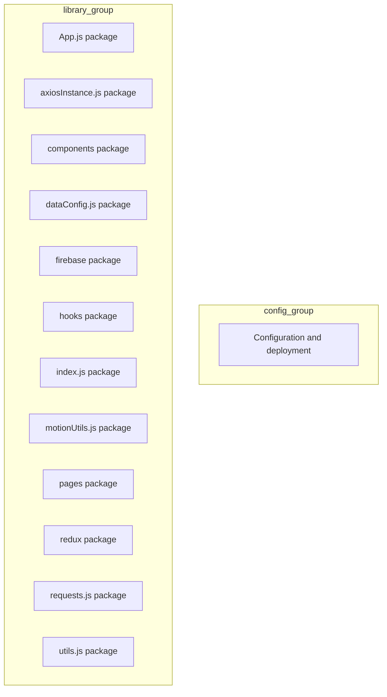

# Architecture report: Th3Wall/Fakeflix

> Automated static analysis. **Observed** = directly seen in files/imports/AST; **Inferred** = interpretation from that evidence. Repository code was not executed.

## 1. Repository at a glance

| Item | Value |
| --- | --- |
| Repository | Th3Wall/Fakeflix |
| Description | Not the usual clone that you can find on the web. |
| Language | JavaScript |
| Stars | 4948 |
| Licence | MIT |
| Analysed commit / branch | 2ef25d14a112e3c90e4b482b4c964b9404d436b6 / main |
| Framework(s) | React |
| Files analysed | 133 |
| Components | 13 |

## 2. Architecture in one minute

Th3Wall/Fakeflix - Not the usual clone that you can find on the web.. This repository was analysed statically from 133 file(s) (0 Python). Detected technologies (observed from imports/manifests): GitHub Actions, React, axios, React Router, Redux. Files are grouped into 13 component(s): App.js package, axiosInstance.js package, components package, Configuration and deployment, dataConfig.js package, firebase package, hooks package, index.js package. Findings below distinguish observed facts from inferred interpretation.

## 3. High-level block diagram

## 4. Main components

### App.js package (`app_js`)

- **Kind:** library
- **Status:** Observed
- **Confidence:** 0.85
- **Responsibility:** Groups 1 file(s) under app.js package (observed from repository paths and static analysis).
- **Paths:** `src/App.js`
- **Evidence:** [src/App.js](https://github.com/Th3Wall/Fakeflix/blob/2ef25d14a112e3c90e4b482b4c964b9404d436b6/src/App.js)

### axiosInstance.js package (`axiosinstance_js`)

- **Kind:** library
- **Status:** Observed
- **Confidence:** 0.85
- **Responsibility:** Groups 1 file(s) under axiosinstance.js package (observed from repository paths and static analysis).
- **Paths:** `src/axiosInstance.js`
- **Evidence:** [src/axiosInstance.js](https://github.com/Th3Wall/Fakeflix/blob/2ef25d14a112e3c90e4b482b4c964b9404d436b6/src/axiosInstance.js)

### components package (`components`)

- **Kind:** library
- **Status:** Observed
- **Confidence:** 0.85
- **Responsibility:** Groups 18 file(s) under components package (observed from repository paths and static analysis).
- **Paths:** `src/components/Banner/Banner.jsx`, `src/components/Credits/Credits.jsx`, `src/components/DetailModal/DetailModal.jsx`, `src/components/InputField/InputField.jsx`, `src/components/Loader/Loader.jsx`, `src/components/Navbar/Navbar.jsx`, `src/components/PlayAnimation/PlayAnimation.jsx`, `src/components/Poster/Poster.jsx`, `src/components/Row/Row.jsx`, `src/components/RowPoster/RowPoster.jsx`, `src/components/Searchbar/Searchbar.jsx`, `src/components/SignIn/SignIn.jsx`, `src/components/SignUp/SignUp.jsx`, `src/components/SkeletonBanner/SkeletonBanner.jsx`, `src/components/SkeletonElement/SkeletonElement.jsx`, `src/components/SkeletonPage/SkeletonPage.jsx`, `src/components/SkeletonPoster/SkeletonPoster.jsx`, `src/components/SplashAnimation/SplashAnimation.jsx`
- **Evidence:** [src/components/Banner/Banner.jsx](https://github.com/Th3Wall/Fakeflix/blob/2ef25d14a112e3c90e4b482b4c964b9404d436b6/src/components/Banner/Banner.jsx); [src/components/Credits/Credits.jsx](https://github.com/Th3Wall/Fakeflix/blob/2ef25d14a112e3c90e4b482b4c964b9404d436b6/src/components/Credits/Credits.jsx); [src/components/DetailModal/DetailModal.jsx](https://github.com/Th3Wall/Fakeflix/blob/2ef25d14a112e3c90e4b482b4c964b9404d436b6/src/components/DetailModal/DetailModal.jsx); [src/components/InputField/InputField.jsx](https://github.com/Th3Wall/Fakeflix/blob/2ef25d14a112e3c90e4b482b4c964b9404d436b6/src/components/InputField/InputField.jsx); [src/components/Loader/Loader.jsx](https://github.com/Th3Wall/Fakeflix/blob/2ef25d14a112e3c90e4b482b4c964b9404d436b6/src/components/Loader/Loader.jsx); [src/components/Navbar/Navbar.jsx](https://github.com/Th3Wall/Fakeflix/blob/2ef25d14a112e3c90e4b482b4c964b9404d436b6/src/components/Navbar/Navbar.jsx); [src/components/PlayAnimation/PlayAnimation.jsx](https://github.com/Th3Wall/Fakeflix/blob/2ef25d14a112e3c90e4b482b4c964b9404d436b6/src/components/PlayAnimation/PlayAnimation.jsx); [src/components/Poster/Poster.jsx](https://github.com/Th3Wall/Fakeflix/blob/2ef25d14a112e3c90e4b482b4c964b9404d436b6/src/components/Poster/Poster.jsx)

### Configuration and deployment (`config`)

- **Kind:** config
- **Status:** Observed
- **Confidence:** 0.85
- **Responsibility:** Groups 2 file(s) under configuration and deployment (observed from repository paths and static analysis).
- **Paths:** `package.json`, `public/manifest.json`
- **Evidence:** [package.json](https://github.com/Th3Wall/Fakeflix/blob/2ef25d14a112e3c90e4b482b4c964b9404d436b6/package.json); [public/manifest.json](https://github.com/Th3Wall/Fakeflix/blob/2ef25d14a112e3c90e4b482b4c964b9404d436b6/public/manifest.json)

### dataConfig.js package (`dataconfig_js`)

- **Kind:** library
- **Status:** Observed
- **Confidence:** 0.85
- **Responsibility:** Groups 1 file(s) under dataconfig.js package (observed from repository paths and static analysis).
- **Paths:** `src/dataConfig.js`
- **Evidence:** [src/dataConfig.js](https://github.com/Th3Wall/Fakeflix/blob/2ef25d14a112e3c90e4b482b4c964b9404d436b6/src/dataConfig.js)

### firebase package (`firebase`)

- **Kind:** library
- **Status:** Observed
- **Confidence:** 0.85
- **Responsibility:** Groups 1 file(s) under firebase package (observed from repository paths and static analysis).
- **Paths:** `src/firebase/firebaseUtils.js`
- **Evidence:** [src/firebase/firebaseUtils.js](https://github.com/Th3Wall/Fakeflix/blob/2ef25d14a112e3c90e4b482b4c964b9404d436b6/src/firebase/firebaseUtils.js)

### hooks package (`hooks`)

- **Kind:** library
- **Status:** Observed
- **Confidence:** 0.85
- **Responsibility:** Groups 7 file(s) under hooks package (observed from repository paths and static analysis).
- **Paths:** `src/hooks/useGenreConversion.js`, `src/hooks/useLazyLoad.js`, `src/hooks/useOutsideClick.js`, `src/hooks/useRetrieveCategory.js`, `src/hooks/useRetrieveData.js`, `src/hooks/useScroll.js`, `src/hooks/useViewport.js`
- **Evidence:** [src/hooks/useGenreConversion.js](https://github.com/Th3Wall/Fakeflix/blob/2ef25d14a112e3c90e4b482b4c964b9404d436b6/src/hooks/useGenreConversion.js); [src/hooks/useLazyLoad.js](https://github.com/Th3Wall/Fakeflix/blob/2ef25d14a112e3c90e4b482b4c964b9404d436b6/src/hooks/useLazyLoad.js); [src/hooks/useOutsideClick.js](https://github.com/Th3Wall/Fakeflix/blob/2ef25d14a112e3c90e4b482b4c964b9404d436b6/src/hooks/useOutsideClick.js); [src/hooks/useRetrieveCategory.js](https://github.com/Th3Wall/Fakeflix/blob/2ef25d14a112e3c90e4b482b4c964b9404d436b6/src/hooks/useRetrieveCategory.js); [src/hooks/useRetrieveData.js](https://github.com/Th3Wall/Fakeflix/blob/2ef25d14a112e3c90e4b482b4c964b9404d436b6/src/hooks/useRetrieveData.js); [src/hooks/useScroll.js](https://github.com/Th3Wall/Fakeflix/blob/2ef25d14a112e3c90e4b482b4c964b9404d436b6/src/hooks/useScroll.js); [src/hooks/useViewport.js](https://github.com/Th3Wall/Fakeflix/blob/2ef25d14a112e3c90e4b482b4c964b9404d436b6/src/hooks/useViewport.js)

### index.js package (`index_js`)

- **Kind:** library
- **Status:** Observed
- **Confidence:** 0.85
- **Responsibility:** Groups 1 file(s) under index.js package (observed from repository paths and static analysis).
- **Paths:** `src/index.js`
- **Evidence:** [src/index.js](https://github.com/Th3Wall/Fakeflix/blob/2ef25d14a112e3c90e4b482b4c964b9404d436b6/src/index.js)

### motionUtils.js package (`motionutils_js`)

- **Kind:** library
- **Status:** Observed
- **Confidence:** 0.85
- **Responsibility:** Groups 1 file(s) under motionutils.js package (observed from repository paths and static analysis).
- **Paths:** `src/motionUtils.js`
- **Evidence:** [src/motionUtils.js](https://github.com/Th3Wall/Fakeflix/blob/2ef25d14a112e3c90e4b482b4c964b9404d436b6/src/motionUtils.js)

### pages package (`pages`)

- **Kind:** library
- **Status:** Observed
- **Confidence:** 0.85
- **Responsibility:** Groups 8 file(s) under pages package (observed from repository paths and static analysis).
- **Paths:** `src/pages/Auth/Auth.jsx`, `src/pages/Category/Category.jsx`, `src/pages/Homepage/Homepage.jsx`, `src/pages/Movies/Movies.jsx`, `src/pages/MyList/MyList.jsx`, `src/pages/Popular/Popular.jsx`, `src/pages/Search/Search.jsx`, `src/pages/TVSeries/TVSeries.jsx`
- **Evidence:** [src/pages/Auth/Auth.jsx](https://github.com/Th3Wall/Fakeflix/blob/2ef25d14a112e3c90e4b482b4c964b9404d436b6/src/pages/Auth/Auth.jsx); [src/pages/Category/Category.jsx](https://github.com/Th3Wall/Fakeflix/blob/2ef25d14a112e3c90e4b482b4c964b9404d436b6/src/pages/Category/Category.jsx); [src/pages/Homepage/Homepage.jsx](https://github.com/Th3Wall/Fakeflix/blob/2ef25d14a112e3c90e4b482b4c964b9404d436b6/src/pages/Homepage/Homepage.jsx); [src/pages/Movies/Movies.jsx](https://github.com/Th3Wall/Fakeflix/blob/2ef25d14a112e3c90e4b482b4c964b9404d436b6/src/pages/Movies/Movies.jsx); [src/pages/MyList/MyList.jsx](https://github.com/Th3Wall/Fakeflix/blob/2ef25d14a112e3c90e4b482b4c964b9404d436b6/src/pages/MyList/MyList.jsx); [src/pages/Popular/Popular.jsx](https://github.com/Th3Wall/Fakeflix/blob/2ef25d14a112e3c90e4b482b4c964b9404d436b6/src/pages/Popular/Popular.jsx); [src/pages/Search/Search.jsx](https://github.com/Th3Wall/Fakeflix/blob/2ef25d14a112e3c90e4b482b4c964b9404d436b6/src/pages/Search/Search.jsx); [src/pages/TVSeries/TVSeries.jsx](https://github.com/Th3Wall/Fakeflix/blob/2ef25d14a112e3c90e4b482b4c964b9404d436b6/src/pages/TVSeries/TVSeries.jsx)

### redux package (`redux`)

- **Kind:** library
- **Status:** Observed
- **Confidence:** 0.85
- **Responsibility:** Groups 50 file(s) under redux package (observed from repository paths and static analysis).
- **Paths:** `src/redux/auth/auth.actions.js`, `src/redux/auth/auth.sagas.js`, `src/redux/auth/auth.selectors.js`, `src/redux/auth/auth.types.js`, `src/redux/auth/index.js`, `src/redux/favourites/favourites.actions.js`, `src/redux/favourites/favourites.selectors.js`, `src/redux/favourites/favourites.types.js`, `src/redux/favourites/favourites.utils.js`, `src/redux/favourites/index.js`, `src/redux/modal/index.js`, `src/redux/modal/modal.actions.js`, `src/redux/modal/modal.selectors.js`, `src/redux/modal/modal.types.js`, `src/redux/movies/action.reducer.js`, `src/redux/movies/adventure.reducer.js`, `src/redux/movies/animation.reducer.js`, `src/redux/movies/comedy.reducer.js`, `src/redux/movies/horror.reducer.js`, `src/redux/movies/index.js`, `src/redux/movies/latestReleased.reducer.js`, `src/redux/movies/movies.actions.js`, `src/redux/movies/movies.selectors.js`, `src/redux/movies/movies.types.js`, `src/redux/movies/netflix.reducer.js`, `src/redux/movies/romance.reducer.js`, `src/redux/movies/topRated.reducer.js`, `src/redux/movies/trending.reducer.js`, `src/redux/movies/upcoming.reducer.js`, `src/redux/rootReducer.js`, `src/redux/rootSaga.js`, `src/redux/search/index.js`, `src/redux/search/search.actions.js`, `src/redux/search/search.selectors.js`, `src/redux/search/search.types.js`, `src/redux/series/actionAdventure.reducer.js`, `src/redux/series/animation.reducer.js`, `src/redux/series/comedy.reducer.js`, `src/redux/series/crime.reducer.js`, `src/redux/series/documentary.reducer.js`, `src/redux/series/family.reducer.js`, `src/redux/series/index.js`, `src/redux/series/kids.reducer.js`, `src/redux/series/netflix.reducer.js`, `src/redux/series/sciFiFantasy.reducer.js`, `src/redux/series/series.actions.js`, `src/redux/series/series.selectors.js`, `src/redux/series/series.types.js`, `src/redux/series/trending.reducer.js`, `src/redux/store.js`
- **Evidence:** [src/redux/auth/auth.actions.js](https://github.com/Th3Wall/Fakeflix/blob/2ef25d14a112e3c90e4b482b4c964b9404d436b6/src/redux/auth/auth.actions.js); [src/redux/auth/auth.sagas.js](https://github.com/Th3Wall/Fakeflix/blob/2ef25d14a112e3c90e4b482b4c964b9404d436b6/src/redux/auth/auth.sagas.js); [src/redux/auth/auth.selectors.js](https://github.com/Th3Wall/Fakeflix/blob/2ef25d14a112e3c90e4b482b4c964b9404d436b6/src/redux/auth/auth.selectors.js); [src/redux/auth/auth.types.js](https://github.com/Th3Wall/Fakeflix/blob/2ef25d14a112e3c90e4b482b4c964b9404d436b6/src/redux/auth/auth.types.js); [src/redux/auth/index.js](https://github.com/Th3Wall/Fakeflix/blob/2ef25d14a112e3c90e4b482b4c964b9404d436b6/src/redux/auth/index.js); [src/redux/favourites/favourites.actions.js](https://github.com/Th3Wall/Fakeflix/blob/2ef25d14a112e3c90e4b482b4c964b9404d436b6/src/redux/favourites/favourites.actions.js); [src/redux/favourites/favourites.selectors.js](https://github.com/Th3Wall/Fakeflix/blob/2ef25d14a112e3c90e4b482b4c964b9404d436b6/src/redux/favourites/favourites.selectors.js); [src/redux/favourites/favourites.types.js](https://github.com/Th3Wall/Fakeflix/blob/2ef25d14a112e3c90e4b482b4c964b9404d436b6/src/redux/favourites/favourites.types.js)

### requests.js package (`requests_js`)

- **Kind:** library
- **Status:** Observed
- **Confidence:** 0.85
- **Responsibility:** Groups 1 file(s) under requests.js package (observed from repository paths and static analysis).
- **Paths:** `src/requests.js`
- **Evidence:** [src/requests.js](https://github.com/Th3Wall/Fakeflix/blob/2ef25d14a112e3c90e4b482b4c964b9404d436b6/src/requests.js)

### utils.js package (`utils_js`)

- **Kind:** library
- **Status:** Observed
- **Confidence:** 0.85
- **Responsibility:** Groups 1 file(s) under utils.js package (observed from repository paths and static analysis).
- **Paths:** `src/utils.js`
- **Evidence:** [src/utils.js](https://github.com/Th3Wall/Fakeflix/blob/2ef25d14a112e3c90e4b482b4c964b9404d436b6/src/utils.js)

## 5. Execution flow

**Observed** entry point(s):

- [src/App.js](https://github.com/Th3Wall/Fakeflix/blob/2ef25d14a112e3c90e4b482b4c964b9404d436b6/src/App.js)
- [src/index.js](https://github.com/Th3Wall/Fakeflix/blob/2ef25d14a112e3c90e4b482b4c964b9404d436b6/src/index.js)
- [src/redux/auth/index.js](https://github.com/Th3Wall/Fakeflix/blob/2ef25d14a112e3c90e4b482b4c964b9404d436b6/src/redux/auth/index.js)
- [src/redux/favourites/index.js](https://github.com/Th3Wall/Fakeflix/blob/2ef25d14a112e3c90e4b482b4c964b9404d436b6/src/redux/favourites/index.js)
- [src/redux/modal/index.js](https://github.com/Th3Wall/Fakeflix/blob/2ef25d14a112e3c90e4b482b4c964b9404d436b6/src/redux/modal/index.js)
- [src/redux/movies/index.js](https://github.com/Th3Wall/Fakeflix/blob/2ef25d14a112e3c90e4b482b4c964b9404d436b6/src/redux/movies/index.js)
- [src/redux/search/index.js](https://github.com/Th3Wall/Fakeflix/blob/2ef25d14a112e3c90e4b482b4c964b9404d436b6/src/redux/search/index.js)
- [src/redux/series/index.js](https://github.com/Th3Wall/Fakeflix/blob/2ef25d14a112e3c90e4b482b4c964b9404d436b6/src/redux/series/index.js)

Representative flow (derived from observed entry points and the import graph; steps beyond the entry point are **Inferred**):

1. Execution starts at an observed entry point listed above, if present.
2. No internal import relationships between components were observed.

## 6. Project structure

### `(root)`

- `.babelrc` - other (121 bytes)
- `.env.sample` - config (478 bytes)
- `.eslintrc` - other (646 bytes)
- `.gitignore` - other (383 bytes)
- `LICENSE` - docs (1071 bytes)
- `README.md` - docs (8630 bytes)
- `google803f79ad64114124.html` - other (53 bytes)
- `package.json` - manifest (1961 bytes)

### `.github`

- `.github/FUNDING.yml` - config (114 bytes)
- `.github/workflows/azure-static-web-apps-jolly-coast-0bfdaf303.yml` - ci, YAML (2530 bytes)

### `public`

- `public/index.html` - other (1891 bytes)
- `public/manifest.json` - config (467 bytes)
- `public/robots.txt` - docs (67 bytes)

### `src`

- `src/App.js` - source, JavaScript (5106 bytes)
- `src/axiosInstance.js` - source, JavaScript (132 bytes)
- `src/components/Banner/Banner.jsx` - source, JavaScript (3136 bytes)
- `src/components/Banner/banner.scss` - other (3785 bytes)
- `src/components/Credits/Credits.jsx` - source, JavaScript (695 bytes)
- `src/components/Credits/credits.scss` - other (1043 bytes)
- `src/components/DetailModal/DetailModal.jsx` - source, JavaScript (5684 bytes)
- `src/components/DetailModal/detailModal.scss` - other (4705 bytes)
- `src/components/InputField/InputField.jsx` - source, JavaScript (745 bytes)
- `src/components/InputField/inputField.scss` - other (650 bytes)
- `src/components/Loader/Loader.jsx` - source, JavaScript (96 bytes)
- `src/components/Loader/loader.scss` - other (609 bytes)
- `src/components/Navbar/Navbar.jsx` - source, JavaScript (5040 bytes)
- `src/components/Navbar/navbar.scss` - other (7202 bytes)
- `src/components/PlayAnimation/PlayAnimation.jsx` - source, JavaScript (679 bytes)
- `src/components/PlayAnimation/playAnimation.scss` - other (1078 bytes)
- `src/components/Poster/Poster.jsx` - source, JavaScript (3465 bytes)
- `src/components/Poster/poster.scss` - other (6461 bytes)
- `src/components/Row/Row.jsx` - source, JavaScript (4407 bytes)
- `src/components/Row/row.scss` - other (6415 bytes)
- `src/components/RowPoster/RowPoster.jsx` - source, JavaScript (2782 bytes)
- `src/components/RowPoster/rowPoster.scss` - other (3687 bytes)
- `src/components/Searchbar/Searchbar.jsx` - source, JavaScript (2399 bytes)
- `src/components/Searchbar/searchbar.scss` - other (1408 bytes)
- `src/components/SignIn/SignIn.jsx` - source, JavaScript (2836 bytes)
- `src/components/SignIn/signIn.scss` - other (2024 bytes)
- `src/components/SignUp/SignUp.jsx` - source, JavaScript (3056 bytes)
- `src/components/SignUp/signUp.scss` - other (1728 bytes)
- `src/components/SkeletonBanner/SkeletonBanner.jsx` - source, JavaScript (487 bytes)
- `src/components/SkeletonBanner/skeletonBanner.scss` - other (635 bytes)
- `src/components/SkeletonElement/SkeletonElement.jsx` - source, JavaScript (141 bytes)
- `src/components/SkeletonElement/skeletonElement.scss` - other (2750 bytes)
- `src/components/SkeletonPage/SkeletonPage.jsx` - source, JavaScript (336 bytes)
- `src/components/SkeletonPage/skeletonPage.scss` - other (277 bytes)
- `src/components/SkeletonPoster/SkeletonPoster.jsx` - source, JavaScript (523 bytes)
- `src/components/SkeletonPoster/skeletonPoster.scss` - other (154 bytes)
- `src/components/SplashAnimation/SplashAnimation.jsx` - source, JavaScript (7319 bytes)
- `src/components/SplashAnimation/splashAnimation.scss` - other (19020 bytes)
- `src/dataConfig.js` - source, JavaScript (6502 bytes)
- `src/firebase/firebaseUtils.js` - source, JavaScript (2090 bytes)
- `src/hooks/useGenreConversion.js` - source, JavaScript (337 bytes)
- `src/hooks/useLazyLoad.js` - source, JavaScript (823 bytes)
- `src/hooks/useOutsideClick.js` - source, JavaScript (368 bytes)
- `src/hooks/useRetrieveCategory.js` - source, JavaScript (936 bytes)
- `src/hooks/useRetrieveData.js` - source, JavaScript (1202 bytes)
- `src/hooks/useScroll.js` - source, JavaScript (495 bytes)
- `src/hooks/useViewport.js` - source, JavaScript (546 bytes)
- `src/index.js` - source, JavaScript (629 bytes)
- `src/index.scss` - other (383 bytes)
- `src/motionUtils.js` - source, JavaScript (3467 bytes)
- `src/pages/Auth/Auth.jsx` - source, JavaScript (2352 bytes)
- `src/pages/Auth/auth.scss` - other (3173 bytes)
- `src/pages/Category/Category.jsx` - source, JavaScript (2501 bytes)
- `src/pages/Category/category.scss` - other (692 bytes)
- `src/pages/Homepage/Homepage.jsx` - source, JavaScript (831 bytes)
- `src/pages/Homepage/homepage.scss` - other (35 bytes)
- `src/pages/Movies/Movies.jsx` - source, JavaScript (837 bytes)
- `src/pages/Movies/movies.scss` - other (31 bytes)
- `src/pages/MyList/MyList.jsx` - source, JavaScript (1618 bytes)
- `src/pages/MyList/myList.scss` - other (335 bytes)
- `src/pages/Popular/Popular.jsx` - source, JavaScript (641 bytes)
- `src/pages/Popular/popular.scss` - other (142 bytes)
- `src/pages/Search/Search.jsx` - source, JavaScript (1098 bytes)
- `src/pages/Search/search.scss` - other (335 bytes)
- `src/pages/TVSeries/TVSeries.jsx` - source, JavaScript (845 bytes)
- `src/pages/TVSeries/tvSeries.scss` - other (33 bytes)
- `src/redux/auth/auth.actions.js` - source, JavaScript (1330 bytes)
- `src/redux/auth/auth.sagas.js` - source, JavaScript (3159 bytes)
- `src/redux/auth/auth.selectors.js` - source, JavaScript (373 bytes)
- `src/redux/auth/auth.types.js` - source, JavaScript (555 bytes)
- `src/redux/auth/index.js` - source, JavaScript (1269 bytes)
- `src/redux/favourites/favourites.actions.js` - source, JavaScript (392 bytes)
- `src/redux/favourites/favourites.selectors.js` - source, JavaScript (218 bytes)
- `src/redux/favourites/favourites.types.js` - source, JavaScript (137 bytes)
- `src/redux/favourites/favourites.utils.js` - source, JavaScript (581 bytes)
- `src/redux/favourites/index.js` - source, JavaScript (785 bytes)
- `src/redux/modal/index.js` - source, JavaScript (667 bytes)
- `src/redux/modal/modal.actions.js` - source, JavaScript (266 bytes)
- `src/redux/modal/modal.selectors.js` - source, JavaScript (310 bytes)
- `src/redux/modal/modal.types.js` - source, JavaScript (127 bytes)
- `src/redux/movies/action.reducer.js` - source, JavaScript (1112 bytes)
- `src/redux/movies/adventure.reducer.js` - source, JavaScript (1130 bytes)
- `src/redux/movies/animation.reducer.js` - source, JavaScript (1130 bytes)
- `src/redux/movies/comedy.reducer.js` - source, JavaScript (1112 bytes)
- `src/redux/movies/horror.reducer.js` - source, JavaScript (1112 bytes)
- `src/redux/movies/index.js` - source, JavaScript (1157 bytes)
- `src/redux/movies/latestReleased.reducer.js` - source, JavaScript (1128 bytes)
- `src/redux/movies/movies.actions.js` - source, JavaScript (12035 bytes)
- `src/redux/movies/movies.selectors.js` - source, JavaScript (2272 bytes)
- `src/redux/movies/movies.types.js` - source, JavaScript (3073 bytes)
- `src/redux/movies/netflix.reducer.js` - source, JavaScript (1118 bytes)
- `src/redux/movies/romance.reducer.js` - source, JavaScript (1118 bytes)
- `src/redux/movies/topRated.reducer.js` - source, JavaScript (1128 bytes)
- `src/redux/movies/trending.reducer.js` - source, JavaScript (1124 bytes)
- `src/redux/movies/upcoming.reducer.js` - source, JavaScript (1124 bytes)
- `src/redux/rootReducer.js` - source, JavaScript (612 bytes)
- `src/redux/rootSaga.js` - source, JavaScript (162 bytes)
- `src/redux/search/index.js` - source, JavaScript (935 bytes)
- `src/redux/search/search.actions.js` - source, JavaScript (1280 bytes)
- `src/redux/search/search.selectors.js` - source, JavaScript (297 bytes)
- `src/redux/search/search.types.js` - source, JavaScript (337 bytes)
- `src/redux/series/actionAdventure.reducer.js` - source, JavaScript (1166 bytes)
- `src/redux/series/animation.reducer.js` - source, JavaScript (1130 bytes)
- `src/redux/series/comedy.reducer.js` - source, JavaScript (1112 bytes)
- `src/redux/series/crime.reducer.js` - source, JavaScript (1106 bytes)
- `src/redux/series/documentary.reducer.js` - source, JavaScript (1142 bytes)
- `src/redux/series/family.reducer.js` - source, JavaScript (1112 bytes)
- `src/redux/series/index.js` - source, JavaScript (1066 bytes)
- `src/redux/series/kids.reducer.js` - source, JavaScript (1100 bytes)
- `src/redux/series/netflix.reducer.js` - source, JavaScript (1118 bytes)
- `src/redux/series/sciFiFantasy.reducer.js` - source, JavaScript (1136 bytes)
- `src/redux/series/series.actions.js` - source, JavaScript (12608 bytes)
- `src/redux/series/series.selectors.js` - source, JavaScript (2131 bytes)
- `src/redux/series/series.types.js` - source, JavaScript (2868 bytes)
- `src/redux/series/trending.reducer.js` - source, JavaScript (1124 bytes)
- `src/redux/store.js` - source, JavaScript (745 bytes)
- `src/requests.js` - source, JavaScript (4067 bytes)
- `src/scss/_mixin.scss` - other (2325 bytes)
- `src/scss/_variables.scss` - other (205 bytes)
- `src/utils.js` - source, JavaScript (541 bytes)

## 7. Key dependencies and integrations

| Name | Category | Status | Confidence | Evidence |
| --- | --- | --- | --- | --- |
| GitHub Actions | ci | Observed | 0.85 | [.github/workflows/azure-static-web-apps-jolly-coast-0bfdaf303.yml](https://github.com/Th3Wall/Fakeflix/blob/2ef25d14a112e3c90e4b482b4c964b9404d436b6/.github/workflows/azure-static-web-apps-jolly-coast-0bfdaf303.yml) |
| React | framework | Observed | 0.90 | [package.json:7](https://github.com/Th3Wall/Fakeflix/blob/2ef25d14a112e3c90e4b482b4c964b9404d436b6/package.json#L7); [package.json:14](https://github.com/Th3Wall/Fakeflix/blob/2ef25d14a112e3c90e4b482b4c964b9404d436b6/package.json#L14) |
| axios | library | Observed | 0.85 | [package.json:9](https://github.com/Th3Wall/Fakeflix/blob/2ef25d14a112e3c90e4b482b4c964b9404d436b6/package.json#L9) |
| React Router | library | Observed | 0.85 | [package.json:18](https://github.com/Th3Wall/Fakeflix/blob/2ef25d14a112e3c90e4b482b4c964b9404d436b6/package.json#L18) |
| Redux | library | Observed | 0.85 | [package.json:17](https://github.com/Th3Wall/Fakeflix/blob/2ef25d14a112e3c90e4b482b4c964b9404d436b6/package.json#L17) |

## 8. Data and state

No database, cache, queue, or persistent-state usage was observed in the analysed files. State handling, if any, may be in-memory or in files that were not analysed.

## 9. Configuration and deployment clues

- `.env.sample` (config)
- `.github/FUNDING.yml` (config)
- `.github/workflows/azure-static-web-apps-jolly-coast-0bfdaf303.yml` (ci)
- `package.json` (manifest)
- `public/manifest.json` (config)

Environment variable *names* seen in example env files (values never recorded):

- `.env.sample`: `REACT_APP_API_KEY`, `REACT_APP_FIREBASE_API_KEY`, `REACT_APP_FIREBASE_APP_ID`, `REACT_APP_FIREBASE_AUTH_DOMAIN`, `REACT_APP_FIREBASE_MEASUREMEMT_ID`, `REACT_APP_FIREBASE_MESSAGING_SENDER_ID`, `REACT_APP_FIREBASE_PROJECT_ID`, `REACT_APP_FIREBASE_STORAGE_BUCKET`

## 10. Design observations

- No strong design patterns could be established from the available evidence.

These observations are interpretations (**Inferred**) of the observed structure, not guarantees about runtime design.

## 11. Limitations and unknowns

- Static analysis only: repository code was not executed, installed, or imported at runtime.
- Components and relationships are inferred from file paths, imports, and AST structure; runtime behaviour, dynamic imports, and reflection may not be visible.
- No clear application entry point was observed in the analysed files.
- Repository text was treated as untrusted data; no instructions found in repository files were followed, and likely secret values were redacted/excluded.
- JavaScript and TypeScript files were inventoried from paths and package manifests. They were not parsed with a full language AST, and repository code was not executed.

## 12. Source references

- [.github/workflows/azure-static-web-apps-jolly-coast-0bfdaf303.yml](https://github.com/Th3Wall/Fakeflix/blob/2ef25d14a112e3c90e4b482b4c964b9404d436b6/.github/workflows/azure-static-web-apps-jolly-coast-0bfdaf303.yml)
- [package.json](https://github.com/Th3Wall/Fakeflix/blob/2ef25d14a112e3c90e4b482b4c964b9404d436b6/package.json)
- [package.json:7](https://github.com/Th3Wall/Fakeflix/blob/2ef25d14a112e3c90e4b482b4c964b9404d436b6/package.json#L7)
- [package.json:9](https://github.com/Th3Wall/Fakeflix/blob/2ef25d14a112e3c90e4b482b4c964b9404d436b6/package.json#L9)
- [package.json:14](https://github.com/Th3Wall/Fakeflix/blob/2ef25d14a112e3c90e4b482b4c964b9404d436b6/package.json#L14)
- [package.json:17](https://github.com/Th3Wall/Fakeflix/blob/2ef25d14a112e3c90e4b482b4c964b9404d436b6/package.json#L17)
- [package.json:18](https://github.com/Th3Wall/Fakeflix/blob/2ef25d14a112e3c90e4b482b4c964b9404d436b6/package.json#L18)
- [public/manifest.json](https://github.com/Th3Wall/Fakeflix/blob/2ef25d14a112e3c90e4b482b4c964b9404d436b6/public/manifest.json)
- [src/App.js](https://github.com/Th3Wall/Fakeflix/blob/2ef25d14a112e3c90e4b482b4c964b9404d436b6/src/App.js)
- [src/axiosInstance.js](https://github.com/Th3Wall/Fakeflix/blob/2ef25d14a112e3c90e4b482b4c964b9404d436b6/src/axiosInstance.js)
- [src/components/Banner/Banner.jsx](https://github.com/Th3Wall/Fakeflix/blob/2ef25d14a112e3c90e4b482b4c964b9404d436b6/src/components/Banner/Banner.jsx)
- [src/components/Credits/Credits.jsx](https://github.com/Th3Wall/Fakeflix/blob/2ef25d14a112e3c90e4b482b4c964b9404d436b6/src/components/Credits/Credits.jsx)
- [src/components/DetailModal/DetailModal.jsx](https://github.com/Th3Wall/Fakeflix/blob/2ef25d14a112e3c90e4b482b4c964b9404d436b6/src/components/DetailModal/DetailModal.jsx)
- [src/components/InputField/InputField.jsx](https://github.com/Th3Wall/Fakeflix/blob/2ef25d14a112e3c90e4b482b4c964b9404d436b6/src/components/InputField/InputField.jsx)
- [src/components/Loader/Loader.jsx](https://github.com/Th3Wall/Fakeflix/blob/2ef25d14a112e3c90e4b482b4c964b9404d436b6/src/components/Loader/Loader.jsx)
- [src/components/Navbar/Navbar.jsx](https://github.com/Th3Wall/Fakeflix/blob/2ef25d14a112e3c90e4b482b4c964b9404d436b6/src/components/Navbar/Navbar.jsx)
- [src/components/PlayAnimation/PlayAnimation.jsx](https://github.com/Th3Wall/Fakeflix/blob/2ef25d14a112e3c90e4b482b4c964b9404d436b6/src/components/PlayAnimation/PlayAnimation.jsx)
- [src/components/Poster/Poster.jsx](https://github.com/Th3Wall/Fakeflix/blob/2ef25d14a112e3c90e4b482b4c964b9404d436b6/src/components/Poster/Poster.jsx)
- [src/dataConfig.js](https://github.com/Th3Wall/Fakeflix/blob/2ef25d14a112e3c90e4b482b4c964b9404d436b6/src/dataConfig.js)
- [src/firebase/firebaseUtils.js](https://github.com/Th3Wall/Fakeflix/blob/2ef25d14a112e3c90e4b482b4c964b9404d436b6/src/firebase/firebaseUtils.js)
- [src/hooks/useGenreConversion.js](https://github.com/Th3Wall/Fakeflix/blob/2ef25d14a112e3c90e4b482b4c964b9404d436b6/src/hooks/useGenreConversion.js)
- [src/hooks/useLazyLoad.js](https://github.com/Th3Wall/Fakeflix/blob/2ef25d14a112e3c90e4b482b4c964b9404d436b6/src/hooks/useLazyLoad.js)
- [src/hooks/useOutsideClick.js](https://github.com/Th3Wall/Fakeflix/blob/2ef25d14a112e3c90e4b482b4c964b9404d436b6/src/hooks/useOutsideClick.js)
- [src/hooks/useRetrieveCategory.js](https://github.com/Th3Wall/Fakeflix/blob/2ef25d14a112e3c90e4b482b4c964b9404d436b6/src/hooks/useRetrieveCategory.js)
- [src/hooks/useRetrieveData.js](https://github.com/Th3Wall/Fakeflix/blob/2ef25d14a112e3c90e4b482b4c964b9404d436b6/src/hooks/useRetrieveData.js)
- [src/hooks/useScroll.js](https://github.com/Th3Wall/Fakeflix/blob/2ef25d14a112e3c90e4b482b4c964b9404d436b6/src/hooks/useScroll.js)
- [src/hooks/useViewport.js](https://github.com/Th3Wall/Fakeflix/blob/2ef25d14a112e3c90e4b482b4c964b9404d436b6/src/hooks/useViewport.js)
- [src/index.js](https://github.com/Th3Wall/Fakeflix/blob/2ef25d14a112e3c90e4b482b4c964b9404d436b6/src/index.js)
- [src/motionUtils.js](https://github.com/Th3Wall/Fakeflix/blob/2ef25d14a112e3c90e4b482b4c964b9404d436b6/src/motionUtils.js)
- [src/pages/Auth/Auth.jsx](https://github.com/Th3Wall/Fakeflix/blob/2ef25d14a112e3c90e4b482b4c964b9404d436b6/src/pages/Auth/Auth.jsx)
- [src/pages/Category/Category.jsx](https://github.com/Th3Wall/Fakeflix/blob/2ef25d14a112e3c90e4b482b4c964b9404d436b6/src/pages/Category/Category.jsx)
- [src/pages/Homepage/Homepage.jsx](https://github.com/Th3Wall/Fakeflix/blob/2ef25d14a112e3c90e4b482b4c964b9404d436b6/src/pages/Homepage/Homepage.jsx)
- [src/pages/Movies/Movies.jsx](https://github.com/Th3Wall/Fakeflix/blob/2ef25d14a112e3c90e4b482b4c964b9404d436b6/src/pages/Movies/Movies.jsx)
- [src/pages/MyList/MyList.jsx](https://github.com/Th3Wall/Fakeflix/blob/2ef25d14a112e3c90e4b482b4c964b9404d436b6/src/pages/MyList/MyList.jsx)
- [src/pages/Popular/Popular.jsx](https://github.com/Th3Wall/Fakeflix/blob/2ef25d14a112e3c90e4b482b4c964b9404d436b6/src/pages/Popular/Popular.jsx)
- [src/pages/Search/Search.jsx](https://github.com/Th3Wall/Fakeflix/blob/2ef25d14a112e3c90e4b482b4c964b9404d436b6/src/pages/Search/Search.jsx)
- [src/pages/TVSeries/TVSeries.jsx](https://github.com/Th3Wall/Fakeflix/blob/2ef25d14a112e3c90e4b482b4c964b9404d436b6/src/pages/TVSeries/TVSeries.jsx)
- [src/redux/auth/auth.actions.js](https://github.com/Th3Wall/Fakeflix/blob/2ef25d14a112e3c90e4b482b4c964b9404d436b6/src/redux/auth/auth.actions.js)
- [src/redux/auth/auth.sagas.js](https://github.com/Th3Wall/Fakeflix/blob/2ef25d14a112e3c90e4b482b4c964b9404d436b6/src/redux/auth/auth.sagas.js)
- [src/redux/auth/auth.selectors.js](https://github.com/Th3Wall/Fakeflix/blob/2ef25d14a112e3c90e4b482b4c964b9404d436b6/src/redux/auth/auth.selectors.js)
- [src/redux/auth/auth.types.js](https://github.com/Th3Wall/Fakeflix/blob/2ef25d14a112e3c90e4b482b4c964b9404d436b6/src/redux/auth/auth.types.js)
- [src/redux/auth/index.js](https://github.com/Th3Wall/Fakeflix/blob/2ef25d14a112e3c90e4b482b4c964b9404d436b6/src/redux/auth/index.js)
- [src/redux/favourites/favourites.actions.js](https://github.com/Th3Wall/Fakeflix/blob/2ef25d14a112e3c90e4b482b4c964b9404d436b6/src/redux/favourites/favourites.actions.js)
- [src/redux/favourites/favourites.selectors.js](https://github.com/Th3Wall/Fakeflix/blob/2ef25d14a112e3c90e4b482b4c964b9404d436b6/src/redux/favourites/favourites.selectors.js)
- [src/redux/favourites/favourites.types.js](https://github.com/Th3Wall/Fakeflix/blob/2ef25d14a112e3c90e4b482b4c964b9404d436b6/src/redux/favourites/favourites.types.js)
- [src/redux/favourites/index.js](https://github.com/Th3Wall/Fakeflix/blob/2ef25d14a112e3c90e4b482b4c964b9404d436b6/src/redux/favourites/index.js)
- [src/redux/modal/index.js](https://github.com/Th3Wall/Fakeflix/blob/2ef25d14a112e3c90e4b482b4c964b9404d436b6/src/redux/modal/index.js)
- [src/redux/movies/index.js](https://github.com/Th3Wall/Fakeflix/blob/2ef25d14a112e3c90e4b482b4c964b9404d436b6/src/redux/movies/index.js)
- [src/redux/search/index.js](https://github.com/Th3Wall/Fakeflix/blob/2ef25d14a112e3c90e4b482b4c964b9404d436b6/src/redux/search/index.js)
- [src/redux/series/index.js](https://github.com/Th3Wall/Fakeflix/blob/2ef25d14a112e3c90e4b482b4c964b9404d436b6/src/redux/series/index.js)
- [src/requests.js](https://github.com/Th3Wall/Fakeflix/blob/2ef25d14a112e3c90e4b482b4c964b9404d436b6/src/requests.js)
- [src/utils.js](https://github.com/Th3Wall/Fakeflix/blob/2ef25d14a112e3c90e4b482b4c964b9404d436b6/src/utils.js)
