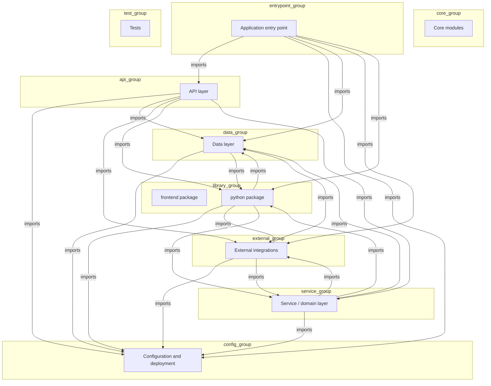

# Architecture report: ValueCell-ai/valuecell

> Automated static analysis. **Observed** = directly seen in files/imports/AST; **Inferred** = interpretation from that evidence. Repository code was not executed.

## 1. Repository at a glance

| Item | Value |
| --- | --- |
| Repository | ValueCell-ai/valuecell |
| Description | ValueCell is a community-driven, multi-agent platform for financial applications. |
| Language | Python |
| Stars | 11054 |
| Licence | Apache-2.0 |
| Analysed commit / branch | 9793e9c0563fbf56fc096757d8bb80e209ac7aab / main |
| Framework(s) | FastAPI, React, Starlette |
| Files analysed | 523 |
| Components | 10 |

## 2. Architecture in one minute

ValueCell-ai/valuecell - ValueCell is a community-driven, multi-agent platform for financial applications.. This repository was analysed statically from 523 file(s) (241 Python). Detected technologies (observed from imports/manifests): GitHub Actions, MySQL, SQLite, FastAPI, React, Starlette. Files are grouped into 10 component(s): API layer, Configuration and deployment, Core modules, Data layer, Application entry point, External integrations, frontend package, python package. Observed entry point(s): python/valuecell/agents/news_agent/__main__.py, python/valuecell/agents/prompt_strategy_agent/__main__.py, python/valuecell/agents/research_agent/__main__.py. Findings below distinguish observed facts from inferred interpretation.

## 3. High-level block diagram

## 4. Main components

### API layer (`api_layer`)

- **Kind:** api
- **Status:** Observed
- **Confidence:** 0.85
- **Responsibility:** Groups 34 file(s) under api layer (observed from repository paths and static analysis). Observed top-level classes: APIException, AddAssetRequest, AddModelRequest, AgentCapabilities, AgentData, AgentEnableRequest. Observed top-level functions: _get_client_ip, api_exception_handler, create_agent_router, create_agent_stream_router, create_conversation_router, create_i18n_router.
- **Paths:** `frontend/src/api/agent.ts`, `frontend/src/api/conversation.ts`, `frontend/src/api/setting.ts`, `frontend/src/api/stock.ts`, `frontend/src/api/strategy.ts`, `frontend/src/api/system.ts`, `python/valuecell/server/api/__init__.py`, `python/valuecell/server/api/exceptions.py`, `python/valuecell/server/api/routers/__init__.py`, `python/valuecell/server/api/routers/agent.py`, `python/valuecell/server/api/routers/agent_stream.py`, `python/valuecell/server/api/routers/conversation.py`, `python/valuecell/server/api/routers/i18n.py`, `python/valuecell/server/api/routers/models.py`, `python/valuecell/server/api/routers/strategy.py`, `python/valuecell/server/api/routers/strategy_agent.py`, `python/valuecell/server/api/routers/strategy_api.py`, `python/valuecell/server/api/routers/strategy_prompts.py`, `python/valuecell/server/api/routers/system.py`, `python/valuecell/server/api/routers/task.py`, `python/valuecell/server/api/routers/user_profile.py`, `python/valuecell/server/api/routers/watchlist.py`, `python/valuecell/server/api/schemas/__init__.py`, `python/valuecell/server/api/schemas/agent.py`, `python/valuecell/server/api/schemas/agent_stream.py`, `python/valuecell/server/api/schemas/base.py`, `python/valuecell/server/api/schemas/conversation.py`, `python/valuecell/server/api/schemas/i18n.py`, `python/valuecell/server/api/schemas/model.py`, `python/valuecell/server/api/schemas/strategy.py`, `python/valuecell/server/api/schemas/task.py`, `python/valuecell/server/api/schemas/trading.py`, `python/valuecell/server/api/schemas/user_profile.py`, `python/valuecell/server/api/schemas/watchlist.py`
- **Evidence:** [frontend/src/api/agent.ts](https://github.com/ValueCell-ai/valuecell/blob/9793e9c0563fbf56fc096757d8bb80e209ac7aab/frontend/src/api/agent.ts); [frontend/src/api/conversation.ts](https://github.com/ValueCell-ai/valuecell/blob/9793e9c0563fbf56fc096757d8bb80e209ac7aab/frontend/src/api/conversation.ts); [frontend/src/api/setting.ts](https://github.com/ValueCell-ai/valuecell/blob/9793e9c0563fbf56fc096757d8bb80e209ac7aab/frontend/src/api/setting.ts); [frontend/src/api/stock.ts](https://github.com/ValueCell-ai/valuecell/blob/9793e9c0563fbf56fc096757d8bb80e209ac7aab/frontend/src/api/stock.ts); [frontend/src/api/strategy.ts](https://github.com/ValueCell-ai/valuecell/blob/9793e9c0563fbf56fc096757d8bb80e209ac7aab/frontend/src/api/strategy.ts); [frontend/src/api/system.ts](https://github.com/ValueCell-ai/valuecell/blob/9793e9c0563fbf56fc096757d8bb80e209ac7aab/frontend/src/api/system.ts); [python/valuecell/server/api/__init__.py](https://github.com/ValueCell-ai/valuecell/blob/9793e9c0563fbf56fc096757d8bb80e209ac7aab/python/valuecell/server/api/__init__.py); [python/valuecell/server/api/exceptions.py:12](https://github.com/ValueCell-ai/valuecell/blob/9793e9c0563fbf56fc096757d8bb80e209ac7aab/python/valuecell/server/api/exceptions.py#L12)

### Configuration and deployment (`config`)

- **Kind:** config
- **Status:** Observed
- **Confidence:** 0.85
- **Responsibility:** Groups 48 file(s) under configuration and deployment (observed from repository paths and static analysis). Observed top-level classes: AgentConfig, AgentModelConfig, ConfigLoader, ConfigManager, I18nConfig, ProviderConfig. Observed top-level functions: _default_db_path, _get_project_root, get_config_loader, get_config_manager, get_i18n_config, get_settings.
- **Paths:** `docker/DockerFile`, `frontend/.env.example`, `frontend/.vscode/settings.json`, `frontend/biome.json`, `frontend/components.json`, `frontend/package.json`, `frontend/src-tauri/Cargo.toml`, `frontend/src-tauri/capabilities/default.json`, `frontend/src-tauri/capabilities/desktop.json`, `frontend/src-tauri/tauri.conf.json`, `frontend/src/components/tradingview/tv-symbol-map.json`, `frontend/src/i18n/locales/en.json`, `frontend/src/i18n/locales/ja.json`, `frontend/src/i18n/locales/zh_CN.json`, `frontend/src/i18n/locales/zh_TW.json`, `frontend/tsconfig.json`, `frontend/tsconfig.node.json`, `python/configs/agent_cards/grid_agent.json`, `python/configs/agent_cards/investment_research_agent.json`, `python/configs/agent_cards/news_agent.json`, `python/configs/agent_cards/prompt_strategy_agent.json`, `python/configs/agents/news_agent.yaml`, `python/configs/agents/research_agent.yaml`, `python/configs/agents/super_agent.yaml`, `python/configs/config.yaml`, `python/configs/locales/en-GB.json`, `python/configs/locales/en-US.json`, `python/configs/locales/ja-JP.json`, `python/configs/locales/language_list.json`, `python/configs/locales/zh-Hans.json`, `python/configs/locales/zh-Hant.json`, `python/configs/providers/azure.yaml`, `python/configs/providers/dashscope.yaml`, `python/configs/providers/deepseek.yaml`, `python/configs/providers/google.yaml`, `python/configs/providers/ollama.yaml`, `python/configs/providers/openai-compatible.yaml`, `python/configs/providers/openai.yaml`, `python/configs/providers/openrouter.yaml`, `python/configs/providers/siliconflow.yaml`, `python/pyproject.toml`, `python/valuecell/config/__init__.py`, `python/valuecell/config/constants.py`, `python/valuecell/config/loader.py`, `python/valuecell/config/manager.py`, `python/valuecell/server/config/__init__.py`, `python/valuecell/server/config/i18n.py`, `python/valuecell/server/config/settings.py`
- **Evidence:** [docker/DockerFile](https://github.com/ValueCell-ai/valuecell/blob/9793e9c0563fbf56fc096757d8bb80e209ac7aab/docker/DockerFile); [frontend/.env.example](https://github.com/ValueCell-ai/valuecell/blob/9793e9c0563fbf56fc096757d8bb80e209ac7aab/frontend/.env.example); [frontend/.vscode/settings.json](https://github.com/ValueCell-ai/valuecell/blob/9793e9c0563fbf56fc096757d8bb80e209ac7aab/frontend/.vscode/settings.json); [frontend/biome.json](https://github.com/ValueCell-ai/valuecell/blob/9793e9c0563fbf56fc096757d8bb80e209ac7aab/frontend/biome.json); [frontend/components.json](https://github.com/ValueCell-ai/valuecell/blob/9793e9c0563fbf56fc096757d8bb80e209ac7aab/frontend/components.json); [frontend/package.json](https://github.com/ValueCell-ai/valuecell/blob/9793e9c0563fbf56fc096757d8bb80e209ac7aab/frontend/package.json); [frontend/src-tauri/Cargo.toml](https://github.com/ValueCell-ai/valuecell/blob/9793e9c0563fbf56fc096757d8bb80e209ac7aab/frontend/src-tauri/Cargo.toml); [frontend/src-tauri/capabilities/default.json](https://github.com/ValueCell-ai/valuecell/blob/9793e9c0563fbf56fc096757d8bb80e209ac7aab/frontend/src-tauri/capabilities/default.json)

### Core modules (`core`)

- **Kind:** core
- **Status:** Observed
- **Confidence:** 0.85
- **Responsibility:** Groups 1 file(s) under core modules (observed from repository paths and static analysis).
- **Paths:** `start.sh`
- **Evidence:** [start.sh](https://github.com/ValueCell-ai/valuecell/blob/9793e9c0563fbf56fc096757d8bb80e209ac7aab/start.sh)

### Data layer (`data_layer`)

- **Kind:** data
- **Status:** Observed
- **Confidence:** 0.85
- **Responsibility:** Groups 36 file(s) under data layer (observed from repository paths and static analysis). Observed top-level classes: AShareFilingMetadata, AShareFilingResult, Agent, Asset, AssetRepository, AzureProvider. Observed top-level functions: _strip_sqlite_prefix, create_embedder, create_embedder_for_agent, create_embedder_with_provider, create_model, create_model_for_agent.
- **Paths:** `frontend/src/app/setting/components/models/model-detail.tsx`, `frontend/src/app/setting/components/models/model-providers.tsx`, `python/valuecell/adapters/db/__init__.py`, `python/valuecell/adapters/models/__init__.py`, `python/valuecell/adapters/models/factory.py`, `python/valuecell/agents/common/trading/data/__init__.py`, `python/valuecell/agents/common/trading/data/interfaces.py`, `python/valuecell/agents/common/trading/data/market.py`, `python/valuecell/agents/common/trading/data/news.py`, `python/valuecell/agents/common/trading/models.py`, `python/valuecell/agents/research_agent/schemas.py`, `python/valuecell/core/conversation/models.py`, `python/valuecell/core/plan/models.py`, `python/valuecell/core/task/models.py`, `python/valuecell/server/db/__init__.py`, `python/valuecell/server/db/connection.py`, `python/valuecell/server/db/models/__init__.py`, `python/valuecell/server/db/models/agent.py`, `python/valuecell/server/db/models/asset.py`, `python/valuecell/server/db/models/base.py`, `python/valuecell/server/db/models/strategy.py`, `python/valuecell/server/db/models/strategy_compose_cycle.py`, `python/valuecell/server/db/models/strategy_detail.py`, `python/valuecell/server/db/models/strategy_holding.py`, `python/valuecell/server/db/models/strategy_instruction.py`, `python/valuecell/server/db/models/strategy_portfolio.py`, `python/valuecell/server/db/models/strategy_prompt.py`, `python/valuecell/server/db/models/user_profile.py`, `python/valuecell/server/db/models/watchlist.py`, `python/valuecell/server/db/repositories/__init__.py`, `python/valuecell/server/db/repositories/asset_repository.py`, `python/valuecell/server/db/repositories/strategy_repository.py`, `python/valuecell/server/db/repositories/user_profile_repository.py`, `python/valuecell/server/db/repositories/watchlist_repository.py`, `python/valuecell/utils/db.py`, `python/valuecell/utils/model.py`
- **Evidence:** [frontend/src/app/setting/components/models/model-detail.tsx](https://github.com/ValueCell-ai/valuecell/blob/9793e9c0563fbf56fc096757d8bb80e209ac7aab/frontend/src/app/setting/components/models/model-detail.tsx); [frontend/src/app/setting/components/models/model-providers.tsx](https://github.com/ValueCell-ai/valuecell/blob/9793e9c0563fbf56fc096757d8bb80e209ac7aab/frontend/src/app/setting/components/models/model-providers.tsx); [python/valuecell/adapters/db/__init__.py](https://github.com/ValueCell-ai/valuecell/blob/9793e9c0563fbf56fc096757d8bb80e209ac7aab/python/valuecell/adapters/db/__init__.py); [python/valuecell/adapters/models/__init__.py](https://github.com/ValueCell-ai/valuecell/blob/9793e9c0563fbf56fc096757d8bb80e209ac7aab/python/valuecell/adapters/models/__init__.py); [python/valuecell/adapters/models/factory.py:19](https://github.com/ValueCell-ai/valuecell/blob/9793e9c0563fbf56fc096757d8bb80e209ac7aab/python/valuecell/adapters/models/factory.py#L19); [python/valuecell/agents/common/trading/data/__init__.py](https://github.com/ValueCell-ai/valuecell/blob/9793e9c0563fbf56fc096757d8bb80e209ac7aab/python/valuecell/agents/common/trading/data/__init__.py); [python/valuecell/agents/common/trading/data/interfaces.py:13](https://github.com/ValueCell-ai/valuecell/blob/9793e9c0563fbf56fc096757d8bb80e209ac7aab/python/valuecell/agents/common/trading/data/interfaces.py#L13); [python/valuecell/agents/common/trading/data/market.py:18](https://github.com/ValueCell-ai/valuecell/blob/9793e9c0563fbf56fc096757d8bb80e209ac7aab/python/valuecell/agents/common/trading/data/market.py#L18)

### Application entry point (`entrypoint`)

- **Kind:** entrypoint
- **Status:** Observed
- **Confidence:** 0.85
- **Responsibility:** Groups 7 file(s) under application entry point (observed from repository paths and static analysis). Observed application object created via FastAPI. Observed top-level classes: DatabaseInitializer, NotificationListener. Observed top-level functions: _add_exception_handlers, _add_middleware, _add_routes, _ensure_system_env_and_load, control_loop, create_app.
- **Paths:** `python/valuecell/agents/news_agent/__main__.py`, `python/valuecell/agents/prompt_strategy_agent/__main__.py`, `python/valuecell/agents/research_agent/__main__.py`, `python/valuecell/core/agent/listener.py`, `python/valuecell/server/api/app.py`, `python/valuecell/server/db/init_db.py`, `python/valuecell/server/main.py`
- **Evidence:** [python/valuecell/agents/news_agent/__main__.py](https://github.com/ValueCell-ai/valuecell/blob/9793e9c0563fbf56fc096757d8bb80e209ac7aab/python/valuecell/agents/news_agent/__main__.py); [python/valuecell/agents/prompt_strategy_agent/__main__.py](https://github.com/ValueCell-ai/valuecell/blob/9793e9c0563fbf56fc096757d8bb80e209ac7aab/python/valuecell/agents/prompt_strategy_agent/__main__.py); [python/valuecell/agents/research_agent/__main__.py](https://github.com/ValueCell-ai/valuecell/blob/9793e9c0563fbf56fc096757d8bb80e209ac7aab/python/valuecell/agents/research_agent/__main__.py); [python/valuecell/core/agent/listener.py:15](https://github.com/ValueCell-ai/valuecell/blob/9793e9c0563fbf56fc096757d8bb80e209ac7aab/python/valuecell/core/agent/listener.py#L15); [python/valuecell/server/api/app.py:145](https://github.com/ValueCell-ai/valuecell/blob/9793e9c0563fbf56fc096757d8bb80e209ac7aab/python/valuecell/server/api/app.py#L145); [python/valuecell/server/db/init_db.py:36](https://github.com/ValueCell-ai/valuecell/blob/9793e9c0563fbf56fc096757d8bb80e209ac7aab/python/valuecell/server/db/init_db.py#L36); [python/valuecell/server/main.py:26](https://github.com/ValueCell-ai/valuecell/blob/9793e9c0563fbf56fc096757d8bb80e209ac7aab/python/valuecell/server/main.py#L26)

### External integrations (`external_integrations`)

- **Kind:** external
- **Status:** Observed
- **Confidence:** 0.85
- **Responsibility:** Groups 10 file(s) under external integrations (observed from repository paths and static analysis). Observed top-level classes: AKShareAdapter, AdapterCapability, AdapterManager, AgentClient, Asset, AssetI18nService. Observed top-level functions: get_adapter_manager, get_asset_i18n_service, get_watchlist_manager, reset_asset_i18n_service, reset_managers.
- **Paths:** `python/valuecell/adapters/__init__.py`, `python/valuecell/adapters/assets/__init__.py`, `python/valuecell/adapters/assets/akshare_adapter.py`, `python/valuecell/adapters/assets/baostock_adapter.py`, `python/valuecell/adapters/assets/base.py`, `python/valuecell/adapters/assets/i18n_integration.py`, `python/valuecell/adapters/assets/manager.py`, `python/valuecell/adapters/assets/types.py`, `python/valuecell/adapters/assets/yfinance_adapter.py`, `python/valuecell/core/agent/client.py`
- **Evidence:** [python/valuecell/adapters/__init__.py](https://github.com/ValueCell-ai/valuecell/blob/9793e9c0563fbf56fc096757d8bb80e209ac7aab/python/valuecell/adapters/__init__.py); [python/valuecell/adapters/assets/__init__.py](https://github.com/ValueCell-ai/valuecell/blob/9793e9c0563fbf56fc096757d8bb80e209ac7aab/python/valuecell/adapters/assets/__init__.py); [python/valuecell/adapters/assets/akshare_adapter.py:38](https://github.com/ValueCell-ai/valuecell/blob/9793e9c0563fbf56fc096757d8bb80e209ac7aab/python/valuecell/adapters/assets/akshare_adapter.py#L38); [python/valuecell/adapters/assets/baostock_adapter.py:46](https://github.com/ValueCell-ai/valuecell/blob/9793e9c0563fbf56fc096757d8bb80e209ac7aab/python/valuecell/adapters/assets/baostock_adapter.py#L46); [python/valuecell/adapters/assets/base.py:27](https://github.com/ValueCell-ai/valuecell/blob/9793e9c0563fbf56fc096757d8bb80e209ac7aab/python/valuecell/adapters/assets/base.py#L27); [python/valuecell/adapters/assets/i18n_integration.py:18](https://github.com/ValueCell-ai/valuecell/blob/9793e9c0563fbf56fc096757d8bb80e209ac7aab/python/valuecell/adapters/assets/i18n_integration.py#L18); [python/valuecell/adapters/assets/manager.py:33](https://github.com/ValueCell-ai/valuecell/blob/9793e9c0563fbf56fc096757d8bb80e209ac7aab/python/valuecell/adapters/assets/manager.py#L33); [python/valuecell/adapters/assets/types.py:16](https://github.com/ValueCell-ai/valuecell/blob/9793e9c0563fbf56fc096757d8bb80e209ac7aab/python/valuecell/adapters/assets/types.py#L16)

### frontend package (`frontend`)

- **Kind:** library
- **Status:** Observed
- **Confidence:** 0.85
- **Responsibility:** Groups 174 file(s) under frontend package (observed from repository paths and static analysis).
- **Paths:** `frontend/react-router.config.ts`, `frontend/scripts/pre-build.sh`, `frontend/src-tauri/build.rs`, `frontend/src-tauri/src/backend.rs`, `frontend/src-tauri/src/lib.rs`, `frontend/src-tauri/src/main.rs`, `frontend/src-tauri/src/system.rs`, `frontend/src/app/agent/chat.tsx`, `frontend/src/app/agent/components/agent-view/common-agent-area.tsx`, `frontend/src/app/agent/components/agent-view/strategy-agent-area.tsx`, `frontend/src/app/agent/components/chat-conversation/chat-conversation-header.tsx`, `frontend/src/app/agent/components/chat-conversation/chat-input-area.tsx`, `frontend/src/app/agent/components/chat-conversation/chat-item-area.tsx`, `frontend/src/app/agent/components/chat-conversation/chat-multi-section-component.tsx`, `frontend/src/app/agent/components/chat-conversation/chat-section-component.tsx`, `frontend/src/app/agent/components/chat-conversation/chat-streaming-indicator.tsx`, `frontend/src/app/agent/components/chat-conversation/chat-thread-area.tsx`, `frontend/src/app/agent/components/chat-conversation/chat-welcome-screen.tsx`, `frontend/src/app/agent/components/chat-conversation/index.tsx`, `frontend/src/app/agent/components/strategy-items/index.tsx`, `frontend/src/app/agent/components/strategy-items/modals/create-strategy-modal.tsx`, `frontend/src/app/agent/components/strategy-items/modals/new-prompt-modal.tsx`, `frontend/src/app/agent/components/strategy-items/modals/share-portfolio-modal.tsx`, `frontend/src/app/agent/components/strategy-items/modals/strategy-detail-modal.tsx`, `frontend/src/app/agent/components/strategy-items/modals/view-strategy-modal.tsx`, `frontend/src/app/agent/components/strategy-items/portfolio-positions-group.tsx`, `frontend/src/app/agent/components/strategy-items/strategy-compose-list.tsx`, `frontend/src/app/agent/components/strategy-items/trade-strategy-group.tsx`, `frontend/src/app/agent/config.tsx`, `frontend/src/app/home/_layout.tsx`, `frontend/src/app/home/components/agent-suggestions-list.tsx`, `frontend/src/app/home/components/agent-task-cards.tsx`, `frontend/src/app/home/components/index.tsx`, `frontend/src/app/home/components/stock-history-chart.tsx`, `frontend/src/app/home/components/stock-list.tsx`, `frontend/src/app/home/components/stock-search-modal.tsx`, `frontend/src/app/home/home.tsx`, `frontend/src/app/home/stock.tsx`, `frontend/src/app/market/agents.tsx`, `frontend/src/app/market/components/agent-card.tsx`, `frontend/src/app/rank/board.tsx`, `frontend/src/app/rank/components/strategy-remote-modal.tsx`, `frontend/src/app/redirect-to-home.tsx`, `frontend/src/app/setting/_layout.tsx`, `frontend/src/app/setting/components/memory/index.tsx`, `frontend/src/app/setting/components/memory/memory-item-card.tsx`, `frontend/src/app/setting/general.tsx`, `frontend/src/app/setting/memory.tsx`, `frontend/src/app/setting/models.tsx`, `frontend/src/app/test.tsx`, `frontend/src/assets/png/index.ts`, `frontend/src/assets/svg/index.ts`, `frontend/src/components/tradingview/tradingview-advanced-chart.tsx`, `frontend/src/components/tradingview/tradingview-ticker-tape.tsx`, `frontend/src/components/ui/alert-dialog.tsx`, `frontend/src/components/ui/alert.tsx`, `frontend/src/components/ui/avatar.tsx`, `frontend/src/components/ui/badge.tsx`, `frontend/src/components/ui/button.tsx`, `frontend/src/components/ui/card.tsx`, `frontend/src/components/ui/checkbox.tsx`, `frontend/src/components/ui/collapsible.tsx`, `frontend/src/components/ui/command.tsx`, `frontend/src/components/ui/dialog.tsx`, `frontend/src/components/ui/dropdown-menu.tsx`, `frontend/src/components/ui/field.tsx`, `frontend/src/components/ui/hover-card.tsx`, `frontend/src/components/ui/input-group.tsx`, `frontend/src/components/ui/input.tsx`, `frontend/src/components/ui/item.tsx`, `frontend/src/components/ui/label.tsx`, `frontend/src/components/ui/popover.tsx`, `frontend/src/components/ui/progress.tsx`, `frontend/src/components/ui/radio-group.tsx`, `frontend/src/components/ui/select.tsx`, `frontend/src/components/ui/separator.tsx`, `frontend/src/components/ui/sheet.tsx`, `frontend/src/components/ui/sidebar.tsx`, `frontend/src/components/ui/skeleton.tsx`, `frontend/src/components/ui/sonner.tsx`, `frontend/src/components/ui/spinner.tsx`, `frontend/src/components/ui/switch.tsx`, `frontend/src/components/ui/table.tsx`, `frontend/src/components/ui/tabs.tsx`, `frontend/src/components/ui/textarea.tsx`, `frontend/src/components/ui/tooltip.tsx`, `frontend/src/components/valuecell/app/app-conversation-sheet.tsx`, `frontend/src/components/valuecell/app/app-sidebar.tsx`, `frontend/src/components/valuecell/app/auto-update-check.tsx`, `frontend/src/components/valuecell/app/backend-health-check.tsx`, `frontend/src/components/valuecell/button/back-button.tsx`, `frontend/src/components/valuecell/button/close-button.tsx`, `frontend/src/components/valuecell/button/link-button.tsx`, `frontend/src/components/valuecell/button/tag-groups.tsx`, `frontend/src/components/valuecell/charts/candlestick-chart.tsx`, `frontend/src/components/valuecell/charts/mini-sparkline.tsx`, `frontend/src/components/valuecell/charts/model-multi-line.tsx`, `frontend/src/components/valuecell/charts/sparkline.tsx`, `frontend/src/components/valuecell/form/ai-model-form.tsx`, `frontend/src/components/valuecell/form/copy-strategy-form.tsx`, `frontend/src/components/valuecell/form/exchange-form.tsx`, `frontend/src/components/valuecell/form/field/index.tsx`, `frontend/src/components/valuecell/form/field/number-field.tsx`, `frontend/src/components/valuecell/form/field/password-field.tsx`, `frontend/src/components/valuecell/form/field/radio-field.tsx`, `frontend/src/components/valuecell/form/field/select-field.tsx`, `frontend/src/components/valuecell/form/field/text-field.tsx`, `frontend/src/components/valuecell/form/trading-strategy-form.tsx`, `frontend/src/components/valuecell/icon/agent-avatar.tsx`, `frontend/src/components/valuecell/icon/index.tsx`, `frontend/src/components/valuecell/icon/png-icon.tsx`, `frontend/src/components/valuecell/icon/svg-icon.tsx`, `frontend/src/components/valuecell/icon/svg-icon/gradient-logo.tsx`, `frontend/src/components/valuecell/icon/svg-icon/rank1.tsx`, `frontend/src/components/valuecell/icon/svg-icon/rank2.tsx`, `frontend/src/components/valuecell/icon/svg-icon/rank3.tsx`, `frontend/src/components/valuecell/icon/svg-icon/rounded-logo.tsx`, `frontend/src/components/valuecell/menus/agent-menus.tsx`, `frontend/src/components/valuecell/menus/stock-menus.tsx`, `frontend/src/components/valuecell/modal/copy-strategy-modal.tsx`, `frontend/src/components/valuecell/modal/login-modal.tsx`, `frontend/src/components/valuecell/multi-select.tsx`, `frontend/src/components/valuecell/renderer/chat-conversation-renderer.tsx`, `frontend/src/components/valuecell/renderer/index.tsx`, `frontend/src/components/valuecell/renderer/markdown-renderer.tsx`, `frontend/src/components/valuecell/renderer/reasoning-renderer.tsx`, `frontend/src/components/valuecell/renderer/report-renderer.tsx`, `frontend/src/components/valuecell/renderer/scheduled-task-controller-renderer.tsx`, `frontend/src/components/valuecell/renderer/scheduled-task-renderer.tsx`, `frontend/src/components/valuecell/renderer/tool-call-renderer.tsx`, `frontend/src/components/valuecell/renderer/unknown-renderer.tsx`, `frontend/src/components/valuecell/scroll/scroll-textarea.tsx`, `frontend/src/components/valuecell/skeleton/agent-market-skeleton.tsx`, `frontend/src/components/valuecell/skeleton/index.ts`, `frontend/src/components/valuecell/skeleton/sparkline-stock-list-skeleton.tsx`, `frontend/src/components/valuecell/step-indicator.tsx`, `frontend/src/constants/agent.ts`, `frontend/src/constants/api.ts`, `frontend/src/constants/icons.ts`, `frontend/src/constants/schema.ts`, `frontend/src/constants/stock.ts`, `frontend/src/hooks/use-chart-resize.ts`, `frontend/src/hooks/use-debounce.ts`, `frontend/src/hooks/use-form.tsx`, `frontend/src/hooks/use-mobile.ts`, `frontend/src/hooks/use-sse.ts`, `frontend/src/hooks/use-tauri-info.ts`, `frontend/src/hooks/use-update-toast.tsx`, `frontend/src/i18n/index.ts`, `frontend/src/lib/agent-store.ts`, `frontend/src/lib/api-client.ts`, `frontend/src/lib/sse-client.ts`, `frontend/src/lib/time.ts`, `frontend/src/lib/tracker.ts`, `frontend/src/lib/utils.ts`, `frontend/src/mock/agent-data.tsx`, `frontend/src/provider/multi-section-provider.tsx`, `frontend/src/provider/tracker-provider.tsx`, `frontend/src/root.tsx`, `frontend/src/routes.ts`, `frontend/src/store/agent-store.ts`, `frontend/src/store/plugin/tauri-store-state.ts`, `frontend/src/store/settings-store.ts`, `frontend/src/store/system-store.ts`, `frontend/src/types/agent.ts`, `frontend/src/types/chart.ts`, `frontend/src/types/conversation.ts`, `frontend/src/types/renderer.ts`, `frontend/src/types/setting.ts`, `frontend/src/types/stock.ts`, `frontend/src/types/strategy.ts`, `frontend/src/types/system.ts`, `frontend/src/vite-env.d.ts`, `frontend/vite.config.ts`
- **Evidence:** [frontend/react-router.config.ts](https://github.com/ValueCell-ai/valuecell/blob/9793e9c0563fbf56fc096757d8bb80e209ac7aab/frontend/react-router.config.ts); [frontend/scripts/pre-build.sh](https://github.com/ValueCell-ai/valuecell/blob/9793e9c0563fbf56fc096757d8bb80e209ac7aab/frontend/scripts/pre-build.sh); [frontend/src-tauri/build.rs](https://github.com/ValueCell-ai/valuecell/blob/9793e9c0563fbf56fc096757d8bb80e209ac7aab/frontend/src-tauri/build.rs); [frontend/src-tauri/src/backend.rs](https://github.com/ValueCell-ai/valuecell/blob/9793e9c0563fbf56fc096757d8bb80e209ac7aab/frontend/src-tauri/src/backend.rs); [frontend/src-tauri/src/lib.rs](https://github.com/ValueCell-ai/valuecell/blob/9793e9c0563fbf56fc096757d8bb80e209ac7aab/frontend/src-tauri/src/lib.rs); [frontend/src-tauri/src/main.rs](https://github.com/ValueCell-ai/valuecell/blob/9793e9c0563fbf56fc096757d8bb80e209ac7aab/frontend/src-tauri/src/main.rs); [frontend/src-tauri/src/system.rs](https://github.com/ValueCell-ai/valuecell/blob/9793e9c0563fbf56fc096757d8bb80e209ac7aab/frontend/src-tauri/src/system.rs); [frontend/src/app/agent/chat.tsx](https://github.com/ValueCell-ai/valuecell/blob/9793e9c0563fbf56fc096757d8bb80e209ac7aab/frontend/src/app/agent/chat.tsx)

### python package (`python`)

- **Kind:** library
- **Status:** Observed
- **Confidence:** 0.85
- **Responsibility:** Groups 68 file(s) under python package (observed from repository paths and static analysis). Observed top-level classes: BaseComposer, BaseDigestBuilder, BaseExecutionGateway, BaseFeaturesPipeline, BaseHistoryRecorder, BasePortfolioService. Observed top-level functions: _build_lang_ctx_from_dep, _create_execution_gateway, _ensure_list, _extract_quarter_from_title, _fetch_announcement_content, _fetch_cninfo_data.
- **Paths:** `python/scripts/prepare_envs.sh`, `python/valuecell/__init__.py`, `python/valuecell/agents/__init__.py`, `python/valuecell/agents/common/__init__.py`, `python/valuecell/agents/common/trading/__init__.py`, `python/valuecell/agents/common/trading/_internal/__init__.py`, `python/valuecell/agents/common/trading/_internal/coordinator.py`, `python/valuecell/agents/common/trading/_internal/runtime.py`, `python/valuecell/agents/common/trading/_internal/stream_controller.py`, `python/valuecell/agents/common/trading/base_agent.py`, `python/valuecell/agents/common/trading/constants.py`, `python/valuecell/agents/common/trading/decision/__init__.py`, `python/valuecell/agents/common/trading/decision/grid_composer/__init__.py`, `python/valuecell/agents/common/trading/decision/grid_composer/grid_composer.py`, `python/valuecell/agents/common/trading/decision/grid_composer/llm_param_advisor.py`, `python/valuecell/agents/common/trading/decision/interfaces.py`, `python/valuecell/agents/common/trading/decision/prompt_based/__init__.py`, `python/valuecell/agents/common/trading/decision/prompt_based/composer.py`, `python/valuecell/agents/common/trading/decision/prompt_based/system_prompt.py`, `python/valuecell/agents/common/trading/execution/__init__.py`, `python/valuecell/agents/common/trading/execution/ccxt_trading.py`, `python/valuecell/agents/common/trading/execution/exchanges.py`, `python/valuecell/agents/common/trading/execution/factory.py`, `python/valuecell/agents/common/trading/execution/interfaces.py`, `python/valuecell/agents/common/trading/execution/paper_trading.py`, `python/valuecell/agents/common/trading/features/__init__.py`, `python/valuecell/agents/common/trading/features/candle.py`, `python/valuecell/agents/common/trading/features/interfaces.py`, `python/valuecell/agents/common/trading/features/market_snapshot.py`, `python/valuecell/agents/common/trading/features/multimodal.py`, `python/valuecell/agents/common/trading/features/news.py`, `python/valuecell/agents/common/trading/features/pipeline.py`, `python/valuecell/agents/common/trading/history/__init__.py`, `python/valuecell/agents/common/trading/history/digest.py`, `python/valuecell/agents/common/trading/history/interfaces.py`, `python/valuecell/agents/common/trading/history/recorder.py`, `python/valuecell/agents/common/trading/portfolio/__init__.py`, `python/valuecell/agents/common/trading/portfolio/in_memory.py`, `python/valuecell/agents/common/trading/portfolio/interfaces.py`, `python/valuecell/agents/common/trading/utils.py`, `python/valuecell/agents/grid_agent/__init__.py`, `python/valuecell/agents/grid_agent/grid_agent.py`, `python/valuecell/agents/news_agent/__init__.py`, `python/valuecell/agents/news_agent/core.py`, `python/valuecell/agents/news_agent/prompts.py`, `python/valuecell/agents/news_agent/tools.py`, `python/valuecell/agents/prompt_strategy_agent/__init__.py`, `python/valuecell/agents/prompt_strategy_agent/core.py`, `python/valuecell/agents/research_agent/__init__.py`, `python/valuecell/agents/research_agent/core.py`, `python/valuecell/agents/research_agent/knowledge.py`, `python/valuecell/agents/research_agent/prompts.py`, `python/valuecell/agents/research_agent/sources.py`, `python/valuecell/agents/research_agent/vdb.py`, `python/valuecell/agents/sources/__init__.py`, `python/valuecell/agents/sources/rootdata.py`, `python/valuecell/agents/utils/__init__.py`, `python/valuecell/agents/utils/context.py`, `python/valuecell/contrib/__init__.py`, `python/valuecell/server/__init__.py`, `python/valuecell/utils/__init__.py`, `python/valuecell/utils/env.py`, `python/valuecell/utils/i18n_utils.py`, `python/valuecell/utils/path.py`, `python/valuecell/utils/port.py`, `python/valuecell/utils/ts.py`, `python/valuecell/utils/user_profile_utils.py`, `python/valuecell/utils/uuid.py`
- **Evidence:** [python/scripts/prepare_envs.sh](https://github.com/ValueCell-ai/valuecell/blob/9793e9c0563fbf56fc096757d8bb80e209ac7aab/python/scripts/prepare_envs.sh); [python/valuecell/__init__.py:24](https://github.com/ValueCell-ai/valuecell/blob/9793e9c0563fbf56fc096757d8bb80e209ac7aab/python/valuecell/__init__.py#L24); [python/valuecell/agents/__init__.py](https://github.com/ValueCell-ai/valuecell/blob/9793e9c0563fbf56fc096757d8bb80e209ac7aab/python/valuecell/agents/__init__.py); [python/valuecell/agents/common/__init__.py](https://github.com/ValueCell-ai/valuecell/blob/9793e9c0563fbf56fc096757d8bb80e209ac7aab/python/valuecell/agents/common/__init__.py); [python/valuecell/agents/common/trading/__init__.py](https://github.com/ValueCell-ai/valuecell/blob/9793e9c0563fbf56fc096757d8bb80e209ac7aab/python/valuecell/agents/common/trading/__init__.py); [python/valuecell/agents/common/trading/_internal/__init__.py](https://github.com/ValueCell-ai/valuecell/blob/9793e9c0563fbf56fc096757d8bb80e209ac7aab/python/valuecell/agents/common/trading/_internal/__init__.py); [python/valuecell/agents/common/trading/_internal/coordinator.py:49](https://github.com/ValueCell-ai/valuecell/blob/9793e9c0563fbf56fc096757d8bb80e209ac7aab/python/valuecell/agents/common/trading/_internal/coordinator.py#L49); [python/valuecell/agents/common/trading/_internal/runtime.py:24](https://github.com/ValueCell-ai/valuecell/blob/9793e9c0563fbf56fc096757d8bb80e209ac7aab/python/valuecell/agents/common/trading/_internal/runtime.py#L24)

### Service / domain layer (`service_layer`)

- **Kind:** service
- **Status:** Observed
- **Confidence:** 0.85
- **Responsibility:** Groups 48 file(s) under service / domain layer (observed from repository paths and static analysis). Observed top-level classes: AgentContext, AgentOrchestrator, AgentService, AgentServiceBundle, AgentStreamService, AssetService. Observed top-level functions: _auto_resume_recurring_tasks, _build_local_agent, _create_agent_executor, _drain_execute_task, _format_tool_result_for_frontend, _preload_agent_classes_once.
- **Paths:** `python/valuecell/core/__init__.py`, `python/valuecell/core/agent/__init__.py`, `python/valuecell/core/agent/card.py`, `python/valuecell/core/agent/connect.py`, `python/valuecell/core/agent/decorator.py`, `python/valuecell/core/agent/responses.py`, `python/valuecell/core/constants.py`, `python/valuecell/core/conversation/__init__.py`, `python/valuecell/core/conversation/conversation_store.py`, `python/valuecell/core/conversation/item_store.py`, `python/valuecell/core/conversation/manager.py`, `python/valuecell/core/conversation/service.py`, `python/valuecell/core/coordinate/__init__.py`, `python/valuecell/core/coordinate/orchestrator.py`, `python/valuecell/core/coordinate/services.py`, `python/valuecell/core/event/__init__.py`, `python/valuecell/core/event/buffer.py`, `python/valuecell/core/event/factory.py`, `python/valuecell/core/event/router.py`, `python/valuecell/core/event/service.py`, `python/valuecell/core/plan/__init__.py`, `python/valuecell/core/plan/planner.py`, `python/valuecell/core/plan/prompts.py`, `python/valuecell/core/plan/service.py`, `python/valuecell/core/super_agent/__init__.py`, `python/valuecell/core/super_agent/core.py`, `python/valuecell/core/super_agent/prompts.py`, `python/valuecell/core/super_agent/service.py`, `python/valuecell/core/task/__init__.py`, `python/valuecell/core/task/executor.py`, `python/valuecell/core/task/locator.py`, `python/valuecell/core/task/manager.py`, `python/valuecell/core/task/service.py`, `python/valuecell/core/task/task_store.py`, `python/valuecell/core/task/temporal.py`, `python/valuecell/core/types.py`, `python/valuecell/server/services/__init__.py`, `python/valuecell/server/services/agent_service.py`, `python/valuecell/server/services/agent_stream_service.py`, `python/valuecell/server/services/assets/__init__.py`, `python/valuecell/server/services/assets/asset_service.py`, `python/valuecell/server/services/conversation_service.py`, `python/valuecell/server/services/i18n_service.py`, `python/valuecell/server/services/strategy_autoresume.py`, `python/valuecell/server/services/strategy_persistence.py`, `python/valuecell/server/services/strategy_service.py`, `python/valuecell/server/services/task_service.py`, `python/valuecell/server/services/user_profile_service.py`
- **Evidence:** [python/valuecell/core/__init__.py](https://github.com/ValueCell-ai/valuecell/blob/9793e9c0563fbf56fc096757d8bb80e209ac7aab/python/valuecell/core/__init__.py); [python/valuecell/core/agent/__init__.py](https://github.com/ValueCell-ai/valuecell/blob/9793e9c0563fbf56fc096757d8bb80e209ac7aab/python/valuecell/core/agent/__init__.py); [python/valuecell/core/agent/card.py:12](https://github.com/ValueCell-ai/valuecell/blob/9793e9c0563fbf56fc096757d8bb80e209ac7aab/python/valuecell/core/agent/card.py#L12); [python/valuecell/core/agent/connect.py:23](https://github.com/ValueCell-ai/valuecell/blob/9793e9c0563fbf56fc096757d8bb80e209ac7aab/python/valuecell/core/agent/connect.py#L23); [python/valuecell/core/agent/decorator.py:36](https://github.com/ValueCell-ai/valuecell/blob/9793e9c0563fbf56fc096757d8bb80e209ac7aab/python/valuecell/core/agent/decorator.py#L36); [python/valuecell/core/agent/responses.py:16](https://github.com/ValueCell-ai/valuecell/blob/9793e9c0563fbf56fc096757d8bb80e209ac7aab/python/valuecell/core/agent/responses.py#L16); [python/valuecell/core/constants.py](https://github.com/ValueCell-ai/valuecell/blob/9793e9c0563fbf56fc096757d8bb80e209ac7aab/python/valuecell/core/constants.py); [python/valuecell/core/conversation/__init__.py](https://github.com/ValueCell-ai/valuecell/blob/9793e9c0563fbf56fc096757d8bb80e209ac7aab/python/valuecell/core/conversation/__init__.py)

### Tests (`tests`)

- **Kind:** test
- **Status:** Observed
- **Confidence:** 0.85
- **Responsibility:** Groups 40 file(s) under tests (observed from repository paths and static analysis). Observed routes: PATCH valuecell.core.agent.card.get_agent_card_path, PATCH valuecell.core.agent.card.get_agent_card_path, PATCH valuecell.core.agent.card.get_agent_card_path, PATCH valuecell.core.agent.card.get_agent_card_path, PATCH valuecell.core.agent.decorator.find_local_agent_card_by_agent_name. Observed top-level classes: AdapterTestResult, AdapterTester, DummyBuffer, DummyConversationService, DummyEventService, DummyModel. Observed top-level functions: _conversation_id, _make_non_streaming_response, _m…
- **Paths:** `python/valuecell/adapters/assets/tests/test_adapters_comparison.py`, `python/valuecell/agents/research_agent/tests/test_fault_tolerance.py`, `python/valuecell/core/agent/tests/__init__.py`, `python/valuecell/core/agent/tests/test_card.py`, `python/valuecell/core/agent/tests/test_client.py`, `python/valuecell/core/agent/tests/test_connect.py`, `python/valuecell/core/agent/tests/test_decorator.py`, `python/valuecell/core/agent/tests/test_listener.py`, `python/valuecell/core/agent/tests/test_responses.py`, `python/valuecell/core/conversation/tests/test_conv_manager.py`, `python/valuecell/core/conversation/tests/test_conv_models.py`, `python/valuecell/core/conversation/tests/test_conversation_service.py`, `python/valuecell/core/conversation/tests/test_conversation_store.py`, `python/valuecell/core/conversation/tests/test_in_memory_item_store.py`, `python/valuecell/core/conversation/tests/test_sqlite_item_store.py`, `python/valuecell/core/coordinate/tests/__init__.py`, `python/valuecell/core/coordinate/tests/test_e2e_persistence.py`, `python/valuecell/core/coordinate/tests/test_orchestrator.py`, `python/valuecell/core/coordinate/tests/test_orchestrator_context.py`, `python/valuecell/core/event/tests/__init__.py`, `python/valuecell/core/event/tests/test_component_id.py`, `python/valuecell/core/event/tests/test_event_response_service.py`, `python/valuecell/core/event/tests/test_response_buffer.py`, `python/valuecell/core/event/tests/test_response_factory.py`, `python/valuecell/core/event/tests/test_response_router.py`, `python/valuecell/core/plan/tests/__init__.py`, `python/valuecell/core/plan/tests/test_planner.py`, `python/valuecell/core/plan/tests/test_planner_thread_id.py`, `python/valuecell/core/plan/tests/test_service.py`, `python/valuecell/core/super_agent/tests/__init__.py`, `python/valuecell/core/super_agent/tests/test_model_consistency_restart.py`, `python/valuecell/core/super_agent/tests/test_super_agent.py`, `python/valuecell/core/task/tests/test_executor.py`, `python/valuecell/core/task/tests/test_locator.py`, `python/valuecell/core/task/tests/test_manager.py`, `python/valuecell/core/task/tests/test_models.py`, `python/valuecell/core/task/tests/test_service_unit.py`, `python/valuecell/core/task/tests/test_task_store.py`, `python/valuecell/core/task/tests/test_temporal.py`, `python/valuecell/tests/__init__.py`
- **Evidence:** [python/valuecell/adapters/assets/tests/test_adapters_comparison.py:51](https://github.com/ValueCell-ai/valuecell/blob/9793e9c0563fbf56fc096757d8bb80e209ac7aab/python/valuecell/adapters/assets/tests/test_adapters_comparison.py#L51); [python/valuecell/agents/research_agent/tests/test_fault_tolerance.py:4](https://github.com/ValueCell-ai/valuecell/blob/9793e9c0563fbf56fc096757d8bb80e209ac7aab/python/valuecell/agents/research_agent/tests/test_fault_tolerance.py#L4); [python/valuecell/core/agent/tests/__init__.py](https://github.com/ValueCell-ai/valuecell/blob/9793e9c0563fbf56fc096757d8bb80e209ac7aab/python/valuecell/core/agent/tests/__init__.py); [python/valuecell/core/agent/tests/test_card.py:19](https://github.com/ValueCell-ai/valuecell/blob/9793e9c0563fbf56fc096757d8bb80e209ac7aab/python/valuecell/core/agent/tests/test_card.py#L19); [python/valuecell/core/agent/tests/test_client.py:15](https://github.com/ValueCell-ai/valuecell/blob/9793e9c0563fbf56fc096757d8bb80e209ac7aab/python/valuecell/core/agent/tests/test_client.py#L15); [python/valuecell/core/agent/tests/test_connect.py:22](https://github.com/ValueCell-ai/valuecell/blob/9793e9c0563fbf56fc096757d8bb80e209ac7aab/python/valuecell/core/agent/tests/test_connect.py#L22); [python/valuecell/core/agent/tests/test_decorator.py:28](https://github.com/ValueCell-ai/valuecell/blob/9793e9c0563fbf56fc096757d8bb80e209ac7aab/python/valuecell/core/agent/tests/test_decorator.py#L28); [python/valuecell/core/agent/tests/test_listener.py:15](https://github.com/ValueCell-ai/valuecell/blob/9793e9c0563fbf56fc096757d8bb80e209ac7aab/python/valuecell/core/agent/tests/test_listener.py#L15)

## 5. Execution flow

**Observed** entry point(s):

- [frontend/src/i18n/index.ts](https://github.com/ValueCell-ai/valuecell/blob/9793e9c0563fbf56fc096757d8bb80e209ac7aab/frontend/src/i18n/index.ts)
- [python/valuecell/agents/news_agent/__main__.py:6](https://github.com/ValueCell-ai/valuecell/blob/9793e9c0563fbf56fc096757d8bb80e209ac7aab/python/valuecell/agents/news_agent/__main__.py#L6)
- [python/valuecell/agents/prompt_strategy_agent/__main__.py:7](https://github.com/ValueCell-ai/valuecell/blob/9793e9c0563fbf56fc096757d8bb80e209ac7aab/python/valuecell/agents/prompt_strategy_agent/__main__.py#L7)
- [python/valuecell/agents/research_agent/__main__.py:7](https://github.com/ValueCell-ai/valuecell/blob/9793e9c0563fbf56fc096757d8bb80e209ac7aab/python/valuecell/agents/research_agent/__main__.py#L7)
- [python/valuecell/core/agent/listener.py:94](https://github.com/ValueCell-ai/valuecell/blob/9793e9c0563fbf56fc096757d8bb80e209ac7aab/python/valuecell/core/agent/listener.py#L94)
- [python/valuecell/server/api/app.py:145](https://github.com/ValueCell-ai/valuecell/blob/9793e9c0563fbf56fc096757d8bb80e209ac7aab/python/valuecell/server/api/app.py#L145)
- [python/valuecell/server/db/init_db.py:717](https://github.com/ValueCell-ai/valuecell/blob/9793e9c0563fbf56fc096757d8bb80e209ac7aab/python/valuecell/server/db/init_db.py#L717)
- [python/valuecell/server/main.py:97](https://github.com/ValueCell-ai/valuecell/blob/9793e9c0563fbf56fc096757d8bb80e209ac7aab/python/valuecell/server/main.py#L97)

**Observed** routes (from decorators):

- `PATCH valuecell.core.agent.card.get_agent_card_path` -> `test_find_existing_agent_card` in `python/valuecell/core/agent/tests/test_card.py:117`
- `PATCH valuecell.core.agent.card.get_agent_card_path` -> `test_find_nonexistent_agent_card` in `python/valuecell/core/agent/tests/test_card.py:153`
- `PATCH valuecell.core.agent.card.get_agent_card_path` -> `test_custom_base_dir` in `python/valuecell/core/agent/tests/test_card.py:164`
- `PATCH valuecell.core.agent.card.get_agent_card_path` -> `test_find_disabled_agent_card` in `python/valuecell/core/agent/tests/test_card.py:196`
- `PATCH valuecell.core.agent.decorator.find_local_agent_card_by_agent_name` -> `test_serve_decorator` in `python/valuecell/core/agent/tests/test_decorator.py:291`
- `PATCH valuecell.core.agent.decorator.find_local_agent_card_by_agent_name` -> `test_serve_method` in `python/valuecell/core/agent/tests/test_decorator.py:339`
- `PATCH uvicorn.Server` -> `test_serve_method` in `python/valuecell/core/agent/tests/test_decorator.py:339`
- `PATCH httpx.AsyncClient` -> `test_serve_method` in `python/valuecell/core/agent/tests/test_decorator.py:339`
- `PATCH valuecell.core.agent.decorator.A2AStarletteApplication` -> `test_serve_method` in `python/valuecell/core/agent/tests/test_decorator.py:339`
- `PATCH valuecell.core.agent.decorator.DefaultRequestHandler` -> `test_serve_method` in `python/valuecell/core/agent/tests/test_decorator.py:339`
- `PATCH valuecell.core.agent.decorator.InMemoryTaskStore` -> `test_serve_method` in `python/valuecell/core/agent/tests/test_decorator.py:339`
- `PATCH valuecell.core.agent.decorator.InMemoryPushNotificationConfigStore` -> `test_serve_method` in `python/valuecell/core/agent/tests/test_decorator.py:339`
- `PATCH valuecell.core.agent.decorator.BasePushNotificationSender` -> `test_serve_method` in `python/valuecell/core/agent/tests/test_decorator.py:339`
- `PATCH valuecell.core.agent.decorator.find_local_agent_card_by_agent_name` -> `test_create_wrapped_agent_success` in `python/valuecell/core/agent/tests/test_decorator.py:455`
- `PATCH valuecell.core.agent.decorator.find_local_agent_card_by_agent_name` -> `test_create_wrapped_agent_no_card` in `python/valuecell/core/agent/tests/test_decorator.py:488`

Representative flow (derived from observed entry points and the import graph; steps beyond the entry point are **Inferred**):

1. Execution starts at an observed entry point listed above, if present.
2. `api_layer` imports `config` (API layer -> Configuration and deployment).
3. `api_layer` imports `data_layer` (API layer -> Data layer).
4. `api_layer` imports `external_integrations` (API layer -> External integrations).
5. `api_layer` imports `python` (API layer -> python package).
6. `api_layer` imports `service_layer` (API layer -> Service / domain layer).
7. `data_layer` imports `config` (Data layer -> Configuration and deployment).
8. `data_layer` imports `python` (Data layer -> python package).
9. `entrypoint` imports `api_layer` (Application entry point -> API layer).

## 6. Project structure

### `(root)`

- `.env.example` - config (2077 bytes)
- `.gitignore` - other (4889 bytes)
- `AGENTS.md` - docs (5537 bytes)
- `LICENSE` - docs (11339 bytes)
- `Makefile` - other (195 bytes)
- `README.ja.md` - docs (17743 bytes)
- `README.md` - docs (14615 bytes)
- `README.zh.md` - docs (13245 bytes)
- `README.zh_Hant.md` - docs (13296 bytes)
- `SECURITY.md` - docs (410 bytes)
- `project.code-workspace` - other (129 bytes)
- `start.ps1` - other (9739 bytes)
- `start.sh` - source, Shell (5213 bytes)

### `.github`

- `.github/CODE_OF_CONDUCT.md` - docs (5221 bytes)
- `.github/CONTRIBUTING.md` - docs (11624 bytes)
- `.github/ISSUE_TEMPLATE/bug_report.md` - docs (865 bytes)
- `.github/ISSUE_TEMPLATE/custom.md` - docs (126 bytes)
- `.github/ISSUE_TEMPLATE/feature_request.md` - docs (595 bytes)
- `.github/PULL_REQUEST_TEMPLATE.md` - docs (589 bytes)
- `.github/workflows/frontend.yml` - ci, YAML (1549 bytes)
- `.github/workflows/mac_build.yml` - ci, YAML (6099 bytes)
- `.github/workflows/python.yml` - ci, YAML (1829 bytes)
- `.github/workflows/win_build.yml` - ci, YAML (3829 bytes)

### `.vscode`

- `.vscode/launch.json` - config (375 bytes)
- `.vscode/settings.json` - config (41 bytes)

### `docker`

- `docker/DockerFile` - container (668 bytes)

### `docs`

- `docs/CONFIGURATION_GUIDE.md` - docs (17956 bytes)
- `docs/CONTRIBUTE_AN_AGENT.md` - docs (16853 bytes)
- `docs/CORE_ARCHITECTURE.md` - docs (13646 bytes)

### `frontend`

- `frontend/.env.example` - config (48 bytes)
- `frontend/.gitignore` - other (214 bytes)
- `frontend/.vscode/settings.json` - config (78 bytes)
- `frontend/README.md` - docs (36 bytes)
- `frontend/biome.json` - config (1717 bytes)
- `frontend/bun.lock` - other (197689 bytes)
- `frontend/components.json` - config (495 bytes)
- `frontend/package.json` - manifest (3329 bytes)
- `frontend/public/logo.svg` - other (1878 bytes)
- `frontend/react-router.config.ts` - source, TypeScript (229 bytes)
- `frontend/scripts/pre-build.sh` - source, Shell (1295 bytes)
- `frontend/src-tauri/.gitignore` - other (177 bytes)
- `frontend/src-tauri/Cargo.toml` - manifest (1258 bytes)
- `frontend/src-tauri/build.rs` - source, Rust (39 bytes)
- `frontend/src-tauri/capabilities/default.json` - config (507 bytes)
- `frontend/src-tauri/capabilities/desktop.json` - config (202 bytes)
- `frontend/src-tauri/hooks.nsh` - other (151 bytes)
- `frontend/src-tauri/icons/android/mipmap-anydpi-v26/ic_launcher.xml` - other (261 bytes)
- `frontend/src-tauri/icons/android/values/ic_launcher_background.xml` - other (115 bytes)
- `frontend/src-tauri/src/backend.rs` - source, Rust (9896 bytes)
- `frontend/src-tauri/src/lib.rs` - source, Rust (2516 bytes)
- `frontend/src-tauri/src/main.rs` - source, Rust (184 bytes)
- `frontend/src-tauri/src/system.rs` - source, Rust (2658 bytes)
- `frontend/src-tauri/tauri.conf.json` - config (1747 bytes)
- `frontend/src/api/agent.ts` - source, TypeScript (2092 bytes)
- `frontend/src/api/conversation.ts` - source, TypeScript (2380 bytes)
- `frontend/src/api/setting.ts` - source, TypeScript (6683 bytes)
- `frontend/src/api/stock.ts` - source, TypeScript (3523 bytes)
- `frontend/src/api/strategy.ts` - source, TypeScript (5345 bytes)
- `frontend/src/api/system.ts` - source, TypeScript (4215 bytes)
- `frontend/src/app/agent/chat.tsx` - source, TypeScript (749 bytes)
- `frontend/src/app/agent/components/agent-view/common-agent-area.tsx` - source, TypeScript (8599 bytes)
- `frontend/src/app/agent/components/agent-view/strategy-agent-area.tsx` - source, TypeScript (4828 bytes)
- `frontend/src/app/agent/components/chat-conversation/chat-conversation-header.tsx` - source, TypeScript (2328 bytes)
- `frontend/src/app/agent/components/chat-conversation/chat-input-area.tsx` - source, TypeScript (2292 bytes)
- `frontend/src/app/agent/components/chat-conversation/chat-item-area.tsx` - source, TypeScript (3052 bytes)
- `frontend/src/app/agent/components/chat-conversation/chat-multi-section-component.tsx` - source, TypeScript (1356 bytes)
- `frontend/src/app/agent/components/chat-conversation/chat-section-component.tsx` - source, TypeScript (3705 bytes)
- `frontend/src/app/agent/components/chat-conversation/chat-streaming-indicator.tsx` - source, TypeScript (691 bytes)
- `frontend/src/app/agent/components/chat-conversation/chat-thread-area.tsx` - source, TypeScript (1441 bytes)
- `frontend/src/app/agent/components/chat-conversation/chat-welcome-screen.tsx` - source, TypeScript (2491 bytes)
- `frontend/src/app/agent/components/chat-conversation/index.tsx` - source, TypeScript (439 bytes)
- `frontend/src/app/agent/components/strategy-items/index.tsx` - source, TypeScript (228 bytes)
- `frontend/src/app/agent/components/strategy-items/modals/create-strategy-modal.tsx` - source, TypeScript (8362 bytes)
- `frontend/src/app/agent/components/strategy-items/modals/new-prompt-modal.tsx` - source, TypeScript (4105 bytes)
- `frontend/src/app/agent/components/strategy-items/modals/share-portfolio-modal.tsx` - source, TypeScript (7973 bytes)
- `frontend/src/app/agent/components/strategy-items/modals/strategy-detail-modal.tsx` - source, TypeScript (6636 bytes)
- `frontend/src/app/agent/components/strategy-items/modals/view-strategy-modal.tsx` - source, TypeScript (1197 bytes)
- `frontend/src/app/agent/components/strategy-items/portfolio-positions-group.tsx` - source, TypeScript (10782 bytes)
- `frontend/src/app/agent/components/strategy-items/strategy-compose-list.tsx` - source, TypeScript (9173 bytes)
- `frontend/src/app/agent/components/strategy-items/trade-strategy-group.tsx` - source, TypeScript (11873 bytes)
- `frontend/src/app/agent/config.tsx` - source, TypeScript (3048 bytes)
- `frontend/src/app/home/_layout.tsx` - source, TypeScript (1028 bytes)
- `frontend/src/app/home/components/agent-suggestions-list.tsx` - source, TypeScript (3939 bytes)
- `frontend/src/app/home/components/agent-task-cards.tsx` - source, TypeScript (2043 bytes)
- `frontend/src/app/home/components/index.tsx` - source, TypeScript (227 bytes)
- `frontend/src/app/home/components/stock-history-chart.tsx` - source, TypeScript (3165 bytes)
- `frontend/src/app/home/components/stock-list.tsx` - source, TypeScript (1780 bytes)
- `frontend/src/app/home/components/stock-search-modal.tsx` - source, TypeScript (5590 bytes)
- `frontend/src/app/home/home.tsx` - source, TypeScript (4742 bytes)
- `frontend/src/app/home/stock.tsx` - source, TypeScript (4550 bytes)
- `frontend/src/app/market/agents.tsx` - source, TypeScript (1105 bytes)
- `frontend/src/app/market/components/agent-card.tsx` - source, TypeScript (1299 bytes)
- `frontend/src/app/rank/board.tsx` - source, TypeScript (6509 bytes)
- `frontend/src/app/rank/components/strategy-remote-modal.tsx` - source, TypeScript (6346 bytes)
- `frontend/src/app/redirect-to-home.tsx` - source, TypeScript (129 bytes)
- `frontend/src/app/setting/_layout.tsx` - source, TypeScript (2300 bytes)
- `frontend/src/app/setting/components/memory/index.tsx` - source, TypeScript (53 bytes)
- `frontend/src/app/setting/components/memory/memory-item-card.tsx` - source, TypeScript (1649 bytes)
- `frontend/src/app/setting/components/models/model-detail.tsx` - source, TypeScript (15731 bytes)
- `frontend/src/app/setting/components/models/model-providers.tsx` - source, TypeScript (2273 bytes)
- `frontend/src/app/setting/general.tsx` - source, TypeScript (6603 bytes)
- `frontend/src/app/setting/memory.tsx` - source, TypeScript (1923 bytes)
- `frontend/src/app/setting/models.tsx` - source, TypeScript (876 bytes)
- `frontend/src/app/test.tsx` - source, TypeScript (1071 bytes)
- `frontend/src/assets/png/index.ts` - source, TypeScript (3208 bytes)
- `frontend/src/assets/svg/agent-suggest/auto-trade.svg` - other (774 bytes)
- `frontend/src/assets/svg/agent-suggest/news-push.svg` - other (1316 bytes)
- `frontend/src/assets/svg/agent-suggest/research-report.svg` - other (1780 bytes)
- `frontend/src/assets/svg/conversation.svg` - other (3676 bytes)
- `frontend/src/assets/svg/delete-strategy.svg` - other (1637 bytes)
- `frontend/src/assets/svg/index.ts` - source, TypeScript (808 bytes)
- `frontend/src/assets/svg/logo.svg` - other (1878 bytes)
- `frontend/src/assets/svg/send.svg` - other (1186 bytes)
- `frontend/src/assets/svg/share.svg` - other (3353 bytes)
- `frontend/src/assets/svg/sidebar/market.svg` - other (5105 bytes)
- `frontend/src/assets/svg/sidebar/ranking.svg` - other (2028 bytes)
- `frontend/src/assets/svg/sidebar/setting.svg` - other (4292 bytes)
- `frontend/src/assets/svg/sidebar/strategy-agent.svg` - other (11183 bytes)
- `frontend/src/assets/svg/strategy-status.svg` - other (316 bytes)
- `frontend/src/components/tradingview/tradingview-advanced-chart.tsx` - source, TypeScript (3978 bytes)
- `frontend/src/components/tradingview/tradingview-ticker-tape.tsx` - source, TypeScript (1820 bytes)
- `frontend/src/components/tradingview/tv-symbol-map.json` - config (324 bytes)
- `frontend/src/components/ui/alert-dialog.tsx` - source, TypeScript (3850 bytes)
- `frontend/src/components/ui/alert.tsx` - source, TypeScript (1614 bytes)
- `frontend/src/components/ui/avatar.tsx` - source, TypeScript (1097 bytes)
- `frontend/src/components/ui/badge.tsx` - source, TypeScript (1633 bytes)
- `frontend/src/components/ui/button.tsx` - source, TypeScript (2153 bytes)
- `frontend/src/components/ui/card.tsx` - source, TypeScript (1987 bytes)
- `frontend/src/components/ui/checkbox.tsx` - source, TypeScript (1205 bytes)
- `frontend/src/components/ui/collapsible.tsx` - source, TypeScript (786 bytes)
- `frontend/src/components/ui/command.tsx` - source, TypeScript (4818 bytes)
- `frontend/src/components/ui/dialog.tsx` - source, TypeScript (3968 bytes)
- `frontend/src/components/ui/dropdown-menu.tsx` - source, TypeScript (8410 bytes)
- `frontend/src/components/ui/field.tsx` - source, TypeScript (6145 bytes)
- `frontend/src/components/ui/hover-card.tsx` - source, TypeScript (1518 bytes)
- `frontend/src/components/ui/input-group.tsx` - source, TypeScript (5051 bytes)
- `frontend/src/components/ui/input.tsx` - source, TypeScript (962 bytes)
- `frontend/src/components/ui/item.tsx` - source, TypeScript (4494 bytes)
- `frontend/src/components/ui/label.tsx` - source, TypeScript (611 bytes)
- `frontend/src/components/ui/popover.tsx` - source, TypeScript (1621 bytes)
- `frontend/src/components/ui/progress.tsx` - source, TypeScript (726 bytes)
- `frontend/src/components/ui/radio-group.tsx` - source, TypeScript (1452 bytes)
- `frontend/src/components/ui/select.tsx` - source, TypeScript (6295 bytes)
- `frontend/src/components/ui/separator.tsx` - source, TypeScript (685 bytes)
- `frontend/src/components/ui/sheet.tsx` - source, TypeScript (4099 bytes)
- `frontend/src/components/ui/sidebar.tsx` - source, TypeScript (21638 bytes)
- `frontend/src/components/ui/skeleton.tsx` - source, TypeScript (276 bytes)
- `frontend/src/components/ui/sonner.tsx` - source, TypeScript (550 bytes)
- `frontend/src/components/ui/spinner.tsx` - source, TypeScript (331 bytes)
- `frontend/src/components/ui/switch.tsx` - source, TypeScript (1163 bytes)
- `frontend/src/components/ui/table.tsx` - source, TypeScript (2434 bytes)
- `frontend/src/components/ui/tabs.tsx` - source, TypeScript (1955 bytes)
- `frontend/src/components/ui/textarea.tsx` - source, TypeScript (759 bytes)
- `frontend/src/components/ui/tooltip.tsx` - source, TypeScript (1878 bytes)
- `frontend/src/components/valuecell/app/app-conversation-sheet.tsx` - source, TypeScript (4705 bytes)
- `frontend/src/components/valuecell/app/app-sidebar.tsx` - source, TypeScript (6886 bytes)
- `frontend/src/components/valuecell/app/auto-update-check.tsx` - source, TypeScript (982 bytes)
- `frontend/src/components/valuecell/app/backend-health-check.tsx` - source, TypeScript (4087 bytes)
- `frontend/src/components/valuecell/button/back-button.tsx` - source, TypeScript (704 bytes)
- `frontend/src/components/valuecell/button/close-button.tsx` - source, TypeScript (367 bytes)
- `frontend/src/components/valuecell/button/link-button.tsx` - source, TypeScript (728 bytes)
- `frontend/src/components/valuecell/button/tag-groups.tsx` - source, TypeScript (1974 bytes)
- `frontend/src/components/valuecell/charts/candlestick-chart.tsx` - source, TypeScript (5956 bytes)
- `frontend/src/components/valuecell/charts/mini-sparkline.tsx` - source, TypeScript (2779 bytes)
- `frontend/src/components/valuecell/charts/model-multi-line.tsx` - source, TypeScript (4496 bytes)
- `frontend/src/components/valuecell/charts/sparkline.tsx` - source, TypeScript (4512 bytes)
- `frontend/src/components/valuecell/form/ai-model-form.tsx` - source, TypeScript (3740 bytes)
- `frontend/src/components/valuecell/form/copy-strategy-form.tsx` - source, TypeScript (4776 bytes)
- `frontend/src/components/valuecell/form/exchange-form.tsx` - source, TypeScript (12081 bytes)
- `frontend/src/components/valuecell/form/field/index.tsx` - source, TypeScript (228 bytes)
- `frontend/src/components/valuecell/form/field/number-field.tsx` - source, TypeScript (1184 bytes)
- `frontend/src/components/valuecell/form/field/password-field.tsx` - source, TypeScript (1641 bytes)
- `frontend/src/components/valuecell/form/field/radio-field.tsx` - source, TypeScript (804 bytes)
- `frontend/src/components/valuecell/form/field/select-field.tsx` - source, TypeScript (881 bytes)
- `frontend/src/components/valuecell/form/field/text-field.tsx` - source, TypeScript (902 bytes)
- `frontend/src/components/valuecell/form/trading-strategy-form.tsx` - source, TypeScript (11480 bytes)
- `frontend/src/components/valuecell/icon/agent-avatar.tsx` - source, TypeScript (608 bytes)
- `frontend/src/components/valuecell/icon/index.tsx` - source, TypeScript (464 bytes)
- `frontend/src/components/valuecell/icon/png-icon.tsx` - source, TypeScript (603 bytes)
- `frontend/src/components/valuecell/icon/svg-icon.tsx` - source, TypeScript (405 bytes)
- `frontend/src/components/valuecell/icon/svg-icon/gradient-logo.tsx` - source, TypeScript (3736 bytes)
- `frontend/src/components/valuecell/icon/svg-icon/rank1.tsx` - source, TypeScript (2494 bytes)
- `frontend/src/components/valuecell/icon/svg-icon/rank2.tsx` - source, TypeScript (5018 bytes)
- `frontend/src/components/valuecell/icon/svg-icon/rank3.tsx` - source, TypeScript (5384 bytes)
- `frontend/src/components/valuecell/icon/svg-icon/rounded-logo.tsx` - source, TypeScript (2917 bytes)
- `frontend/src/components/valuecell/menus/agent-menus.tsx` - source, TypeScript (3365 bytes)
- `frontend/src/components/valuecell/menus/stock-menus.tsx` - source, TypeScript (3227 bytes)
- `frontend/src/components/valuecell/modal/copy-strategy-modal.tsx` - source, TypeScript (8675 bytes)
- `frontend/src/components/valuecell/modal/login-modal.tsx` - source, TypeScript (8677 bytes)
- `frontend/src/components/valuecell/multi-select.tsx` - source, TypeScript (10150 bytes)
- `frontend/src/components/valuecell/renderer/chat-conversation-renderer.tsx` - source, TypeScript (3048 bytes)
- `frontend/src/components/valuecell/renderer/index.tsx` - source, TypeScript (593 bytes)
- `frontend/src/components/valuecell/renderer/markdown-renderer.tsx` - source, TypeScript (694 bytes)
- `frontend/src/components/valuecell/renderer/reasoning-renderer.tsx` - source, TypeScript (1936 bytes)
- `frontend/src/components/valuecell/renderer/report-renderer.tsx` - source, TypeScript (1613 bytes)
- `frontend/src/components/valuecell/renderer/scheduled-task-controller-renderer.tsx` - source, TypeScript (1839 bytes)
- `frontend/src/components/valuecell/renderer/scheduled-task-renderer.tsx` - source, TypeScript (934 bytes)
- `frontend/src/components/valuecell/renderer/tool-call-renderer.tsx` - source, TypeScript (2434 bytes)
- `frontend/src/components/valuecell/renderer/unknown-renderer.tsx` - source, TypeScript (877 bytes)
- `frontend/src/components/valuecell/scroll/scroll-textarea.tsx` - source, TypeScript (2509 bytes)
- `frontend/src/components/valuecell/skeleton/agent-market-skeleton.tsx` - source, TypeScript (2104 bytes)
- `frontend/src/components/valuecell/skeleton/index.ts` - source, TypeScript (198 bytes)
- `frontend/src/components/valuecell/skeleton/sparkline-stock-list-skeleton.tsx` - source, TypeScript (1879 bytes)
- `frontend/src/components/valuecell/step-indicator.tsx` - source, TypeScript (2539 bytes)
- `frontend/src/constants/agent.ts` - source, TypeScript (3358 bytes)
- `frontend/src/constants/api.ts` - source, TypeScript (2120 bytes)
- `frontend/src/constants/icons.ts` - source, TypeScript (828 bytes)
- `frontend/src/constants/schema.ts` - source, TypeScript (3710 bytes)
- `frontend/src/constants/stock.ts` - source, TypeScript (1063 bytes)
- `frontend/src/global.css` - other (5803 bytes)
- `frontend/src/hooks/use-chart-resize.ts` - source, TypeScript (785 bytes)
- `frontend/src/hooks/use-debounce.ts` - source, TypeScript (809 bytes)
- `frontend/src/hooks/use-form.tsx` - source, TypeScript (537 bytes)
- `frontend/src/hooks/use-mobile.ts` - source, TypeScript (585 bytes)
- `frontend/src/hooks/use-sse.ts` - source, TypeScript (2321 bytes)
- `frontend/src/hooks/use-tauri-info.ts` - source, TypeScript (1156 bytes)
- `frontend/src/hooks/use-update-toast.tsx` - source, TypeScript (4515 bytes)
- `frontend/src/i18n/index.ts` - source, TypeScript (897 bytes)
- `frontend/src/i18n/locales/en.json` - config (13383 bytes)
- `frontend/src/i18n/locales/ja.json` - config (15227 bytes)
- `frontend/src/i18n/locales/zh_CN.json` - config (12865 bytes)
- `frontend/src/i18n/locales/zh_TW.json` - config (12906 bytes)
- `frontend/src/lib/agent-store.ts` - source, TypeScript (8856 bytes)
- `frontend/src/lib/api-client.ts` - source, TypeScript (4925 bytes)
- `frontend/src/lib/sse-client.ts` - source, TypeScript (6690 bytes)
- `frontend/src/lib/time.ts` - source, TypeScript (2314 bytes)
- `frontend/src/lib/tracker.ts` - source, TypeScript (2711 bytes)
- `frontend/src/lib/utils.ts` - source, TypeScript (1912 bytes)
- `frontend/src/mock/agent-data.tsx` - source, TypeScript (46287 bytes)
- `frontend/src/provider/multi-section-provider.tsx` - source, TypeScript (1218 bytes)
- `frontend/src/provider/tracker-provider.tsx` - source, TypeScript (990 bytes)
- `frontend/src/root.tsx` - source, TypeScript (2708 bytes)
- `frontend/src/routes.ts` - source, TypeScript (863 bytes)
- `frontend/src/store/agent-store.ts` - source, TypeScript (2183 bytes)
- `frontend/src/store/plugin/tauri-store-state.ts` - source, TypeScript (1535 bytes)
- `frontend/src/store/settings-store.ts` - source, TypeScript (3429 bytes)
- `frontend/src/store/system-store.ts` - source, TypeScript (1605 bytes)
- `frontend/src/types/agent.ts` - source, TypeScript (4045 bytes)
- `frontend/src/types/chart.ts` - source, TypeScript (265 bytes)
- `frontend/src/types/conversation.ts` - source, TypeScript (521 bytes)
- `frontend/src/types/renderer.ts` - source, TypeScript (1437 bytes)
- `frontend/src/types/setting.ts` - source, TypeScript (641 bytes)
- `frontend/src/types/stock.ts` - source, TypeScript (1184 bytes)
- `frontend/src/types/strategy.ts` - source, TypeScript (3550 bytes)
- `frontend/src/types/system.ts` - source, TypeScript (1239 bytes)
- `frontend/src/vite-env.d.ts` - source, TypeScript (187 bytes)
- `frontend/tsconfig.json` - config (992 bytes)
- `frontend/tsconfig.node.json` - config (220 bytes)
- `frontend/vite.config.ts` - source, TypeScript (2828 bytes)

### `python`

- `python/.python-version` - other (5 bytes)
- `python/README.md` - docs (2088 bytes)
- `python/configs/agent_cards/grid_agent.json` - config (765 bytes)
- `python/configs/agent_cards/investment_research_agent.json` - config (2924 bytes)
- `python/configs/agent_cards/news_agent.json` - config (2305 bytes)
- `python/configs/agent_cards/prompt_strategy_agent.json` - config (1192 bytes)
- `python/configs/agents/news_agent.yaml` - config (3399 bytes)
- `python/configs/agents/research_agent.yaml` - config (1677 bytes)
- `python/configs/agents/super_agent.yaml` - config (2284 bytes)
- `python/configs/config.yaml` - config (1727 bytes)
- `python/configs/locales/en-GB.json` - config (5542 bytes)
- `python/configs/locales/en-US.json` - config (5531 bytes)
- `python/configs/locales/ja-JP.json` - config (6312 bytes)
- `python/configs/locales/language_list.json` - config (571 bytes)
- `python/configs/locales/zh-Hans.json` - config (5444 bytes)
- `python/configs/locales/zh-Hant.json` - config (5435 bytes)
- `python/configs/providers/azure.yaml` - config (2951 bytes)
- `python/configs/providers/dashscope.yaml` - config (2172 bytes)
- `python/configs/providers/deepseek.yaml` - config (805 bytes)
- `python/configs/providers/google.yaml` - config (1796 bytes)
- `python/configs/providers/ollama.yaml` - config (113 bytes)
- `python/configs/providers/openai-compatible.yaml` - config (1931 bytes)
- `python/configs/providers/openai.yaml` - config (1971 bytes)
- `python/configs/providers/openrouter.yaml` - config (1539 bytes)
- `python/configs/providers/siliconflow.yaml` - config (1756 bytes)
- `python/pyproject.toml` - manifest (1984 bytes)
- `python/scripts/prepare_envs.ps1` - other (2141 bytes)
- `python/scripts/prepare_envs.sh` - source, Shell (1896 bytes)
- `python/valuecell/__init__.py` - source, Python (4491 bytes)
- `python/valuecell/adapters/__init__.py` - source, Python (0 bytes)
- `python/valuecell/adapters/assets/__init__.py` - source, Python (2642 bytes)
- `python/valuecell/adapters/assets/akshare_adapter.py` - source, Python (58489 bytes)
- `python/valuecell/adapters/assets/baostock_adapter.py` - source, Python (37688 bytes)
- `python/valuecell/adapters/assets/base.py` - source, Python (6685 bytes)
- `python/valuecell/adapters/assets/i18n_integration.py` - source, Python (16028 bytes)
- `python/valuecell/adapters/assets/manager.py` - source, Python (37211 bytes)
- `python/valuecell/adapters/assets/tests/test_adapters_comparison.py` - test, Python (15968 bytes)
- `python/valuecell/adapters/assets/types.py` - source, Python (12978 bytes)
- `python/valuecell/adapters/assets/yfinance_adapter.py` - source, Python (34934 bytes)
- `python/valuecell/adapters/db/__init__.py` - source, Python (0 bytes)
- `python/valuecell/adapters/models/__init__.py` - source, Python (1562 bytes)
- `python/valuecell/adapters/models/factory.py` - source, Python (48287 bytes)
- `python/valuecell/agents/__init__.py` - source, Python (0 bytes)
- `python/valuecell/agents/common/__init__.py` - source, Python (0 bytes)
- `python/valuecell/agents/common/trading/README.md` - docs (22505 bytes)
- `python/valuecell/agents/common/trading/__init__.py` - source, Python (0 bytes)
- `python/valuecell/agents/common/trading/_internal/__init__.py` - source, Python (67 bytes)
- `python/valuecell/agents/common/trading/_internal/coordinator.py` - source, Python (28656 bytes)
- `python/valuecell/agents/common/trading/_internal/runtime.py` - source, Python (8236 bytes)
- `python/valuecell/agents/common/trading/_internal/stream_controller.py` - source, Python (16587 bytes)
- `python/valuecell/agents/common/trading/base_agent.py` - source, Python (14413 bytes)
- `python/valuecell/agents/common/trading/constants.py` - source, Python (532 bytes)
- `python/valuecell/agents/common/trading/data/__init__.py` - source, Python (0 bytes)
- `python/valuecell/agents/common/trading/data/interfaces.py` - source, Python (1622 bytes)
- `python/valuecell/agents/common/trading/data/market.py` - source, Python (9962 bytes)
- `python/valuecell/agents/common/trading/data/news.py` - source, Python (0 bytes)
- `python/valuecell/agents/common/trading/decision/__init__.py` - source, Python (162 bytes)
- `python/valuecell/agents/common/trading/decision/grid_composer/__init__.py` - source, Python (0 bytes)
- `python/valuecell/agents/common/trading/decision/grid_composer/grid_composer.py` - source, Python (33311 bytes)
- `python/valuecell/agents/common/trading/decision/grid_composer/llm_param_advisor.py` - source, Python (9228 bytes)
- `python/valuecell/agents/common/trading/decision/interfaces.py` - source, Python (22177 bytes)
- `python/valuecell/agents/common/trading/decision/prompt_based/__init__.py` - source, Python (0 bytes)
- `python/valuecell/agents/common/trading/decision/prompt_based/composer.py` - source, Python (10641 bytes)
- `python/valuecell/agents/common/trading/decision/prompt_based/system_prompt.py` - source, Python (6350 bytes)
- `python/valuecell/agents/common/trading/execution/__init__.py` - source, Python (487 bytes)
- `python/valuecell/agents/common/trading/execution/ccxt_trading.py` - source, Python (56562 bytes)
- `python/valuecell/agents/common/trading/execution/exchanges.py` - source, Python (4962 bytes)
- `python/valuecell/agents/common/trading/execution/factory.py` - source, Python (3623 bytes)
- `python/valuecell/agents/common/trading/execution/interfaces.py` - source, Python (1712 bytes)
- `python/valuecell/agents/common/trading/execution/paper_trading.py` - source, Python (2832 bytes)
- `python/valuecell/agents/common/trading/features/__init__.py` - source, Python (193 bytes)
- `python/valuecell/agents/common/trading/features/candle.py` - source, Python (5784 bytes)
- `python/valuecell/agents/common/trading/features/interfaces.py` - source, Python (1771 bytes)
- `python/valuecell/agents/common/trading/features/market_snapshot.py` - source, Python (3844 bytes)
- `python/valuecell/agents/common/trading/features/multimodal.py` - source, Python (0 bytes)
- `python/valuecell/agents/common/trading/features/news.py` - source, Python (0 bytes)
- `python/valuecell/agents/common/trading/features/pipeline.py` - source, Python (4532 bytes)
- `python/valuecell/agents/common/trading/history/__init__.py` - source, Python (330 bytes)
- `python/valuecell/agents/common/trading/history/digest.py` - source, Python (10088 bytes)
- `python/valuecell/agents/common/trading/history/interfaces.py` - source, Python (978 bytes)
- `python/valuecell/agents/common/trading/history/recorder.py` - source, Python (675 bytes)
- `python/valuecell/agents/common/trading/models.py` - source, Python (33827 bytes)
- `python/valuecell/agents/common/trading/portfolio/__init__.py` - source, Python (0 bytes)
- `python/valuecell/agents/common/trading/portfolio/in_memory.py` - source, Python (15780 bytes)
- `python/valuecell/agents/common/trading/portfolio/interfaces.py` - source, Python (1646 bytes)
- `python/valuecell/agents/common/trading/utils.py` - source, Python (14152 bytes)
- `python/valuecell/agents/grid_agent/__init__.py` - source, Python (0 bytes)
- `python/valuecell/agents/grid_agent/grid_agent.py` - source, Python (1724 bytes)
- `python/valuecell/agents/news_agent/__init__.py` - source, Python (112 bytes)
- `python/valuecell/agents/news_agent/__main__.py` - source, Python (217 bytes)
- `python/valuecell/agents/news_agent/core.py` - source, Python (4814 bytes)
- `python/valuecell/agents/news_agent/prompts.py` - source, Python (1194 bytes)
- `python/valuecell/agents/news_agent/tools.py` - source, Python (3546 bytes)
- `python/valuecell/agents/prompt_strategy_agent/__init__.py` - source, Python (0 bytes)
- `python/valuecell/agents/prompt_strategy_agent/__main__.py` - source, Python (232 bytes)
- `python/valuecell/agents/prompt_strategy_agent/core.py` - source, Python (1914 bytes)
- `python/valuecell/agents/prompt_strategy_agent/templates/aggressive.txt` - docs (4368 bytes)
- `python/valuecell/agents/prompt_strategy_agent/templates/default.txt` - docs (3607 bytes)
- `python/valuecell/agents/prompt_strategy_agent/templates/insane.txt` - docs (2765 bytes)
- `python/valuecell/agents/research_agent/__init__.py` - source, Python (0 bytes)
- `python/valuecell/agents/research_agent/__main__.py` - source, Python (220 bytes)
- `python/valuecell/agents/research_agent/core.py` - source, Python (3488 bytes)
- `python/valuecell/agents/research_agent/knowledge.py` - source, Python (2179 bytes)
- `python/valuecell/agents/research_agent/prompts.py` - source, Python (20065 bytes)
- `python/valuecell/agents/research_agent/schemas.py` - source, Python (856 bytes)
- `python/valuecell/agents/research_agent/sources.py` - source, Python (30160 bytes)
- `python/valuecell/agents/research_agent/tests/test_fault_tolerance.py` - test, Python (7349 bytes)
- `python/valuecell/agents/research_agent/vdb.py` - source, Python (1834 bytes)
- `python/valuecell/agents/sources/__init__.py` - source, Python (575 bytes)
- `python/valuecell/agents/sources/rootdata.py` - source, Python (46426 bytes)
- `python/valuecell/agents/utils/__init__.py` - source, Python (0 bytes)
- `python/valuecell/agents/utils/context.py` - source, Python (1490 bytes)
- `python/valuecell/config/__init__.py` - source, Python (0 bytes)
- `python/valuecell/config/constants.py` - source, Python (2773 bytes)
- `python/valuecell/config/loader.py` - source, Python (15606 bytes)
- `python/valuecell/config/manager.py` - source, Python (15113 bytes)
- `python/valuecell/contrib/__init__.py` - source, Python (0 bytes)
- `python/valuecell/core/__init__.py` - source, Python (1135 bytes)
- `python/valuecell/core/agent/__init__.py` - source, Python (339 bytes)
- `python/valuecell/core/agent/card.py` - source, Python (3262 bytes)
- `python/valuecell/core/agent/client.py` - source, Python (4987 bytes)
- `python/valuecell/core/agent/connect.py` - source, Python (27447 bytes)
- `python/valuecell/core/agent/decorator.py` - source, Python (10153 bytes)
- `python/valuecell/core/agent/listener.py` - source, Python (3038 bytes)
- `python/valuecell/core/agent/responses.py` - source, Python (8976 bytes)
- `python/valuecell/core/agent/tests/__init__.py` - test, Python (0 bytes)
- `python/valuecell/core/agent/tests/test_card.py` - test, Python (8121 bytes)
- `python/valuecell/core/agent/tests/test_client.py` - test, Python (11205 bytes)
- `python/valuecell/core/agent/tests/test_connect.py` - test, Python (33407 bytes)
- `python/valuecell/core/agent/tests/test_decorator.py` - test, Python (17164 bytes)
- `python/valuecell/core/agent/tests/test_listener.py` - test, Python (5878 bytes)
- `python/valuecell/core/agent/tests/test_responses.py` - test, Python (6646 bytes)
- `python/valuecell/core/constants.py` - source, Python (1278 bytes)
- `python/valuecell/core/conversation/__init__.py` - source, Python (724 bytes)
- `python/valuecell/core/conversation/conversation_store.py` - source, Python (8932 bytes)
- `python/valuecell/core/conversation/item_store.py` - source, Python (9753 bytes)
- `python/valuecell/core/conversation/manager.py` - source, Python (11481 bytes)
- `python/valuecell/core/conversation/models.py` - source, Python (2230 bytes)
- `python/valuecell/core/conversation/service.py` - source, Python (5405 bytes)
- `python/valuecell/core/conversation/tests/test_conv_manager.py` - test, Python (26223 bytes)
- `python/valuecell/core/conversation/tests/test_conv_models.py` - test, Python (6639 bytes)
- `python/valuecell/core/conversation/tests/test_conversation_service.py` - test, Python (5337 bytes)
- `python/valuecell/core/conversation/tests/test_conversation_store.py` - test, Python (19730 bytes)
- `python/valuecell/core/conversation/tests/test_in_memory_item_store.py` - test, Python (13373 bytes)
- `python/valuecell/core/conversation/tests/test_sqlite_item_store.py` - test, Python (6280 bytes)
- `python/valuecell/core/coordinate/__init__.py` - source, Python (151 bytes)
- `python/valuecell/core/coordinate/orchestrator.py` - source, Python (26377 bytes)
- `python/valuecell/core/coordinate/services.py` - source, Python (3412 bytes)
- `python/valuecell/core/coordinate/tests/__init__.py` - test, Python (0 bytes)
- `python/valuecell/core/coordinate/tests/test_e2e_persistence.py` - test, Python (2420 bytes)
- `python/valuecell/core/coordinate/tests/test_orchestrator.py` - test, Python (18230 bytes)
- `python/valuecell/core/coordinate/tests/test_orchestrator_context.py` - test, Python (7039 bytes)
- `python/valuecell/core/event/__init__.py` - source, Python (117 bytes)
- `python/valuecell/core/event/buffer.py` - source, Python (12008 bytes)
- `python/valuecell/core/event/factory.py` - source, Python (21608 bytes)
- `python/valuecell/core/event/router.py` - source, Python (5543 bytes)
- `python/valuecell/core/event/service.py` - source, Python (2960 bytes)
- `python/valuecell/core/event/tests/__init__.py` - test, Python (0 bytes)
- `python/valuecell/core/event/tests/test_component_id.py` - test, Python (9536 bytes)
- `python/valuecell/core/event/tests/test_event_response_service.py` - test, Python (4591 bytes)
- `python/valuecell/core/event/tests/test_response_buffer.py` - test, Python (18892 bytes)
- `python/valuecell/core/event/tests/test_response_factory.py` - test, Python (10096 bytes)
- `python/valuecell/core/event/tests/test_response_router.py` - test, Python (19773 bytes)
- `python/valuecell/core/plan/__init__.py` - source, Python (151 bytes)
- `python/valuecell/core/plan/models.py` - source, Python (3097 bytes)
- `python/valuecell/core/plan/planner.py` - source, Python (16140 bytes)
- `python/valuecell/core/plan/prompts.py` - source, Python (13715 bytes)
- `python/valuecell/core/plan/service.py` - source, Python (5362 bytes)
- `python/valuecell/core/plan/tests/__init__.py` - test, Python (0 bytes)
- `python/valuecell/core/plan/tests/test_planner.py` - test, Python (12669 bytes)
- `python/valuecell/core/plan/tests/test_planner_thread_id.py` - test, Python (1662 bytes)
- `python/valuecell/core/plan/tests/test_service.py` - test, Python (3088 bytes)
- `python/valuecell/core/super_agent/__init__.py` - source, Python (222 bytes)
- `python/valuecell/core/super_agent/core.py` - source, Python (6864 bytes)
- `python/valuecell/core/super_agent/prompts.py` - source, Python (6638 bytes)
- `python/valuecell/core/super_agent/service.py` - source, Python (718 bytes)
- `python/valuecell/core/super_agent/tests/__init__.py` - test, Python (0 bytes)
- `python/valuecell/core/super_agent/tests/test_model_consistency_restart.py` - test, Python (4615 bytes)
- `python/valuecell/core/super_agent/tests/test_super_agent.py` - test, Python (6797 bytes)
- `python/valuecell/core/task/__init__.py` - source, Python (386 bytes)
- `python/valuecell/core/task/executor.py` - source, Python (17115 bytes)
- `python/valuecell/core/task/locator.py` - source, Python (1566 bytes)
- `python/valuecell/core/task/manager.py` - source, Python (3133 bytes)
- `python/valuecell/core/task/models.py` - source, Python (4982 bytes)
- `python/valuecell/core/task/service.py` - source, Python (2245 bytes)
- `python/valuecell/core/task/task_store.py` - source, Python (11051 bytes)
- `python/valuecell/core/task/temporal.py` - source, Python (1589 bytes)
- `python/valuecell/core/task/tests/test_executor.py` - test, Python (12491 bytes)
- `python/valuecell/core/task/tests/test_locator.py` - test, Python (863 bytes)
- `python/valuecell/core/task/tests/test_manager.py` - test, Python (12602 bytes)
- `python/valuecell/core/task/tests/test_models.py` - test, Python (10267 bytes)
- `python/valuecell/core/task/tests/test_service_unit.py` - test, Python (1809 bytes)
- `python/valuecell/core/task/tests/test_task_store.py` - test, Python (10792 bytes)
- `python/valuecell/core/task/tests/test_temporal.py` - test, Python (1531 bytes)
- `python/valuecell/core/types.py` - source, Python (16702 bytes)
- `python/valuecell/server/__init__.py` - source, Python (0 bytes)
- `python/valuecell/server/api/__init__.py` - source, Python (0 bytes)
- `python/valuecell/server/api/app.py` - source, Python (8274 bytes)
- `python/valuecell/server/api/exceptions.py` - source, Python (3437 bytes)
- `python/valuecell/server/api/routers/__init__.py` - source, Python (342 bytes)
- `python/valuecell/server/api/routers/agent.py` - source, Python (6278 bytes)
- `python/valuecell/server/api/routers/agent_stream.py` - source, Python (2081 bytes)
- `python/valuecell/server/api/routers/conversation.py` - source, Python (5805 bytes)
- `python/valuecell/server/api/routers/i18n.py` - source, Python (16434 bytes)
- `python/valuecell/server/api/routers/models.py` - source, Python (38614 bytes)
- `python/valuecell/server/api/routers/strategy.py` - source, Python (20222 bytes)
- `python/valuecell/server/api/routers/strategy_agent.py` - source, Python (15693 bytes)
- `python/valuecell/server/api/routers/strategy_api.py` - source, Python (819 bytes)
- `python/valuecell/server/api/routers/strategy_prompts.py` - source, Python (3699 bytes)
- `python/valuecell/server/api/routers/system.py` - source, Python (3857 bytes)
- `python/valuecell/server/api/routers/task.py` - source, Python (1521 bytes)
- `python/valuecell/server/api/routers/user_profile.py` - source, Python (7954 bytes)
- `python/valuecell/server/api/routers/watchlist.py` - source, Python (21388 bytes)
- `python/valuecell/server/api/schemas/__init__.py` - source, Python (2890 bytes)
- `python/valuecell/server/api/schemas/agent.py` - source, Python (4728 bytes)
- `python/valuecell/server/api/schemas/agent_stream.py` - source, Python (1149 bytes)
- `python/valuecell/server/api/schemas/base.py` - source, Python (2325 bytes)
- `python/valuecell/server/api/schemas/conversation.py` - source, Python (3808 bytes)
- `python/valuecell/server/api/schemas/i18n.py` - source, Python (7050 bytes)
- `python/valuecell/server/api/schemas/model.py` - source, Python (4207 bytes)
- `python/valuecell/server/api/schemas/strategy.py` - source, Python (11336 bytes)
- `python/valuecell/server/api/schemas/task.py` - source, Python (657 bytes)
- `python/valuecell/server/api/schemas/trading.py` - source, Python (1215 bytes)
- `python/valuecell/server/api/schemas/user_profile.py` - source, Python (2006 bytes)
- `python/valuecell/server/api/schemas/watchlist.py` - source, Python (8897 bytes)
- `python/valuecell/server/config/__init__.py` - source, Python (63 bytes)
- `python/valuecell/server/config/i18n.py` - source, Python (7545 bytes)
- `python/valuecell/server/config/settings.py` - source, Python (3275 bytes)
- `python/valuecell/server/db/README.md` - docs (8164 bytes)
- `python/valuecell/server/db/__init__.py` - source, Python (465 bytes)
- `python/valuecell/server/db/connection.py` - source, Python (2849 bytes)
- `python/valuecell/server/db/init_db.py` - source, Python (29354 bytes)
- `python/valuecell/server/db/models/__init__.py` - source, Python (1045 bytes)
- `python/valuecell/server/db/models/agent.py` - source, Python (3843 bytes)
- `python/valuecell/server/db/models/asset.py` - source, Python (3794 bytes)
- `python/valuecell/server/db/models/base.py` - source, Python (262 bytes)
- `python/valuecell/server/db/models/strategy.py` - source, Python (2377 bytes)
- `python/valuecell/server/db/models/strategy_compose_cycle.py` - source, Python (1935 bytes)
- `python/valuecell/server/db/models/strategy_detail.py` - source, Python (5956 bytes)
- `python/valuecell/server/db/models/strategy_holding.py` - source, Python (3665 bytes)
- `python/valuecell/server/db/models/strategy_instruction.py` - source, Python (2170 bytes)
- `python/valuecell/server/db/models/strategy_portfolio.py` - source, Python (3789 bytes)
- `python/valuecell/server/db/models/strategy_prompt.py` - source, Python (1400 bytes)
- `python/valuecell/server/db/models/user_profile.py` - source, Python (2037 bytes)
- `python/valuecell/server/db/models/watchlist.py` - source, Python (5680 bytes)
- `python/valuecell/server/db/repositories/__init__.py` - source, Python (773 bytes)
- `python/valuecell/server/db/repositories/asset_repository.py` - source, Python (12807 bytes)
- `python/valuecell/server/db/repositories/strategy_repository.py` - source, Python (22854 bytes)
- `python/valuecell/server/db/repositories/user_profile_repository.py` - source, Python (6093 bytes)
- `python/valuecell/server/db/repositories/watchlist_repository.py` - source, Python (15329 bytes)
- `python/valuecell/server/main.py` - source, Python (2728 bytes)
- `python/valuecell/server/services/__init__.py` - source, Python (604 bytes)
- `python/valuecell/server/services/agent_service.py` - source, Python (6073 bytes)
- `python/valuecell/server/services/agent_stream_service.py` - source, Python (5371 bytes)
- `python/valuecell/server/services/assets/__init__.py` - source, Python (1175 bytes)
- `python/valuecell/server/services/assets/asset_service.py` - source, Python (26899 bytes)
- `python/valuecell/server/services/conversation_service.py` - source, Python (13630 bytes)
- `python/valuecell/server/services/i18n_service.py` - source, Python (10767 bytes)
- `python/valuecell/server/services/strategy_autoresume.py` - source, Python (5662 bytes)
- `python/valuecell/server/services/strategy_persistence.py` - source, Python (17752 bytes)
- `python/valuecell/server/services/strategy_service.py` - source, Python (16969 bytes)
- `python/valuecell/server/services/task_service.py` - source, Python (4311 bytes)
- `python/valuecell/server/services/user_profile_service.py` - source, Python (7891 bytes)
- `python/valuecell/tests/__init__.py` - test, Python (0 bytes)
- `python/valuecell/utils/__init__.py` - source, Python (301 bytes)
- `python/valuecell/utils/db.py` - source, Python (2404 bytes)
- `python/valuecell/utils/env.py` - source, Python (1845 bytes)
- `python/valuecell/utils/i18n_utils.py` - source, Python (17301 bytes)
- `python/valuecell/utils/model.py` - source, Python (16470 bytes)
- `python/valuecell/utils/path.py` - source, Python (2839 bytes)
- `python/valuecell/utils/port.py` - source, Python (2092 bytes)
- `python/valuecell/utils/ts.py` - source, Python (192 bytes)
- `python/valuecell/utils/user_profile_utils.py` - source, Python (7942 bytes)
- `python/valuecell/utils/uuid.py` - source, Python (432 bytes)

## 7. Key dependencies and integrations

| Name | Category | Status | Confidence | Evidence |
| --- | --- | --- | --- | --- |
| GitHub Actions | ci | Observed | 0.90 | [.github/workflows/frontend.yml](https://github.com/ValueCell-ai/valuecell/blob/9793e9c0563fbf56fc096757d8bb80e209ac7aab/.github/workflows/frontend.yml); [.github/workflows/mac_build.yml](https://github.com/ValueCell-ai/valuecell/blob/9793e9c0563fbf56fc096757d8bb80e209ac7aab/.github/workflows/mac_build.yml); [.github/workflows/python.yml](https://github.com/ValueCell-ai/valuecell/blob/9793e9c0563fbf56fc096757d8bb80e209ac7aab/.github/workflows/python.yml); [.github/workflows/win_build.yml](https://github.com/ValueCell-ai/valuecell/blob/9793e9c0563fbf56fc096757d8bb80e209ac7aab/.github/workflows/win_build.yml) |
| MySQL | database | Observed | 0.85 | [python/pyproject.toml:34](https://github.com/ValueCell-ai/valuecell/blob/9793e9c0563fbf56fc096757d8bb80e209ac7aab/python/pyproject.toml#L34) |
| SQLite | database | Observed | 0.95 | [python/pyproject.toml:25](https://github.com/ValueCell-ai/valuecell/blob/9793e9c0563fbf56fc096757d8bb80e209ac7aab/python/pyproject.toml#L25); [python/valuecell/core/conversation/conversation_store.py:2](https://github.com/ValueCell-ai/valuecell/blob/9793e9c0563fbf56fc096757d8bb80e209ac7aab/python/valuecell/core/conversation/conversation_store.py#L2); [python/valuecell/core/conversation/conversation_store.py:7](https://github.com/ValueCell-ai/valuecell/blob/9793e9c0563fbf56fc096757d8bb80e209ac7aab/python/valuecell/core/conversation/conversation_store.py#L7); [python/valuecell/core/conversation/item_store.py:4](https://github.com/ValueCell-ai/valuecell/blob/9793e9c0563fbf56fc096757d8bb80e209ac7aab/python/valuecell/core/conversation/item_store.py#L4) |
| FastAPI | framework | Observed | 0.95 | [python/pyproject.toml:15](https://github.com/ValueCell-ai/valuecell/blob/9793e9c0563fbf56fc096757d8bb80e209ac7aab/python/pyproject.toml#L15); [python/valuecell/server/api/app.py:7](https://github.com/ValueCell-ai/valuecell/blob/9793e9c0563fbf56fc096757d8bb80e209ac7aab/python/valuecell/server/api/app.py#L7); [python/valuecell/server/api/app.py:8](https://github.com/ValueCell-ai/valuecell/blob/9793e9c0563fbf56fc096757d8bb80e209ac7aab/python/valuecell/server/api/app.py#L8); [python/valuecell/server/api/app.py:9](https://github.com/ValueCell-ai/valuecell/blob/9793e9c0563fbf56fc096757d8bb80e209ac7aab/python/valuecell/server/api/app.py#L9) |
| React | framework | Observed | 0.90 | [frontend/package.json:7](https://github.com/ValueCell-ai/valuecell/blob/9793e9c0563fbf56fc096757d8bb80e209ac7aab/frontend/package.json#L7); [frontend/package.json:65](https://github.com/ValueCell-ai/valuecell/blob/9793e9c0563fbf56fc096757d8bb80e209ac7aab/frontend/package.json#L65) |
| Starlette | framework | Observed | 0.95 | [python/valuecell/core/agent/listener.py:7](https://github.com/ValueCell-ai/valuecell/blob/9793e9c0563fbf56fc096757d8bb80e209ac7aab/python/valuecell/core/agent/listener.py#L7); [python/valuecell/core/agent/listener.py:8](https://github.com/ValueCell-ai/valuecell/blob/9793e9c0563fbf56fc096757d8bb80e209ac7aab/python/valuecell/core/agent/listener.py#L8); [python/valuecell/core/agent/listener.py:9](https://github.com/ValueCell-ai/valuecell/blob/9793e9c0563fbf56fc096757d8bb80e209ac7aab/python/valuecell/core/agent/listener.py#L9); [python/valuecell/core/agent/tests/test_listener.py:10](https://github.com/ValueCell-ai/valuecell/blob/9793e9c0563fbf56fc096757d8bb80e209ac7aab/python/valuecell/core/agent/tests/test_listener.py#L10) |
| aiohttp | library | Observed | 0.90 | [python/valuecell/agents/research_agent/sources.py:9](https://github.com/ValueCell-ai/valuecell/blob/9793e9c0563fbf56fc096757d8bb80e209ac7aab/python/valuecell/agents/research_agent/sources.py#L9) |
| httpx | library | Observed | 0.95 | [python/valuecell/agents/common/trading/utils.py:7](https://github.com/ValueCell-ai/valuecell/blob/9793e9c0563fbf56fc096757d8bb80e209ac7aab/python/valuecell/agents/common/trading/utils.py#L7); [python/valuecell/agents/sources/rootdata.py:53](https://github.com/ValueCell-ai/valuecell/blob/9793e9c0563fbf56fc096757d8bb80e209ac7aab/python/valuecell/agents/sources/rootdata.py#L53); [python/valuecell/core/agent/client.py:3](https://github.com/ValueCell-ai/valuecell/blob/9793e9c0563fbf56fc096757d8bb80e209ac7aab/python/valuecell/core/agent/client.py#L3); [python/valuecell/core/agent/decorator.py:5](https://github.com/ValueCell-ai/valuecell/blob/9793e9c0563fbf56fc096757d8bb80e209ac7aab/python/valuecell/core/agent/decorator.py#L5) |
| NumPy | library | Observed | 0.95 | [python/valuecell/agents/common/trading/features/candle.py:4](https://github.com/ValueCell-ai/valuecell/blob/9793e9c0563fbf56fc096757d8bb80e209ac7aab/python/valuecell/agents/common/trading/features/candle.py#L4); [python/valuecell/agents/common/trading/history/digest.py:4](https://github.com/ValueCell-ai/valuecell/blob/9793e9c0563fbf56fc096757d8bb80e209ac7aab/python/valuecell/agents/common/trading/history/digest.py#L4) |
| pandas | library | Observed | 0.95 | [python/valuecell/adapters/assets/akshare_adapter.py:13](https://github.com/ValueCell-ai/valuecell/blob/9793e9c0563fbf56fc096757d8bb80e209ac7aab/python/valuecell/adapters/assets/akshare_adapter.py#L13); [python/valuecell/adapters/assets/baostock_adapter.py:7](https://github.com/ValueCell-ai/valuecell/blob/9793e9c0563fbf56fc096757d8bb80e209ac7aab/python/valuecell/adapters/assets/baostock_adapter.py#L7); [python/valuecell/adapters/assets/yfinance_adapter.py:636](https://github.com/ValueCell-ai/valuecell/blob/9793e9c0563fbf56fc096757d8bb80e209ac7aab/python/valuecell/adapters/assets/yfinance_adapter.py#L636); [python/valuecell/agents/common/trading/features/candle.py:5](https://github.com/ValueCell-ai/valuecell/blob/9793e9c0563fbf56fc096757d8bb80e209ac7aab/python/valuecell/agents/common/trading/features/candle.py#L5) |
| Pydantic | library | Observed | 0.95 | [python/pyproject.toml:16](https://github.com/ValueCell-ai/valuecell/blob/9793e9c0563fbf56fc096757d8bb80e209ac7aab/python/pyproject.toml#L16); [python/valuecell/adapters/assets/types.py:13](https://github.com/ValueCell-ai/valuecell/blob/9793e9c0563fbf56fc096757d8bb80e209ac7aab/python/valuecell/adapters/assets/types.py#L13); [python/valuecell/agents/common/trading/execution/exchanges.py:11](https://github.com/ValueCell-ai/valuecell/blob/9793e9c0563fbf56fc096757d8bb80e209ac7aab/python/valuecell/agents/common/trading/execution/exchanges.py#L11); [python/valuecell/agents/common/trading/models.py:5](https://github.com/ValueCell-ai/valuecell/blob/9793e9c0563fbf56fc096757d8bb80e209ac7aab/python/valuecell/agents/common/trading/models.py#L5) |
| requests | library | Observed | 0.85 | [python/pyproject.toml:20](https://github.com/ValueCell-ai/valuecell/blob/9793e9c0563fbf56fc096757d8bb80e209ac7aab/python/pyproject.toml#L20) |
| SQLAlchemy | library | Observed | 0.95 | [python/pyproject.toml:24](https://github.com/ValueCell-ai/valuecell/blob/9793e9c0563fbf56fc096757d8bb80e209ac7aab/python/pyproject.toml#L24); [python/valuecell/server/api/routers/agent.py:8](https://github.com/ValueCell-ai/valuecell/blob/9793e9c0563fbf56fc096757d8bb80e209ac7aab/python/valuecell/server/api/routers/agent.py#L8); [python/valuecell/server/api/routers/strategy.py:9](https://github.com/ValueCell-ai/valuecell/blob/9793e9c0563fbf56fc096757d8bb80e209ac7aab/python/valuecell/server/api/routers/strategy.py#L9); [python/valuecell/server/api/routers/strategy.py:10](https://github.com/ValueCell-ai/valuecell/blob/9793e9c0563fbf56fc096757d8bb80e209ac7aab/python/valuecell/server/api/routers/strategy.py#L10) |
| Tailwind CSS | library | Observed | 0.85 | [frontend/package.json:80](https://github.com/ValueCell-ai/valuecell/blob/9793e9c0563fbf56fc096757d8bb80e209ac7aab/frontend/package.json#L80) |
| Uvicorn | library | Observed | 0.95 | [python/pyproject.toml:17](https://github.com/ValueCell-ai/valuecell/blob/9793e9c0563fbf56fc096757d8bb80e209ac7aab/python/pyproject.toml#L17); [python/valuecell/core/agent/decorator.py:6](https://github.com/ValueCell-ai/valuecell/blob/9793e9c0563fbf56fc096757d8bb80e209ac7aab/python/valuecell/core/agent/decorator.py#L6); [python/valuecell/core/agent/listener.py:5](https://github.com/ValueCell-ai/valuecell/blob/9793e9c0563fbf56fc096757d8bb80e209ac7aab/python/valuecell/core/agent/listener.py#L5); [python/valuecell/server/main.py:11](https://github.com/ValueCell-ai/valuecell/blob/9793e9c0563fbf56fc096757d8bb80e209ac7aab/python/valuecell/server/main.py#L11) |
| Poetry | packaging | Observed | 0.85 | [python/pyproject.toml](https://github.com/ValueCell-ai/valuecell/blob/9793e9c0563fbf56fc096757d8bb80e209ac7aab/python/pyproject.toml) |
| Docker | tooling | Observed | 0.85 | [docker/DockerFile](https://github.com/ValueCell-ai/valuecell/blob/9793e9c0563fbf56fc096757d8bb80e209ac7aab/docker/DockerFile) |
| pytest | tooling | Observed | 0.95 | [.github/workflows/python.yml:80](https://github.com/ValueCell-ai/valuecell/blob/9793e9c0563fbf56fc096757d8bb80e209ac7aab/.github/workflows/python.yml#L80); [python/pyproject.toml:40](https://github.com/ValueCell-ai/valuecell/blob/9793e9c0563fbf56fc096757d8bb80e209ac7aab/python/pyproject.toml#L40); [python/valuecell/agents/research_agent/tests/test_fault_tolerance.py:1](https://github.com/ValueCell-ai/valuecell/blob/9793e9c0563fbf56fc096757d8bb80e209ac7aab/python/valuecell/agents/research_agent/tests/test_fault_tolerance.py#L1); [python/valuecell/core/agent/tests/test_client.py:9](https://github.com/ValueCell-ai/valuecell/blob/9793e9c0563fbf56fc096757d8bb80e209ac7aab/python/valuecell/core/agent/tests/test_client.py#L9) |
| TypeScript | tooling | Observed | 0.85 | [frontend/package.json:88](https://github.com/ValueCell-ai/valuecell/blob/9793e9c0563fbf56fc096757d8bb80e209ac7aab/frontend/package.json#L88) |
| unittest | tooling | Observed | 0.95 | [python/valuecell/core/agent/tests/test_card.py:10](https://github.com/ValueCell-ai/valuecell/blob/9793e9c0563fbf56fc096757d8bb80e209ac7aab/python/valuecell/core/agent/tests/test_card.py#L10); [python/valuecell/core/agent/tests/test_client.py:7](https://github.com/ValueCell-ai/valuecell/blob/9793e9c0563fbf56fc096757d8bb80e209ac7aab/python/valuecell/core/agent/tests/test_client.py#L7); [python/valuecell/core/agent/tests/test_decorator.py:8](https://github.com/ValueCell-ai/valuecell/blob/9793e9c0563fbf56fc096757d8bb80e209ac7aab/python/valuecell/core/agent/tests/test_decorator.py#L8); [python/valuecell/core/agent/tests/test_listener.py:7](https://github.com/ValueCell-ai/valuecell/blob/9793e9c0563fbf56fc096757d8bb80e209ac7aab/python/valuecell/core/agent/tests/test_listener.py#L7) |
| Vite | tooling | Observed | 0.85 | [frontend/package.json:10](https://github.com/ValueCell-ai/valuecell/blob/9793e9c0563fbf56fc096757d8bb80e209ac7aab/frontend/package.json#L10) |

## 8. Data and state

- **MySQL** (Observed, confidence 0.85) - evidence: [python/pyproject.toml:34](https://github.com/ValueCell-ai/valuecell/blob/9793e9c0563fbf56fc096757d8bb80e209ac7aab/python/pyproject.toml#L34)
- **SQLite** (Observed, confidence 0.95) - evidence: [python/pyproject.toml:25](https://github.com/ValueCell-ai/valuecell/blob/9793e9c0563fbf56fc096757d8bb80e209ac7aab/python/pyproject.toml#L25); [python/valuecell/core/conversation/conversation_store.py:2](https://github.com/ValueCell-ai/valuecell/blob/9793e9c0563fbf56fc096757d8bb80e209ac7aab/python/valuecell/core/conversation/conversation_store.py#L2); [python/valuecell/core/conversation/conversation_store.py:7](https://github.com/ValueCell-ai/valuecell/blob/9793e9c0563fbf56fc096757d8bb80e209ac7aab/python/valuecell/core/conversation/conversation_store.py#L7); [python/valuecell/core/conversation/item_store.py:4](https://github.com/ValueCell-ai/valuecell/blob/9793e9c0563fbf56fc096757d8bb80e209ac7aab/python/valuecell/core/conversation/item_store.py#L4)
- Data component `data_layer` (Observed): Groups 36 file(s) under data layer (observed from repository paths and static analysis). Observed top-level classes: AShareFilingMetadata, AShareFilingResult, Agent, Asset, AssetRepository, AzureProvider. Observed top-level functions: _strip_sqlite_prefix, create_embedder, create_embedder_for_agent…

## 9. Configuration and deployment clues

- `.env.example` (config)
- `.github/workflows/frontend.yml` (ci)
- `.github/workflows/mac_build.yml` (ci)
- `.github/workflows/python.yml` (ci)
- `.github/workflows/win_build.yml` (ci)
- `.vscode/launch.json` (config)
- `.vscode/settings.json` (config)
- `docker/DockerFile` (container)
- `frontend/.env.example` (config)
- `frontend/.vscode/settings.json` (config)
- `frontend/biome.json` (config)
- `frontend/components.json` (config)
- `frontend/package.json` (manifest)
- `frontend/src-tauri/Cargo.toml` (manifest)
- `frontend/src-tauri/capabilities/default.json` (config)
- `frontend/src-tauri/capabilities/desktop.json` (config)
- `frontend/src-tauri/tauri.conf.json` (config)
- `frontend/src/components/tradingview/tv-symbol-map.json` (config)
- `frontend/src/i18n/locales/en.json` (config)
- `frontend/src/i18n/locales/ja.json` (config)
- `frontend/src/i18n/locales/zh_CN.json` (config)
- `frontend/src/i18n/locales/zh_TW.json` (config)
- `frontend/tsconfig.json` (config)
- `frontend/tsconfig.node.json` (config)
- `python/configs/agent_cards/grid_agent.json` (config)
- `python/configs/agent_cards/investment_research_agent.json` (config)
- `python/configs/agent_cards/news_agent.json` (config)
- `python/configs/agent_cards/prompt_strategy_agent.json` (config)
- `python/configs/agents/news_agent.yaml` (config)
- `python/configs/agents/research_agent.yaml` (config)
- `python/configs/agents/super_agent.yaml` (config)
- `python/configs/config.yaml` (config)
- `python/configs/locales/en-GB.json` (config)
- `python/configs/locales/en-US.json` (config)
- `python/configs/locales/ja-JP.json` (config)
- `python/configs/locales/language_list.json` (config)
- `python/configs/locales/zh-Hans.json` (config)
- `python/configs/locales/zh-Hant.json` (config)
- `python/configs/providers/azure.yaml` (config)
- `python/configs/providers/dashscope.yaml` (config)
- `python/configs/providers/deepseek.yaml` (config)
- `python/configs/providers/google.yaml` (config)
- `python/configs/providers/ollama.yaml` (config)
- `python/configs/providers/openai-compatible.yaml` (config)
- `python/configs/providers/openai.yaml` (config)
- `python/configs/providers/openrouter.yaml` (config)
- `python/configs/providers/siliconflow.yaml` (config)
- `python/pyproject.toml` (manifest)

Environment variable *names* seen in example env files (values never recorded):

- `.env.example`: `AGENT_DEBUG_MODE`, `API_DEBUG`, `API_ENABLED`, `API_HOST`, `API_I18N_ENABLED`, `API_PORT`, `APP_ENVIRONMENT`, `APP_NAME`, `APP_VERSION`, `AZURE_OPENAI_API_KEY`, `AZURE_OPENAI_API_VERSION`, `AZURE_OPENAI_ENDPOINT`, `DASHSCOPE_API_KEY`, `GOOGLE_API_KEY`, `LANG`, `OPENAI_API_KEY`, `OPENAI_COMPATIBLE_API_KEY`, `OPENAI_COMPATIBLE_BASE_URL`, `OPENROUTER_API_KEY`, `PYTHONIOENCODING`, `SEC_EMAIL`, `SILICONFLOW_API_KEY`, `TIMEZONE`
- `frontend/.env.example`: `VITE_API_BASE_URL`

## 10. Design observations

- An entry/API layer is separated from other code (Inferred from paths and decorators).
- Data-related code is grouped separately, suggesting a data-layer boundary (Inferred).
- Service/domain code is distinct from entry and data code, suggesting layered separation (Inferred).
- Tests are present alongside source code (Observed from test file paths).
- External integrations appear isolated behind a boundary component (Inferred from imports/paths).

These observations are interpretations (**Inferred**) of the observed structure, not guarantees about runtime design.

## 11. Limitations and unknowns

- Static analysis only: repository code was not executed, installed, or imported at runtime.
- Components and relationships are inferred from file paths, imports, and AST structure; runtime behaviour, dynamic imports, and reflection may not be visible.
- 1 file(s) were skipped during inventory (1 x lockfile excluded).
- Repository text was treated as untrusted data; no instructions found in repository files were followed, and likely secret values were redacted/excluded.

## 12. Source references

- [.github/workflows/frontend.yml](https://github.com/ValueCell-ai/valuecell/blob/9793e9c0563fbf56fc096757d8bb80e209ac7aab/.github/workflows/frontend.yml)
- [.github/workflows/mac_build.yml](https://github.com/ValueCell-ai/valuecell/blob/9793e9c0563fbf56fc096757d8bb80e209ac7aab/.github/workflows/mac_build.yml)
- [.github/workflows/python.yml](https://github.com/ValueCell-ai/valuecell/blob/9793e9c0563fbf56fc096757d8bb80e209ac7aab/.github/workflows/python.yml)
- [.github/workflows/python.yml:80](https://github.com/ValueCell-ai/valuecell/blob/9793e9c0563fbf56fc096757d8bb80e209ac7aab/.github/workflows/python.yml#L80)
- [.github/workflows/win_build.yml](https://github.com/ValueCell-ai/valuecell/blob/9793e9c0563fbf56fc096757d8bb80e209ac7aab/.github/workflows/win_build.yml)
- [docker/DockerFile](https://github.com/ValueCell-ai/valuecell/blob/9793e9c0563fbf56fc096757d8bb80e209ac7aab/docker/DockerFile)
- [frontend/.env.example](https://github.com/ValueCell-ai/valuecell/blob/9793e9c0563fbf56fc096757d8bb80e209ac7aab/frontend/.env.example)
- [frontend/.vscode/settings.json](https://github.com/ValueCell-ai/valuecell/blob/9793e9c0563fbf56fc096757d8bb80e209ac7aab/frontend/.vscode/settings.json)
- [frontend/biome.json](https://github.com/ValueCell-ai/valuecell/blob/9793e9c0563fbf56fc096757d8bb80e209ac7aab/frontend/biome.json)
- [frontend/components.json](https://github.com/ValueCell-ai/valuecell/blob/9793e9c0563fbf56fc096757d8bb80e209ac7aab/frontend/components.json)
- [frontend/package.json](https://github.com/ValueCell-ai/valuecell/blob/9793e9c0563fbf56fc096757d8bb80e209ac7aab/frontend/package.json)
- [frontend/package.json:7](https://github.com/ValueCell-ai/valuecell/blob/9793e9c0563fbf56fc096757d8bb80e209ac7aab/frontend/package.json#L7)
- [frontend/package.json:10](https://github.com/ValueCell-ai/valuecell/blob/9793e9c0563fbf56fc096757d8bb80e209ac7aab/frontend/package.json#L10)
- [frontend/package.json:65](https://github.com/ValueCell-ai/valuecell/blob/9793e9c0563fbf56fc096757d8bb80e209ac7aab/frontend/package.json#L65)
- [frontend/package.json:80](https://github.com/ValueCell-ai/valuecell/blob/9793e9c0563fbf56fc096757d8bb80e209ac7aab/frontend/package.json#L80)
- [frontend/package.json:88](https://github.com/ValueCell-ai/valuecell/blob/9793e9c0563fbf56fc096757d8bb80e209ac7aab/frontend/package.json#L88)
- [frontend/react-router.config.ts](https://github.com/ValueCell-ai/valuecell/blob/9793e9c0563fbf56fc096757d8bb80e209ac7aab/frontend/react-router.config.ts)
- [frontend/scripts/pre-build.sh](https://github.com/ValueCell-ai/valuecell/blob/9793e9c0563fbf56fc096757d8bb80e209ac7aab/frontend/scripts/pre-build.sh)
- [frontend/src-tauri/Cargo.toml](https://github.com/ValueCell-ai/valuecell/blob/9793e9c0563fbf56fc096757d8bb80e209ac7aab/frontend/src-tauri/Cargo.toml)
- [frontend/src-tauri/build.rs](https://github.com/ValueCell-ai/valuecell/blob/9793e9c0563fbf56fc096757d8bb80e209ac7aab/frontend/src-tauri/build.rs)
- [frontend/src-tauri/capabilities/default.json](https://github.com/ValueCell-ai/valuecell/blob/9793e9c0563fbf56fc096757d8bb80e209ac7aab/frontend/src-tauri/capabilities/default.json)
- [frontend/src-tauri/src/backend.rs](https://github.com/ValueCell-ai/valuecell/blob/9793e9c0563fbf56fc096757d8bb80e209ac7aab/frontend/src-tauri/src/backend.rs)
- [frontend/src-tauri/src/lib.rs](https://github.com/ValueCell-ai/valuecell/blob/9793e9c0563fbf56fc096757d8bb80e209ac7aab/frontend/src-tauri/src/lib.rs)
- [frontend/src-tauri/src/main.rs](https://github.com/ValueCell-ai/valuecell/blob/9793e9c0563fbf56fc096757d8bb80e209ac7aab/frontend/src-tauri/src/main.rs)
- [frontend/src-tauri/src/system.rs](https://github.com/ValueCell-ai/valuecell/blob/9793e9c0563fbf56fc096757d8bb80e209ac7aab/frontend/src-tauri/src/system.rs)
- [frontend/src/api/agent.ts](https://github.com/ValueCell-ai/valuecell/blob/9793e9c0563fbf56fc096757d8bb80e209ac7aab/frontend/src/api/agent.ts)
- [frontend/src/api/conversation.ts](https://github.com/ValueCell-ai/valuecell/blob/9793e9c0563fbf56fc096757d8bb80e209ac7aab/frontend/src/api/conversation.ts)
- [frontend/src/api/setting.ts](https://github.com/ValueCell-ai/valuecell/blob/9793e9c0563fbf56fc096757d8bb80e209ac7aab/frontend/src/api/setting.ts)
- [frontend/src/api/stock.ts](https://github.com/ValueCell-ai/valuecell/blob/9793e9c0563fbf56fc096757d8bb80e209ac7aab/frontend/src/api/stock.ts)
- [frontend/src/api/strategy.ts](https://github.com/ValueCell-ai/valuecell/blob/9793e9c0563fbf56fc096757d8bb80e209ac7aab/frontend/src/api/strategy.ts)
- [frontend/src/api/system.ts](https://github.com/ValueCell-ai/valuecell/blob/9793e9c0563fbf56fc096757d8bb80e209ac7aab/frontend/src/api/system.ts)
- [frontend/src/app/agent/chat.tsx](https://github.com/ValueCell-ai/valuecell/blob/9793e9c0563fbf56fc096757d8bb80e209ac7aab/frontend/src/app/agent/chat.tsx)
- [frontend/src/app/setting/components/models/model-detail.tsx](https://github.com/ValueCell-ai/valuecell/blob/9793e9c0563fbf56fc096757d8bb80e209ac7aab/frontend/src/app/setting/components/models/model-detail.tsx)
- [frontend/src/app/setting/components/models/model-providers.tsx](https://github.com/ValueCell-ai/valuecell/blob/9793e9c0563fbf56fc096757d8bb80e209ac7aab/frontend/src/app/setting/components/models/model-providers.tsx)
- [frontend/src/i18n/index.ts](https://github.com/ValueCell-ai/valuecell/blob/9793e9c0563fbf56fc096757d8bb80e209ac7aab/frontend/src/i18n/index.ts)
- [python/pyproject.toml](https://github.com/ValueCell-ai/valuecell/blob/9793e9c0563fbf56fc096757d8bb80e209ac7aab/python/pyproject.toml)
- [python/pyproject.toml:15](https://github.com/ValueCell-ai/valuecell/blob/9793e9c0563fbf56fc096757d8bb80e209ac7aab/python/pyproject.toml#L15)
- [python/pyproject.toml:16](https://github.com/ValueCell-ai/valuecell/blob/9793e9c0563fbf56fc096757d8bb80e209ac7aab/python/pyproject.toml#L16)
- [python/pyproject.toml:17](https://github.com/ValueCell-ai/valuecell/blob/9793e9c0563fbf56fc096757d8bb80e209ac7aab/python/pyproject.toml#L17)
- [python/pyproject.toml:20](https://github.com/ValueCell-ai/valuecell/blob/9793e9c0563fbf56fc096757d8bb80e209ac7aab/python/pyproject.toml#L20)
- [python/pyproject.toml:24](https://github.com/ValueCell-ai/valuecell/blob/9793e9c0563fbf56fc096757d8bb80e209ac7aab/python/pyproject.toml#L24)
- [python/pyproject.toml:25](https://github.com/ValueCell-ai/valuecell/blob/9793e9c0563fbf56fc096757d8bb80e209ac7aab/python/pyproject.toml#L25)
- [python/pyproject.toml:34](https://github.com/ValueCell-ai/valuecell/blob/9793e9c0563fbf56fc096757d8bb80e209ac7aab/python/pyproject.toml#L34)
- [python/pyproject.toml:40](https://github.com/ValueCell-ai/valuecell/blob/9793e9c0563fbf56fc096757d8bb80e209ac7aab/python/pyproject.toml#L40)
- [python/scripts/prepare_envs.sh](https://github.com/ValueCell-ai/valuecell/blob/9793e9c0563fbf56fc096757d8bb80e209ac7aab/python/scripts/prepare_envs.sh)
- [python/valuecell/__init__.py:24](https://github.com/ValueCell-ai/valuecell/blob/9793e9c0563fbf56fc096757d8bb80e209ac7aab/python/valuecell/__init__.py#L24)
- [python/valuecell/adapters/__init__.py](https://github.com/ValueCell-ai/valuecell/blob/9793e9c0563fbf56fc096757d8bb80e209ac7aab/python/valuecell/adapters/__init__.py)
- [python/valuecell/adapters/assets/__init__.py](https://github.com/ValueCell-ai/valuecell/blob/9793e9c0563fbf56fc096757d8bb80e209ac7aab/python/valuecell/adapters/assets/__init__.py)
- [python/valuecell/adapters/assets/akshare_adapter.py:13](https://github.com/ValueCell-ai/valuecell/blob/9793e9c0563fbf56fc096757d8bb80e209ac7aab/python/valuecell/adapters/assets/akshare_adapter.py#L13)
- [python/valuecell/adapters/assets/akshare_adapter.py:38](https://github.com/ValueCell-ai/valuecell/blob/9793e9c0563fbf56fc096757d8bb80e209ac7aab/python/valuecell/adapters/assets/akshare_adapter.py#L38)
- [python/valuecell/adapters/assets/baostock_adapter.py:7](https://github.com/ValueCell-ai/valuecell/blob/9793e9c0563fbf56fc096757d8bb80e209ac7aab/python/valuecell/adapters/assets/baostock_adapter.py#L7)
- [python/valuecell/adapters/assets/baostock_adapter.py:46](https://github.com/ValueCell-ai/valuecell/blob/9793e9c0563fbf56fc096757d8bb80e209ac7aab/python/valuecell/adapters/assets/baostock_adapter.py#L46)
- [python/valuecell/adapters/assets/base.py:27](https://github.com/ValueCell-ai/valuecell/blob/9793e9c0563fbf56fc096757d8bb80e209ac7aab/python/valuecell/adapters/assets/base.py#L27)
- [python/valuecell/adapters/assets/i18n_integration.py:18](https://github.com/ValueCell-ai/valuecell/blob/9793e9c0563fbf56fc096757d8bb80e209ac7aab/python/valuecell/adapters/assets/i18n_integration.py#L18)
- [python/valuecell/adapters/assets/manager.py:33](https://github.com/ValueCell-ai/valuecell/blob/9793e9c0563fbf56fc096757d8bb80e209ac7aab/python/valuecell/adapters/assets/manager.py#L33)
- [python/valuecell/adapters/assets/tests/test_adapters_comparison.py:51](https://github.com/ValueCell-ai/valuecell/blob/9793e9c0563fbf56fc096757d8bb80e209ac7aab/python/valuecell/adapters/assets/tests/test_adapters_comparison.py#L51)
- [python/valuecell/adapters/assets/types.py:13](https://github.com/ValueCell-ai/valuecell/blob/9793e9c0563fbf56fc096757d8bb80e209ac7aab/python/valuecell/adapters/assets/types.py#L13)
- [python/valuecell/adapters/assets/types.py:16](https://github.com/ValueCell-ai/valuecell/blob/9793e9c0563fbf56fc096757d8bb80e209ac7aab/python/valuecell/adapters/assets/types.py#L16)
- [python/valuecell/adapters/assets/yfinance_adapter.py:636](https://github.com/ValueCell-ai/valuecell/blob/9793e9c0563fbf56fc096757d8bb80e209ac7aab/python/valuecell/adapters/assets/yfinance_adapter.py#L636)
- [python/valuecell/adapters/db/__init__.py](https://github.com/ValueCell-ai/valuecell/blob/9793e9c0563fbf56fc096757d8bb80e209ac7aab/python/valuecell/adapters/db/__init__.py)
- [python/valuecell/adapters/models/__init__.py](https://github.com/ValueCell-ai/valuecell/blob/9793e9c0563fbf56fc096757d8bb80e209ac7aab/python/valuecell/adapters/models/__init__.py)
- [python/valuecell/adapters/models/factory.py:19](https://github.com/ValueCell-ai/valuecell/blob/9793e9c0563fbf56fc096757d8bb80e209ac7aab/python/valuecell/adapters/models/factory.py#L19)
- [python/valuecell/agents/__init__.py](https://github.com/ValueCell-ai/valuecell/blob/9793e9c0563fbf56fc096757d8bb80e209ac7aab/python/valuecell/agents/__init__.py)
- [python/valuecell/agents/common/__init__.py](https://github.com/ValueCell-ai/valuecell/blob/9793e9c0563fbf56fc096757d8bb80e209ac7aab/python/valuecell/agents/common/__init__.py)
- [python/valuecell/agents/common/trading/__init__.py](https://github.com/ValueCell-ai/valuecell/blob/9793e9c0563fbf56fc096757d8bb80e209ac7aab/python/valuecell/agents/common/trading/__init__.py)
- [python/valuecell/agents/common/trading/_internal/__init__.py](https://github.com/ValueCell-ai/valuecell/blob/9793e9c0563fbf56fc096757d8bb80e209ac7aab/python/valuecell/agents/common/trading/_internal/__init__.py)
- [python/valuecell/agents/common/trading/_internal/coordinator.py:49](https://github.com/ValueCell-ai/valuecell/blob/9793e9c0563fbf56fc096757d8bb80e209ac7aab/python/valuecell/agents/common/trading/_internal/coordinator.py#L49)
- [python/valuecell/agents/common/trading/_internal/runtime.py:24](https://github.com/ValueCell-ai/valuecell/blob/9793e9c0563fbf56fc096757d8bb80e209ac7aab/python/valuecell/agents/common/trading/_internal/runtime.py#L24)
- [python/valuecell/agents/common/trading/data/__init__.py](https://github.com/ValueCell-ai/valuecell/blob/9793e9c0563fbf56fc096757d8bb80e209ac7aab/python/valuecell/agents/common/trading/data/__init__.py)
- [python/valuecell/agents/common/trading/data/interfaces.py:13](https://github.com/ValueCell-ai/valuecell/blob/9793e9c0563fbf56fc096757d8bb80e209ac7aab/python/valuecell/agents/common/trading/data/interfaces.py#L13)
- [python/valuecell/agents/common/trading/data/market.py:18](https://github.com/ValueCell-ai/valuecell/blob/9793e9c0563fbf56fc096757d8bb80e209ac7aab/python/valuecell/agents/common/trading/data/market.py#L18)
- [python/valuecell/agents/common/trading/execution/exchanges.py:11](https://github.com/ValueCell-ai/valuecell/blob/9793e9c0563fbf56fc096757d8bb80e209ac7aab/python/valuecell/agents/common/trading/execution/exchanges.py#L11)
- [python/valuecell/agents/common/trading/features/candle.py:4](https://github.com/ValueCell-ai/valuecell/blob/9793e9c0563fbf56fc096757d8bb80e209ac7aab/python/valuecell/agents/common/trading/features/candle.py#L4)
- [python/valuecell/agents/common/trading/features/candle.py:5](https://github.com/ValueCell-ai/valuecell/blob/9793e9c0563fbf56fc096757d8bb80e209ac7aab/python/valuecell/agents/common/trading/features/candle.py#L5)
- [python/valuecell/agents/common/trading/history/digest.py:4](https://github.com/ValueCell-ai/valuecell/blob/9793e9c0563fbf56fc096757d8bb80e209ac7aab/python/valuecell/agents/common/trading/history/digest.py#L4)
- [python/valuecell/agents/common/trading/models.py:5](https://github.com/ValueCell-ai/valuecell/blob/9793e9c0563fbf56fc096757d8bb80e209ac7aab/python/valuecell/agents/common/trading/models.py#L5)
- [python/valuecell/agents/common/trading/utils.py:7](https://github.com/ValueCell-ai/valuecell/blob/9793e9c0563fbf56fc096757d8bb80e209ac7aab/python/valuecell/agents/common/trading/utils.py#L7)
- [python/valuecell/agents/news_agent/__main__.py](https://github.com/ValueCell-ai/valuecell/blob/9793e9c0563fbf56fc096757d8bb80e209ac7aab/python/valuecell/agents/news_agent/__main__.py)
- [python/valuecell/agents/news_agent/__main__.py:6](https://github.com/ValueCell-ai/valuecell/blob/9793e9c0563fbf56fc096757d8bb80e209ac7aab/python/valuecell/agents/news_agent/__main__.py#L6)
- [python/valuecell/agents/prompt_strategy_agent/__main__.py](https://github.com/ValueCell-ai/valuecell/blob/9793e9c0563fbf56fc096757d8bb80e209ac7aab/python/valuecell/agents/prompt_strategy_agent/__main__.py)
- [python/valuecell/agents/prompt_strategy_agent/__main__.py:7](https://github.com/ValueCell-ai/valuecell/blob/9793e9c0563fbf56fc096757d8bb80e209ac7aab/python/valuecell/agents/prompt_strategy_agent/__main__.py#L7)
- [python/valuecell/agents/research_agent/__main__.py](https://github.com/ValueCell-ai/valuecell/blob/9793e9c0563fbf56fc096757d8bb80e209ac7aab/python/valuecell/agents/research_agent/__main__.py)
- [python/valuecell/agents/research_agent/__main__.py:7](https://github.com/ValueCell-ai/valuecell/blob/9793e9c0563fbf56fc096757d8bb80e209ac7aab/python/valuecell/agents/research_agent/__main__.py#L7)
- [python/valuecell/agents/research_agent/sources.py:9](https://github.com/ValueCell-ai/valuecell/blob/9793e9c0563fbf56fc096757d8bb80e209ac7aab/python/valuecell/agents/research_agent/sources.py#L9)
- [python/valuecell/agents/research_agent/tests/test_fault_tolerance.py:1](https://github.com/ValueCell-ai/valuecell/blob/9793e9c0563fbf56fc096757d8bb80e209ac7aab/python/valuecell/agents/research_agent/tests/test_fault_tolerance.py#L1)
- [python/valuecell/agents/research_agent/tests/test_fault_tolerance.py:4](https://github.com/ValueCell-ai/valuecell/blob/9793e9c0563fbf56fc096757d8bb80e209ac7aab/python/valuecell/agents/research_agent/tests/test_fault_tolerance.py#L4)
- [python/valuecell/agents/sources/rootdata.py:53](https://github.com/ValueCell-ai/valuecell/blob/9793e9c0563fbf56fc096757d8bb80e209ac7aab/python/valuecell/agents/sources/rootdata.py#L53)
- [python/valuecell/agents/sources/rootdata.py:56](https://github.com/ValueCell-ai/valuecell/blob/9793e9c0563fbf56fc096757d8bb80e209ac7aab/python/valuecell/agents/sources/rootdata.py#L56)
- [python/valuecell/core/__init__.py](https://github.com/ValueCell-ai/valuecell/blob/9793e9c0563fbf56fc096757d8bb80e209ac7aab/python/valuecell/core/__init__.py)
- [python/valuecell/core/agent/__init__.py](https://github.com/ValueCell-ai/valuecell/blob/9793e9c0563fbf56fc096757d8bb80e209ac7aab/python/valuecell/core/agent/__init__.py)
- [python/valuecell/core/agent/card.py:12](https://github.com/ValueCell-ai/valuecell/blob/9793e9c0563fbf56fc096757d8bb80e209ac7aab/python/valuecell/core/agent/card.py#L12)
- [python/valuecell/core/agent/client.py:3](https://github.com/ValueCell-ai/valuecell/blob/9793e9c0563fbf56fc096757d8bb80e209ac7aab/python/valuecell/core/agent/client.py#L3)
- [python/valuecell/core/agent/connect.py:23](https://github.com/ValueCell-ai/valuecell/blob/9793e9c0563fbf56fc096757d8bb80e209ac7aab/python/valuecell/core/agent/connect.py#L23)
- [python/valuecell/core/agent/decorator.py:5](https://github.com/ValueCell-ai/valuecell/blob/9793e9c0563fbf56fc096757d8bb80e209ac7aab/python/valuecell/core/agent/decorator.py#L5)
- [python/valuecell/core/agent/decorator.py:6](https://github.com/ValueCell-ai/valuecell/blob/9793e9c0563fbf56fc096757d8bb80e209ac7aab/python/valuecell/core/agent/decorator.py#L6)
- [python/valuecell/core/agent/decorator.py:36](https://github.com/ValueCell-ai/valuecell/blob/9793e9c0563fbf56fc096757d8bb80e209ac7aab/python/valuecell/core/agent/decorator.py#L36)
- [python/valuecell/core/agent/listener.py:5](https://github.com/ValueCell-ai/valuecell/blob/9793e9c0563fbf56fc096757d8bb80e209ac7aab/python/valuecell/core/agent/listener.py#L5)
- [python/valuecell/core/agent/listener.py:7](https://github.com/ValueCell-ai/valuecell/blob/9793e9c0563fbf56fc096757d8bb80e209ac7aab/python/valuecell/core/agent/listener.py#L7)
- [python/valuecell/core/agent/listener.py:8](https://github.com/ValueCell-ai/valuecell/blob/9793e9c0563fbf56fc096757d8bb80e209ac7aab/python/valuecell/core/agent/listener.py#L8)
- [python/valuecell/core/agent/listener.py:9](https://github.com/ValueCell-ai/valuecell/blob/9793e9c0563fbf56fc096757d8bb80e209ac7aab/python/valuecell/core/agent/listener.py#L9)
- [python/valuecell/core/agent/listener.py:15](https://github.com/ValueCell-ai/valuecell/blob/9793e9c0563fbf56fc096757d8bb80e209ac7aab/python/valuecell/core/agent/listener.py#L15)
- [python/valuecell/core/agent/listener.py:94](https://github.com/ValueCell-ai/valuecell/blob/9793e9c0563fbf56fc096757d8bb80e209ac7aab/python/valuecell/core/agent/listener.py#L94)
- [python/valuecell/core/agent/responses.py:16](https://github.com/ValueCell-ai/valuecell/blob/9793e9c0563fbf56fc096757d8bb80e209ac7aab/python/valuecell/core/agent/responses.py#L16)
- [python/valuecell/core/agent/tests/__init__.py](https://github.com/ValueCell-ai/valuecell/blob/9793e9c0563fbf56fc096757d8bb80e209ac7aab/python/valuecell/core/agent/tests/__init__.py)
- [python/valuecell/core/agent/tests/test_card.py:10](https://github.com/ValueCell-ai/valuecell/blob/9793e9c0563fbf56fc096757d8bb80e209ac7aab/python/valuecell/core/agent/tests/test_card.py#L10)
- [python/valuecell/core/agent/tests/test_card.py:19](https://github.com/ValueCell-ai/valuecell/blob/9793e9c0563fbf56fc096757d8bb80e209ac7aab/python/valuecell/core/agent/tests/test_card.py#L19)
- [python/valuecell/core/agent/tests/test_client.py:7](https://github.com/ValueCell-ai/valuecell/blob/9793e9c0563fbf56fc096757d8bb80e209ac7aab/python/valuecell/core/agent/tests/test_client.py#L7)
- [python/valuecell/core/agent/tests/test_client.py:9](https://github.com/ValueCell-ai/valuecell/blob/9793e9c0563fbf56fc096757d8bb80e209ac7aab/python/valuecell/core/agent/tests/test_client.py#L9)
- [python/valuecell/core/agent/tests/test_client.py:15](https://github.com/ValueCell-ai/valuecell/blob/9793e9c0563fbf56fc096757d8bb80e209ac7aab/python/valuecell/core/agent/tests/test_client.py#L15)
- [python/valuecell/core/agent/tests/test_connect.py:10](https://github.com/ValueCell-ai/valuecell/blob/9793e9c0563fbf56fc096757d8bb80e209ac7aab/python/valuecell/core/agent/tests/test_connect.py#L10)
- [python/valuecell/core/agent/tests/test_connect.py:22](https://github.com/ValueCell-ai/valuecell/blob/9793e9c0563fbf56fc096757d8bb80e209ac7aab/python/valuecell/core/agent/tests/test_connect.py#L22)
- [python/valuecell/core/agent/tests/test_decorator.py:8](https://github.com/ValueCell-ai/valuecell/blob/9793e9c0563fbf56fc096757d8bb80e209ac7aab/python/valuecell/core/agent/tests/test_decorator.py#L8)
- [python/valuecell/core/agent/tests/test_decorator.py:10](https://github.com/ValueCell-ai/valuecell/blob/9793e9c0563fbf56fc096757d8bb80e209ac7aab/python/valuecell/core/agent/tests/test_decorator.py#L10)
- [python/valuecell/core/agent/tests/test_decorator.py:28](https://github.com/ValueCell-ai/valuecell/blob/9793e9c0563fbf56fc096757d8bb80e209ac7aab/python/valuecell/core/agent/tests/test_decorator.py#L28)
- [python/valuecell/core/agent/tests/test_listener.py:7](https://github.com/ValueCell-ai/valuecell/blob/9793e9c0563fbf56fc096757d8bb80e209ac7aab/python/valuecell/core/agent/tests/test_listener.py#L7)
- [python/valuecell/core/agent/tests/test_listener.py:9](https://github.com/ValueCell-ai/valuecell/blob/9793e9c0563fbf56fc096757d8bb80e209ac7aab/python/valuecell/core/agent/tests/test_listener.py#L9)
- [python/valuecell/core/agent/tests/test_listener.py:10](https://github.com/ValueCell-ai/valuecell/blob/9793e9c0563fbf56fc096757d8bb80e209ac7aab/python/valuecell/core/agent/tests/test_listener.py#L10)
- [python/valuecell/core/agent/tests/test_listener.py:15](https://github.com/ValueCell-ai/valuecell/blob/9793e9c0563fbf56fc096757d8bb80e209ac7aab/python/valuecell/core/agent/tests/test_listener.py#L15)
- [python/valuecell/core/agent/tests/test_responses.py:7](https://github.com/ValueCell-ai/valuecell/blob/9793e9c0563fbf56fc096757d8bb80e209ac7aab/python/valuecell/core/agent/tests/test_responses.py#L7)
- [python/valuecell/core/agent/tests/test_responses.py:8](https://github.com/ValueCell-ai/valuecell/blob/9793e9c0563fbf56fc096757d8bb80e209ac7aab/python/valuecell/core/agent/tests/test_responses.py#L8)
- [python/valuecell/core/constants.py](https://github.com/ValueCell-ai/valuecell/blob/9793e9c0563fbf56fc096757d8bb80e209ac7aab/python/valuecell/core/constants.py)
- [python/valuecell/core/conversation/__init__.py](https://github.com/ValueCell-ai/valuecell/blob/9793e9c0563fbf56fc096757d8bb80e209ac7aab/python/valuecell/core/conversation/__init__.py)
- [python/valuecell/core/conversation/conversation_store.py:2](https://github.com/ValueCell-ai/valuecell/blob/9793e9c0563fbf56fc096757d8bb80e209ac7aab/python/valuecell/core/conversation/conversation_store.py#L2)
- [python/valuecell/core/conversation/conversation_store.py:7](https://github.com/ValueCell-ai/valuecell/blob/9793e9c0563fbf56fc096757d8bb80e209ac7aab/python/valuecell/core/conversation/conversation_store.py#L7)
- [python/valuecell/core/conversation/item_store.py:4](https://github.com/ValueCell-ai/valuecell/blob/9793e9c0563fbf56fc096757d8bb80e209ac7aab/python/valuecell/core/conversation/item_store.py#L4)
- [python/valuecell/core/conversation/item_store.py:8](https://github.com/ValueCell-ai/valuecell/blob/9793e9c0563fbf56fc096757d8bb80e209ac7aab/python/valuecell/core/conversation/item_store.py#L8)
- [python/valuecell/core/conversation/models.py:5](https://github.com/ValueCell-ai/valuecell/blob/9793e9c0563fbf56fc096757d8bb80e209ac7aab/python/valuecell/core/conversation/models.py#L5)
- [python/valuecell/core/conversation/tests/test_conv_manager.py:7](https://github.com/ValueCell-ai/valuecell/blob/9793e9c0563fbf56fc096757d8bb80e209ac7aab/python/valuecell/core/conversation/tests/test_conv_manager.py#L7)
- [python/valuecell/core/conversation/tests/test_conv_models.py:6](https://github.com/ValueCell-ai/valuecell/blob/9793e9c0563fbf56fc096757d8bb80e209ac7aab/python/valuecell/core/conversation/tests/test_conv_models.py#L6)
- [python/valuecell/core/conversation/tests/test_conversation_service.py:3](https://github.com/ValueCell-ai/valuecell/blob/9793e9c0563fbf56fc096757d8bb80e209ac7aab/python/valuecell/core/conversation/tests/test_conversation_service.py#L3)
- [python/valuecell/core/coordinate/tests/test_orchestrator.py:12](https://github.com/ValueCell-ai/valuecell/blob/9793e9c0563fbf56fc096757d8bb80e209ac7aab/python/valuecell/core/coordinate/tests/test_orchestrator.py#L12)
- [python/valuecell/core/event/buffer.py:5](https://github.com/ValueCell-ai/valuecell/blob/9793e9c0563fbf56fc096757d8bb80e209ac7aab/python/valuecell/core/event/buffer.py#L5)
- [python/valuecell/core/task/task_store.py:2](https://github.com/ValueCell-ai/valuecell/blob/9793e9c0563fbf56fc096757d8bb80e209ac7aab/python/valuecell/core/task/task_store.py#L2)
- [python/valuecell/core/task/task_store.py:7](https://github.com/ValueCell-ai/valuecell/blob/9793e9c0563fbf56fc096757d8bb80e209ac7aab/python/valuecell/core/task/task_store.py#L7)
- [python/valuecell/server/api/__init__.py](https://github.com/ValueCell-ai/valuecell/blob/9793e9c0563fbf56fc096757d8bb80e209ac7aab/python/valuecell/server/api/__init__.py)
- [python/valuecell/server/api/app.py:7](https://github.com/ValueCell-ai/valuecell/blob/9793e9c0563fbf56fc096757d8bb80e209ac7aab/python/valuecell/server/api/app.py#L7)
- [python/valuecell/server/api/app.py:8](https://github.com/ValueCell-ai/valuecell/blob/9793e9c0563fbf56fc096757d8bb80e209ac7aab/python/valuecell/server/api/app.py#L8)
- [python/valuecell/server/api/app.py:9](https://github.com/ValueCell-ai/valuecell/blob/9793e9c0563fbf56fc096757d8bb80e209ac7aab/python/valuecell/server/api/app.py#L9)
- [python/valuecell/server/api/app.py:145](https://github.com/ValueCell-ai/valuecell/blob/9793e9c0563fbf56fc096757d8bb80e209ac7aab/python/valuecell/server/api/app.py#L145)
- [python/valuecell/server/api/exceptions.py:5](https://github.com/ValueCell-ai/valuecell/blob/9793e9c0563fbf56fc096757d8bb80e209ac7aab/python/valuecell/server/api/exceptions.py#L5)
- [python/valuecell/server/api/exceptions.py:6](https://github.com/ValueCell-ai/valuecell/blob/9793e9c0563fbf56fc096757d8bb80e209ac7aab/python/valuecell/server/api/exceptions.py#L6)
- [python/valuecell/server/api/exceptions.py:7](https://github.com/ValueCell-ai/valuecell/blob/9793e9c0563fbf56fc096757d8bb80e209ac7aab/python/valuecell/server/api/exceptions.py#L7)
- [python/valuecell/server/api/exceptions.py:12](https://github.com/ValueCell-ai/valuecell/blob/9793e9c0563fbf56fc096757d8bb80e209ac7aab/python/valuecell/server/api/exceptions.py#L12)
- [python/valuecell/server/api/routers/agent.py:7](https://github.com/ValueCell-ai/valuecell/blob/9793e9c0563fbf56fc096757d8bb80e209ac7aab/python/valuecell/server/api/routers/agent.py#L7)
- [python/valuecell/server/api/routers/agent.py:8](https://github.com/ValueCell-ai/valuecell/blob/9793e9c0563fbf56fc096757d8bb80e209ac7aab/python/valuecell/server/api/routers/agent.py#L8)
- [python/valuecell/server/api/routers/models.py:527](https://github.com/ValueCell-ai/valuecell/blob/9793e9c0563fbf56fc096757d8bb80e209ac7aab/python/valuecell/server/api/routers/models.py#L527)
- [python/valuecell/server/api/routers/strategy.py:9](https://github.com/ValueCell-ai/valuecell/blob/9793e9c0563fbf56fc096757d8bb80e209ac7aab/python/valuecell/server/api/routers/strategy.py#L9)
- [python/valuecell/server/api/routers/strategy.py:10](https://github.com/ValueCell-ai/valuecell/blob/9793e9c0563fbf56fc096757d8bb80e209ac7aab/python/valuecell/server/api/routers/strategy.py#L10)
- [python/valuecell/server/api/routers/strategy_agent.py:10](https://github.com/ValueCell-ai/valuecell/blob/9793e9c0563fbf56fc096757d8bb80e209ac7aab/python/valuecell/server/api/routers/strategy_agent.py#L10)
- [python/valuecell/server/api/routers/strategy_prompts.py:8](https://github.com/ValueCell-ai/valuecell/blob/9793e9c0563fbf56fc096757d8bb80e209ac7aab/python/valuecell/server/api/routers/strategy_prompts.py#L8)
- [python/valuecell/server/api/routers/watchlist.py:6](https://github.com/ValueCell-ai/valuecell/blob/9793e9c0563fbf56fc096757d8bb80e209ac7aab/python/valuecell/server/api/routers/watchlist.py#L6)
- [python/valuecell/server/db/connection.py:5](https://github.com/ValueCell-ai/valuecell/blob/9793e9c0563fbf56fc096757d8bb80e209ac7aab/python/valuecell/server/db/connection.py#L5)
- [python/valuecell/server/db/connection.py:6](https://github.com/ValueCell-ai/valuecell/blob/9793e9c0563fbf56fc096757d8bb80e209ac7aab/python/valuecell/server/db/connection.py#L6)
- [python/valuecell/server/db/init_db.py:36](https://github.com/ValueCell-ai/valuecell/blob/9793e9c0563fbf56fc096757d8bb80e209ac7aab/python/valuecell/server/db/init_db.py#L36)
- [python/valuecell/server/db/init_db.py:717](https://github.com/ValueCell-ai/valuecell/blob/9793e9c0563fbf56fc096757d8bb80e209ac7aab/python/valuecell/server/db/init_db.py#L717)
- [python/valuecell/server/main.py:11](https://github.com/ValueCell-ai/valuecell/blob/9793e9c0563fbf56fc096757d8bb80e209ac7aab/python/valuecell/server/main.py#L11)
- [python/valuecell/server/main.py:26](https://github.com/ValueCell-ai/valuecell/blob/9793e9c0563fbf56fc096757d8bb80e209ac7aab/python/valuecell/server/main.py#L26)
- [python/valuecell/server/main.py:97](https://github.com/ValueCell-ai/valuecell/blob/9793e9c0563fbf56fc096757d8bb80e209ac7aab/python/valuecell/server/main.py#L97)
- [python/valuecell/utils/i18n_utils.py:91](https://github.com/ValueCell-ai/valuecell/blob/9793e9c0563fbf56fc096757d8bb80e209ac7aab/python/valuecell/utils/i18n_utils.py#L91)
- [python/valuecell/utils/i18n_utils.py:126](https://github.com/ValueCell-ai/valuecell/blob/9793e9c0563fbf56fc096757d8bb80e209ac7aab/python/valuecell/utils/i18n_utils.py#L126)
- [start.sh](https://github.com/ValueCell-ai/valuecell/blob/9793e9c0563fbf56fc096757d8bb80e209ac7aab/start.sh)
