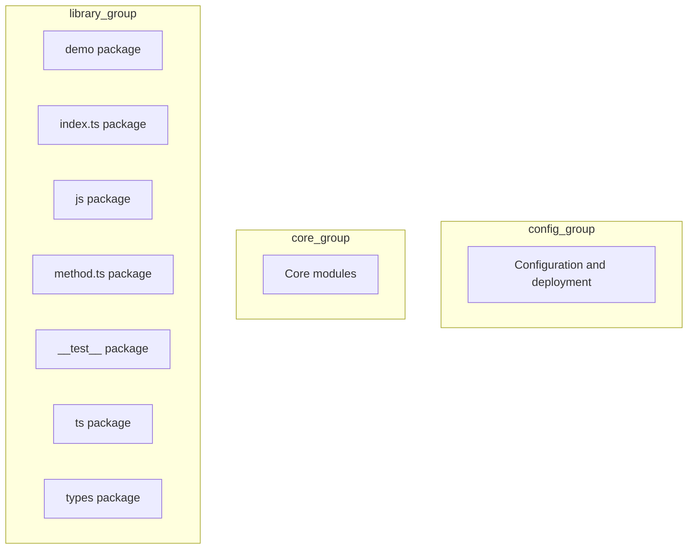

# Architecture report: Vanessa219/vditor

> Automated static analysis. **Observed** = directly seen in files/imports/AST; **Inferred** = interpretation from that evidence. Repository code was not executed.

## 1. Repository at a glance

| Item | Value |
| --- | --- |
| Repository | Vanessa219/vditor |
| Description | ♏  一款浏览器端的 Markdown 编辑器，支持所见即所得（富文本）、即时渲染（类似 Typora）和分屏预览模式。An In-browser Markdown editor, support WYSIWYG (Rich Text),  Instant Rendering (Typora-like) and Split View modes. |
| Language | TypeScript |
| Stars | 11449 |
| Licence | MIT |
| Analysed commit / branch | 0732967e1bd16de7716399b6926bf75ad9bfc5d8 / master |
| Framework(s) | None detected |
| Files analysed | 251 |
| Components | 9 |

## 2. Architecture in one minute

Vanessa219/vditor - ♏  一款浏览器端的 Markdown 编辑器，支持所见即所得（富文本）、即时渲染（类似 Typora）和分屏预览模式。An In-browser Markdown editor, support WYSIWYG (Rich Text),  Instant Rendering (Typora-like) and Split View modes.. This repository was analysed statically from 251 file(s) (0 Python). Detected technologies (observed from imports/manifests): GitHub Actions, Jest, TypeScript, webpack. Files are grouped into 9 component(s): Configuration and deployment, Core modules, demo package, index.ts package, js package, method.ts package, __test__ package, ts package. Findings below distinguish observed facts from inferred interpretation.

## 3. High-level block diagram

## 4. Main components

### Configuration and deployment (`config`)

- **Kind:** config
- **Status:** Observed
- **Confidence:** 0.85
- **Responsibility:** Groups 5 file(s) under configuration and deployment (observed from repository paths and static analysis).
- **Paths:** `bower.json`, `package.json`, `pnpm-workspace.yaml`, `tsconfig.json`, `tsconfig.test.json`
- **Evidence:** [bower.json](https://github.com/Vanessa219/vditor/blob/0732967e1bd16de7716399b6926bf75ad9bfc5d8/bower.json); [package.json](https://github.com/Vanessa219/vditor/blob/0732967e1bd16de7716399b6926bf75ad9bfc5d8/package.json); [pnpm-workspace.yaml](https://github.com/Vanessa219/vditor/blob/0732967e1bd16de7716399b6926bf75ad9bfc5d8/pnpm-workspace.yaml); [tsconfig.json](https://github.com/Vanessa219/vditor/blob/0732967e1bd16de7716399b6926bf75ad9bfc5d8/tsconfig.json); [tsconfig.test.json](https://github.com/Vanessa219/vditor/blob/0732967e1bd16de7716399b6926bf75ad9bfc5d8/tsconfig.test.json)

### Core modules (`core`)

- **Kind:** core
- **Status:** Observed
- **Confidence:** 0.85
- **Responsibility:** Groups 4 file(s) under core modules (observed from repository paths and static analysis).
- **Paths:** `eslint.config.mjs`, `jest.config.cjs`, `webpack.config.js`, `webpack.start.js`
- **Evidence:** [eslint.config.mjs](https://github.com/Vanessa219/vditor/blob/0732967e1bd16de7716399b6926bf75ad9bfc5d8/eslint.config.mjs); [jest.config.cjs](https://github.com/Vanessa219/vditor/blob/0732967e1bd16de7716399b6926bf75ad9bfc5d8/jest.config.cjs); [webpack.config.js](https://github.com/Vanessa219/vditor/blob/0732967e1bd16de7716399b6926bf75ad9bfc5d8/webpack.config.js); [webpack.start.js](https://github.com/Vanessa219/vditor/blob/0732967e1bd16de7716399b6926bf75ad9bfc5d8/webpack.start.js)

### demo package (`demo`)

- **Kind:** library
- **Status:** Observed
- **Confidence:** 0.85
- **Responsibility:** Groups 4 file(s) under demo package (observed from repository paths and static analysis).
- **Paths:** `demo/comment.js`, `demo/index.js`, `demo/jest-puppeteer.js`, `demo/render.js`
- **Evidence:** [demo/comment.js](https://github.com/Vanessa219/vditor/blob/0732967e1bd16de7716399b6926bf75ad9bfc5d8/demo/comment.js); [demo/index.js](https://github.com/Vanessa219/vditor/blob/0732967e1bd16de7716399b6926bf75ad9bfc5d8/demo/index.js); [demo/jest-puppeteer.js](https://github.com/Vanessa219/vditor/blob/0732967e1bd16de7716399b6926bf75ad9bfc5d8/demo/jest-puppeteer.js); [demo/render.js](https://github.com/Vanessa219/vditor/blob/0732967e1bd16de7716399b6926bf75ad9bfc5d8/demo/render.js)

### index.ts package (`index_ts`)

- **Kind:** library
- **Status:** Observed
- **Confidence:** 0.85
- **Responsibility:** Groups 1 file(s) under index.ts package (observed from repository paths and static analysis).
- **Paths:** `src/index.ts`
- **Evidence:** [src/index.ts](https://github.com/Vanessa219/vditor/blob/0732967e1bd16de7716399b6926bf75ad9bfc5d8/src/index.ts)

### js package (`js`)

- **Kind:** library
- **Status:** Observed
- **Confidence:** 0.85
- **Responsibility:** Groups 52 file(s) under js package (observed from repository paths and static analysis).
- **Paths:** `src/js/graphviz/viz.js`, `src/js/highlight.js/third-languages.js`, `src/js/i18n/de_DE.js`, `src/js/i18n/en_US.js`, `src/js/i18n/es_ES.js`, `src/js/i18n/fr_FR.js`, `src/js/i18n/ja_JP.js`, `src/js/i18n/ko_KR.js`, `src/js/i18n/pt_BR.js`, `src/js/i18n/ru_RU.js`, `src/js/i18n/sv_SE.js`, `src/js/i18n/vi_VN.js`, `src/js/i18n/zh_CN.js`, `src/js/i18n/zh_TW.js`, `src/js/icons/ant.js`, `src/js/icons/material.js`, `src/js/mathjax/a11y/assistive-mml.js`, `src/js/mathjax/a11y/complexity.js`, `src/js/mathjax/a11y/explorer.js`, `src/js/mathjax/a11y/semantic-enrich.js`, `src/js/mathjax/input/asciimath.js`, `src/js/mathjax/input/mml.js`, `src/js/mathjax/input/mml/entities.js`, `src/js/mathjax/input/tex-base.js`, `src/js/mathjax/input/tex.js`, `src/js/mathjax/input/tex/extensions/action.js`, `src/js/mathjax/input/tex/extensions/all-packages.js`, `src/js/mathjax/input/tex/extensions/ams.js`, `src/js/mathjax/input/tex/extensions/amscd.js`, `src/js/mathjax/input/tex/extensions/autoload.js`, `src/js/mathjax/input/tex/extensions/bbox.js`, `src/js/mathjax/input/tex/extensions/boldsymbol.js`, `src/js/mathjax/input/tex/extensions/braket.js`, `src/js/mathjax/input/tex/extensions/bussproofs.js`, `src/js/mathjax/input/tex/extensions/cancel.js`, `src/js/mathjax/input/tex/extensions/color.js`, `src/js/mathjax/input/tex/extensions/colorV2.js`, `src/js/mathjax/input/tex/extensions/configMacros.js`, `src/js/mathjax/input/tex/extensions/enclose.js`, `src/js/mathjax/input/tex/extensions/extpfeil.js`, `src/js/mathjax/input/tex/extensions/html.js`, `src/js/mathjax/input/tex/extensions/mhchem.js`, `src/js/mathjax/input/tex/extensions/newcommand.js`, `src/js/mathjax/input/tex/extensions/noerrors.js`, `src/js/mathjax/input/tex/extensions/noundefined.js`, `src/js/mathjax/input/tex/extensions/physics.js`, `src/js/mathjax/input/tex/extensions/require.js`, `src/js/mathjax/input/tex/extensions/tagFormat.js`, `src/js/mathjax/input/tex/extensions/textmacros.js`, `src/js/mathjax/input/tex/extensions/unicode.js`, `src/js/mathjax/input/tex/extensions/verb.js`, `src/js/mathjax/sre/sre-node.js`
- **Evidence:** [src/js/graphviz/viz.js](https://github.com/Vanessa219/vditor/blob/0732967e1bd16de7716399b6926bf75ad9bfc5d8/src/js/graphviz/viz.js); [src/js/highlight.js/third-languages.js](https://github.com/Vanessa219/vditor/blob/0732967e1bd16de7716399b6926bf75ad9bfc5d8/src/js/highlight.js/third-languages.js); [src/js/i18n/de_DE.js](https://github.com/Vanessa219/vditor/blob/0732967e1bd16de7716399b6926bf75ad9bfc5d8/src/js/i18n/de_DE.js); [src/js/i18n/en_US.js](https://github.com/Vanessa219/vditor/blob/0732967e1bd16de7716399b6926bf75ad9bfc5d8/src/js/i18n/en_US.js); [src/js/i18n/es_ES.js](https://github.com/Vanessa219/vditor/blob/0732967e1bd16de7716399b6926bf75ad9bfc5d8/src/js/i18n/es_ES.js); [src/js/i18n/fr_FR.js](https://github.com/Vanessa219/vditor/blob/0732967e1bd16de7716399b6926bf75ad9bfc5d8/src/js/i18n/fr_FR.js); [src/js/i18n/ja_JP.js](https://github.com/Vanessa219/vditor/blob/0732967e1bd16de7716399b6926bf75ad9bfc5d8/src/js/i18n/ja_JP.js); [src/js/i18n/ko_KR.js](https://github.com/Vanessa219/vditor/blob/0732967e1bd16de7716399b6926bf75ad9bfc5d8/src/js/i18n/ko_KR.js)

### method.ts package (`method_ts`)

- **Kind:** library
- **Status:** Observed
- **Confidence:** 0.85
- **Responsibility:** Groups 1 file(s) under method.ts package (observed from repository paths and static analysis).
- **Paths:** `src/method.ts`
- **Evidence:** [src/method.ts](https://github.com/Vanessa219/vditor/blob/0732967e1bd16de7716399b6926bf75ad9bfc5d8/src/method.ts)

### __test__ package (`test`)

- **Kind:** library
- **Status:** Observed
- **Confidence:** 0.85
- **Responsibility:** Groups 33 file(s) under __test__ package (observed from repository paths and static analysis).
- **Paths:** `__test__/blockquoteInList.test.js`, `__test__/imageCaption.test.js`, `__test__/ir/copyHeadingMarker.test.js`, `__test__/ir/toolbarToggle.test.js`, `__test__/listEnter.test.js`, `__test__/markdown/callout.test.js`, `__test__/markdown/commonmark-0.29.ts`, `__test__/markdown/getMarkdownNbsp.browser.test.js`, `__test__/markdown/getMarkdownNbsp.test.ts`, `__test__/markdown/headingIDRaw.test.js`, `__test__/markdown/inlineMath.test.ts`, `__test__/markdown/linkBase.test.js`, `__test__/markdown/listSetextContinuation.test.js`, `__test__/markdown/lute.test.ts`, `__test__/markdown/mediaRender.browser.test.js`, `__test__/markdown/mermaid.browser.test.js`, `__test__/markdown/tableBreak.test.js`, `__test__/markdown/wavedrom.browser.test.js`, `__test__/markdown/wavedrom.test.js`, `__test__/methods/index.spec.ts`, `__test__/sv/textarea.test.js`, `__test__/toolbarButton.test.js`, `__test__/uploadError.test.js`, `__test__/util/Options.test.ts`, `__test__/util/launchBrowser.ts`, `__test__/util/textareaPosition.spec.ts`, `__test__/wysiwyg/androidCursor.test.js`, `__test__/wysiwyg/callout.test.js`, `__test__/wysiwyg/headingInList.test.js`, `__test__/wysiwyg/inlineMathRoundTrip.test.js`, `__test__/wysiwyg/mobileToolbar.test.js`, `__test__/wysiwyg/multilineListHotkey.test.js`, `__test__/wysiwyg/pasteTableCell.test.js`
- **Evidence:** [__test__/blockquoteInList.test.js](https://github.com/Vanessa219/vditor/blob/0732967e1bd16de7716399b6926bf75ad9bfc5d8/__test__/blockquoteInList.test.js); [__test__/imageCaption.test.js](https://github.com/Vanessa219/vditor/blob/0732967e1bd16de7716399b6926bf75ad9bfc5d8/__test__/imageCaption.test.js); [__test__/ir/copyHeadingMarker.test.js](https://github.com/Vanessa219/vditor/blob/0732967e1bd16de7716399b6926bf75ad9bfc5d8/__test__/ir/copyHeadingMarker.test.js); [__test__/ir/toolbarToggle.test.js](https://github.com/Vanessa219/vditor/blob/0732967e1bd16de7716399b6926bf75ad9bfc5d8/__test__/ir/toolbarToggle.test.js); [__test__/listEnter.test.js](https://github.com/Vanessa219/vditor/blob/0732967e1bd16de7716399b6926bf75ad9bfc5d8/__test__/listEnter.test.js); [__test__/markdown/callout.test.js](https://github.com/Vanessa219/vditor/blob/0732967e1bd16de7716399b6926bf75ad9bfc5d8/__test__/markdown/callout.test.js); [__test__/markdown/commonmark-0.29.ts](https://github.com/Vanessa219/vditor/blob/0732967e1bd16de7716399b6926bf75ad9bfc5d8/__test__/markdown/commonmark-0.29.ts); [__test__/markdown/getMarkdownNbsp.browser.test.js](https://github.com/Vanessa219/vditor/blob/0732967e1bd16de7716399b6926bf75ad9bfc5d8/__test__/markdown/getMarkdownNbsp.browser.test.js)

### ts package (`ts`)

- **Kind:** library
- **Status:** Observed
- **Confidence:** 0.85
- **Responsibility:** Groups 108 file(s) under ts package (observed from repository paths and static analysis).
- **Paths:** `src/ts/constants.ts`, `src/ts/devtools/index.ts`, `src/ts/export/index.ts`, `src/ts/hint/index.ts`, `src/ts/ir/expandMarker.ts`, `src/ts/ir/highlightToolbarIR.ts`, `src/ts/ir/index.ts`, `src/ts/ir/input.ts`, `src/ts/ir/process.ts`, `src/ts/ir/processKeydown.ts`, `src/ts/markdown/SMILESRender.ts`, `src/ts/markdown/abcRender.ts`, `src/ts/markdown/adapterRender.ts`, `src/ts/markdown/anchorRender.ts`, `src/ts/markdown/chartRender.ts`, `src/ts/markdown/codeRender.ts`, `src/ts/markdown/flowchartRender.ts`, `src/ts/markdown/getHTML.ts`, `src/ts/markdown/getMarkdown.ts`, `src/ts/markdown/graphvizRender.ts`, `src/ts/markdown/highlightRender.ts`, `src/ts/markdown/imageCaptionRender.ts`, `src/ts/markdown/lazyLoadImageRender.ts`, `src/ts/markdown/markmapRender.ts`, `src/ts/markdown/mathRender.ts`, `src/ts/markdown/mediaRender.ts`, `src/ts/markdown/mermaidRender.ts`, `src/ts/markdown/mindmapRender.ts`, `src/ts/markdown/outlineRender.ts`, `src/ts/markdown/plantumlRender.ts`, `src/ts/markdown/previewRender.ts`, `src/ts/markdown/setLute.ts`, `src/ts/markdown/speechRender.ts`, `src/ts/markdown/wavedromRender.ts`, `src/ts/outline/index.ts`, `src/ts/preview/image.ts`, `src/ts/preview/index.ts`, `src/ts/resize/index.ts`, `src/ts/sv/index.ts`, `src/ts/sv/process.ts`, `src/ts/sv/processKeydown.ts`, `src/ts/tip/index.ts`, `src/ts/toolbar/Both.ts`, `src/ts/toolbar/Br.ts`, `src/ts/toolbar/CodeTheme.ts`, `src/ts/toolbar/ContentTheme.ts`, `src/ts/toolbar/Counter.ts`, `src/ts/toolbar/Custom.ts`, `src/ts/toolbar/Devtools.ts`, `src/ts/toolbar/Divider.ts`, `src/ts/toolbar/EditMode.ts`, `src/ts/toolbar/Emoji.ts`, `src/ts/toolbar/Export.ts`, `src/ts/toolbar/Fullscreen.ts`, `src/ts/toolbar/Headings.ts`, `src/ts/toolbar/Help.ts`, `src/ts/toolbar/Indent.ts`, `src/ts/toolbar/Info.ts`, `src/ts/toolbar/InsertAfter.ts`, `src/ts/toolbar/InsertBefore.ts`, `src/ts/toolbar/MenuItem.ts`, `src/ts/toolbar/Outdent.ts`, `src/ts/toolbar/Outline.ts`, `src/ts/toolbar/Preview.ts`, `src/ts/toolbar/Record.ts`, `src/ts/toolbar/Redo.ts`, `src/ts/toolbar/Undo.ts`, `src/ts/toolbar/Upload.ts`, `src/ts/toolbar/index.ts`, `src/ts/toolbar/setToolbar.ts`, `src/ts/ui/initUI.ts`, `src/ts/ui/setCodeTheme.ts`, `src/ts/ui/setContentTheme.ts`, `src/ts/ui/setPreviewMode.ts`, `src/ts/ui/setTheme.ts`, `src/ts/undo/index.ts`, `src/ts/upload/getElement.ts`, `src/ts/upload/index.ts`, `src/ts/upload/setHeaders.ts`, `src/ts/util/Options.ts`, `src/ts/util/RecordMedia.ts`, `src/ts/util/addScript.ts`, `src/ts/util/addStyle.ts`, `src/ts/util/code160to32.ts`, `src/ts/util/compatibility.ts`, `src/ts/util/editorCommonEvent.ts`, `src/ts/util/fixBrowserBehavior.ts`, `src/ts/util/function.ts`, `src/ts/util/getSelectText.ts`, `src/ts/util/hasClosest.ts`, `src/ts/util/hasClosestByHeadings.ts`, `src/ts/util/highlightToolbar.ts`, `src/ts/util/hotKey.ts`, `src/ts/util/log.ts`, `src/ts/util/merge.ts`, `src/ts/util/processCode.ts`, `src/ts/util/selection.ts`, `src/ts/util/toc.ts`, `src/ts/wysiwyg/afterRenderEvent.ts`, `src/ts/wysiwyg/highlightToolbarWYSIWYG.ts`, `src/ts/wysiwyg/index.ts`, `src/ts/wysiwyg/inlineTag.ts`, `src/ts/wysiwyg/input.ts`, `src/ts/wysiwyg/processKeydown.ts`, `src/ts/wysiwyg/renderDomByMd.ts`, `src/ts/wysiwyg/setHeading.ts`, `src/ts/wysiwyg/showCode.ts`, `src/ts/wysiwyg/toolbarEvent.ts`
- **Evidence:** [src/ts/constants.ts](https://github.com/Vanessa219/vditor/blob/0732967e1bd16de7716399b6926bf75ad9bfc5d8/src/ts/constants.ts); [src/ts/devtools/index.ts](https://github.com/Vanessa219/vditor/blob/0732967e1bd16de7716399b6926bf75ad9bfc5d8/src/ts/devtools/index.ts); [src/ts/export/index.ts](https://github.com/Vanessa219/vditor/blob/0732967e1bd16de7716399b6926bf75ad9bfc5d8/src/ts/export/index.ts); [src/ts/hint/index.ts](https://github.com/Vanessa219/vditor/blob/0732967e1bd16de7716399b6926bf75ad9bfc5d8/src/ts/hint/index.ts); [src/ts/ir/expandMarker.ts](https://github.com/Vanessa219/vditor/blob/0732967e1bd16de7716399b6926bf75ad9bfc5d8/src/ts/ir/expandMarker.ts); [src/ts/ir/highlightToolbarIR.ts](https://github.com/Vanessa219/vditor/blob/0732967e1bd16de7716399b6926bf75ad9bfc5d8/src/ts/ir/highlightToolbarIR.ts); [src/ts/ir/index.ts](https://github.com/Vanessa219/vditor/blob/0732967e1bd16de7716399b6926bf75ad9bfc5d8/src/ts/ir/index.ts); [src/ts/ir/input.ts](https://github.com/Vanessa219/vditor/blob/0732967e1bd16de7716399b6926bf75ad9bfc5d8/src/ts/ir/input.ts)

### types package (`types`)

- **Kind:** library
- **Status:** Observed
- **Confidence:** 0.85
- **Responsibility:** Groups 1 file(s) under types package (observed from repository paths and static analysis).
- **Paths:** `types/index.d.ts`
- **Evidence:** [types/index.d.ts](https://github.com/Vanessa219/vditor/blob/0732967e1bd16de7716399b6926bf75ad9bfc5d8/types/index.d.ts)

## 5. Execution flow

**Observed** entry point(s):

- [demo/index.js](https://github.com/Vanessa219/vditor/blob/0732967e1bd16de7716399b6926bf75ad9bfc5d8/demo/index.js)
- [src/index.ts](https://github.com/Vanessa219/vditor/blob/0732967e1bd16de7716399b6926bf75ad9bfc5d8/src/index.ts)
- [src/ts/devtools/index.ts](https://github.com/Vanessa219/vditor/blob/0732967e1bd16de7716399b6926bf75ad9bfc5d8/src/ts/devtools/index.ts)
- [src/ts/export/index.ts](https://github.com/Vanessa219/vditor/blob/0732967e1bd16de7716399b6926bf75ad9bfc5d8/src/ts/export/index.ts)
- [src/ts/hint/index.ts](https://github.com/Vanessa219/vditor/blob/0732967e1bd16de7716399b6926bf75ad9bfc5d8/src/ts/hint/index.ts)
- [src/ts/ir/index.ts](https://github.com/Vanessa219/vditor/blob/0732967e1bd16de7716399b6926bf75ad9bfc5d8/src/ts/ir/index.ts)
- [src/ts/outline/index.ts](https://github.com/Vanessa219/vditor/blob/0732967e1bd16de7716399b6926bf75ad9bfc5d8/src/ts/outline/index.ts)
- [src/ts/preview/index.ts](https://github.com/Vanessa219/vditor/blob/0732967e1bd16de7716399b6926bf75ad9bfc5d8/src/ts/preview/index.ts)
- [src/ts/resize/index.ts](https://github.com/Vanessa219/vditor/blob/0732967e1bd16de7716399b6926bf75ad9bfc5d8/src/ts/resize/index.ts)
- [src/ts/sv/index.ts](https://github.com/Vanessa219/vditor/blob/0732967e1bd16de7716399b6926bf75ad9bfc5d8/src/ts/sv/index.ts)
- [src/ts/tip/index.ts](https://github.com/Vanessa219/vditor/blob/0732967e1bd16de7716399b6926bf75ad9bfc5d8/src/ts/tip/index.ts)
- [src/ts/toolbar/index.ts](https://github.com/Vanessa219/vditor/blob/0732967e1bd16de7716399b6926bf75ad9bfc5d8/src/ts/toolbar/index.ts)

Representative flow (derived from observed entry points and the import graph; steps beyond the entry point are **Inferred**):

1. Execution starts at an observed entry point listed above, if present.
2. No internal import relationships between components were observed.

## 6. Project structure

### `(root)`

- `.editorconfig` - config (148 bytes)
- `.gitignore` - other (70 bytes)
- `.prettierrc` - other (441 bytes)
- `CHANGELOG.md` - docs (115681 bytes)
- `LICENSE` - docs (1088 bytes)
- `README.md` - docs (35485 bytes)
- `README_en_US.md` - docs (35163 bytes)
- `bower.json` - config (318 bytes)
- `eslint.config.mjs` - source, JavaScript (525 bytes)
- `jest.config.cjs` - source, JavaScript (246 bytes)
- `package.json` - manifest (2545 bytes)
- `pnpm-workspace.yaml` - config (32 bytes)
- `tsconfig.json` - config (365 bytes)
- `tsconfig.test.json` - config (275 bytes)
- `webpack.config.js` - source, JavaScript (6386 bytes)
- `webpack.start.js` - source, JavaScript (4729 bytes)

### `.github`

- `.github/ISSUE_TEMPLATE/bug_report.md` - docs (975 bytes)
- `.github/ISSUE_TEMPLATE/config.yml` - config (359 bytes)
- `.github/ISSUE_TEMPLATE/feature_request.md` - docs (538 bytes)
- `.github/PULL_REQUEST_TEMPLATE.md` - docs (48 bytes)
- `.github/SECURITY.md` - docs (186 bytes)
- `.github/workflows/publish.yml` - ci, YAML (2779 bytes)

### `__test__`

- `__test__/blockquoteInList.test.js` - source, JavaScript (8715 bytes)
- `__test__/imageCaption.test.js` - source, JavaScript (7591 bytes)
- `__test__/ir/copyHeadingMarker.test.js` - source, JavaScript (7846 bytes)
- `__test__/ir/toolbarToggle.test.js` - source, JavaScript (4179 bytes)
- `__test__/listEnter.test.js` - source, JavaScript (7949 bytes)
- `__test__/markdown/callout.test.js` - source, JavaScript (3330 bytes)
- `__test__/markdown/commonmark-0.29.ts` - source, TypeScript (150967 bytes)
- `__test__/markdown/getMarkdownNbsp.browser.test.js` - source, JavaScript (3080 bytes)
- `__test__/markdown/getMarkdownNbsp.test.ts` - source, TypeScript (3013 bytes)
- `__test__/markdown/headingIDRaw.test.js` - source, JavaScript (715 bytes)
- `__test__/markdown/inlineMath.test.ts` - source, TypeScript (1026 bytes)
- `__test__/markdown/linkBase.test.js` - source, JavaScript (597 bytes)
- `__test__/markdown/listSetextContinuation.test.js` - source, JavaScript (1442 bytes)
- `__test__/markdown/lute.test.ts` - source, TypeScript (855 bytes)
- `__test__/markdown/mediaRender.browser.test.js` - source, JavaScript (4971 bytes)
- `__test__/markdown/mermaid.browser.test.js` - source, JavaScript (2818 bytes)
- `__test__/markdown/tableBreak.test.js` - source, JavaScript (1116 bytes)
- `__test__/markdown/wavedrom.browser.test.js` - source, JavaScript (1880 bytes)
- `__test__/markdown/wavedrom.test.js` - source, JavaScript (969 bytes)
- `__test__/methods/index.spec.ts` - source, TypeScript (7918 bytes)
- `__test__/sv/textarea.test.js` - source, JavaScript (4784 bytes)
- `__test__/toolbarButton.test.js` - source, JavaScript (2609 bytes)
- `__test__/uploadError.test.js` - source, JavaScript (4241 bytes)
- `__test__/util/Options.test.ts` - source, TypeScript (5266 bytes)
- `__test__/util/launchBrowser.ts` - source, TypeScript (928 bytes)
- `__test__/util/textareaPosition.spec.ts` - source, TypeScript (1464 bytes)
- `__test__/wysiwyg/androidCursor.test.js` - source, JavaScript (3724 bytes)
- `__test__/wysiwyg/callout.test.js` - source, JavaScript (3130 bytes)
- `__test__/wysiwyg/headingInList.test.js` - source, JavaScript (7018 bytes)
- `__test__/wysiwyg/inlineMathRoundTrip.test.js` - source, JavaScript (1161 bytes)
- `__test__/wysiwyg/mobileToolbar.test.js` - source, JavaScript (11255 bytes)
- `__test__/wysiwyg/multilineListHotkey.test.js` - source, JavaScript (3598 bytes)
- `__test__/wysiwyg/pasteTableCell.test.js` - source, JavaScript (2604 bytes)

### `demo`

- `demo/comment.html` - other (4730 bytes)
- `demo/comment.js` - source, JavaScript (4945 bytes)
- `demo/icon.html` - other (7796 bytes)
- `demo/index.html` - other (5176 bytes)
- `demo/index.js` - source, JavaScript (4619 bytes)
- `demo/jest-puppeteer.html` - other (3631 bytes)
- `demo/jest-puppeteer.js` - source, JavaScript (4856 bytes)
- `demo/markdown/cute-list.md` - docs (311 bytes)
- `demo/markdown/entity.md` - docs (85 bytes)
- `demo/markdown/ko_KR.md` - docs (11422 bytes)
- `demo/markdown/zh_CN.md` - docs (9171 bytes)
- `demo/render.html` - other (6855 bytes)
- `demo/render.js` - source, JavaScript (3091 bytes)
- `demo/static.html` - other (4107 bytes)

### `src`

- `src/assets/less/_content.less` - other (5288 bytes)
- `src/assets/less/_hint.less` - other (1222 bytes)
- `src/assets/less/_ir.less` - other (5287 bytes)
- `src/assets/less/_panel.less` - other (2069 bytes)
- `src/assets/less/_reset.less` - other (17749 bytes)
- `src/assets/less/_sv.less` - other (711 bytes)
- `src/assets/less/_toolbar.less` - other (3502 bytes)
- `src/assets/less/_tooltipped.less` - other (2842 bytes)
- `src/assets/less/_wysiwyg.less` - other (4029 bytes)
- `src/assets/less/index.less` - other (3143 bytes)
- `src/css/content-theme/ant-design.css` - other (4938 bytes)
- `src/css/content-theme/dark.css` - other (3028 bytes)
- `src/css/content-theme/light.css` - other (2755 bytes)
- `src/css/content-theme/wechat.css` - other (2966 bytes)
- `src/images/img-loading.svg` - other (1338 bytes)
- `src/index.ts` - source, TypeScript (21658 bytes)
- `src/js/graphviz/viz.js` - source, JavaScript (11468 bytes)
- `src/js/highlight.js/LICENSE` - docs (1514 bytes)
- `src/js/highlight.js/third-languages.js` - source, JavaScript (21007 bytes)
- `src/js/i18n/de_DE.js` - source, JavaScript (2702 bytes)
- `src/js/i18n/en_US.js` - source, JavaScript (2419 bytes)
- `src/js/i18n/es_ES.js` - source, JavaScript (2930 bytes)
- `src/js/i18n/fr_FR.js` - source, JavaScript (2743 bytes)
- `src/js/i18n/ja_JP.js` - source, JavaScript (3065 bytes)
- `src/js/i18n/ko_KR.js` - source, JavaScript (2777 bytes)
- `src/js/i18n/pt_BR.js` - source, JavaScript (2704 bytes)
- `src/js/i18n/ru_RU.js` - source, JavaScript (4176 bytes)
- `src/js/i18n/sv_SE.js` - source, JavaScript (2675 bytes)
- `src/js/i18n/vi_VN.js` - source, JavaScript (3205 bytes)
- `src/js/i18n/zh_CN.js` - source, JavaScript (2564 bytes)
- `src/js/i18n/zh_TW.js` - source, JavaScript (2567 bytes)
- `src/js/icons/ant.js` - source, JavaScript (42983 bytes)
- `src/js/icons/material.js` - source, JavaScript (20896 bytes)
- `src/js/markmap/prism.css` - other (2335 bytes)
- `src/js/mathjax/LICENSE` - docs (11358 bytes)
- `src/js/mathjax/a11y/assistive-mml.js` - source, JavaScript (6982 bytes)
- `src/js/mathjax/a11y/complexity.js` - source, JavaScript (18478 bytes)
- `src/js/mathjax/a11y/explorer.js` - source, JavaScript (32640 bytes)
- `src/js/mathjax/a11y/semantic-enrich.js` - source, JavaScript (8767 bytes)
- `src/js/mathjax/input/asciimath.js` - source, JavaScript (106067 bytes)
- `src/js/mathjax/input/mml.js` - source, JavaScript (14009 bytes)
- `src/js/mathjax/input/mml/entities.js` - source, JavaScript (33265 bytes)
- `src/js/mathjax/input/tex-base.js` - source, JavaScript (129130 bytes)
- `src/js/mathjax/input/tex.js` - source, JavaScript (163954 bytes)
- `src/js/mathjax/input/tex/extensions/action.js` - source, JavaScript (3302 bytes)
- `src/js/mathjax/input/tex/extensions/all-packages.js` - source, JavaScript (147205 bytes)
- `src/js/mathjax/input/tex/extensions/ams.js` - source, JavaScript (23357 bytes)
- `src/js/mathjax/input/tex/extensions/amscd.js` - source, JavaScript (7056 bytes)
- `src/js/mathjax/input/tex/extensions/autoload.js` - source, JavaScript (7019 bytes)
- `src/js/mathjax/input/tex/extensions/bbox.js` - source, JavaScript (3693 bytes)
- `src/js/mathjax/input/tex/extensions/boldsymbol.js` - source, JavaScript (4709 bytes)
- `src/js/mathjax/input/tex/extensions/braket.js` - source, JavaScript (7150 bytes)
- `src/js/mathjax/input/tex/extensions/bussproofs.js` - source, JavaScript (17174 bytes)
- `src/js/mathjax/input/tex/extensions/cancel.js` - source, JavaScript (4029 bytes)
- `src/js/mathjax/input/tex/extensions/color.js` - source, JavaScript (9192 bytes)
- `src/js/mathjax/input/tex/extensions/colorV2.js` - source, JavaScript (3076 bytes)
- `src/js/mathjax/input/tex/extensions/configMacros.js` - source, JavaScript (4764 bytes)
- `src/js/mathjax/input/tex/extensions/enclose.js` - source, JavaScript (3071 bytes)
- `src/js/mathjax/input/tex/extensions/extpfeil.js` - source, JavaScript (4158 bytes)
- `src/js/mathjax/input/tex/extensions/html.js` - source, JavaScript (3572 bytes)
- `src/js/mathjax/input/tex/extensions/mhchem.js` - source, JavaScript (36819 bytes)
- `src/js/mathjax/input/tex/extensions/newcommand.js` - source, JavaScript (10840 bytes)
- `src/js/mathjax/input/tex/extensions/noerrors.js` - source, JavaScript (2049 bytes)
- `src/js/mathjax/input/tex/extensions/noundefined.js` - source, JavaScript (2657 bytes)
- `src/js/mathjax/input/tex/extensions/physics.js` - source, JavaScript (23443 bytes)
- `src/js/mathjax/input/tex/extensions/require.js` - source, JavaScript (6521 bytes)
- `src/js/mathjax/input/tex/extensions/tagFormat.js` - source, JavaScript (3842 bytes)
- `src/js/mathjax/input/tex/extensions/textmacros.js` - source, JavaScript (15926 bytes)
- `src/js/mathjax/input/tex/extensions/unicode.js` - source, JavaScript (4151 bytes)
- `src/js/mathjax/input/tex/extensions/verb.js` - source, JavaScript (3258 bytes)
- `src/js/mathjax/sre/sre-node.js` - source, JavaScript (297 bytes)
- `src/js/wavedrom/LICENSE.WaveDrom` - other (1092 bytes)
- `src/method.ts` - source, TypeScript (3433 bytes)
- `src/ts/constants.ts` - source, TypeScript (7526 bytes)
- `src/ts/devtools/index.ts` - source, TypeScript (3221 bytes)
- `src/ts/export/index.ts` - source, TypeScript (3841 bytes)
- `src/ts/hint/index.ts` - source, TypeScript (12197 bytes)
- `src/ts/ir/expandMarker.ts` - source, TypeScript (3062 bytes)
- `src/ts/ir/highlightToolbarIR.ts` - source, TypeScript (4410 bytes)
- `src/ts/ir/index.ts` - source, TypeScript (12858 bytes)
- `src/ts/ir/input.ts` - source, TypeScript (10148 bytes)
- `src/ts/ir/process.ts` - source, TypeScript (10821 bytes)
- `src/ts/ir/processKeydown.ts` - source, TypeScript (9673 bytes)
- `src/ts/markdown/SMILESRender.ts` - source, TypeScript (1284 bytes)
- `src/ts/markdown/abcRender.ts` - source, TypeScript (1126 bytes)
- `src/ts/markdown/adapterRender.ts` - source, TypeScript (2083 bytes)
- `src/ts/markdown/anchorRender.ts` - source, TypeScript (754 bytes)
- `src/ts/markdown/chartRender.ts` - source, TypeScript (1603 bytes)
- `src/ts/markdown/codeRender.ts` - source, TypeScript (3401 bytes)
- `src/ts/markdown/flowchartRender.ts` - source, TypeScript (963 bytes)
- `src/ts/markdown/getHTML.ts` - source, TypeScript (610 bytes)
- `src/ts/markdown/getMarkdown.ts` - source, TypeScript (516 bytes)
- `src/ts/markdown/graphvizRender.ts` - source, TypeScript (1969 bytes)
- `src/ts/markdown/highlightRender.ts` - source, TypeScript (4331 bytes)
- `src/ts/markdown/imageCaptionRender.ts` - source, TypeScript (5764 bytes)
- `src/ts/markdown/lazyLoadImageRender.ts` - source, TypeScript (2298 bytes)
- `src/ts/markdown/markmapRender.ts` - source, TypeScript (2129 bytes)
- `src/ts/markdown/mathRender.ts` - source, TypeScript (6162 bytes)
- `src/ts/markdown/mediaRender.ts` - source, TypeScript (4115 bytes)
- `src/ts/markdown/mermaidRender.ts` - source, TypeScript (2437 bytes)
- `src/ts/markdown/mindmapRender.ts` - source, TypeScript (3353 bytes)
- `src/ts/markdown/outlineRender.ts` - source, TypeScript (5280 bytes)
- `src/ts/markdown/plantumlRender.ts` - source, TypeScript (1288 bytes)
- `src/ts/markdown/previewRender.ts` - source, TypeScript (7373 bytes)
- `src/ts/markdown/setLute.ts` - source, TypeScript (1158 bytes)
- `src/ts/markdown/speechRender.ts` - source, TypeScript (4223 bytes)
- `src/ts/markdown/wavedromRender.ts` - source, TypeScript (2296 bytes)
- `src/ts/outline/index.ts` - source, TypeScript (1741 bytes)
- `src/ts/preview/image.ts` - source, TypeScript (2916 bytes)
- `src/ts/preview/index.ts` - source, TypeScript (14281 bytes)
- `src/ts/resize/index.ts` - source, TypeScript (2241 bytes)
- `src/ts/sv/index.ts` - source, TypeScript (3240 bytes)
- `src/ts/sv/process.ts` - source, TypeScript (4082 bytes)
- `src/ts/sv/processKeydown.ts` - source, TypeScript (1377 bytes)
- `src/ts/tip/index.ts` - source, TypeScript (1273 bytes)
- `src/ts/toolbar/Both.ts` - source, TypeScript (1041 bytes)
- `src/ts/toolbar/Br.ts` - source, TypeScript (189 bytes)
- `src/ts/toolbar/CodeTheme.ts` - source, TypeScript (1506 bytes)
- `src/ts/toolbar/ContentTheme.ts` - source, TypeScript (1598 bytes)
- `src/ts/toolbar/Counter.ts` - source, TypeScript (1606 bytes)
- `src/ts/toolbar/Custom.ts` - source, TypeScript (663 bytes)
- `src/ts/toolbar/Devtools.ts` - source, TypeScript (1122 bytes)
- `src/ts/toolbar/Divider.ts` - source, TypeScript (199 bytes)
- `src/ts/toolbar/EditMode.ts` - source, TypeScript (7436 bytes)
- `src/ts/toolbar/Emoji.ts` - source, TypeScript (4106 bytes)
- `src/ts/toolbar/Export.ts` - source, TypeScript (1724 bytes)
- `src/ts/toolbar/Fullscreen.ts` - source, TypeScript (2945 bytes)
- `src/ts/toolbar/Headings.ts` - source, TypeScript (3628 bytes)
- `src/ts/toolbar/Help.ts` - source, TypeScript (1545 bytes)
- `src/ts/toolbar/Indent.ts` - source, TypeScript (968 bytes)
- `src/ts/toolbar/Info.ts` - source, TypeScript (1761 bytes)
- `src/ts/toolbar/InsertAfter.ts` - source, TypeScript (694 bytes)
- `src/ts/toolbar/InsertBefore.ts` - source, TypeScript (698 bytes)
- `src/ts/toolbar/MenuItem.ts` - source, TypeScript (2435 bytes)
- `src/ts/toolbar/Outdent.ts` - source, TypeScript (996 bytes)
- `src/ts/toolbar/Outline.ts` - source, TypeScript (918 bytes)
- `src/ts/toolbar/Preview.ts` - source, TypeScript (2469 bytes)
- `src/ts/toolbar/Record.ts` - source, TypeScript (3082 bytes)
- `src/ts/toolbar/Redo.ts` - source, TypeScript (668 bytes)
- `src/ts/toolbar/Undo.ts` - source, TypeScript (668 bytes)
- `src/ts/toolbar/Upload.ts` - source, TypeScript (1684 bytes)
- `src/ts/toolbar/index.ts` - source, TypeScript (6896 bytes)
- `src/ts/toolbar/setToolbar.ts` - source, TypeScript (4391 bytes)
- `src/ts/ui/initUI.ts` - source, TypeScript (6362 bytes)
- `src/ts/ui/setCodeTheme.ts` - source, TypeScript (635 bytes)
- `src/ts/ui/setContentTheme.ts` - source, TypeScript (566 bytes)
- `src/ts/ui/setPreviewMode.ts` - source, TypeScript (943 bytes)
- `src/ts/ui/setTheme.ts` - source, TypeScript (223 bytes)
- `src/ts/undo/index.ts` - source, TypeScript (11620 bytes)
- `src/ts/upload/getElement.ts` - source, TypeScript (273 bytes)
- `src/ts/upload/index.ts` - source, TypeScript (11782 bytes)
- `src/ts/upload/setHeaders.ts` - source, TypeScript (404 bytes)
- `src/ts/util/Options.ts` - source, TypeScript (14153 bytes)
- `src/ts/util/RecordMedia.ts` - source, TypeScript (6300 bytes)
- `src/ts/util/addScript.ts` - source, TypeScript (1544 bytes)
- `src/ts/util/addStyle.ts` - source, TypeScript (385 bytes)
- `src/ts/util/code160to32.ts` - source, TypeScript (129 bytes)
- `src/ts/util/compatibility.ts` - source, TypeScript (2140 bytes)
- `src/ts/util/editorCommonEvent.ts` - source, TypeScript (11722 bytes)
- `src/ts/util/fixBrowserBehavior.ts` - source, TypeScript (76454 bytes)
- `src/ts/util/function.ts` - source, TypeScript (738 bytes)
- `src/ts/util/getSelectText.ts` - source, TypeScript (223 bytes)
- `src/ts/util/hasClosest.ts` - source, TypeScript (4679 bytes)
- `src/ts/util/hasClosestByHeadings.ts` - source, TypeScript (849 bytes)
- `src/ts/util/highlightToolbar.ts` - source, TypeScript (369 bytes)
- `src/ts/util/hotKey.ts` - source, TypeScript (1803 bytes)
- `src/ts/util/log.ts` - source, TypeScript (192 bytes)
- `src/ts/util/merge.ts` - source, TypeScript (564 bytes)
- `src/ts/util/processCode.ts` - source, TypeScript (4497 bytes)
- `src/ts/util/selection.ts` - source, TypeScript (11171 bytes)
- `src/ts/util/toc.ts` - source, TypeScript (3548 bytes)
- `src/ts/wysiwyg/afterRenderEvent.ts` - source, TypeScript (1462 bytes)
- `src/ts/wysiwyg/highlightToolbarWYSIWYG.ts` - source, TypeScript (51737 bytes)
- `src/ts/wysiwyg/index.ts` - source, TypeScript (26330 bytes)
- `src/ts/wysiwyg/inlineTag.ts` - source, TypeScript (4775 bytes)
- `src/ts/wysiwyg/input.ts` - source, TypeScript (9508 bytes)
- `src/ts/wysiwyg/processKeydown.ts` - source, TypeScript (16916 bytes)
- `src/ts/wysiwyg/renderDomByMd.ts` - source, TypeScript (655 bytes)
- `src/ts/wysiwyg/setHeading.ts` - source, TypeScript (5726 bytes)
- `src/ts/wysiwyg/showCode.ts` - source, TypeScript (1146 bytes)
- `src/ts/wysiwyg/toolbarEvent.ts` - source, TypeScript (14852 bytes)

### `types`

- `types/index.d.ts` - source, TypeScript (28456 bytes)

## 7. Key dependencies and integrations

| Name | Category | Status | Confidence | Evidence |
| --- | --- | --- | --- | --- |
| GitHub Actions | ci | Observed | 0.85 | [.github/workflows/publish.yml](https://github.com/Vanessa219/vditor/blob/0732967e1bd16de7716399b6926bf75ad9bfc5d8/.github/workflows/publish.yml) |
| Jest | tooling | Observed | 0.85 | [package.json:26](https://github.com/Vanessa219/vditor/blob/0732967e1bd16de7716399b6926bf75ad9bfc5d8/package.json#L26) |
| TypeScript | tooling | Observed | 0.85 | [package.json:29](https://github.com/Vanessa219/vditor/blob/0732967e1bd16de7716399b6926bf75ad9bfc5d8/package.json#L29) |
| webpack | tooling | Observed | 0.85 | [package.json:33](https://github.com/Vanessa219/vditor/blob/0732967e1bd16de7716399b6926bf75ad9bfc5d8/package.json#L33) |

## 8. Data and state

No database, cache, queue, or persistent-state usage was observed in the analysed files. State handling, if any, may be in-memory or in files that were not analysed.

## 9. Configuration and deployment clues

- `.editorconfig` (config)
- `.github/ISSUE_TEMPLATE/config.yml` (config)
- `.github/workflows/publish.yml` (ci)
- `bower.json` (config)
- `package.json` (manifest)
- `pnpm-workspace.yaml` (config)
- `tsconfig.json` (config)
- `tsconfig.test.json` (config)

## 10. Design observations

- No strong design patterns could be established from the available evidence.

These observations are interpretations (**Inferred**) of the observed structure, not guarantees about runtime design.

## 11. Limitations and unknowns

- Static analysis only: repository code was not executed, installed, or imported at runtime.
- Components and relationships are inferred from file paths, imports, and AST structure; runtime behaviour, dynamic imports, and reflection may not be visible.
- 252 file(s) were skipped during inventory (251 x generated/minified file excluded; 1 x likely secret file excluded).
- No clear application entry point was observed in the analysed files.
- Repository text was treated as untrusted data; no instructions found in repository files were followed, and likely secret values were redacted/excluded.
- JavaScript and TypeScript files were inventoried from paths and package manifests. They were not parsed with a full language AST, and repository code was not executed.

## 12. Source references

- [.github/workflows/publish.yml](https://github.com/Vanessa219/vditor/blob/0732967e1bd16de7716399b6926bf75ad9bfc5d8/.github/workflows/publish.yml)
- [__test__/blockquoteInList.test.js](https://github.com/Vanessa219/vditor/blob/0732967e1bd16de7716399b6926bf75ad9bfc5d8/__test__/blockquoteInList.test.js)
- [__test__/imageCaption.test.js](https://github.com/Vanessa219/vditor/blob/0732967e1bd16de7716399b6926bf75ad9bfc5d8/__test__/imageCaption.test.js)
- [__test__/ir/copyHeadingMarker.test.js](https://github.com/Vanessa219/vditor/blob/0732967e1bd16de7716399b6926bf75ad9bfc5d8/__test__/ir/copyHeadingMarker.test.js)
- [__test__/ir/toolbarToggle.test.js](https://github.com/Vanessa219/vditor/blob/0732967e1bd16de7716399b6926bf75ad9bfc5d8/__test__/ir/toolbarToggle.test.js)
- [__test__/listEnter.test.js](https://github.com/Vanessa219/vditor/blob/0732967e1bd16de7716399b6926bf75ad9bfc5d8/__test__/listEnter.test.js)
- [__test__/markdown/callout.test.js](https://github.com/Vanessa219/vditor/blob/0732967e1bd16de7716399b6926bf75ad9bfc5d8/__test__/markdown/callout.test.js)
- [__test__/markdown/commonmark-0.29.ts](https://github.com/Vanessa219/vditor/blob/0732967e1bd16de7716399b6926bf75ad9bfc5d8/__test__/markdown/commonmark-0.29.ts)
- [__test__/markdown/getMarkdownNbsp.browser.test.js](https://github.com/Vanessa219/vditor/blob/0732967e1bd16de7716399b6926bf75ad9bfc5d8/__test__/markdown/getMarkdownNbsp.browser.test.js)
- [bower.json](https://github.com/Vanessa219/vditor/blob/0732967e1bd16de7716399b6926bf75ad9bfc5d8/bower.json)
- [demo/comment.js](https://github.com/Vanessa219/vditor/blob/0732967e1bd16de7716399b6926bf75ad9bfc5d8/demo/comment.js)
- [demo/index.js](https://github.com/Vanessa219/vditor/blob/0732967e1bd16de7716399b6926bf75ad9bfc5d8/demo/index.js)
- [demo/jest-puppeteer.js](https://github.com/Vanessa219/vditor/blob/0732967e1bd16de7716399b6926bf75ad9bfc5d8/demo/jest-puppeteer.js)
- [demo/render.js](https://github.com/Vanessa219/vditor/blob/0732967e1bd16de7716399b6926bf75ad9bfc5d8/demo/render.js)
- [eslint.config.mjs](https://github.com/Vanessa219/vditor/blob/0732967e1bd16de7716399b6926bf75ad9bfc5d8/eslint.config.mjs)
- [jest.config.cjs](https://github.com/Vanessa219/vditor/blob/0732967e1bd16de7716399b6926bf75ad9bfc5d8/jest.config.cjs)
- [package.json](https://github.com/Vanessa219/vditor/blob/0732967e1bd16de7716399b6926bf75ad9bfc5d8/package.json)
- [package.json:26](https://github.com/Vanessa219/vditor/blob/0732967e1bd16de7716399b6926bf75ad9bfc5d8/package.json#L26)
- [package.json:29](https://github.com/Vanessa219/vditor/blob/0732967e1bd16de7716399b6926bf75ad9bfc5d8/package.json#L29)
- [package.json:33](https://github.com/Vanessa219/vditor/blob/0732967e1bd16de7716399b6926bf75ad9bfc5d8/package.json#L33)
- [pnpm-workspace.yaml](https://github.com/Vanessa219/vditor/blob/0732967e1bd16de7716399b6926bf75ad9bfc5d8/pnpm-workspace.yaml)
- [src/index.ts](https://github.com/Vanessa219/vditor/blob/0732967e1bd16de7716399b6926bf75ad9bfc5d8/src/index.ts)
- [src/js/graphviz/viz.js](https://github.com/Vanessa219/vditor/blob/0732967e1bd16de7716399b6926bf75ad9bfc5d8/src/js/graphviz/viz.js)
- [src/js/highlight.js/third-languages.js](https://github.com/Vanessa219/vditor/blob/0732967e1bd16de7716399b6926bf75ad9bfc5d8/src/js/highlight.js/third-languages.js)
- [src/js/i18n/de_DE.js](https://github.com/Vanessa219/vditor/blob/0732967e1bd16de7716399b6926bf75ad9bfc5d8/src/js/i18n/de_DE.js)
- [src/js/i18n/en_US.js](https://github.com/Vanessa219/vditor/blob/0732967e1bd16de7716399b6926bf75ad9bfc5d8/src/js/i18n/en_US.js)
- [src/js/i18n/es_ES.js](https://github.com/Vanessa219/vditor/blob/0732967e1bd16de7716399b6926bf75ad9bfc5d8/src/js/i18n/es_ES.js)
- [src/js/i18n/fr_FR.js](https://github.com/Vanessa219/vditor/blob/0732967e1bd16de7716399b6926bf75ad9bfc5d8/src/js/i18n/fr_FR.js)
- [src/js/i18n/ja_JP.js](https://github.com/Vanessa219/vditor/blob/0732967e1bd16de7716399b6926bf75ad9bfc5d8/src/js/i18n/ja_JP.js)
- [src/js/i18n/ko_KR.js](https://github.com/Vanessa219/vditor/blob/0732967e1bd16de7716399b6926bf75ad9bfc5d8/src/js/i18n/ko_KR.js)
- [src/method.ts](https://github.com/Vanessa219/vditor/blob/0732967e1bd16de7716399b6926bf75ad9bfc5d8/src/method.ts)
- [src/ts/constants.ts](https://github.com/Vanessa219/vditor/blob/0732967e1bd16de7716399b6926bf75ad9bfc5d8/src/ts/constants.ts)
- [src/ts/devtools/index.ts](https://github.com/Vanessa219/vditor/blob/0732967e1bd16de7716399b6926bf75ad9bfc5d8/src/ts/devtools/index.ts)
- [src/ts/export/index.ts](https://github.com/Vanessa219/vditor/blob/0732967e1bd16de7716399b6926bf75ad9bfc5d8/src/ts/export/index.ts)
- [src/ts/hint/index.ts](https://github.com/Vanessa219/vditor/blob/0732967e1bd16de7716399b6926bf75ad9bfc5d8/src/ts/hint/index.ts)
- [src/ts/ir/expandMarker.ts](https://github.com/Vanessa219/vditor/blob/0732967e1bd16de7716399b6926bf75ad9bfc5d8/src/ts/ir/expandMarker.ts)
- [src/ts/ir/highlightToolbarIR.ts](https://github.com/Vanessa219/vditor/blob/0732967e1bd16de7716399b6926bf75ad9bfc5d8/src/ts/ir/highlightToolbarIR.ts)
- [src/ts/ir/index.ts](https://github.com/Vanessa219/vditor/blob/0732967e1bd16de7716399b6926bf75ad9bfc5d8/src/ts/ir/index.ts)
- [src/ts/ir/input.ts](https://github.com/Vanessa219/vditor/blob/0732967e1bd16de7716399b6926bf75ad9bfc5d8/src/ts/ir/input.ts)
- [src/ts/outline/index.ts](https://github.com/Vanessa219/vditor/blob/0732967e1bd16de7716399b6926bf75ad9bfc5d8/src/ts/outline/index.ts)
- [src/ts/preview/index.ts](https://github.com/Vanessa219/vditor/blob/0732967e1bd16de7716399b6926bf75ad9bfc5d8/src/ts/preview/index.ts)
- [src/ts/resize/index.ts](https://github.com/Vanessa219/vditor/blob/0732967e1bd16de7716399b6926bf75ad9bfc5d8/src/ts/resize/index.ts)
- [src/ts/sv/index.ts](https://github.com/Vanessa219/vditor/blob/0732967e1bd16de7716399b6926bf75ad9bfc5d8/src/ts/sv/index.ts)
- [src/ts/tip/index.ts](https://github.com/Vanessa219/vditor/blob/0732967e1bd16de7716399b6926bf75ad9bfc5d8/src/ts/tip/index.ts)
- [src/ts/toolbar/index.ts](https://github.com/Vanessa219/vditor/blob/0732967e1bd16de7716399b6926bf75ad9bfc5d8/src/ts/toolbar/index.ts)
- [tsconfig.json](https://github.com/Vanessa219/vditor/blob/0732967e1bd16de7716399b6926bf75ad9bfc5d8/tsconfig.json)
- [tsconfig.test.json](https://github.com/Vanessa219/vditor/blob/0732967e1bd16de7716399b6926bf75ad9bfc5d8/tsconfig.test.json)
- [types/index.d.ts](https://github.com/Vanessa219/vditor/blob/0732967e1bd16de7716399b6926bf75ad9bfc5d8/types/index.d.ts)
- [webpack.config.js](https://github.com/Vanessa219/vditor/blob/0732967e1bd16de7716399b6926bf75ad9bfc5d8/webpack.config.js)
- [webpack.start.js](https://github.com/Vanessa219/vditor/blob/0732967e1bd16de7716399b6926bf75ad9bfc5d8/webpack.start.js)
