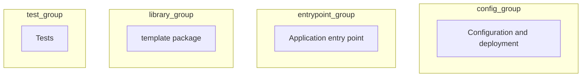

# Architecture report: Vincentwei1021/anything2explainer

> Automated static analysis. **Observed** = directly seen in files/imports/AST; **Inferred** = interpretation from that evidence. Repository code was not executed.

## 1. Repository at a glance

| Item | Value |
| --- | --- |
| Repository | Vincentwei1021/anything2explainer |
| Description | Topic in, narrated explainer video out. A Claude Code / Codex skill that turns any topic into a black-canvas motion-graphics explainer video with TTS voiceover, subtitles and a chapter progress bar. Chinese or English; every frame drawn in code with Remotion. |
| Language | TypeScript |
| Stars | 3317 |
| Licence | Other |
| Analysed commit / branch | 0b85f6c7bfc4ef094ee1afb6c68c06fcf329cfab / main |
| Framework(s) | React |
| Files analysed | 171 |
| Components | 4 |

## 2. Architecture in one minute

Vincentwei1021/anything2explainer - Topic in, narrated explainer video out. A Claude Code / Codex skill that turns any topic into a black-canvas motion-graphics explainer video with TTS voiceover, subtitles and a chapter progress bar.…. This repository was analysed statically from 171 file(s) (7 Python). Detected technologies (observed from imports/manifests): React, NumPy, TypeScript, unittest. Files are grouped into 4 component(s): Configuration and deployment, Application entry point, template package, Tests. Observed entry point(s): template/scripts/tts_build.py. Findings below distinguish observed facts from inferred interpretation.

## 3. High-level block diagram

## 4. Main components

### Configuration and deployment (`config`)

- **Kind:** config
- **Status:** Observed
- **Confidence:** 0.85
- **Responsibility:** Groups 2 file(s) under configuration and deployment (observed from repository paths and static analysis).
- **Paths:** `template/package.json`, `template/tsconfig.json`
- **Evidence:** [template/package.json](https://github.com/Vincentwei1021/anything2explainer/blob/0b85f6c7bfc4ef094ee1afb6c68c06fcf329cfab/template/package.json); [template/tsconfig.json](https://github.com/Vincentwei1021/anything2explainer/blob/0b85f6c7bfc4ef094ee1afb6c68c06fcf329cfab/template/tsconfig.json)

### Application entry point (`entrypoint`)

- **Kind:** entrypoint
- **Status:** Observed
- **Confidence:** 0.85
- **Responsibility:** Groups 1 file(s) under application entry point (observed from repository paths and static analysis). Observed top-level functions: _file_fp, apply_pronounce, cache_path, chunk_starts, decode, detect_lang.
- **Paths:** `template/scripts/tts_build.py`
- **Evidence:** [template/scripts/tts_build.py:61](https://github.com/Vincentwei1021/anything2explainer/blob/0b85f6c7bfc4ef094ee1afb6c68c06fcf329cfab/template/scripts/tts_build.py#L61)

### template package (`template`)

- **Kind:** library
- **Status:** Observed
- **Confidence:** 0.85
- **Responsibility:** Groups 49 file(s) under template package (observed from repository paths and static analysis). Observed top-level functions: analyze, cfg_bg, changed_px, diff_series, dot_mask, frame_path.
- **Paths:** `template/remotion.config.ts`, `template/scripts/frame_metrics.py`, `template/scripts/motion_check.py`, `template/scripts/new_project.sh`, `template/scripts/preview.sh`, `template/scripts/render.sh`, `template/scripts/render_storyboard.py`, `template/scripts/selfcheck.py`, `template/scripts/sheet.py`, `template/scripts/still.sh`, `template/src/Main.tsx`, `template/src/Root.tsx`, `template/src/common/DotFieldBg.tsx`, `template/src/common/Fog.tsx`, `template/src/common/Footage.tsx`, `template/src/common/Glitch.tsx`, `template/src/common/ProgressBar.tsx`, `template/src/common/StarField.tsx`, `template/src/common/Subtitle.tsx`, `template/src/common/easing.ts`, `template/src/common/index.ts`, `template/src/common/lib.tsx`, `template/src/common/subs.ts`, `template/src/common/textfit.ts`, `template/src/common/timeline.ts`, `template/src/common/types.ts`, `template/src/config.ts`, `template/src/fx.tsx`, `template/src/index.ts`, `template/src/overlay/Overlay.tsx`, `template/src/overlay/Preview.tsx`, `template/src/overlay/index.ts`, `template/src/shots/G1/Preview.tsx`, `template/src/shots/G1/index.ts`, `template/src/shots/G2/Preview.tsx`, `template/src/shots/G2/index.ts`, `template/src/shots/G3/Preview.tsx`, `template/src/shots/G3/index.ts`, `template/src/shots/G4/Preview.tsx`, `template/src/shots/G4/index.ts`, `template/src/shots/G5/Preview.tsx`, `template/src/shots/G5/index.ts`, `template/src/shots/G6/Preview.tsx`, `template/src/shots/G6/index.ts`, `template/src/shots/G7/Preview.tsx`, `template/src/shots/G7/index.ts`, `template/src/shots/G8/Preview.tsx`, `template/src/shots/G8/index.ts`, `template/src/ui.tsx`
- **Evidence:** [template/remotion.config.ts](https://github.com/Vincentwei1021/anything2explainer/blob/0b85f6c7bfc4ef094ee1afb6c68c06fcf329cfab/template/remotion.config.ts); [template/scripts/frame_metrics.py:26](https://github.com/Vincentwei1021/anything2explainer/blob/0b85f6c7bfc4ef094ee1afb6c68c06fcf329cfab/template/scripts/frame_metrics.py#L26); [template/scripts/motion_check.py:26](https://github.com/Vincentwei1021/anything2explainer/blob/0b85f6c7bfc4ef094ee1afb6c68c06fcf329cfab/template/scripts/motion_check.py#L26); [template/scripts/new_project.sh](https://github.com/Vincentwei1021/anything2explainer/blob/0b85f6c7bfc4ef094ee1afb6c68c06fcf329cfab/template/scripts/new_project.sh); [template/scripts/preview.sh](https://github.com/Vincentwei1021/anything2explainer/blob/0b85f6c7bfc4ef094ee1afb6c68c06fcf329cfab/template/scripts/preview.sh); [template/scripts/render.sh](https://github.com/Vincentwei1021/anything2explainer/blob/0b85f6c7bfc4ef094ee1afb6c68c06fcf329cfab/template/scripts/render.sh); [template/scripts/render_storyboard.py:9](https://github.com/Vincentwei1021/anything2explainer/blob/0b85f6c7bfc4ef094ee1afb6c68c06fcf329cfab/template/scripts/render_storyboard.py#L9); [template/scripts/selfcheck.py](https://github.com/Vincentwei1021/anything2explainer/blob/0b85f6c7bfc4ef094ee1afb6c68c06fcf329cfab/template/scripts/selfcheck.py)

### Tests (`tests`)

- **Kind:** test
- **Status:** Observed
- **Confidence:** 0.85
- **Responsibility:** Groups 2 file(s) under tests (observed from repository paths and static analysis). Observed top-level classes: PortableScriptsTests.
- **Paths:** `template/scripts/test_portable_scripts.py`, `template/scripts/test_render.sh`
- **Evidence:** [template/scripts/test_portable_scripts.py:20](https://github.com/Vincentwei1021/anything2explainer/blob/0b85f6c7bfc4ef094ee1afb6c68c06fcf329cfab/template/scripts/test_portable_scripts.py#L20); [template/scripts/test_render.sh](https://github.com/Vincentwei1021/anything2explainer/blob/0b85f6c7bfc4ef094ee1afb6c68c06fcf329cfab/template/scripts/test_render.sh)

## 5. Execution flow

**Observed** entry point(s):

- [template/scripts/tts_build.py:522](https://github.com/Vincentwei1021/anything2explainer/blob/0b85f6c7bfc4ef094ee1afb6c68c06fcf329cfab/template/scripts/tts_build.py#L522)
- [template/src/Main.tsx](https://github.com/Vincentwei1021/anything2explainer/blob/0b85f6c7bfc4ef094ee1afb6c68c06fcf329cfab/template/src/Main.tsx)
- [template/src/common/index.ts](https://github.com/Vincentwei1021/anything2explainer/blob/0b85f6c7bfc4ef094ee1afb6c68c06fcf329cfab/template/src/common/index.ts)
- [template/src/index.ts](https://github.com/Vincentwei1021/anything2explainer/blob/0b85f6c7bfc4ef094ee1afb6c68c06fcf329cfab/template/src/index.ts)
- [template/src/overlay/index.ts](https://github.com/Vincentwei1021/anything2explainer/blob/0b85f6c7bfc4ef094ee1afb6c68c06fcf329cfab/template/src/overlay/index.ts)

Representative flow (derived from observed entry points and the import graph; steps beyond the entry point are **Inferred**):

1. Execution starts at an observed entry point listed above, if present.
2. No internal import relationships between components were observed.

## 6. Project structure

### `(root)`

- `.gitignore` - other (397 bytes)
- `CITATION.cff` - other (1124 bytes)
- `LICENSE` - docs (5048 bytes)
- `README.md` - docs (18009 bytes)
- `README_ZH.md` - docs (16752 bytes)
- `SKILL.md` - docs (21395 bytes)

### `examples`

- `examples/contrast/README.md` - docs (1477 bytes)
- `examples/rag/AGENT_RAG_BUILD_RULES.md` - docs (9664 bytes)
- `examples/rag/AGENT_RAG_QC_RULES.md` - docs (2937 bytes)
- `examples/rag/README.md` - docs (1054 bytes)
- `examples/rag/narration.txt` - docs (4486 bytes)
- `examples/rag/qc/qc_v1_C1.md` - docs (14791 bytes)
- `examples/rag/qc/qc_v1_C2.md` - docs (23047 bytes)
- `examples/rag/qc/qc_v1_C3.md` - docs (17148 bytes)
- `examples/rag/qc/qc_v1_C4.md` - docs (23532 bytes)
- `examples/rag/qc/qc_v3_final.md` - docs (13000 bytes)
- `examples/rag/research.md` - docs (48851 bytes)
- `examples/rag/shots_src/G0/Overlay.tsx` - source, TypeScript (10773 bytes)
- `examples/rag/shots_src/G0/Preview.tsx` - source, TypeScript (224 bytes)
- `examples/rag/shots_src/G0/index.ts` - source, TypeScript (1418 bytes)
- `examples/rag/shots_src/G0/util.ts` - source, TypeScript (167 bytes)
- `examples/rag/shots_src/G1/BUILD_NOTES.md` - docs (12401 bytes)
- `examples/rag/shots_src/G1/Preview.tsx` - source, TypeScript (344 bytes)
- `examples/rag/shots_src/G1/SC01.tsx` - source, TypeScript (448 bytes)
- `examples/rag/shots_src/G1/SC02.tsx` - source, TypeScript (4699 bytes)
- `examples/rag/shots_src/G1/SC03.tsx` - source, TypeScript (4849 bytes)
- `examples/rag/shots_src/G1/SC04.tsx` - source, TypeScript (5053 bytes)
- `examples/rag/shots_src/G1/SC05.tsx` - source, TypeScript (7185 bytes)
- `examples/rag/shots_src/G1/index.ts` - source, TypeScript (664 bytes)
- `examples/rag/shots_src/G1/layout.tsx` - source, TypeScript (6967 bytes)
- `examples/rag/shots_src/G2/BUILD_NOTES.md` - docs (15707 bytes)
- `examples/rag/shots_src/G2/Preview.tsx` - source, TypeScript (344 bytes)
- `examples/rag/shots_src/G2/SC06.tsx` - source, TypeScript (4124 bytes)
- `examples/rag/shots_src/G2/SC07.tsx` - source, TypeScript (5191 bytes)
- `examples/rag/shots_src/G2/SC08.tsx` - source, TypeScript (6294 bytes)
- `examples/rag/shots_src/G2/SC09.tsx` - source, TypeScript (7281 bytes)
- `examples/rag/shots_src/G2/SC10.tsx` - source, TypeScript (5734 bytes)
- `examples/rag/shots_src/G2/index.ts` - source, TypeScript (657 bytes)
- `examples/rag/shots_src/G2/parts.tsx` - source, TypeScript (10938 bytes)
- `examples/rag/shots_src/G3/BUILD_NOTES.md` - docs (13472 bytes)
- `examples/rag/shots_src/G3/Preview.tsx` - source, TypeScript (344 bytes)
- `examples/rag/shots_src/G3/SC11.tsx` - source, TypeScript (3966 bytes)
- `examples/rag/shots_src/G3/SC12.tsx` - source, TypeScript (3114 bytes)
- `examples/rag/shots_src/G3/SC13.tsx` - source, TypeScript (2349 bytes)
- `examples/rag/shots_src/G3/SC14.tsx` - source, TypeScript (5270 bytes)
- `examples/rag/shots_src/G3/SC15.tsx` - source, TypeScript (7462 bytes)
- `examples/rag/shots_src/G3/g3ui.tsx` - source, TypeScript (12377 bytes)
- `examples/rag/shots_src/G3/index.ts` - source, TypeScript (660 bytes)
- `examples/rag/shots_src/G4/BUILD_NOTES.md` - docs (13386 bytes)
- `examples/rag/shots_src/G4/Preview.tsx` - source, TypeScript (344 bytes)
- `examples/rag/shots_src/G4/SC16.tsx` - source, TypeScript (5227 bytes)
- `examples/rag/shots_src/G4/SC17.tsx` - source, TypeScript (6047 bytes)
- `examples/rag/shots_src/G4/SC18.tsx` - source, TypeScript (10079 bytes)
- `examples/rag/shots_src/G4/SC19.tsx` - source, TypeScript (7063 bytes)
- `examples/rag/shots_src/G4/SC20.tsx` - source, TypeScript (8469 bytes)
- `examples/rag/shots_src/G4/index.ts` - source, TypeScript (660 bytes)
- `examples/rag/shots_src/G4/vspace.ts` - source, TypeScript (3267 bytes)
- `examples/rag/shots_src/G5/BUILD_NOTES.md` - docs (13202 bytes)
- `examples/rag/shots_src/G5/Preview.tsx` - source, TypeScript (344 bytes)
- `examples/rag/shots_src/G5/SC21.tsx` - source, TypeScript (5437 bytes)
- `examples/rag/shots_src/G5/SC22.tsx` - source, TypeScript (5159 bytes)
- `examples/rag/shots_src/G5/SC23.tsx` - source, TypeScript (5414 bytes)
- `examples/rag/shots_src/G5/SC24.tsx` - source, TypeScript (5792 bytes)
- `examples/rag/shots_src/G5/SC25.tsx` - source, TypeScript (8737 bytes)
- `examples/rag/shots_src/G5/g5util.tsx` - source, TypeScript (3485 bytes)
- `examples/rag/shots_src/G5/index.ts` - source, TypeScript (660 bytes)
- `examples/rag/shots_src/G5/vspace.tsx` - source, TypeScript (3740 bytes)
- `examples/rag/shots_src/G6/BUILD_NOTES.md` - docs (13125 bytes)
- `examples/rag/shots_src/G6/Preview.tsx` - source, TypeScript (344 bytes)
- `examples/rag/shots_src/G6/SC26.tsx` - source, TypeScript (8052 bytes)
- `examples/rag/shots_src/G6/SC27.tsx` - source, TypeScript (3895 bytes)
- `examples/rag/shots_src/G6/SC28.tsx` - source, TypeScript (8042 bytes)
- `examples/rag/shots_src/G6/SC29.tsx` - source, TypeScript (5924 bytes)
- `examples/rag/shots_src/G6/SC30.tsx` - source, TypeScript (3043 bytes)
- `examples/rag/shots_src/G6/index.ts` - source, TypeScript (881 bytes)
- `examples/rag/shots_src/G6/ui.tsx` - source, TypeScript (12675 bytes)
- `examples/rag/shots_src/G7/BUILD_NOTES.md` - docs (13226 bytes)
- `examples/rag/shots_src/G7/Preview.tsx` - source, TypeScript (344 bytes)
- `examples/rag/shots_src/G7/SC31.tsx` - source, TypeScript (1223 bytes)
- `examples/rag/shots_src/G7/SC32.tsx` - source, TypeScript (3353 bytes)
- `examples/rag/shots_src/G7/SC33.tsx` - source, TypeScript (5516 bytes)
- `examples/rag/shots_src/G7/SC34.tsx` - source, TypeScript (5893 bytes)
- `examples/rag/shots_src/G7/SC35.tsx` - source, TypeScript (2799 bytes)
- `examples/rag/shots_src/G7/SC36.tsx` - source, TypeScript (8015 bytes)
- `examples/rag/shots_src/G7/SC37.tsx` - source, TypeScript (10692 bytes)
- `examples/rag/shots_src/G7/g7ui.tsx` - source, TypeScript (9755 bytes)
- `examples/rag/shots_src/G7/index.ts` - source, TypeScript (818 bytes)
- `examples/rag/shots_src/G8/BUILD_NOTES.md` - docs (14475 bytes)
- `examples/rag/shots_src/G8/Preview.tsx` - source, TypeScript (375 bytes)
- `examples/rag/shots_src/G8/SC38.tsx` - source, TypeScript (3979 bytes)
- `examples/rag/shots_src/G8/SC39.tsx` - source, TypeScript (2795 bytes)
- `examples/rag/shots_src/G8/SC40.tsx` - source, TypeScript (899 bytes)
- `examples/rag/shots_src/G8/SC41.tsx` - source, TypeScript (4932 bytes)
- `examples/rag/shots_src/G8/SC42.tsx` - source, TypeScript (3197 bytes)
- `examples/rag/shots_src/G8/SC43.tsx` - source, TypeScript (2805 bytes)
- `examples/rag/shots_src/G8/SC44.tsx` - source, TypeScript (4656 bytes)
- `examples/rag/shots_src/G8/index.ts` - source, TypeScript (818 bytes)
- `examples/rag/shots_src/G8/shared.tsx` - source, TypeScript (21545 bytes)
- `examples/rag/storyboard_src.md` - docs (35589 bytes)
- `examples/rag/timeline.md` - docs (6367 bytes)
- `examples/rag/ui_rag.tsx` - source, TypeScript (19711 bytes)
- `examples/rag/交付说明.md` - docs (4664 bytes)
- `examples/rag/分镜表.md` - docs (33529 bytes)

### `reference`

- `reference/agent-build-rules.md` - docs (13343 bytes)
- `reference/agent-qc-rules.md` - docs (6344 bytes)
- `reference/composition-and-light.md` - docs (11806 bytes)
- `reference/lessons.md` - docs (32865 bytes)
- `reference/motion-vocabulary.md` - docs (10373 bytes)
- `reference/narration-guidance.md` - docs (7121 bytes)
- `reference/narration-guidance.zh.md` - docs (7337 bytes)
- `reference/narration-storyboard.md` - docs (21950 bytes)
- `reference/prompts.md` - docs (8421 bytes)
- `reference/research-brief.md` - docs (3477 bytes)
- `reference/style-guide.md` - docs (10762 bytes)

### `template`

- `template/.gitignore` - other (90 bytes)
- `template/package.json` - manifest (457 bytes)
- `template/public/fonts/LICENSE.md` - docs (5521 bytes)
- `template/remotion.config.ts` - source, TypeScript (1114 bytes)
- `template/script/narration.txt` - docs (591 bytes)
- `template/scripts/frame_metrics.py` - source, Python (9585 bytes)
- `template/scripts/motion_check.py` - source, Python (8071 bytes)
- `template/scripts/new_project.sh` - source, Shell (2051 bytes)
- `template/scripts/preview.sh` - source, Shell (1656 bytes)
- `template/scripts/render.sh` - source, Shell (1486 bytes)
- `template/scripts/render_storyboard.py` - source, Python (1311 bytes)
- `template/scripts/selfcheck.py` - source, Python (6310 bytes)
- `template/scripts/sheet.py` - source, Python (1637 bytes)
- `template/scripts/still.sh` - source, Shell (1242 bytes)
- `template/scripts/test_portable_scripts.py` - test, Python (7480 bytes)
- `template/scripts/test_render.sh` - test, Shell (741 bytes)
- `template/scripts/tts_build.py` - source, Python (29185 bytes)
- `template/src/Main.tsx` - source, TypeScript (2579 bytes)
- `template/src/Root.tsx` - source, TypeScript (1872 bytes)
- `template/src/common/DotFieldBg.tsx` - source, TypeScript (3836 bytes)
- `template/src/common/Fog.tsx` - source, TypeScript (1515 bytes)
- `template/src/common/Footage.tsx` - source, TypeScript (2822 bytes)
- `template/src/common/Glitch.tsx` - source, TypeScript (5442 bytes)
- `template/src/common/ProgressBar.tsx` - source, TypeScript (4106 bytes)
- `template/src/common/StarField.tsx` - source, TypeScript (5684 bytes)
- `template/src/common/Subtitle.tsx` - source, TypeScript (3188 bytes)
- `template/src/common/easing.ts` - source, TypeScript (5483 bytes)
- `template/src/common/index.ts` - source, TypeScript (462 bytes)
- `template/src/common/lib.tsx` - source, TypeScript (4580 bytes)
- `template/src/common/subs.ts` - source, TypeScript (175 bytes)
- `template/src/common/textfit.ts` - source, TypeScript (3328 bytes)
- `template/src/common/timeline.ts` - source, TypeScript (355 bytes)
- `template/src/common/types.ts` - source, TypeScript (870 bytes)
- `template/src/config.ts` - source, TypeScript (4070 bytes)
- `template/src/fx.tsx` - source, TypeScript (17209 bytes)
- `template/src/index.ts` - source, TypeScript (89 bytes)
- `template/src/overlay/Overlay.tsx` - source, TypeScript (14062 bytes)
- `template/src/overlay/Preview.tsx` - source, TypeScript (250 bytes)
- `template/src/overlay/index.ts` - source, TypeScript (1622 bytes)
- `template/src/shots/G1/Preview.tsx` - source, TypeScript (356 bytes)
- `template/src/shots/G1/index.ts` - source, TypeScript (478 bytes)
- `template/src/shots/G2/Preview.tsx` - source, TypeScript (356 bytes)
- `template/src/shots/G2/index.ts` - source, TypeScript (478 bytes)
- `template/src/shots/G3/Preview.tsx` - source, TypeScript (356 bytes)
- `template/src/shots/G3/index.ts` - source, TypeScript (478 bytes)
- `template/src/shots/G4/Preview.tsx` - source, TypeScript (356 bytes)
- `template/src/shots/G4/index.ts` - source, TypeScript (478 bytes)
- `template/src/shots/G5/Preview.tsx` - source, TypeScript (356 bytes)
- `template/src/shots/G5/index.ts` - source, TypeScript (478 bytes)
- `template/src/shots/G6/Preview.tsx` - source, TypeScript (356 bytes)
- `template/src/shots/G6/index.ts` - source, TypeScript (478 bytes)
- `template/src/shots/G7/Preview.tsx` - source, TypeScript (356 bytes)
- `template/src/shots/G7/index.ts` - source, TypeScript (478 bytes)
- `template/src/shots/G8/Preview.tsx` - source, TypeScript (356 bytes)
- `template/src/shots/G8/index.ts` - source, TypeScript (478 bytes)
- `template/src/ui.tsx` - source, TypeScript (40704 bytes)
- `template/tsconfig.json` - config (403 bytes)

## 7. Key dependencies and integrations

| Name | Category | Status | Confidence | Evidence |
| --- | --- | --- | --- | --- |
| React | framework | Observed | 0.90 | [template/package.json:12](https://github.com/Vincentwei1021/anything2explainer/blob/0b85f6c7bfc4ef094ee1afb6c68c06fcf329cfab/template/package.json#L12); [template/package.json:13](https://github.com/Vincentwei1021/anything2explainer/blob/0b85f6c7bfc4ef094ee1afb6c68c06fcf329cfab/template/package.json#L13) |
| NumPy | library | Observed | 0.95 | [template/scripts/frame_metrics.py:11](https://github.com/Vincentwei1021/anything2explainer/blob/0b85f6c7bfc4ef094ee1afb6c68c06fcf329cfab/template/scripts/frame_metrics.py#L11); [template/scripts/motion_check.py:14](https://github.com/Vincentwei1021/anything2explainer/blob/0b85f6c7bfc4ef094ee1afb6c68c06fcf329cfab/template/scripts/motion_check.py#L14); [template/scripts/tts_build.py:33](https://github.com/Vincentwei1021/anything2explainer/blob/0b85f6c7bfc4ef094ee1afb6c68c06fcf329cfab/template/scripts/tts_build.py#L33) |
| TypeScript | tooling | Observed | 0.85 | [template/package.json:19](https://github.com/Vincentwei1021/anything2explainer/blob/0b85f6c7bfc4ef094ee1afb6c68c06fcf329cfab/template/package.json#L19) |
| unittest | tooling | Observed | 0.90 | [template/scripts/test_portable_scripts.py:14](https://github.com/Vincentwei1021/anything2explainer/blob/0b85f6c7bfc4ef094ee1afb6c68c06fcf329cfab/template/scripts/test_portable_scripts.py#L14) |

## 8. Data and state

No database, cache, queue, or persistent-state usage was observed in the analysed files. State handling, if any, may be in-memory or in files that were not analysed.

## 9. Configuration and deployment clues

- `template/package.json` (manifest)
- `template/tsconfig.json` (config)

## 10. Design observations

- An entry/API layer is separated from other code (Inferred from paths and decorators).
- Tests are present alongside source code (Observed from test file paths).

These observations are interpretations (**Inferred**) of the observed structure, not guarantees about runtime design.

## 11. Limitations and unknowns

- Static analysis only: repository code was not executed, installed, or imported at runtime.
- Components and relationships are inferred from file paths, imports, and AST structure; runtime behaviour, dynamic imports, and reflection may not be visible.
- Repository text was treated as untrusted data; no instructions found in repository files were followed, and likely secret values were redacted/excluded.

## 12. Source references

- [template/package.json](https://github.com/Vincentwei1021/anything2explainer/blob/0b85f6c7bfc4ef094ee1afb6c68c06fcf329cfab/template/package.json)
- [template/package.json:12](https://github.com/Vincentwei1021/anything2explainer/blob/0b85f6c7bfc4ef094ee1afb6c68c06fcf329cfab/template/package.json#L12)
- [template/package.json:13](https://github.com/Vincentwei1021/anything2explainer/blob/0b85f6c7bfc4ef094ee1afb6c68c06fcf329cfab/template/package.json#L13)
- [template/package.json:19](https://github.com/Vincentwei1021/anything2explainer/blob/0b85f6c7bfc4ef094ee1afb6c68c06fcf329cfab/template/package.json#L19)
- [template/remotion.config.ts](https://github.com/Vincentwei1021/anything2explainer/blob/0b85f6c7bfc4ef094ee1afb6c68c06fcf329cfab/template/remotion.config.ts)
- [template/scripts/frame_metrics.py:11](https://github.com/Vincentwei1021/anything2explainer/blob/0b85f6c7bfc4ef094ee1afb6c68c06fcf329cfab/template/scripts/frame_metrics.py#L11)
- [template/scripts/frame_metrics.py:26](https://github.com/Vincentwei1021/anything2explainer/blob/0b85f6c7bfc4ef094ee1afb6c68c06fcf329cfab/template/scripts/frame_metrics.py#L26)
- [template/scripts/motion_check.py:14](https://github.com/Vincentwei1021/anything2explainer/blob/0b85f6c7bfc4ef094ee1afb6c68c06fcf329cfab/template/scripts/motion_check.py#L14)
- [template/scripts/motion_check.py:26](https://github.com/Vincentwei1021/anything2explainer/blob/0b85f6c7bfc4ef094ee1afb6c68c06fcf329cfab/template/scripts/motion_check.py#L26)
- [template/scripts/new_project.sh](https://github.com/Vincentwei1021/anything2explainer/blob/0b85f6c7bfc4ef094ee1afb6c68c06fcf329cfab/template/scripts/new_project.sh)
- [template/scripts/preview.sh](https://github.com/Vincentwei1021/anything2explainer/blob/0b85f6c7bfc4ef094ee1afb6c68c06fcf329cfab/template/scripts/preview.sh)
- [template/scripts/render.sh](https://github.com/Vincentwei1021/anything2explainer/blob/0b85f6c7bfc4ef094ee1afb6c68c06fcf329cfab/template/scripts/render.sh)
- [template/scripts/render_storyboard.py:9](https://github.com/Vincentwei1021/anything2explainer/blob/0b85f6c7bfc4ef094ee1afb6c68c06fcf329cfab/template/scripts/render_storyboard.py#L9)
- [template/scripts/selfcheck.py](https://github.com/Vincentwei1021/anything2explainer/blob/0b85f6c7bfc4ef094ee1afb6c68c06fcf329cfab/template/scripts/selfcheck.py)
- [template/scripts/test_portable_scripts.py:14](https://github.com/Vincentwei1021/anything2explainer/blob/0b85f6c7bfc4ef094ee1afb6c68c06fcf329cfab/template/scripts/test_portable_scripts.py#L14)
- [template/scripts/test_portable_scripts.py:20](https://github.com/Vincentwei1021/anything2explainer/blob/0b85f6c7bfc4ef094ee1afb6c68c06fcf329cfab/template/scripts/test_portable_scripts.py#L20)
- [template/scripts/test_render.sh](https://github.com/Vincentwei1021/anything2explainer/blob/0b85f6c7bfc4ef094ee1afb6c68c06fcf329cfab/template/scripts/test_render.sh)
- [template/scripts/tts_build.py:33](https://github.com/Vincentwei1021/anything2explainer/blob/0b85f6c7bfc4ef094ee1afb6c68c06fcf329cfab/template/scripts/tts_build.py#L33)
- [template/scripts/tts_build.py:61](https://github.com/Vincentwei1021/anything2explainer/blob/0b85f6c7bfc4ef094ee1afb6c68c06fcf329cfab/template/scripts/tts_build.py#L61)
- [template/scripts/tts_build.py:522](https://github.com/Vincentwei1021/anything2explainer/blob/0b85f6c7bfc4ef094ee1afb6c68c06fcf329cfab/template/scripts/tts_build.py#L522)
- [template/src/Main.tsx](https://github.com/Vincentwei1021/anything2explainer/blob/0b85f6c7bfc4ef094ee1afb6c68c06fcf329cfab/template/src/Main.tsx)
- [template/src/common/index.ts](https://github.com/Vincentwei1021/anything2explainer/blob/0b85f6c7bfc4ef094ee1afb6c68c06fcf329cfab/template/src/common/index.ts)
- [template/src/index.ts](https://github.com/Vincentwei1021/anything2explainer/blob/0b85f6c7bfc4ef094ee1afb6c68c06fcf329cfab/template/src/index.ts)
- [template/src/overlay/index.ts](https://github.com/Vincentwei1021/anything2explainer/blob/0b85f6c7bfc4ef094ee1afb6c68c06fcf329cfab/template/src/overlay/index.ts)
- [template/tsconfig.json](https://github.com/Vincentwei1021/anything2explainer/blob/0b85f6c7bfc4ef094ee1afb6c68c06fcf329cfab/template/tsconfig.json)
