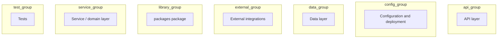

# Architecture report: VulcanJS/Vulcan

> Automated static analysis. **Observed** = directly seen in files/imports/AST; **Inferred** = interpretation from that evidence. Repository code was not executed.

## 1. Repository at a glance

| Item | Value |
| --- | --- |
| Repository | VulcanJS/Vulcan |
| Description | 🌋 A toolkit to quickly build apps with React, GraphQL & Meteor |
| Language | JavaScript |
| Stars | 7888 |
| Licence | MIT |
| Analysed commit / branch | 5b81976dc67a5af280131ce093d889a29a736d93 / devel |
| Framework(s) | Express, React |
| Files analysed | 798 |
| Components | 7 |

## 2. Architecture in one minute

VulcanJS/Vulcan - 🌋 A toolkit to quickly build apps with React, GraphQL & Meteor. This repository was analysed statically from 798 file(s) (0 Python). Detected technologies (observed from imports/manifests): GitHub Actions, Express, React, React Router, Redux, Docker. Files are grouped into 7 component(s): API layer, Configuration and deployment, Data layer, External integrations, packages package, Service / domain layer, Tests. Findings below distinguish observed facts from inferred interpretation.

## 3. High-level block diagram

## 4. Main components

### API layer (`api_layer`)

- **Kind:** api
- **Status:** Observed
- **Confidence:** 0.85
- **Responsibility:** Groups 1 file(s) under api layer (observed from repository paths and static analysis).
- **Paths:** `packages/vulcan-accounts/imports/api/server/servicesListPublication.js`
- **Evidence:** [packages/vulcan-accounts/imports/api/server/servicesListPublication.js](https://github.com/VulcanJS/Vulcan/blob/5b81976dc67a5af280131ce093d889a29a736d93/packages/vulcan-accounts/imports/api/server/servicesListPublication.js)

### Configuration and deployment (`config`)

- **Kind:** config
- **Status:** Observed
- **Confidence:** 0.85
- **Responsibility:** Groups 17 file(s) under configuration and deployment (observed from repository paths and static analysis).
- **Paths:** `Dockerfile`, `jsconfig.json`, `jsdoc-conf.json`, `jsdoc.json`, `package.json`, `packages/_boilerplate-generator/.npm/package/npm-shrinkwrap.json`, `packages/meteor-mocha/package.json`, `packages/vulcan-backoffice/package.json`, `packages/vulcan-debug/lib/modules/settings/collection.js`, `packages/vulcan-debug/lib/modules/settings/schema.js`, `packages/vulcan-debug/lib/server/settings/collection.js`, `packages/vulcan-debug/lib/server/settings/index.js`, `packages/vulcan-debug/lib/server/settings/resolvers.js`, `packages/vulcan-newsletter/scss.json`, `packages/vulcan-scss/.github/workflows/comment-issue.yml`, `packages/vulcan-scss/.travis.yml`, `packages/vulcan-scss/scss-config.json`
- **Evidence:** [Dockerfile](https://github.com/VulcanJS/Vulcan/blob/5b81976dc67a5af280131ce093d889a29a736d93/Dockerfile); [jsconfig.json](https://github.com/VulcanJS/Vulcan/blob/5b81976dc67a5af280131ce093d889a29a736d93/jsconfig.json); [jsdoc-conf.json](https://github.com/VulcanJS/Vulcan/blob/5b81976dc67a5af280131ce093d889a29a736d93/jsdoc-conf.json); [jsdoc.json](https://github.com/VulcanJS/Vulcan/blob/5b81976dc67a5af280131ce093d889a29a736d93/jsdoc.json); [package.json](https://github.com/VulcanJS/Vulcan/blob/5b81976dc67a5af280131ce093d889a29a736d93/package.json); [packages/_boilerplate-generator/.npm/package/npm-shrinkwrap.json](https://github.com/VulcanJS/Vulcan/blob/5b81976dc67a5af280131ce093d889a29a736d93/packages/_boilerplate-generator/.npm/package/npm-shrinkwrap.json); [packages/meteor-mocha/package.json](https://github.com/VulcanJS/Vulcan/blob/5b81976dc67a5af280131ce093d889a29a736d93/packages/meteor-mocha/package.json); [packages/vulcan-backoffice/package.json](https://github.com/VulcanJS/Vulcan/blob/5b81976dc67a5af280131ce093d889a29a736d93/packages/vulcan-backoffice/package.json)

### Data layer (`data_layer`)

- **Kind:** data
- **Status:** Observed
- **Confidence:** 0.85
- **Responsibility:** Groups 2 file(s) under data layer (observed from repository paths and static analysis).
- **Paths:** `packages/vulcan-debug/lib/server/database/index.js`, `packages/vulcan-debug/lib/server/database/queries.js`
- **Evidence:** [packages/vulcan-debug/lib/server/database/index.js](https://github.com/VulcanJS/Vulcan/blob/5b81976dc67a5af280131ce093d889a29a736d93/packages/vulcan-debug/lib/server/database/index.js); [packages/vulcan-debug/lib/server/database/queries.js](https://github.com/VulcanJS/Vulcan/blob/5b81976dc67a5af280131ce093d889a29a736d93/packages/vulcan-debug/lib/server/database/queries.js)

### External integrations (`external_integrations`)

- **Kind:** external
- **Status:** Observed
- **Confidence:** 0.85
- **Responsibility:** Groups 58 file(s) under external integrations (observed from repository paths and static analysis).
- **Paths:** `packages/vulcan-admin/lib/client/main.js`, `packages/vulcan-backoffice/lib/client/main.js`, `packages/vulcan-cloudinary/lib/client/main.js`, `packages/vulcan-cloudinary/lib/client/make_cloudinary.js`, `packages/vulcan-core/lib/client/components/AppGenerator.jsx`, `packages/vulcan-core/lib/client/main.js`, `packages/vulcan-core/lib/client/start.jsx`, `packages/vulcan-debug/lib/client/main.js`, `packages/vulcan-email/lib/client/main.js`, `packages/vulcan-embed/lib/client/main.js`, `packages/vulcan-embed/lib/server/integrations/builtin.js`, `packages/vulcan-embed/lib/server/integrations/embedapi.js`, `packages/vulcan-embed/lib/server/integrations/embedly.js`, `packages/vulcan-errors-sentry/lib/client/main.js`, `packages/vulcan-errors-sentry/lib/client/sentry-client.js`, `packages/vulcan-errors/lib/client/init.js`, `packages/vulcan-errors/lib/client/main.js`, `packages/vulcan-events-ga/lib/client/ga.js`, `packages/vulcan-events-ga/lib/client/main.js`, `packages/vulcan-events-intercom/lib/client/intercom-client.js`, `packages/vulcan-events-intercom/lib/client/main.js`, `packages/vulcan-events-internal/lib/client/internal-client.js`, `packages/vulcan-events-internal/lib/client/main.js`, `packages/vulcan-events-segment/lib/client/main.js`, `packages/vulcan-events-segment/lib/client/segment-client.js`, `packages/vulcan-events/lib/client/main.js`, `packages/vulcan-forms/lib/client/main.js`, `packages/vulcan-i18n/lib/client/main.js`, `packages/vulcan-lib/lib/client/apollo-client/apolloClient.js`, `packages/vulcan-lib/lib/client/apollo-client/cache.js`, `packages/vulcan-lib/lib/client/apollo-client/index.js`, `packages/vulcan-lib/lib/client/apollo-client/links/error.js`, `packages/vulcan-lib/lib/client/apollo-client/links/http.js`, `packages/vulcan-lib/lib/client/apollo-client/links/meteor.js`, `packages/vulcan-lib/lib/client/apollo-client/links/registerLinks.js`, `packages/vulcan-lib/lib/client/auth.js`, `packages/vulcan-lib/lib/client/connectors.js`, `packages/vulcan-lib/lib/client/errors.js`, `packages/vulcan-lib/lib/client/inject_data.js`, `packages/vulcan-lib/lib/client/main.js`, `packages/vulcan-lib/lib/client/mock.js`, `packages/vulcan-newsletter/lib/client/main.js`, `packages/vulcan-newsletter/lib/server/integrations/emailoctopus.js`, `packages/vulcan-newsletter/lib/server/integrations/index.js`, `packages/vulcan-newsletter/lib/server/integrations/mailchimp.js`, `packages/vulcan-newsletter/lib/server/integrations/sample.js`, `packages/vulcan-newsletter/lib/server/integrations/sendy.js`, `packages/vulcan-payments/lib/client/main.js`, `packages/vulcan-payments/lib/server/integrations/stripe.js`, `packages/vulcan-redux/lib/client/main.js`, `packages/vulcan-redux/lib/client/reduxInitialState.js`, `packages/vulcan-redux/lib/client/setupRedux.js`, `packages/vulcan-styled-components/lib/client/main.js`, `packages/vulcan-test/lib/client/initComponentTest.js`, `packages/vulcan-test/lib/client/main.js`, `packages/vulcan-ui-bootstrap/lib/client/main.js`, `packages/vulcan-ui-material/lib/client/main.js`, `packages/vulcan-ui-material/lib/client/wrapWithMuiTheme.jsx`
- **Evidence:** [packages/vulcan-admin/lib/client/main.js](https://github.com/VulcanJS/Vulcan/blob/5b81976dc67a5af280131ce093d889a29a736d93/packages/vulcan-admin/lib/client/main.js); [packages/vulcan-backoffice/lib/client/main.js](https://github.com/VulcanJS/Vulcan/blob/5b81976dc67a5af280131ce093d889a29a736d93/packages/vulcan-backoffice/lib/client/main.js); [packages/vulcan-cloudinary/lib/client/main.js](https://github.com/VulcanJS/Vulcan/blob/5b81976dc67a5af280131ce093d889a29a736d93/packages/vulcan-cloudinary/lib/client/main.js); [packages/vulcan-cloudinary/lib/client/make_cloudinary.js](https://github.com/VulcanJS/Vulcan/blob/5b81976dc67a5af280131ce093d889a29a736d93/packages/vulcan-cloudinary/lib/client/make_cloudinary.js); [packages/vulcan-core/lib/client/components/AppGenerator.jsx](https://github.com/VulcanJS/Vulcan/blob/5b81976dc67a5af280131ce093d889a29a736d93/packages/vulcan-core/lib/client/components/AppGenerator.jsx); [packages/vulcan-core/lib/client/main.js](https://github.com/VulcanJS/Vulcan/blob/5b81976dc67a5af280131ce093d889a29a736d93/packages/vulcan-core/lib/client/main.js); [packages/vulcan-core/lib/client/start.jsx](https://github.com/VulcanJS/Vulcan/blob/5b81976dc67a5af280131ce093d889a29a736d93/packages/vulcan-core/lib/client/start.jsx); [packages/vulcan-debug/lib/client/main.js](https://github.com/VulcanJS/Vulcan/blob/5b81976dc67a5af280131ce093d889a29a736d93/packages/vulcan-debug/lib/client/main.js)

### packages package (`packages`)

- **Kind:** library
- **Status:** Observed
- **Confidence:** 0.85
- **Responsibility:** Groups 541 file(s) under packages package (observed from repository paths and static analysis).
- **Paths:** `packages/_boilerplate-generator/generator.js`, `packages/_boilerplate-generator/package.js`, `packages/_boilerplate-generator/template-web.browser.js`, `packages/_boilerplate-generator/template-web.cordova.js`, `packages/_boilerplate-generator/template.js`, `packages/_buffer/buffer.js`, `packages/_buffer/package.js`, `packages/meteor-mocha/browser-shim.js`, `packages/meteor-mocha/client.js`, `packages/meteor-mocha/package.js`, `packages/meteor-mocha/prepForHTMLReporter.js`, `packages/meteor-mocha/runtimeArgs.js`, `packages/meteor-mocha/server.handleCoverage.js`, `packages/meteor-mocha/server.js`, `packages/vulcan-accounts/imports/accounts_ui.js`, `packages/vulcan-accounts/imports/components.js`, `packages/vulcan-accounts/imports/emailTemplates.js`, `packages/vulcan-accounts/imports/helpers.js`, `packages/vulcan-accounts/imports/login_session.js`, `packages/vulcan-accounts/imports/oauth_config.js`, `packages/vulcan-accounts/imports/routes.js`, `packages/vulcan-accounts/imports/ui/components/Button.jsx`, `packages/vulcan-accounts/imports/ui/components/Buttons.jsx`, `packages/vulcan-accounts/imports/ui/components/EnrollAccount.jsx`, `packages/vulcan-accounts/imports/ui/components/Field.jsx`, `packages/vulcan-accounts/imports/ui/components/Fields.jsx`, `packages/vulcan-accounts/imports/ui/components/Form.jsx`, `packages/vulcan-accounts/imports/ui/components/FormMessage.jsx`, `packages/vulcan-accounts/imports/ui/components/FormMessages.jsx`, `packages/vulcan-accounts/imports/ui/components/LoginForm.jsx`, `packages/vulcan-accounts/imports/ui/components/LoginFormInner.jsx`, `packages/vulcan-accounts/imports/ui/components/PasswordOrService.jsx`, `packages/vulcan-accounts/imports/ui/components/ResetPassword.jsx`, `packages/vulcan-accounts/imports/ui/components/SocialButtons.jsx`, `packages/vulcan-accounts/imports/ui/components/StateSwitcher.jsx`, `packages/vulcan-accounts/imports/ui/components/TrackerComponent.jsx`, `packages/vulcan-accounts/imports/ui/components/VerifyEmail.jsx`, `packages/vulcan-accounts/imports/useMeteorLogout.js`, `packages/vulcan-accounts/main_client.js`, `packages/vulcan-accounts/main_server.js`, `packages/vulcan-accounts/package.js`, `packages/vulcan-admin/lib/components/AdminHome.jsx`, `packages/vulcan-admin/lib/components/AdminLayout.jsx`, `packages/vulcan-admin/lib/components/users/columns/AdminUsersActions.jsx`, `packages/vulcan-admin/lib/components/users/columns/AdminUsersCreated.jsx`, `packages/vulcan-admin/lib/components/users/columns/AdminUsersEmail.jsx`, `packages/vulcan-admin/lib/components/users/columns/AdminUsersName.jsx`, `packages/vulcan-admin/lib/modules/columns.js`, `packages/vulcan-admin/lib/modules/fragments.js`, `packages/vulcan-admin/lib/modules/i18n.js`, `packages/vulcan-admin/lib/modules/index.js`, `packages/vulcan-admin/lib/modules/routes.js`, `packages/vulcan-admin/lib/server/main.js`, `packages/vulcan-admin/package.js`, `packages/vulcan-backoffice/lib/components/BackofficeIndex.jsx`, `packages/vulcan-backoffice/lib/components/BackofficeLayout.jsx`, `packages/vulcan-backoffice/lib/components/CollectionItem.jsx`, `packages/vulcan-backoffice/lib/components/CollectionList.jsx`, `packages/vulcan-backoffice/lib/hocs/withDocumentId.js`, `packages/vulcan-backoffice/lib/hocs/withRouteParam.js`, `packages/vulcan-backoffice/lib/modules/components.js`, `packages/vulcan-backoffice/lib/modules/createCollectionComponents/createCollectionComponents.js`, `packages/vulcan-backoffice/lib/modules/createCollectionComponents/createItemComponent.js`, `packages/vulcan-backoffice/lib/modules/createCollectionComponents/createListComponent.js`, `packages/vulcan-backoffice/lib/modules/createCollectionComponents/index.js`, `packages/vulcan-backoffice/lib/modules/index.js`, `packages/vulcan-backoffice/lib/modules/namingHelpers.js`, `packages/vulcan-backoffice/lib/modules/options.js`, `packages/vulcan-backoffice/lib/modules/settings.js`, `packages/vulcan-backoffice/lib/modules/setupBackoffice.js`, `packages/vulcan-backoffice/lib/modules/setupCollectionMenuItems.js`, `packages/vulcan-backoffice/lib/modules/setupCollectionRoutes.js`, `packages/vulcan-backoffice/lib/modules/startup.js`, `packages/vulcan-backoffice/lib/server/main.js`, `packages/vulcan-backoffice/package.js`, `packages/vulcan-cloudinary/lib/modules/custom_fields.js`, `packages/vulcan-cloudinary/lib/modules/index.js`, `packages/vulcan-cloudinary/lib/server/cloudinary.js`, `packages/vulcan-cloudinary/lib/server/main.js`, `packages/vulcan-cloudinary/lib/server/make_cloudinary.js`, `packages/vulcan-cloudinary/package.js`, `packages/vulcan-core/lib/modules/callbacks.js`, `packages/vulcan-core/lib/modules/components.js`, `packages/vulcan-core/lib/modules/components/AccessControl.jsx`, `packages/vulcan-core/lib/modules/components/App.jsx`, `packages/vulcan-core/lib/modules/components/Avatar.jsx`, `packages/vulcan-core/lib/modules/components/Card/Card.jsx`, `packages/vulcan-core/lib/modules/components/Card/CardItemArray.jsx`, `packages/vulcan-core/lib/modules/components/Card/CardItemDate.jsx`, `packages/vulcan-core/lib/modules/components/Card/CardItemDefault.jsx`, `packages/vulcan-core/lib/modules/components/Card/CardItemHTML.jsx`, `packages/vulcan-core/lib/modules/components/Card/CardItemImage.jsx`, `packages/vulcan-core/lib/modules/components/Card/CardItemNumber.jsx`, `packages/vulcan-core/lib/modules/components/Card/CardItemObject.jsx`, `packages/vulcan-core/lib/modules/components/Card/CardItemRelationHasMany.jsx`, `packages/vulcan-core/lib/modules/components/Card/CardItemRelationHasOne.jsx`, `packages/vulcan-core/lib/modules/components/Card/CardItemRelationItem.jsx`, `packages/vulcan-core/lib/modules/components/Card/CardItemString.jsx`, `packages/vulcan-core/lib/modules/components/Card/CardItemSwitcher.jsx`, `packages/vulcan-core/lib/modules/components/Card/CardItemURL.jsx`, `packages/vulcan-core/lib/modules/components/Card/index.js`, `packages/vulcan-core/lib/modules/components/Datatable/Datatable.jsx`, `packages/vulcan-core/lib/modules/components/Datatable/DatatableCell.jsx`, `packages/vulcan-core/lib/modules/components/Datatable/DatatableContents.jsx`, `packages/vulcan-core/lib/modules/components/Datatable/DatatableFilter.jsx`, `packages/vulcan-core/lib/modules/components/Datatable/DatatableHeader.jsx`, `packages/vulcan-core/lib/modules/components/Datatable/DatatableRow.jsx`, `packages/vulcan-core/lib/modules/components/Datatable/DatatableSelect.jsx`, `packages/vulcan-core/lib/modules/components/Datatable/DatatableSorter.jsx`, `packages/vulcan-core/lib/modules/components/Datatable/DatatableSubmitSelected.jsx`, `packages/vulcan-core/lib/modules/components/Datatable/index.js`, `packages/vulcan-core/lib/modules/components/DeleteButton.jsx`, `packages/vulcan-core/lib/modules/components/Dummy.jsx`, `packages/vulcan-core/lib/modules/components/DynamicLoading.jsx`, `packages/vulcan-core/lib/modules/components/EditButton.jsx`, `packages/vulcan-core/lib/modules/components/Error404.jsx`, `packages/vulcan-core/lib/modules/components/Flash.jsx`, `packages/vulcan-core/lib/modules/components/FlashMessages.jsx`, `packages/vulcan-core/lib/modules/components/HeadTags.jsx`, `packages/vulcan-core/lib/modules/components/HelloWorld.jsx`, `packages/vulcan-core/lib/modules/components/Icon.jsx`, `packages/vulcan-core/lib/modules/components/Layout.jsx`, `packages/vulcan-core/lib/modules/components/Loading.jsx`, `packages/vulcan-core/lib/modules/components/LoadingButton.jsx`, `packages/vulcan-core/lib/modules/components/MutationButton.jsx`, `packages/vulcan-core/lib/modules/components/NewButton.jsx`, `packages/vulcan-core/lib/modules/components/PaginatedList/PaginatedList.jsx`, `packages/vulcan-core/lib/modules/components/PaginatedList/index.js`, `packages/vulcan-core/lib/modules/components/RouterHook.jsx`, `packages/vulcan-core/lib/modules/components/ScrollToTop.jsx`, `packages/vulcan-core/lib/modules/components/ShowIf.jsx`, `packages/vulcan-core/lib/modules/components/VerticalMenuLayout/MenuLayout.jsx`, `packages/vulcan-core/lib/modules/components/VerticalMenuLayout/VerticalMenuLayout.jsx`, `packages/vulcan-core/lib/modules/components/Welcome.jsx`, `packages/vulcan-core/lib/modules/containers/cacheUpdate.js`, `packages/vulcan-core/lib/modules/containers/create.js`, `packages/vulcan-core/lib/modules/containers/create2.js`, `packages/vulcan-core/lib/modules/containers/currentUser.js`, `packages/vulcan-core/lib/modules/containers/delete.js`, `packages/vulcan-core/lib/modules/containers/delete2.js`, `packages/vulcan-core/lib/modules/containers/index.js`, `packages/vulcan-core/lib/modules/containers/localeData.js`, `packages/vulcan-core/lib/modules/containers/multi.js`, `packages/vulcan-core/lib/modules/containers/multi2.js`, `packages/vulcan-core/lib/modules/containers/registeredMutation.js`, `packages/vulcan-core/lib/modules/containers/single.js`, `packages/vulcan-core/lib/modules/containers/single2.js`, `packages/vulcan-core/lib/modules/containers/siteData.js`, `packages/vulcan-core/lib/modules/containers/update.js`, `packages/vulcan-core/lib/modules/containers/update2.js`, `packages/vulcan-core/lib/modules/containers/upsert.js`, `packages/vulcan-core/lib/modules/containers/upsert2.js`, `packages/vulcan-core/lib/modules/containers/variables.js`, `packages/vulcan-core/lib/modules/containers/withAccess.js`, `packages/vulcan-core/lib/modules/containers/withComponents.js`, `packages/vulcan-core/lib/modules/containers/withMessages-state-link.js`, `packages/vulcan-core/lib/modules/containers/withMessages.js`, `packages/vulcan-core/lib/modules/decorators/autocomplete.js`, `packages/vulcan-core/lib/modules/decorators/checkboxgroup.js`, `packages/vulcan-core/lib/modules/decorators/index.js`, `packages/vulcan-core/lib/modules/decorators/likert.js`, `packages/vulcan-core/lib/modules/decorators/radiogroup.js`, `packages/vulcan-core/lib/modules/index.js`, `packages/vulcan-core/lib/modules/menu.js`, `packages/vulcan-core/lib/server/main.js`, `packages/vulcan-core/lib/server/start.js`, `packages/vulcan-core/package.js`, `packages/vulcan-debug/lib/components/Callbacks.jsx`, `packages/vulcan-debug/lib/components/Components.jsx`, `packages/vulcan-debug/lib/components/Dashboard.jsx`, `packages/vulcan-debug/lib/components/Database.jsx`, `packages/vulcan-debug/lib/components/DebugLayout.jsx`, `packages/vulcan-debug/lib/components/Emails.jsx`, `packages/vulcan-debug/lib/components/ErrorCatcherContents.jsx`, `packages/vulcan-debug/lib/components/Groups.jsx`, `packages/vulcan-debug/lib/components/I18n.jsx`, `packages/vulcan-debug/lib/components/Routes.jsx`, `packages/vulcan-debug/lib/components/Settings.jsx`, `packages/vulcan-debug/lib/modules/callbacks/collection.js`, `packages/vulcan-debug/lib/modules/callbacks/fragments.js`, `packages/vulcan-debug/lib/modules/callbacks/schema.js`, `packages/vulcan-debug/lib/modules/components.js`, `packages/vulcan-debug/lib/modules/emails/collection.js`, `packages/vulcan-debug/lib/modules/emails/schema.js`, `packages/vulcan-debug/lib/modules/index.js`, `packages/vulcan-debug/lib/modules/permissions.js`, `packages/vulcan-debug/lib/modules/routes.js`, `packages/vulcan-debug/lib/server/callbacks/collection.js`, `packages/vulcan-debug/lib/server/callbacks/index.js`, `packages/vulcan-debug/lib/server/callbacks/resolvers.js`, `packages/vulcan-debug/lib/server/emails/collection.js`, `packages/vulcan-debug/lib/server/emails/index.js`, `packages/vulcan-debug/lib/server/emails/resolvers.js`, `packages/vulcan-debug/lib/server/main.js`, `packages/vulcan-debug/package.js`, `packages/vulcan-email/lib/modules/fragments.js`, `packages/vulcan-email/lib/modules/index.js`, `packages/vulcan-email/lib/modules/namespace.js`, `packages/vulcan-email/lib/server/email.js`, `packages/vulcan-email/lib/server/main.js`, `packages/vulcan-email/lib/server/mutations.js`, `packages/vulcan-email/lib/server/routes.js`, `packages/vulcan-email/lib/server/templates/index.js`, `packages/vulcan-email/package.js`, `packages/vulcan-embed/lib/components/EmbedURL.jsx`, `packages/vulcan-embed/lib/modules/embed.js`, `packages/vulcan-embed/lib/modules/i18n.js`, `packages/vulcan-embed/lib/modules/index.js`, `packages/vulcan-embed/lib/server/main.js`, `packages/vulcan-embed/lib/server/methods.js`, `packages/vulcan-embed/lib/server/mutations.js`, `packages/vulcan-embed/package.js`, `packages/vulcan-errors-sentry/lib/modules/index.js`, `packages/vulcan-errors-sentry/lib/modules/sentry.js`, `packages/vulcan-errors-sentry/lib/modules/settings.js`, `packages/vulcan-errors-sentry/lib/server/main.js`, `packages/vulcan-errors-sentry/lib/server/sentry-server.js`, `packages/vulcan-errors-sentry/package.js`, `packages/vulcan-errors/lib/components/ErrorCatcher.jsx`, `packages/vulcan-errors/lib/components/ErrorsUserMonitor.jsx`, `packages/vulcan-errors/lib/modules/errors.js`, `packages/vulcan-errors/lib/modules/extended-NOTUSED.js`, `packages/vulcan-errors/lib/modules/index.js`, `packages/vulcan-errors/lib/modules/rethrown-NOTUSED.js`, `packages/vulcan-errors/lib/server/init.js`, `packages/vulcan-errors/lib/server/main.js`, `packages/vulcan-errors/package.js`, `packages/vulcan-events-ga/lib/modules/index.js`, `packages/vulcan-events-ga/lib/server/main.js`, `packages/vulcan-events-ga/package.js`, `packages/vulcan-events-intercom/lib/modules/index.js`, `packages/vulcan-events-intercom/lib/server/intercom-server.js`, `packages/vulcan-events-intercom/lib/server/main.js`, `packages/vulcan-events-intercom/package.js`, `packages/vulcan-events-internal/lib/modules/collection.js`, `packages/vulcan-events-internal/lib/modules/fragments.js`, `packages/vulcan-events-internal/lib/modules/index.js`, `packages/vulcan-events-internal/lib/modules/schema.js`, `packages/vulcan-events-internal/lib/server/internal-server.js`, `packages/vulcan-events-internal/lib/server/main.js`, `packages/vulcan-events-internal/package.js`, `packages/vulcan-events-segment/lib/modules/index.js`, `packages/vulcan-events-segment/lib/server/main.js`, `packages/vulcan-events-segment/lib/server/segment-server.js`, `packages/vulcan-events-segment/package.js`, `packages/vulcan-events/lib/modules/events.js`, `packages/vulcan-events/lib/modules/index.js`, `packages/vulcan-events/lib/server/main.js`, `packages/vulcan-events/package.js`, `packages/vulcan-forms-tags/lib/components/Tags.jsx`, `packages/vulcan-forms-tags/lib/export.js`, `packages/vulcan-forms-tags/package.js`, `packages/vulcan-forms-upload/lib/Upload.jsx`, `packages/vulcan-forms-upload/lib/i18n.js`, `packages/vulcan-forms-upload/lib/modules.js`, `packages/vulcan-forms-upload/package.js`, `packages/vulcan-forms/lib/components/FieldErrors.jsx`, `packages/vulcan-forms/lib/components/Form.jsx`, `packages/vulcan-forms/lib/components/FormClear.jsx`, `packages/vulcan-forms/lib/components/FormComponent.jsx`, `packages/vulcan-forms/lib/components/FormComponentLoader.jsx`, `packages/vulcan-forms/lib/components/FormElement.jsx`, `packages/vulcan-forms/lib/components/FormError.jsx`, `packages/vulcan-forms/lib/components/FormErrors.jsx`, `packages/vulcan-forms/lib/components/FormGroup.jsx`, `packages/vulcan-forms/lib/components/FormIntl.jsx`, `packages/vulcan-forms/lib/components/FormLayout.jsx`, `packages/vulcan-forms/lib/components/FormNestedArray.jsx`, `packages/vulcan-forms/lib/components/FormNestedArrayLayout.jsx`, `packages/vulcan-forms/lib/components/FormNestedDivider.jsx`, `packages/vulcan-forms/lib/components/FormNestedItem.jsx`, `packages/vulcan-forms/lib/components/FormNestedObject.jsx`, `packages/vulcan-forms/lib/components/FormOptionLabel.jsx`, `packages/vulcan-forms/lib/components/FormSubmit.jsx`, `packages/vulcan-forms/lib/components/FormWrapper.jsx`, `packages/vulcan-forms/lib/components/propTypes.js`, `packages/vulcan-forms/lib/components/withCollectionProps.js`, `packages/vulcan-forms/lib/modules/components.js`, `packages/vulcan-forms/lib/modules/formFragments.js`, `packages/vulcan-forms/lib/modules/index.js`, `packages/vulcan-forms/lib/modules/path_utils.js`, `packages/vulcan-forms/lib/modules/schema_utils.js`, `packages/vulcan-forms/lib/modules/utils.js`, `packages/vulcan-forms/lib/server/main.js`, `packages/vulcan-forms/package.js`, `packages/vulcan-i18n-en-us/lib/en_US.js`, `packages/vulcan-i18n-en-us/package.js`, `packages/vulcan-i18n-es-es/lib/es_ES.js`, `packages/vulcan-i18n-es-es/package.js`, `packages/vulcan-i18n-fa-ir/lib/fa_IR.js`, `packages/vulcan-i18n-fa-ir/package.js`, `packages/vulcan-i18n-fr-fr/lib/fr_FR.js`, `packages/vulcan-i18n-fr-fr/package.js`, `packages/vulcan-i18n/lib/modules/context.js`, `packages/vulcan-i18n/lib/modules/index.js`, `packages/vulcan-i18n/lib/modules/message.js`, `packages/vulcan-i18n/lib/modules/provider.js`, `packages/vulcan-i18n/lib/modules/shape.js`, `packages/vulcan-i18n/lib/modules/useIntl.js`, `packages/vulcan-i18n/lib/server/graphql.js`, `packages/vulcan-i18n/lib/server/main.js`, `packages/vulcan-i18n/package.js`, `packages/vulcan-lib/lib/modules/admin.js`, `packages/vulcan-lib/lib/modules/apollo-common/index.js`, `packages/vulcan-lib/lib/modules/apollo-common/links/state.js`, `packages/vulcan-lib/lib/modules/apollo-common/settings.js`, `packages/vulcan-lib/lib/modules/callbacks.js`, `packages/vulcan-lib/lib/modules/collections.js`, `packages/vulcan-lib/lib/modules/components.js`, `packages/vulcan-lib/lib/modules/compose.js`, `packages/vulcan-lib/lib/modules/config.js`, `packages/vulcan-lib/lib/modules/debug.js`, `packages/vulcan-lib/lib/modules/deep.js`, `packages/vulcan-lib/lib/modules/deep_extend.js`, `packages/vulcan-lib/lib/modules/dynamic_loader.js`, `packages/vulcan-lib/lib/modules/errors.js`, `packages/vulcan-lib/lib/modules/findbyids.js`, `packages/vulcan-lib/lib/modules/fragment_matcher.js`, `packages/vulcan-lib/lib/modules/fragments.js`, `packages/vulcan-lib/lib/modules/graphql/defaultFragment.js`, `packages/vulcan-lib/lib/modules/graphql/index.js`, `packages/vulcan-lib/lib/modules/graphql/utils.js`, `packages/vulcan-lib/lib/modules/graphql_templates/filtering.js`, `packages/vulcan-lib/lib/modules/graphql_templates/index.js`, `packages/vulcan-lib/lib/modules/graphql_templates/mutations.js`, `packages/vulcan-lib/lib/modules/graphql_templates/other.js`, `packages/vulcan-lib/lib/modules/graphql_templates/queries.js`, `packages/vulcan-lib/lib/modules/graphql_templates/types.js`, `packages/vulcan-lib/lib/modules/handleOptions.js`, `packages/vulcan-lib/lib/modules/headtags.js`, `packages/vulcan-lib/lib/modules/icons.js`, `packages/vulcan-lib/lib/modules/index.js`, `packages/vulcan-lib/lib/modules/intl.js`, `packages/vulcan-lib/lib/modules/intl_polyfill.js`, `packages/vulcan-lib/lib/modules/mongoParams.js`, `packages/vulcan-lib/lib/modules/mongo_redux.js`, `packages/vulcan-lib/lib/modules/random_id.js`, `packages/vulcan-lib/lib/modules/reactive-state.js`, `packages/vulcan-lib/lib/modules/routes.js`, `packages/vulcan-lib/lib/modules/routes.ts`, `packages/vulcan-lib/lib/modules/schema_utils.js`, `packages/vulcan-lib/lib/modules/settings.js`, `packages/vulcan-lib/lib/modules/simpleSchema_utils.js`, `packages/vulcan-lib/lib/modules/startup.js`, `packages/vulcan-lib/lib/modules/ui_utils.js`, `packages/vulcan-lib/lib/modules/utils.js`, `packages/vulcan-lib/lib/modules/validation.js`, `packages/vulcan-lib/lib/server/accounts_helpers.js`, `packages/vulcan-lib/lib/server/apollo-server/apollo_server.js`, `packages/vulcan-lib/lib/server/apollo-server/context.js`, `packages/vulcan-lib/lib/server/apollo-server/engine.js`, `packages/vulcan-lib/lib/server/apollo-server/graphiql.js`, `packages/vulcan-lib/lib/server/apollo-server/index.js`, `packages/vulcan-lib/lib/server/apollo-server/initGraphQL.js`, `packages/vulcan-lib/lib/server/apollo-server/playground.js`, `packages/vulcan-lib/lib/server/apollo-server/settings.js`, `packages/vulcan-lib/lib/server/apollo-server/startup.js`, `packages/vulcan-lib/lib/server/apollo-server/voyager.js`, `packages/vulcan-lib/lib/server/apollo-ssr/apolloClient.js`, `packages/vulcan-lib/lib/server/apollo-ssr/components/ApolloState.jsx`, `packages/vulcan-lib/lib/server/apollo-ssr/components/AppGenerator.jsx`, `packages/vulcan-lib/lib/server/apollo-ssr/components/Head.jsx`, `packages/vulcan-lib/lib/server/apollo-ssr/enableSSR.js`, `packages/vulcan-lib/lib/server/apollo-ssr/index.js`, `packages/vulcan-lib/lib/server/apollo-ssr/injectDefaultData.js`, `packages/vulcan-lib/lib/server/apollo-ssr/inject_data.js`, `packages/vulcan-lib/lib/server/apollo-ssr/renderPage.js`, `packages/vulcan-lib/lib/server/caching.js`, `packages/vulcan-lib/lib/server/connectors.js`, `packages/vulcan-lib/lib/server/connectors/mongo.js`, `packages/vulcan-lib/lib/server/debug.js`, `packages/vulcan-lib/lib/server/default_mutations.js`, `packages/vulcan-lib/lib/server/default_mutations2.js`, `packages/vulcan-lib/lib/server/default_resolvers.js`, `packages/vulcan-lib/lib/server/default_resolvers2.js`, `packages/vulcan-lib/lib/server/errors.js`, `packages/vulcan-lib/lib/server/graphql/collection.js`, `packages/vulcan-lib/lib/server/graphql/graphql.js`, `packages/vulcan-lib/lib/server/graphql/index.js`, `packages/vulcan-lib/lib/server/graphql/relations.js`, `packages/vulcan-lib/lib/server/graphql/resolvers.js`, `packages/vulcan-lib/lib/server/graphql/schemaFields.js`, `packages/vulcan-lib/lib/server/graphql/typedefs.js`, `packages/vulcan-lib/lib/server/intl.js`, `packages/vulcan-lib/lib/server/intl_polyfill.js`, `packages/vulcan-lib/lib/server/main.js`, `packages/vulcan-lib/lib/server/meteor_patch.js`, `packages/vulcan-lib/lib/server/mutators.js`, `packages/vulcan-lib/lib/server/query.js`, `packages/vulcan-lib/lib/server/site.js`, `packages/vulcan-lib/lib/server/source_version.js`, `packages/vulcan-lib/lib/server/utils.js`, `packages/vulcan-lib/package.js`, `packages/vulcan-newsletter/lib/components/NewsletterSubscribe.jsx`, `packages/vulcan-newsletter/lib/modules/collection.js`, `packages/vulcan-newsletter/lib/modules/custom_fields.js`, `packages/vulcan-newsletter/lib/modules/fragments.js`, `packages/vulcan-newsletter/lib/modules/i18n.js`, `packages/vulcan-newsletter/lib/modules/index.js`, `packages/vulcan-newsletter/lib/modules/schema.js`, `packages/vulcan-newsletter/lib/server/callbacks.js`, `packages/vulcan-newsletter/lib/server/cron.js`, `packages/vulcan-newsletter/lib/server/main.js`, `packages/vulcan-newsletter/lib/server/mutations.js`, `packages/vulcan-newsletter/lib/server/newsletters.js`, `packages/vulcan-newsletter/package.js`, `packages/vulcan-payments/lib/components/ChargesDashboard.jsx`, `packages/vulcan-payments/lib/components/Checkout.jsx`, `packages/vulcan-payments/lib/containers/withPaymentAction.js`, `packages/vulcan-payments/lib/modules/charges/collection.js`, `packages/vulcan-payments/lib/modules/charges/schema.js`, `packages/vulcan-payments/lib/modules/components.js`, `packages/vulcan-payments/lib/modules/custom_fields.js`, `packages/vulcan-payments/lib/modules/fragments.js`, `packages/vulcan-payments/lib/modules/i18n.js`, `packages/vulcan-payments/lib/modules/index.js`, `packages/vulcan-payments/lib/modules/products.js`, `packages/vulcan-payments/lib/modules/routes.js`, `packages/vulcan-payments/lib/server/main.js`, `packages/vulcan-payments/lib/server/mutations.js`, `packages/vulcan-payments/package.js`, `packages/vulcan-redux/lib/modules/index.js`, `packages/vulcan-redux/lib/modules/redux.js`, `packages/vulcan-redux/lib/server/main.js`, `packages/vulcan-redux/lib/server/reduxInitialState.js`, `packages/vulcan-redux/lib/server/setupRedux.js`, `packages/vulcan-redux/package.js`, `packages/vulcan-scss/package.js`, `packages/vulcan-scss/plugin/compile-scss.js`, `packages/vulcan-scss/tests.js`, `packages/vulcan-styled-components/lib/modules/index.js`, `packages/vulcan-styled-components/lib/server/main.js`, `packages/vulcan-styled-components/lib/server/setupStyledComponents.js`, `packages/vulcan-styled-components/package.js`, `packages/vulcan-subscribe/lib/callbacks.js`, `packages/vulcan-subscribe/lib/components/SubscribeTo.jsx`, `packages/vulcan-subscribe/lib/custom_fields.js`, `packages/vulcan-subscribe/lib/fragments.js`, `packages/vulcan-subscribe/lib/helpers.js`, `packages/vulcan-subscribe/lib/modules.js`, `packages/vulcan-subscribe/lib/mutations.js`, `packages/vulcan-subscribe/lib/permissions.js`, `packages/vulcan-subscribe/lib/views.js`, `packages/vulcan-subscribe/package.js`, `packages/vulcan-test/lib/modules/createDummyCollection.js`, `packages/vulcan-test/lib/modules/graphqlSchema.js`, `packages/vulcan-test/lib/modules/index.js`, `packages/vulcan-test/lib/modules/initComponentTest.js`, `packages/vulcan-test/lib/server/initComponentTest.js`, `packages/vulcan-test/lib/server/initGraphQLTest.js`, `packages/vulcan-test/lib/server/initServerTest.js`, `packages/vulcan-test/lib/server/isoCreateCollection.js`, `packages/vulcan-test/lib/server/main.js`, `packages/vulcan-test/package.js`, `packages/vulcan-ui-bootstrap/lib/components/backoffice/BackofficeNavbar.jsx`, `packages/vulcan-ui-bootstrap/lib/components/backoffice/BackofficePageLayout.jsx`, `packages/vulcan-ui-bootstrap/lib/components/backoffice/BackofficeVerticalMenuLayout.jsx`, `packages/vulcan-ui-bootstrap/lib/components/forms/Autocomplete.jsx`, `packages/vulcan-ui-bootstrap/lib/components/forms/AutocompleteMultiple.jsx`, `packages/vulcan-ui-bootstrap/lib/components/forms/Checkbox.jsx`, `packages/vulcan-ui-bootstrap/lib/components/forms/Checkboxgroup.jsx`, `packages/vulcan-ui-bootstrap/lib/components/forms/Date.jsx`, `packages/vulcan-ui-bootstrap/lib/components/forms/Date2.jsx`, `packages/vulcan-ui-bootstrap/lib/components/forms/Datetime.jsx`, `packages/vulcan-ui-bootstrap/lib/components/forms/Default.jsx`, `packages/vulcan-ui-bootstrap/lib/components/forms/Email.jsx`, `packages/vulcan-ui-bootstrap/lib/components/forms/FormComponentInner.jsx`, `packages/vulcan-ui-bootstrap/lib/components/forms/FormControl.jsx`, `packages/vulcan-ui-bootstrap/lib/components/forms/FormDescription.jsx`, `packages/vulcan-ui-bootstrap/lib/components/forms/FormElement.jsx`, `packages/vulcan-ui-bootstrap/lib/components/forms/FormGroupDefault.jsx`, `packages/vulcan-ui-bootstrap/lib/components/forms/FormInputLoading.jsx`, `packages/vulcan-ui-bootstrap/lib/components/forms/FormItem.jsx`, `packages/vulcan-ui-bootstrap/lib/components/forms/FormLabel.jsx`, `packages/vulcan-ui-bootstrap/lib/components/forms/Likert.jsx`, `packages/vulcan-ui-bootstrap/lib/components/forms/Number.jsx`, `packages/vulcan-ui-bootstrap/lib/components/forms/Password.jsx`, `packages/vulcan-ui-bootstrap/lib/components/forms/Radiogroup.jsx`, `packages/vulcan-ui-bootstrap/lib/components/forms/Select.jsx`, `packages/vulcan-ui-bootstrap/lib/components/forms/SelectMultiple.jsx`, `packages/vulcan-ui-bootstrap/lib/components/forms/StaticText.jsx`, `packages/vulcan-ui-bootstrap/lib/components/forms/Textarea.jsx`, `packages/vulcan-ui-bootstrap/lib/components/forms/Time.jsx`, `packages/vulcan-ui-bootstrap/lib/components/forms/Url.jsx`, `packages/vulcan-ui-bootstrap/lib/components/ui/Alert.jsx`, `packages/vulcan-ui-bootstrap/lib/components/ui/Button.jsx`, `packages/vulcan-ui-bootstrap/lib/components/ui/Dropdown.jsx`, `packages/vulcan-ui-bootstrap/lib/components/ui/Modal.jsx`, `packages/vulcan-ui-bootstrap/lib/components/ui/ModalTrigger.jsx`, `packages/vulcan-ui-bootstrap/lib/components/ui/Table.jsx`, `packages/vulcan-ui-bootstrap/lib/components/ui/TooltipTrigger.jsx`, `packages/vulcan-ui-bootstrap/lib/components/ui/VerticalNavigation.jsx`, `packages/vulcan-ui-bootstrap/lib/modules/components.js`, `packages/vulcan-ui-bootstrap/lib/modules/index.js`, `packages/vulcan-ui-bootstrap/lib/server/main.js`, `packages/vulcan-ui-bootstrap/package.js`, `packages/vulcan-ui-material/en_US.js`, `packages/vulcan-ui-material/fr_FR.js`, `packages/vulcan-ui-material/lib/components/accounts/AccountsButton.jsx`, `packages/vulcan-ui-material/lib/components/accounts/AccountsButtons.jsx`, `packages/vulcan-ui-material/lib/components/accounts/AccountsField.jsx`, `packages/vulcan-ui-material/lib/components/accounts/AccountsFields.jsx`, `packages/vulcan-ui-material/lib/components/accounts/AccountsForm.jsx`, `packages/vulcan-ui-material/lib/components/accounts/AccountsPasswordOrService.jsx`, `packages/vulcan-ui-material/lib/components/accounts/AccountsSocialButtons.jsx`, `packages/vulcan-ui-material/lib/components/backoffice/BackofficeNavbar.jsx`, `packages/vulcan-ui-material/lib/components/backoffice/BackofficePageLayout.jsx`, `packages/vulcan-ui-material/lib/components/backoffice/BackofficeVerticalMenuLayout.jsx`, `packages/vulcan-ui-material/lib/components/bonus/DatatableFromArray.jsx`, `packages/vulcan-ui-material/lib/components/bonus/KeyEventHandler.jsx`, `packages/vulcan-ui-material/lib/components/bonus/LoadMore.jsx`, `packages/vulcan-ui-material/lib/components/bonus/ScrollTrigger.jsx`, `packages/vulcan-ui-material/lib/components/bonus/SearchInput.jsx`, `packages/vulcan-ui-material/lib/components/bonus/TooltipButton.jsx`, `packages/vulcan-ui-material/lib/components/bonus/TooltipIconButton.jsx`, `packages/vulcan-ui-material/lib/components/bonus/TooltipIntl.jsx`, `packages/vulcan-ui-material/lib/components/forms/FormComponentInner.jsx`, `packages/vulcan-ui-material/lib/components/forms/FormErrors.jsx`, `packages/vulcan-ui-material/lib/components/forms/FormGroupDefault.jsx`, `packages/vulcan-ui-material/lib/components/forms/FormGroupLine.jsx`, `packages/vulcan-ui-material/lib/components/forms/FormGroupNone.jsx`, `packages/vulcan-ui-material/lib/components/forms/FormNestedArrayLayout.jsx`, `packages/vulcan-ui-material/lib/components/forms/FormNestedDivider.jsx`, `packages/vulcan-ui-material/lib/components/forms/FormSubmit.jsx`, `packages/vulcan-ui-material/lib/components/forms/base-controls/EndAdornment.jsx`, `packages/vulcan-ui-material/lib/components/forms/base-controls/FormCheckbox.jsx`, `packages/vulcan-ui-material/lib/components/forms/base-controls/FormCheckboxGroup.jsx`, `packages/vulcan-ui-material/lib/components/forms/base-controls/FormControlLayout.jsx`, `packages/vulcan-ui-material/lib/components/forms/base-controls/FormHelper.jsx`, `packages/vulcan-ui-material/lib/components/forms/base-controls/FormInput.jsx`, `packages/vulcan-ui-material/lib/components/forms/base-controls/FormPicker.jsx`, `packages/vulcan-ui-material/lib/components/forms/base-controls/FormRadioGroup.jsx`, `packages/vulcan-ui-material/lib/components/forms/base-controls/FormSelect.jsx`, `packages/vulcan-ui-material/lib/components/forms/base-controls/FormSuggest.jsx`, `packages/vulcan-ui-material/lib/components/forms/base-controls/FormSwitch.jsx`, `packages/vulcan-ui-material/lib/components/forms/base-controls/FormText.jsx`, `packages/vulcan-ui-material/lib/components/forms/base-controls/RequiredIndicator.jsx`, `packages/vulcan-ui-material/lib/components/forms/base-controls/StartAdornment.jsx`, `packages/vulcan-ui-material/lib/components/forms/base-controls/mixins/component.jsx`, `packages/vulcan-ui-material/lib/components/forms/controls/Checkbox.jsx`, `packages/vulcan-ui-material/lib/components/forms/controls/CheckboxGroup.jsx`
- **Evidence:** [packages/_boilerplate-generator/generator.js](https://github.com/VulcanJS/Vulcan/blob/5b81976dc67a5af280131ce093d889a29a736d93/packages/_boilerplate-generator/generator.js); [packages/_boilerplate-generator/package.js](https://github.com/VulcanJS/Vulcan/blob/5b81976dc67a5af280131ce093d889a29a736d93/packages/_boilerplate-generator/package.js); [packages/_boilerplate-generator/template-web.browser.js](https://github.com/VulcanJS/Vulcan/blob/5b81976dc67a5af280131ce093d889a29a736d93/packages/_boilerplate-generator/template-web.browser.js); [packages/_boilerplate-generator/template-web.cordova.js](https://github.com/VulcanJS/Vulcan/blob/5b81976dc67a5af280131ce093d889a29a736d93/packages/_boilerplate-generator/template-web.cordova.js); [packages/_boilerplate-generator/template.js](https://github.com/VulcanJS/Vulcan/blob/5b81976dc67a5af280131ce093d889a29a736d93/packages/_boilerplate-generator/template.js); [packages/_buffer/buffer.js](https://github.com/VulcanJS/Vulcan/blob/5b81976dc67a5af280131ce093d889a29a736d93/packages/_buffer/buffer.js); [packages/_buffer/package.js](https://github.com/VulcanJS/Vulcan/blob/5b81976dc67a5af280131ce093d889a29a736d93/packages/_buffer/package.js); [packages/meteor-mocha/browser-shim.js](https://github.com/VulcanJS/Vulcan/blob/5b81976dc67a5af280131ce093d889a29a736d93/packages/meteor-mocha/browser-shim.js)

### Service / domain layer (`service_layer`)

- **Kind:** service
- **Status:** Observed
- **Confidence:** 0.85
- **Responsibility:** Groups 7 file(s) under service / domain layer (observed from repository paths and static analysis).
- **Paths:** `packages/vulcan-ui-material/lib/components/core/Avatar.jsx`, `packages/vulcan-ui-material/lib/components/core/Card.jsx`, `packages/vulcan-ui-material/lib/components/core/Datatable.jsx`, `packages/vulcan-ui-material/lib/components/core/EditButton.jsx`, `packages/vulcan-ui-material/lib/components/core/Flash.jsx`, `packages/vulcan-ui-material/lib/components/core/Loading.jsx`, `packages/vulcan-ui-material/lib/components/core/NewButton.jsx`
- **Evidence:** [packages/vulcan-ui-material/lib/components/core/Avatar.jsx](https://github.com/VulcanJS/Vulcan/blob/5b81976dc67a5af280131ce093d889a29a736d93/packages/vulcan-ui-material/lib/components/core/Avatar.jsx); [packages/vulcan-ui-material/lib/components/core/Card.jsx](https://github.com/VulcanJS/Vulcan/blob/5b81976dc67a5af280131ce093d889a29a736d93/packages/vulcan-ui-material/lib/components/core/Card.jsx); [packages/vulcan-ui-material/lib/components/core/Datatable.jsx](https://github.com/VulcanJS/Vulcan/blob/5b81976dc67a5af280131ce093d889a29a736d93/packages/vulcan-ui-material/lib/components/core/Datatable.jsx); [packages/vulcan-ui-material/lib/components/core/EditButton.jsx](https://github.com/VulcanJS/Vulcan/blob/5b81976dc67a5af280131ce093d889a29a736d93/packages/vulcan-ui-material/lib/components/core/EditButton.jsx); [packages/vulcan-ui-material/lib/components/core/Flash.jsx](https://github.com/VulcanJS/Vulcan/blob/5b81976dc67a5af280131ce093d889a29a736d93/packages/vulcan-ui-material/lib/components/core/Flash.jsx); [packages/vulcan-ui-material/lib/components/core/Loading.jsx](https://github.com/VulcanJS/Vulcan/blob/5b81976dc67a5af280131ce093d889a29a736d93/packages/vulcan-ui-material/lib/components/core/Loading.jsx); [packages/vulcan-ui-material/lib/components/core/NewButton.jsx](https://github.com/VulcanJS/Vulcan/blob/5b81976dc67a5af280131ce093d889a29a736d93/packages/vulcan-ui-material/lib/components/core/NewButton.jsx)

### Tests (`tests`)

- **Kind:** test
- **Status:** Observed
- **Confidence:** 0.85
- **Responsibility:** Groups 63 file(s) under tests (observed from repository paths and static analysis).
- **Paths:** `packages/vulcan-backoffice/test/index.js`, `packages/vulcan-backoffice/test/namingHelpers.test.js`, `packages/vulcan-backoffice/test/options.js`, `packages/vulcan-backoffice/test/routes.test.js`, `packages/vulcan-core/test/client/index.js`, `packages/vulcan-core/test/client/mutations2.test.js`, `packages/vulcan-core/test/components.test.js`, `packages/vulcan-core/test/containers/mutations.test.js`, `packages/vulcan-core/test/containers/queries.test.js`, `packages/vulcan-core/test/containers2/mutations.test.js`, `packages/vulcan-core/test/containers2/queries.test.js`, `packages/vulcan-core/test/index.js`, `packages/vulcan-core/test/menu.test.js`, `packages/vulcan-core/test/server/index.js`, `packages/vulcan-core/test/withComponents.test.js`, `packages/vulcan-forms/test/Form.test.js`, `packages/vulcan-forms/test/FormComponent.test.js`, `packages/vulcan-forms/test/FormNestedArray.test.js`, `packages/vulcan-forms/test/FormNestedObject.test.js`, `packages/vulcan-forms/test/formFragments.test.js`, `packages/vulcan-forms/test/index.js`, `packages/vulcan-forms/test/package.test.js`, `packages/vulcan-forms/test/schema_utils.test.js`, `packages/vulcan-i18n/test/index.js`, `packages/vulcan-i18n/test/provider.test.js`, `packages/vulcan-lib/test/client/apolloClient.test.js`, `packages/vulcan-lib/test/client/index.js`, `packages/vulcan-lib/test/components.test.js`, `packages/vulcan-lib/test/documentValidation.test.js`, `packages/vulcan-lib/test/handleOptions.test.js`, `packages/vulcan-lib/test/index.js`, `packages/vulcan-lib/test/intl.test.js`, `packages/vulcan-lib/test/mongoParams.test.js`, `packages/vulcan-lib/test/reactive-state.test.js`, `packages/vulcan-lib/test/routes.test.js`, `packages/vulcan-lib/test/schema_utils.test.js`, `packages/vulcan-lib/test/server/apollo-server.test.js`, `packages/vulcan-lib/test/server/apollo-ssr.test.js`, `packages/vulcan-lib/test/server/fixtures/minimalSchema.js`, `packages/vulcan-lib/test/server/fragments.test.js`, `packages/vulcan-lib/test/server/graphql.test.js`, `packages/vulcan-lib/test/server/index.js`, `packages/vulcan-lib/test/server/mutations.test.js`, `packages/vulcan-lib/test/server/mutators.test.js`, `packages/vulcan-lib/test/server/resolvers.test.js`, `packages/vulcan-lib/test/utils.test.js`, `packages/vulcan-redux/test/client/index.js`, `packages/vulcan-redux/test/client/initialState.test.js`, `packages/vulcan-redux/test/server/index.js`, `packages/vulcan-redux/test/server/initialState.test.js`, `packages/vulcan-redux/test/server/initialStateWithValue.test.js`, `packages/vulcan-scss/test/include-paths/include-paths.scss`, `packages/vulcan-scss/test/include-paths/modules/module/_module.scss`, `packages/vulcan-scss/test/scss/_emptyimport.scss`, `packages/vulcan-scss/test/scss/_not-included.scss`, `packages/vulcan-scss/test/scss/_top.scss`, `packages/vulcan-scss/test/scss/_top3.scss`, `packages/vulcan-scss/test/scss/dir/_in-dir.scss`, `packages/vulcan-scss/test/scss/dir/_in-dir2.scss`, `packages/vulcan-scss/test/scss/dir/root.scss`, `packages/vulcan-scss/test/scss/dir/subdir/_in-subdir.scss`, `packages/vulcan-scss/test/scss/empty.scss`, `packages/vulcan-scss/test/scss/top2.scss`
- **Evidence:** [packages/vulcan-backoffice/test/index.js](https://github.com/VulcanJS/Vulcan/blob/5b81976dc67a5af280131ce093d889a29a736d93/packages/vulcan-backoffice/test/index.js); [packages/vulcan-backoffice/test/namingHelpers.test.js](https://github.com/VulcanJS/Vulcan/blob/5b81976dc67a5af280131ce093d889a29a736d93/packages/vulcan-backoffice/test/namingHelpers.test.js); [packages/vulcan-backoffice/test/options.js](https://github.com/VulcanJS/Vulcan/blob/5b81976dc67a5af280131ce093d889a29a736d93/packages/vulcan-backoffice/test/options.js); [packages/vulcan-backoffice/test/routes.test.js](https://github.com/VulcanJS/Vulcan/blob/5b81976dc67a5af280131ce093d889a29a736d93/packages/vulcan-backoffice/test/routes.test.js); [packages/vulcan-core/test/client/index.js](https://github.com/VulcanJS/Vulcan/blob/5b81976dc67a5af280131ce093d889a29a736d93/packages/vulcan-core/test/client/index.js); [packages/vulcan-core/test/client/mutations2.test.js](https://github.com/VulcanJS/Vulcan/blob/5b81976dc67a5af280131ce093d889a29a736d93/packages/vulcan-core/test/client/mutations2.test.js); [packages/vulcan-core/test/components.test.js](https://github.com/VulcanJS/Vulcan/blob/5b81976dc67a5af280131ce093d889a29a736d93/packages/vulcan-core/test/components.test.js); [packages/vulcan-core/test/containers/mutations.test.js](https://github.com/VulcanJS/Vulcan/blob/5b81976dc67a5af280131ce093d889a29a736d93/packages/vulcan-core/test/containers/mutations.test.js)

## 5. Execution flow

**Observed** entry point(s):

- [.vulcan/prettier/index.js](https://github.com/VulcanJS/Vulcan/blob/5b81976dc67a5af280131ce093d889a29a736d93/.vulcan/prettier/index.js)
- [packages/meteor-mocha/server.js](https://github.com/VulcanJS/Vulcan/blob/5b81976dc67a5af280131ce093d889a29a736d93/packages/meteor-mocha/server.js)
- [packages/vulcan-backoffice/package.js](https://github.com/VulcanJS/Vulcan/blob/5b81976dc67a5af280131ce093d889a29a736d93/packages/vulcan-backoffice/package.js)

Representative flow (derived from observed entry points and the import graph; steps beyond the entry point are **Inferred**):

1. Execution starts at an observed entry point listed above, if present.
2. No internal import relationships between components were observed.

## 6. Project structure

### `(root)`

- `.babelrc` - other (208 bytes)
- `.editorconfig` - config (317 bytes)
- `.eslintignore` - other (25 bytes)
- `.eslintrc` - other (1722 bytes)
- `.gitignore` - other (636 bytes)
- `.jshintrc` - other (8341 bytes)
- `.meteorignore` - other (25 bytes)
- `.nvmrc` - other (9 bytes)
- `.prettierrc.js` - source, JavaScript (365 bytes)
- `CHANGELOG.md` - docs (121143 bytes)
- `CODE_OF_CONDUCT.md` - docs (3350 bytes)
- `CONTRIBUTING.md` - docs (1353 bytes)
- `Dockerfile` - container (28 bytes)
- `MIGRATING.md` - docs (4292 bytes)
- `README.md` - docs (2890 bytes)
- `RELEASE.md` - docs (2554 bytes)
- `jsconfig.json` - config (4780 bytes)
- `jsdoc-conf.json` - config (215 bytes)
- `jsdoc.json` - config (1160 bytes)
- `license.md` - docs (1081 bytes)
- `package.json` - manifest (6872 bytes)

### `.circleci`

- `.circleci/config.yml` - ci, YAML (3461 bytes)

### `.github`

- `.github/CONTRIBUTING.md` - docs (261 bytes)
- `.github/ISSUE_TEMPLATE/bug_report.md` - docs (652 bytes)
- `.github/ISSUE_TEMPLATE/feature_request.md` - docs (595 bytes)
- `.github/stale.yml` - config (681 bytes)

### `.meteor`

- `.meteor/.finished-upgraders` - other (631 bytes)
- `.meteor/.gitignore` - other (27 bytes)
- `.meteor/.id` - other (324 bytes)
- `.meteor/cordova-plugins` - other (0 bytes)
- `.meteor/packages` - other (440 bytes)
- `.meteor/platforms` - other (15 bytes)
- `.meteor/release` - other (13 bytes)
- `.meteor/versions` - other (1875 bytes)

### `.storybook`

- `.storybook/addons.js` - source, JavaScript (198 bytes)
- `.storybook/config.js` - source, JavaScript (2193 bytes)
- `.storybook/decorators/BootstrapDecorator.js` - source, JavaScript (416 bytes)
- `.storybook/decorators/MaterialUIDecorator.js` - source, JavaScript (386 bytes)
- `.storybook/helpers.js` - source, JavaScript (3493 bytes)
- `.storybook/loaders/starter-example-loader.js` - source, JavaScript (1473 bytes)
- `.storybook/mocks/Meteor.js` - source, JavaScript (311 bytes)
- `.storybook/mocks/Mongo.js` - source, JavaScript (56 bytes)
- `.storybook/mocks/Vulcan.js` - source, JavaScript (21 bytes)
- `.storybook/mocks/meteor-apollo.js` - source, JavaScript (72 bytes)
- `.storybook/mocks/meteor-server-render.js` - source, JavaScript (46 bytes)
- `.storybook/mocks/vulcan-email.js` - source, JavaScript (44 bytes)
- `.storybook/startup.js` - source, JavaScript (2155 bytes)
- `.storybook/webpack.config.js` - source, JavaScript (4411 bytes)

### `.vscode`

- `.vscode/launch.json` - config (484 bytes)

### `.vulcan`

- `.vulcan/.gitignore` - other (17 bytes)
- `.vulcan/prestart_vulcan.js` - source, JavaScript (3059 bytes)
- `.vulcan/prettier/index.js` - source, JavaScript (2110 bytes)
- `.vulcan/shared/listChangedFiles.js` - source, JavaScript (922 bytes)
- `.vulcan/shared/pathsByLanguageVersion.js` - source, JavaScript (398 bytes)
- `.vulcan/update_package.js` - source, JavaScript (3683 bytes)

### `packages`

- `packages/.gitignore` - other (37 bytes)
- `packages/_boilerplate-generator/.gitignore` - other (8 bytes)
- `packages/_boilerplate-generator/.npm/package/.gitignore` - other (13 bytes)
- `packages/_boilerplate-generator/.npm/package/README` - other (443 bytes)
- `packages/_boilerplate-generator/.npm/package/npm-shrinkwrap.json` - config (1047 bytes)
- `packages/_boilerplate-generator/README.md` - docs (290 bytes)
- `packages/_boilerplate-generator/generator.js` - source, JavaScript (4820 bytes)
- `packages/_boilerplate-generator/package.js` - source, JavaScript (375 bytes)
- `packages/_boilerplate-generator/template-web.browser.js` - source, JavaScript (2019 bytes)
- `packages/_boilerplate-generator/template-web.cordova.js` - source, JavaScript (2908 bytes)
- `packages/_boilerplate-generator/template.js` - source, JavaScript (583 bytes)
- `packages/_buffer/buffer.js` - source, JavaScript (58 bytes)
- `packages/_buffer/package.js` - source, JavaScript (167 bytes)
- `packages/meteor-mocha/browser-shim.js` - source, JavaScript (5042 bytes)
- `packages/meteor-mocha/client.js` - source, JavaScript (2717 bytes)
- `packages/meteor-mocha/package.js` - source, JavaScript (620 bytes)
- `packages/meteor-mocha/package.json` - manifest (472 bytes)
- `packages/meteor-mocha/prepForHTMLReporter.js` - source, JavaScript (465 bytes)
- `packages/meteor-mocha/runtimeArgs.js` - source, JavaScript (2478 bytes)
- `packages/meteor-mocha/server.handleCoverage.js` - source, JavaScript (2807 bytes)
- `packages/meteor-mocha/server.js` - source, JavaScript (5991 bytes)
- `packages/vulcan-accounts/README.md` - docs (83 bytes)
- `packages/vulcan-accounts/imports/accounts_ui.js` - source, JavaScript (7495 bytes)
- `packages/vulcan-accounts/imports/api/server/servicesListPublication.js` - source, JavaScript (498 bytes)
- `packages/vulcan-accounts/imports/components.js` - source, JavaScript (619 bytes)
- `packages/vulcan-accounts/imports/emailTemplates.js` - source, JavaScript (445 bytes)
- `packages/vulcan-accounts/imports/helpers.js` - source, JavaScript (3698 bytes)
- `packages/vulcan-accounts/imports/login_session.js` - source, JavaScript (3186 bytes)
- `packages/vulcan-accounts/imports/oauth_config.js` - source, JavaScript (345 bytes)
- `packages/vulcan-accounts/imports/routes.js` - source, JavaScript (363 bytes)
- `packages/vulcan-accounts/imports/ui/components/Button.jsx` - source, JavaScript (931 bytes)
- `packages/vulcan-accounts/imports/ui/components/Buttons.jsx` - source, JavaScript (485 bytes)
- `packages/vulcan-accounts/imports/ui/components/EnrollAccount.jsx` - source, JavaScript (1204 bytes)
- `packages/vulcan-accounts/imports/ui/components/Field.jsx` - source, JavaScript (2111 bytes)
- `packages/vulcan-accounts/imports/ui/components/Fields.jsx` - source, JavaScript (470 bytes)
- `packages/vulcan-accounts/imports/ui/components/Form.jsx` - source, JavaScript (1395 bytes)
- `packages/vulcan-accounts/imports/ui/components/FormMessage.jsx` - source, JavaScript (542 bytes)
- `packages/vulcan-accounts/imports/ui/components/FormMessages.jsx` - source, JavaScript (683 bytes)
- `packages/vulcan-accounts/imports/ui/components/LoginForm.jsx` - source, JavaScript (309 bytes)
- `packages/vulcan-accounts/imports/ui/components/LoginFormInner.jsx` - source, JavaScript (32494 bytes)
- `packages/vulcan-accounts/imports/ui/components/PasswordOrService.jsx` - source, JavaScript (1104 bytes)
- `packages/vulcan-accounts/imports/ui/components/ResetPassword.jsx` - source, JavaScript (1205 bytes)
- `packages/vulcan-accounts/imports/ui/components/SocialButtons.jsx` - source, JavaScript (554 bytes)
- `packages/vulcan-accounts/imports/ui/components/StateSwitcher.jsx` - source, JavaScript (2239 bytes)
- `packages/vulcan-accounts/imports/ui/components/TrackerComponent.jsx` - source, JavaScript (1574 bytes)
- `packages/vulcan-accounts/imports/ui/components/VerifyEmail.jsx` - source, JavaScript (1660 bytes)
- `packages/vulcan-accounts/imports/useMeteorLogout.js` - source, JavaScript (654 bytes)
- `packages/vulcan-accounts/main_client.js` - source, JavaScript (413 bytes)
- `packages/vulcan-accounts/main_server.js` - source, JavaScript (565 bytes)
- `packages/vulcan-accounts/package.js` - source, JavaScript (608 bytes)
- `packages/vulcan-admin/README.md` - docs (23 bytes)
- `packages/vulcan-admin/lib/client/main.js` - source, JavaScript (36 bytes)
- `packages/vulcan-admin/lib/components/AdminHome.jsx` - source, JavaScript (870 bytes)
- `packages/vulcan-admin/lib/components/AdminLayout.jsx` - source, JavaScript (672 bytes)
- `packages/vulcan-admin/lib/components/users/columns/AdminUsersActions.jsx` - source, JavaScript (604 bytes)
- `packages/vulcan-admin/lib/components/users/columns/AdminUsersCreated.jsx` - source, JavaScript (266 bytes)
- `packages/vulcan-admin/lib/components/users/columns/AdminUsersEmail.jsx` - source, JavaScript (271 bytes)
- `packages/vulcan-admin/lib/components/users/columns/AdminUsersName.jsx` - source, JavaScript (461 bytes)
- `packages/vulcan-admin/lib/modules/columns.js` - source, JavaScript (537 bytes)
- `packages/vulcan-admin/lib/modules/fragments.js` - source, JavaScript (410 bytes)
- `packages/vulcan-admin/lib/modules/i18n.js` - source, JavaScript (210 bytes)
- `packages/vulcan-admin/lib/modules/index.js` - source, JavaScript (103 bytes)
- `packages/vulcan-admin/lib/modules/routes.js` - source, JavaScript (388 bytes)
- `packages/vulcan-admin/lib/server/main.js` - source, JavaScript (36 bytes)
- `packages/vulcan-admin/lib/stylesheets/style.scss` - other (618 bytes)
- `packages/vulcan-admin/package.js` - source, JavaScript (476 bytes)
- `packages/vulcan-backoffice/.gitignore` - other (29 bytes)
- `packages/vulcan-backoffice/README.md` - docs (45 bytes)
- `packages/vulcan-backoffice/lib/client/main.js` - source, JavaScript (28 bytes)
- `packages/vulcan-backoffice/lib/components/BackofficeIndex.jsx` - source, JavaScript (509 bytes)
- `packages/vulcan-backoffice/lib/components/BackofficeLayout.jsx` - source, JavaScript (1746 bytes)
- `packages/vulcan-backoffice/lib/components/CollectionItem.jsx` - source, JavaScript (800 bytes)
- `packages/vulcan-backoffice/lib/components/CollectionList.jsx` - source, JavaScript (726 bytes)
- `packages/vulcan-backoffice/lib/hocs/withDocumentId.js` - source, JavaScript (476 bytes)
- `packages/vulcan-backoffice/lib/hocs/withRouteParam.js` - source, JavaScript (634 bytes)
- `packages/vulcan-backoffice/lib/modules/components.js` - source, JavaScript (241 bytes)
- `packages/vulcan-backoffice/lib/modules/createCollectionComponents/createCollectionComponents.js` - source, JavaScript (659 bytes)
- `packages/vulcan-backoffice/lib/modules/createCollectionComponents/createItemComponent.js` - source, JavaScript (1334 bytes)
- `packages/vulcan-backoffice/lib/modules/createCollectionComponents/createListComponent.js` - source, JavaScript (1029 bytes)
- `packages/vulcan-backoffice/lib/modules/createCollectionComponents/index.js` - source, JavaScript (201 bytes)
- `packages/vulcan-backoffice/lib/modules/index.js` - source, JavaScript (414 bytes)
- `packages/vulcan-backoffice/lib/modules/namingHelpers.js` - source, JavaScript (1361 bytes)
- `packages/vulcan-backoffice/lib/modules/options.js` - source, JavaScript (1002 bytes)
- `packages/vulcan-backoffice/lib/modules/settings.js` - source, JavaScript (159 bytes)
- `packages/vulcan-backoffice/lib/modules/setupBackoffice.js` - source, JavaScript (1389 bytes)
- `packages/vulcan-backoffice/lib/modules/setupCollectionMenuItems.js` - source, JavaScript (1201 bytes)
- `packages/vulcan-backoffice/lib/modules/setupCollectionRoutes.js` - source, JavaScript (1276 bytes)
- `packages/vulcan-backoffice/lib/modules/startup.js` - source, JavaScript (681 bytes)
- `packages/vulcan-backoffice/lib/server/main.js` - source, JavaScript (28 bytes)
- `packages/vulcan-backoffice/package.js` - source, JavaScript (526 bytes)
- `packages/vulcan-backoffice/package.json` - manifest (363 bytes)
- `packages/vulcan-backoffice/test/index.js` - test, JavaScript (56 bytes)
- `packages/vulcan-backoffice/test/namingHelpers.test.js` - test, JavaScript (1237 bytes)
- `packages/vulcan-backoffice/test/options.js` - test, JavaScript (476 bytes)
- `packages/vulcan-backoffice/test/routes.test.js` - test, JavaScript (553 bytes)
- `packages/vulcan-cloudinary/README.md` - docs (611 bytes)
- `packages/vulcan-cloudinary/lib/client/main.js` - source, JavaScript (75 bytes)
- `packages/vulcan-cloudinary/lib/client/make_cloudinary.js` - source, JavaScript (150 bytes)
- `packages/vulcan-cloudinary/lib/modules/custom_fields.js` - source, JavaScript (1111 bytes)
- `packages/vulcan-cloudinary/lib/modules/index.js` - source, JavaScript (35 bytes)
- `packages/vulcan-cloudinary/lib/server/cloudinary.js` - source, JavaScript (2795 bytes)
- `packages/vulcan-cloudinary/lib/server/main.js` - source, JavaScript (108 bytes)
- `packages/vulcan-cloudinary/lib/server/make_cloudinary.js` - source, JavaScript (1332 bytes)
- `packages/vulcan-cloudinary/package.js` - source, JavaScript (336 bytes)
- `packages/vulcan-core/README.md` - docs (38 bytes)
- `packages/vulcan-core/lib/client/components/AppGenerator.jsx` - source, JavaScript (819 bytes)
- `packages/vulcan-core/lib/client/main.js` - source, JavaScript (67 bytes)
- `packages/vulcan-core/lib/client/start.jsx` - source, JavaScript (1698 bytes)
- `packages/vulcan-core/lib/modules/callbacks.js` - source, JavaScript (294 bytes)
- `packages/vulcan-core/lib/modules/components.js` - source, JavaScript (261 bytes)
- `packages/vulcan-core/lib/modules/components/AccessControl.jsx` - source, JavaScript (2727 bytes)
- `packages/vulcan-core/lib/modules/components/App.jsx` - source, JavaScript (8105 bytes)
- `packages/vulcan-core/lib/modules/components/Avatar.jsx` - source, JavaScript (1467 bytes)
- `packages/vulcan-core/lib/modules/components/Card/Card.jsx` - source, JavaScript (4371 bytes)
- `packages/vulcan-core/lib/modules/components/Card/CardItemArray.jsx` - source, JavaScript (559 bytes)
- `packages/vulcan-core/lib/modules/components/Card/CardItemDate.jsx` - source, JavaScript (326 bytes)
- `packages/vulcan-core/lib/modules/components/Card/CardItemDefault.jsx` - source, JavaScript (242 bytes)
- `packages/vulcan-core/lib/modules/components/Card/CardItemHTML.jsx` - source, JavaScript (281 bytes)
- `packages/vulcan-core/lib/modules/components/Card/CardItemImage.jsx` - source, JavaScript (679 bytes)
- `packages/vulcan-core/lib/modules/components/Card/CardItemNumber.jsx` - source, JavaScript (266 bytes)
- `packages/vulcan-core/lib/modules/components/Card/CardItemObject.jsx` - source, JavaScript (1656 bytes)
- `packages/vulcan-core/lib/modules/components/Card/CardItemRelationHasMany.jsx` - source, JavaScript (571 bytes)
- `packages/vulcan-core/lib/modules/components/Card/CardItemRelationHasOne.jsx` - source, JavaScript (378 bytes)
- `packages/vulcan-core/lib/modules/components/Card/CardItemRelationItem.jsx` - source, JavaScript (1691 bytes)
- `packages/vulcan-core/lib/modules/components/Card/CardItemString.jsx` - source, JavaScript (419 bytes)
- `packages/vulcan-core/lib/modules/components/Card/CardItemSwitcher.jsx` - source, JavaScript (3675 bytes)
- `packages/vulcan-core/lib/modules/components/Card/CardItemURL.jsx` - source, JavaScript (479 bytes)
- `packages/vulcan-core/lib/modules/components/Card/index.js` - source, JavaScript (426 bytes)
- `packages/vulcan-core/lib/modules/components/Datatable/Datatable.jsx` - source, JavaScript (13244 bytes)
- `packages/vulcan-core/lib/modules/components/Datatable/DatatableCell.jsx` - source, JavaScript (1495 bytes)
- `packages/vulcan-core/lib/modules/components/Datatable/DatatableContents.jsx` - source, JavaScript (6369 bytes)
- `packages/vulcan-core/lib/modules/components/Datatable/DatatableFilter.jsx` - source, JavaScript (9434 bytes)
- `packages/vulcan-core/lib/modules/components/Datatable/DatatableHeader.jsx` - source, JavaScript (3239 bytes)
- `packages/vulcan-core/lib/modules/components/Datatable/DatatableRow.jsx` - source, JavaScript (3745 bytes)
- `packages/vulcan-core/lib/modules/components/Datatable/DatatableSelect.jsx` - source, JavaScript (889 bytes)
- `packages/vulcan-core/lib/modules/components/Datatable/DatatableSorter.jsx` - source, JavaScript (2529 bytes)
- `packages/vulcan-core/lib/modules/components/Datatable/DatatableSubmitSelected.jsx` - source, JavaScript (597 bytes)
- `packages/vulcan-core/lib/modules/components/Datatable/index.js` - source, JavaScript (330 bytes)
- `packages/vulcan-core/lib/modules/components/DeleteButton.jsx` - source, JavaScript (816 bytes)
- `packages/vulcan-core/lib/modules/components/Dummy.jsx` - source, JavaScript (237 bytes)
- `packages/vulcan-core/lib/modules/components/DynamicLoading.jsx` - source, JavaScript (472 bytes)
- `packages/vulcan-core/lib/modules/components/EditButton.jsx` - source, JavaScript (1629 bytes)
- `packages/vulcan-core/lib/modules/components/Error404.jsx` - source, JavaScript (429 bytes)
- `packages/vulcan-core/lib/modules/components/Flash.jsx` - source, JavaScript (802 bytes)
- `packages/vulcan-core/lib/modules/components/FlashMessages.jsx` - source, JavaScript (944 bytes)
- `packages/vulcan-core/lib/modules/components/HeadTags.jsx` - source, JavaScript (3369 bytes)
- `packages/vulcan-core/lib/modules/components/HelloWorld.jsx` - source, JavaScript (1703 bytes)
- `packages/vulcan-core/lib/modules/components/Icon.jsx` - source, JavaScript (520 bytes)
- `packages/vulcan-core/lib/modules/components/Layout.jsx` - source, JavaScript (277 bytes)
- `packages/vulcan-core/lib/modules/components/Loading.jsx` - source, JavaScript (392 bytes)
- `packages/vulcan-core/lib/modules/components/LoadingButton.jsx` - source, JavaScript (934 bytes)
- `packages/vulcan-core/lib/modules/components/MutationButton.jsx` - source, JavaScript (3186 bytes)
- `packages/vulcan-core/lib/modules/components/NewButton.jsx` - source, JavaScript (1226 bytes)
- `packages/vulcan-core/lib/modules/components/PaginatedList/PaginatedList.jsx` - source, JavaScript (4063 bytes)
- `packages/vulcan-core/lib/modules/components/PaginatedList/index.js` - source, JavaScript (46 bytes)
- `packages/vulcan-core/lib/modules/components/RouterHook.jsx` - source, JavaScript (1102 bytes)
- `packages/vulcan-core/lib/modules/components/ScrollToTop.jsx` - source, JavaScript (531 bytes)
- `packages/vulcan-core/lib/modules/components/ShowIf.jsx` - source, JavaScript (634 bytes)
- `packages/vulcan-core/lib/modules/components/VerticalMenuLayout/MenuLayout.jsx` - source, JavaScript (0 bytes)
- `packages/vulcan-core/lib/modules/components/VerticalMenuLayout/VerticalMenuLayout.jsx` - source, JavaScript (308 bytes)
- `packages/vulcan-core/lib/modules/components/Welcome.jsx` - source, JavaScript (1127 bytes)
- `packages/vulcan-core/lib/modules/containers/cacheUpdate.js` - source, JavaScript (4835 bytes)
- `packages/vulcan-core/lib/modules/containers/create.js` - source, JavaScript (3942 bytes)
- `packages/vulcan-core/lib/modules/containers/create2.js` - source, JavaScript (5027 bytes)
- `packages/vulcan-core/lib/modules/containers/currentUser.js` - source, JavaScript (1586 bytes)
- `packages/vulcan-core/lib/modules/containers/delete.js` - source, JavaScript (3521 bytes)
- `packages/vulcan-core/lib/modules/containers/delete2.js` - source, JavaScript (3558 bytes)
- `packages/vulcan-core/lib/modules/containers/index.js` - source, JavaScript (29 bytes)
- `packages/vulcan-core/lib/modules/containers/localeData.js` - source, JavaScript (1602 bytes)
- `packages/vulcan-core/lib/modules/containers/multi.js` - source, JavaScript (7956 bytes)
- `packages/vulcan-core/lib/modules/containers/multi2.js` - source, JavaScript (7530 bytes)
- `packages/vulcan-core/lib/modules/containers/registeredMutation.js` - source, JavaScript (1703 bytes)
- `packages/vulcan-core/lib/modules/containers/single.js` - source, JavaScript (3694 bytes)
- `packages/vulcan-core/lib/modules/containers/single2.js` - source, JavaScript (3489 bytes)
- `packages/vulcan-core/lib/modules/containers/siteData.js` - source, JavaScript (998 bytes)
- `packages/vulcan-core/lib/modules/containers/update.js` - source, JavaScript (2271 bytes)
- `packages/vulcan-core/lib/modules/containers/update2.js` - source, JavaScript (2576 bytes)
- `packages/vulcan-core/lib/modules/containers/upsert.js` - source, JavaScript (2365 bytes)
- `packages/vulcan-core/lib/modules/containers/upsert2.js` - source, JavaScript (2530 bytes)
- `packages/vulcan-core/lib/modules/containers/variables.js` - source, JavaScript (697 bytes)
- `packages/vulcan-core/lib/modules/containers/withAccess.js` - source, JavaScript (2611 bytes)
- `packages/vulcan-core/lib/modules/containers/withComponents.js` - source, JavaScript (1072 bytes)
- `packages/vulcan-core/lib/modules/containers/withMessages-state-link.js` - source, JavaScript (6737 bytes)
- `packages/vulcan-core/lib/modules/containers/withMessages.js` - source, JavaScript (2641 bytes)
- `packages/vulcan-core/lib/modules/decorators/autocomplete.js` - source, JavaScript (3201 bytes)
- `packages/vulcan-core/lib/modules/decorators/checkboxgroup.js` - source, JavaScript (616 bytes)
- `packages/vulcan-core/lib/modules/decorators/index.js` - source, JavaScript (121 bytes)
- `packages/vulcan-core/lib/modules/decorators/likert.js` - source, JavaScript (761 bytes)
- `packages/vulcan-core/lib/modules/decorators/radiogroup.js` - source, JavaScript (555 bytes)
- `packages/vulcan-core/lib/modules/index.js` - source, JavaScript (3182 bytes)
- `packages/vulcan-core/lib/modules/menu.js` - source, JavaScript (2661 bytes)
- `packages/vulcan-core/lib/server/main.js` - source, JavaScript (59 bytes)
- `packages/vulcan-core/lib/server/start.js` - source, JavaScript (507 bytes)
- `packages/vulcan-core/package.js` - source, JavaScript (762 bytes)
- `packages/vulcan-core/test/client/index.js` - test, JavaScript (48 bytes)
- `packages/vulcan-core/test/client/mutations2.test.js` - test, JavaScript (5227 bytes)
- `packages/vulcan-core/test/components.test.js` - test, JavaScript (2857 bytes)
- `packages/vulcan-core/test/containers/mutations.test.js` - test, JavaScript (13735 bytes)
- `packages/vulcan-core/test/containers/queries.test.js` - test, JavaScript (14781 bytes)
- `packages/vulcan-core/test/containers2/mutations.test.js` - test, JavaScript (7872 bytes)
- `packages/vulcan-core/test/containers2/queries.test.js` - test, JavaScript (14782 bytes)
- `packages/vulcan-core/test/index.js` - test, JavaScript (232 bytes)
- `packages/vulcan-core/test/menu.test.js` - test, JavaScript (1691 bytes)
- `packages/vulcan-core/test/server/index.js` - test, JavaScript (18 bytes)
- `packages/vulcan-core/test/withComponents.test.js` - test, JavaScript (1188 bytes)
- `packages/vulcan-debug/README.md` - docs (22 bytes)
- `packages/vulcan-debug/lib/client/main.js` - source, JavaScript (36 bytes)
- `packages/vulcan-debug/lib/components/Callbacks.jsx` - source, JavaScript (755 bytes)
- `packages/vulcan-debug/lib/components/Components.jsx` - source, JavaScript (735 bytes)
- `packages/vulcan-debug/lib/components/Dashboard.jsx` - source, JavaScript (964 bytes)
- `packages/vulcan-debug/lib/components/Database.jsx` - source, JavaScript (1172 bytes)
- `packages/vulcan-debug/lib/components/DebugLayout.jsx` - source, JavaScript (290 bytes)
- `packages/vulcan-debug/lib/components/Emails.jsx` - source, JavaScript (2219 bytes)
- `packages/vulcan-debug/lib/components/ErrorCatcherContents.jsx` - source, JavaScript (1095 bytes)
- `packages/vulcan-debug/lib/components/Groups.jsx` - source, JavaScript (906 bytes)
- `packages/vulcan-debug/lib/components/I18n.jsx` - source, JavaScript (1826 bytes)
- `packages/vulcan-debug/lib/components/Routes.jsx` - source, JavaScript (708 bytes)
- `packages/vulcan-debug/lib/components/Settings.jsx` - source, JavaScript (901 bytes)
- `packages/vulcan-debug/lib/modules/callbacks/collection.js` - source, JavaScript (294 bytes)
- `packages/vulcan-debug/lib/modules/callbacks/fragments.js` - source, JavaScript (209 bytes)
- `packages/vulcan-debug/lib/modules/callbacks/schema.js` - source, JavaScript (1411 bytes)
- `packages/vulcan-debug/lib/modules/components.js` - source, JavaScript (417 bytes)
- `packages/vulcan-debug/lib/modules/emails/collection.js` - source, JavaScript (257 bytes)
- `packages/vulcan-debug/lib/modules/emails/schema.js` - source, JavaScript (363 bytes)
- `packages/vulcan-debug/lib/modules/index.js` - source, JavaScript (119 bytes)
- `packages/vulcan-debug/lib/modules/permissions.js` - source, JavaScript (54 bytes)
- `packages/vulcan-debug/lib/modules/routes.js` - source, JavaScript (1457 bytes)
- `packages/vulcan-debug/lib/modules/settings/collection.js` - source, JavaScript (265 bytes)
- `packages/vulcan-debug/lib/modules/settings/schema.js` - source, JavaScript (551 bytes)
- `packages/vulcan-debug/lib/server/callbacks/collection.js` - source, JavaScript (222 bytes)
- `packages/vulcan-debug/lib/server/callbacks/index.js` - source, JavaScript (30 bytes)
- `packages/vulcan-debug/lib/server/callbacks/resolvers.js` - source, JavaScript (253 bytes)
- `packages/vulcan-debug/lib/server/database/index.js` - source, JavaScript (27 bytes)
- `packages/vulcan-debug/lib/server/database/queries.js` - source, JavaScript (636 bytes)
- `packages/vulcan-debug/lib/server/emails/collection.js` - source, JavaScript (214 bytes)
- `packages/vulcan-debug/lib/server/emails/index.js` - source, JavaScript (30 bytes)
- `packages/vulcan-debug/lib/server/emails/resolvers.js` - source, JavaScript (459 bytes)
- `packages/vulcan-debug/lib/server/main.js` - source, JavaScript (148 bytes)
- `packages/vulcan-debug/lib/server/settings/collection.js` - source, JavaScript (219 bytes)
- `packages/vulcan-debug/lib/server/settings/index.js` - source, JavaScript (30 bytes)
- `packages/vulcan-debug/lib/server/settings/resolvers.js` - source, JavaScript (285 bytes)
- `packages/vulcan-debug/lib/stylesheets/debug.scss` - other (125 bytes)
- `packages/vulcan-debug/package.js` - source, JavaScript (596 bytes)
- `packages/vulcan-email/.gitignore` - other (8 bytes)
- `packages/vulcan-email/README.md` - docs (39 bytes)
- `packages/vulcan-email/lib/client/main.js` - source, JavaScript (99 bytes)
- `packages/vulcan-email/lib/modules/fragments.js` - source, JavaScript (176 bytes)
- `packages/vulcan-email/lib/modules/index.js` - source, JavaScript (64 bytes)
- `packages/vulcan-email/lib/modules/namespace.js` - source, JavaScript (445 bytes)
- `packages/vulcan-email/lib/server/email.js` - source, JavaScript (7877 bytes)
- `packages/vulcan-email/lib/server/main.js` - source, JavaScript (190 bytes)
- `packages/vulcan-email/lib/server/mutations.js` - source, JavaScript (870 bytes)
- `packages/vulcan-email/lib/server/routes.js` - source, JavaScript (2523 bytes)
- `packages/vulcan-email/lib/server/templates/index.js` - source, JavaScript (147 bytes)
- `packages/vulcan-email/lib/server/templates/template_error.handlebars` - other (121 bytes)
- `packages/vulcan-email/package.js` - source, JavaScript (405 bytes)
- `packages/vulcan-embed/.gitignore` - other (8 bytes)
- `packages/vulcan-embed/README.md` - docs (260 bytes)
- `packages/vulcan-embed/lib/client/main.js` - source, JavaScript (36 bytes)
- `packages/vulcan-embed/lib/components/EmbedURL.jsx` - source, JavaScript (6372 bytes)
- `packages/vulcan-embed/lib/modules/embed.js` - source, JavaScript (214 bytes)
- `packages/vulcan-embed/lib/modules/i18n.js` - source, JavaScript (165 bytes)
- `packages/vulcan-embed/lib/modules/index.js` - source, JavaScript (101 bytes)
- `packages/vulcan-embed/lib/server/integrations/builtin.js` - source, JavaScript (2355 bytes)
- `packages/vulcan-embed/lib/server/integrations/embedapi.js` - source, JavaScript (1720 bytes)
- `packages/vulcan-embed/lib/server/integrations/embedly.js` - source, JavaScript (1996 bytes)
- `packages/vulcan-embed/lib/server/main.js` - source, JavaScript (172 bytes)
- `packages/vulcan-embed/lib/server/methods.js` - source, JavaScript (1592 bytes)
- `packages/vulcan-embed/lib/server/mutations.js` - source, JavaScript (2245 bytes)
- `packages/vulcan-embed/lib/stylesheets/embedly.scss` - other (926 bytes)
- `packages/vulcan-embed/package.js` - source, JavaScript (423 bytes)
- `packages/vulcan-errors-sentry/README.md` - docs (41 bytes)
- `packages/vulcan-errors-sentry/lib/client/main.js` - source, JavaScript (62 bytes)
- `packages/vulcan-errors-sentry/lib/client/sentry-client.js` - source, JavaScript (1179 bytes)
- `packages/vulcan-errors-sentry/lib/modules/index.js` - source, JavaScript (56 bytes)
- `packages/vulcan-errors-sentry/lib/modules/sentry.js` - source, JavaScript (138 bytes)
- `packages/vulcan-errors-sentry/lib/modules/settings.js` - source, JavaScript (442 bytes)
- `packages/vulcan-errors-sentry/lib/server/main.js` - source, JavaScript (63 bytes)
- `packages/vulcan-errors-sentry/lib/server/sentry-server.js` - source, JavaScript (1238 bytes)
- `packages/vulcan-errors-sentry/package.js` - source, JavaScript (397 bytes)
- `packages/vulcan-errors/README.md` - docs (30 bytes)
- `packages/vulcan-errors/lib/client/init.js` - source, JavaScript (370 bytes)
- `packages/vulcan-errors/lib/client/main.js` - source, JavaScript (63 bytes)
- `packages/vulcan-errors/lib/components/ErrorCatcher.jsx` - source, JavaScript (1715 bytes)
- `packages/vulcan-errors/lib/components/ErrorsUserMonitor.jsx` - source, JavaScript (1600 bytes)
- `packages/vulcan-errors/lib/modules/errors.js` - source, JavaScript (5189 bytes)
- `packages/vulcan-errors/lib/modules/extended-NOTUSED.js` - source, JavaScript (1247 bytes)
- `packages/vulcan-errors/lib/modules/index.js` - source, JavaScript (107 bytes)
- `packages/vulcan-errors/lib/modules/rethrown-NOTUSED.js` - source, JavaScript (1589 bytes)
- `packages/vulcan-errors/lib/server/init.js` - source, JavaScript (219 bytes)
- `packages/vulcan-errors/lib/server/main.js` - source, JavaScript (64 bytes)
- `packages/vulcan-errors/package.js` - source, JavaScript (334 bytes)
- `packages/vulcan-events-ga/README.md` - docs (40 bytes)
- `packages/vulcan-events-ga/lib/client/ga.js` - source, JavaScript (2219 bytes)
- `packages/vulcan-events-ga/lib/client/main.js` - source, JavaScript (54 bytes)
- `packages/vulcan-events-ga/lib/modules/index.js` - source, JavaScript (127 bytes)
- `packages/vulcan-events-ga/lib/server/main.js` - source, JavaScript (37 bytes)
- `packages/vulcan-events-ga/package.js` - source, JavaScript (379 bytes)
- `packages/vulcan-events-intercom/README.md` - docs (295 bytes)
- `packages/vulcan-events-intercom/lib/client/intercom-client.js` - source, JavaScript (2090 bytes)
- `packages/vulcan-events-intercom/lib/client/main.js` - source, JavaScript (68 bytes)
- `packages/vulcan-events-intercom/lib/modules/index.js` - source, JavaScript (0 bytes)
- `packages/vulcan-events-intercom/lib/server/intercom-server.js` - source, JavaScript (1458 bytes)
- `packages/vulcan-events-intercom/lib/server/main.js` - source, JavaScript (75 bytes)
- `packages/vulcan-events-intercom/package.js` - source, JavaScript (375 bytes)
- `packages/vulcan-events-internal/README.md` - docs (40 bytes)
- `packages/vulcan-events-internal/lib/client/internal-client.js` - source, JavaScript (677 bytes)
- `packages/vulcan-events-internal/lib/client/main.js` - source, JavaScript (76 bytes)
- `packages/vulcan-events-internal/lib/modules/collection.js` - source, JavaScript (563 bytes)
- `packages/vulcan-events-internal/lib/modules/fragments.js` - source, JavaScript (330 bytes)
- `packages/vulcan-events-internal/lib/modules/index.js` - source, JavaScript (84 bytes)
- `packages/vulcan-events-internal/lib/modules/schema.js` - source, JavaScript (891 bytes)
- `packages/vulcan-events-internal/lib/server/internal-server.js` - source, JavaScript (479 bytes)
- `packages/vulcan-events-internal/lib/server/main.js` - source, JavaScript (73 bytes)
- `packages/vulcan-events-internal/package.js` - source, JavaScript (377 bytes)
- `packages/vulcan-events-segment/README.md` - docs (40 bytes)
- `packages/vulcan-events-segment/lib/client/main.js` - source, JavaScript (64 bytes)
- `packages/vulcan-events-segment/lib/client/segment-client.js` - source, JavaScript (2804 bytes)
- `packages/vulcan-events-segment/lib/modules/index.js` - source, JavaScript (205 bytes)
- `packages/vulcan-events-segment/lib/server/main.js` - source, JavaScript (74 bytes)
- `packages/vulcan-events-segment/lib/server/segment-server.js` - source, JavaScript (1477 bytes)
- `packages/vulcan-events-segment/package.js` - source, JavaScript (352 bytes)
- `packages/vulcan-events/README.md` - docs (40 bytes)
- `packages/vulcan-events/lib/client/main.js` - source, JavaScript (36 bytes)
- `packages/vulcan-events/lib/modules/events.js` - source, JavaScript (1352 bytes)
- `packages/vulcan-events/lib/modules/index.js` - source, JavaScript (25 bytes)
- `packages/vulcan-events/lib/server/main.js` - source, JavaScript (36 bytes)
- `packages/vulcan-events/package.js` - source, JavaScript (334 bytes)
- `packages/vulcan-forms-tags/README.md` - docs (393 bytes)
- `packages/vulcan-forms-tags/lib/components/Tags.jsx` - source, JavaScript (1816 bytes)
- `packages/vulcan-forms-tags/lib/export.js` - source, JavaScript (64 bytes)
- `packages/vulcan-forms-tags/package.js` - source, JavaScript (314 bytes)
- `packages/vulcan-forms-upload/README.md` - docs (5762 bytes)
- `packages/vulcan-forms-upload/lib/Upload.jsx` - source, JavaScript (10074 bytes)
- `packages/vulcan-forms-upload/lib/Upload.scss` - other (2029 bytes)
- `packages/vulcan-forms-upload/lib/i18n.js` - source, JavaScript (190 bytes)
- `packages/vulcan-forms-upload/lib/modules.js` - source, JavaScript (80 bytes)
- `packages/vulcan-forms-upload/package.js` - source, JavaScript (457 bytes)
- `packages/vulcan-forms/README.md` - docs (63 bytes)
- `packages/vulcan-forms/lib/client/main.js` - source, JavaScript (36 bytes)
- `packages/vulcan-forms/lib/components/FieldErrors.jsx` - source, JavaScript (478 bytes)
- `packages/vulcan-forms/lib/components/Form.jsx` - source, JavaScript (40269 bytes)
- `packages/vulcan-forms/lib/components/FormClear.jsx` - source, JavaScript (806 bytes)
- `packages/vulcan-forms/lib/components/FormComponent.jsx` - source, JavaScript (11514 bytes)
- `packages/vulcan-forms/lib/components/FormComponentLoader.jsx` - source, JavaScript (1693 bytes)
- `packages/vulcan-forms/lib/components/FormElement.jsx` - source, JavaScript (402 bytes)
- `packages/vulcan-forms/lib/components/FormError.jsx` - source, JavaScript (1756 bytes)
- `packages/vulcan-forms/lib/components/FormErrors.jsx` - source, JavaScript (1514 bytes)
- `packages/vulcan-forms/lib/components/FormGroup.jsx` - source, JavaScript (3917 bytes)
- `packages/vulcan-forms/lib/components/FormIntl.jsx` - source, JavaScript (2087 bytes)
- `packages/vulcan-forms/lib/components/FormLayout.jsx` - source, JavaScript (631 bytes)
- `packages/vulcan-forms/lib/components/FormNestedArray.jsx` - source, JavaScript (5692 bytes)
- `packages/vulcan-forms/lib/components/FormNestedArrayLayout.jsx` - source, JavaScript (1692 bytes)
- `packages/vulcan-forms/lib/components/FormNestedDivider.jsx` - source, JavaScript (328 bytes)
- `packages/vulcan-forms/lib/components/FormNestedItem.jsx` - source, JavaScript (2496 bytes)
- `packages/vulcan-forms/lib/components/FormNestedObject.jsx` - source, JavaScript (2199 bytes)
- `packages/vulcan-forms/lib/components/FormOptionLabel.jsx` - source, JavaScript (274 bytes)
- `packages/vulcan-forms/lib/components/FormSubmit.jsx` - source, JavaScript (2227 bytes)
- `packages/vulcan-forms/lib/components/FormWrapper.jsx` - source, JavaScript (7548 bytes)
- `packages/vulcan-forms/lib/components/propTypes.js` - source, JavaScript (1451 bytes)
- `packages/vulcan-forms/lib/components/withCollectionProps.js` - source, JavaScript (1277 bytes)
- `packages/vulcan-forms/lib/modules/components.js` - source, JavaScript (783 bytes)
- `packages/vulcan-forms/lib/modules/formFragments.js` - source, JavaScript (7807 bytes)
- `packages/vulcan-forms/lib/modules/index.js` - source, JavaScript (313 bytes)
- `packages/vulcan-forms/lib/modules/path_utils.js` - source, JavaScript (1710 bytes)
- `packages/vulcan-forms/lib/modules/schema_utils.js` - source, JavaScript (7526 bytes)
- `packages/vulcan-forms/lib/modules/utils.js` - source, JavaScript (5292 bytes)
- `packages/vulcan-forms/lib/server/main.js` - source, JavaScript (36 bytes)
- `packages/vulcan-forms/package.js` - source, JavaScript (533 bytes)
- `packages/vulcan-forms/test/Form.test.js` - test, JavaScript (15416 bytes)
- `packages/vulcan-forms/test/FormComponent.test.js` - test, JavaScript (3034 bytes)
- `packages/vulcan-forms/test/FormNestedArray.test.js` - test, JavaScript (5184 bytes)
- `packages/vulcan-forms/test/FormNestedObject.test.js` - test, JavaScript (2130 bytes)
- `packages/vulcan-forms/test/formFragments.test.js` - test, JavaScript (7795 bytes)
- `packages/vulcan-forms/test/index.js` - test, JavaScript (229 bytes)
- `packages/vulcan-forms/test/package.test.js` - test, JavaScript (219 bytes)
- `packages/vulcan-forms/test/schema_utils.test.js` - test, JavaScript (1670 bytes)
- `packages/vulcan-i18n-en-us/README.md` - docs (26 bytes)
- `packages/vulcan-i18n-en-us/lib/en_US.js` - source, JavaScript (8202 bytes)
- `packages/vulcan-i18n-en-us/package.js` - source, JavaScript (292 bytes)
- `packages/vulcan-i18n-es-es/README.md` - docs (26 bytes)
- `packages/vulcan-i18n-es-es/lib/es_ES.js` - source, JavaScript (8719 bytes)
- `packages/vulcan-i18n-es-es/package.js` - source, JavaScript (292 bytes)
- `packages/vulcan-i18n-fa-ir/README.md` - docs (26 bytes)
- `packages/vulcan-i18n-fa-ir/lib/fa_IR.js` - source, JavaScript (9862 bytes)
- `packages/vulcan-i18n-fa-ir/package.js` - source, JavaScript (292 bytes)
- `packages/vulcan-i18n-fr-fr/README.md` - docs (27 bytes)
- `packages/vulcan-i18n-fr-fr/lib/fr_FR.js` - source, JavaScript (8585 bytes)
- `packages/vulcan-i18n-fr-fr/package.js` - source, JavaScript (292 bytes)
- `packages/vulcan-i18n/README.md` - docs (21 bytes)
- `packages/vulcan-i18n/lib/client/main.js` - source, JavaScript (37 bytes)
- `packages/vulcan-i18n/lib/modules/context.js` - source, JavaScript (144 bytes)
- `packages/vulcan-i18n/lib/modules/index.js` - source, JavaScript (403 bytes)
- `packages/vulcan-i18n/lib/modules/message.js` - source, JavaScript (772 bytes)
- `packages/vulcan-i18n/lib/modules/provider.js` - source, JavaScript (960 bytes)
- `packages/vulcan-i18n/lib/modules/shape.js` - source, JavaScript (2136 bytes)
- `packages/vulcan-i18n/lib/modules/useIntl.js` - source, JavaScript (174 bytes)
- `packages/vulcan-i18n/lib/server/graphql.js` - source, JavaScript (746 bytes)
- `packages/vulcan-i18n/lib/server/main.js` - source, JavaScript (60 bytes)
- `packages/vulcan-i18n/package.js` - source, JavaScript (471 bytes)
- `packages/vulcan-i18n/test/index.js` - test, JavaScript (29 bytes)
- `packages/vulcan-i18n/test/provider.test.js` - test, JavaScript (2207 bytes)
- `packages/vulcan-lib/README.md` - docs (43 bytes)
- `packages/vulcan-lib/lib/client/apollo-client/apolloClient.js` - source, JavaScript (2189 bytes)
- `packages/vulcan-lib/lib/client/apollo-client/cache.js` - source, JavaScript (279 bytes)
- `packages/vulcan-lib/lib/client/apollo-client/index.js` - source, JavaScript (71 bytes)
- `packages/vulcan-lib/lib/client/apollo-client/links/error.js` - source, JavaScript (714 bytes)
- `packages/vulcan-lib/lib/client/apollo-client/links/http.js` - source, JavaScript (154 bytes)
- `packages/vulcan-lib/lib/client/apollo-client/links/meteor.js` - source, JavaScript (141 bytes)
- `packages/vulcan-lib/lib/client/apollo-client/links/registerLinks.js` - source, JavaScript (499 bytes)
- `packages/vulcan-lib/lib/client/auth.js` - source, JavaScript (1647 bytes)
- `packages/vulcan-lib/lib/client/connectors.js` - source, JavaScript (139 bytes)
- `packages/vulcan-lib/lib/client/errors.js` - source, JavaScript (115 bytes)
- `packages/vulcan-lib/lib/client/inject_data.js` - source, JavaScript (1359 bytes)
- `packages/vulcan-lib/lib/client/main.js` - source, JavaScript (302 bytes)
- `packages/vulcan-lib/lib/client/mock.js` - source, JavaScript (256 bytes)
- `packages/vulcan-lib/lib/modules/admin.js` - source, JavaScript (236 bytes)
- `packages/vulcan-lib/lib/modules/apollo-common/index.js` - source, JavaScript (52 bytes)
- `packages/vulcan-lib/lib/modules/apollo-common/links/state.js` - source, JavaScript (1710 bytes)
- `packages/vulcan-lib/lib/modules/apollo-common/settings.js` - source, JavaScript (126 bytes)
- `packages/vulcan-lib/lib/modules/callbacks.js` - source, JavaScript (8648 bytes)
- `packages/vulcan-lib/lib/modules/collections.js` - source, JavaScript (15780 bytes)
- `packages/vulcan-lib/lib/modules/components.js` - source, JavaScript (9217 bytes)
- `packages/vulcan-lib/lib/modules/compose.js` - source, JavaScript (1181 bytes)
- `packages/vulcan-lib/lib/modules/config.js` - source, JavaScript (3042 bytes)
- `packages/vulcan-lib/lib/modules/debug.js` - source, JavaScript (823 bytes)
- `packages/vulcan-lib/lib/modules/deep.js` - source, JavaScript (1396 bytes)
- `packages/vulcan-lib/lib/modules/deep_extend.js` - source, JavaScript (2862 bytes)
- `packages/vulcan-lib/lib/modules/dynamic_loader.js` - source, JavaScript (2097 bytes)
- `packages/vulcan-lib/lib/modules/errors.js` - source, JavaScript (2096 bytes)
- `packages/vulcan-lib/lib/modules/findbyids.js` - source, JavaScript (548 bytes)
- `packages/vulcan-lib/lib/modules/fragment_matcher.js` - source, JavaScript (422 bytes)
- `packages/vulcan-lib/lib/modules/fragments.js` - source, JavaScript (8670 bytes)
- `packages/vulcan-lib/lib/modules/graphql/defaultFragment.js` - source, JavaScript (3120 bytes)
- `packages/vulcan-lib/lib/modules/graphql/index.js` - source, JavaScript (60 bytes)
- `packages/vulcan-lib/lib/modules/graphql/utils.js` - source, JavaScript (3141 bytes)
- `packages/vulcan-lib/lib/modules/graphql_templates/filtering.js` - source, JavaScript (3864 bytes)
- `packages/vulcan-lib/lib/modules/graphql_templates/index.js` - source, JavaScript (150 bytes)
- `packages/vulcan-lib/lib/modules/graphql_templates/mutations.js` - source, JavaScript (7972 bytes)
- `packages/vulcan-lib/lib/modules/graphql_templates/other.js` - source, JavaScript (1841 bytes)
- `packages/vulcan-lib/lib/modules/graphql_templates/queries.js` - source, JavaScript (5034 bytes)
- `packages/vulcan-lib/lib/modules/graphql_templates/types.js` - source, JavaScript (1715 bytes)
- `packages/vulcan-lib/lib/modules/handleOptions.js` - source, JavaScript (1373 bytes)
- `packages/vulcan-lib/lib/modules/headtags.js` - source, JavaScript (256 bytes)
- `packages/vulcan-lib/lib/modules/icons.js` - source, JavaScript (1559 bytes)
- `packages/vulcan-lib/lib/modules/index.js` - source, JavaScript (1178 bytes)
- `packages/vulcan-lib/lib/modules/intl.js` - source, JavaScript (12464 bytes)
- `packages/vulcan-lib/lib/modules/intl_polyfill.js` - source, JavaScript (772 bytes)
- `packages/vulcan-lib/lib/modules/mongoParams.js` - source, JavaScript (7106 bytes)
- `packages/vulcan-lib/lib/modules/mongo_redux.js` - source, JavaScript (1052 bytes)
- `packages/vulcan-lib/lib/modules/random_id.js` - source, JavaScript (279 bytes)
- `packages/vulcan-lib/lib/modules/reactive-state.js` - source, JavaScript (4130 bytes)
- `packages/vulcan-lib/lib/modules/routes.js` - source, JavaScript (4707 bytes)
- `packages/vulcan-lib/lib/modules/routes.ts` - source, TypeScript (4657 bytes)
- `packages/vulcan-lib/lib/modules/schema_utils.js` - source, JavaScript (8615 bytes)
- `packages/vulcan-lib/lib/modules/settings.js` - source, JavaScript (3810 bytes)
- `packages/vulcan-lib/lib/modules/simpleSchema_utils.js` - source, JavaScript (1602 bytes)
- `packages/vulcan-lib/lib/modules/startup.js` - source, JavaScript (102 bytes)
- `packages/vulcan-lib/lib/modules/ui_utils.js` - source, JavaScript (1130 bytes)
- `packages/vulcan-lib/lib/modules/utils.js` - source, JavaScript (17380 bytes)
- `packages/vulcan-lib/lib/modules/validation.js` - source, JavaScript (9432 bytes)
- `packages/vulcan-lib/lib/server/accounts_helpers.js` - source, JavaScript (1026 bytes)
- `packages/vulcan-lib/lib/server/apollo-server/apollo_server.js` - source, JavaScript (7626 bytes)
- `packages/vulcan-lib/lib/server/apollo-server/context.js` - source, JavaScript (5480 bytes)
- `packages/vulcan-lib/lib/server/apollo-server/engine.js` - source, JavaScript (499 bytes)
- `packages/vulcan-lib/lib/server/apollo-server/graphiql.js` - source, JavaScript (10467 bytes)
- `packages/vulcan-lib/lib/server/apollo-server/index.js` - source, JavaScript (148 bytes)
- `packages/vulcan-lib/lib/server/apollo-server/initGraphQL.js` - source, JavaScript (1080 bytes)
- `packages/vulcan-lib/lib/server/apollo-server/playground.js` - source, JavaScript (1098 bytes)
- `packages/vulcan-lib/lib/server/apollo-server/settings.js` - source, JavaScript (1528 bytes)
- `packages/vulcan-lib/lib/server/apollo-server/startup.js` - source, JavaScript (115 bytes)
- `packages/vulcan-lib/lib/server/apollo-server/voyager.js` - source, JavaScript (124 bytes)
- `packages/vulcan-lib/lib/server/apollo-ssr/apolloClient.js` - source, JavaScript (2033 bytes)
- `packages/vulcan-lib/lib/server/apollo-ssr/components/ApolloState.jsx` - source, JavaScript (412 bytes)
- `packages/vulcan-lib/lib/server/apollo-ssr/components/AppGenerator.jsx` - source, JavaScript (1138 bytes)
- `packages/vulcan-lib/lib/server/apollo-ssr/components/Head.jsx` - source, JavaScript (464 bytes)
- `packages/vulcan-lib/lib/server/apollo-ssr/enableSSR.js` - source, JavaScript (773 bytes)
- `packages/vulcan-lib/lib/server/apollo-ssr/index.js` - source, JavaScript (83 bytes)
- `packages/vulcan-lib/lib/server/apollo-ssr/injectDefaultData.js` - source, JavaScript (743 bytes)
- `packages/vulcan-lib/lib/server/apollo-ssr/inject_data.js` - source, JavaScript (2180 bytes)
- `packages/vulcan-lib/lib/server/apollo-ssr/renderPage.js` - source, JavaScript (4835 bytes)
- `packages/vulcan-lib/lib/server/caching.js` - source, JavaScript (1521 bytes)
- `packages/vulcan-lib/lib/server/connectors.js` - source, JavaScript (354 bytes)
- `packages/vulcan-lib/lib/server/connectors/mongo.js` - source, JavaScript (2472 bytes)
- `packages/vulcan-lib/lib/server/debug.js` - source, JavaScript (4699 bytes)
- `packages/vulcan-lib/lib/server/default_mutations.js` - source, JavaScript (17556 bytes)
- `packages/vulcan-lib/lib/server/default_mutations2.js` - source, JavaScript (6204 bytes)
- `packages/vulcan-lib/lib/server/default_resolvers.js` - source, JavaScript (9447 bytes)
- `packages/vulcan-lib/lib/server/default_resolvers2.js` - source, JavaScript (8328 bytes)
- `packages/vulcan-lib/lib/server/errors.js` - source, JavaScript (472 bytes)
- `packages/vulcan-lib/lib/server/graphql/collection.js` - source, JavaScript (12569 bytes)
- `packages/vulcan-lib/lib/server/graphql/graphql.js` - source, JavaScript (14257 bytes)
- `packages/vulcan-lib/lib/server/graphql/index.js` - source, JavaScript (54 bytes)
- `packages/vulcan-lib/lib/server/graphql/relations.js` - source, JavaScript (1246 bytes)
- `packages/vulcan-lib/lib/server/graphql/resolvers.js` - source, JavaScript (1119 bytes)
- `packages/vulcan-lib/lib/server/graphql/schemaFields.js` - source, JavaScript (23697 bytes)
- `packages/vulcan-lib/lib/server/graphql/typedefs.js` - source, JavaScript (2640 bytes)
- `packages/vulcan-lib/lib/server/intl.js` - source, JavaScript (6014 bytes)
- `packages/vulcan-lib/lib/server/intl_polyfill.js` - source, JavaScript (835 bytes)
- `packages/vulcan-lib/lib/server/main.js` - source, JavaScript (782 bytes)
- `packages/vulcan-lib/lib/server/meteor_patch.js` - source, JavaScript (2382 bytes)
- `packages/vulcan-lib/lib/server/mutators.js` - source, JavaScript (21736 bytes)
- `packages/vulcan-lib/lib/server/query.js` - source, JavaScript (3943 bytes)
- `packages/vulcan-lib/lib/server/site.js` - source, JavaScript (732 bytes)
- `packages/vulcan-lib/lib/server/source_version.js` - source, JavaScript (652 bytes)
- `packages/vulcan-lib/lib/server/utils.js` - source, JavaScript (974 bytes)
- `packages/vulcan-lib/package.js` - source, JavaScript (1548 bytes)
- `packages/vulcan-lib/test/client/apolloClient.test.js` - test, JavaScript (2208 bytes)
- `packages/vulcan-lib/test/client/index.js` - test, JavaScript (101 bytes)
- `packages/vulcan-lib/test/components.test.js` - test, JavaScript (1120 bytes)
- `packages/vulcan-lib/test/documentValidation.test.js` - test, JavaScript (9702 bytes)
- `packages/vulcan-lib/test/handleOptions.test.js` - test, JavaScript (2152 bytes)
- `packages/vulcan-lib/test/index.js` - test, JavaScript (269 bytes)
- `packages/vulcan-lib/test/intl.test.js` - test, JavaScript (5436 bytes)
- `packages/vulcan-lib/test/mongoParams.test.js` - test, JavaScript (23152 bytes)
- `packages/vulcan-lib/test/reactive-state.test.js` - test, JavaScript (6239 bytes)
- `packages/vulcan-lib/test/routes.test.js` - test, JavaScript (1406 bytes)
- `packages/vulcan-lib/test/schema_utils.test.js` - test, JavaScript (1397 bytes)
- `packages/vulcan-lib/test/server/apollo-server.test.js` - test, JavaScript (5672 bytes)
- `packages/vulcan-lib/test/server/apollo-ssr.test.js` - test, JavaScript (2998 bytes)
- `packages/vulcan-lib/test/server/fixtures/minimalSchema.js` - test, JavaScript (1735 bytes)
- `packages/vulcan-lib/test/server/fragments.test.js` - test, JavaScript (9297 bytes)
- `packages/vulcan-lib/test/server/graphql.test.js` - test, JavaScript (36292 bytes)
- `packages/vulcan-lib/test/server/index.js` - test, JavaScript (227 bytes)
- `packages/vulcan-lib/test/server/mutations.test.js` - test, JavaScript (3160 bytes)
- `packages/vulcan-lib/test/server/mutators.test.js` - test, JavaScript (10940 bytes)
- `packages/vulcan-lib/test/server/resolvers.test.js` - test, JavaScript (13092 bytes)
- `packages/vulcan-lib/test/utils.test.js` - test, JavaScript (6482 bytes)
- `packages/vulcan-newsletter/.gitignore` - other (8 bytes)
- `packages/vulcan-newsletter/README.md` - docs (2130 bytes)
- `packages/vulcan-newsletter/lib/client/main.js` - source, JavaScript (75 bytes)
- `packages/vulcan-newsletter/lib/components/NewsletterSubscribe.jsx` - source, JavaScript (1884 bytes)
- `packages/vulcan-newsletter/lib/modules/collection.js` - source, JavaScript (304 bytes)
- `packages/vulcan-newsletter/lib/modules/custom_fields.js` - source, JavaScript (542 bytes)
- `packages/vulcan-newsletter/lib/modules/fragments.js` - source, JavaScript (137 bytes)
- `packages/vulcan-newsletter/lib/modules/i18n.js` - source, JavaScript (975 bytes)
- `packages/vulcan-newsletter/lib/modules/index.js` - source, JavaScript (195 bytes)
- `packages/vulcan-newsletter/lib/modules/schema.js` - source, JavaScript (463 bytes)
- `packages/vulcan-newsletter/lib/server/callbacks.js` - source, JavaScript (711 bytes)
- `packages/vulcan-newsletter/lib/server/cron.js` - source, JavaScript (2770 bytes)
- `packages/vulcan-newsletter/lib/server/integrations/emailoctopus.js` - source, JavaScript (2035 bytes)
- `packages/vulcan-newsletter/lib/server/integrations/index.js` - source, JavaScript (67 bytes)
- `packages/vulcan-newsletter/lib/server/integrations/mailchimp.js` - source, JavaScript (3823 bytes)
- `packages/vulcan-newsletter/lib/server/integrations/sample.js` - source, JavaScript (1629 bytes)
- `packages/vulcan-newsletter/lib/server/integrations/sendy.js` - source, JavaScript (2204 bytes)
- `packages/vulcan-newsletter/lib/server/main.js` - source, JavaScript (280 bytes)
- `packages/vulcan-newsletter/lib/server/mutations.js` - source, JavaScript (2604 bytes)
- `packages/vulcan-newsletter/lib/server/newsletters.js` - source, JavaScript (5828 bytes)
- `packages/vulcan-newsletter/package.js` - source, JavaScript (364 bytes)
- `packages/vulcan-newsletter/scss.json` - config (110 bytes)
- `packages/vulcan-payments/README.md` - docs (6802 bytes)
- `packages/vulcan-payments/lib/client/main.js` - source, JavaScript (36 bytes)
- `packages/vulcan-payments/lib/components/ChargesDashboard.jsx` - source, JavaScript (1047 bytes)
- `packages/vulcan-payments/lib/components/Checkout.jsx` - source, JavaScript (4460 bytes)
- `packages/vulcan-payments/lib/containers/withPaymentAction.js` - source, JavaScript (1061 bytes)
- `packages/vulcan-payments/lib/modules/charges/collection.js` - source, JavaScript (648 bytes)
- `packages/vulcan-payments/lib/modules/charges/schema.js` - source, JavaScript (2853 bytes)
- `packages/vulcan-payments/lib/modules/components.js` - source, JavaScript (82 bytes)
- `packages/vulcan-payments/lib/modules/custom_fields.js` - source, JavaScript (175 bytes)
- `packages/vulcan-payments/lib/modules/fragments.js` - source, JavaScript (664 bytes)
- `packages/vulcan-payments/lib/modules/i18n.js` - source, JavaScript (196 bytes)
- `packages/vulcan-payments/lib/modules/index.js` - source, JavaScript (223 bytes)
- `packages/vulcan-payments/lib/modules/products.js` - source, JavaScript (705 bytes)
- `packages/vulcan-payments/lib/modules/routes.js` - source, JavaScript (275 bytes)
- `packages/vulcan-payments/lib/server/integrations/stripe.js` - source, JavaScript (23106 bytes)
- `packages/vulcan-payments/lib/server/main.js` - source, JavaScript (105 bytes)
- `packages/vulcan-payments/lib/server/mutations.js` - source, JavaScript (1043 bytes)
- `packages/vulcan-payments/lib/stylesheets/style.scss` - other (342 bytes)
- `packages/vulcan-payments/package.js` - source, JavaScript (419 bytes)
- `packages/vulcan-redux/README.md` - docs (14 bytes)
- `packages/vulcan-redux/lib/client/main.js` - source, JavaScript (104 bytes)
- `packages/vulcan-redux/lib/client/reduxInitialState.js` - source, JavaScript (221 bytes)
- `packages/vulcan-redux/lib/client/setupRedux.js` - source, JavaScript (405 bytes)
- `packages/vulcan-redux/lib/modules/index.js` - source, JavaScript (28 bytes)
- `packages/vulcan-redux/lib/modules/redux.js` - source, JavaScript (3191 bytes)
- `packages/vulcan-redux/lib/server/main.js` - source, JavaScript (104 bytes)
- `packages/vulcan-redux/lib/server/reduxInitialState.js` - source, JavaScript (221 bytes)
- `packages/vulcan-redux/lib/server/setupRedux.js` - source, JavaScript (405 bytes)
- `packages/vulcan-redux/package.js` - source, JavaScript (533 bytes)
- `packages/vulcan-redux/test/client/index.js` - test, JavaScript (33 bytes)
- `packages/vulcan-redux/test/client/initialState.test.js` - test, JavaScript (799 bytes)
- `packages/vulcan-redux/test/server/index.js` - test, JavaScript (78 bytes)
- `packages/vulcan-redux/test/server/initialState.test.js` - test, JavaScript (437 bytes)
- `packages/vulcan-redux/test/server/initialStateWithValue.test.js` - test, JavaScript (564 bytes)
- `packages/vulcan-scss/.github/workflows/comment-issue.yml` - ci, YAML (1265 bytes)
- `packages/vulcan-scss/.gitignore` - other (39 bytes)
- `packages/vulcan-scss/.travis.yml` - ci, YAML (121 bytes)
- `packages/vulcan-scss/.versions` - other (1095 bytes)
- `packages/vulcan-scss/ISSUE_TEMPLATE.md` - docs (463 bytes)
- `packages/vulcan-scss/LICENSE.txt` - docs (1071 bytes)
- `packages/vulcan-scss/README.md` - docs (5390 bytes)
- `packages/vulcan-scss/package.js` - source, JavaScript (1289 bytes)
- `packages/vulcan-scss/plugin/compile-scss.js` - source, JavaScript (11270 bytes)
- `packages/vulcan-scss/scss-config.json` - config (93 bytes)
- `packages/vulcan-scss/test/include-paths/include-paths.scss` - test (19 bytes)
- `packages/vulcan-scss/test/include-paths/modules/module/_module.scss` - test (55 bytes)
- `packages/vulcan-scss/test/scss/_emptyimport.scss` - test (0 bytes)
- `packages/vulcan-scss/test/scss/_not-included.scss` - test (87 bytes)
- `packages/vulcan-scss/test/scss/_top.scss` - test (190 bytes)
- `packages/vulcan-scss/test/scss/_top3.scss` - test (23 bytes)
- `packages/vulcan-scss/test/scss/dir/_in-dir.scss` - test (23 bytes)
- `packages/vulcan-scss/test/scss/dir/_in-dir2.scss` - test (24 bytes)
- `packages/vulcan-scss/test/scss/dir/root.scss` - test (419 bytes)
- `packages/vulcan-scss/test/scss/dir/subdir/_in-subdir.scss` - test (24 bytes)
- `packages/vulcan-scss/test/scss/empty.scss` - test (0 bytes)
- `packages/vulcan-scss/test/scss/top2.scss` - test (24 bytes)
- `packages/vulcan-scss/tests.js` - source, JavaScript (1437 bytes)
- `packages/vulcan-styled-components/README.md` - docs (26 bytes)
- `packages/vulcan-styled-components/lib/client/main.js` - source, JavaScript (34 bytes)
- `packages/vulcan-styled-components/lib/modules/index.js` - source, JavaScript (0 bytes)
- `packages/vulcan-styled-components/lib/server/main.js` - source, JavaScript (121 bytes)
- `packages/vulcan-styled-components/lib/server/setupStyledComponents.js` - source, JavaScript (738 bytes)
- `packages/vulcan-styled-components/package.js` - source, JavaScript (348 bytes)
- `packages/vulcan-subscribe/README.md` - docs (2995 bytes)
- `packages/vulcan-subscribe/lib/callbacks.js` - source, JavaScript (4190 bytes)
- `packages/vulcan-subscribe/lib/components/SubscribeTo.jsx` - source, JavaScript (3551 bytes)
- `packages/vulcan-subscribe/lib/custom_fields.js` - source, JavaScript (2127 bytes)
- `packages/vulcan-subscribe/lib/fragments.js` - source, JavaScript (108 bytes)
- `packages/vulcan-subscribe/lib/helpers.js` - source, JavaScript (568 bytes)
- `packages/vulcan-subscribe/lib/modules.js` - source, JavaScript (293 bytes)
- `packages/vulcan-subscribe/lib/mutations.js` - source, JavaScript (6972 bytes)
- `packages/vulcan-subscribe/lib/permissions.js` - source, JavaScript (255 bytes)
- `packages/vulcan-subscribe/lib/views.js` - source, JavaScript (582 bytes)
- `packages/vulcan-subscribe/package.js` - source, JavaScript (594 bytes)
- `packages/vulcan-test/README.md` - docs (13 bytes)
- `packages/vulcan-test/lib/client/initComponentTest.js` - source, JavaScript (171 bytes)
- `packages/vulcan-test/lib/client/main.js` - source, JavaScript (95 bytes)
- `packages/vulcan-test/lib/modules/createDummyCollection.js` - source, JavaScript (1229 bytes)
- `packages/vulcan-test/lib/modules/graphqlSchema.js` - source, JavaScript (207 bytes)
- `packages/vulcan-test/lib/modules/index.js` - source, JavaScript (183 bytes)
- `packages/vulcan-test/lib/modules/initComponentTest.js` - source, JavaScript (811 bytes)
- `packages/vulcan-test/lib/server/initComponentTest.js` - source, JavaScript (386 bytes)
- `packages/vulcan-test/lib/server/initGraphQLTest.js` - source, JavaScript (514 bytes)
- `packages/vulcan-test/lib/server/initServerTest.js` - source, JavaScript (145 bytes)
- `packages/vulcan-test/lib/server/isoCreateCollection.js` - source, JavaScript (825 bytes)
- `packages/vulcan-test/lib/server/main.js` - source, JavaScript (400 bytes)
- `packages/vulcan-test/package.js` - source, JavaScript (344 bytes)
- `packages/vulcan-ui-bootstrap/README.md` - docs (39 bytes)
- `packages/vulcan-ui-bootstrap/lib/client/main.js` - source, JavaScript (36 bytes)
- `packages/vulcan-ui-bootstrap/lib/components/backoffice/BackofficeNavbar.jsx` - source, JavaScript (506 bytes)
- `packages/vulcan-ui-bootstrap/lib/components/backoffice/BackofficePageLayout.jsx` - source, JavaScript (402 bytes)
- `packages/vulcan-ui-bootstrap/lib/components/backoffice/BackofficeVerticalMenuLayout.jsx` - source, JavaScript (1094 bytes)
- `packages/vulcan-ui-bootstrap/lib/components/forms/Autocomplete.jsx` - source, JavaScript (2488 bytes)
- `packages/vulcan-ui-bootstrap/lib/components/forms/AutocompleteMultiple.jsx` - source, JavaScript (2460 bytes)
- `packages/vulcan-ui-bootstrap/lib/components/forms/Checkbox.jsx` - source, JavaScript (636 bytes)
- `packages/vulcan-ui-bootstrap/lib/components/forms/Checkboxgroup.jsx` - source, JavaScript (5261 bytes)
- `packages/vulcan-ui-bootstrap/lib/components/forms/Date.jsx` - source, JavaScript (1541 bytes)
- `packages/vulcan-ui-bootstrap/lib/components/forms/Date2.jsx` - source, JavaScript (4843 bytes)
- `packages/vulcan-ui-bootstrap/lib/components/forms/Datetime.jsx` - source, JavaScript (1519 bytes)
- `packages/vulcan-ui-bootstrap/lib/components/forms/Default.jsx` - source, JavaScript (628 bytes)
- `packages/vulcan-ui-bootstrap/lib/components/forms/Email.jsx` - source, JavaScript (582 bytes)
- `packages/vulcan-ui-bootstrap/lib/components/forms/FormComponentInner.jsx` - source, JavaScript (3225 bytes)
- `packages/vulcan-ui-bootstrap/lib/components/forms/FormControl.jsx` - source, JavaScript (184 bytes)
- `packages/vulcan-ui-bootstrap/lib/components/forms/FormDescription.jsx` - source, JavaScript (344 bytes)
- `packages/vulcan-ui-bootstrap/lib/components/forms/FormElement.jsx` - source, JavaScript (168 bytes)
- `packages/vulcan-ui-bootstrap/lib/components/forms/FormGroupDefault.jsx` - source, JavaScript (2644 bytes)
- `packages/vulcan-ui-bootstrap/lib/components/forms/FormInputLoading.jsx` - source, JavaScript (502 bytes)
- `packages/vulcan-ui-bootstrap/lib/components/forms/FormItem.jsx` - source, JavaScript (1831 bytes)
- `packages/vulcan-ui-bootstrap/lib/components/forms/FormLabel.jsx` - source, JavaScript (485 bytes)
- `packages/vulcan-ui-bootstrap/lib/components/forms/Likert.jsx` - source, JavaScript (2516 bytes)
- `packages/vulcan-ui-bootstrap/lib/components/forms/Number.jsx` - source, JavaScript (586 bytes)
- `packages/vulcan-ui-bootstrap/lib/components/forms/Password.jsx` - source, JavaScript (576 bytes)
- `packages/vulcan-ui-bootstrap/lib/components/forms/Radiogroup.jsx` - source, JavaScript (3457 bytes)
- `packages/vulcan-ui-bootstrap/lib/components/forms/Select.jsx` - source, JavaScript (1509 bytes)
- `packages/vulcan-ui-bootstrap/lib/components/forms/SelectMultiple.jsx` - source, JavaScript (765 bytes)
- `packages/vulcan-ui-bootstrap/lib/components/forms/StaticText.jsx` - source, JavaScript (788 bytes)
- `packages/vulcan-ui-bootstrap/lib/components/forms/Textarea.jsx` - source, JavaScript (592 bytes)
- `packages/vulcan-ui-bootstrap/lib/components/forms/Time.jsx` - source, JavaScript (1776 bytes)
- `packages/vulcan-ui-bootstrap/lib/components/forms/Url.jsx` - source, JavaScript (564 bytes)
- `packages/vulcan-ui-bootstrap/lib/components/ui/Alert.jsx` - source, JavaScript (299 bytes)
- `packages/vulcan-ui-bootstrap/lib/components/ui/Button.jsx` - source, JavaScript (324 bytes)
- `packages/vulcan-ui-bootstrap/lib/components/ui/Dropdown.jsx` - source, JavaScript (3644 bytes)
- `packages/vulcan-ui-bootstrap/lib/components/ui/Modal.jsx` - source, JavaScript (1317 bytes)
- `packages/vulcan-ui-bootstrap/lib/components/ui/ModalTrigger.jsx` - source, JavaScript (2384 bytes)
- `packages/vulcan-ui-bootstrap/lib/components/ui/Table.jsx` - source, JavaScript (160 bytes)
- `packages/vulcan-ui-bootstrap/lib/components/ui/TooltipTrigger.jsx` - source, JavaScript (621 bytes)
- `packages/vulcan-ui-bootstrap/lib/components/ui/VerticalNavigation.jsx` - source, JavaScript (971 bytes)
- `packages/vulcan-ui-bootstrap/lib/modules/components.js` - source, JavaScript (1774 bytes)
- `packages/vulcan-ui-bootstrap/lib/modules/index.js` - source, JavaScript (29 bytes)
- `packages/vulcan-ui-bootstrap/lib/server/main.js` - source, JavaScript (39 bytes)
- `packages/vulcan-ui-bootstrap/lib/stylesheets/datetime.scss` - other (3793 bytes)
- `packages/vulcan-ui-bootstrap/lib/stylesheets/likert.scss` - other (683 bytes)
- `packages/vulcan-ui-bootstrap/lib/stylesheets/style.scss` - other (5941 bytes)
- `packages/vulcan-ui-bootstrap/lib/stylesheets/typeahead-bs4.scss` - other (1126 bytes)
- `packages/vulcan-ui-bootstrap/lib/stylesheets/typeahead.scss` - other (4354 bytes)
- `packages/vulcan-ui-bootstrap/package.js` - source, JavaScript (608 bytes)
- `packages/vulcan-ui-material/accounts.css` - other (385 bytes)
- `packages/vulcan-ui-material/en_US.js` - source, JavaScript (597 bytes)
- `packages/vulcan-ui-material/forms.css` - other (215 bytes)
- `packages/vulcan-ui-material/fr_FR.js` - source, JavaScript (174 bytes)
- `packages/vulcan-ui-material/history.md` - docs (10723 bytes)
- `packages/vulcan-ui-material/lib/client/main.js` - source, JavaScript (63 bytes)
- `packages/vulcan-ui-material/lib/client/wrapWithMuiTheme.jsx` - source, JavaScript (297 bytes)
- `packages/vulcan-ui-material/lib/components/accounts/AccountsButton.jsx` - source, JavaScript (1101 bytes)
- `packages/vulcan-ui-material/lib/components/accounts/AccountsButtons.jsx` - source, JavaScript (1089 bytes)
- `packages/vulcan-ui-material/lib/components/accounts/AccountsField.jsx` - source, JavaScript (2652 bytes)
- `packages/vulcan-ui-material/lib/components/accounts/AccountsFields.jsx` - source, JavaScript (654 bytes)
- `packages/vulcan-ui-material/lib/components/accounts/AccountsForm.jsx` - source, JavaScript (1658 bytes)
- `packages/vulcan-ui-material/lib/components/accounts/AccountsPasswordOrService.jsx` - source, JavaScript (1757 bytes)
- `packages/vulcan-ui-material/lib/components/accounts/AccountsSocialButtons.jsx` - source, JavaScript (880 bytes)
- `packages/vulcan-ui-material/lib/components/backoffice/BackofficeNavbar.jsx` - source, JavaScript (901 bytes)
- `packages/vulcan-ui-material/lib/components/backoffice/BackofficePageLayout.jsx` - source, JavaScript (512 bytes)
- `packages/vulcan-ui-material/lib/components/backoffice/BackofficeVerticalMenuLayout.jsx` - source, JavaScript (1252 bytes)
- `packages/vulcan-ui-material/lib/components/bonus/DatatableFromArray.jsx` - source, JavaScript (1434 bytes)
- `packages/vulcan-ui-material/lib/components/bonus/KeyEventHandler.jsx` - source, JavaScript (250 bytes)
- `packages/vulcan-ui-material/lib/components/bonus/LoadMore.jsx` - source, JavaScript (2943 bytes)
- `packages/vulcan-ui-material/lib/components/bonus/ScrollTrigger.jsx` - source, JavaScript (3214 bytes)
- `packages/vulcan-ui-material/lib/components/bonus/SearchInput.jsx` - source, JavaScript (5343 bytes)
- `packages/vulcan-ui-material/lib/components/bonus/TooltipButton.jsx` - source, JavaScript (7906 bytes)
- `packages/vulcan-ui-material/lib/components/bonus/TooltipIconButton.jsx` - source, JavaScript (2384 bytes)
- `packages/vulcan-ui-material/lib/components/bonus/TooltipIntl.jsx` - source, JavaScript (3705 bytes)
- `packages/vulcan-ui-material/lib/components/core/Avatar.jsx` - source, JavaScript (3740 bytes)
- `packages/vulcan-ui-material/lib/components/core/Card.jsx` - source, JavaScript (6736 bytes)
- `packages/vulcan-ui-material/lib/components/core/Datatable.jsx` - source, JavaScript (18938 bytes)
- `packages/vulcan-ui-material/lib/components/core/EditButton.jsx` - source, JavaScript (2088 bytes)
- `packages/vulcan-ui-material/lib/components/core/Flash.jsx` - source, JavaScript (3133 bytes)
- `packages/vulcan-ui-material/lib/components/core/Loading.jsx` - source, JavaScript (259 bytes)
- `packages/vulcan-ui-material/lib/components/core/NewButton.jsx` - source, JavaScript (1145 bytes)
- `packages/vulcan-ui-material/lib/components/forms/FormComponentInner.jsx` - source, JavaScript (2950 bytes)
- `packages/vulcan-ui-material/lib/components/forms/FormErrors.jsx` - source, JavaScript (1222 bytes)
- `packages/vulcan-ui-material/lib/components/forms/FormGroupDefault.jsx` - source, JavaScript (3377 bytes)
- `packages/vulcan-ui-material/lib/components/forms/FormGroupLine.jsx` - source, JavaScript (3403 bytes)
- `packages/vulcan-ui-material/lib/components/forms/FormGroupNone.jsx` - source, JavaScript (1270 bytes)
- `packages/vulcan-ui-material/lib/components/forms/FormNestedArrayLayout.jsx` - source, JavaScript (2347 bytes)
- `packages/vulcan-ui-material/lib/components/forms/FormNestedDivider.jsx` - source, JavaScript (731 bytes)
- `packages/vulcan-ui-material/lib/components/forms/FormSubmit.jsx` - source, JavaScript (3199 bytes)
- `packages/vulcan-ui-material/lib/components/forms/base-controls/EndAdornment.jsx` - source, JavaScript (3269 bytes)
- `packages/vulcan-ui-material/lib/components/forms/base-controls/FormCheckbox.jsx` - source, JavaScript (2705 bytes)
- `packages/vulcan-ui-material/lib/components/forms/base-controls/FormCheckboxGroup.jsx` - source, JavaScript (7350 bytes)
- `packages/vulcan-ui-material/lib/components/forms/base-controls/FormControlLayout.jsx` - source, JavaScript (2206 bytes)
- `packages/vulcan-ui-material/lib/components/forms/base-controls/FormHelper.jsx` - source, JavaScript (1597 bytes)
- `packages/vulcan-ui-material/lib/components/forms/base-controls/FormInput.jsx` - source, JavaScript (4857 bytes)
- `packages/vulcan-ui-material/lib/components/forms/base-controls/FormPicker.jsx` - source, JavaScript (2319 bytes)
- `packages/vulcan-ui-material/lib/components/forms/base-controls/FormRadioGroup.jsx` - source, JavaScript (8008 bytes)
- `packages/vulcan-ui-material/lib/components/forms/base-controls/FormSelect.jsx` - source, JavaScript (5742 bytes)
- `packages/vulcan-ui-material/lib/components/forms/base-controls/FormSuggest.jsx` - source, JavaScript (18599 bytes)
- `packages/vulcan-ui-material/lib/components/forms/base-controls/FormSwitch.jsx` - source, JavaScript (2729 bytes)
- `packages/vulcan-ui-material/lib/components/forms/base-controls/FormText.jsx` - source, JavaScript (1949 bytes)
- `packages/vulcan-ui-material/lib/components/forms/base-controls/RequiredIndicator.jsx` - source, JavaScript (840 bytes)
- `packages/vulcan-ui-material/lib/components/forms/base-controls/StartAdornment.jsx` - source, JavaScript (2278 bytes)
- `packages/vulcan-ui-material/lib/components/forms/base-controls/mixins/component.jsx` - source, JavaScript (3995 bytes)
- `packages/vulcan-ui-material/lib/components/forms/controls/Checkbox.jsx` - source, JavaScript (469 bytes)
- `packages/vulcan-ui-material/lib/components/forms/controls/CheckboxGroup.jsx` - source, JavaScript (353 bytes)

## 7. Key dependencies and integrations

| Name | Category | Status | Confidence | Evidence |
| --- | --- | --- | --- | --- |
| GitHub Actions | ci | Observed | 0.85 | [packages/vulcan-scss/.github/workflows/comment-issue.yml](https://github.com/VulcanJS/Vulcan/blob/5b81976dc67a5af280131ce093d889a29a736d93/packages/vulcan-scss/.github/workflows/comment-issue.yml) |
| Express | framework | Observed | 0.85 | [package.json:45](https://github.com/VulcanJS/Vulcan/blob/5b81976dc67a5af280131ce093d889a29a736d93/package.json#L45) |
| React | framework | Observed | 0.90 | [package.json:62](https://github.com/VulcanJS/Vulcan/blob/5b81976dc67a5af280131ce093d889a29a736d93/package.json#L62); [package.json:99](https://github.com/VulcanJS/Vulcan/blob/5b81976dc67a5af280131ce093d889a29a736d93/package.json#L99) |
| React Router | library | Observed | 0.90 | [package.json:109](https://github.com/VulcanJS/Vulcan/blob/5b81976dc67a5af280131ce093d889a29a736d93/package.json#L109); [package.json:111](https://github.com/VulcanJS/Vulcan/blob/5b81976dc67a5af280131ce093d889a29a736d93/package.json#L111) |
| Redux | library | Observed | 0.85 | [package.json:108](https://github.com/VulcanJS/Vulcan/blob/5b81976dc67a5af280131ce093d889a29a736d93/package.json#L108) |
| Docker | tooling | Observed | 0.85 | [Dockerfile](https://github.com/VulcanJS/Vulcan/blob/5b81976dc67a5af280131ce093d889a29a736d93/Dockerfile) |
| webpack | tooling | Observed | 0.85 | [package.json:193](https://github.com/VulcanJS/Vulcan/blob/5b81976dc67a5af280131ce093d889a29a736d93/package.json#L193) |

## 8. Data and state

- Data component `data_layer` (Observed): Groups 2 file(s) under data layer (observed from repository paths and static analysis).

## 9. Configuration and deployment clues

- `.circleci/config.yml` (ci)
- `.editorconfig` (config)
- `.github/stale.yml` (config)
- `.vscode/launch.json` (config)
- `Dockerfile` (container)
- `jsconfig.json` (config)
- `jsdoc-conf.json` (config)
- `jsdoc.json` (config)
- `package.json` (manifest)
- `packages/_boilerplate-generator/.npm/package/npm-shrinkwrap.json` (config)
- `packages/meteor-mocha/package.json` (manifest)
- `packages/vulcan-backoffice/package.json` (manifest)
- `packages/vulcan-newsletter/scss.json` (config)
- `packages/vulcan-scss/.github/workflows/comment-issue.yml` (ci)
- `packages/vulcan-scss/.travis.yml` (ci)
- `packages/vulcan-scss/scss-config.json` (config)

## 10. Design observations

- An entry/API layer is separated from other code (Inferred from paths and decorators).
- Data-related code is grouped separately, suggesting a data-layer boundary (Inferred).
- Service/domain code is distinct from entry and data code, suggesting layered separation (Inferred).
- Tests are present alongside source code (Observed from test file paths).
- External integrations appear isolated behind a boundary component (Inferred from imports/paths).

These observations are interpretations (**Inferred**) of the observed structure, not guarantees about runtime design.

## 11. Limitations and unknowns

- Static analysis only: repository code was not executed, installed, or imported at runtime.
- Components and relationships are inferred from file paths, imports, and AST structure; runtime behaviour, dynamic imports, and reflection may not be visible.
- 2 file(s) were skipped during inventory (1 x generated/minified file excluded; 1 x lockfile excluded).
- No clear application entry point was observed in the analysed files.
- Repository text was treated as untrusted data; no instructions found in repository files were followed, and likely secret values were redacted/excluded.
- JavaScript and TypeScript files were inventoried from paths and package manifests. They were not parsed with a full language AST, and repository code was not executed.
- The GitHub repository was marked archived at selection time.

## 12. Source references

- [.vulcan/prettier/index.js](https://github.com/VulcanJS/Vulcan/blob/5b81976dc67a5af280131ce093d889a29a736d93/.vulcan/prettier/index.js)
- [Dockerfile](https://github.com/VulcanJS/Vulcan/blob/5b81976dc67a5af280131ce093d889a29a736d93/Dockerfile)
- [jsconfig.json](https://github.com/VulcanJS/Vulcan/blob/5b81976dc67a5af280131ce093d889a29a736d93/jsconfig.json)
- [jsdoc-conf.json](https://github.com/VulcanJS/Vulcan/blob/5b81976dc67a5af280131ce093d889a29a736d93/jsdoc-conf.json)
- [jsdoc.json](https://github.com/VulcanJS/Vulcan/blob/5b81976dc67a5af280131ce093d889a29a736d93/jsdoc.json)
- [package.json](https://github.com/VulcanJS/Vulcan/blob/5b81976dc67a5af280131ce093d889a29a736d93/package.json)
- [package.json:45](https://github.com/VulcanJS/Vulcan/blob/5b81976dc67a5af280131ce093d889a29a736d93/package.json#L45)
- [package.json:62](https://github.com/VulcanJS/Vulcan/blob/5b81976dc67a5af280131ce093d889a29a736d93/package.json#L62)
- [package.json:99](https://github.com/VulcanJS/Vulcan/blob/5b81976dc67a5af280131ce093d889a29a736d93/package.json#L99)
- [package.json:108](https://github.com/VulcanJS/Vulcan/blob/5b81976dc67a5af280131ce093d889a29a736d93/package.json#L108)
- [package.json:109](https://github.com/VulcanJS/Vulcan/blob/5b81976dc67a5af280131ce093d889a29a736d93/package.json#L109)
- [package.json:111](https://github.com/VulcanJS/Vulcan/blob/5b81976dc67a5af280131ce093d889a29a736d93/package.json#L111)
- [package.json:193](https://github.com/VulcanJS/Vulcan/blob/5b81976dc67a5af280131ce093d889a29a736d93/package.json#L193)
- [packages/_boilerplate-generator/.npm/package/npm-shrinkwrap.json](https://github.com/VulcanJS/Vulcan/blob/5b81976dc67a5af280131ce093d889a29a736d93/packages/_boilerplate-generator/.npm/package/npm-shrinkwrap.json)
- [packages/_boilerplate-generator/generator.js](https://github.com/VulcanJS/Vulcan/blob/5b81976dc67a5af280131ce093d889a29a736d93/packages/_boilerplate-generator/generator.js)
- [packages/_boilerplate-generator/package.js](https://github.com/VulcanJS/Vulcan/blob/5b81976dc67a5af280131ce093d889a29a736d93/packages/_boilerplate-generator/package.js)
- [packages/_boilerplate-generator/template-web.browser.js](https://github.com/VulcanJS/Vulcan/blob/5b81976dc67a5af280131ce093d889a29a736d93/packages/_boilerplate-generator/template-web.browser.js)
- [packages/_boilerplate-generator/template-web.cordova.js](https://github.com/VulcanJS/Vulcan/blob/5b81976dc67a5af280131ce093d889a29a736d93/packages/_boilerplate-generator/template-web.cordova.js)
- [packages/_boilerplate-generator/template.js](https://github.com/VulcanJS/Vulcan/blob/5b81976dc67a5af280131ce093d889a29a736d93/packages/_boilerplate-generator/template.js)
- [packages/_buffer/buffer.js](https://github.com/VulcanJS/Vulcan/blob/5b81976dc67a5af280131ce093d889a29a736d93/packages/_buffer/buffer.js)
- [packages/_buffer/package.js](https://github.com/VulcanJS/Vulcan/blob/5b81976dc67a5af280131ce093d889a29a736d93/packages/_buffer/package.js)
- [packages/meteor-mocha/browser-shim.js](https://github.com/VulcanJS/Vulcan/blob/5b81976dc67a5af280131ce093d889a29a736d93/packages/meteor-mocha/browser-shim.js)
- [packages/meteor-mocha/package.json](https://github.com/VulcanJS/Vulcan/blob/5b81976dc67a5af280131ce093d889a29a736d93/packages/meteor-mocha/package.json)
- [packages/meteor-mocha/server.js](https://github.com/VulcanJS/Vulcan/blob/5b81976dc67a5af280131ce093d889a29a736d93/packages/meteor-mocha/server.js)
- [packages/vulcan-accounts/imports/api/server/servicesListPublication.js](https://github.com/VulcanJS/Vulcan/blob/5b81976dc67a5af280131ce093d889a29a736d93/packages/vulcan-accounts/imports/api/server/servicesListPublication.js)
- [packages/vulcan-admin/lib/client/main.js](https://github.com/VulcanJS/Vulcan/blob/5b81976dc67a5af280131ce093d889a29a736d93/packages/vulcan-admin/lib/client/main.js)
- [packages/vulcan-backoffice/lib/client/main.js](https://github.com/VulcanJS/Vulcan/blob/5b81976dc67a5af280131ce093d889a29a736d93/packages/vulcan-backoffice/lib/client/main.js)
- [packages/vulcan-backoffice/package.js](https://github.com/VulcanJS/Vulcan/blob/5b81976dc67a5af280131ce093d889a29a736d93/packages/vulcan-backoffice/package.js)
- [packages/vulcan-backoffice/package.json](https://github.com/VulcanJS/Vulcan/blob/5b81976dc67a5af280131ce093d889a29a736d93/packages/vulcan-backoffice/package.json)
- [packages/vulcan-backoffice/test/index.js](https://github.com/VulcanJS/Vulcan/blob/5b81976dc67a5af280131ce093d889a29a736d93/packages/vulcan-backoffice/test/index.js)
- [packages/vulcan-backoffice/test/namingHelpers.test.js](https://github.com/VulcanJS/Vulcan/blob/5b81976dc67a5af280131ce093d889a29a736d93/packages/vulcan-backoffice/test/namingHelpers.test.js)
- [packages/vulcan-backoffice/test/options.js](https://github.com/VulcanJS/Vulcan/blob/5b81976dc67a5af280131ce093d889a29a736d93/packages/vulcan-backoffice/test/options.js)
- [packages/vulcan-backoffice/test/routes.test.js](https://github.com/VulcanJS/Vulcan/blob/5b81976dc67a5af280131ce093d889a29a736d93/packages/vulcan-backoffice/test/routes.test.js)
- [packages/vulcan-cloudinary/lib/client/main.js](https://github.com/VulcanJS/Vulcan/blob/5b81976dc67a5af280131ce093d889a29a736d93/packages/vulcan-cloudinary/lib/client/main.js)
- [packages/vulcan-cloudinary/lib/client/make_cloudinary.js](https://github.com/VulcanJS/Vulcan/blob/5b81976dc67a5af280131ce093d889a29a736d93/packages/vulcan-cloudinary/lib/client/make_cloudinary.js)
- [packages/vulcan-core/lib/client/components/AppGenerator.jsx](https://github.com/VulcanJS/Vulcan/blob/5b81976dc67a5af280131ce093d889a29a736d93/packages/vulcan-core/lib/client/components/AppGenerator.jsx)
- [packages/vulcan-core/lib/client/main.js](https://github.com/VulcanJS/Vulcan/blob/5b81976dc67a5af280131ce093d889a29a736d93/packages/vulcan-core/lib/client/main.js)
- [packages/vulcan-core/lib/client/start.jsx](https://github.com/VulcanJS/Vulcan/blob/5b81976dc67a5af280131ce093d889a29a736d93/packages/vulcan-core/lib/client/start.jsx)
- [packages/vulcan-core/test/client/index.js](https://github.com/VulcanJS/Vulcan/blob/5b81976dc67a5af280131ce093d889a29a736d93/packages/vulcan-core/test/client/index.js)
- [packages/vulcan-core/test/client/mutations2.test.js](https://github.com/VulcanJS/Vulcan/blob/5b81976dc67a5af280131ce093d889a29a736d93/packages/vulcan-core/test/client/mutations2.test.js)
- [packages/vulcan-core/test/components.test.js](https://github.com/VulcanJS/Vulcan/blob/5b81976dc67a5af280131ce093d889a29a736d93/packages/vulcan-core/test/components.test.js)
- [packages/vulcan-core/test/containers/mutations.test.js](https://github.com/VulcanJS/Vulcan/blob/5b81976dc67a5af280131ce093d889a29a736d93/packages/vulcan-core/test/containers/mutations.test.js)
- [packages/vulcan-debug/lib/client/main.js](https://github.com/VulcanJS/Vulcan/blob/5b81976dc67a5af280131ce093d889a29a736d93/packages/vulcan-debug/lib/client/main.js)
- [packages/vulcan-debug/lib/server/database/index.js](https://github.com/VulcanJS/Vulcan/blob/5b81976dc67a5af280131ce093d889a29a736d93/packages/vulcan-debug/lib/server/database/index.js)
- [packages/vulcan-debug/lib/server/database/queries.js](https://github.com/VulcanJS/Vulcan/blob/5b81976dc67a5af280131ce093d889a29a736d93/packages/vulcan-debug/lib/server/database/queries.js)
- [packages/vulcan-scss/.github/workflows/comment-issue.yml](https://github.com/VulcanJS/Vulcan/blob/5b81976dc67a5af280131ce093d889a29a736d93/packages/vulcan-scss/.github/workflows/comment-issue.yml)
- [packages/vulcan-ui-material/lib/components/core/Avatar.jsx](https://github.com/VulcanJS/Vulcan/blob/5b81976dc67a5af280131ce093d889a29a736d93/packages/vulcan-ui-material/lib/components/core/Avatar.jsx)
- [packages/vulcan-ui-material/lib/components/core/Card.jsx](https://github.com/VulcanJS/Vulcan/blob/5b81976dc67a5af280131ce093d889a29a736d93/packages/vulcan-ui-material/lib/components/core/Card.jsx)
- [packages/vulcan-ui-material/lib/components/core/Datatable.jsx](https://github.com/VulcanJS/Vulcan/blob/5b81976dc67a5af280131ce093d889a29a736d93/packages/vulcan-ui-material/lib/components/core/Datatable.jsx)
- [packages/vulcan-ui-material/lib/components/core/EditButton.jsx](https://github.com/VulcanJS/Vulcan/blob/5b81976dc67a5af280131ce093d889a29a736d93/packages/vulcan-ui-material/lib/components/core/EditButton.jsx)
- [packages/vulcan-ui-material/lib/components/core/Flash.jsx](https://github.com/VulcanJS/Vulcan/blob/5b81976dc67a5af280131ce093d889a29a736d93/packages/vulcan-ui-material/lib/components/core/Flash.jsx)
- [packages/vulcan-ui-material/lib/components/core/Loading.jsx](https://github.com/VulcanJS/Vulcan/blob/5b81976dc67a5af280131ce093d889a29a736d93/packages/vulcan-ui-material/lib/components/core/Loading.jsx)
- [packages/vulcan-ui-material/lib/components/core/NewButton.jsx](https://github.com/VulcanJS/Vulcan/blob/5b81976dc67a5af280131ce093d889a29a736d93/packages/vulcan-ui-material/lib/components/core/NewButton.jsx)
