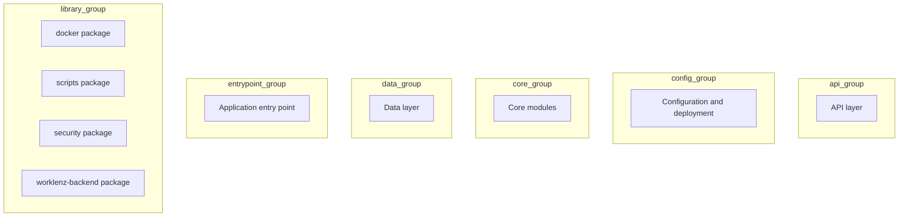

# Architecture report: Worklenz/worklenz

> Automated static analysis. **Observed** = directly seen in files/imports/AST; **Inferred** = interpretation from that evidence. Repository code was not executed.

## 1. Repository at a glance

| Item | Value |
| --- | --- |
| Repository | Worklenz/worklenz |
| Description | All in one project management tool for efficient teams |
| Language | TypeScript |
| Stars | 3308 |
| Licence | AGPL-3.0 |
| Analysed commit / branch | c0115ed217610a03b0b2da2fc28d17ec59d3e921 / main |
| Framework(s) | Express, React |
| Files analysed | 798 |
| Components | 9 |

## 2. Architecture in one minute

Worklenz/worklenz - All in one project management tool for efficient teams. This repository was analysed statically from 798 file(s) (1 Python). Detected technologies (observed from imports/manifests): GitHub Actions, PostgreSQL, Redis, Express, React, axios. Files are grouped into 9 component(s): API layer, Configuration and deployment, Core modules, Data layer, docker package, Application entry point, scripts package, security package. Observed entry point(s): scripts/oss-export/scan-secrets.test.py. Findings below distinguish observed facts from inferred interpretation.

## 3. High-level block diagram

## 4. Main components

### API layer (`api_layer`)

- **Kind:** api
- **Status:** Observed
- **Confidence:** 0.85
- **Responsibility:** Groups 186 file(s) under api layer (observed from repository paths and static analysis).
- **Paths:** `worklenz-backend/src/controllers/access-controls-controller.ts`, `worklenz-backend/src/controllers/account-deletion-controller.ts`, `worklenz-backend/src/controllers/activity-logs-controller.ts`, `worklenz-backend/src/controllers/admin-active-team-owners-controller.ts`, `worklenz-backend/src/controllers/admin-center/admin-center-billing-controller.ts`, `worklenz-backend/src/controllers/admin-center/admin-center-holidays-controller.ts`, `worklenz-backend/src/controllers/admin-center/admin-center-organization-controller.ts`, `worklenz-backend/src/controllers/admin-center/admin-center-teams-controller.ts`, `worklenz-backend/src/controllers/attachment-controller.ts`, `worklenz-backend/src/controllers/audit-log-controller.ts`, `worklenz-backend/src/controllers/audit-log-export-controller.ts`, `worklenz-backend/src/controllers/audit-log-retention-controller.ts`, `worklenz-backend/src/controllers/auth-controller.ts`, `worklenz-backend/src/controllers/aws-ses-controller.ts`, `worklenz-backend/src/controllers/billing-controller.ts`, `worklenz-backend/src/controllers/client-portal-attachment-controller.ts`, `worklenz-backend/src/controllers/client-portal/client-contacts-http.ts`, `worklenz-backend/src/controllers/client-portal/client-portal-auth-controller.ts`, `worklenz-backend/src/controllers/client-portal/client-portal-base.ts`, `worklenz-backend/src/controllers/client-portal/client-portal-chat-controller.ts`, `worklenz-backend/src/controllers/client-portal/client-portal-client-snapshot.ts`, `worklenz-backend/src/controllers/client-portal/client-portal-clients-controller.ts`, `worklenz-backend/src/controllers/client-portal/client-portal-comments-controller.ts`, `worklenz-backend/src/controllers/client-portal/client-portal-company-users-controller.ts`, `worklenz-backend/src/controllers/client-portal/client-portal-dashboard-controller.ts`, `worklenz-backend/src/controllers/client-portal/client-portal-invoice-helpers.ts`, `worklenz-backend/src/controllers/client-portal/client-portal-invoices-controller.ts`, `worklenz-backend/src/controllers/client-portal/client-portal-notifications-controller.ts`, `worklenz-backend/src/controllers/client-portal/client-portal-onboarding-controller.ts`, `worklenz-backend/src/controllers/client-portal/client-portal-profile-controller.ts`, `worklenz-backend/src/controllers/client-portal/client-portal-projects-controller.ts`, `worklenz-backend/src/controllers/client-portal/client-portal-quote-helpers.ts`, `worklenz-backend/src/controllers/client-portal/client-portal-quotes-controller.ts`, `worklenz-backend/src/controllers/client-portal/client-portal-requests-controller.ts`, `worklenz-backend/src/controllers/client-portal/client-portal-services-controller.ts`, `worklenz-backend/src/controllers/client-portal/client-portal-settings-controller.ts`, `worklenz-backend/src/controllers/client-portal/client-portal-team-controller.ts`, `worklenz-backend/src/controllers/client-portal/helpers.ts`, `worklenz-backend/src/controllers/client-portal/interfaces.ts`, `worklenz-backend/src/controllers/client-portal/v2/client-portal-v2-controller.ts`, `worklenz-backend/src/controllers/client-portal/v2/client-sign-in-controller.ts`, `worklenz-backend/src/controllers/client-portal/v2/portal-access-controller.ts`, `worklenz-backend/src/controllers/client-portal/v2/portal-http.ts`, `worklenz-backend/src/controllers/client-portal/v2/portal-overview-controller.ts`, `worklenz-backend/src/controllers/client-portal/v2/portal-projects-controller.ts`, `worklenz-backend/src/controllers/client-portal/v2/portal-workflow-controller.ts`, `worklenz-backend/src/controllers/clients-controller.ts`, `worklenz-backend/src/controllers/currency-rates-controller.ts`, `worklenz-backend/src/controllers/custom-columns-controller.ts`, `worklenz-backend/src/controllers/custom-reports-controller.ts`, `worklenz-backend/src/controllers/departments-controller.ts`, `worklenz-backend/src/controllers/digest-preferences-controller.ts`, `worklenz-backend/src/controllers/finance-overview-controller.ts`, `worklenz-backend/src/controllers/finance-reports-controller.ts`, `worklenz-backend/src/controllers/gantt-controller.ts`, `worklenz-backend/src/controllers/github-controller.ts`, `worklenz-backend/src/controllers/guest-seat-controller.ts`, `worklenz-backend/src/controllers/holiday-controller.ts`, `worklenz-backend/src/controllers/home-page-controller.ts`, `worklenz-backend/src/controllers/home-preferences-controller.ts`, `worklenz-backend/src/controllers/imports-controller.ts`, `worklenz-backend/src/controllers/index-controller.ts`, `worklenz-backend/src/controllers/issue-flags-controller.ts`, `worklenz-backend/src/controllers/job-titles-controller.ts`, `worklenz-backend/src/controllers/labels-controller.ts`, `worklenz-backend/src/controllers/logs-controller.ts`, `worklenz-backend/src/controllers/migration-controller.ts`, `worklenz-backend/src/controllers/notification-controller.ts`, `worklenz-backend/src/controllers/onboarding-controller.ts`, `worklenz-backend/src/controllers/org-configuration-controller.ts`, `worklenz-backend/src/controllers/overview-controller.ts`, `worklenz-backend/src/controllers/personal-overview-controller.ts`, `worklenz-backend/src/controllers/plan-recommendation-controller.ts`, `worklenz-backend/src/controllers/plan-trial-controller.ts`, `worklenz-backend/src/controllers/practices-controller.ts`, `worklenz-backend/src/controllers/profile-settings-controller.ts`, `worklenz-backend/src/controllers/project-categories-controller.ts`, `worklenz-backend/src/controllers/project-comment-reactions-controller.ts`, `worklenz-backend/src/controllers/project-comments-controller.ts`, `worklenz-backend/src/controllers/project-documents-controller.ts`, `worklenz-backend/src/controllers/project-epics-controller.ts`, `worklenz-backend/src/controllers/project-files-controller.ts`, `worklenz-backend/src/controllers/project-finance-controller.ts`, `worklenz-backend/src/controllers/project-folders-controller.ts`, `worklenz-backend/src/controllers/project-healths-controller.ts`, `worklenz-backend/src/controllers/project-insights-controller.ts`, `worklenz-backend/src/controllers/project-links-controller.ts`, `worklenz-backend/src/controllers/project-managers-controller.ts`, `worklenz-backend/src/controllers/project-members-controller.ts`, `worklenz-backend/src/controllers/project-priorities-controller.ts`, `worklenz-backend/src/controllers/project-ratecard-controller.ts`, `worklenz-backend/src/controllers/project-releases-controller.ts`, `worklenz-backend/src/controllers/project-roadmap/roadmap-tasks-contoller-v2-base.ts`, `worklenz-backend/src/controllers/project-roadmap/roadmap-tasks-controller-v2.ts`, `worklenz-backend/src/controllers/project-saved-views-controller.ts`, `worklenz-backend/src/controllers/project-statuses-controller.ts`, `worklenz-backend/src/controllers/project-templates/interfaces.ts`, `worklenz-backend/src/controllers/project-templates/project-templates-base.ts`, `worklenz-backend/src/controllers/project-templates/project-templates.ts`, `worklenz-backend/src/controllers/project-templates/pt-task-phases-controller.ts`, `worklenz-backend/src/controllers/project-templates/pt-task-statuses-controller.ts`, `worklenz-backend/src/controllers/project-templates/pt-tasks-controller-base.ts`, `worklenz-backend/src/controllers/project-templates/pt-tasks-controller.ts`, `worklenz-backend/src/controllers/project-templates/pt-templates-controller.ts`, `worklenz-backend/src/controllers/project-workload/workload-gannt-base.ts`, `worklenz-backend/src/controllers/project-workload/workload-gannt-controller.ts`, `worklenz-backend/src/controllers/projects-controller.ts`, `worklenz-backend/src/controllers/ratecard-controller.ts`, `worklenz-backend/src/controllers/reporting-analytics/analytics-templates-controller.ts`, `worklenz-backend/src/controllers/reporting-analytics/budget-tracking-controller.ts`, `worklenz-backend/src/controllers/reporting-analytics/cfd-controller.ts`, `worklenz-backend/src/controllers/reporting-analytics/planned-vs-actual-milestones-controller.ts`, `worklenz-backend/src/controllers/reporting-analytics/planned-vs-actual-tasks-controller.ts`, `worklenz-backend/src/controllers/reporting-analytics/project-health-controller.ts`, `worklenz-backend/src/controllers/reporting-analytics/time-in-status-controller.ts`, `worklenz-backend/src/controllers/reporting-analytics/time-report-controller.ts`, `worklenz-backend/src/controllers/reporting-analytics/utilization-controller.ts`, `worklenz-backend/src/controllers/reporting-analytics/velocity-controller.ts`, `worklenz-backend/src/controllers/reporting-controller.ts`, `worklenz-backend/src/controllers/reporting/interfaces.ts`, `worklenz-backend/src/controllers/reporting/overview/reporting-overview-base.ts`, `worklenz-backend/src/controllers/reporting/overview/reporting-overview-controller.ts`, `worklenz-backend/src/controllers/reporting/overview/reporting-overview-export-controller.ts`, `worklenz-backend/src/controllers/reporting/point-options-object.ts`, `worklenz-backend/src/controllers/reporting/progress-tracking/progress-tracking-controller.ts`, `worklenz-backend/src/controllers/reporting/progress-tracking/progress-tracking-query.ts`, `worklenz-backend/src/controllers/reporting/projects/reporting-projects-base.ts`, `worklenz-backend/src/controllers/reporting/projects/reporting-projects-controller.ts`, `worklenz-backend/src/controllers/reporting/projects/reporting-projects-export-controller.ts`, `worklenz-backend/src/controllers/reporting/reporting-all-tasks-controller.ts`, `worklenz-backend/src/controllers/reporting/reporting-allocation-controller-updated.ts`, `worklenz-backend/src/controllers/reporting/reporting-allocation-controller.ts`, `worklenz-backend/src/controllers/reporting/reporting-controller-base-with-timezone.ts`, `worklenz-backend/src/controllers/reporting/reporting-controller-base.ts`, `worklenz-backend/src/controllers/reporting/reporting-info-controller.ts`, `worklenz-backend/src/controllers/reporting/reporting-members-controller.ts`, `worklenz-backend/src/controllers/reporting/reporting-time-logs-controller.ts`, `worklenz-backend/src/controllers/reporting/team-lead-members-controller.ts`, `worklenz-backend/src/controllers/reporting/time-logs-export.ts`, `worklenz-backend/src/controllers/reporting/time-logs-groups-export.ts`, `worklenz-backend/src/controllers/reporting/time-logs-query-builder.ts`, `worklenz-backend/src/controllers/resource-allocation-controller.ts`, `worklenz-backend/src/controllers/schedule-v2/capacity-controller.ts`, `worklenz-backend/src/controllers/schedule-v2/project-timeline-controller.ts`, `worklenz-backend/src/controllers/schedule-v2/schedule-controller.ts`, `worklenz-backend/src/controllers/schedule-v2/task-timeline-controller.ts`, `worklenz-backend/src/controllers/schedule-v2/time-off-controller.ts`, `worklenz-backend/src/controllers/schedule-v2/workload-controller.ts`, `worklenz-backend/src/controllers/schedule/schedule-controller-base.ts`, `worklenz-backend/src/controllers/schedule/schedule-controller.ts`, `worklenz-backend/src/controllers/shared-projects-controller.ts`, `worklenz-backend/src/controllers/slack-controller.ts`, `worklenz-backend/src/controllers/software-issues-controller.ts`, `worklenz-backend/src/controllers/software-reports-controller.ts`, `worklenz-backend/src/controllers/story-points-controller.ts`, `worklenz-backend/src/controllers/sub-tasks-controller.ts`, `worklenz-backend/src/controllers/subscription-controller.ts`, `worklenz-backend/src/controllers/support-controller.ts`, `worklenz-backend/src/controllers/survey-controller.ts`, `worklenz-backend/src/controllers/task-comments-controller.ts`, `worklenz-backend/src/controllers/task-dependencies-controller.ts`, `worklenz-backend/src/controllers/task-duplicate-controller.ts`, `worklenz-backend/src/controllers/task-export-controller.ts`, `worklenz-backend/src/controllers/task-list-columns-controller.ts`, `worklenz-backend/src/controllers/task-phases-controller.ts`, `worklenz-backend/src/controllers/task-priorities-controller.ts`, `worklenz-backend/src/controllers/task-recurring-controller.ts`, `worklenz-backend/src/controllers/task-statuses-controller.ts`, `worklenz-backend/src/controllers/task-templates-controller.ts`, `worklenz-backend/src/controllers/task-work-log-controller.ts`, `worklenz-backend/src/controllers/tasks-controller-base.ts`, `worklenz-backend/src/controllers/tasks-controller-v2.ts`, `worklenz-backend/src/controllers/tasks-controller.ts`, `worklenz-backend/src/controllers/tasks-custom-columns-controller.ts`, `worklenz-backend/src/controllers/team-documents-controller.ts`, `worklenz-backend/src/controllers/team-files-controller.ts`, `worklenz-backend/src/controllers/team-lead-reports-controller.ts`, `worklenz-backend/src/controllers/team-management-controller.ts`, `worklenz-backend/src/controllers/team-members-controller.ts`, `worklenz-backend/src/controllers/teams-controller.ts`, `worklenz-backend/src/controllers/timezones-controller.ts`, `worklenz-backend/src/controllers/todo-list-controller.ts`, `worklenz-backend/src/controllers/user-activity-logs-controller.ts`, `worklenz-backend/src/controllers/user-type-controller.ts`, `worklenz-backend/src/controllers/whats-new-controller.ts`, `worklenz-backend/src/controllers/worklenz-controller-base.ts`
- **Evidence:** [worklenz-backend/src/controllers/access-controls-controller.ts](https://github.com/Worklenz/worklenz/blob/c0115ed217610a03b0b2da2fc28d17ec59d3e921/worklenz-backend/src/controllers/access-controls-controller.ts); [worklenz-backend/src/controllers/account-deletion-controller.ts](https://github.com/Worklenz/worklenz/blob/c0115ed217610a03b0b2da2fc28d17ec59d3e921/worklenz-backend/src/controllers/account-deletion-controller.ts); [worklenz-backend/src/controllers/activity-logs-controller.ts](https://github.com/Worklenz/worklenz/blob/c0115ed217610a03b0b2da2fc28d17ec59d3e921/worklenz-backend/src/controllers/activity-logs-controller.ts); [worklenz-backend/src/controllers/admin-active-team-owners-controller.ts](https://github.com/Worklenz/worklenz/blob/c0115ed217610a03b0b2da2fc28d17ec59d3e921/worklenz-backend/src/controllers/admin-active-team-owners-controller.ts); [worklenz-backend/src/controllers/admin-center/admin-center-billing-controller.ts](https://github.com/Worklenz/worklenz/blob/c0115ed217610a03b0b2da2fc28d17ec59d3e921/worklenz-backend/src/controllers/admin-center/admin-center-billing-controller.ts); [worklenz-backend/src/controllers/admin-center/admin-center-holidays-controller.ts](https://github.com/Worklenz/worklenz/blob/c0115ed217610a03b0b2da2fc28d17ec59d3e921/worklenz-backend/src/controllers/admin-center/admin-center-holidays-controller.ts); [worklenz-backend/src/controllers/admin-center/admin-center-organization-controller.ts](https://github.com/Worklenz/worklenz/blob/c0115ed217610a03b0b2da2fc28d17ec59d3e921/worklenz-backend/src/controllers/admin-center/admin-center-organization-controller.ts); [worklenz-backend/src/controllers/admin-center/admin-center-teams-controller.ts](https://github.com/Worklenz/worklenz/blob/c0115ed217610a03b0b2da2fc28d17ec59d3e921/worklenz-backend/src/controllers/admin-center/admin-center-teams-controller.ts)

### Configuration and deployment (`config`)

- **Kind:** config
- **Status:** Observed
- **Confidence:** 0.85
- **Responsibility:** Groups 14 file(s) under configuration and deployment (observed from repository paths and static analysis).
- **Paths:** `docker-compose.yml`, `worklenz-backend/.dockerignore`, `worklenz-backend/.editorconfig`, `worklenz-backend/.env.template`, `worklenz-backend/.eslintrc.json`, `worklenz-backend/Dockerfile`, `worklenz-backend/appspec.yml`, `worklenz-backend/package.json`, `worklenz-backend/src/config/audit-retention-db.ts`, `worklenz-backend/src/config/db-config.ts`, `worklenz-backend/src/config/db.ts`, `worklenz-backend/src/config/i18n.ts`, `worklenz-backend/src/data/sri-lankan-holidays.json`, `worklenz-backend/src/docs/openapi.yaml`
- **Evidence:** [docker-compose.yml](https://github.com/Worklenz/worklenz/blob/c0115ed217610a03b0b2da2fc28d17ec59d3e921/docker-compose.yml); [worklenz-backend/.dockerignore](https://github.com/Worklenz/worklenz/blob/c0115ed217610a03b0b2da2fc28d17ec59d3e921/worklenz-backend/.dockerignore); [worklenz-backend/.editorconfig](https://github.com/Worklenz/worklenz/blob/c0115ed217610a03b0b2da2fc28d17ec59d3e921/worklenz-backend/.editorconfig); [worklenz-backend/.env.template](https://github.com/Worklenz/worklenz/blob/c0115ed217610a03b0b2da2fc28d17ec59d3e921/worklenz-backend/.env.template); [worklenz-backend/.eslintrc.json](https://github.com/Worklenz/worklenz/blob/c0115ed217610a03b0b2da2fc28d17ec59d3e921/worklenz-backend/.eslintrc.json); [worklenz-backend/Dockerfile](https://github.com/Worklenz/worklenz/blob/c0115ed217610a03b0b2da2fc28d17ec59d3e921/worklenz-backend/Dockerfile); [worklenz-backend/appspec.yml](https://github.com/Worklenz/worklenz/blob/c0115ed217610a03b0b2da2fc28d17ec59d3e921/worklenz-backend/appspec.yml); [worklenz-backend/package.json](https://github.com/Worklenz/worklenz/blob/c0115ed217610a03b0b2da2fc28d17ec59d3e921/worklenz-backend/package.json)

### Core modules (`core`)

- **Kind:** core
- **Status:** Observed
- **Confidence:** 0.85
- **Responsibility:** Groups 7 file(s) under core modules (observed from repository paths and static analysis).
- **Paths:** `backup.sh`, `deploy.sh`, `manage.sh`, `quick-setup.sh`, `start.sh`, `stop.sh`, `update-docker-env.sh`
- **Evidence:** [backup.sh](https://github.com/Worklenz/worklenz/blob/c0115ed217610a03b0b2da2fc28d17ec59d3e921/backup.sh); [deploy.sh](https://github.com/Worklenz/worklenz/blob/c0115ed217610a03b0b2da2fc28d17ec59d3e921/deploy.sh); [manage.sh](https://github.com/Worklenz/worklenz/blob/c0115ed217610a03b0b2da2fc28d17ec59d3e921/manage.sh); [quick-setup.sh](https://github.com/Worklenz/worklenz/blob/c0115ed217610a03b0b2da2fc28d17ec59d3e921/quick-setup.sh); [start.sh](https://github.com/Worklenz/worklenz/blob/c0115ed217610a03b0b2da2fc28d17ec59d3e921/start.sh); [stop.sh](https://github.com/Worklenz/worklenz/blob/c0115ed217610a03b0b2da2fc28d17ec59d3e921/stop.sh); [update-docker-env.sh](https://github.com/Worklenz/worklenz/blob/c0115ed217610a03b0b2da2fc28d17ec59d3e921/update-docker-env.sh)

### Data layer (`data_layer`)

- **Kind:** data
- **Status:** Observed
- **Confidence:** 0.85
- **Responsibility:** Groups 355 file(s) under data layer (observed from repository paths and static analysis).
- **Paths:** `worklenz-backend/database/00_init.sh`, `worklenz-backend/database/pg-migrations-support/team-lead-prerequisites.js`, `worklenz-backend/database/pg-migrations/1735689500000_baseline_gap_licensing_and_custom_columns.js`, `worklenz-backend/database/pg-migrations/1735689501000_baseline_gap_task_comments_and_template_phases.js`, `worklenz-backend/database/pg-migrations/1735689600000_add_member_time_off_table.js`, `worklenz-backend/database/pg-migrations/1735689601000_run_member_time_off_migration.js`, `worklenz-backend/database/pg-migrations/1735689609000_create_client_portal_request_comments.js`, `worklenz-backend/database/pg-migrations/1735862400000_add_user_deletion_logs.js`, `worklenz-backend/database/pg-migrations/1735948800000_fix_create_task_assignee_duplicate.js`, `worklenz-backend/database/pg-migrations/1736035200000_fix_update_team_member_return_type.js`, `worklenz-backend/database/pg-migrations/1736121600000_fix_duplicate_sort_orders.js`, `worklenz-backend/database/pg-migrations/1736812801000_add_lkr_pricing_tiers.js`, `worklenz-backend/database/pg-migrations/1736899200000_performance_indexes.js`, `worklenz-backend/database/pg-migrations/1737331200000_optimize_reporting_members_indexes.js`, `worklenz-backend/database/pg-migrations/1737936000000_fix_window_function_error.js`, `worklenz-backend/database/pg-migrations/1738195200000_add_holiday_calendar.js`, `worklenz-backend/database/pg-migrations/1738195201000_create_slack_integration.js`, `worklenz-backend/database/pg-migrations/1738281600000_sri_lankan_holidays.js`, `worklenz-backend/database/pg-migrations/1738627200000_add_custom_columns_to_templates.js`, `worklenz-backend/database/pg-migrations/1738886400000_add_2026_sri_lankan_holidays.js`, `worklenz-backend/database/pg-migrations/1738892400000_add_2026_sri_lankan_holidays.js`, `worklenz-backend/database/pg-migrations/1740096000000_add_sort_order_columns_to_cpt_tasks.js`, `worklenz-backend/database/pg-migrations/1740787200000_split_client_address_fields.js`, `worklenz-backend/database/pg-migrations/1745366400000_manual_task_progress.js`, `worklenz-backend/database/pg-migrations/1745452800000_subtask_manual_progress.js`, `worklenz-backend/database/pg-migrations/1745539200000_add_progress_and_weight_activity_types.js`, `worklenz-backend/database/pg-migrations/1745625600000_update_time_based_progress.js`, `worklenz-backend/database/pg-migrations/1745712000000_improve_parent_task_progress_calculation.js`, `worklenz-backend/database/pg-migrations/1745712001000_update_progress_mode_handlers.js`, `worklenz-backend/database/pg-migrations/1745798400000_fix_progress_mode_type.js`, `worklenz-backend/database/pg-migrations/1746576000000_fix_multilevel_subtask_progress_calculation.js`, `worklenz-backend/database/pg-migrations/1752537600000_add_grouping_sort_orders.js`, `worklenz-backend/database/pg-migrations/1752537601000_update_sort_functions.js`, `worklenz-backend/database/pg-migrations/1752537602000_fix_sort_constraint.js`, `worklenz-backend/database/pg-migrations/1753315200000_add_survey_tables.js`, `worklenz-backend/database/pg-migrations/1753401600000_create_client_portal_tables.js`, `worklenz-backend/database/pg-migrations/1753401601000_enhance_existing_tables_for_portal.js`, `worklenz-backend/database/pg-migrations/1753401602000_create_client_portal_functions.js`, `worklenz-backend/database/pg-migrations/1753401603000_create_client_portal_triggers.js`, `worklenz-backend/database/pg-migrations/1753401604000_create_client_portal_views.js`, `worklenz-backend/database/pg-migrations/1753401605000_seed_client_portal_data.js`, `worklenz-backend/database/pg-migrations/1753401606000_create_message_reads_table.js`, `worklenz-backend/database/pg-migrations/1753401607000_create_client_invitations.js`, `worklenz-backend/database/pg-migrations/1753401608000_add_assigned_to_requests.js`, `worklenz-backend/database/pg-migrations/1753401609000_create_organization_invitations.js`, `worklenz-backend/database/pg-migrations/1753401610000_create_client_portal_request_comments_after_tables.js`, `worklenz-backend/database/pg-migrations/1753401611000_add_client_portal_invoice_tax_discount_columns.js`, `worklenz-backend/database/pg-migrations/1753401612000_add_client_portal_soft_delete_columns.js`, `worklenz-backend/database/pg-migrations/1753488000000_fix_client_portal_triggers.js`, `worklenz-backend/database/pg-migrations/1753574400000_add_plan_trials.js`, `worklenz-backend/database/pg-migrations/1753574401000_add_user_limit_to_pricing_plans.js`, `worklenz-backend/database/pg-migrations/1753574402000_update_deserialize_user_for_plan_trials.js`, `worklenz-backend/database/pg-migrations/1753574403000_auto_start_business_trial_on_signup.js`, `worklenz-backend/database/pg-migrations/1753574500000_add_organization_holiday_settings.js`, `worklenz-backend/database/pg-migrations/1757289600000_preserve_project_logs_after_deletion.js`, `worklenz-backend/database/pg-migrations/1757289601000_add_i18n_logging_support.js`, `worklenz-backend/database/pg-migrations/1758326400000_add_role_name_to_session.js`, `worklenz-backend/database/pg-migrations/1758326401000_add_team_lead_role_migration.js`, `worklenz-backend/database/pg-migrations/1758412800000_add_reports_to_team_members.js`, `worklenz-backend/database/pg-migrations/1758412801000_create_team_lead_member_views.js`, `worklenz-backend/database/pg-migrations/1758412802000_fix_team_lead_admin_privileges.js`, `worklenz-backend/database/pg-migrations/1758412803000_fix_team_lead_view_admin_condition.js`, `worklenz-backend/database/pg-migrations/1758412804000_update_team_creation_functions.js`, `worklenz-backend/database/pg-migrations/1758412805000_update_permission_functions.js`, `worklenz-backend/database/pg-migrations/1758499205000_verify_team_lead_implementation.js`, `worklenz-backend/database/pg-migrations/1758499206000_team_lead_reports_perf_indexes.js`, `worklenz-backend/database/pg-migrations/1759377600000_enhance_email_tracking.js`, `worklenz-backend/database/pg-migrations/1762617600000_create_invitation_links.js`, `worklenz-backend/database/pg-migrations/1763049600000_add_apple_sign_in_support.js`, `worklenz-backend/database/pg-migrations/1763049601000_add_register_apple_user_function.js`, `worklenz-backend/database/pg-migrations/1765584000000_add_logo_url_to_organizations.js`, `worklenz-backend/database/pg-migrations/1766188800000_create_client_portal_notification_reads.js`, `worklenz-backend/database/pg-migrations/1766188801000_add_duplicate_task_function.js`, `worklenz-backend/database/pg-migrations/1766275200000_fix_create_project_member_team_lead_access_level.js`, `worklenz-backend/database/pg-migrations/1766275201000_optimize_subtask_filtering.js`, `worklenz-backend/database/pg-migrations/1766361600000_fix_task_completed_date_trigger.js`, `worklenz-backend/database/pg-migrations/1766448000000_add_sort_order_columns_to_cpt_tasks_v2.js`, `worklenz-backend/database/pg-migrations/1766880000000_create_client_portal_task_comments.js`, `worklenz-backend/database/pg-migrations/1766880001000_create_client_task_views.js`, `worklenz-backend/database/pg-migrations/1766880002000_add_client_portal_task_comments_soft_delete.js`, `worklenz-backend/database/pg-migrations/1767225600000_create_imports.js`, `worklenz-backend/database/pg-migrations/1767398400000_sanitize_html_in_names.js`, `worklenz-backend/database/pg-migrations/1767484800000_add_password_reset_tokens.js`, `worklenz-backend/database/pg-migrations/1767571200000_add_multi_org_support.js`, `worklenz-backend/database/pg-migrations/1767571201000_add_user_id_to_client_users.js`, `worklenz-backend/database/pg-migrations/1767571202000_add_unique_constraint_to_client_portal_access.js`, `worklenz-backend/database/pg-migrations/1767571203000_fix_google_oauth_invite_setup_completed.js`, `worklenz-backend/database/pg-migrations/1767571204000_fix_missing_unique_constraints.js`, `worklenz-backend/database/pg-migrations/1767571208000_update_request_sequences_per_service.js`, `worklenz-backend/database/pg-migrations/1767571300000_add_capacity_calculation_function.js`, `worklenz-backend/database/pg-migrations/1767657600000_add_service_pricing_fields.js`, `worklenz-backend/database/pg-migrations/1767657601000_create_client_portal_attachments.js`, `worklenz-backend/database/pg-migrations/1767657601001_add_position_import_hierarchy.js`, `worklenz-backend/database/pg-migrations/1767657602000_add_admin_comments_viewed_tracking.js`, `worklenz-backend/database/pg-migrations/1767657700000_add_bulk_change_due_date_function.js`, `worklenz-backend/database/pg-migrations/1767744000000_add_request_status_history.js`, `worklenz-backend/database/pg-migrations/1767744100000_fix_client_status_null_values.js`, `worklenz-backend/database/pg-migrations/1767761335000_fix_quick_task_sort_order.js`, `worklenz-backend/database/pg-migrations/1767830400000_add_notes_to_client_portal_invoices.js`, `worklenz-backend/database/pg-migrations/1767830401000_add_company_details_to_client_portal_settings.js`, `worklenz-backend/database/pg-migrations/1767830500000_add_payment_proof_url_to_invoices.js`, `worklenz-backend/database/pg-migrations/1767830501000_add_payment_proof_purpose.js`, `worklenz-backend/database/pg-migrations/1767916800000_add_invite_slug_to_clients.js`, `worklenz-backend/database/pg-migrations/1767916801000_add_client_portal_notifications_read.js`, `worklenz-backend/database/pg-migrations/1767916802000_add_updated_at_to_client_invitations.js`, `worklenz-backend/database/pg-migrations/1767916900000_create_client_portal_request_sequences.js`, `worklenz-backend/database/pg-migrations/1767916901000_fix_client_portal_request_unique_constraint.js`, `worklenz-backend/database/pg-migrations/1767916902000_add_service_key_field.js`, `worklenz-backend/database/pg-migrations/1768555501000_register_function_changes.js`, `worklenz-backend/database/pg-migrations/1768995180000_add_calculate_member_capacity_function.js`, `worklenz-backend/database/pg-migrations/1769040000000_fix_project_comment_response_structure.js`, `worklenz-backend/database/pg-migrations/1769040001000_add_comment_reactions_and_edit_audit.js`, `worklenz-backend/database/pg-migrations/1769558400000_create_project_files.js`, `worklenz-backend/database/pg-migrations/1769558401000_fix_recurring_tasks.js`, `worklenz-backend/database/pg-migrations/1769731200000_fix_team_plan_trial_propagation.js`, `worklenz-backend/database/pg-migrations/1769731201000_fix_team_plan_trial_propagation_simple.js`, `worklenz-backend/database/pg-migrations/1769754554000_update_register_db_functions_owd.js`, `worklenz-backend/database/pg-migrations/1769904000000_create_client_password_reset_tokens.js`, `worklenz-backend/database/pg-migrations/1770076800000_add_auto_assign_task_creator.js`, `worklenz-backend/database/pg-migrations/1770163200000_add_team_currency_to_rate_cards.js`, `worklenz-backend/database/pg-migrations/1770163201000_create_finance_rate_card_roles.js`, `worklenz-backend/database/pg-migrations/1770249600000_fix_project_date_timezone_handling.js`, `worklenz-backend/database/pg-migrations/1770681600000_recurring_tasks_complete_fix.js`, `worklenz-backend/database/pg-migrations/1770854400000_add_recurring_mode_selection.js`, `worklenz-backend/database/pg-migrations/1770940800000_fix_notification_email_loop.js`, `worklenz-backend/database/pg-migrations/1770940801000_cleanup_stuck_notifications.js`, `worklenz-backend/database/pg-migrations/1770940802000_add_retry_mechanism.js`, `worklenz-backend/database/pg-migrations/1770940803000_clear_pending_notifications.js`, `worklenz-backend/database/pg-migrations/1770940804000_fix_notification_email_edge_cases.js`, `worklenz-backend/database/pg-migrations/1771286402000_fix_quick_task_sort_order.js`, `worklenz-backend/database/pg-migrations/1771286403000_fix_template_import_sort_order.js`, `worklenz-backend/database/pg-migrations/1771545602000_add_grouped_reporting_indexes.js`, `worklenz-backend/database/pg-migrations/1771718400000_fix_task_activity_logs_cascade_delete.js`, `worklenz-backend/database/pg-migrations/1771718401000_fix_bulk_delete_activity_logs.js`, `worklenz-backend/database/pg-migrations/1771891200000_add_project_members_to_account_setup.js`, `worklenz-backend/database/pg-migrations/1773014400000_invalidate_bcrypt_reset_tokens.js`, `worklenz-backend/database/pg-migrations/1773333900000_ensure_clients_portal_columns.js`, `worklenz-backend/database/pg-migrations/1773333901000_create_user_release_dismissals.js`, `worklenz-backend/database/pg-migrations/1773333902000_add_release_id_to_user_notifications.js`, `worklenz-backend/database/pg-migrations/1773334200000_ensure_clients_portal_columns.js`, `worklenz-backend/database/pg-migrations/1773619200000_add_business_plan_overrides.js`, `worklenz-backend/database/pg-migrations/1773619202000_add_redeemed_codes_count_to_billing_info.js`, `worklenz-backend/database/pg-migrations/1773619202001_add_redeemed_codes_count_to_billing_info.js`, `worklenz-backend/database/pg-migrations/1773619203000_add_business_plan_override_columns.js`, `worklenz-backend/database/pg-migrations/1773619203001_add_business_plan_override_columns.js`, `worklenz-backend/database/pg-migrations/1773705600000_add_custom_columns_to_task_form_view_model.js`, `worklenz-backend/database/pg-migrations/1773705600001_add_custom_columns_to_task_form_view_model.js`, `worklenz-backend/database/pg-migrations/1773705600002_fix_create_task_auto_assign_task_creator.js`, `worklenz-backend/database/pg-migrations/1773748800000_add_client_phone_country_code.js`, `worklenz-backend/database/pg-migrations/1773748800001_add_client_phone_country_code.js`, `worklenz-backend/database/pg-migrations/1773792000000_fix_get_billing_info_cardinality.js`, `worklenz-backend/database/pg-migrations/1773792000001_set_import_jobs_id_default_uuid_generate_v4.js`, `worklenz-backend/database/pg-migrations/1773792001000_add_groupby_preference_to_project_members.js`, `worklenz-backend/database/pg-migrations/1773792001001_fix_get_billing_info_cardinality.js`, `worklenz-backend/database/pg-migrations/1773792002000_fix_project_default_priority.js`, `worklenz-backend/database/pg-migrations/1773878401000_fix_bulk_archive_subtask_selection.js`, `worklenz-backend/database/pg-migrations/1773964801000_make_bulk_archive_recursive.js`, `worklenz-backend/database/pg-migrations/1775174400000_add_critical_task_priority.js`, `worklenz-backend/database/pg-migrations/1776729600000_add_groupby_preference_to_project_members.js`, `worklenz-backend/database/pg-migrations/1776988801000_add_due_time_to_tasks.js`, `worklenz-backend/database/pg-migrations/1777248001000_add_due_time_to_task_form_view_model.js`, `worklenz-backend/database/pg-migrations/1777248002000_add_due_time_column_to_task_list.js`, `worklenz-backend/database/pg-migrations/1777507200000_add_multiple_reaction_types.js`, `worklenz-backend/database/pg-migrations/1778112000000_add_priority_to_projects.js`, `worklenz-backend/database/pg-migrations/1778112000001_optimize_reporting_projects_grouped.js`, `worklenz-backend/database/pg-migrations/1778112001000_update_project_functions_with_priority.js`, `worklenz-backend/database/pg-migrations/1778630401000_fix_duplicate_sort_orders.js`, `worklenz-backend/database/pg-migrations/1778803200000_add_restrict_task_creation.js`, `worklenz-backend/database/pg-migrations/1779062400000_seed_pro_lkr_pricing_tier.js`, `worklenz-backend/database/pg-migrations/1779235201000_task_template_subtask_support.js`, `worklenz-backend/database/pg-migrations/1779235202000_task_template_3level_subtask_support.js`, `worklenz-backend/database/pg-migrations/1779840000000_add_status_to_project_files.js`, `worklenz-backend/database/pg-migrations/1780012801000_soft_delete_task_comments.js`, `worklenz-backend/database/pg-migrations/1780017302000_fix_done_task_progress_on_template_import.js`, `worklenz-backend/database/pg-migrations/1780100000000_add_status_to_project_files.js`, `worklenz-backend/database/pg-migrations/1781000000000_add_sys_project_priorities.js`, `worklenz-backend/database/pg-migrations/1781000000001_add_departments.js`, `worklenz-backend/database/pg-migrations/1781568000000_add_phase_assignees_enabled.js`, `worklenz-backend/database/pg-migrations/1781568001000_add_default_assignee_to_phases.js`, `worklenz-backend/database/pg-migrations/1782000000000_fix_task_activity_logs_project_fk_cascade.js`, `worklenz-backend/database/pg-migrations/1782432001000_add_annual_pro_license_type.js`, `worklenz-backend/database/pg-migrations/1782500000000_create-project-links.js`, `worklenz-backend/database/pg-migrations/1782600000000_add-project-comment-source-to-project-links.js`, `worklenz-backend/database/pg-migrations/1782700000000_add_color_code_to_task_statuses.js`, `worklenz-backend/database/pg-migrations/1782864000000_keep_business_trial_through_redemption.js`, `worklenz-backend/database/pg-migrations/1783000000000_create-user-digest-preferences.js`, `worklenz-backend/database/pg-migrations/1783000000001_create-digest-send-log.js`, `worklenz-backend/database/pg-migrations/1783000000002_create-digest-unsubscribe-tokens.js`, `worklenz-backend/database/pg-migrations/1783000000003_add-timezone-missing-to-digest-send-log.js`, `worklenz-backend/database/pg-migrations/1783000000004_unique-digest-unsubscribe-user.js`, `worklenz-backend/database/pg-migrations/1783100000000_keep_business_trial_through_redemption.js`, `worklenz-backend/database/pg-migrations/1783555201000_add_comment_id_to_user_notifications.js`, `worklenz-backend/database/pg-migrations/1783800000000_project-chat-inbox.js`, `worklenz-backend/database/pg-migrations/1783987200000_fix_email_notifications_default.js`, `worklenz-backend/database/pg-migrations/1784000000000_project-comment-attachments.js`, `worklenz-backend/database/pg-migrations/1784274092057_fix-project-comment-attachments-column.js`, `worklenz-backend/database/pg-migrations/1785110400000_add_base_currency_to_organizations.js`, `worklenz-backend/database/pg-migrations/1785196801000_enforce_task_name_250_char_limit.js`, `worklenz-backend/database/pg-migrations/1785196802000_fix_task_name_constraint_to_250_chars.js`, `worklenz-backend/database/pg-migrations/1785389196523_fix_double_encoded_html_entities.js`, `worklenz-backend/database/pg-migrations/1785456000000_add_tasks_assignees_assigned_by_index.js`, `worklenz-backend/database/pg-migrations/1785456000001_add_timelog_backdate_limit.js`, `worklenz-backend/database/pg-migrations/1785628800000_add_personal_todo_list_user_dates_index.js`, `worklenz-backend/database/pg-migrations/1785715200000_add_task_phase_phase_id_index.js`, `worklenz-backend/database/pg-migrations/1785801600000_add_guest_access_level.js`, `worklenz-backend/database/pg-migrations/1785801600001_add_guest_access_level.js`, `worklenz-backend/database/pg-migrations/1786000000000_fix_task_progress_for_existing_databases.js`, `worklenz-backend/database/pg-migrations/1786060800000_fix_comment_edit_timestamp_format.js`, `worklenz-backend/database/pg-migrations/1786320001000_fix_comment_edit_timestamp_format.js`, `worklenz-backend/database/pg-migrations/1787097600000_fix_guest_member_role_duplication.js`, `worklenz-backend/database/pg-migrations/1787184000000_fix_task_comment_contents_unique_constraint.js`, `worklenz-backend/database/pg-migrations/1787184000001_fix_task_comment_contents_unique_constraint.js`, `worklenz-backend/database/pg-migrations/1787306400000_add_team_guest_status.js`, `worklenz-backend/database/pg-migrations/1788134400000_duplicate_task_cross_project.js`, `worklenz-backend/database/pg-migrations/1788170400000_add_custom_column_type_locked.js`, `worklenz-backend/database/pg-migrations/1788170400001_add_custom_column_type_locked.js`, `worklenz-backend/database/pg-migrations/1788343200000_add_template_scope.js`, `worklenz-backend/database/pg-migrations/1788346800000_add_task_template_scope.js`, `worklenz-backend/database/pg-migrations/1788393600000_fix_get_mapped_status_id_empty_array.js`, `worklenz-backend/database/pg-migrations/1788436800000_map_status_by_category_fallback.js`, `worklenz-backend/database/pg-migrations/1788782371000_add_auto_assign_subtask_phase_to_projects.js`, `worklenz-backend/database/pg-migrations/1788782400000_update_project_functions_for_auto_assign_subtask_phase.js`, `worklenz-backend/database/pg-migrations/1788786000000_add_subtask_phase_inheritance_on_creation.js`, `worklenz-backend/database/pg-migrations/1788789600000_add_phase_cascade_to_subtasks.js`, `worklenz-backend/database/pg-migrations/1788793200000_add_cascade_to_bulk_change_tasks_phase.js`, `worklenz-backend/database/pg-migrations/1788796800000_add_cascade_to_phase_deletion.js`, `worklenz-backend/database/pg-migrations/1788800400000_fix_auto_assign_subtask_phase_functions.js`, `worklenz-backend/database/pg-migrations/1788998400000_add_restrict_tasks_to_assignee.js`, `worklenz-backend/database/pg-migrations/1789034400000_create_task_export_jobs.js`, `worklenz-backend/database/pg-migrations/1789034400001_create_task_export_jobs.js`, `worklenz-backend/database/pg-migrations/1789344000000_add_subtask_rollup_flag.js`, `worklenz-backend/database/pg-migrations/1789380000000_one_active_export_per_project.js`, `worklenz-backend/database/pg-migrations/1789380000001_one_active_export_per_project.js`, `worklenz-backend/database/pg-migrations/1789560000000_add_partial_time_off_and_capacity_v2.js`, `worklenz-backend/database/pg-migrations/1789603200000_fix_in_organization_owner_check.js`, `worklenz-backend/database/pg-migrations/1789689600000_task_template_subtask_support.js`, `worklenz-backend/database/pg-migrations/1789732800000_restore_auto_assign_subtask_phase_to_project_functions.js`, `worklenz-backend/database/pg-migrations/1789740000000_add_is_guest_to_deserialize_user.js`, `worklenz-backend/database/pg-migrations/1789992000000_add_organization_holidays_is_auto_synced.js`, `worklenz-backend/database/pg-migrations/1790002800000_extend_custom_project_templates_config.js`, `worklenz-backend/database/pg-migrations/1790035200000_add_time_entries_preferences_to_team_members.js`, `worklenz-backend/database/pg-migrations/1790035200001_add_time_entries_preferences_to_team_members.js`, `worklenz-backend/database/pg-migrations/1790121600000_get_team_members_include_is_guest.js`, `worklenz-backend/database/pg-migrations/1790172000000_add_project_pm_access_flags.js`, `worklenz-backend/database/pg-migrations/1790208000000_enforce_cpt_tasks_task_no_not_null.js`, `worklenz-backend/database/pg-migrations/1790335440000_add_mobile_banner_and_org_overrides.js`, `worklenz-backend/database/pg-migrations/1790335440001_add_mobile_banner_and_org_overrides.js`, `worklenz-backend/database/pg-migrations/1790337600000_order_statuses_in_task_form_view_model.js`, `worklenz-backend/database/pg-migrations/1790553600000_add_attachments_task_list_column.js`, `worklenz-backend/database/pg-migrations/1790553600001_seed_attachments_task_list_column.js`, `worklenz-backend/database/pg-migrations/1790596800000_add_project_delivery_confidence.js`, `worklenz-backend/database/pg-migrations/1790652600000_add_comments_task_list_column.js`, `worklenz-backend/database/pg-migrations/1790652660000_seed_comments_task_list_column.js`, `worklenz-backend/database/pg-migrations/1790676000000_add_polish_language_to_enum.js`, `worklenz-backend/database/pg-migrations/1790679600000_add_french_language_to_enum.js`, `worklenz-backend/database/pg-migrations/1790683200000_add_notification_translation_support.js`, `worklenz-backend/database/pg-migrations/1790686800000_apply_notification_localization_function_updates.js`, `worklenz-backend/database/pg-migrations/1790690400000_fix_guest_member_role_duplication.js`, `worklenz-backend/database/pg-migrations/1790694000001_add_practices.js`, `worklenz-backend/database/pg-migrations/1790694000002_fix_insights_tasks_status_name.js`, `worklenz-backend/database/pg-migrations/1790726400000_backfill_notification_i18n_metadata.js`, `worklenz-backend/database/pg-migrations/1790744958188_fix-notification-params-jsonb-type.js`, `worklenz-backend/database/pg-migrations/1790747388547_fix-task-assignment-notification-wording.js`, `worklenz-backend/database/pg-migrations/1790757757262_create_client_contacts.js`, `worklenz-backend/database/pg-migrations/1790757817262_backfill_client_contacts.js`, `worklenz-backend/database/pg-migrations/1790757877262_add_client_portal_request_custom_statuses.js`, `worklenz-backend/database/pg-migrations/1790757937262_add_invoice_payment_status.js`, `worklenz-backend/database/pg-migrations/1790757997262_create_invoice_line_items.js`, `worklenz-backend/database/pg-migrations/1790758057262_create_client_portal_tickets.js`, `worklenz-backend/database/pg-migrations/1790758117262_add_client_portal_service_billing_type.js`, `worklenz-backend/database/pg-migrations/1790758177262_add_client_portal_service_option_values.js`, `worklenz-backend/database/pg-migrations/1790758237262_add_client_portal_settings_extensions.js`, `worklenz-backend/database/pg-migrations/1790768082889_fix-remove-team-member-delete.js`, `worklenz-backend/database/pg-migrations/1790780400000_register_functions_self_hosted_license.js`, `worklenz-backend/database/pg-migrations/1790800000000_add_paddle_billing_columns.js`, `worklenz-backend/database/pg-migrations/1790836075000_add_software_project_type.js`, `worklenz-backend/database/pg-migrations/1790836076000_add_sprint_status_to_project_phases.js`, `worklenz-backend/database/pg-migrations/1790836077000_add_assignee_groupby_preference.js`, `worklenz-backend/database/pg-migrations/1790836078000_add_sprint_goal_to_project_phases.js`, `worklenz-backend/database/pg-migrations/1790836079000_add_project_epics.js`, `worklenz-backend/database/pg-migrations/1790836080000_add_story_points.js`, `worklenz-backend/database/pg-migrations/1790836081000_add_task_is_blocked.js`, `worklenz-backend/database/pg-migrations/1790836082000_add_task_issue_type.js`, `worklenz-backend/database/pg-migrations/1790836083000_add_project_releases.js`, `worklenz-backend/database/pg-migrations/1790836084000_add_sprint_report_snapshots.js`, `worklenz-backend/database/pg-migrations/1790836085000_add_auto_start_complete_sprints.js`, `worklenz-backend/database/pg-migrations/1790916775747_add-project-custom-reports.js`, `worklenz-backend/database/pg-migrations/1790923539989_create_client_portal_quotes.js`, `worklenz-backend/database/pg-migrations/1790925550723_add_client_snapshot_to_invoices_and_quotes.js`, `worklenz-backend/database/pg-migrations/1790935200000_create-user-pinned-tasks.js`, `worklenz-backend/database/pg-migrations/1790935200001_create-user-home-preferences.js`, `worklenz-backend/database/pg-migrations/1790935200002_auto-unpin-completed-tasks.js`, `worklenz-backend/database/pg-migrations/1791193625587_create-audit-events-table.js`, `worklenz-backend/database/pg-migrations/1791193625588_add-audit-log-retention-to-organizations.js`, `worklenz-backend/database/pg-migrations/1791199423499_create-project-documents.js`, `worklenz-backend/database/pg-migrations/1791259941477_create-audit-log-export-jobs.js`, `worklenz-backend/database/pg-migrations/1791267995553_allow-audit-events-fk-set-null.js`, `worklenz-backend/database/pg-migrations/1791298000000_client_users_v2_roles_and_status.js`, `worklenz-backend/database/pg-migrations/1791298001000_create_project_client_settings.js`, `worklenz-backend/database/pg-migrations/1791298002000_create_client_portal_milestones.js`, `worklenz-backend/database/pg-migrations/1791298003000_create_client_portal_task_settings.js`, `worklenz-backend/database/pg-migrations/1791298004000_extend_project_files_for_portal_versions.js`, `worklenz-backend/database/pg-migrations/1791298005000_create_client_portal_approvals.js`, `worklenz-backend/database/pg-migrations/1791298006000_create_client_portal_change_requests.js`, `worklenz-backend/database/pg-migrations/1791298007000_create_client_portal_threads.js`, `worklenz-backend/database/pg-migrations/1791298008000_create_client_portal_audit_events.js`, `worklenz-backend/database/pg-migrations/1791298009000_extend_client_portal_settings_v2.js`, `worklenz-backend/database/pg-migrations/1791298010000_add_url_to_user_notifications.js`, `worklenz-backend/database/pg-migrations/1791298011000_client_portal_otp_sign_in.js`, `worklenz-backend/database/pg-migrations/1791364628702_fix-team-member-comment-fk-cascade.js`, `worklenz-backend/database/pg-migrations/1791364628703_fix_recurring_tasks_immutable_index.js`, `worklenz-backend/database/pg-migrations/1791369414685_client-portal-milestone-source.js`, `worklenz-backend/database/pg-migrations/1791372078302_client-portal-approval-approvers.js`, `worklenz-backend/database/pg-migrations/1791384978300_client-portal-change-request-attachment-file-id.js`, `worklenz-backend/database/pg-migrations/1791393950217_client-portal-thread-ref-no.js`, `worklenz-backend/database/pg-migrations/1791396172152_client-portal-thread-staff-mentions.js`, `worklenz-backend/database/pg-migrations/1791397518207_client-portal-thread-body-rich-text.js`, `worklenz-backend/database/pg-migrations/1791399010966_client-portal-thread-message-attachments.js`, `worklenz-backend/database/pg-migrations/1791402218531_client-portal-change-request-threads.js`, `worklenz-backend/database/pg-migrations/1791435469081_client-portal-overview-layouts.js`, `worklenz-backend/database/pg-migrations/1791454074122_client-portal-client-app-state.js`, `worklenz-backend/database/pg-migrations/1791454074583_client-portal-contact-language-timezone.js`, `worklenz-backend/database/pg-migrations/1791454074887_client-portal-invitation-invited-by-contact.js`, `worklenz-backend/database/pg-migrations/1791542999237_client-portal-client-user-deletion.js`, `worklenz-backend/database/pg-migrations/1791544157859_client-portal-dashboard-layouts.js`, `worklenz-backend/database/pg-migrations/1791560488072_client-portal-show-powered-by.js`, `worklenz-backend/database/pg-migrations/1791560489000_disable_client_email_notifications_by_default.js`, `worklenz-backend/database/pg-migrations/1791568985041_client-portal-thread-client-only-messages.js`, `worklenz-backend/database/pg-migrations/1791571053585_client-portal-thread-message-edit-reply.js`, `worklenz-backend/database/pg-migrations/1791775639912_mark-invited-signups-setup-completed.js`, `worklenz-backend/database/pg-migrations/1791798944695_client-portal-file-first-shared-version.js`, `worklenz-backend/database/pg-migrations/1791800000000_create_github_integration.js`, `worklenz-backend/database/pg-migrations/1791850000000_add-cascading-selection-custom-fields.js`, `worklenz-backend/database/pg-migrations/1791900000000_github_account_identity.js`, `worklenz-backend/database/pg-migrations/1792051800000_restrict_audit_retention_execution.js`, `worklenz-backend/database/pg-migrations/1792108800000_project-document-favorites.js`, `worklenz-backend/database/pg-migrations/1792195200000_client-lifecycle-soft-delete.js`, `worklenz-backend/database/pg-migrations/1792487961615_oss-invitation-security.js`, `worklenz-backend/database/pg-migrations/1792540800000_create_release_notes_tables.js`, `worklenz-backend/database/pg-migrations/1792600000000_add_bulk_change_start_date_function.js`, `worklenz-backend/database/pg-migrations/1792627200000_project_logs_allow_null_project_id.js`, `worklenz-backend/database/pg-migrations/1792660800000_add_members_can_view_client_team.js`, `worklenz-backend/database/pg-migrations/1792700000000_allow_project_managers_task_creation.js`, `worklenz-backend/database/pg-migrations/1792750000000_update_project_functions_members_can_view_client_team.js`, `worklenz-backend/database/pg-migrations/1792800000000_create-project-saved-views.js`, `worklenz-backend/database/pg-migrations/1792800000000_create_task_status_history.js`, `worklenz-backend/database/pg-migrations/1792800001000_create_reporting_analytics_stubs.js`, `worklenz-backend/database/pg-migrations/1792800002000_create_velocity_sprint_cache.js`, `worklenz-backend/database/pg-migrations/1792800003000_task_status_history_trigger.js`, `worklenz-backend/database/pg-migrations/1792900000000_client_portal_thread_message_reactions.js`, `worklenz-backend/database/pg-migrations/1792900001000_client_portal_reactions_single_per_user.js`, `worklenz-backend/database/pg-migrations/1793664000000_fix_paddle_billing_payment_idempotency.js`, `worklenz-backend/database/pg-migrations/1793700000000_create_task_default_total_minutes.js`, `worklenz-backend/database/pg-migrations/1793750400000_add_italian_language_to_enum.js`, `worklenz-backend/database/pg-migrations/1793836800000_add_italian_client_contact_language.js`
- **Evidence:** [worklenz-backend/database/00_init.sh](https://github.com/Worklenz/worklenz/blob/c0115ed217610a03b0b2da2fc28d17ec59d3e921/worklenz-backend/database/00_init.sh); [worklenz-backend/database/pg-migrations-support/team-lead-prerequisites.js](https://github.com/Worklenz/worklenz/blob/c0115ed217610a03b0b2da2fc28d17ec59d3e921/worklenz-backend/database/pg-migrations-support/team-lead-prerequisites.js); [worklenz-backend/database/pg-migrations/1735689500000_baseline_gap_licensing_and_custom_columns.js](https://github.com/Worklenz/worklenz/blob/c0115ed217610a03b0b2da2fc28d17ec59d3e921/worklenz-backend/database/pg-migrations/1735689500000_baseline_gap_licensing_and_custom_columns.js); [worklenz-backend/database/pg-migrations/1735689501000_baseline_gap_task_comments_and_template_phases.js](https://github.com/Worklenz/worklenz/blob/c0115ed217610a03b0b2da2fc28d17ec59d3e921/worklenz-backend/database/pg-migrations/1735689501000_baseline_gap_task_comments_and_template_phases.js); [worklenz-backend/database/pg-migrations/1735689600000_add_member_time_off_table.js](https://github.com/Worklenz/worklenz/blob/c0115ed217610a03b0b2da2fc28d17ec59d3e921/worklenz-backend/database/pg-migrations/1735689600000_add_member_time_off_table.js); [worklenz-backend/database/pg-migrations/1735689601000_run_member_time_off_migration.js](https://github.com/Worklenz/worklenz/blob/c0115ed217610a03b0b2da2fc28d17ec59d3e921/worklenz-backend/database/pg-migrations/1735689601000_run_member_time_off_migration.js); [worklenz-backend/database/pg-migrations/1735689609000_create_client_portal_request_comments.js](https://github.com/Worklenz/worklenz/blob/c0115ed217610a03b0b2da2fc28d17ec59d3e921/worklenz-backend/database/pg-migrations/1735689609000_create_client_portal_request_comments.js); [worklenz-backend/database/pg-migrations/1735862400000_add_user_deletion_logs.js](https://github.com/Worklenz/worklenz/blob/c0115ed217610a03b0b2da2fc28d17ec59d3e921/worklenz-backend/database/pg-migrations/1735862400000_add_user_deletion_logs.js)

### docker package (`docker`)

- **Kind:** library
- **Status:** Observed
- **Confidence:** 0.85
- **Responsibility:** Groups 1 file(s) under docker package (observed from repository paths and static analysis).
- **Paths:** `docker/db-init-wrapper.sh`
- **Evidence:** [docker/db-init-wrapper.sh](https://github.com/Worklenz/worklenz/blob/c0115ed217610a03b0b2da2fc28d17ec59d3e921/docker/db-init-wrapper.sh)

### Application entry point (`entrypoint`)

- **Kind:** entrypoint
- **Status:** Observed
- **Confidence:** 0.85
- **Responsibility:** Groups 1 file(s) under application entry point (observed from repository paths and static analysis). Observed top-level classes: SecretScannerTest.
- **Paths:** `scripts/oss-export/scan-secrets.test.py`
- **Evidence:** [scripts/oss-export/scan-secrets.test.py:11](https://github.com/Worklenz/worklenz/blob/c0115ed217610a03b0b2da2fc28d17ec59d3e921/scripts/oss-export/scan-secrets.test.py#L11)

### scripts package (`scripts`)

- **Kind:** library
- **Status:** Observed
- **Confidence:** 0.85
- **Responsibility:** Groups 8 file(s) under scripts package (observed from repository paths and static analysis).
- **Paths:** `scripts/add-short-weekdays.js`, `scripts/add-util-keys.js`, `scripts/check-i18n-translations.js`, `scripts/db-init-wrapper.sh`, `scripts/merge-schedule-translations.js`, `scripts/oss-export/build-oss-tree.sh`, `scripts/oss-export/scan-secrets.sh`, `scripts/test-e2e.js`
- **Evidence:** [scripts/add-short-weekdays.js](https://github.com/Worklenz/worklenz/blob/c0115ed217610a03b0b2da2fc28d17ec59d3e921/scripts/add-short-weekdays.js); [scripts/add-util-keys.js](https://github.com/Worklenz/worklenz/blob/c0115ed217610a03b0b2da2fc28d17ec59d3e921/scripts/add-util-keys.js); [scripts/check-i18n-translations.js](https://github.com/Worklenz/worklenz/blob/c0115ed217610a03b0b2da2fc28d17ec59d3e921/scripts/check-i18n-translations.js); [scripts/db-init-wrapper.sh](https://github.com/Worklenz/worklenz/blob/c0115ed217610a03b0b2da2fc28d17ec59d3e921/scripts/db-init-wrapper.sh); [scripts/merge-schedule-translations.js](https://github.com/Worklenz/worklenz/blob/c0115ed217610a03b0b2da2fc28d17ec59d3e921/scripts/merge-schedule-translations.js); [scripts/oss-export/build-oss-tree.sh](https://github.com/Worklenz/worklenz/blob/c0115ed217610a03b0b2da2fc28d17ec59d3e921/scripts/oss-export/build-oss-tree.sh); [scripts/oss-export/scan-secrets.sh](https://github.com/Worklenz/worklenz/blob/c0115ed217610a03b0b2da2fc28d17ec59d3e921/scripts/oss-export/scan-secrets.sh); [scripts/test-e2e.js](https://github.com/Worklenz/worklenz/blob/c0115ed217610a03b0b2da2fc28d17ec59d3e921/scripts/test-e2e.js)

### security package (`security`)

- **Kind:** library
- **Status:** Observed
- **Confidence:** 0.85
- **Responsibility:** Groups 2 file(s) under security package (observed from repository paths and static analysis).
- **Paths:** `security/phase1-emergency-mitigation/03-sql-injection-detector.ts`, `security/phase2-sql-injection-fixes/01-tasks-controller-v2-example.ts`
- **Evidence:** [security/phase1-emergency-mitigation/03-sql-injection-detector.ts](https://github.com/Worklenz/worklenz/blob/c0115ed217610a03b0b2da2fc28d17ec59d3e921/security/phase1-emergency-mitigation/03-sql-injection-detector.ts); [security/phase2-sql-injection-fixes/01-tasks-controller-v2-example.ts](https://github.com/Worklenz/worklenz/blob/c0115ed217610a03b0b2da2fc28d17ec59d3e921/security/phase2-sql-injection-fixes/01-tasks-controller-v2-example.ts)

### worklenz-backend package (`worklenz_backend`)

- **Kind:** library
- **Status:** Observed
- **Confidence:** 0.85
- **Responsibility:** Groups 131 file(s) under worklenz-backend package (observed from repository paths and static analysis).
- **Paths:** `worklenz-backend/apply-task-activity-migration.sh`, `worklenz-backend/babel.config.js`, `worklenz-backend/build.sh`, `worklenz-backend/esbuild.js`, `worklenz-backend/jest.config.js`, `worklenz-backend/scripts/build-addons.js`, `worklenz-backend/scripts/compress.js`, `worklenz-backend/scripts/convert-unmigrated-sql.js`, `worklenz-backend/scripts/generate-pg-migrations.js`, `worklenz-backend/scripts/migrate-addons.js`, `worklenz-backend/scripts/migrate-bootstrap.js`, `worklenz-backend/scripts/migrate.js`, `worklenz-backend/scripts/populate-holidays.js`, `worklenz-backend/scripts/reconcile-legacy-migration-ids.js`, `worklenz-backend/scripts/run-holiday-population.sh`, `worklenz-backend/scripts/validate-migration-ids.js`, `worklenz-backend/scripts/verify-schedule-setup.js`, `worklenz-backend/src/__tests__/apple-desktop-relay.test.ts`, `worklenz-backend/src/__tests__/appsumo-popup.test.ts`, `worklenz-backend/src/__tests__/assignee-task-scope.test.ts`, `worklenz-backend/src/__tests__/auth-change-password.test.ts`, `worklenz-backend/src/__tests__/bulk-start-date-migration.integration.test.ts`, `worklenz-backend/src/__tests__/custom-column-permissions.test.ts`, `worklenz-backend/src/__tests__/custom-column-type-change.test.ts`, `worklenz-backend/src/__tests__/custom-columns-api-router.test.ts`, `worklenz-backend/src/__tests__/deployment-mode.test.ts`, `worklenz-backend/src/__tests__/email-configuration.test.ts`, `worklenz-backend/src/__tests__/github-branch-name.test.ts`, `worklenz-backend/src/__tests__/github-event-processor.test.ts`, `worklenz-backend/src/__tests__/github-issue-key-parser.test.ts`, `worklenz-backend/src/__tests__/github-issue-mapping.test.ts`, `worklenz-backend/src/__tests__/github-transition-rules.test.ts`, `worklenz-backend/src/__tests__/github-webhook-signature.test.ts`, `worklenz-backend/src/__tests__/imports-column-inference.test.ts`, `worklenz-backend/src/__tests__/imports-mapping.test.ts`, `worklenz-backend/src/__tests__/on-join-or-leave-project-room.test.ts`, `worklenz-backend/src/__tests__/oss-security-migration.integration.test.ts`, `worklenz-backend/src/__tests__/oss-security-policy.test.ts`, `worklenz-backend/src/__tests__/passport-local-login-invitation.test.ts`, `worklenz-backend/src/__tests__/progress-tracking-query.test.ts`, `worklenz-backend/src/__tests__/project-date-ack-and-reporting-room.test.ts`, `worklenz-backend/src/__tests__/project-date-notifications.test.ts`, `worklenz-backend/src/__tests__/project-members-controller.test.ts`, `worklenz-backend/src/__tests__/projects-members-can-view-client-team.test.ts`, `worklenz-backend/src/__tests__/sanitize-comment-content.test.ts`, `worklenz-backend/src/__tests__/sanitize-plain-text.test.ts`, `worklenz-backend/src/__tests__/sql-injection-prevention.test.ts`, `worklenz-backend/src/__tests__/task-status-colors.test.ts`, `worklenz-backend/src/__tests__/url-extractor.test.ts`, `worklenz-backend/src/__tests__/verify-guest-view-access.test.ts`, `worklenz-backend/src/addons/addon-sdk.ts`, `worklenz-backend/src/addons/load-addons.ts`, `worklenz-backend/src/app.ts`, `worklenz-backend/src/bin/config.ts`, `worklenz-backend/src/bin/www.ts`, `worklenz-backend/src/cron_jobs/audit-log-export-cleanup-job.ts`, `worklenz-backend/src/cron_jobs/audit-log-retention-job.ts`, `worklenz-backend/src/cron_jobs/cfd-daily-snapshot-job.ts`, `worklenz-backend/src/cron_jobs/client-purge-job.ts`, `worklenz-backend/src/cron_jobs/daily-digest-job.ts`, `worklenz-backend/src/cron_jobs/digest-scheduler.ts`, `worklenz-backend/src/cron_jobs/helpers.ts`, `worklenz-backend/src/cron_jobs/index.ts`, `worklenz-backend/src/cron_jobs/notifications-job.ts`, `worklenz-backend/src/cron_jobs/project-digest-job.ts`, `worklenz-backend/src/cron_jobs/project-files-cleanup-job.ts`, `worklenz-backend/src/cron_jobs/recurring-occurrence.ts`, `worklenz-backend/src/cron_jobs/recurring-tasks.ts`, `worklenz-backend/src/cron_jobs/seat-reconciliation-job.ts`, `worklenz-backend/src/cron_jobs/sprint-auto-schedule-job.ts`, `worklenz-backend/src/cron_jobs/task-export-cleanup-job.ts`, `worklenz-backend/src/decorators/handle-exceptions.ts`, `worklenz-backend/src/interfaces/aws-bounced-email-response.ts`, `worklenz-backend/src/interfaces/aws-complaint-email-response.ts`, `worklenz-backend/src/interfaces/aws-delivery-response.ts`, `worklenz-backend/src/interfaces/comment-email-notification.ts`, `worklenz-backend/src/interfaces/daily-digest.ts`, `worklenz-backend/src/interfaces/deserialize-callback.ts`, `worklenz-backend/src/interfaces/email-template-type.ts`, `worklenz-backend/src/interfaces/gantt-chart.ts`, `worklenz-backend/src/interfaces/holiday.interface.ts`, `worklenz-backend/src/interfaces/passport-session.ts`, `worklenz-backend/src/interfaces/password-validity-result.ts`, `worklenz-backend/src/interfaces/pg-session-data.ts`, `worklenz-backend/src/interfaces/plan-recommendation.ts`, `worklenz-backend/src/interfaces/project-category.ts`, `worklenz-backend/src/interfaces/project-digest.ts`, `worklenz-backend/src/interfaces/project-folder.ts`, `worklenz-backend/src/interfaces/recurring-tasks.ts`, `worklenz-backend/src/interfaces/serialize-callback.ts`, `worklenz-backend/src/interfaces/socket-session.ts`, `worklenz-backend/src/interfaces/survey.ts`, `worklenz-backend/src/interfaces/task-assignments-model.ts`, `worklenz-backend/src/interfaces/task-moved-to-done.ts`, `worklenz-backend/src/interfaces/user.ts`, `worklenz-backend/src/interfaces/whats-new.ts`, `worklenz-backend/src/interfaces/worklenz-request.ts`, `worklenz-backend/src/interfaces/worklenz-response.ts`, `worklenz-backend/src/jobs/plan-trial-expiration-job.ts`, `worklenz-backend/src/json_schemas/email-request-schema.ts`, `worklenz-backend/src/json_schemas/item-create-schema.ts`, `worklenz-backend/src/json_schemas/project-category-schema.ts`, `worklenz-backend/src/json_schemas/project-folder-schema.ts`, `worklenz-backend/src/json_schemas/task-phase-create-schema.ts`, `worklenz-backend/src/middlewares/analytics-project-access.ts`, `worklenz-backend/src/middlewares/client-auth-middleware.ts`, `worklenz-backend/src/middlewares/client-invoices-visible-middleware.ts`, `worklenz-backend/src/middlewares/client-sign-in-rate-limiter.ts`, `worklenz-backend/src/middlewares/client-subject-middleware.ts`, `worklenz-backend/src/middlewares/csrf-rotation.ts`, `worklenz-backend/src/middlewares/holiday-rate-limiter.ts`, `worklenz-backend/src/middlewares/image-to-webp.ts`, `worklenz-backend/src/middlewares/licensing-middleware.ts`, `worklenz-backend/src/middlewares/link-preview-middleware.ts`, `worklenz-backend/src/middlewares/map-tasks-to-bulk-update.ts`, `worklenz-backend/src/middlewares/project-document-access.ts`, `worklenz-backend/src/middlewares/project-document-favorite-rate-limiter.ts`, `worklenz-backend/src/middlewares/project-files-presign-rate-limiter.ts`, `worklenz-backend/src/middlewares/reset-password-rate-limiter.ts`, `worklenz-backend/src/middlewares/schema-validator.ts`, `worklenz-backend/src/middlewares/session-middleware.ts`, `worklenz-backend/src/middlewares/sql-injection-detector.ts`, `worklenz-backend/src/middlewares/subscription-middleware.ts`, `worklenz-backend/src/middlewares/validators/audit-log-access-validator.ts`, `worklenz-backend/src/middlewares/validators/avatar-validator.ts`, `worklenz-backend/src/middlewares/validators/body-name-validator.ts`, `worklenz-backend/src/middlewares/validators/bulk-tasks-due-date-validator.ts`, `worklenz-backend/src/middlewares/validators/bulk-tasks-phase-validators.ts`, `worklenz-backend/src/middlewares/validators/bulk-tasks-priority-validators.ts`, `worklenz-backend/src/middlewares/validators/bulk-tasks-status-validator.ts`, `worklenz-backend/src/middlewares/validators/bulk-tasks-validator.ts`
- **Evidence:** [worklenz-backend/apply-task-activity-migration.sh](https://github.com/Worklenz/worklenz/blob/c0115ed217610a03b0b2da2fc28d17ec59d3e921/worklenz-backend/apply-task-activity-migration.sh); [worklenz-backend/babel.config.js](https://github.com/Worklenz/worklenz/blob/c0115ed217610a03b0b2da2fc28d17ec59d3e921/worklenz-backend/babel.config.js); [worklenz-backend/build.sh](https://github.com/Worklenz/worklenz/blob/c0115ed217610a03b0b2da2fc28d17ec59d3e921/worklenz-backend/build.sh); [worklenz-backend/esbuild.js](https://github.com/Worklenz/worklenz/blob/c0115ed217610a03b0b2da2fc28d17ec59d3e921/worklenz-backend/esbuild.js); [worklenz-backend/jest.config.js](https://github.com/Worklenz/worklenz/blob/c0115ed217610a03b0b2da2fc28d17ec59d3e921/worklenz-backend/jest.config.js); [worklenz-backend/scripts/build-addons.js](https://github.com/Worklenz/worklenz/blob/c0115ed217610a03b0b2da2fc28d17ec59d3e921/worklenz-backend/scripts/build-addons.js); [worklenz-backend/scripts/compress.js](https://github.com/Worklenz/worklenz/blob/c0115ed217610a03b0b2da2fc28d17ec59d3e921/worklenz-backend/scripts/compress.js); [worklenz-backend/scripts/convert-unmigrated-sql.js](https://github.com/Worklenz/worklenz/blob/c0115ed217610a03b0b2da2fc28d17ec59d3e921/worklenz-backend/scripts/convert-unmigrated-sql.js)

## 5. Execution flow

**Observed** entry point(s):

- [scripts/oss-export/scan-secrets.test.py:64](https://github.com/Worklenz/worklenz/blob/c0115ed217610a03b0b2da2fc28d17ec59d3e921/scripts/oss-export/scan-secrets.test.py#L64)
- [worklenz-backend/src/app.ts](https://github.com/Worklenz/worklenz/blob/c0115ed217610a03b0b2da2fc28d17ec59d3e921/worklenz-backend/src/app.ts)
- [worklenz-backend/src/cron_jobs/index.ts](https://github.com/Worklenz/worklenz/blob/c0115ed217610a03b0b2da2fc28d17ec59d3e921/worklenz-backend/src/cron_jobs/index.ts)

Representative flow (derived from observed entry points and the import graph; steps beyond the entry point are **Inferred**):

1. Execution starts at an observed entry point listed above, if present.
2. No internal import relationships between components were observed.

## 6. Project structure

### `(root)`

- `.coderabbit.yaml` - config (533 bytes)
- `.env.example` - config (12061 bytes)
- `.gitattributes` - other (66 bytes)
- `.gitignore` - other (1303 bytes)
- `.gitmodules` - other (94 bytes)
- `AGENTS.md` - docs (25020 bytes)
- `CODE_OF_CONDUCT.md` - docs (5219 bytes)
- `CONTRIBUTING.md` - docs (2428 bytes)
- `DEPLOYMENT_VERIFICATION_CHECKLIST.md` - docs (9780 bytes)
- `DESIGN.md` - docs (5291 bytes)
- `DOCKER_SETUP.md` - docs (11502 bytes)
- `LICENSE` - docs (34523 bytes)
- `README.md` - docs (21173 bytes)
- `SECURITY-REVIEW.md` - docs (1138 bytes)
- `SECURITY.md` - docs (1601 bytes)
- `SELF_HOSTING.md` - docs (678 bytes)
- `SETUP_THE_PROJECT.md` - docs (3426 bytes)
- `backup.sh` - source, Shell (389 bytes)
- `deploy.sh` - source, Shell (16696 bytes)
- `docker-compose.yml` - container (5981 bytes)
- `manage.sh` - source, Shell (51425 bytes)
- `quick-setup.sh` - source, Shell (13321 bytes)
- `start.bat` - other (6733 bytes)
- `start.sh` - source, Shell (5315 bytes)
- `stop.bat` - other (157 bytes)
- `stop.sh` - source, Shell (1709 bytes)
- `update-docker-env.sh` - source, Shell (2453 bytes)

### `.github`

- `.github/CODEOWNERS` - other (204 bytes)
- `.github/ISSUE_TEMPLATE/01_task.yml` - config (2145 bytes)
- `.github/ISSUE_TEMPLATE/02_bug.yml` - config (1200 bytes)
- `.github/ISSUE_TEMPLATE/03_user_request.yml` - config (603 bytes)
- `.github/ISSUE_TEMPLATE/04_hotfix.yml` - config (461 bytes)
- `.github/ISSUE_TEMPLATE/config.yml` - config (167 bytes)
- `.github/ISSUE_TEMPLATE/docs_issue.yml` - config (566 bytes)
- `.github/ISSUE_TEMPLATE/feature_request.yml` - config (877 bytes)
- `.github/ISSUE_TEMPLATE/feature_spec.yml` - config (953 bytes)
- `.github/ISSUE_TEMPLATE/security_issue.yml` - config (774 bytes)
- `.github/codeql/codeql-config.yml` - config (294 bytes)
- `.github/workflows/build-images.yaml` - ci, YAML (1440 bytes)
- `.github/workflows/ci.yaml` - ci, YAML (2406 bytes)
- `.github/workflows/codeql.yaml` - ci, YAML (1158 bytes)

### `addons`

- `addons/.gitignore` - other (43 bytes)
- `addons/README.md` - docs (1617 bytes)

### `docker`

- `docker/db-init-wrapper.sh` - source, Shell (463 bytes)

### `nginx`

- `nginx/conf.d/worklenz.conf` - other (7529 bytes)
- `nginx/nginx.conf` - other (1681 bytes)
- `nginx/ssl/.gitkeep` - other (1 bytes)

### `scripts`

- `scripts/add-short-weekdays.js` - source, JavaScript (1691 bytes)
- `scripts/add-util-keys.js` - source, JavaScript (1442 bytes)
- `scripts/check-i18n-translations.js` - source, JavaScript (11489 bytes)
- `scripts/db-init-wrapper.sh` - source, Shell (4416 bytes)
- `scripts/merge-schedule-translations.js` - source, JavaScript (28287 bytes)
- `scripts/oss-export/README.md` - docs (2292 bytes)
- `scripts/oss-export/allow.txt` - docs (256 bytes)
- `scripts/oss-export/build-oss-tree.sh` - source, Shell (3596 bytes)
- `scripts/oss-export/exclude.txt` - docs (2667 bytes)
- `scripts/oss-export/scan-secrets.sh` - source, Shell (2535 bytes)
- `scripts/oss-export/scan-secrets.test.py` - source, Python (2577 bytes)
- `scripts/test-e2e.js` - source, JavaScript (11426 bytes)

### `security`

- `security/phase1-emergency-mitigation/01-database-security.sql` - data, SQL (8697 bytes)
- `security/phase1-emergency-mitigation/03-sql-injection-detector.ts` - source, TypeScript (8376 bytes)
- `security/phase2-sql-injection-fixes/01-tasks-controller-v2-example.ts` - source, TypeScript (7317 bytes)
- `security/phase2-sql-injection-fixes/02-tasks-controller-v2-getQuery-refactor.md` - docs (9645 bytes)
- `security/phase2-sql-injection-fixes/03-reporting-projects-summary.md` - docs (3003 bytes)
- `security/phase2-sql-injection-fixes/COMPLETION_SUMMARY.md` - docs (9712 bytes)
- `security/phase2-sql-injection-fixes/DEPLOYMENT_CHECKLIST.md` - docs (8202 bytes)
- `security/phase2-sql-injection-fixes/MIGRATION_GUIDE.md` - docs (11951 bytes)
- `security/phase2-sql-injection-fixes/PHASE2_COMPLETE.md` - docs (15155 bytes)
- `security/phase2-sql-injection-fixes/PROGRESS_REPORT.md` - docs (8233 bytes)
- `security/phase2-sql-injection-fixes/README.md` - docs (9435 bytes)

### `worklenz-backend`

- `worklenz-backend/.dockerignore` - container (80 bytes)
- `worklenz-backend/.editorconfig` - config (332 bytes)
- `worklenz-backend/.env.template` - config (7607 bytes)
- `worklenz-backend/.eslintrc.json` - config (2527 bytes)
- `worklenz-backend/.gitignore` - other (924 bytes)
- `worklenz-backend/.gitmodules` - other (90 bytes)
- `worklenz-backend/Dockerfile` - container (1095 bytes)
- `worklenz-backend/README.md` - docs (3520 bytes)
- `worklenz-backend/apply-task-activity-migration.ps1` - other (3633 bytes)
- `worklenz-backend/apply-task-activity-migration.sh` - source, Shell (2414 bytes)
- `worklenz-backend/appspec.yml` - config (303 bytes)
- `worklenz-backend/babel.config.js` - source, JavaScript (267 bytes)
- `worklenz-backend/build.sh` - source, Shell (36 bytes)
- `worklenz-backend/cli/esbuild-patch` - other (698 bytes)
- `worklenz-backend/cli/generate-controller` - other (3810 bytes)
- `worklenz-backend/cli/generate-validator` - other (891 bytes)
- `worklenz-backend/cli/inline-queries` - other (683 bytes)
- `worklenz-backend/cli/mkrelease` - other (3393 bytes)
- `worklenz-backend/cli/swagger` - other (556 bytes)
- `worklenz-backend/database/00_init.sh` - source, Shell (2696 bytes)
- `worklenz-backend/database/README-pg-migrations.md` - docs (4447 bytes)
- `worklenz-backend/database/README.md` - docs (1561 bytes)
- `worklenz-backend/database/apply-comment-migrations.sql` - data, SQL (3326 bytes)
- `worklenz-backend/database/create-test-client-user.sql` - data, SQL (533 bytes)
- `worklenz-backend/database/fix-project-comment-function.sql` - data, SQL (3286 bytes)
- `worklenz-backend/database/pg-migrations-support/team-lead-prerequisites.js` - source, JavaScript (14672 bytes)
- `worklenz-backend/database/pg-migrations/1735689500000_baseline_gap_licensing_and_custom_columns.js` - source, JavaScript (43867 bytes)
- `worklenz-backend/database/pg-migrations/1735689501000_baseline_gap_task_comments_and_template_phases.js` - source, JavaScript (1491 bytes)
- `worklenz-backend/database/pg-migrations/1735689600000_add_member_time_off_table.js` - source, JavaScript (1876 bytes)
- `worklenz-backend/database/pg-migrations/1735689601000_run_member_time_off_migration.js` - source, JavaScript (2974 bytes)
- `worklenz-backend/database/pg-migrations/1735689609000_create_client_portal_request_comments.js` - source, JavaScript (3046 bytes)
- `worklenz-backend/database/pg-migrations/1735862400000_add_user_deletion_logs.js` - source, JavaScript (2391 bytes)
- `worklenz-backend/database/pg-migrations/1735948800000_fix_create_task_assignee_duplicate.js` - source, JavaScript (2251 bytes)
- `worklenz-backend/database/pg-migrations/1736035200000_fix_update_team_member_return_type.js` - source, JavaScript (2658 bytes)
- `worklenz-backend/database/pg-migrations/1736121600000_fix_duplicate_sort_orders.js` - source, JavaScript (8470 bytes)
- `worklenz-backend/database/pg-migrations/1736812801000_add_lkr_pricing_tiers.js` - source, JavaScript (2839 bytes)
- `worklenz-backend/database/pg-migrations/1736899200000_performance_indexes.js` - source, JavaScript (5116 bytes)
- `worklenz-backend/database/pg-migrations/1737331200000_optimize_reporting_members_indexes.js` - source, JavaScript (4520 bytes)
- `worklenz-backend/database/pg-migrations/1737936000000_fix_window_function_error.js` - source, JavaScript (5519 bytes)
- `worklenz-backend/database/pg-migrations/1738195200000_add_holiday_calendar.js` - source, JavaScript (5969 bytes)
- `worklenz-backend/database/pg-migrations/1738195201000_create_slack_integration.js` - source, JavaScript (13661 bytes)
- `worklenz-backend/database/pg-migrations/1738281600000_sri_lankan_holidays.js` - source, JavaScript (6496 bytes)
- `worklenz-backend/database/pg-migrations/1738627200000_add_custom_columns_to_templates.js` - source, JavaScript (4268 bytes)
- `worklenz-backend/database/pg-migrations/1738886400000_add_2026_sri_lankan_holidays.js` - source, JavaScript (4184 bytes)
- `worklenz-backend/database/pg-migrations/1738892400000_add_2026_sri_lankan_holidays.js` - source, JavaScript (3577 bytes)
- `worklenz-backend/database/pg-migrations/1740096000000_add_sort_order_columns_to_cpt_tasks.js` - source, JavaScript (1439 bytes)
- `worklenz-backend/database/pg-migrations/1740787200000_split_client_address_fields.js` - source, JavaScript (649 bytes)
- `worklenz-backend/database/pg-migrations/1745366400000_manual_task_progress.js` - source, JavaScript (2871 bytes)
- `worklenz-backend/database/pg-migrations/1745452800000_subtask_manual_progress.js` - source, JavaScript (32190 bytes)
- `worklenz-backend/database/pg-migrations/1745539200000_add_progress_and_weight_activity_types.js` - source, JavaScript (10514 bytes)
- `worklenz-backend/database/pg-migrations/1745625600000_update_time_based_progress.js` - source, JavaScript (9693 bytes)
- `worklenz-backend/database/pg-migrations/1745712000000_improve_parent_task_progress_calculation.js` - source, JavaScript (11915 bytes)
- `worklenz-backend/database/pg-migrations/1745712001000_update_progress_mode_handlers.js` - source, JavaScript (5123 bytes)
- `worklenz-backend/database/pg-migrations/1745798400000_fix_progress_mode_type.js` - source, JavaScript (5688 bytes)
- `worklenz-backend/database/pg-migrations/1746576000000_fix_multilevel_subtask_progress_calculation.js` - source, JavaScript (6680 bytes)
- `worklenz-backend/database/pg-migrations/1752537600000_add_grouping_sort_orders.js` - source, JavaScript (3410 bytes)
- `worklenz-backend/database/pg-migrations/1752537601000_update_sort_functions.js` - source, JavaScript (7578 bytes)
- `worklenz-backend/database/pg-migrations/1752537602000_fix_sort_constraint.js` - source, JavaScript (7093 bytes)
- `worklenz-backend/database/pg-migrations/1753315200000_add_survey_tables.js` - source, JavaScript (6027 bytes)
- `worklenz-backend/database/pg-migrations/1753401600000_create_client_portal_tables.js` - source, JavaScript (9579 bytes)
- `worklenz-backend/database/pg-migrations/1753401601000_enhance_existing_tables_for_portal.js` - source, JavaScript (11207 bytes)
- `worklenz-backend/database/pg-migrations/1753401602000_create_client_portal_functions.js` - source, JavaScript (7806 bytes)
- `worklenz-backend/database/pg-migrations/1753401603000_create_client_portal_triggers.js` - source, JavaScript (10657 bytes)
- `worklenz-backend/database/pg-migrations/1753401604000_create_client_portal_views.js` - source, JavaScript (10045 bytes)
- `worklenz-backend/database/pg-migrations/1753401605000_seed_client_portal_data.js` - source, JavaScript (5303 bytes)
- `worklenz-backend/database/pg-migrations/1753401606000_create_message_reads_table.js` - source, JavaScript (1775 bytes)
- `worklenz-backend/database/pg-migrations/1753401607000_create_client_invitations.js` - source, JavaScript (3470 bytes)
- `worklenz-backend/database/pg-migrations/1753401608000_add_assigned_to_requests.js` - source, JavaScript (1077 bytes)
- `worklenz-backend/database/pg-migrations/1753401609000_create_organization_invitations.js` - source, JavaScript (3336 bytes)
- `worklenz-backend/database/pg-migrations/1753401610000_create_client_portal_request_comments_after_tables.js` - source, JavaScript (586 bytes)
- `worklenz-backend/database/pg-migrations/1753401611000_add_client_portal_invoice_tax_discount_columns.js` - source, JavaScript (996 bytes)
- `worklenz-backend/database/pg-migrations/1753401612000_add_client_portal_soft_delete_columns.js` - source, JavaScript (2118 bytes)
- `worklenz-backend/database/pg-migrations/1753488000000_fix_client_portal_triggers.js` - source, JavaScript (2076 bytes)
- `worklenz-backend/database/pg-migrations/1753574400000_add_plan_trials.js` - source, JavaScript (7051 bytes)
- `worklenz-backend/database/pg-migrations/1753574401000_add_user_limit_to_pricing_plans.js` - source, JavaScript (2635 bytes)
- `worklenz-backend/database/pg-migrations/1753574402000_update_deserialize_user_for_plan_trials.js` - source, JavaScript (6987 bytes)
- `worklenz-backend/database/pg-migrations/1753574403000_auto_start_business_trial_on_signup.js` - source, JavaScript (14816 bytes)
- `worklenz-backend/database/pg-migrations/1753574500000_add_organization_holiday_settings.js` - source, JavaScript (4894 bytes)
- `worklenz-backend/database/pg-migrations/1757289600000_preserve_project_logs_after_deletion.js` - source, JavaScript (1809 bytes)
- `worklenz-backend/database/pg-migrations/1757289601000_add_i18n_logging_support.js` - source, JavaScript (11653 bytes)
- `worklenz-backend/database/pg-migrations/1758326400000_add_role_name_to_session.js` - source, JavaScript (7030 bytes)
- `worklenz-backend/database/pg-migrations/1758326401000_add_team_lead_role_migration.js` - source, JavaScript (11503 bytes)
- `worklenz-backend/database/pg-migrations/1758412800000_add_reports_to_team_members.js` - source, JavaScript (1262 bytes)
- `worklenz-backend/database/pg-migrations/1758412801000_create_team_lead_member_views.js` - source, JavaScript (6858 bytes)
- `worklenz-backend/database/pg-migrations/1758412802000_fix_team_lead_admin_privileges.js` - source, JavaScript (5088 bytes)
- `worklenz-backend/database/pg-migrations/1758412803000_fix_team_lead_view_admin_condition.js` - source, JavaScript (6526 bytes)
- `worklenz-backend/database/pg-migrations/1758412804000_update_team_creation_functions.js` - source, JavaScript (4663 bytes)
- `worklenz-backend/database/pg-migrations/1758412805000_update_permission_functions.js` - source, JavaScript (5283 bytes)
- `worklenz-backend/database/pg-migrations/1758499205000_verify_team_lead_implementation.js` - source, JavaScript (11923 bytes)
- `worklenz-backend/database/pg-migrations/1758499206000_team_lead_reports_perf_indexes.js` - source, JavaScript (1427 bytes)
- `worklenz-backend/database/pg-migrations/1759377600000_enhance_email_tracking.js` - source, JavaScript (4101 bytes)
- `worklenz-backend/database/pg-migrations/1762617600000_create_invitation_links.js` - source, JavaScript (15904 bytes)
- `worklenz-backend/database/pg-migrations/1763049600000_add_apple_sign_in_support.js` - source, JavaScript (2653 bytes)
- `worklenz-backend/database/pg-migrations/1763049601000_add_register_apple_user_function.js` - source, JavaScript (5643 bytes)
- `worklenz-backend/database/pg-migrations/1765584000000_add_logo_url_to_organizations.js` - source, JavaScript (811 bytes)
- `worklenz-backend/database/pg-migrations/1766188800000_create_client_portal_notification_reads.js` - source, JavaScript (2845 bytes)
- `worklenz-backend/database/pg-migrations/1766188801000_add_duplicate_task_function.js` - source, JavaScript (5652 bytes)
- `worklenz-backend/database/pg-migrations/1766275200000_fix_create_project_member_team_lead_access_level.js` - source, JavaScript (3369 bytes)
- `worklenz-backend/database/pg-migrations/1766275201000_optimize_subtask_filtering.js` - source, JavaScript (2764 bytes)
- `worklenz-backend/database/pg-migrations/1766361600000_fix_task_completed_date_trigger.js` - source, JavaScript (5728 bytes)
- `worklenz-backend/database/pg-migrations/1766448000000_add_sort_order_columns_to_cpt_tasks_v2.js` - source, JavaScript (2789 bytes)
- `worklenz-backend/database/pg-migrations/1766880000000_create_client_portal_task_comments.js` - source, JavaScript (2306 bytes)
- `worklenz-backend/database/pg-migrations/1766880001000_create_client_task_views.js` - source, JavaScript (1602 bytes)
- `worklenz-backend/database/pg-migrations/1766880002000_add_client_portal_task_comments_soft_delete.js` - source, JavaScript (667 bytes)
- `worklenz-backend/database/pg-migrations/1767225600000_create_imports.js` - source, JavaScript (4406 bytes)
- `worklenz-backend/database/pg-migrations/1767398400000_sanitize_html_in_names.js` - source, JavaScript (4554 bytes)
- `worklenz-backend/database/pg-migrations/1767484800000_add_password_reset_tokens.js` - source, JavaScript (2359 bytes)
- `worklenz-backend/database/pg-migrations/1767571200000_add_multi_org_support.js` - source, JavaScript (3387 bytes)
- `worklenz-backend/database/pg-migrations/1767571201000_add_user_id_to_client_users.js` - source, JavaScript (2331 bytes)
- `worklenz-backend/database/pg-migrations/1767571202000_add_unique_constraint_to_client_portal_access.js` - source, JavaScript (1125 bytes)
- `worklenz-backend/database/pg-migrations/1767571203000_fix_google_oauth_invite_setup_completed.js` - source, JavaScript (3791 bytes)
- `worklenz-backend/database/pg-migrations/1767571204000_fix_missing_unique_constraints.js` - source, JavaScript (2127 bytes)
- `worklenz-backend/database/pg-migrations/1767571208000_update_request_sequences_per_service.js` - source, JavaScript (1959 bytes)
- `worklenz-backend/database/pg-migrations/1767571300000_add_capacity_calculation_function.js` - source, JavaScript (6359 bytes)
- `worklenz-backend/database/pg-migrations/1767657600000_add_service_pricing_fields.js` - source, JavaScript (1454 bytes)
- `worklenz-backend/database/pg-migrations/1767657601000_create_client_portal_attachments.js` - source, JavaScript (4738 bytes)
- `worklenz-backend/database/pg-migrations/1767657601001_add_position_import_hierarchy.js` - source, JavaScript (582 bytes)
- `worklenz-backend/database/pg-migrations/1767657602000_add_admin_comments_viewed_tracking.js` - source, JavaScript (1330 bytes)
- `worklenz-backend/database/pg-migrations/1767657700000_add_bulk_change_due_date_function.js` - source, JavaScript (2718 bytes)
- `worklenz-backend/database/pg-migrations/1767744000000_add_request_status_history.js` - source, JavaScript (3651 bytes)
- `worklenz-backend/database/pg-migrations/1767744100000_fix_client_status_null_values.js` - source, JavaScript (2049 bytes)
- `worklenz-backend/database/pg-migrations/1767761335000_fix_quick_task_sort_order.js` - source, JavaScript (2933 bytes)
- `worklenz-backend/database/pg-migrations/1767830400000_add_notes_to_client_portal_invoices.js` - source, JavaScript (994 bytes)
- `worklenz-backend/database/pg-migrations/1767830401000_add_company_details_to_client_portal_settings.js` - source, JavaScript (1226 bytes)
- `worklenz-backend/database/pg-migrations/1767830500000_add_payment_proof_url_to_invoices.js` - source, JavaScript (1328 bytes)
- `worklenz-backend/database/pg-migrations/1767830501000_add_payment_proof_purpose.js` - source, JavaScript (1453 bytes)
- `worklenz-backend/database/pg-migrations/1767916800000_add_invite_slug_to_clients.js` - source, JavaScript (2486 bytes)
- `worklenz-backend/database/pg-migrations/1767916801000_add_client_portal_notifications_read.js` - source, JavaScript (2542 bytes)
- `worklenz-backend/database/pg-migrations/1767916802000_add_updated_at_to_client_invitations.js` - source, JavaScript (948 bytes)
- `worklenz-backend/database/pg-migrations/1767916900000_create_client_portal_request_sequences.js` - source, JavaScript (2504 bytes)
- `worklenz-backend/database/pg-migrations/1767916901000_fix_client_portal_request_unique_constraint.js` - source, JavaScript (1489 bytes)
- `worklenz-backend/database/pg-migrations/1767916902000_add_service_key_field.js` - source, JavaScript (4298 bytes)
- `worklenz-backend/database/pg-migrations/1768555501000_register_function_changes.js` - source, JavaScript (14707 bytes)
- `worklenz-backend/database/pg-migrations/1768995180000_add_calculate_member_capacity_function.js` - source, JavaScript (8957 bytes)
- `worklenz-backend/database/pg-migrations/1769040000000_fix_project_comment_response_structure.js` - source, JavaScript (3077 bytes)
- `worklenz-backend/database/pg-migrations/1769040001000_add_comment_reactions_and_edit_audit.js` - source, JavaScript (7487 bytes)
- `worklenz-backend/database/pg-migrations/1769558400000_create_project_files.js` - source, JavaScript (1919 bytes)
- `worklenz-backend/database/pg-migrations/1769558401000_fix_recurring_tasks.js` - source, JavaScript (5348 bytes)
- `worklenz-backend/database/pg-migrations/1769731200000_fix_team_plan_trial_propagation.js` - source, JavaScript (7603 bytes)
- `worklenz-backend/database/pg-migrations/1769731201000_fix_team_plan_trial_propagation_simple.js` - source, JavaScript (7732 bytes)
- `worklenz-backend/database/pg-migrations/1769754554000_update_register_db_functions_owd.js` - source, JavaScript (15234 bytes)
- `worklenz-backend/database/pg-migrations/1769904000000_create_client_password_reset_tokens.js` - source, JavaScript (1998 bytes)
- `worklenz-backend/database/pg-migrations/1770076800000_add_auto_assign_task_creator.js` - source, JavaScript (15754 bytes)
- `worklenz-backend/database/pg-migrations/1770163200000_add_team_currency_to_rate_cards.js` - source, JavaScript (1502 bytes)
- `worklenz-backend/database/pg-migrations/1770163201000_create_finance_rate_card_roles.js` - source, JavaScript (1881 bytes)
- `worklenz-backend/database/pg-migrations/1770249600000_fix_project_date_timezone_handling.js` - source, JavaScript (15974 bytes)
- `worklenz-backend/database/pg-migrations/1770681600000_recurring_tasks_complete_fix.js` - source, JavaScript (8148 bytes)
- `worklenz-backend/database/pg-migrations/1770854400000_add_recurring_mode_selection.js` - source, JavaScript (1614 bytes)
- `worklenz-backend/database/pg-migrations/1770940800000_fix_notification_email_loop.js` - source, JavaScript (4616 bytes)
- `worklenz-backend/database/pg-migrations/1770940801000_cleanup_stuck_notifications.js` - source, JavaScript (1339 bytes)
- `worklenz-backend/database/pg-migrations/1770940802000_add_retry_mechanism.js` - source, JavaScript (6895 bytes)
- `worklenz-backend/database/pg-migrations/1770940803000_clear_pending_notifications.js` - source, JavaScript (1159 bytes)
- `worklenz-backend/database/pg-migrations/1770940804000_fix_notification_email_edge_cases.js` - source, JavaScript (6041 bytes)
- `worklenz-backend/database/pg-migrations/1771286402000_fix_quick_task_sort_order.js` - source, JavaScript (6672 bytes)
- `worklenz-backend/database/pg-migrations/1771286403000_fix_template_import_sort_order.js` - source, JavaScript (4629 bytes)
- `worklenz-backend/database/pg-migrations/1771545602000_add_grouped_reporting_indexes.js` - source, JavaScript (1810 bytes)
- `worklenz-backend/database/pg-migrations/1771718400000_fix_task_activity_logs_cascade_delete.js` - source, JavaScript (2038 bytes)
- `worklenz-backend/database/pg-migrations/1771718401000_fix_bulk_delete_activity_logs.js` - source, JavaScript (2117 bytes)
- `worklenz-backend/database/pg-migrations/1771891200000_add_project_members_to_account_setup.js` - source, JavaScript (5634 bytes)
- `worklenz-backend/database/pg-migrations/1773014400000_invalidate_bcrypt_reset_tokens.js` - source, JavaScript (1024 bytes)
- `worklenz-backend/database/pg-migrations/1773333900000_ensure_clients_portal_columns.js` - source, JavaScript (1582 bytes)
- `worklenz-backend/database/pg-migrations/1773333901000_create_user_release_dismissals.js` - source, JavaScript (1248 bytes)
- `worklenz-backend/database/pg-migrations/1773333902000_add_release_id_to_user_notifications.js` - source, JavaScript (1289 bytes)
- `worklenz-backend/database/pg-migrations/1773334200000_ensure_clients_portal_columns.js` - source, JavaScript (1577 bytes)
- `worklenz-backend/database/pg-migrations/1773619200000_add_business_plan_overrides.js` - source, JavaScript (1635 bytes)
- `worklenz-backend/database/pg-migrations/1773619202000_add_redeemed_codes_count_to_billing_info.js` - source, JavaScript (6781 bytes)
- `worklenz-backend/database/pg-migrations/1773619202001_add_redeemed_codes_count_to_billing_info.js` - source, JavaScript (3766 bytes)
- `worklenz-backend/database/pg-migrations/1773619203000_add_business_plan_override_columns.js` - source, JavaScript (772 bytes)
- `worklenz-backend/database/pg-migrations/1773619203001_add_business_plan_override_columns.js` - source, JavaScript (1247 bytes)
- `worklenz-backend/database/pg-migrations/1773705600000_add_custom_columns_to_task_form_view_model.js` - source, JavaScript (10020 bytes)
- `worklenz-backend/database/pg-migrations/1773705600001_add_custom_columns_to_task_form_view_model.js` - source, JavaScript (10087 bytes)
- `worklenz-backend/database/pg-migrations/1773705600002_fix_create_task_auto_assign_task_creator.js` - source, JavaScript (4398 bytes)
- `worklenz-backend/database/pg-migrations/1773748800000_add_client_phone_country_code.js` - source, JavaScript (484 bytes)
- `worklenz-backend/database/pg-migrations/1773748800001_add_client_phone_country_code.js` - source, JavaScript (479 bytes)
- `worklenz-backend/database/pg-migrations/1773792000000_fix_get_billing_info_cardinality.js` - source, JavaScript (7107 bytes)
- `worklenz-backend/database/pg-migrations/1773792000001_set_import_jobs_id_default_uuid_generate_v4.js` - source, JavaScript (537 bytes)
- `worklenz-backend/database/pg-migrations/1773792001000_add_groupby_preference_to_project_members.js` - source, JavaScript (1729 bytes)
- `worklenz-backend/database/pg-migrations/1773792001001_fix_get_billing_info_cardinality.js` - source, JavaScript (4092 bytes)
- `worklenz-backend/database/pg-migrations/1773792002000_fix_project_default_priority.js` - source, JavaScript (2832 bytes)
- `worklenz-backend/database/pg-migrations/1773878401000_fix_bulk_archive_subtask_selection.js` - source, JavaScript (1695 bytes)
- `worklenz-backend/database/pg-migrations/1773964801000_make_bulk_archive_recursive.js` - source, JavaScript (1548 bytes)
- `worklenz-backend/database/pg-migrations/1775174400000_add_critical_task_priority.js` - source, JavaScript (617 bytes)
- `worklenz-backend/database/pg-migrations/1776729600000_add_groupby_preference_to_project_members.js` - source, JavaScript (1465 bytes)
- `worklenz-backend/database/pg-migrations/1776988801000_add_due_time_to_tasks.js` - source, JavaScript (580 bytes)
- `worklenz-backend/database/pg-migrations/1777248001000_add_due_time_to_task_form_view_model.js` - source, JavaScript (10245 bytes)
- `worklenz-backend/database/pg-migrations/1777248002000_add_due_time_column_to_task_list.js` - source, JavaScript (3956 bytes)
- `worklenz-backend/database/pg-migrations/1777507200000_add_multiple_reaction_types.js` - source, JavaScript (1475 bytes)
- `worklenz-backend/database/pg-migrations/1778112000000_add_priority_to_projects.js` - source, JavaScript (700 bytes)
- `worklenz-backend/database/pg-migrations/1778112000001_optimize_reporting_projects_grouped.js` - source, JavaScript (2131 bytes)
- `worklenz-backend/database/pg-migrations/1778112001000_update_project_functions_with_priority.js` - source, JavaScript (7514 bytes)
- `worklenz-backend/database/pg-migrations/1778630401000_fix_duplicate_sort_orders.js` - source, JavaScript (3477 bytes)
- `worklenz-backend/database/pg-migrations/1778803200000_add_restrict_task_creation.js` - source, JavaScript (11571 bytes)
- `worklenz-backend/database/pg-migrations/1779062400000_seed_pro_lkr_pricing_tier.js` - source, JavaScript (1397 bytes)
- `worklenz-backend/database/pg-migrations/1779235201000_task_template_subtask_support.js` - source, JavaScript (10444 bytes)
- `worklenz-backend/database/pg-migrations/1779235202000_task_template_3level_subtask_support.js` - source, JavaScript (12837 bytes)
- `worklenz-backend/database/pg-migrations/1779840000000_add_status_to_project_files.js` - source, JavaScript (1318 bytes)
- `worklenz-backend/database/pg-migrations/1780012801000_soft_delete_task_comments.js` - source, JavaScript (633 bytes)
- `worklenz-backend/database/pg-migrations/1780017302000_fix_done_task_progress_on_template_import.js` - source, JavaScript (6505 bytes)
- `worklenz-backend/database/pg-migrations/1780100000000_add_status_to_project_files.js` - source, JavaScript (1527 bytes)
- `worklenz-backend/database/pg-migrations/1781000000000_add_sys_project_priorities.js` - source, JavaScript (12392 bytes)
- `worklenz-backend/database/pg-migrations/1781000000001_add_departments.js` - source, JavaScript (1333 bytes)
- `worklenz-backend/database/pg-migrations/1781568000000_add_phase_assignees_enabled.js` - source, JavaScript (8758 bytes)
- `worklenz-backend/database/pg-migrations/1781568001000_add_default_assignee_to_phases.js` - source, JavaScript (1039 bytes)
- `worklenz-backend/database/pg-migrations/1782000000000_fix_task_activity_logs_project_fk_cascade.js` - source, JavaScript (1110 bytes)
- `worklenz-backend/database/pg-migrations/1782432001000_add_annual_pro_license_type.js` - source, JavaScript (1158 bytes)
- `worklenz-backend/database/pg-migrations/1782500000000_create-project-links.js` - source, JavaScript (1405 bytes)
- `worklenz-backend/database/pg-migrations/1782600000000_add-project-comment-source-to-project-links.js` - source, JavaScript (1328 bytes)
- `worklenz-backend/database/pg-migrations/1782700000000_add_color_code_to_task_statuses.js` - source, JavaScript (376 bytes)
- `worklenz-backend/database/pg-migrations/1782864000000_keep_business_trial_through_redemption.js` - source, JavaScript (10593 bytes)
- `worklenz-backend/database/pg-migrations/1783000000000_create-user-digest-preferences.js` - source, JavaScript (897 bytes)
- `worklenz-backend/database/pg-migrations/1783000000001_create-digest-send-log.js` - source, JavaScript (923 bytes)
- `worklenz-backend/database/pg-migrations/1783000000002_create-digest-unsubscribe-tokens.js` - source, JavaScript (741 bytes)
- `worklenz-backend/database/pg-migrations/1783000000003_add-timezone-missing-to-digest-send-log.js` - source, JavaScript (358 bytes)
- `worklenz-backend/database/pg-migrations/1783000000004_unique-digest-unsubscribe-user.js` - source, JavaScript (927 bytes)
- `worklenz-backend/database/pg-migrations/1783100000000_keep_business_trial_through_redemption.js` - source, JavaScript (10586 bytes)
- `worklenz-backend/database/pg-migrations/1783555201000_add_comment_id_to_user_notifications.js` - source, JavaScript (851 bytes)
- `worklenz-backend/database/pg-migrations/1783800000000_project-chat-inbox.js` - source, JavaScript (8025 bytes)
- `worklenz-backend/database/pg-migrations/1783987200000_fix_email_notifications_default.js` - source, JavaScript (1155 bytes)
- `worklenz-backend/database/pg-migrations/1784000000000_project-comment-attachments.js` - source, JavaScript (1593 bytes)
- `worklenz-backend/database/pg-migrations/1784274092057_fix-project-comment-attachments-column.js` - source, JavaScript (1281 bytes)
- `worklenz-backend/database/pg-migrations/1785110400000_add_base_currency_to_organizations.js` - source, JavaScript (1735 bytes)
- `worklenz-backend/database/pg-migrations/1785196801000_enforce_task_name_250_char_limit.js` - source, JavaScript (5154 bytes)
- `worklenz-backend/database/pg-migrations/1785196802000_fix_task_name_constraint_to_250_chars.js` - source, JavaScript (1635 bytes)
- `worklenz-backend/database/pg-migrations/1785389196523_fix_double_encoded_html_entities.js` - source, JavaScript (3546 bytes)
- `worklenz-backend/database/pg-migrations/1785456000000_add_tasks_assignees_assigned_by_index.js` - source, JavaScript (1016 bytes)
- `worklenz-backend/database/pg-migrations/1785456000001_add_timelog_backdate_limit.js` - source, JavaScript (1249 bytes)
- `worklenz-backend/database/pg-migrations/1785628800000_add_personal_todo_list_user_dates_index.js` - source, JavaScript (1021 bytes)
- `worklenz-backend/database/pg-migrations/1785715200000_add_task_phase_phase_id_index.js` - source, JavaScript (1034 bytes)
- `worklenz-backend/database/pg-migrations/1785801600000_add_guest_access_level.js` - source, JavaScript (527 bytes)
- `worklenz-backend/database/pg-migrations/1785801600001_add_guest_access_level.js` - source, JavaScript (828 bytes)
- `worklenz-backend/database/pg-migrations/1786000000000_fix_task_progress_for_existing_databases.js` - source, JavaScript (7897 bytes)
- `worklenz-backend/database/pg-migrations/1786060800000_fix_comment_edit_timestamp_format.js` - source, JavaScript (2584 bytes)
- `worklenz-backend/database/pg-migrations/1786320001000_fix_comment_edit_timestamp_format.js` - source, JavaScript (2424 bytes)
- `worklenz-backend/database/pg-migrations/1787097600000_fix_guest_member_role_duplication.js` - source, JavaScript (4686 bytes)
- `worklenz-backend/database/pg-migrations/1787184000000_fix_task_comment_contents_unique_constraint.js` - source, JavaScript (1134 bytes)
- `worklenz-backend/database/pg-migrations/1787184000001_fix_task_comment_contents_unique_constraint.js` - source, JavaScript (1274 bytes)
- `worklenz-backend/database/pg-migrations/1787306400000_add_team_guest_status.js` - source, JavaScript (2136 bytes)
- `worklenz-backend/database/pg-migrations/1788134400000_duplicate_task_cross_project.js` - source, JavaScript (10288 bytes)
- `worklenz-backend/database/pg-migrations/1788170400000_add_custom_column_type_locked.js` - source, JavaScript (855 bytes)
- `worklenz-backend/database/pg-migrations/1788170400001_add_custom_column_type_locked.js` - source, JavaScript (1132 bytes)
- `worklenz-backend/database/pg-migrations/1788343200000_add_template_scope.js` - source, JavaScript (1081 bytes)
- `worklenz-backend/database/pg-migrations/1788346800000_add_task_template_scope.js` - source, JavaScript (971 bytes)
- `worklenz-backend/database/pg-migrations/1788393600000_fix_get_mapped_status_id_empty_array.js` - source, JavaScript (3896 bytes)
- `worklenz-backend/database/pg-migrations/1788436800000_map_status_by_category_fallback.js` - source, JavaScript (7446 bytes)
- `worklenz-backend/database/pg-migrations/1788782371000_add_auto_assign_subtask_phase_to_projects.js` - source, JavaScript (1203 bytes)
- `worklenz-backend/database/pg-migrations/1788782400000_update_project_functions_for_auto_assign_subtask_phase.js` - source, JavaScript (16179 bytes)
- `worklenz-backend/database/pg-migrations/1788786000000_add_subtask_phase_inheritance_on_creation.js` - source, JavaScript (19433 bytes)
- `worklenz-backend/database/pg-migrations/1788789600000_add_phase_cascade_to_subtasks.js` - source, JavaScript (10096 bytes)
- `worklenz-backend/database/pg-migrations/1788793200000_add_cascade_to_bulk_change_tasks_phase.js` - source, JavaScript (5011 bytes)
- `worklenz-backend/database/pg-migrations/1788796800000_add_cascade_to_phase_deletion.js` - source, JavaScript (2635 bytes)
- `worklenz-backend/database/pg-migrations/1788800400000_fix_auto_assign_subtask_phase_functions.js` - source, JavaScript (14530 bytes)
- `worklenz-backend/database/pg-migrations/1788998400000_add_restrict_tasks_to_assignee.js` - source, JavaScript (9665 bytes)
- `worklenz-backend/database/pg-migrations/1789034400000_create_task_export_jobs.js` - source, JavaScript (2506 bytes)
- `worklenz-backend/database/pg-migrations/1789034400001_create_task_export_jobs.js` - source, JavaScript (2596 bytes)
- `worklenz-backend/database/pg-migrations/1789344000000_add_subtask_rollup_flag.js` - source, JavaScript (547 bytes)
- `worklenz-backend/database/pg-migrations/1789380000000_one_active_export_per_project.js` - source, JavaScript (1488 bytes)
- `worklenz-backend/database/pg-migrations/1789380000001_one_active_export_per_project.js` - source, JavaScript (1487 bytes)
- `worklenz-backend/database/pg-migrations/1789560000000_add_partial_time_off_and_capacity_v2.js` - source, JavaScript (8620 bytes)
- `worklenz-backend/database/pg-migrations/1789603200000_fix_in_organization_owner_check.js` - source, JavaScript (1286 bytes)
- `worklenz-backend/database/pg-migrations/1789689600000_task_template_subtask_support.js` - source, JavaScript (18284 bytes)
- `worklenz-backend/database/pg-migrations/1789732800000_restore_auto_assign_subtask_phase_to_project_functions.js` - source, JavaScript (18124 bytes)
- `worklenz-backend/database/pg-migrations/1789740000000_add_is_guest_to_deserialize_user.js` - source, JavaScript (20334 bytes)
- `worklenz-backend/database/pg-migrations/1789992000000_add_organization_holidays_is_auto_synced.js` - source, JavaScript (2531 bytes)
- `worklenz-backend/database/pg-migrations/1790002800000_extend_custom_project_templates_config.js` - source, JavaScript (11931 bytes)
- `worklenz-backend/database/pg-migrations/1790035200000_add_time_entries_preferences_to_team_members.js` - source, JavaScript (2398 bytes)
- `worklenz-backend/database/pg-migrations/1790035200001_add_time_entries_preferences_to_team_members.js` - source, JavaScript (2320 bytes)
- `worklenz-backend/database/pg-migrations/1790121600000_get_team_members_include_is_guest.js` - source, JavaScript (2549 bytes)
- `worklenz-backend/database/pg-migrations/1790172000000_add_project_pm_access_flags.js` - source, JavaScript (5063 bytes)
- `worklenz-backend/database/pg-migrations/1790208000000_enforce_cpt_tasks_task_no_not_null.js` - source, JavaScript (1085 bytes)
- `worklenz-backend/database/pg-migrations/1790335440000_add_mobile_banner_and_org_overrides.js` - source, JavaScript (2011 bytes)
- `worklenz-backend/database/pg-migrations/1790335440001_add_mobile_banner_and_org_overrides.js` - source, JavaScript (1956 bytes)
- `worklenz-backend/database/pg-migrations/1790337600000_order_statuses_in_task_form_view_model.js` - source, JavaScript (2113 bytes)
- `worklenz-backend/database/pg-migrations/1790553600000_add_attachments_task_list_column.js` - source, JavaScript (268 bytes)
- `worklenz-backend/database/pg-migrations/1790553600001_seed_attachments_task_list_column.js` - source, JavaScript (3283 bytes)
- `worklenz-backend/database/pg-migrations/1790596800000_add_project_delivery_confidence.js` - source, JavaScript (1932 bytes)
- `worklenz-backend/database/pg-migrations/1790652600000_add_comments_task_list_column.js` - source, JavaScript (612 bytes)
- `worklenz-backend/database/pg-migrations/1790652660000_seed_comments_task_list_column.js` - source, JavaScript (4101 bytes)
- `worklenz-backend/database/pg-migrations/1790676000000_add_polish_language_to_enum.js` - source, JavaScript (542 bytes)
- `worklenz-backend/database/pg-migrations/1790679600000_add_french_language_to_enum.js` - source, JavaScript (542 bytes)
- `worklenz-backend/database/pg-migrations/1790683200000_add_notification_translation_support.js` - source, JavaScript (10956 bytes)
- `worklenz-backend/database/pg-migrations/1790686800000_apply_notification_localization_function_updates.js` - source, JavaScript (12303 bytes)
- `worklenz-backend/database/pg-migrations/1790690400000_fix_guest_member_role_duplication.js` - source, JavaScript (5134 bytes)
- `worklenz-backend/database/pg-migrations/1790694000001_add_practices.js` - source, JavaScript (1301 bytes)
- `worklenz-backend/database/pg-migrations/1790694000002_fix_insights_tasks_status_name.js` - source, JavaScript (8408 bytes)
- `worklenz-backend/database/pg-migrations/1790726400000_backfill_notification_i18n_metadata.js` - source, JavaScript (3495 bytes)
- `worklenz-backend/database/pg-migrations/1790744958188_fix-notification-params-jsonb-type.js` - source, JavaScript (34426 bytes)
- `worklenz-backend/database/pg-migrations/1790747388547_fix-task-assignment-notification-wording.js` - source, JavaScript (5699 bytes)
- `worklenz-backend/database/pg-migrations/1790757757262_create_client_contacts.js` - source, JavaScript (4103 bytes)
- `worklenz-backend/database/pg-migrations/1790757817262_backfill_client_contacts.js` - source, JavaScript (3170 bytes)
- `worklenz-backend/database/pg-migrations/1790757877262_add_client_portal_request_custom_statuses.js` - source, JavaScript (1666 bytes)
- `worklenz-backend/database/pg-migrations/1790757937262_add_invoice_payment_status.js` - source, JavaScript (6062 bytes)
- `worklenz-backend/database/pg-migrations/1790757997262_create_invoice_line_items.js` - source, JavaScript (2493 bytes)
- `worklenz-backend/database/pg-migrations/1790758057262_create_client_portal_tickets.js` - source, JavaScript (8149 bytes)
- `worklenz-backend/database/pg-migrations/1790758117262_add_client_portal_service_billing_type.js` - source, JavaScript (1108 bytes)
- `worklenz-backend/database/pg-migrations/1790758177262_add_client_portal_service_option_values.js` - source, JavaScript (1769 bytes)
- `worklenz-backend/database/pg-migrations/1790758237262_add_client_portal_settings_extensions.js` - source, JavaScript (2794 bytes)
- `worklenz-backend/database/pg-migrations/1790768082889_fix-remove-team-member-delete.js` - source, JavaScript (3493 bytes)
- `worklenz-backend/database/pg-migrations/1790780400000_register_functions_self_hosted_license.js` - source, JavaScript (18018 bytes)
- `worklenz-backend/database/pg-migrations/1790800000000_add_paddle_billing_columns.js` - source, JavaScript (5431 bytes)
- `worklenz-backend/database/pg-migrations/1790836075000_add_software_project_type.js` - source, JavaScript (12912 bytes)
- `worklenz-backend/database/pg-migrations/1790836076000_add_sprint_status_to_project_phases.js` - source, JavaScript (1402 bytes)
- `worklenz-backend/database/pg-migrations/1790836077000_add_assignee_groupby_preference.js` - source, JavaScript (1758 bytes)
- `worklenz-backend/database/pg-migrations/1790836078000_add_sprint_goal_to_project_phases.js` - source, JavaScript (1119 bytes)
- `worklenz-backend/database/pg-migrations/1790836079000_add_project_epics.js` - source, JavaScript (2227 bytes)
- `worklenz-backend/database/pg-migrations/1790836080000_add_story_points.js` - source, JavaScript (1884 bytes)
- `worklenz-backend/database/pg-migrations/1790836081000_add_task_is_blocked.js` - source, JavaScript (716 bytes)
- `worklenz-backend/database/pg-migrations/1790836082000_add_task_issue_type.js` - source, JavaScript (1067 bytes)
- `worklenz-backend/database/pg-migrations/1790836083000_add_project_releases.js` - source, JavaScript (2382 bytes)
- `worklenz-backend/database/pg-migrations/1790836084000_add_sprint_report_snapshots.js` - source, JavaScript (2077 bytes)
- `worklenz-backend/database/pg-migrations/1790836085000_add_auto_start_complete_sprints.js` - source, JavaScript (918 bytes)
- `worklenz-backend/database/pg-migrations/1790916775747_add-project-custom-reports.js` - source, JavaScript (2339 bytes)
- `worklenz-backend/database/pg-migrations/1790923539989_create_client_portal_quotes.js` - source, JavaScript (4107 bytes)
- `worklenz-backend/database/pg-migrations/1790925550723_add_client_snapshot_to_invoices_and_quotes.js` - source, JavaScript (3770 bytes)
- `worklenz-backend/database/pg-migrations/1790935200000_create-user-pinned-tasks.js` - source, JavaScript (1406 bytes)
- `worklenz-backend/database/pg-migrations/1790935200001_create-user-home-preferences.js` - source, JavaScript (1107 bytes)
- `worklenz-backend/database/pg-migrations/1790935200002_auto-unpin-completed-tasks.js` - source, JavaScript (1625 bytes)
- `worklenz-backend/database/pg-migrations/1791193625587_create-audit-events-table.js` - source, JavaScript (7577 bytes)
- `worklenz-backend/database/pg-migrations/1791193625588_add-audit-log-retention-to-organizations.js` - source, JavaScript (3331 bytes)
- `worklenz-backend/database/pg-migrations/1791199423499_create-project-documents.js` - source, JavaScript (2655 bytes)
- `worklenz-backend/database/pg-migrations/1791259941477_create-audit-log-export-jobs.js` - source, JavaScript (4327 bytes)
- `worklenz-backend/database/pg-migrations/1791267995553_allow-audit-events-fk-set-null.js` - source, JavaScript (3132 bytes)
- `worklenz-backend/database/pg-migrations/1791298000000_client_users_v2_roles_and_status.js` - source, JavaScript (5153 bytes)
- `worklenz-backend/database/pg-migrations/1791298001000_create_project_client_settings.js` - source, JavaScript (6216 bytes)
- `worklenz-backend/database/pg-migrations/1791298002000_create_client_portal_milestones.js` - source, JavaScript (4366 bytes)
- `worklenz-backend/database/pg-migrations/1791298003000_create_client_portal_task_settings.js` - source, JavaScript (3104 bytes)
- `worklenz-backend/database/pg-migrations/1791298004000_extend_project_files_for_portal_versions.js` - source, JavaScript (6696 bytes)
- `worklenz-backend/database/pg-migrations/1791298005000_create_client_portal_approvals.js` - source, JavaScript (7763 bytes)
- `worklenz-backend/database/pg-migrations/1791298006000_create_client_portal_change_requests.js` - source, JavaScript (9788 bytes)
- `worklenz-backend/database/pg-migrations/1791298007000_create_client_portal_threads.js` - source, JavaScript (6847 bytes)
- `worklenz-backend/database/pg-migrations/1791298008000_create_client_portal_audit_events.js` - source, JavaScript (4331 bytes)
- `worklenz-backend/database/pg-migrations/1791298009000_extend_client_portal_settings_v2.js` - source, JavaScript (3627 bytes)
- `worklenz-backend/database/pg-migrations/1791298010000_add_url_to_user_notifications.js` - source, JavaScript (990 bytes)
- `worklenz-backend/database/pg-migrations/1791298011000_client_portal_otp_sign_in.js` - source, JavaScript (3242 bytes)
- `worklenz-backend/database/pg-migrations/1791364628702_fix-team-member-comment-fk-cascade.js` - source, JavaScript (1931 bytes)
- `worklenz-backend/database/pg-migrations/1791364628703_fix_recurring_tasks_immutable_index.js` - source, JavaScript (3152 bytes)
- `worklenz-backend/database/pg-migrations/1791369414685_client-portal-milestone-source.js` - source, JavaScript (1182 bytes)
- `worklenz-backend/database/pg-migrations/1791372078302_client-portal-approval-approvers.js` - source, JavaScript (2073 bytes)
- `worklenz-backend/database/pg-migrations/1791384978300_client-portal-change-request-attachment-file-id.js` - source, JavaScript (1125 bytes)
- `worklenz-backend/database/pg-migrations/1791393950217_client-portal-thread-ref-no.js` - source, JavaScript (1801 bytes)
- `worklenz-backend/database/pg-migrations/1791396172152_client-portal-thread-staff-mentions.js` - source, JavaScript (1185 bytes)
- `worklenz-backend/database/pg-migrations/1791397518207_client-portal-thread-body-rich-text.js` - source, JavaScript (1103 bytes)
- `worklenz-backend/database/pg-migrations/1791399010966_client-portal-thread-message-attachments.js` - source, JavaScript (1708 bytes)
- `worklenz-backend/database/pg-migrations/1791402218531_client-portal-change-request-threads.js` - source, JavaScript (5973 bytes)
- `worklenz-backend/database/pg-migrations/1791435469081_client-portal-overview-layouts.js` - source, JavaScript (1667 bytes)
- `worklenz-backend/database/pg-migrations/1791454074122_client-portal-client-app-state.js` - source, JavaScript (4308 bytes)
- `worklenz-backend/database/pg-migrations/1791454074583_client-portal-contact-language-timezone.js` - source, JavaScript (1590 bytes)
- `worklenz-backend/database/pg-migrations/1791454074887_client-portal-invitation-invited-by-contact.js` - source, JavaScript (1974 bytes)
- `worklenz-backend/database/pg-migrations/1791542999237_client-portal-client-user-deletion.js` - source, JavaScript (2719 bytes)
- `worklenz-backend/database/pg-migrations/1791544157859_client-portal-dashboard-layouts.js` - source, JavaScript (1965 bytes)
- `worklenz-backend/database/pg-migrations/1791560488072_client-portal-show-powered-by.js` - source, JavaScript (619 bytes)
- `worklenz-backend/database/pg-migrations/1791560489000_disable_client_email_notifications_by_default.js` - source, JavaScript (2555 bytes)
- `worklenz-backend/database/pg-migrations/1791568985041_client-portal-thread-client-only-messages.js` - source, JavaScript (2373 bytes)
- `worklenz-backend/database/pg-migrations/1791571053585_client-portal-thread-message-edit-reply.js` - source, JavaScript (1123 bytes)
- `worklenz-backend/database/pg-migrations/1791775639912_mark-invited-signups-setup-completed.js` - source, JavaScript (10994 bytes)
- `worklenz-backend/database/pg-migrations/1791798944695_client-portal-file-first-shared-version.js` - source, JavaScript (1906 bytes)
- `worklenz-backend/database/pg-migrations/1791800000000_create_github_integration.js` - source, JavaScript (9832 bytes)
- `worklenz-backend/database/pg-migrations/1791850000000_add-cascading-selection-custom-fields.js` - source, JavaScript (1430 bytes)
- `worklenz-backend/database/pg-migrations/1791900000000_github_account_identity.js` - source, JavaScript (226 bytes)
- `worklenz-backend/database/pg-migrations/1792051800000_restrict_audit_retention_execution.js` - source, JavaScript (412 bytes)
- `worklenz-backend/database/pg-migrations/1792108800000_project-document-favorites.js` - source, JavaScript (739 bytes)
- `worklenz-backend/database/pg-migrations/1792195200000_client-lifecycle-soft-delete.js` - source, JavaScript (4722 bytes)
- `worklenz-backend/database/pg-migrations/1792487961615_oss-invitation-security.js` - source, JavaScript (7375 bytes)
- `worklenz-backend/database/pg-migrations/1792540800000_create_release_notes_tables.js` - source, JavaScript (2223 bytes)
- `worklenz-backend/database/pg-migrations/1792600000000_add_bulk_change_start_date_function.js` - source, JavaScript (2896 bytes)
- `worklenz-backend/database/pg-migrations/1792627200000_project_logs_allow_null_project_id.js` - source, JavaScript (768 bytes)
- `worklenz-backend/database/pg-migrations/1792660800000_add_members_can_view_client_team.js` - source, JavaScript (931 bytes)
- `worklenz-backend/database/pg-migrations/1792700000000_allow_project_managers_task_creation.js` - source, JavaScript (4302 bytes)
- `worklenz-backend/database/pg-migrations/1792750000000_update_project_functions_members_can_view_client_team.js` - source, JavaScript (23431 bytes)
- `worklenz-backend/database/pg-migrations/1792800000000_create-project-saved-views.js` - source, JavaScript (2468 bytes)
- `worklenz-backend/database/pg-migrations/1792800000000_create_task_status_history.js` - source, JavaScript (1787 bytes)
- `worklenz-backend/database/pg-migrations/1792800001000_create_reporting_analytics_stubs.js` - source, JavaScript (4984 bytes)
- `worklenz-backend/database/pg-migrations/1792800002000_create_velocity_sprint_cache.js` - source, JavaScript (2164 bytes)
- `worklenz-backend/database/pg-migrations/1792800003000_task_status_history_trigger.js` - source, JavaScript (2959 bytes)
- `worklenz-backend/database/pg-migrations/1792900000000_client_portal_thread_message_reactions.js` - source, JavaScript (2162 bytes)
- `worklenz-backend/database/pg-migrations/1792900001000_client_portal_reactions_single_per_user.js` - source, JavaScript (2117 bytes)
- `worklenz-backend/database/pg-migrations/1793664000000_fix_paddle_billing_payment_idempotency.js` - source, JavaScript (589 bytes)
- `worklenz-backend/database/pg-migrations/1793700000000_create_task_default_total_minutes.js` - source, JavaScript (10112 bytes)
- `worklenz-backend/database/pg-migrations/1793750400000_add_italian_language_to_enum.js` - source, JavaScript (227 bytes)
- `worklenz-backend/database/pg-migrations/1793836800000_add_italian_client_contact_language.js` - source, JavaScript (614 bytes)
- `worklenz-backend/database/project-comments-improvements.sql` - data, SQL (8407 bytes)
- `worklenz-backend/database/sql/0_extensions.sql` - data, SQL (100 bytes)
- `worklenz-backend/database/sql/1_tables.sql` - data, SQL (104443 bytes)
- `worklenz-backend/database/sql/2_dml.sql` - data, SQL (10820 bytes)
- `worklenz-backend/database/sql/3_views.sql` - data, SQL (2466 bytes)
- `worklenz-backend/database/sql/5_database_user.sql` - data, SQL (1254 bytes)
- `worklenz-backend/database/sql/indexes.sql` - data, SQL (9882 bytes)
- `worklenz-backend/database/sql/migrations/20260114000000-capacity-calculation-function.sql` - data, SQL (5789 bytes)
- `worklenz-backend/database/sql/migrations/add_member_time_off_table.sql` - data, SQL (1339 bytes)
- `worklenz-backend/database/sql/migrations/run_member_time_off_migration.sql` - data, SQL (2391 bytes)
- `worklenz-backend/database/sql/text_length_checks.sql` - data, SQL (1650 bytes)
- `worklenz-backend/database/sql/triggers.sql` - data, SQL (5213 bytes)
- `worklenz-backend/database/sql/truncate.sql` - data, SQL (2451 bytes)
- `worklenz-backend/docs/security/oss-abuse-protection.md` - docs (6742 bytes)
- `worklenz-backend/esbuild.js` - source, JavaScript (885 bytes)
- `worklenz-backend/jest.config.js` - source, JavaScript (7199 bytes)
- `worklenz-backend/keys/.gitkeep` - other (0 bytes)
- `worklenz-backend/new` - other (1681 bytes)
- `worklenz-backend/package.json` - manifest (8170 bytes)
- `worklenz-backend/release` - other (3 bytes)
- `worklenz-backend/release-notes/2026-08-15-example-release.md` - docs (828 bytes)
- `worklenz-backend/release-notes/README.md` - docs (2710 bytes)
- `worklenz-backend/release-notes/v3.1.2-cloud.md` - docs (6451 bytes)
- `worklenz-backend/scripts/build-addons.js` - source, JavaScript (4503 bytes)
- `worklenz-backend/scripts/compress.js` - source, JavaScript (1408 bytes)
- `worklenz-backend/scripts/convert-unmigrated-sql.js` - source, JavaScript (9467 bytes)
- `worklenz-backend/scripts/generate-pg-migrations.js` - source, JavaScript (22802 bytes)
- `worklenz-backend/scripts/migrate-addons.js` - source, JavaScript (4521 bytes)
- `worklenz-backend/scripts/migrate-bootstrap.js` - source, JavaScript (6648 bytes)
- `worklenz-backend/scripts/migrate.js` - source, JavaScript (3391 bytes)
- `worklenz-backend/scripts/populate-holidays.js` - source, JavaScript (9249 bytes)
- `worklenz-backend/scripts/reconcile-legacy-migration-ids.js` - source, JavaScript (2973 bytes)
- `worklenz-backend/scripts/run-holiday-population.sh` - source, Shell (724 bytes)
- `worklenz-backend/scripts/validate-migration-ids.js` - source, JavaScript (862 bytes)
- `worklenz-backend/scripts/verify-schedule-setup.js` - source, JavaScript (9196 bytes)
- `worklenz-backend/scss/style.scss` - other (0 bytes)
- `worklenz-backend/sonar-project.properties` - other (395 bytes)
- `worklenz-backend/src/__tests__/apple-desktop-relay.test.ts` - source, TypeScript (3399 bytes)
- `worklenz-backend/src/__tests__/appsumo-popup.test.ts` - source, TypeScript (3679 bytes)
- `worklenz-backend/src/__tests__/assignee-task-scope.test.ts` - source, TypeScript (14337 bytes)
- `worklenz-backend/src/__tests__/auth-change-password.test.ts` - source, TypeScript (2652 bytes)
- `worklenz-backend/src/__tests__/bulk-start-date-migration.integration.test.ts` - source, TypeScript (6667 bytes)
- `worklenz-backend/src/__tests__/custom-column-permissions.test.ts` - source, TypeScript (8619 bytes)
- `worklenz-backend/src/__tests__/custom-column-type-change.test.ts` - source, TypeScript (3906 bytes)
- `worklenz-backend/src/__tests__/custom-columns-api-router.test.ts` - source, TypeScript (3846 bytes)
- `worklenz-backend/src/__tests__/deployment-mode.test.ts` - source, TypeScript (1141 bytes)
- `worklenz-backend/src/__tests__/email-configuration.test.ts` - source, TypeScript (2143 bytes)
- `worklenz-backend/src/__tests__/github-branch-name.test.ts` - source, TypeScript (660 bytes)
- `worklenz-backend/src/__tests__/github-event-processor.test.ts` - source, TypeScript (2794 bytes)
- `worklenz-backend/src/__tests__/github-issue-key-parser.test.ts` - source, TypeScript (1773 bytes)
- `worklenz-backend/src/__tests__/github-issue-mapping.test.ts` - source, TypeScript (2354 bytes)
- `worklenz-backend/src/__tests__/github-transition-rules.test.ts` - source, TypeScript (4629 bytes)
- `worklenz-backend/src/__tests__/github-webhook-signature.test.ts` - source, TypeScript (972 bytes)
- `worklenz-backend/src/__tests__/imports-column-inference.test.ts` - source, TypeScript (5142 bytes)
- `worklenz-backend/src/__tests__/imports-mapping.test.ts` - source, TypeScript (5482 bytes)
- `worklenz-backend/src/__tests__/on-join-or-leave-project-room.test.ts` - source, TypeScript (2744 bytes)
- `worklenz-backend/src/__tests__/oss-security-migration.integration.test.ts` - source, TypeScript (9288 bytes)
- `worklenz-backend/src/__tests__/oss-security-policy.test.ts` - source, TypeScript (7934 bytes)
- `worklenz-backend/src/__tests__/passport-local-login-invitation.test.ts` - source, TypeScript (2914 bytes)
- `worklenz-backend/src/__tests__/progress-tracking-query.test.ts` - source, TypeScript (5153 bytes)
- `worklenz-backend/src/__tests__/project-date-ack-and-reporting-room.test.ts` - source, TypeScript (5138 bytes)
- `worklenz-backend/src/__tests__/project-date-notifications.test.ts` - source, TypeScript (1632 bytes)
- `worklenz-backend/src/__tests__/project-members-controller.test.ts` - source, TypeScript (10275 bytes)
- `worklenz-backend/src/__tests__/projects-members-can-view-client-team.test.ts` - source, TypeScript (6988 bytes)
- `worklenz-backend/src/__tests__/sanitize-comment-content.test.ts` - source, TypeScript (3813 bytes)
- `worklenz-backend/src/__tests__/sanitize-plain-text.test.ts` - source, TypeScript (431 bytes)
- `worklenz-backend/src/__tests__/sql-injection-prevention.test.ts` - source, TypeScript (8758 bytes)
- `worklenz-backend/src/__tests__/task-status-colors.test.ts` - source, TypeScript (7472 bytes)
- `worklenz-backend/src/__tests__/url-extractor.test.ts` - source, TypeScript (1034 bytes)
- `worklenz-backend/src/__tests__/verify-guest-view-access.test.ts` - source, TypeScript (12967 bytes)
- `worklenz-backend/src/addons/addon-sdk.ts` - source, TypeScript (2280 bytes)
- `worklenz-backend/src/addons/load-addons.ts` - source, TypeScript (6665 bytes)
- `worklenz-backend/src/app.ts` - source, TypeScript (23290 bytes)
- `worklenz-backend/src/bin/config.ts` - source, TypeScript (377 bytes)
- `worklenz-backend/src/bin/www.ts` - source, TypeScript (5664 bytes)
- `worklenz-backend/src/config/audit-retention-db.ts` - source, TypeScript (713 bytes)
- `worklenz-backend/src/config/db-config.ts` - source, TypeScript (345 bytes)
- `worklenz-backend/src/config/db.ts` - source, TypeScript (1035 bytes)
- `worklenz-backend/src/config/i18n.ts` - source, TypeScript (959 bytes)
- `worklenz-backend/src/controllers/.gitkeep` - other (0 bytes)
- `worklenz-backend/src/controllers/access-controls-controller.ts` - source, TypeScript (828 bytes)
- `worklenz-backend/src/controllers/account-deletion-controller.ts` - source, TypeScript (9132 bytes)
- `worklenz-backend/src/controllers/activity-logs-controller.ts` - source, TypeScript (2094 bytes)
- `worklenz-backend/src/controllers/admin-active-team-owners-controller.ts` - source, TypeScript (12939 bytes)
- `worklenz-backend/src/controllers/admin-center/admin-center-billing-controller.ts` - source, TypeScript (24890 bytes)
- `worklenz-backend/src/controllers/admin-center/admin-center-holidays-controller.ts` - source, TypeScript (10448 bytes)
- `worklenz-backend/src/controllers/admin-center/admin-center-organization-controller.ts` - source, TypeScript (18497 bytes)
- `worklenz-backend/src/controllers/admin-center/admin-center-teams-controller.ts` - source, TypeScript (18923 bytes)
- `worklenz-backend/src/controllers/attachment-controller.ts` - source, TypeScript (18763 bytes)
- `worklenz-backend/src/controllers/audit-log-controller.ts` - source, TypeScript (7659 bytes)
- `worklenz-backend/src/controllers/audit-log-export-controller.ts` - source, TypeScript (6067 bytes)
- `worklenz-backend/src/controllers/audit-log-retention-controller.ts` - source, TypeScript (4450 bytes)
- `worklenz-backend/src/controllers/auth-controller.ts` - source, TypeScript (23352 bytes)
- `worklenz-backend/src/controllers/aws-ses-controller.ts` - source, TypeScript (4819 bytes)
- `worklenz-backend/src/controllers/billing-controller.ts` - source, TypeScript (57854 bytes)
- `worklenz-backend/src/controllers/client-portal-attachment-controller.ts` - source, TypeScript (14193 bytes)
- `worklenz-backend/src/controllers/client-portal/client-contacts-http.ts` - source, TypeScript (1977 bytes)
- `worklenz-backend/src/controllers/client-portal/client-portal-auth-controller.ts` - source, TypeScript (38412 bytes)
- `worklenz-backend/src/controllers/client-portal/client-portal-base.ts` - source, TypeScript (3436 bytes)
- `worklenz-backend/src/controllers/client-portal/client-portal-chat-controller.ts` - source, TypeScript (20303 bytes)
- `worklenz-backend/src/controllers/client-portal/client-portal-client-snapshot.ts` - source, TypeScript (2086 bytes)
- `worklenz-backend/src/controllers/client-portal/client-portal-clients-controller.ts` - source, TypeScript (80152 bytes)
- `worklenz-backend/src/controllers/client-portal/client-portal-comments-controller.ts` - source, TypeScript (7285 bytes)
- `worklenz-backend/src/controllers/client-portal/client-portal-company-users-controller.ts` - source, TypeScript (17522 bytes)
- `worklenz-backend/src/controllers/client-portal/client-portal-dashboard-controller.ts` - source, TypeScript (5324 bytes)
- `worklenz-backend/src/controllers/client-portal/client-portal-invoice-helpers.ts` - source, TypeScript (10279 bytes)
- `worklenz-backend/src/controllers/client-portal/client-portal-invoices-controller.ts` - source, TypeScript (73945 bytes)
- `worklenz-backend/src/controllers/client-portal/client-portal-notifications-controller.ts` - source, TypeScript (5555 bytes)
- `worklenz-backend/src/controllers/client-portal/client-portal-onboarding-controller.ts` - source, TypeScript (8123 bytes)
- `worklenz-backend/src/controllers/client-portal/client-portal-profile-controller.ts` - source, TypeScript (3861 bytes)
- `worklenz-backend/src/controllers/client-portal/client-portal-projects-controller.ts` - source, TypeScript (18426 bytes)
- `worklenz-backend/src/controllers/client-portal/client-portal-quote-helpers.ts` - source, TypeScript (2118 bytes)
- `worklenz-backend/src/controllers/client-portal/client-portal-quotes-controller.ts` - source, TypeScript (30779 bytes)
- `worklenz-backend/src/controllers/client-portal/client-portal-requests-controller.ts` - source, TypeScript (23055 bytes)
- `worklenz-backend/src/controllers/client-portal/client-portal-services-controller.ts` - source, TypeScript (29979 bytes)
- `worklenz-backend/src/controllers/client-portal/client-portal-settings-controller.ts` - source, TypeScript (20054 bytes)
- `worklenz-backend/src/controllers/client-portal/client-portal-team-controller.ts` - source, TypeScript (16810 bytes)
- `worklenz-backend/src/controllers/client-portal/helpers.ts` - source, TypeScript (10111 bytes)
- `worklenz-backend/src/controllers/client-portal/interfaces.ts` - source, TypeScript (6374 bytes)
- `worklenz-backend/src/controllers/client-portal/v2/client-portal-v2-controller.ts` - source, TypeScript (15640 bytes)
- `worklenz-backend/src/controllers/client-portal/v2/client-sign-in-controller.ts` - source, TypeScript (2436 bytes)
- `worklenz-backend/src/controllers/client-portal/v2/portal-access-controller.ts` - source, TypeScript (12314 bytes)
- `worklenz-backend/src/controllers/client-portal/v2/portal-http.ts` - source, TypeScript (4461 bytes)
- `worklenz-backend/src/controllers/client-portal/v2/portal-overview-controller.ts` - source, TypeScript (1750 bytes)
- `worklenz-backend/src/controllers/client-portal/v2/portal-projects-controller.ts` - source, TypeScript (13325 bytes)
- `worklenz-backend/src/controllers/client-portal/v2/portal-workflow-controller.ts` - source, TypeScript (14801 bytes)
- `worklenz-backend/src/controllers/clients-controller.ts` - source, TypeScript (109565 bytes)
- `worklenz-backend/src/controllers/currency-rates-controller.ts` - source, TypeScript (4283 bytes)
- `worklenz-backend/src/controllers/custom-columns-controller.ts` - source, TypeScript (28007 bytes)
- `worklenz-backend/src/controllers/custom-reports-controller.ts` - source, TypeScript (17251 bytes)
- `worklenz-backend/src/controllers/departments-controller.ts` - source, TypeScript (3309 bytes)
- `worklenz-backend/src/controllers/deserialize.sql.sql` - data, SQL (14167 bytes)
- `worklenz-backend/src/controllers/digest-preferences-controller.ts` - source, TypeScript (6777 bytes)
- `worklenz-backend/src/controllers/finance-overview-controller.ts` - source, TypeScript (10455 bytes)
- `worklenz-backend/src/controllers/finance-reports-controller.ts` - source, TypeScript (36944 bytes)
- `worklenz-backend/src/controllers/gantt-controller.ts` - source, TypeScript (19902 bytes)
- `worklenz-backend/src/controllers/github-controller.ts` - source, TypeScript (39853 bytes)
- `worklenz-backend/src/controllers/guest-seat-controller.ts` - source, TypeScript (1944 bytes)
- `worklenz-backend/src/controllers/holiday-controller.ts` - source, TypeScript (16653 bytes)
- `worklenz-backend/src/controllers/home-page-controller.ts` - source, TypeScript (55643 bytes)
- `worklenz-backend/src/controllers/home-preferences-controller.ts` - source, TypeScript (2526 bytes)
- `worklenz-backend/src/controllers/imports-controller.ts` - source, TypeScript (40723 bytes)
- `worklenz-backend/src/controllers/index-controller.ts` - source, TypeScript (3414 bytes)
- `worklenz-backend/src/controllers/issue-flags-controller.ts` - source, TypeScript (1356 bytes)
- `worklenz-backend/src/controllers/job-titles-controller.ts` - source, TypeScript (3842 bytes)
- `worklenz-backend/src/controllers/labels-controller.ts` - source, TypeScript (8780 bytes)
- `worklenz-backend/src/controllers/logs-controller.ts` - source, TypeScript (1551 bytes)
- `worklenz-backend/src/controllers/migration-controller.ts` - source, TypeScript (20510 bytes)
- `worklenz-backend/src/controllers/notification-controller.ts` - source, TypeScript (8213 bytes)
- `worklenz-backend/src/controllers/onboarding-controller.ts` - source, TypeScript (4187 bytes)
- `worklenz-backend/src/controllers/org-configuration-controller.ts` - source, TypeScript (4166 bytes)
- `worklenz-backend/src/controllers/overview-controller.ts` - source, TypeScript (2345 bytes)
- `worklenz-backend/src/controllers/personal-overview-controller.ts` - source, TypeScript (4652 bytes)
- `worklenz-backend/src/controllers/plan-recommendation-controller.ts` - source, TypeScript (21232 bytes)
- `worklenz-backend/src/controllers/plan-trial-controller.ts` - source, TypeScript (9553 bytes)
- `worklenz-backend/src/controllers/practices-controller.ts` - source, TypeScript (3311 bytes)
- `worklenz-backend/src/controllers/profile-settings-controller.ts` - source, TypeScript (4085 bytes)
- `worklenz-backend/src/controllers/project-categories-controller.ts` - source, TypeScript (5465 bytes)
- `worklenz-backend/src/controllers/project-comment-reactions-controller.ts` - source, TypeScript (6494 bytes)
- `worklenz-backend/src/controllers/project-comments-controller.ts` - source, TypeScript (26866 bytes)
- `worklenz-backend/src/controllers/project-documents-controller.ts` - source, TypeScript (34239 bytes)
- `worklenz-backend/src/controllers/project-epics-controller.ts` - source, TypeScript (8401 bytes)
- `worklenz-backend/src/controllers/project-files-controller.ts` - source, TypeScript (17826 bytes)
- `worklenz-backend/src/controllers/project-finance-controller.ts` - source, TypeScript (71530 bytes)
- `worklenz-backend/src/controllers/project-folders-controller.ts` - source, TypeScript (3796 bytes)
- `worklenz-backend/src/controllers/project-healths-controller.ts` - source, TypeScript (792 bytes)
- `worklenz-backend/src/controllers/project-insights-controller.ts` - source, TypeScript (15442 bytes)
- `worklenz-backend/src/controllers/project-links-controller.ts` - source, TypeScript (4880 bytes)
- `worklenz-backend/src/controllers/project-managers-controller.ts` - source, TypeScript (2683 bytes)
- `worklenz-backend/src/controllers/project-members-controller.ts` - source, TypeScript (67530 bytes)
- `worklenz-backend/src/controllers/project-priorities-controller.ts` - source, TypeScript (1168 bytes)
- `worklenz-backend/src/controllers/project-ratecard-controller.ts` - source, TypeScript (11372 bytes)
- `worklenz-backend/src/controllers/project-releases-controller.ts` - source, TypeScript (15749 bytes)
- `worklenz-backend/src/controllers/project-roadmap/roadmap-tasks-contoller-v2-base.ts` - source, TypeScript (2327 bytes)
- `worklenz-backend/src/controllers/project-roadmap/roadmap-tasks-controller-v2.ts` - source, TypeScript (15036 bytes)
- `worklenz-backend/src/controllers/project-saved-views-controller.ts` - source, TypeScript (6447 bytes)
- `worklenz-backend/src/controllers/project-statuses-controller.ts` - source, TypeScript (788 bytes)
- `worklenz-backend/src/controllers/project-templates/interfaces.ts` - source, TypeScript (12079 bytes)
- `worklenz-backend/src/controllers/project-templates/project-templates-base.ts` - source, TypeScript (105237 bytes)
- `worklenz-backend/src/controllers/project-templates/project-templates.ts` - source, TypeScript (77521 bytes)
- `worklenz-backend/src/controllers/project-templates/pt-task-phases-controller.ts` - source, TypeScript (4206 bytes)
- `worklenz-backend/src/controllers/project-templates/pt-task-statuses-controller.ts` - source, TypeScript (5961 bytes)
- `worklenz-backend/src/controllers/project-templates/pt-tasks-controller-base.ts` - source, TypeScript (1765 bytes)
- `worklenz-backend/src/controllers/project-templates/pt-tasks-controller.ts` - source, TypeScript (9807 bytes)
- `worklenz-backend/src/controllers/project-templates/pt-templates-controller.ts` - source, TypeScript (36217 bytes)
- `worklenz-backend/src/controllers/project-workload/workload-gannt-base.ts` - source, TypeScript (2176 bytes)
- `worklenz-backend/src/controllers/project-workload/workload-gannt-controller.ts` - source, TypeScript (42078 bytes)
- `worklenz-backend/src/controllers/projects-controller.ts` - source, TypeScript (91229 bytes)
- `worklenz-backend/src/controllers/ratecard-controller.ts` - source, TypeScript (5847 bytes)
- `worklenz-backend/src/controllers/reporting-analytics/analytics-templates-controller.ts` - source, TypeScript (4602 bytes)
- `worklenz-backend/src/controllers/reporting-analytics/budget-tracking-controller.ts` - source, TypeScript (2477 bytes)
- `worklenz-backend/src/controllers/reporting-analytics/cfd-controller.ts` - source, TypeScript (3127 bytes)
- `worklenz-backend/src/controllers/reporting-analytics/planned-vs-actual-milestones-controller.ts` - source, TypeScript (2700 bytes)
- `worklenz-backend/src/controllers/reporting-analytics/planned-vs-actual-tasks-controller.ts` - source, TypeScript (2547 bytes)
- `worklenz-backend/src/controllers/reporting-analytics/project-health-controller.ts` - source, TypeScript (2466 bytes)
- `worklenz-backend/src/controllers/reporting-analytics/time-in-status-controller.ts` - source, TypeScript (3510 bytes)
- `worklenz-backend/src/controllers/reporting-analytics/time-report-controller.ts` - source, TypeScript (2415 bytes)
- `worklenz-backend/src/controllers/reporting-analytics/utilization-controller.ts` - source, TypeScript (2424 bytes)
- `worklenz-backend/src/controllers/reporting-analytics/velocity-controller.ts` - source, TypeScript (5829 bytes)
- `worklenz-backend/src/controllers/reporting-controller.ts` - source, TypeScript (94716 bytes)
- `worklenz-backend/src/controllers/reporting/interfaces.ts` - source, TypeScript (1091 bytes)
- `worklenz-backend/src/controllers/reporting/overview/reporting-overview-base.ts` - source, TypeScript (44364 bytes)
- `worklenz-backend/src/controllers/reporting/overview/reporting-overview-controller.ts` - source, TypeScript (24663 bytes)
- `worklenz-backend/src/controllers/reporting/overview/reporting-overview-export-controller.ts` - source, TypeScript (30479 bytes)
- `worklenz-backend/src/controllers/reporting/point-options-object.ts` - source, TypeScript (284 bytes)
- `worklenz-backend/src/controllers/reporting/progress-tracking/progress-tracking-controller.ts` - source, TypeScript (14208 bytes)
- `worklenz-backend/src/controllers/reporting/progress-tracking/progress-tracking-query.ts` - source, TypeScript (5357 bytes)
- `worklenz-backend/src/controllers/reporting/projects/reporting-projects-base.ts` - source, TypeScript (148 bytes)
- `worklenz-backend/src/controllers/reporting/projects/reporting-projects-controller.ts` - source, TypeScript (30361 bytes)
- `worklenz-backend/src/controllers/reporting/projects/reporting-projects-export-controller.ts` - source, TypeScript (12039 bytes)
- `worklenz-backend/src/controllers/reporting/reporting-all-tasks-controller.ts` - source, TypeScript (21674 bytes)
- `worklenz-backend/src/controllers/reporting/reporting-allocation-controller-updated.ts` - source, TypeScript (6705 bytes)
- `worklenz-backend/src/controllers/reporting/reporting-allocation-controller.ts` - source, TypeScript (56272 bytes)
- `worklenz-backend/src/controllers/reporting/reporting-controller-base-with-timezone.ts` - source, TypeScript (8060 bytes)
- `worklenz-backend/src/controllers/reporting/reporting-controller-base.ts` - source, TypeScript (54467 bytes)
- `worklenz-backend/src/controllers/reporting/reporting-info-controller.ts` - source, TypeScript (891 bytes)
- `worklenz-backend/src/controllers/reporting/reporting-members-controller.ts` - source, TypeScript (94782 bytes)
- `worklenz-backend/src/controllers/reporting/reporting-time-logs-controller.ts` - source, TypeScript (12272 bytes)
- `worklenz-backend/src/controllers/reporting/team-lead-members-controller.ts` - source, TypeScript (6827 bytes)
- `worklenz-backend/src/controllers/reporting/time-logs-export.ts` - source, TypeScript (7858 bytes)
- `worklenz-backend/src/controllers/reporting/time-logs-groups-export.ts` - source, TypeScript (11072 bytes)
- `worklenz-backend/src/controllers/reporting/time-logs-query-builder.ts` - source, TypeScript (22035 bytes)
- `worklenz-backend/src/controllers/resource-allocation-controller.ts` - source, TypeScript (3321 bytes)
- `worklenz-backend/src/controllers/schedule-v2/capacity-controller.ts` - source, TypeScript (13018 bytes)
- `worklenz-backend/src/controllers/schedule-v2/project-timeline-controller.ts` - source, TypeScript (7906 bytes)
- `worklenz-backend/src/controllers/schedule-v2/schedule-controller.ts` - source, TypeScript (37301 bytes)
- `worklenz-backend/src/controllers/schedule-v2/task-timeline-controller.ts` - source, TypeScript (15589 bytes)
- `worklenz-backend/src/controllers/schedule-v2/time-off-controller.ts` - source, TypeScript (18625 bytes)
- `worklenz-backend/src/controllers/schedule-v2/workload-controller.ts` - source, TypeScript (21544 bytes)
- `worklenz-backend/src/controllers/schedule/schedule-controller-base.ts` - source, TypeScript (2194 bytes)
- `worklenz-backend/src/controllers/schedule/schedule-controller.ts` - source, TypeScript (48490 bytes)
- `worklenz-backend/src/controllers/shared-projects-controller.ts` - source, TypeScript (2494 bytes)
- `worklenz-backend/src/controllers/slack-controller.ts` - source, TypeScript (28076 bytes)
- `worklenz-backend/src/controllers/software-issues-controller.ts` - source, TypeScript (13504 bytes)
- `worklenz-backend/src/controllers/software-reports-controller.ts` - source, TypeScript (19149 bytes)
- `worklenz-backend/src/controllers/story-points-controller.ts` - source, TypeScript (3302 bytes)
- `worklenz-backend/src/controllers/sub-tasks-controller.ts` - source, TypeScript (6779 bytes)
- `worklenz-backend/src/controllers/subscription-controller.ts` - source, TypeScript (36258 bytes)
- `worklenz-backend/src/controllers/support-controller.ts` - source, TypeScript (4350 bytes)
- `worklenz-backend/src/controllers/survey-controller.ts` - source, TypeScript (7507 bytes)
- `worklenz-backend/src/controllers/task-comments-controller.ts` - source, TypeScript (35474 bytes)
- `worklenz-backend/src/controllers/task-dependencies-controller.ts` - source, TypeScript (3519 bytes)
- `worklenz-backend/src/controllers/task-duplicate-controller.ts` - source, TypeScript (49931 bytes)
- `worklenz-backend/src/controllers/task-export-controller.ts` - source, TypeScript (9347 bytes)
- `worklenz-backend/src/controllers/task-list-columns-controller.ts` - source, TypeScript (2072 bytes)
- `worklenz-backend/src/controllers/task-phases-controller.ts` - source, TypeScript (19256 bytes)
- `worklenz-backend/src/controllers/task-priorities-controller.ts` - source, TypeScript (1406 bytes)
- `worklenz-backend/src/controllers/task-recurring-controller.ts` - source, TypeScript (14622 bytes)
- `worklenz-backend/src/controllers/task-statuses-controller.ts` - source, TypeScript (11043 bytes)
- `worklenz-backend/src/controllers/task-templates-controller.ts` - source, TypeScript (13741 bytes)
- `worklenz-backend/src/controllers/task-work-log-controller.ts` - source, TypeScript (78903 bytes)
- `worklenz-backend/src/controllers/tasks-controller-base.ts` - source, TypeScript (5188 bytes)
- `worklenz-backend/src/controllers/tasks-controller-v2.ts` - source, TypeScript (110043 bytes)
- `worklenz-backend/src/controllers/tasks-controller.ts` - source, TypeScript (45617 bytes)
- `worklenz-backend/src/controllers/tasks-custom-columns-controller.ts` - source, TypeScript (2019 bytes)
- `worklenz-backend/src/controllers/team-documents-controller.ts` - source, TypeScript (6160 bytes)
- `worklenz-backend/src/controllers/team-files-controller.ts` - source, TypeScript (8405 bytes)
- `worklenz-backend/src/controllers/team-lead-reports-controller.ts` - source, TypeScript (15118 bytes)
- `worklenz-backend/src/controllers/team-management-controller.ts` - source, TypeScript (13310 bytes)
- `worklenz-backend/src/controllers/team-members-controller.ts` - source, TypeScript (124226 bytes)
- `worklenz-backend/src/controllers/teams-controller.ts` - source, TypeScript (4843 bytes)
- `worklenz-backend/src/controllers/timezones-controller.ts` - source, TypeScript (1404 bytes)
- `worklenz-backend/src/controllers/todo-list-controller.ts` - source, TypeScript (3808 bytes)
- `worklenz-backend/src/controllers/user-activity-logs-controller.ts` - source, TypeScript (8086 bytes)
- `worklenz-backend/src/controllers/user-type-controller.ts` - source, TypeScript (27670 bytes)
- `worklenz-backend/src/controllers/whats-new-controller.ts` - source, TypeScript (1732 bytes)
- `worklenz-backend/src/controllers/worklenz-controller-base.ts` - source, TypeScript (2913 bytes)
- `worklenz-backend/src/cron_jobs/audit-log-export-cleanup-job.ts` - source, TypeScript (3065 bytes)
- `worklenz-backend/src/cron_jobs/audit-log-retention-job.ts` - source, TypeScript (2564 bytes)
- `worklenz-backend/src/cron_jobs/cfd-daily-snapshot-job.ts` - source, TypeScript (1860 bytes)
- `worklenz-backend/src/cron_jobs/client-purge-job.ts` - source, TypeScript (2485 bytes)
- `worklenz-backend/src/cron_jobs/daily-digest-job.ts` - source, TypeScript (2859 bytes)
- `worklenz-backend/src/cron_jobs/digest-scheduler.ts` - source, TypeScript (13747 bytes)
- `worklenz-backend/src/cron_jobs/helpers.ts` - source, TypeScript (2261 bytes)
- `worklenz-backend/src/cron_jobs/index.ts` - source, TypeScript (712 bytes)
- `worklenz-backend/src/cron_jobs/notifications-job.ts` - source, TypeScript (4543 bytes)
- `worklenz-backend/src/cron_jobs/project-digest-job.ts` - source, TypeScript (3394 bytes)
- `worklenz-backend/src/cron_jobs/project-files-cleanup-job.ts` - source, TypeScript (5292 bytes)
- `worklenz-backend/src/cron_jobs/recurring-occurrence.ts` - source, TypeScript (1495 bytes)
- `worklenz-backend/src/cron_jobs/recurring-tasks.ts` - source, TypeScript (15403 bytes)
- `worklenz-backend/src/cron_jobs/seat-reconciliation-job.ts` - source, TypeScript (2590 bytes)
- `worklenz-backend/src/cron_jobs/sprint-auto-schedule-job.ts` - source, TypeScript (4419 bytes)
- `worklenz-backend/src/cron_jobs/task-export-cleanup-job.ts` - source, TypeScript (3094 bytes)
- `worklenz-backend/src/data/sri-lankan-holidays.json` - config (7516 bytes)
- `worklenz-backend/src/decorators/handle-exceptions.ts` - source, TypeScript (4105 bytes)
- `worklenz-backend/src/docs/README.md` - docs (11641 bytes)
- `worklenz-backend/src/docs/openapi.yaml` - config (139648 bytes)
- `worklenz-backend/src/docs/sri-lankan-holiday-update-process.md` - docs (4954 bytes)
- `worklenz-backend/src/interfaces/.gitkeep` - other (0 bytes)
- `worklenz-backend/src/interfaces/aws-bounced-email-response.ts` - source, TypeScript (1199 bytes)
- `worklenz-backend/src/interfaces/aws-complaint-email-response.ts` - source, TypeScript (917 bytes)
- `worklenz-backend/src/interfaces/aws-delivery-response.ts` - source, TypeScript (838 bytes)
- `worklenz-backend/src/interfaces/comment-email-notification.ts` - source, TypeScript (505 bytes)
- `worklenz-backend/src/interfaces/daily-digest.ts` - source, TypeScript (362 bytes)
- `worklenz-backend/src/interfaces/deserialize-callback.ts` - source, TypeScript (160 bytes)
- `worklenz-backend/src/interfaces/email-template-type.ts` - source, TypeScript (456 bytes)
- `worklenz-backend/src/interfaces/gantt-chart.ts` - source, TypeScript (484 bytes)
- `worklenz-backend/src/interfaces/holiday.interface.ts` - source, TypeScript (1066 bytes)
- `worklenz-backend/src/interfaces/passport-session.ts` - source, TypeScript (1176 bytes)
- `worklenz-backend/src/interfaces/password-validity-result.ts` - source, TypeScript (199 bytes)
- `worklenz-backend/src/interfaces/pg-session-data.ts` - source, TypeScript (197 bytes)
- `worklenz-backend/src/interfaces/plan-recommendation.ts` - source, TypeScript (8254 bytes)
- `worklenz-backend/src/interfaces/project-category.ts` - source, TypeScript (182 bytes)
- `worklenz-backend/src/interfaces/project-digest.ts` - source, TypeScript (515 bytes)
- `worklenz-backend/src/interfaces/project-folder.ts` - source, TypeScript (217 bytes)
- `worklenz-backend/src/interfaces/recurring-tasks.ts` - source, TypeScript (1013 bytes)
- `worklenz-backend/src/interfaces/serialize-callback.ts` - source, TypeScript (108 bytes)
- `worklenz-backend/src/interfaces/socket-session.ts` - source, TypeScript (95 bytes)
- `worklenz-backend/src/interfaces/survey.ts` - source, TypeScript (777 bytes)
- `worklenz-backend/src/interfaces/task-assignments-model.ts` - source, TypeScript (660 bytes)
- `worklenz-backend/src/interfaces/task-moved-to-done.ts` - source, TypeScript (255 bytes)
- `worklenz-backend/src/interfaces/user.ts` - source, TypeScript (98 bytes)
- `worklenz-backend/src/interfaces/whats-new.ts` - source, TypeScript (644 bytes)
- `worklenz-backend/src/interfaces/worklenz-request.ts` - source, TypeScript (619 bytes)
- `worklenz-backend/src/interfaces/worklenz-response.ts` - source, TypeScript (76 bytes)
- `worklenz-backend/src/jobs/plan-trial-expiration-job.ts` - source, TypeScript (6149 bytes)
- `worklenz-backend/src/json_schemas/email-request-schema.ts` - source, TypeScript (326 bytes)
- `worklenz-backend/src/json_schemas/item-create-schema.ts` - source, TypeScript (623 bytes)
- `worklenz-backend/src/json_schemas/project-category-schema.ts` - source, TypeScript (244 bytes)
- `worklenz-backend/src/json_schemas/project-folder-schema.ts` - source, TypeScript (242 bytes)
- `worklenz-backend/src/json_schemas/task-phase-create-schema.ts` - source, TypeScript (191 bytes)
- `worklenz-backend/src/middlewares/analytics-project-access.ts` - source, TypeScript (4257 bytes)
- `worklenz-backend/src/middlewares/client-auth-middleware.ts` - source, TypeScript (9029 bytes)
- `worklenz-backend/src/middlewares/client-invoices-visible-middleware.ts` - source, TypeScript (1193 bytes)
- `worklenz-backend/src/middlewares/client-sign-in-rate-limiter.ts` - source, TypeScript (1529 bytes)
- `worklenz-backend/src/middlewares/client-subject-middleware.ts` - source, TypeScript (2766 bytes)
- `worklenz-backend/src/middlewares/csrf-rotation.ts` - source, TypeScript (1634 bytes)
- `worklenz-backend/src/middlewares/holiday-rate-limiter.ts` - source, TypeScript (658 bytes)
- `worklenz-backend/src/middlewares/image-to-webp.ts` - source, TypeScript (761 bytes)
- `worklenz-backend/src/middlewares/licensing-middleware.ts` - source, TypeScript (0 bytes)
- `worklenz-backend/src/middlewares/link-preview-middleware.ts` - source, TypeScript (8260 bytes)
- `worklenz-backend/src/middlewares/map-tasks-to-bulk-update.ts` - source, TypeScript (391 bytes)
- `worklenz-backend/src/middlewares/project-document-access.ts` - source, TypeScript (1832 bytes)
- `worklenz-backend/src/middlewares/project-document-favorite-rate-limiter.ts` - source, TypeScript (621 bytes)
- `worklenz-backend/src/middlewares/project-files-presign-rate-limiter.ts` - source, TypeScript (896 bytes)
- `worklenz-backend/src/middlewares/reset-password-rate-limiter.ts` - source, TypeScript (1061 bytes)
- `worklenz-backend/src/middlewares/schema-validator.ts` - source, TypeScript (908 bytes)
- `worklenz-backend/src/middlewares/session-middleware.ts` - source, TypeScript (2716 bytes)
- `worklenz-backend/src/middlewares/sql-injection-detector.ts` - source, TypeScript (8125 bytes)
- `worklenz-backend/src/middlewares/subscription-middleware.ts` - source, TypeScript (6373 bytes)
- `worklenz-backend/src/middlewares/validators/README.md` - docs (69 bytes)
- `worklenz-backend/src/middlewares/validators/audit-log-access-validator.ts` - source, TypeScript (1875 bytes)
- `worklenz-backend/src/middlewares/validators/avatar-validator.ts` - source, TypeScript (904 bytes)
- `worklenz-backend/src/middlewares/validators/body-name-validator.ts` - source, TypeScript (512 bytes)
- `worklenz-backend/src/middlewares/validators/bulk-tasks-due-date-validator.ts` - source, TypeScript (2314 bytes)
- `worklenz-backend/src/middlewares/validators/bulk-tasks-phase-validators.ts` - source, TypeScript (525 bytes)
- `worklenz-backend/src/middlewares/validators/bulk-tasks-priority-validators.ts` - source, TypeScript (531 bytes)
- `worklenz-backend/src/middlewares/validators/bulk-tasks-status-validator.ts` - source, TypeScript (527 bytes)
- `worklenz-backend/src/middlewares/validators/bulk-tasks-validator.ts` - source, TypeScript (578 bytes)

## 7. Key dependencies and integrations

| Name | Category | Status | Confidence | Evidence |
| --- | --- | --- | --- | --- |
| GitHub Actions | ci | Observed | 0.90 | [.github/workflows/build-images.yaml](https://github.com/Worklenz/worklenz/blob/c0115ed217610a03b0b2da2fc28d17ec59d3e921/.github/workflows/build-images.yaml); [.github/workflows/ci.yaml](https://github.com/Worklenz/worklenz/blob/c0115ed217610a03b0b2da2fc28d17ec59d3e921/.github/workflows/ci.yaml); [.github/workflows/codeql.yaml](https://github.com/Worklenz/worklenz/blob/c0115ed217610a03b0b2da2fc28d17ec59d3e921/.github/workflows/codeql.yaml) |
| PostgreSQL | database | Observed | 0.80 | [docker-compose.yml:117](https://github.com/Worklenz/worklenz/blob/c0115ed217610a03b0b2da2fc28d17ec59d3e921/docker-compose.yml#L117) |
| Redis | database | Observed | 0.85 | [.env.example:90](https://github.com/Worklenz/worklenz/blob/c0115ed217610a03b0b2da2fc28d17ec59d3e921/.env.example#L90); [.env.example:91](https://github.com/Worklenz/worklenz/blob/c0115ed217610a03b0b2da2fc28d17ec59d3e921/.env.example#L91); [worklenz-backend/package.json:121](https://github.com/Worklenz/worklenz/blob/c0115ed217610a03b0b2da2fc28d17ec59d3e921/worklenz-backend/package.json#L121) |
| Express | framework | Observed | 0.85 | [worklenz-backend/package.json:88](https://github.com/Worklenz/worklenz/blob/c0115ed217610a03b0b2da2fc28d17ec59d3e921/worklenz-backend/package.json#L88) |
| React | framework | Observed | 0.85 | [worklenz-backend/package.json:67](https://github.com/Worklenz/worklenz/blob/c0115ed217610a03b0b2da2fc28d17ec59d3e921/worklenz-backend/package.json#L67) |
| axios | library | Observed | 0.85 | [worklenz-backend/package.json:72](https://github.com/Worklenz/worklenz/blob/c0115ed217610a03b0b2da2fc28d17ec59d3e921/worklenz-backend/package.json#L72) |
| Docker | tooling | Observed | 0.90 | [.github/workflows/build-images.yaml:1](https://github.com/Worklenz/worklenz/blob/c0115ed217610a03b0b2da2fc28d17ec59d3e921/.github/workflows/build-images.yaml#L1); [.github/workflows/ci.yaml:79](https://github.com/Worklenz/worklenz/blob/c0115ed217610a03b0b2da2fc28d17ec59d3e921/.github/workflows/ci.yaml#L79); [worklenz-backend/Dockerfile](https://github.com/Worklenz/worklenz/blob/c0115ed217610a03b0b2da2fc28d17ec59d3e921/worklenz-backend/Dockerfile) |
| Docker Compose | tooling | Observed | 0.85 | [docker-compose.yml](https://github.com/Worklenz/worklenz/blob/c0115ed217610a03b0b2da2fc28d17ec59d3e921/docker-compose.yml) |
| Jest | tooling | Observed | 0.85 | [worklenz-backend/package.json:14](https://github.com/Worklenz/worklenz/blob/c0115ed217610a03b0b2da2fc28d17ec59d3e921/worklenz-backend/package.json#L14) |
| TypeScript | tooling | Observed | 0.85 | [worklenz-backend/package.json:136](https://github.com/Worklenz/worklenz/blob/c0115ed217610a03b0b2da2fc28d17ec59d3e921/worklenz-backend/package.json#L136) |
| unittest | tooling | Observed | 0.90 | [scripts/oss-export/scan-secrets.test.py:6](https://github.com/Worklenz/worklenz/blob/c0115ed217610a03b0b2da2fc28d17ec59d3e921/scripts/oss-export/scan-secrets.test.py#L6) |

## 8. Data and state

- **PostgreSQL** (Observed, confidence 0.80) - evidence: [docker-compose.yml:117](https://github.com/Worklenz/worklenz/blob/c0115ed217610a03b0b2da2fc28d17ec59d3e921/docker-compose.yml#L117)
- **Redis** (Observed, confidence 0.85) - evidence: [.env.example:90](https://github.com/Worklenz/worklenz/blob/c0115ed217610a03b0b2da2fc28d17ec59d3e921/.env.example#L90); [.env.example:91](https://github.com/Worklenz/worklenz/blob/c0115ed217610a03b0b2da2fc28d17ec59d3e921/.env.example#L91); [worklenz-backend/package.json:121](https://github.com/Worklenz/worklenz/blob/c0115ed217610a03b0b2da2fc28d17ec59d3e921/worklenz-backend/package.json#L121)
- Data component `data_layer` (Observed): Groups 355 file(s) under data layer (observed from repository paths and static analysis).

## 9. Configuration and deployment clues

- `.coderabbit.yaml` (config)
- `.env.example` (config)
- `.github/ISSUE_TEMPLATE/01_task.yml` (config)
- `.github/ISSUE_TEMPLATE/02_bug.yml` (config)
- `.github/ISSUE_TEMPLATE/03_user_request.yml` (config)
- `.github/ISSUE_TEMPLATE/04_hotfix.yml` (config)
- `.github/ISSUE_TEMPLATE/config.yml` (config)
- `.github/ISSUE_TEMPLATE/docs_issue.yml` (config)
- `.github/ISSUE_TEMPLATE/feature_request.yml` (config)
- `.github/ISSUE_TEMPLATE/feature_spec.yml` (config)
- `.github/ISSUE_TEMPLATE/security_issue.yml` (config)
- `.github/codeql/codeql-config.yml` (config)
- `.github/workflows/build-images.yaml` (ci)
- `.github/workflows/ci.yaml` (ci)
- `.github/workflows/codeql.yaml` (ci)
- `docker-compose.yml` (container)
- `worklenz-backend/.dockerignore` (container)
- `worklenz-backend/.editorconfig` (config)
- `worklenz-backend/.env.template` (config)
- `worklenz-backend/.eslintrc.json` (config)
- `worklenz-backend/Dockerfile` (container)
- `worklenz-backend/appspec.yml` (config)
- `worklenz-backend/package.json` (manifest)
- `worklenz-backend/src/data/sri-lankan-holidays.json` (config)
- `worklenz-backend/src/docs/openapi.yaml` (config)

Environment variable *names* seen in example env files (values never recorded):

- `.env.example`: `BACKUP_RETENTION_DAYS`, `CLIENT_PORTAL_HOSTNAME`, `COOKIE_SECRET`, `DB_MAX_CLIENTS`, `DB_NAME`, `DB_PASSWORD`, `DB_USER`, `DEPLOYMENT_MODE`, `DOCKER_USERNAME`, `DOMAIN`, `EMAIL_FROM`, `EMAIL_PROVIDER`, `ENABLED_ADDONS`, `ENABLE_EMAIL_CRONJOBS`, `ENABLE_SSL`, `FRONTEND_URL`, `GITHUB_APP_CLIENT_ID`, `GITHUB_APP_CLIENT_SECRET`, `GITHUB_APP_ID`, `GITHUB_APP_PRIVATE_KEY`, `GITHUB_APP_SLUG`, `GITHUB_APP_WEBHOOK_SECRET`, `GITHUB_WEBHOOK_WORKER_ENABLED`, `HTTPS_PORT`, `HTTP_PORT`, `JWT_SECRET`, `NODE_ENV`, `PORT`, `REDIS_DB`, `REDIS_PASSWORD`, `S3_ACCESS_KEY_ID`, `S3_BUCKET`, `S3_ENDPOINT`, `S3_PUBLIC_URL`, `S3_SECRET_ACCESS_KEY`, `SEAWEEDFS_S3_PORT`, `SERVER_CORS`, `SESSION_NAME`, `SESSION_SECRET`, `SMTP_HOST`, `SMTP_PASSWORD`, `SMTP_PORT`, `SMTP_SECURE`, `SMTP_USER`, `SOCKET_IO_CORS`, `STORAGE_PROVIDER`, `TZ`, `USE_PG_NATIVE`, `VITE_API_URL`, `VITE_APP_TITLE`, `VITE_ENABLED_ADDONS`, `VITE_ENABLE_SURVEY_MODAL`, `VITE_SOCKET_URL`, `WORKLENZ_DEPLOYMENT_MODE`
- `worklenz-backend/.env.template`: `ANGULAR_DIST_DIR`, `ANGULAR_SRC_DIR`, `APPLE_ANDROID_CLIENT_ID`, `APPLE_CALLBACK_URL`, `APPLE_CLIENT_ID`, `APPLE_IOS_CLIENT_ID`, `APPLE_KEY_ID`, `APPLE_PRIVATE_KEY_PATH`, `APPLE_TEAM_ID`, `APPSUMO_POPUP_FREQUENCY_DAYS`, `APP_URL`, `ASANA_CLIENT_ID`, `ASANA_CLIENT_SECRET`, `ASANA_PKCE_ENABLED`, `ASANA_REDIRECT_URI`, `AUDIT_RETENTION_DB_PASSWORD`, `AUDIT_RETENTION_DB_USER`, `AWS_ACCESS_KEY_ID`, `AWS_REGION`, `AWS_SECRET_ACCESS_KEY`, `AZURE_STORAGE_ACCOUNT_KEY`, `AZURE_STORAGE_ACCOUNT_NAME`, `AZURE_STORAGE_CONTAINER`, `AZURE_STORAGE_URL`, `BACKEND_PUBLIC_DIR`, `BACKEND_VIEWS_DIR`, `CLIENT_PORTAL_ALLOWED_ORIGINS`, `CLIENT_PORTAL_HOSTNAME`, `CLIENT_PURGE_ENABLED`, `CLIENT_PURGE_INTERVAL`, `COMMIT_BUILD_IMMEDIATELY`, `CONTACT_US_EMAIL`, `COOKIE_SECRET`, `CURRENCY_API_FALLBACK_URL`, `CURRENCY_API_PRIMARY_URL`, `DB_HOST`, `DB_MAX_CLIENTS`, `DB_NAME`, `DB_PASSWORD`, `DB_PORT`, `DB_USER`, `DP_API_KEY`, `DP_MERCHANT_ID`, `DP_SECRET_KEY`, `DP_STAGE`, `DP_URL`, `EMAIL_FROM`, `EMAIL_PROVIDER`, `ENABLED_ADDONS`, `ENABLE_EMAIL_CRONJOBS`, `ENABLE_RECURRING_JOBS`, `ENABLE_SLACK_NOTIFICATIONS`, `ENCRYPTION_KEY`, `ENCRYPTION_SALT`, `FRONTEND_URL`, `GITHUB_APP_CLIENT_ID`, `GITHUB_APP_CLIENT_SECRET`, `GITHUB_APP_ID`, `GITHUB_APP_PRIVATE_KEY`, `GITHUB_APP_SLUG`, `GITHUB_APP_WEBHOOK_SECRET`, `GITHUB_WEBHOOK_WORKER_ENABLED`, `GOOGLE_CALLBACK_URL`, `GOOGLE_CAPTCHA_PASS_SCORE`, `GOOGLE_CAPTCHA_SECRET_KEY`, `GOOGLE_CLIENT_ID`, `GOOGLE_CLIENT_SECRET`, `HOSTNAME`, `JWT_SECRET`, `LOGIN_FAILURE_REDIRECT`, `LOGIN_SUCCESS_REDIRECT`, `MIGRATION_DB_HOST`, `MIGRATION_DB_NAME`, `MIGRATION_DB_PASSWORD`, `MIGRATION_DB_PORT`, `MIGRATION_DB_USER`, `NODE_ENV`, `PORT`, `RECURRING_JOBS_INTERVAL`, `S3_ACCESS_KEY_ID`, `S3_BUCKET`, `S3_ENDPOINT`, `S3_PUBLIC_URL`, `S3_REGION`, `S3_SECRET_ACCESS_KEY`, `SECURITY_ALERT_WEBHOOK_URL`, `SERVER_CORS`, `SESSION_NAME`, `SESSION_SECRET`, `SLACK_APP_ID`, `SLACK_CLIENT_ID`, `SLACK_CLIENT_SECRET`, `SLACK_REDIRECT_URI`, `SLACK_SIGNING_SECRET`, `SLACK_VERIFICATION_TOKEN`, `SLACK_WEBHOOK`, `SMTP_HOST`, `SMTP_PASSWORD`, `SMTP_PORT`, `SMTP_SECURE`, `SMTP_USER`, `SOCKET_IO_CORS`, `STORAGE_PROVIDER`, `TEAMS_SUPPORT_WEBHOOK`, `USE_PG_NATIVE`, `WORKLENZ_DEPLOYMENT_MODE`

## 10. Design observations

- An entry/API layer is separated from other code (Inferred from paths and decorators).
- Data-related code is grouped separately, suggesting a data-layer boundary (Inferred).

These observations are interpretations (**Inferred**) of the observed structure, not guarantees about runtime design.

## 11. Limitations and unknowns

- Static analysis only: repository code was not executed, installed, or imported at runtime.
- Components and relationships are inferred from file paths, imports, and AST structure; runtime behaviour, dynamic imports, and reflection may not be visible.
- 2 file(s) were skipped during inventory (1 x likely secret file excluded; 1 x lockfile excluded).
- Repository text was treated as untrusted data; no instructions found in repository files were followed, and likely secret values were redacted/excluded.

## 12. Source references

- [.env.example:90](https://github.com/Worklenz/worklenz/blob/c0115ed217610a03b0b2da2fc28d17ec59d3e921/.env.example#L90)
- [.env.example:91](https://github.com/Worklenz/worklenz/blob/c0115ed217610a03b0b2da2fc28d17ec59d3e921/.env.example#L91)
- [.github/workflows/build-images.yaml](https://github.com/Worklenz/worklenz/blob/c0115ed217610a03b0b2da2fc28d17ec59d3e921/.github/workflows/build-images.yaml)
- [.github/workflows/build-images.yaml:1](https://github.com/Worklenz/worklenz/blob/c0115ed217610a03b0b2da2fc28d17ec59d3e921/.github/workflows/build-images.yaml#L1)
- [.github/workflows/ci.yaml](https://github.com/Worklenz/worklenz/blob/c0115ed217610a03b0b2da2fc28d17ec59d3e921/.github/workflows/ci.yaml)
- [.github/workflows/ci.yaml:79](https://github.com/Worklenz/worklenz/blob/c0115ed217610a03b0b2da2fc28d17ec59d3e921/.github/workflows/ci.yaml#L79)
- [.github/workflows/codeql.yaml](https://github.com/Worklenz/worklenz/blob/c0115ed217610a03b0b2da2fc28d17ec59d3e921/.github/workflows/codeql.yaml)
- [backup.sh](https://github.com/Worklenz/worklenz/blob/c0115ed217610a03b0b2da2fc28d17ec59d3e921/backup.sh)
- [deploy.sh](https://github.com/Worklenz/worklenz/blob/c0115ed217610a03b0b2da2fc28d17ec59d3e921/deploy.sh)
- [docker-compose.yml](https://github.com/Worklenz/worklenz/blob/c0115ed217610a03b0b2da2fc28d17ec59d3e921/docker-compose.yml)
- [docker-compose.yml:117](https://github.com/Worklenz/worklenz/blob/c0115ed217610a03b0b2da2fc28d17ec59d3e921/docker-compose.yml#L117)
- [docker/db-init-wrapper.sh](https://github.com/Worklenz/worklenz/blob/c0115ed217610a03b0b2da2fc28d17ec59d3e921/docker/db-init-wrapper.sh)
- [manage.sh](https://github.com/Worklenz/worklenz/blob/c0115ed217610a03b0b2da2fc28d17ec59d3e921/manage.sh)
- [quick-setup.sh](https://github.com/Worklenz/worklenz/blob/c0115ed217610a03b0b2da2fc28d17ec59d3e921/quick-setup.sh)
- [scripts/add-short-weekdays.js](https://github.com/Worklenz/worklenz/blob/c0115ed217610a03b0b2da2fc28d17ec59d3e921/scripts/add-short-weekdays.js)
- [scripts/add-util-keys.js](https://github.com/Worklenz/worklenz/blob/c0115ed217610a03b0b2da2fc28d17ec59d3e921/scripts/add-util-keys.js)
- [scripts/check-i18n-translations.js](https://github.com/Worklenz/worklenz/blob/c0115ed217610a03b0b2da2fc28d17ec59d3e921/scripts/check-i18n-translations.js)
- [scripts/db-init-wrapper.sh](https://github.com/Worklenz/worklenz/blob/c0115ed217610a03b0b2da2fc28d17ec59d3e921/scripts/db-init-wrapper.sh)
- [scripts/merge-schedule-translations.js](https://github.com/Worklenz/worklenz/blob/c0115ed217610a03b0b2da2fc28d17ec59d3e921/scripts/merge-schedule-translations.js)
- [scripts/oss-export/build-oss-tree.sh](https://github.com/Worklenz/worklenz/blob/c0115ed217610a03b0b2da2fc28d17ec59d3e921/scripts/oss-export/build-oss-tree.sh)
- [scripts/oss-export/scan-secrets.sh](https://github.com/Worklenz/worklenz/blob/c0115ed217610a03b0b2da2fc28d17ec59d3e921/scripts/oss-export/scan-secrets.sh)
- [scripts/oss-export/scan-secrets.test.py:6](https://github.com/Worklenz/worklenz/blob/c0115ed217610a03b0b2da2fc28d17ec59d3e921/scripts/oss-export/scan-secrets.test.py#L6)
- [scripts/oss-export/scan-secrets.test.py:11](https://github.com/Worklenz/worklenz/blob/c0115ed217610a03b0b2da2fc28d17ec59d3e921/scripts/oss-export/scan-secrets.test.py#L11)
- [scripts/oss-export/scan-secrets.test.py:64](https://github.com/Worklenz/worklenz/blob/c0115ed217610a03b0b2da2fc28d17ec59d3e921/scripts/oss-export/scan-secrets.test.py#L64)
- [scripts/test-e2e.js](https://github.com/Worklenz/worklenz/blob/c0115ed217610a03b0b2da2fc28d17ec59d3e921/scripts/test-e2e.js)
- [security/phase1-emergency-mitigation/03-sql-injection-detector.ts](https://github.com/Worklenz/worklenz/blob/c0115ed217610a03b0b2da2fc28d17ec59d3e921/security/phase1-emergency-mitigation/03-sql-injection-detector.ts)
- [security/phase2-sql-injection-fixes/01-tasks-controller-v2-example.ts](https://github.com/Worklenz/worklenz/blob/c0115ed217610a03b0b2da2fc28d17ec59d3e921/security/phase2-sql-injection-fixes/01-tasks-controller-v2-example.ts)
- [start.sh](https://github.com/Worklenz/worklenz/blob/c0115ed217610a03b0b2da2fc28d17ec59d3e921/start.sh)
- [stop.sh](https://github.com/Worklenz/worklenz/blob/c0115ed217610a03b0b2da2fc28d17ec59d3e921/stop.sh)
- [update-docker-env.sh](https://github.com/Worklenz/worklenz/blob/c0115ed217610a03b0b2da2fc28d17ec59d3e921/update-docker-env.sh)
- [worklenz-backend/.dockerignore](https://github.com/Worklenz/worklenz/blob/c0115ed217610a03b0b2da2fc28d17ec59d3e921/worklenz-backend/.dockerignore)
- [worklenz-backend/.editorconfig](https://github.com/Worklenz/worklenz/blob/c0115ed217610a03b0b2da2fc28d17ec59d3e921/worklenz-backend/.editorconfig)
- [worklenz-backend/.env.template](https://github.com/Worklenz/worklenz/blob/c0115ed217610a03b0b2da2fc28d17ec59d3e921/worklenz-backend/.env.template)
- [worklenz-backend/.eslintrc.json](https://github.com/Worklenz/worklenz/blob/c0115ed217610a03b0b2da2fc28d17ec59d3e921/worklenz-backend/.eslintrc.json)
- [worklenz-backend/Dockerfile](https://github.com/Worklenz/worklenz/blob/c0115ed217610a03b0b2da2fc28d17ec59d3e921/worklenz-backend/Dockerfile)
- [worklenz-backend/apply-task-activity-migration.sh](https://github.com/Worklenz/worklenz/blob/c0115ed217610a03b0b2da2fc28d17ec59d3e921/worklenz-backend/apply-task-activity-migration.sh)
- [worklenz-backend/appspec.yml](https://github.com/Worklenz/worklenz/blob/c0115ed217610a03b0b2da2fc28d17ec59d3e921/worklenz-backend/appspec.yml)
- [worklenz-backend/babel.config.js](https://github.com/Worklenz/worklenz/blob/c0115ed217610a03b0b2da2fc28d17ec59d3e921/worklenz-backend/babel.config.js)
- [worklenz-backend/build.sh](https://github.com/Worklenz/worklenz/blob/c0115ed217610a03b0b2da2fc28d17ec59d3e921/worklenz-backend/build.sh)
- [worklenz-backend/database/00_init.sh](https://github.com/Worklenz/worklenz/blob/c0115ed217610a03b0b2da2fc28d17ec59d3e921/worklenz-backend/database/00_init.sh)
- [worklenz-backend/database/pg-migrations-support/team-lead-prerequisites.js](https://github.com/Worklenz/worklenz/blob/c0115ed217610a03b0b2da2fc28d17ec59d3e921/worklenz-backend/database/pg-migrations-support/team-lead-prerequisites.js)
- [worklenz-backend/database/pg-migrations/1735689500000_baseline_gap_licensing_and_custom_columns.js](https://github.com/Worklenz/worklenz/blob/c0115ed217610a03b0b2da2fc28d17ec59d3e921/worklenz-backend/database/pg-migrations/1735689500000_baseline_gap_licensing_and_custom_columns.js)
- [worklenz-backend/database/pg-migrations/1735689501000_baseline_gap_task_comments_and_template_phases.js](https://github.com/Worklenz/worklenz/blob/c0115ed217610a03b0b2da2fc28d17ec59d3e921/worklenz-backend/database/pg-migrations/1735689501000_baseline_gap_task_comments_and_template_phases.js)
- [worklenz-backend/database/pg-migrations/1735689600000_add_member_time_off_table.js](https://github.com/Worklenz/worklenz/blob/c0115ed217610a03b0b2da2fc28d17ec59d3e921/worklenz-backend/database/pg-migrations/1735689600000_add_member_time_off_table.js)
- [worklenz-backend/database/pg-migrations/1735689601000_run_member_time_off_migration.js](https://github.com/Worklenz/worklenz/blob/c0115ed217610a03b0b2da2fc28d17ec59d3e921/worklenz-backend/database/pg-migrations/1735689601000_run_member_time_off_migration.js)
- [worklenz-backend/database/pg-migrations/1735689609000_create_client_portal_request_comments.js](https://github.com/Worklenz/worklenz/blob/c0115ed217610a03b0b2da2fc28d17ec59d3e921/worklenz-backend/database/pg-migrations/1735689609000_create_client_portal_request_comments.js)
- [worklenz-backend/database/pg-migrations/1735862400000_add_user_deletion_logs.js](https://github.com/Worklenz/worklenz/blob/c0115ed217610a03b0b2da2fc28d17ec59d3e921/worklenz-backend/database/pg-migrations/1735862400000_add_user_deletion_logs.js)
- [worklenz-backend/esbuild.js](https://github.com/Worklenz/worklenz/blob/c0115ed217610a03b0b2da2fc28d17ec59d3e921/worklenz-backend/esbuild.js)
- [worklenz-backend/jest.config.js](https://github.com/Worklenz/worklenz/blob/c0115ed217610a03b0b2da2fc28d17ec59d3e921/worklenz-backend/jest.config.js)
- [worklenz-backend/package.json](https://github.com/Worklenz/worklenz/blob/c0115ed217610a03b0b2da2fc28d17ec59d3e921/worklenz-backend/package.json)
- [worklenz-backend/package.json:14](https://github.com/Worklenz/worklenz/blob/c0115ed217610a03b0b2da2fc28d17ec59d3e921/worklenz-backend/package.json#L14)
- [worklenz-backend/package.json:67](https://github.com/Worklenz/worklenz/blob/c0115ed217610a03b0b2da2fc28d17ec59d3e921/worklenz-backend/package.json#L67)
- [worklenz-backend/package.json:72](https://github.com/Worklenz/worklenz/blob/c0115ed217610a03b0b2da2fc28d17ec59d3e921/worklenz-backend/package.json#L72)
- [worklenz-backend/package.json:88](https://github.com/Worklenz/worklenz/blob/c0115ed217610a03b0b2da2fc28d17ec59d3e921/worklenz-backend/package.json#L88)
- [worklenz-backend/package.json:121](https://github.com/Worklenz/worklenz/blob/c0115ed217610a03b0b2da2fc28d17ec59d3e921/worklenz-backend/package.json#L121)
- [worklenz-backend/package.json:136](https://github.com/Worklenz/worklenz/blob/c0115ed217610a03b0b2da2fc28d17ec59d3e921/worklenz-backend/package.json#L136)
- [worklenz-backend/scripts/build-addons.js](https://github.com/Worklenz/worklenz/blob/c0115ed217610a03b0b2da2fc28d17ec59d3e921/worklenz-backend/scripts/build-addons.js)
- [worklenz-backend/scripts/compress.js](https://github.com/Worklenz/worklenz/blob/c0115ed217610a03b0b2da2fc28d17ec59d3e921/worklenz-backend/scripts/compress.js)
- [worklenz-backend/scripts/convert-unmigrated-sql.js](https://github.com/Worklenz/worklenz/blob/c0115ed217610a03b0b2da2fc28d17ec59d3e921/worklenz-backend/scripts/convert-unmigrated-sql.js)
- [worklenz-backend/src/app.ts](https://github.com/Worklenz/worklenz/blob/c0115ed217610a03b0b2da2fc28d17ec59d3e921/worklenz-backend/src/app.ts)
- [worklenz-backend/src/controllers/access-controls-controller.ts](https://github.com/Worklenz/worklenz/blob/c0115ed217610a03b0b2da2fc28d17ec59d3e921/worklenz-backend/src/controllers/access-controls-controller.ts)
- [worklenz-backend/src/controllers/account-deletion-controller.ts](https://github.com/Worklenz/worklenz/blob/c0115ed217610a03b0b2da2fc28d17ec59d3e921/worklenz-backend/src/controllers/account-deletion-controller.ts)
- [worklenz-backend/src/controllers/activity-logs-controller.ts](https://github.com/Worklenz/worklenz/blob/c0115ed217610a03b0b2da2fc28d17ec59d3e921/worklenz-backend/src/controllers/activity-logs-controller.ts)
- [worklenz-backend/src/controllers/admin-active-team-owners-controller.ts](https://github.com/Worklenz/worklenz/blob/c0115ed217610a03b0b2da2fc28d17ec59d3e921/worklenz-backend/src/controllers/admin-active-team-owners-controller.ts)
- [worklenz-backend/src/controllers/admin-center/admin-center-billing-controller.ts](https://github.com/Worklenz/worklenz/blob/c0115ed217610a03b0b2da2fc28d17ec59d3e921/worklenz-backend/src/controllers/admin-center/admin-center-billing-controller.ts)
- [worklenz-backend/src/controllers/admin-center/admin-center-holidays-controller.ts](https://github.com/Worklenz/worklenz/blob/c0115ed217610a03b0b2da2fc28d17ec59d3e921/worklenz-backend/src/controllers/admin-center/admin-center-holidays-controller.ts)
- [worklenz-backend/src/controllers/admin-center/admin-center-organization-controller.ts](https://github.com/Worklenz/worklenz/blob/c0115ed217610a03b0b2da2fc28d17ec59d3e921/worklenz-backend/src/controllers/admin-center/admin-center-organization-controller.ts)
- [worklenz-backend/src/controllers/admin-center/admin-center-teams-controller.ts](https://github.com/Worklenz/worklenz/blob/c0115ed217610a03b0b2da2fc28d17ec59d3e921/worklenz-backend/src/controllers/admin-center/admin-center-teams-controller.ts)
- [worklenz-backend/src/cron_jobs/index.ts](https://github.com/Worklenz/worklenz/blob/c0115ed217610a03b0b2da2fc28d17ec59d3e921/worklenz-backend/src/cron_jobs/index.ts)
