# Architecture report: Xtremilicious/projectlearn-project-based-learning

> Automated static analysis. **Observed** = directly seen in files/imports/AST; **Inferred** = interpretation from that evidence. Repository code was not executed.

## 1. Repository at a glance

| Item | Value |
| --- | --- |
| Repository | Xtremilicious/projectlearn-project-based-learning |
| Description | A curated list of project tutorials for project-based learning. |
| Language | TypeScript |
| Stars | 6403 |
| Licence | MIT |
| Analysed commit / branch | 5f5f694ebd0209679c10fdc96f437c821157ee56 / master |
| Framework(s) | Next.js, React |
| Files analysed | 89 |
| Components | 8 |

## 2. Architecture in one minute

Xtremilicious/projectlearn-project-based-learning - A curated list of project tutorials for project-based learning.. This repository was analysed statically from 89 file(s) (0 Python). Detected technologies (observed from imports/manifests): Next.js, React, axios, Redux, Redux Toolkit, Tailwind CSS. Files are grouped into 8 component(s): API layer, components package, Configuration and deployment, Core modules, lib package, pages package, redux package, utils package. Findings below distinguish observed facts from inferred interpretation.

## 3. High-level block diagram

```mermaid
flowchart TD
    subgraph api_group
        api_layer["API layer"]
    end
    subgraph config_group
        config["Configuration and deployment"]
    end
    subgraph core_group
        core["Core modules"]
    end
    subgraph library_group
        components["components package"]
        lib["lib package"]
        pages["pages package"]
        redux["redux package"]
        utils["utils package"]
    end
```

## 4. Main components

### API layer (`api_layer`)

- **Kind:** api
- **Status:** Observed
- **Confidence:** 0.85
- **Responsibility:** Groups 3 file(s) under api layer (observed from repository paths and static analysis).
- **Paths:** `pages/api/auth/[...nextauth].ts`, `pages/api/github/add-project.ts`, `pages/api/init-analytics.ts`
- **Evidence:** [pages/api/auth/[...nextauth].ts](https://github.com/Xtremilicious/projectlearn-project-based-learning/blob/5f5f694ebd0209679c10fdc96f437c821157ee56/pages/api/auth/%5B...nextauth%5D.ts); [pages/api/github/add-project.ts](https://github.com/Xtremilicious/projectlearn-project-based-learning/blob/5f5f694ebd0209679c10fdc96f437c821157ee56/pages/api/github/add-project.ts); [pages/api/init-analytics.ts](https://github.com/Xtremilicious/projectlearn-project-based-learning/blob/5f5f694ebd0209679c10fdc96f437c821157ee56/pages/api/init-analytics.ts)

### components package (`components`)

- **Kind:** library
- **Status:** Observed
- **Confidence:** 0.85
- **Responsibility:** Groups 37 file(s) under components package (observed from repository paths and static analysis).
- **Paths:** `src/components/GitHubLogin.tsx`, `src/components/blog/BlogList.tsx`, `src/components/blog/BlogSplash.tsx`, `src/components/blog/Footer.tsx`, `src/components/dashboard/Content/Project.tsx`, `src/components/dashboard/Content/ProjectList.tsx`, `src/components/dashboard/Content/index.tsx`, `src/components/dashboard/Info/ProjectInfo.tsx`, `src/components/dashboard/Info/RelatedProject.tsx`, `src/components/dashboard/Info/RelatedProjects.tsx`, `src/components/dashboard/Layout.tsx`, `src/components/dashboard/Sidebar/Categories.tsx`, `src/components/dashboard/Sidebar/CategoryInfo.tsx`, `src/components/dashboard/Sidebar/index.tsx`, `src/components/landing/Categories.tsx`, `src/components/landing/Features.tsx`, `src/components/landing/Footer.tsx`, `src/components/landing/Navbar.tsx`, `src/components/landing/Newsletter.tsx`, `src/components/landing/Splash.tsx`, `src/components/theme-provider.tsx`, `src/components/ui/accordion.tsx`, `src/components/ui/alert.tsx`, `src/components/ui/avatar.tsx`, `src/components/ui/badge.tsx`, `src/components/ui/button.tsx`, `src/components/ui/calendar.tsx`, `src/components/ui/command.tsx`, `src/components/ui/date-picker.tsx`, `src/components/ui/dialog.tsx`, `src/components/ui/form.tsx`, `src/components/ui/input.tsx`, `src/components/ui/label.tsx`, `src/components/ui/loading-spinner.tsx`, `src/components/ui/multi-select.tsx`, `src/components/ui/popover.tsx`, `src/components/ui/select.tsx`
- **Evidence:** [src/components/GitHubLogin.tsx](https://github.com/Xtremilicious/projectlearn-project-based-learning/blob/5f5f694ebd0209679c10fdc96f437c821157ee56/src/components/GitHubLogin.tsx); [src/components/blog/BlogList.tsx](https://github.com/Xtremilicious/projectlearn-project-based-learning/blob/5f5f694ebd0209679c10fdc96f437c821157ee56/src/components/blog/BlogList.tsx); [src/components/blog/BlogSplash.tsx](https://github.com/Xtremilicious/projectlearn-project-based-learning/blob/5f5f694ebd0209679c10fdc96f437c821157ee56/src/components/blog/BlogSplash.tsx); [src/components/blog/Footer.tsx](https://github.com/Xtremilicious/projectlearn-project-based-learning/blob/5f5f694ebd0209679c10fdc96f437c821157ee56/src/components/blog/Footer.tsx); [src/components/dashboard/Content/Project.tsx](https://github.com/Xtremilicious/projectlearn-project-based-learning/blob/5f5f694ebd0209679c10fdc96f437c821157ee56/src/components/dashboard/Content/Project.tsx); [src/components/dashboard/Content/ProjectList.tsx](https://github.com/Xtremilicious/projectlearn-project-based-learning/blob/5f5f694ebd0209679c10fdc96f437c821157ee56/src/components/dashboard/Content/ProjectList.tsx); [src/components/dashboard/Content/index.tsx](https://github.com/Xtremilicious/projectlearn-project-based-learning/blob/5f5f694ebd0209679c10fdc96f437c821157ee56/src/components/dashboard/Content/index.tsx); [src/components/dashboard/Info/ProjectInfo.tsx](https://github.com/Xtremilicious/projectlearn-project-based-learning/blob/5f5f694ebd0209679c10fdc96f437c821157ee56/src/components/dashboard/Info/ProjectInfo.tsx)

### Configuration and deployment (`config`)

- **Kind:** config
- **Status:** Observed
- **Confidence:** 0.85
- **Responsibility:** Groups 4 file(s) under configuration and deployment (observed from repository paths and static analysis).
- **Paths:** `components.json`, `package.json`, `public/data.json`, `tsconfig.json`
- **Evidence:** [components.json](https://github.com/Xtremilicious/projectlearn-project-based-learning/blob/5f5f694ebd0209679c10fdc96f437c821157ee56/components.json); [package.json](https://github.com/Xtremilicious/projectlearn-project-based-learning/blob/5f5f694ebd0209679c10fdc96f437c821157ee56/package.json); [public/data.json](https://github.com/Xtremilicious/projectlearn-project-based-learning/blob/5f5f694ebd0209679c10fdc96f437c821157ee56/public/data.json); [tsconfig.json](https://github.com/Xtremilicious/projectlearn-project-based-learning/blob/5f5f694ebd0209679c10fdc96f437c821157ee56/tsconfig.json)

### Core modules (`core`)

- **Kind:** core
- **Status:** Observed
- **Confidence:** 0.85
- **Responsibility:** Groups 5 file(s) under core modules (observed from repository paths and static analysis).
- **Paths:** `gulpfile.mjs`, `next-env.d.ts`, `next.config.js`, `postcss.config.js`, `tailwind.config.js`
- **Evidence:** [gulpfile.mjs](https://github.com/Xtremilicious/projectlearn-project-based-learning/blob/5f5f694ebd0209679c10fdc96f437c821157ee56/gulpfile.mjs); [next-env.d.ts](https://github.com/Xtremilicious/projectlearn-project-based-learning/blob/5f5f694ebd0209679c10fdc96f437c821157ee56/next-env.d.ts); [next.config.js](https://github.com/Xtremilicious/projectlearn-project-based-learning/blob/5f5f694ebd0209679c10fdc96f437c821157ee56/next.config.js); [postcss.config.js](https://github.com/Xtremilicious/projectlearn-project-based-learning/blob/5f5f694ebd0209679c10fdc96f437c821157ee56/postcss.config.js); [tailwind.config.js](https://github.com/Xtremilicious/projectlearn-project-based-learning/blob/5f5f694ebd0209679c10fdc96f437c821157ee56/tailwind.config.js)

### lib package (`lib`)

- **Kind:** library
- **Status:** Observed
- **Confidence:** 0.85
- **Responsibility:** Groups 2 file(s) under lib package (observed from repository paths and static analysis).
- **Paths:** `src/lib/analytics.js`, `src/lib/utils.ts`
- **Evidence:** [src/lib/analytics.js](https://github.com/Xtremilicious/projectlearn-project-based-learning/blob/5f5f694ebd0209679c10fdc96f437c821157ee56/src/lib/analytics.js); [src/lib/utils.ts](https://github.com/Xtremilicious/projectlearn-project-based-learning/blob/5f5f694ebd0209679c10fdc96f437c821157ee56/src/lib/utils.ts)

### pages package (`pages`)

- **Kind:** library
- **Status:** Observed
- **Confidence:** 0.85
- **Responsibility:** Groups 15 file(s) under pages package (observed from repository paths and static analysis).
- **Paths:** `pages/_app.tsx`, `pages/_document.tsx`, `pages/blog/[slug].tsx`, `pages/blog/index.tsx`, `pages/contribute/index.tsx`, `pages/index.tsx`, `pages/learn.tsx`, `pages/learn/game-development/index.tsx`, `pages/learn/game-development/project/[id].tsx`, `pages/learn/machine-learning-and-ai/index.tsx`, `pages/learn/machine-learning-and-ai/project/[id].tsx`, `pages/learn/mobile-development/index.tsx`, `pages/learn/mobile-development/project/[id].tsx`, `pages/learn/web-development/index.tsx`, `pages/learn/web-development/project/[id].tsx`
- **Evidence:** [pages/_app.tsx](https://github.com/Xtremilicious/projectlearn-project-based-learning/blob/5f5f694ebd0209679c10fdc96f437c821157ee56/pages/_app.tsx); [pages/_document.tsx](https://github.com/Xtremilicious/projectlearn-project-based-learning/blob/5f5f694ebd0209679c10fdc96f437c821157ee56/pages/_document.tsx); [pages/blog/[slug].tsx](https://github.com/Xtremilicious/projectlearn-project-based-learning/blob/5f5f694ebd0209679c10fdc96f437c821157ee56/pages/blog/%5Bslug%5D.tsx); [pages/blog/index.tsx](https://github.com/Xtremilicious/projectlearn-project-based-learning/blob/5f5f694ebd0209679c10fdc96f437c821157ee56/pages/blog/index.tsx); [pages/contribute/index.tsx](https://github.com/Xtremilicious/projectlearn-project-based-learning/blob/5f5f694ebd0209679c10fdc96f437c821157ee56/pages/contribute/index.tsx); [pages/index.tsx](https://github.com/Xtremilicious/projectlearn-project-based-learning/blob/5f5f694ebd0209679c10fdc96f437c821157ee56/pages/index.tsx); [pages/learn.tsx](https://github.com/Xtremilicious/projectlearn-project-based-learning/blob/5f5f694ebd0209679c10fdc96f437c821157ee56/pages/learn.tsx); [pages/learn/game-development/index.tsx](https://github.com/Xtremilicious/projectlearn-project-based-learning/blob/5f5f694ebd0209679c10fdc96f437c821157ee56/pages/learn/game-development/index.tsx)

### redux package (`redux`)

- **Kind:** library
- **Status:** Observed
- **Confidence:** 0.85
- **Responsibility:** Groups 4 file(s) under redux package (observed from repository paths and static analysis).
- **Paths:** `src/redux/actions/dataActions.ts`, `src/redux/reducers/dataReducer.ts`, `src/redux/store.ts`, `src/redux/types.ts`
- **Evidence:** [src/redux/actions/dataActions.ts](https://github.com/Xtremilicious/projectlearn-project-based-learning/blob/5f5f694ebd0209679c10fdc96f437c821157ee56/src/redux/actions/dataActions.ts); [src/redux/reducers/dataReducer.ts](https://github.com/Xtremilicious/projectlearn-project-based-learning/blob/5f5f694ebd0209679c10fdc96f437c821157ee56/src/redux/reducers/dataReducer.ts); [src/redux/store.ts](https://github.com/Xtremilicious/projectlearn-project-based-learning/blob/5f5f694ebd0209679c10fdc96f437c821157ee56/src/redux/store.ts); [src/redux/types.ts](https://github.com/Xtremilicious/projectlearn-project-based-learning/blob/5f5f694ebd0209679c10fdc96f437c821157ee56/src/redux/types.ts)

### utils package (`utils`)

- **Kind:** library
- **Status:** Observed
- **Confidence:** 0.85
- **Responsibility:** Groups 6 file(s) under utils package (observed from repository paths and static analysis).
- **Paths:** `src/utils/data.ts`, `src/utils/functions.ts`, `src/utils/generate_readme.ts`, `src/utils/generate_sitemap.ts`, `src/utils/styles.ts`, `src/utils/technologies.ts`
- **Evidence:** [src/utils/data.ts](https://github.com/Xtremilicious/projectlearn-project-based-learning/blob/5f5f694ebd0209679c10fdc96f437c821157ee56/src/utils/data.ts); [src/utils/functions.ts](https://github.com/Xtremilicious/projectlearn-project-based-learning/blob/5f5f694ebd0209679c10fdc96f437c821157ee56/src/utils/functions.ts); [src/utils/generate_readme.ts](https://github.com/Xtremilicious/projectlearn-project-based-learning/blob/5f5f694ebd0209679c10fdc96f437c821157ee56/src/utils/generate_readme.ts); [src/utils/generate_sitemap.ts](https://github.com/Xtremilicious/projectlearn-project-based-learning/blob/5f5f694ebd0209679c10fdc96f437c821157ee56/src/utils/generate_sitemap.ts); [src/utils/styles.ts](https://github.com/Xtremilicious/projectlearn-project-based-learning/blob/5f5f694ebd0209679c10fdc96f437c821157ee56/src/utils/styles.ts); [src/utils/technologies.ts](https://github.com/Xtremilicious/projectlearn-project-based-learning/blob/5f5f694ebd0209679c10fdc96f437c821157ee56/src/utils/technologies.ts)

## 5. Execution flow

**Observed** entry point(s):

- [pages/blog/index.tsx](https://github.com/Xtremilicious/projectlearn-project-based-learning/blob/5f5f694ebd0209679c10fdc96f437c821157ee56/pages/blog/index.tsx)
- [pages/contribute/index.tsx](https://github.com/Xtremilicious/projectlearn-project-based-learning/blob/5f5f694ebd0209679c10fdc96f437c821157ee56/pages/contribute/index.tsx)
- [pages/index.tsx](https://github.com/Xtremilicious/projectlearn-project-based-learning/blob/5f5f694ebd0209679c10fdc96f437c821157ee56/pages/index.tsx)
- [pages/learn/game-development/index.tsx](https://github.com/Xtremilicious/projectlearn-project-based-learning/blob/5f5f694ebd0209679c10fdc96f437c821157ee56/pages/learn/game-development/index.tsx)
- [pages/learn/machine-learning-and-ai/index.tsx](https://github.com/Xtremilicious/projectlearn-project-based-learning/blob/5f5f694ebd0209679c10fdc96f437c821157ee56/pages/learn/machine-learning-and-ai/index.tsx)
- [pages/learn/mobile-development/index.tsx](https://github.com/Xtremilicious/projectlearn-project-based-learning/blob/5f5f694ebd0209679c10fdc96f437c821157ee56/pages/learn/mobile-development/index.tsx)
- [pages/learn/web-development/index.tsx](https://github.com/Xtremilicious/projectlearn-project-based-learning/blob/5f5f694ebd0209679c10fdc96f437c821157ee56/pages/learn/web-development/index.tsx)

Representative flow (derived from observed entry points and the import graph; steps beyond the entry point are **Inferred**):

1. Execution starts at an observed entry point listed above, if present.
2. No internal import relationships between components were observed.

## 6. Project structure

### `(root)`

- `.babelrc` - other (220 bytes)
- `.gitignore` - other (282 bytes)
- `CONTRIBUTE.md` - docs (1164 bytes)
- `LICENSE` - docs (1069 bytes)
- `README.md` - docs (39090 bytes)
- `components.json` - config (420 bytes)
- `gulpfile.mjs` - source, JavaScript (714 bytes)
- `next-env.d.ts` - source, TypeScript (151 bytes)
- `next.config.js` - source, JavaScript (2761 bytes)
- `package.json` - manifest (2414 bytes)
- `postcss.config.js` - source, JavaScript (82 bytes)
- `tailwind.config.js` - source, JavaScript (2245 bytes)
- `tsconfig.json` - config (12485 bytes)

### `pages`

- `pages/_app.tsx` - source, TypeScript (2114 bytes)
- `pages/_document.tsx` - source, TypeScript (2824 bytes)
- `pages/api/auth/[...nextauth].ts` - source, TypeScript (683 bytes)
- `pages/api/github/add-project.ts` - source, TypeScript (6809 bytes)
- `pages/api/init-analytics.ts` - source, TypeScript (1096 bytes)
- `pages/blog/[slug].tsx` - source, TypeScript (5400 bytes)
- `pages/blog/index.tsx` - source, TypeScript (2122 bytes)
- `pages/contribute/index.tsx` - source, TypeScript (13843 bytes)
- `pages/index.tsx` - source, TypeScript (1458 bytes)
- `pages/learn.tsx` - source, TypeScript (218 bytes)
- `pages/learn/game-development/index.tsx` - source, TypeScript (1219 bytes)
- `pages/learn/game-development/project/[id].tsx` - source, TypeScript (2485 bytes)
- `pages/learn/machine-learning-and-ai/index.tsx` - source, TypeScript (1313 bytes)
- `pages/learn/machine-learning-and-ai/project/[id].tsx` - source, TypeScript (2499 bytes)
- `pages/learn/mobile-development/index.tsx` - source, TypeScript (1284 bytes)
- `pages/learn/mobile-development/project/[id].tsx` - source, TypeScript (2480 bytes)
- `pages/learn/web-development/index.tsx` - source, TypeScript (1259 bytes)
- `pages/learn/web-development/project/[id].tsx` - source, TypeScript (2481 bytes)

### `posts`

- `posts/projectlearn-project-based-learning.md` - docs (1707 bytes)

### `public`

- `public/data.json` - config (70758 bytes)
- `public/img/art.svg` - other (25635 bytes)
- `public/robots.txt` - docs (59 bytes)
- `public/static/images/posts/what_is_projectlearn.svg` - other (29116 bytes)

### `src`

- `src/components/GitHubLogin.tsx` - source, TypeScript (2254 bytes)
- `src/components/blog/BlogList.tsx` - source, TypeScript (5378 bytes)
- `src/components/blog/BlogSplash.tsx` - source, TypeScript (713 bytes)
- `src/components/blog/Footer.tsx` - source, TypeScript (1254 bytes)
- `src/components/dashboard/Content/Project.tsx` - source, TypeScript (8593 bytes)
- `src/components/dashboard/Content/ProjectList.tsx` - source, TypeScript (2009 bytes)
- `src/components/dashboard/Content/index.tsx` - source, TypeScript (7035 bytes)
- `src/components/dashboard/Info/ProjectInfo.tsx` - source, TypeScript (10933 bytes)
- `src/components/dashboard/Info/RelatedProject.tsx` - source, TypeScript (6128 bytes)
- `src/components/dashboard/Info/RelatedProjects.tsx` - source, TypeScript (915 bytes)
- `src/components/dashboard/Layout.tsx` - source, TypeScript (1194 bytes)
- `src/components/dashboard/Sidebar/Categories.tsx` - source, TypeScript (4615 bytes)
- `src/components/dashboard/Sidebar/CategoryInfo.tsx` - source, TypeScript (3826 bytes)
- `src/components/dashboard/Sidebar/index.tsx` - source, TypeScript (889 bytes)
- `src/components/landing/Categories.tsx` - source, TypeScript (7502 bytes)
- `src/components/landing/Features.tsx` - source, TypeScript (1921 bytes)
- `src/components/landing/Footer.tsx` - source, TypeScript (1954 bytes)
- `src/components/landing/Navbar.tsx` - source, TypeScript (4699 bytes)
- `src/components/landing/Newsletter.tsx` - source, TypeScript (3710 bytes)
- `src/components/landing/Splash.tsx` - source, TypeScript (4188 bytes)
- `src/components/theme-provider.tsx` - source, TypeScript (327 bytes)
- `src/components/ui/accordion.tsx` - source, TypeScript (1977 bytes)
- `src/components/ui/alert.tsx` - source, TypeScript (1584 bytes)
- `src/components/ui/avatar.tsx` - source, TypeScript (1405 bytes)
- `src/components/ui/badge.tsx` - source, TypeScript (1128 bytes)
- `src/components/ui/button.tsx` - source, TypeScript (1835 bytes)
- `src/components/ui/calendar.tsx` - source, TypeScript (2609 bytes)
- `src/components/ui/command.tsx` - source, TypeScript (4879 bytes)
- `src/components/ui/date-picker.tsx` - source, TypeScript (1631 bytes)
- `src/components/ui/dialog.tsx` - source, TypeScript (3835 bytes)
- `src/components/ui/form.tsx` - source, TypeScript (4085 bytes)
- `src/components/ui/input.tsx` - source, TypeScript (845 bytes)
- `src/components/ui/label.tsx` - source, TypeScript (710 bytes)
- `src/components/ui/loading-spinner.tsx` - source, TypeScript (716 bytes)
- `src/components/ui/multi-select.tsx` - source, TypeScript (5964 bytes)
- `src/components/ui/popover.tsx` - source, TypeScript (1230 bytes)
- `src/components/ui/select.tsx` - source, TypeScript (5615 bytes)
- `src/images/pl-splash.svg` - other (25635 bytes)
- `src/lib/analytics.js` - source, JavaScript (836 bytes)
- `src/lib/utils.ts` - source, TypeScript (166 bytes)
- `src/redux/actions/dataActions.ts` - source, TypeScript (935 bytes)
- `src/redux/reducers/dataReducer.ts` - source, TypeScript (438 bytes)
- `src/redux/store.ts` - source, TypeScript (483 bytes)
- `src/redux/types.ts` - source, TypeScript (95 bytes)
- `src/utils/data.ts` - source, TypeScript (317 bytes)
- `src/utils/functions.ts` - source, TypeScript (820 bytes)
- `src/utils/generate_readme.ts` - source, TypeScript (3453 bytes)
- `src/utils/generate_sitemap.ts` - source, TypeScript (438 bytes)
- `src/utils/styles.ts` - source, TypeScript (1134 bytes)
- `src/utils/technologies.ts` - source, TypeScript (1261 bytes)

### `styles`

- `styles/contribute.module.scss` - other (826 bytes)
- `styles/globals.css` - other (1685 bytes)
- `styles/markdown-styles.module.scss` - other (1880 bytes)

## 7. Key dependencies and integrations

| Name | Category | Status | Confidence | Evidence |
| --- | --- | --- | --- | --- |
| Next.js | framework | Observed | 0.85 | [package.json:6](https://github.com/Xtremilicious/projectlearn-project-based-learning/blob/5f5f694ebd0209679c10fdc96f437c821157ee56/package.json#L6) |
| React | framework | Observed | 0.90 | [package.json:21](https://github.com/Xtremilicious/projectlearn-project-based-learning/blob/5f5f694ebd0209679c10fdc96f437c821157ee56/package.json#L21); [package.json:50](https://github.com/Xtremilicious/projectlearn-project-based-learning/blob/5f5f694ebd0209679c10fdc96f437c821157ee56/package.json#L50) |
| axios | library | Observed | 0.85 | [package.json:31](https://github.com/Xtremilicious/projectlearn-project-based-learning/blob/5f5f694ebd0209679c10fdc96f437c821157ee56/package.json#L31) |
| Redux | library | Observed | 0.85 | [package.json:30](https://github.com/Xtremilicious/projectlearn-project-based-learning/blob/5f5f694ebd0209679c10fdc96f437c821157ee56/package.json#L30) |
| Redux Toolkit | library | Observed | 0.85 | [package.json:30](https://github.com/Xtremilicious/projectlearn-project-based-learning/blob/5f5f694ebd0209679c10fdc96f437c821157ee56/package.json#L30) |
| Tailwind CSS | library | Observed | 0.85 | [package.json:62](https://github.com/Xtremilicious/projectlearn-project-based-learning/blob/5f5f694ebd0209679c10fdc96f437c821157ee56/package.json#L62) |
| TypeScript | tooling | Observed | 0.85 | [package.json:77](https://github.com/Xtremilicious/projectlearn-project-based-learning/blob/5f5f694ebd0209679c10fdc96f437c821157ee56/package.json#L77) |

## 8. Data and state

No database, cache, queue, or persistent-state usage was observed in the analysed files. State handling, if any, may be in-memory or in files that were not analysed.

## 9. Configuration and deployment clues

- `components.json` (config)
- `package.json` (manifest)
- `public/data.json` (config)
- `tsconfig.json` (config)

## 10. Design observations

- An entry/API layer is separated from other code (Inferred from paths and decorators).

These observations are interpretations (**Inferred**) of the observed structure, not guarantees about runtime design.

## 11. Limitations and unknowns

- Static analysis only: repository code was not executed, installed, or imported at runtime.
- Components and relationships are inferred from file paths, imports, and AST structure; runtime behaviour, dynamic imports, and reflection may not be visible.
- No clear application entry point was observed in the analysed files.
- Repository text was treated as untrusted data; no instructions found in repository files were followed, and likely secret values were redacted/excluded.
- JavaScript and TypeScript files were inventoried from paths and package manifests. They were not parsed with a full language AST, and repository code was not executed.

## 12. Source references

- [components.json](https://github.com/Xtremilicious/projectlearn-project-based-learning/blob/5f5f694ebd0209679c10fdc96f437c821157ee56/components.json)
- [gulpfile.mjs](https://github.com/Xtremilicious/projectlearn-project-based-learning/blob/5f5f694ebd0209679c10fdc96f437c821157ee56/gulpfile.mjs)
- [next-env.d.ts](https://github.com/Xtremilicious/projectlearn-project-based-learning/blob/5f5f694ebd0209679c10fdc96f437c821157ee56/next-env.d.ts)
- [next.config.js](https://github.com/Xtremilicious/projectlearn-project-based-learning/blob/5f5f694ebd0209679c10fdc96f437c821157ee56/next.config.js)
- [package.json](https://github.com/Xtremilicious/projectlearn-project-based-learning/blob/5f5f694ebd0209679c10fdc96f437c821157ee56/package.json)
- [package.json:6](https://github.com/Xtremilicious/projectlearn-project-based-learning/blob/5f5f694ebd0209679c10fdc96f437c821157ee56/package.json#L6)
- [package.json:21](https://github.com/Xtremilicious/projectlearn-project-based-learning/blob/5f5f694ebd0209679c10fdc96f437c821157ee56/package.json#L21)
- [package.json:30](https://github.com/Xtremilicious/projectlearn-project-based-learning/blob/5f5f694ebd0209679c10fdc96f437c821157ee56/package.json#L30)
- [package.json:31](https://github.com/Xtremilicious/projectlearn-project-based-learning/blob/5f5f694ebd0209679c10fdc96f437c821157ee56/package.json#L31)
- [package.json:50](https://github.com/Xtremilicious/projectlearn-project-based-learning/blob/5f5f694ebd0209679c10fdc96f437c821157ee56/package.json#L50)
- [package.json:62](https://github.com/Xtremilicious/projectlearn-project-based-learning/blob/5f5f694ebd0209679c10fdc96f437c821157ee56/package.json#L62)
- [package.json:77](https://github.com/Xtremilicious/projectlearn-project-based-learning/blob/5f5f694ebd0209679c10fdc96f437c821157ee56/package.json#L77)
- [pages/_app.tsx](https://github.com/Xtremilicious/projectlearn-project-based-learning/blob/5f5f694ebd0209679c10fdc96f437c821157ee56/pages/_app.tsx)
- [pages/_document.tsx](https://github.com/Xtremilicious/projectlearn-project-based-learning/blob/5f5f694ebd0209679c10fdc96f437c821157ee56/pages/_document.tsx)
- [pages/api/auth/[...nextauth].ts](https://github.com/Xtremilicious/projectlearn-project-based-learning/blob/5f5f694ebd0209679c10fdc96f437c821157ee56/pages/api/auth/%5B...nextauth%5D.ts)
- [pages/api/github/add-project.ts](https://github.com/Xtremilicious/projectlearn-project-based-learning/blob/5f5f694ebd0209679c10fdc96f437c821157ee56/pages/api/github/add-project.ts)
- [pages/api/init-analytics.ts](https://github.com/Xtremilicious/projectlearn-project-based-learning/blob/5f5f694ebd0209679c10fdc96f437c821157ee56/pages/api/init-analytics.ts)
- [pages/blog/[slug].tsx](https://github.com/Xtremilicious/projectlearn-project-based-learning/blob/5f5f694ebd0209679c10fdc96f437c821157ee56/pages/blog/%5Bslug%5D.tsx)
- [pages/blog/index.tsx](https://github.com/Xtremilicious/projectlearn-project-based-learning/blob/5f5f694ebd0209679c10fdc96f437c821157ee56/pages/blog/index.tsx)
- [pages/contribute/index.tsx](https://github.com/Xtremilicious/projectlearn-project-based-learning/blob/5f5f694ebd0209679c10fdc96f437c821157ee56/pages/contribute/index.tsx)
- [pages/index.tsx](https://github.com/Xtremilicious/projectlearn-project-based-learning/blob/5f5f694ebd0209679c10fdc96f437c821157ee56/pages/index.tsx)
- [pages/learn.tsx](https://github.com/Xtremilicious/projectlearn-project-based-learning/blob/5f5f694ebd0209679c10fdc96f437c821157ee56/pages/learn.tsx)
- [pages/learn/game-development/index.tsx](https://github.com/Xtremilicious/projectlearn-project-based-learning/blob/5f5f694ebd0209679c10fdc96f437c821157ee56/pages/learn/game-development/index.tsx)
- [pages/learn/machine-learning-and-ai/index.tsx](https://github.com/Xtremilicious/projectlearn-project-based-learning/blob/5f5f694ebd0209679c10fdc96f437c821157ee56/pages/learn/machine-learning-and-ai/index.tsx)
- [pages/learn/mobile-development/index.tsx](https://github.com/Xtremilicious/projectlearn-project-based-learning/blob/5f5f694ebd0209679c10fdc96f437c821157ee56/pages/learn/mobile-development/index.tsx)
- [pages/learn/web-development/index.tsx](https://github.com/Xtremilicious/projectlearn-project-based-learning/blob/5f5f694ebd0209679c10fdc96f437c821157ee56/pages/learn/web-development/index.tsx)
- [postcss.config.js](https://github.com/Xtremilicious/projectlearn-project-based-learning/blob/5f5f694ebd0209679c10fdc96f437c821157ee56/postcss.config.js)
- [public/data.json](https://github.com/Xtremilicious/projectlearn-project-based-learning/blob/5f5f694ebd0209679c10fdc96f437c821157ee56/public/data.json)
- [src/components/GitHubLogin.tsx](https://github.com/Xtremilicious/projectlearn-project-based-learning/blob/5f5f694ebd0209679c10fdc96f437c821157ee56/src/components/GitHubLogin.tsx)
- [src/components/blog/BlogList.tsx](https://github.com/Xtremilicious/projectlearn-project-based-learning/blob/5f5f694ebd0209679c10fdc96f437c821157ee56/src/components/blog/BlogList.tsx)
- [src/components/blog/BlogSplash.tsx](https://github.com/Xtremilicious/projectlearn-project-based-learning/blob/5f5f694ebd0209679c10fdc96f437c821157ee56/src/components/blog/BlogSplash.tsx)
- [src/components/blog/Footer.tsx](https://github.com/Xtremilicious/projectlearn-project-based-learning/blob/5f5f694ebd0209679c10fdc96f437c821157ee56/src/components/blog/Footer.tsx)
- [src/components/dashboard/Content/Project.tsx](https://github.com/Xtremilicious/projectlearn-project-based-learning/blob/5f5f694ebd0209679c10fdc96f437c821157ee56/src/components/dashboard/Content/Project.tsx)
- [src/components/dashboard/Content/ProjectList.tsx](https://github.com/Xtremilicious/projectlearn-project-based-learning/blob/5f5f694ebd0209679c10fdc96f437c821157ee56/src/components/dashboard/Content/ProjectList.tsx)
- [src/components/dashboard/Content/index.tsx](https://github.com/Xtremilicious/projectlearn-project-based-learning/blob/5f5f694ebd0209679c10fdc96f437c821157ee56/src/components/dashboard/Content/index.tsx)
- [src/components/dashboard/Info/ProjectInfo.tsx](https://github.com/Xtremilicious/projectlearn-project-based-learning/blob/5f5f694ebd0209679c10fdc96f437c821157ee56/src/components/dashboard/Info/ProjectInfo.tsx)
- [src/lib/analytics.js](https://github.com/Xtremilicious/projectlearn-project-based-learning/blob/5f5f694ebd0209679c10fdc96f437c821157ee56/src/lib/analytics.js)
- [src/lib/utils.ts](https://github.com/Xtremilicious/projectlearn-project-based-learning/blob/5f5f694ebd0209679c10fdc96f437c821157ee56/src/lib/utils.ts)
- [src/redux/actions/dataActions.ts](https://github.com/Xtremilicious/projectlearn-project-based-learning/blob/5f5f694ebd0209679c10fdc96f437c821157ee56/src/redux/actions/dataActions.ts)
- [src/redux/reducers/dataReducer.ts](https://github.com/Xtremilicious/projectlearn-project-based-learning/blob/5f5f694ebd0209679c10fdc96f437c821157ee56/src/redux/reducers/dataReducer.ts)
- [src/redux/store.ts](https://github.com/Xtremilicious/projectlearn-project-based-learning/blob/5f5f694ebd0209679c10fdc96f437c821157ee56/src/redux/store.ts)
- [src/redux/types.ts](https://github.com/Xtremilicious/projectlearn-project-based-learning/blob/5f5f694ebd0209679c10fdc96f437c821157ee56/src/redux/types.ts)
- [src/utils/data.ts](https://github.com/Xtremilicious/projectlearn-project-based-learning/blob/5f5f694ebd0209679c10fdc96f437c821157ee56/src/utils/data.ts)
- [src/utils/functions.ts](https://github.com/Xtremilicious/projectlearn-project-based-learning/blob/5f5f694ebd0209679c10fdc96f437c821157ee56/src/utils/functions.ts)
- [src/utils/generate_readme.ts](https://github.com/Xtremilicious/projectlearn-project-based-learning/blob/5f5f694ebd0209679c10fdc96f437c821157ee56/src/utils/generate_readme.ts)
- [src/utils/generate_sitemap.ts](https://github.com/Xtremilicious/projectlearn-project-based-learning/blob/5f5f694ebd0209679c10fdc96f437c821157ee56/src/utils/generate_sitemap.ts)
- [src/utils/styles.ts](https://github.com/Xtremilicious/projectlearn-project-based-learning/blob/5f5f694ebd0209679c10fdc96f437c821157ee56/src/utils/styles.ts)
- [src/utils/technologies.ts](https://github.com/Xtremilicious/projectlearn-project-based-learning/blob/5f5f694ebd0209679c10fdc96f437c821157ee56/src/utils/technologies.ts)
- [tailwind.config.js](https://github.com/Xtremilicious/projectlearn-project-based-learning/blob/5f5f694ebd0209679c10fdc96f437c821157ee56/tailwind.config.js)
- [tsconfig.json](https://github.com/Xtremilicious/projectlearn-project-based-learning/blob/5f5f694ebd0209679c10fdc96f437c821157ee56/tsconfig.json)
