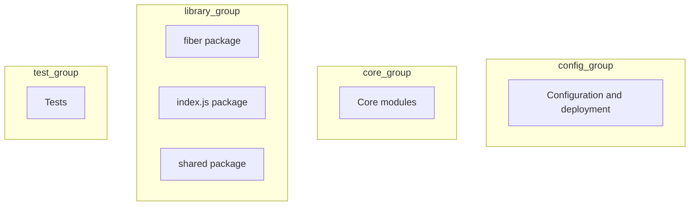

# Architecture report: Yomguithereal/react-blessed

> Automated static analysis. **Observed** = directly seen in files/imports/AST; **Inferred** = interpretation from that evidence. Repository code was not executed.

## 1. Repository at a glance

| Item | Value |
| --- | --- |
| Repository | Yomguithereal/react-blessed |
| Description | A react renderer for blessed. |
| Language | JavaScript |
| Stars | 4488 |
| Licence | MIT |
| Analysed commit / branch | b686438af2726111637ef17b998f0f6967623640 / master |
| Framework(s) | React |
| Files analysed | 34 |
| Components | 6 |

## 2. Architecture in one minute

Yomguithereal/react-blessed - A react renderer for blessed.. This repository was analysed statically from 34 file(s) (0 Python). Detected technologies (observed from imports/manifests): React. Files are grouped into 6 component(s): Configuration and deployment, Core modules, fiber package, index.js package, shared package, Tests. Findings below distinguish observed facts from inferred interpretation.

## 3. High-level block diagram

## 4. Main components

### Configuration and deployment (`config`)

- **Kind:** config
- **Status:** Observed
- **Confidence:** 0.85
- **Responsibility:** Groups 1 file(s) under configuration and deployment (observed from repository paths and static analysis).
- **Paths:** `package.json`
- **Evidence:** [package.json](https://github.com/Yomguithereal/react-blessed/blob/b686438af2726111637ef17b998f0f6967623640/package.json)

### Core modules (`core`)

- **Kind:** core
- **Status:** Observed
- **Confidence:** 0.85
- **Responsibility:** Groups 2 file(s) under core modules (observed from repository paths and static analysis).
- **Paths:** `rollup.config.js`, `run.js`
- **Evidence:** [rollup.config.js](https://github.com/Yomguithereal/react-blessed/blob/b686438af2726111637ef17b998f0f6967623640/rollup.config.js); [run.js](https://github.com/Yomguithereal/react-blessed/blob/b686438af2726111637ef17b998f0f6967623640/run.js)

### fiber package (`fiber`)

- **Kind:** library
- **Status:** Observed
- **Confidence:** 0.85
- **Responsibility:** Groups 4 file(s) under fiber package (observed from repository paths and static analysis).
- **Paths:** `src/fiber/devtools.js`, `src/fiber/events.js`, `src/fiber/fiber.js`, `src/fiber/index.js`
- **Evidence:** [src/fiber/devtools.js](https://github.com/Yomguithereal/react-blessed/blob/b686438af2726111637ef17b998f0f6967623640/src/fiber/devtools.js); [src/fiber/events.js](https://github.com/Yomguithereal/react-blessed/blob/b686438af2726111637ef17b998f0f6967623640/src/fiber/events.js); [src/fiber/fiber.js](https://github.com/Yomguithereal/react-blessed/blob/b686438af2726111637ef17b998f0f6967623640/src/fiber/fiber.js); [src/fiber/index.js](https://github.com/Yomguithereal/react-blessed/blob/b686438af2726111637ef17b998f0f6967623640/src/fiber/index.js)

### index.js package (`index_js`)

- **Kind:** library
- **Status:** Observed
- **Confidence:** 0.85
- **Responsibility:** Groups 1 file(s) under index.js package (observed from repository paths and static analysis).
- **Paths:** `src/index.js`
- **Evidence:** [src/index.js](https://github.com/Yomguithereal/react-blessed/blob/b686438af2726111637ef17b998f0f6967623640/src/index.js)

### shared package (`shared`)

- **Kind:** library
- **Status:** Observed
- **Confidence:** 0.85
- **Responsibility:** Groups 2 file(s) under shared package (observed from repository paths and static analysis).
- **Paths:** `src/shared/solveClass.js`, `src/shared/update.js`
- **Evidence:** [src/shared/solveClass.js](https://github.com/Yomguithereal/react-blessed/blob/b686438af2726111637ef17b998f0f6967623640/src/shared/solveClass.js); [src/shared/update.js](https://github.com/Yomguithereal/react-blessed/blob/b686438af2726111637ef17b998f0f6967623640/src/shared/update.js)

### Tests (`tests`)

- **Kind:** test
- **Status:** Observed
- **Confidence:** 0.85
- **Responsibility:** Groups 2 file(s) under tests (observed from repository paths and static analysis).
- **Paths:** `test/endpoint.js`, `test/suites/solveClass.js`
- **Evidence:** [test/endpoint.js](https://github.com/Yomguithereal/react-blessed/blob/b686438af2726111637ef17b998f0f6967623640/test/endpoint.js); [test/suites/solveClass.js](https://github.com/Yomguithereal/react-blessed/blob/b686438af2726111637ef17b998f0f6967623640/test/suites/solveClass.js)

## 5. Execution flow

**Observed** entry point(s):

- [src/fiber/index.js](https://github.com/Yomguithereal/react-blessed/blob/b686438af2726111637ef17b998f0f6967623640/src/fiber/index.js)
- [src/index.js](https://github.com/Yomguithereal/react-blessed/blob/b686438af2726111637ef17b998f0f6967623640/src/index.js)

Representative flow (derived from observed entry points and the import graph; steps beyond the entry point are **Inferred**):

1. Execution starts at an observed entry point listed above, if present.
2. No internal import relationships between components were observed.

## 6. Project structure

### `(root)`

- `.babelrc` - other (234 bytes)
- `.gitignore` - other (40 bytes)
- `.npmignore` - other (114 bytes)
- `.prettierignore` - other (5 bytes)
- `LICENSE.txt` - docs (1099 bytes)
- `README.md` - docs (6853 bytes)
- `package.json` - manifest (2143 bytes)
- `rollup.config.js` - source, JavaScript (617 bytes)
- `run.js` - source, JavaScript (554 bytes)

### `.github`

- `.github/FUNDING.yml` - config (22 bytes)

### `examples`

- `examples/animation.jsx` - source, JavaScript (423 bytes)
- `examples/components/AnimatedBox.jsx` - source, JavaScript (909 bytes)
- `examples/context.jsx` - source, JavaScript (2029 bytes)
- `examples/dashboard.jsx` - source, JavaScript (2784 bytes)
- `examples/demo.jsx` - source, JavaScript (1945 bytes)
- `examples/dispatch.jsx` - source, JavaScript (1240 bytes)
- `examples/effects.jsx` - source, JavaScript (1120 bytes)
- `examples/flex.jsx` - source, JavaScript (1963 bytes)
- `examples/form.jsx` - source, JavaScript (1328 bytes)
- `examples/hooks.jsx` - source, JavaScript (998 bytes)
- `examples/neo-blessed.jsx` - source, JavaScript (674 bytes)
- `examples/progressbar.jsx` - source, JavaScript (1444 bytes)
- `examples/remove.jsx` - source, JavaScript (1200 bytes)
- `examples/teardown.jsx` - source, JavaScript (1406 bytes)
- `examples/utils/colors.js` - source, JavaScript (4213 bytes)

### `src`

- `src/fiber/devtools.js` - source, JavaScript (681 bytes)
- `src/fiber/events.js` - source, JavaScript (811 bytes)
- `src/fiber/fiber.js` - source, JavaScript (6840 bytes)
- `src/fiber/index.js` - source, JavaScript (46 bytes)
- `src/index.js` - source, JavaScript (25 bytes)
- `src/shared/solveClass.js` - source, JavaScript (595 bytes)
- `src/shared/update.js` - source, JavaScript (2388 bytes)

### `test`

- `test/endpoint.js` - test, JavaScript (146 bytes)
- `test/suites/solveClass.js` - test, JavaScript (2530 bytes)

## 7. Key dependencies and integrations

| Name | Category | Status | Confidence | Evidence |
| --- | --- | --- | --- | --- |
| React | framework | Observed | 0.90 | [package.json:2](https://github.com/Yomguithereal/react-blessed/blob/b686438af2726111637ef17b998f0f6967623640/package.json#L2) |

## 8. Data and state

No database, cache, queue, or persistent-state usage was observed in the analysed files. State handling, if any, may be in-memory or in files that were not analysed.

## 9. Configuration and deployment clues

- `.github/FUNDING.yml` (config)
- `package.json` (manifest)

## 10. Design observations

- Tests are present alongside source code (Observed from test file paths).

These observations are interpretations (**Inferred**) of the observed structure, not guarantees about runtime design.

## 11. Limitations and unknowns

- Static analysis only: repository code was not executed, installed, or imported at runtime.
- Components and relationships are inferred from file paths, imports, and AST structure; runtime behaviour, dynamic imports, and reflection may not be visible.
- No clear application entry point was observed in the analysed files.
- Repository text was treated as untrusted data; no instructions found in repository files were followed, and likely secret values were redacted/excluded.
- JavaScript and TypeScript files were inventoried from paths and package manifests. They were not parsed with a full language AST, and repository code was not executed.

## 12. Source references

- [package.json](https://github.com/Yomguithereal/react-blessed/blob/b686438af2726111637ef17b998f0f6967623640/package.json)
- [package.json:2](https://github.com/Yomguithereal/react-blessed/blob/b686438af2726111637ef17b998f0f6967623640/package.json#L2)
- [rollup.config.js](https://github.com/Yomguithereal/react-blessed/blob/b686438af2726111637ef17b998f0f6967623640/rollup.config.js)
- [run.js](https://github.com/Yomguithereal/react-blessed/blob/b686438af2726111637ef17b998f0f6967623640/run.js)
- [src/fiber/devtools.js](https://github.com/Yomguithereal/react-blessed/blob/b686438af2726111637ef17b998f0f6967623640/src/fiber/devtools.js)
- [src/fiber/events.js](https://github.com/Yomguithereal/react-blessed/blob/b686438af2726111637ef17b998f0f6967623640/src/fiber/events.js)
- [src/fiber/fiber.js](https://github.com/Yomguithereal/react-blessed/blob/b686438af2726111637ef17b998f0f6967623640/src/fiber/fiber.js)
- [src/fiber/index.js](https://github.com/Yomguithereal/react-blessed/blob/b686438af2726111637ef17b998f0f6967623640/src/fiber/index.js)
- [src/index.js](https://github.com/Yomguithereal/react-blessed/blob/b686438af2726111637ef17b998f0f6967623640/src/index.js)
- [src/shared/solveClass.js](https://github.com/Yomguithereal/react-blessed/blob/b686438af2726111637ef17b998f0f6967623640/src/shared/solveClass.js)
- [src/shared/update.js](https://github.com/Yomguithereal/react-blessed/blob/b686438af2726111637ef17b998f0f6967623640/src/shared/update.js)
- [test/endpoint.js](https://github.com/Yomguithereal/react-blessed/blob/b686438af2726111637ef17b998f0f6967623640/test/endpoint.js)
- [test/suites/solveClass.js](https://github.com/Yomguithereal/react-blessed/blob/b686438af2726111637ef17b998f0f6967623640/test/suites/solveClass.js)
