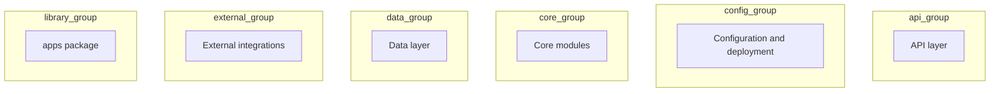

# Architecture report: Yooooomi/your_spotify

> Automated static analysis. **Observed** = directly seen in files/imports/AST; **Inferred** = interpretation from that evidence. Repository code was not executed.

## 1. Repository at a glance

| Item | Value |
| --- | --- |
| Repository | Yooooomi/your_spotify |
| Description | Self hosted Spotify tracking dashboard |
| Language | TypeScript |
| Stars | 4630 |
| Licence | GPL-3.0 |
| Analysed commit / branch | fdd81ef89119159eac375fa2422d83e1765cff5e / master |
| Framework(s) | Express, React |
| Files analysed | 515 |
| Components | 6 |

## 2. Architecture in one minute

Yooooomi/your_spotify - Self hosted Spotify tracking dashboard. This repository was analysed statically from 515 file(s) (0 Python). Detected technologies (observed from imports/manifests): GitHub Actions, MongoDB, Express, React, axios, React Router. Files are grouped into 6 component(s): API layer, apps package, Configuration and deployment, Core modules, Data layer, External integrations. Findings below distinguish observed facts from inferred interpretation.

## 3. High-level block diagram

## 4. Main components

### API layer (`api_layer`)

- **Kind:** api
- **Status:** Observed
- **Confidence:** 0.85
- **Responsibility:** Groups 10 file(s) under api layer (observed from repository paths and static analysis).
- **Paths:** `apps/server/src/routes/album.ts`, `apps/server/src/routes/artist.ts`, `apps/server/src/routes/global.ts`, `apps/server/src/routes/importer.ts`, `apps/server/src/routes/index.ts`, `apps/server/src/routes/metrics.ts`, `apps/server/src/routes/oauth.ts`, `apps/server/src/routes/search.ts`, `apps/server/src/routes/spotify.ts`, `apps/server/src/routes/track.ts`
- **Evidence:** [apps/server/src/routes/album.ts](https://github.com/Yooooomi/your_spotify/blob/fdd81ef89119159eac375fa2422d83e1765cff5e/apps/server/src/routes/album.ts); [apps/server/src/routes/artist.ts](https://github.com/Yooooomi/your_spotify/blob/fdd81ef89119159eac375fa2422d83e1765cff5e/apps/server/src/routes/artist.ts); [apps/server/src/routes/global.ts](https://github.com/Yooooomi/your_spotify/blob/fdd81ef89119159eac375fa2422d83e1765cff5e/apps/server/src/routes/global.ts); [apps/server/src/routes/importer.ts](https://github.com/Yooooomi/your_spotify/blob/fdd81ef89119159eac375fa2422d83e1765cff5e/apps/server/src/routes/importer.ts); [apps/server/src/routes/index.ts](https://github.com/Yooooomi/your_spotify/blob/fdd81ef89119159eac375fa2422d83e1765cff5e/apps/server/src/routes/index.ts); [apps/server/src/routes/metrics.ts](https://github.com/Yooooomi/your_spotify/blob/fdd81ef89119159eac375fa2422d83e1765cff5e/apps/server/src/routes/metrics.ts); [apps/server/src/routes/oauth.ts](https://github.com/Yooooomi/your_spotify/blob/fdd81ef89119159eac375fa2422d83e1765cff5e/apps/server/src/routes/oauth.ts); [apps/server/src/routes/search.ts](https://github.com/Yooooomi/your_spotify/blob/fdd81ef89119159eac375fa2422d83e1765cff5e/apps/server/src/routes/search.ts)

### apps package (`apps`)

- **Kind:** library
- **Status:** Observed
- **Confidence:** 0.85
- **Responsibility:** Groups 50 file(s) under apps package (observed from repository paths and static analysis).
- **Paths:** `apps/server/rsbuild.config.ts`, `apps/server/scripts/run/deprecated.sh`, `apps/server/scripts/run/run.sh`, `apps/server/scripts/run/run_dev.sh`, `apps/server/src/app.ts`, `apps/server/src/bin/www.ts`, `apps/server/src/index.ts`, `apps/server/src/migrations.ts`, `apps/server/src/migrations/1618162835253-add_global_preferences.ts`, `apps/server/src/migrations/1620176626899-add_nb_elements.ts`, `apps/server/src/migrations/1620235555105-add_best_metric_type.ts`, `apps/server/src/migrations/1645792294977-spotify_auth.ts`, `apps/server/src/migrations/1645792294980-admins.ts`, `apps/server/src/migrations/1645792294981-darkmode.ts`, `apps/server/src/migrations/1645792294982-fix_first_listened_at.ts`, `apps/server/src/migrations/1708973485300-create_private_data.ts`, `apps/server/src/migrations/1708973485301-add_metadata_to_infos.ts`, `apps/server/src/migrations/1708973485302-add_language_to_user.ts`, `apps/server/src/spotify/dbTools.ts`, `apps/server/src/spotify/looper.ts`, `apps/server/src/tools/apis/githubApi.ts`, `apps/server/src/tools/apis/queueHttpClient.ts`, `apps/server/src/tools/apis/queuedHttpClient.providers.ts`, `apps/server/src/tools/apis/spotifyApi.ts`, `apps/server/src/tools/constants.ts`, `apps/server/src/tools/crypto.ts`, `apps/server/src/tools/database.ts`, `apps/server/src/tools/date.ts`, `apps/server/src/tools/env.ts`, `apps/server/src/tools/errors/Database.ts`, `apps/server/src/tools/errors/error.ts`, `apps/server/src/tools/importers/cache.ts`, `apps/server/src/tools/importers/full_privacy.ts`, `apps/server/src/tools/importers/importer.ts`, `apps/server/src/tools/importers/privacy.ts`, `apps/server/src/tools/importers/types.ts`, `apps/server/src/tools/lock.ts`, `apps/server/src/tools/logger.ts`, `apps/server/src/tools/metrics.ts`, `apps/server/src/tools/middleware.ts`, `apps/server/src/tools/migrations.ts`, `apps/server/src/tools/misc.ts`, `apps/server/src/tools/oauth/Provider.ts`, `apps/server/src/tools/oauth/credentials.ts`, `apps/server/src/tools/types.ts`, `apps/server/src/tools/types/express.d.ts`, `apps/server/src/tools/user.ts`, `apps/server/src/tools/utils.ts`, `apps/server/src/tools/version.ts`, `apps/server/src/tools/zod.ts`
- **Evidence:** [apps/server/rsbuild.config.ts](https://github.com/Yooooomi/your_spotify/blob/fdd81ef89119159eac375fa2422d83e1765cff5e/apps/server/rsbuild.config.ts); [apps/server/scripts/run/deprecated.sh](https://github.com/Yooooomi/your_spotify/blob/fdd81ef89119159eac375fa2422d83e1765cff5e/apps/server/scripts/run/deprecated.sh); [apps/server/scripts/run/run.sh](https://github.com/Yooooomi/your_spotify/blob/fdd81ef89119159eac375fa2422d83e1765cff5e/apps/server/scripts/run/run.sh); [apps/server/scripts/run/run_dev.sh](https://github.com/Yooooomi/your_spotify/blob/fdd81ef89119159eac375fa2422d83e1765cff5e/apps/server/scripts/run/run_dev.sh); [apps/server/src/app.ts](https://github.com/Yooooomi/your_spotify/blob/fdd81ef89119159eac375fa2422d83e1765cff5e/apps/server/src/app.ts); [apps/server/src/bin/www.ts](https://github.com/Yooooomi/your_spotify/blob/fdd81ef89119159eac375fa2422d83e1765cff5e/apps/server/src/bin/www.ts); [apps/server/src/index.ts](https://github.com/Yooooomi/your_spotify/blob/fdd81ef89119159eac375fa2422d83e1765cff5e/apps/server/src/index.ts); [apps/server/src/migrations.ts](https://github.com/Yooooomi/your_spotify/blob/fdd81ef89119159eac375fa2422d83e1765cff5e/apps/server/src/migrations.ts)

### Configuration and deployment (`config`)

- **Kind:** config
- **Status:** Observed
- **Confidence:** 0.85
- **Responsibility:** Groups 20 file(s) under configuration and deployment (observed from repository paths and static analysis).
- **Paths:** `Dockerfile.client`, `Dockerfile.client.production`, `Dockerfile.server`, `Dockerfile.server.production`, `apps/client/package.json`, `apps/client/public/manifest.json`, `apps/client/scripts/run/serve.json`, `apps/client/tsconfig.json`, `apps/dev/.oxfmtrc.json`, `apps/dev/.oxlintrc.json`, `apps/dev/package.json`, `apps/dev/tsconfig.json`, `apps/server/.dockerignore`, `apps/server/package.json`, `apps/server/tsconfig.json`, `docker-compose-dev.yml`, `docker-compose-example.yml`, `docker-compose-prod.yml`, `package.json`, `pnpm-workspace.yaml`
- **Evidence:** [Dockerfile.client](https://github.com/Yooooomi/your_spotify/blob/fdd81ef89119159eac375fa2422d83e1765cff5e/Dockerfile.client); [Dockerfile.client.production](https://github.com/Yooooomi/your_spotify/blob/fdd81ef89119159eac375fa2422d83e1765cff5e/Dockerfile.client.production); [Dockerfile.server](https://github.com/Yooooomi/your_spotify/blob/fdd81ef89119159eac375fa2422d83e1765cff5e/Dockerfile.server); [Dockerfile.server.production](https://github.com/Yooooomi/your_spotify/blob/fdd81ef89119159eac375fa2422d83e1765cff5e/Dockerfile.server.production); [apps/client/package.json](https://github.com/Yooooomi/your_spotify/blob/fdd81ef89119159eac375fa2422d83e1765cff5e/apps/client/package.json); [apps/client/public/manifest.json](https://github.com/Yooooomi/your_spotify/blob/fdd81ef89119159eac375fa2422d83e1765cff5e/apps/client/public/manifest.json); [apps/client/scripts/run/serve.json](https://github.com/Yooooomi/your_spotify/blob/fdd81ef89119159eac375fa2422d83e1765cff5e/apps/client/scripts/run/serve.json); [apps/client/tsconfig.json](https://github.com/Yooooomi/your_spotify/blob/fdd81ef89119159eac375fa2422d83e1765cff5e/apps/client/tsconfig.json)

### Core modules (`core`)

- **Kind:** core
- **Status:** Observed
- **Confidence:** 0.85
- **Responsibility:** Groups 3 file(s) under core modules (observed from repository paths and static analysis).
- **Paths:** `build.sh`, `dev.sh`, `prod.sh`
- **Evidence:** [build.sh](https://github.com/Yooooomi/your_spotify/blob/fdd81ef89119159eac375fa2422d83e1765cff5e/build.sh); [dev.sh](https://github.com/Yooooomi/your_spotify/blob/fdd81ef89119159eac375fa2422d83e1765cff5e/dev.sh); [prod.sh](https://github.com/Yooooomi/your_spotify/blob/fdd81ef89119159eac375fa2422d83e1765cff5e/prod.sh)

### Data layer (`data_layer`)

- **Kind:** data
- **Status:** Observed
- **Confidence:** 0.85
- **Responsibility:** Groups 25 file(s) under data layer (observed from repository paths and static analysis).
- **Paths:** `apps/server/src/database/Models.ts`, `apps/server/src/database/index.ts`, `apps/server/src/database/queries/album.ts`, `apps/server/src/database/queries/artist.ts`, `apps/server/src/database/queries/collaborative.ts`, `apps/server/src/database/queries/global.ts`, `apps/server/src/database/queries/importer.ts`, `apps/server/src/database/queries/meta.ts`, `apps/server/src/database/queries/meta.types.ts`, `apps/server/src/database/queries/privateData.ts`, `apps/server/src/database/queries/stats.ts`, `apps/server/src/database/queries/statsTools.ts`, `apps/server/src/database/queries/tools.ts`, `apps/server/src/database/queries/track.ts`, `apps/server/src/database/queries/user.ts`, `apps/server/src/database/schemas/album.ts`, `apps/server/src/database/schemas/artist.ts`, `apps/server/src/database/schemas/globalPreference.ts`, `apps/server/src/database/schemas/import.ts`, `apps/server/src/database/schemas/info.ts`, `apps/server/src/database/schemas/migration.ts`, `apps/server/src/database/schemas/privateData.ts`, `apps/server/src/database/schemas/track.ts`, `apps/server/src/database/schemas/types.ts`, `apps/server/src/database/schemas/user.ts`
- **Evidence:** [apps/server/src/database/Models.ts](https://github.com/Yooooomi/your_spotify/blob/fdd81ef89119159eac375fa2422d83e1765cff5e/apps/server/src/database/Models.ts); [apps/server/src/database/index.ts](https://github.com/Yooooomi/your_spotify/blob/fdd81ef89119159eac375fa2422d83e1765cff5e/apps/server/src/database/index.ts); [apps/server/src/database/queries/album.ts](https://github.com/Yooooomi/your_spotify/blob/fdd81ef89119159eac375fa2422d83e1765cff5e/apps/server/src/database/queries/album.ts); [apps/server/src/database/queries/artist.ts](https://github.com/Yooooomi/your_spotify/blob/fdd81ef89119159eac375fa2422d83e1765cff5e/apps/server/src/database/queries/artist.ts); [apps/server/src/database/queries/collaborative.ts](https://github.com/Yooooomi/your_spotify/blob/fdd81ef89119159eac375fa2422d83e1765cff5e/apps/server/src/database/queries/collaborative.ts); [apps/server/src/database/queries/global.ts](https://github.com/Yooooomi/your_spotify/blob/fdd81ef89119159eac375fa2422d83e1765cff5e/apps/server/src/database/queries/global.ts); [apps/server/src/database/queries/importer.ts](https://github.com/Yooooomi/your_spotify/blob/fdd81ef89119159eac375fa2422d83e1765cff5e/apps/server/src/database/queries/importer.ts); [apps/server/src/database/queries/meta.ts](https://github.com/Yooooomi/your_spotify/blob/fdd81ef89119159eac375fa2422d83e1765cff5e/apps/server/src/database/queries/meta.ts)

### External integrations (`external_integrations`)

- **Kind:** external
- **Status:** Observed
- **Confidence:** 0.85
- **Responsibility:** Groups 309 file(s) under external integrations (observed from repository paths and static analysis).
- **Paths:** `apps/client/css.js`, `apps/client/public/variables-template.js`, `apps/client/public/variables.js`, `apps/client/rsbuild.config.ts`, `apps/client/scripts/run/run.sh`, `apps/client/scripts/run/run_dev.sh`, `apps/client/scripts/run/serve.sh`, `apps/client/scripts/run/variables.sh`, `apps/client/src/App.tsx`, `apps/client/src/components/AddToPlaylist/AddToPlaylist.tsx`, `apps/client/src/components/AddToPlaylist/index.ts`, `apps/client/src/components/BackgroundCard/BackgroundCard.tsx`, `apps/client/src/components/BackgroundCard/index.ts`, `apps/client/src/components/BlacklistArtistDialog/BlacklistArtistDialog.tsx`, `apps/client/src/components/BlacklistArtistDialog/index.ts`, `apps/client/src/components/ButtonsHeader/ButtonsHeader.tsx`, `apps/client/src/components/ButtonsHeader/index.ts`, `apps/client/src/components/Card/Card.tsx`, `apps/client/src/components/Card/index.ts`, `apps/client/src/components/ChartCard/ChartCard.tsx`, `apps/client/src/components/ChartCard/index.ts`, `apps/client/src/components/CheckboxWithText/CheckboxWithText.tsx`, `apps/client/src/components/CheckboxWithText/index.ts`, `apps/client/src/components/Dialog/Dialog.tsx`, `apps/client/src/components/Dialog/index.ts`, `apps/client/src/components/FullscreenCentered/FullscreenCentered.tsx`, `apps/client/src/components/FullscreenCentered/index.ts`, `apps/client/src/components/Grid/Grid.tsx`, `apps/client/src/components/Grid/commonUnits.ts`, `apps/client/src/components/Grid/index.ts`, `apps/client/src/components/Header/Header.tsx`, `apps/client/src/components/Header/index.ts`, `apps/client/src/components/History/History.tsx`, `apps/client/src/components/History/Track/Track.tsx`, `apps/client/src/components/History/Track/TrackGrid.ts`, `apps/client/src/components/History/Track/TrackHeader.tsx`, `apps/client/src/components/History/Track/TrackSelectionPopup.tsx`, `apps/client/src/components/History/Track/index.ts`, `apps/client/src/components/History/index.ts`, `apps/client/src/components/IdealImage/IdealImage.tsx`, `apps/client/src/components/IdealImage/index.ts`, `apps/client/src/components/ImageTwoLines/ImageTwoLines.tsx`, `apps/client/src/components/ImageTwoLines/index.ts`, `apps/client/src/components/ImplementedCards/ArtistsListened/ArtistsListened.tsx`, `apps/client/src/components/ImplementedCards/ArtistsListened/index.ts`, `apps/client/src/components/ImplementedCards/BestArtist/BestArtist.tsx`, `apps/client/src/components/ImplementedCards/BestArtist/index.ts`, `apps/client/src/components/ImplementedCards/BestSong/BestSong.tsx`, `apps/client/src/components/ImplementedCards/BestSong/index.ts`, `apps/client/src/components/ImplementedCards/SongsListened/SongsListened.tsx`, `apps/client/src/components/ImplementedCards/SongsListened/index.ts`, `apps/client/src/components/ImplementedCards/TimeListened/TimeListened.tsx`, `apps/client/src/components/ImplementedCards/TimeListened/index.ts`, `apps/client/src/components/ImplementedCards/types.ts`, `apps/client/src/components/ImplementedCharts/ArtistListeningRepartition/ArtistListeningRepartition.tsx`, `apps/client/src/components/ImplementedCharts/ArtistListeningRepartition/index.ts`, `apps/client/src/components/ImplementedCharts/AverageAlbumReleaseDate/AverageAlbumReleaseDate.tsx`, `apps/client/src/components/ImplementedCharts/AverageAlbumReleaseDate/index.ts`, `apps/client/src/components/ImplementedCharts/AverageNumberArtistPer/AverageNumberArtistPer.tsx`, `apps/client/src/components/ImplementedCharts/AverageNumberArtistPer/index.ts`, `apps/client/src/components/ImplementedCharts/BestArtistsBar/BestArtistsBar.tsx`, `apps/client/src/components/ImplementedCharts/BestArtistsBar/index.ts`, `apps/client/src/components/ImplementedCharts/BestOfHour/BestOfHour.tsx`, `apps/client/src/components/ImplementedCharts/BestOfHour/index.ts`, `apps/client/src/components/ImplementedCharts/DifferentArtistListenedPer/DifferentArtistsListenedPer.tsx`, `apps/client/src/components/ImplementedCharts/DifferentArtistListenedPer/index.ts`, `apps/client/src/components/ImplementedCharts/ListeningRepartition/ListeningRepartition.tsx`, `apps/client/src/components/ImplementedCharts/ListeningRepartition/index.ts`, `apps/client/src/components/ImplementedCharts/LoadingImplementedChart/LoadingImplementedChart.tsx`, `apps/client/src/components/ImplementedCharts/LoadingImplementedChart/index.ts`, `apps/client/src/components/ImplementedCharts/SongsListenedPer/SongsListenedPer.tsx`, `apps/client/src/components/ImplementedCharts/SongsListenedPer/index.ts`, `apps/client/src/components/ImplementedCharts/TimeListenedPer/TimeListenedPer.tsx`, `apps/client/src/components/ImplementedCharts/TimeListenedPer/index.ts`, `apps/client/src/components/ImplementedCharts/types.ts`, `apps/client/src/components/InlineAlbum/InlineAlbum.tsx`, `apps/client/src/components/InlineAlbum/index.ts`, `apps/client/src/components/InlineArtist/InlineArtist.tsx`, `apps/client/src/components/InlineArtist/index.ts`, `apps/client/src/components/InlineTrack/InlineTrack.tsx`, `apps/client/src/components/InlineTrack/index.ts`, `apps/client/src/components/IntervalSelector/IntervalSelector.tsx`, `apps/client/src/components/IntervalSelector/RangePicker/RangePicker.tsx`, `apps/client/src/components/IntervalSelector/RangePicker/index.ts`, `apps/client/src/components/IntervalSelector/index.ts`, `apps/client/src/components/Layout/Layout.tsx`, `apps/client/src/components/Layout/LayoutContext.ts`, `apps/client/src/components/Layout/Sider/Sider.tsx`, `apps/client/src/components/Layout/Sider/SiderCategory/SiderCategory.tsx`, `apps/client/src/components/Layout/Sider/SiderCategory/index.ts`, `apps/client/src/components/Layout/Sider/SiderTitle/SiderTitle.tsx`, `apps/client/src/components/Layout/Sider/SiderTitle/index.ts`, `apps/client/src/components/Layout/Sider/index.ts`, `apps/client/src/components/Layout/Sider/types.tsx`, `apps/client/src/components/Layout/Sider/useLinks.tsx`, `apps/client/src/components/Layout/index.ts`, `apps/client/src/components/Layout/useSider.ts`, `apps/client/src/components/Loader/Loader.tsx`, `apps/client/src/components/Loader/index.ts`, `apps/client/src/components/LoadingButton/LoadingButton.tsx`, `apps/client/src/components/LoadingButton/index.ts`, `apps/client/src/components/LongClickableTrack/LongClickableTrack.tsx`, `apps/client/src/components/LongClickableTrack/index.ts`, `apps/client/src/components/Masonry/Masonry.tsx`, `apps/client/src/components/Masonry/index.ts`, `apps/client/src/components/MenuTitle/MenuTitle.tsx`, `apps/client/src/components/Message/Message.tsx`, `apps/client/src/components/Message/index.ts`, `apps/client/src/components/PlayButton/PlayButton.tsx`, `apps/client/src/components/PlayButton/index.ts`, `apps/client/src/components/PlaylistDialog/CountChooser/CountChooser.tsx`, `apps/client/src/components/PlaylistDialog/CountChooser/index.ts`, `apps/client/src/components/PlaylistDialog/PlaylistDialog.tsx`, `apps/client/src/components/PlaylistDialog/index.ts`, `apps/client/src/components/PrivateRoute/PrivateRoute.tsx`, `apps/client/src/components/PrivateRoute/index.ts`, `apps/client/src/components/RightClickable/RightClickable.tsx`, `apps/client/src/components/Selectable/Selectable.context.tsx`, `apps/client/src/components/SiderSearch/SiderSearch.tsx`, `apps/client/src/components/SiderSearch/index.ts`, `apps/client/src/components/SiderSearch/searchPaper/searchPaper.tsx`, `apps/client/src/components/SiderSearch/searchPaper/section/section.tsx`, `apps/client/src/components/SimpleDialogContent/SimpleDialogContent.tsx`, `apps/client/src/components/SimpleDialogContent/index.ts`, `apps/client/src/components/TabPanel/TabPanel.tsx`, `apps/client/src/components/TabPanel/index.ts`, `apps/client/src/components/Text/Text.tsx`, `apps/client/src/components/Text/index.ts`, `apps/client/src/components/ThreePoints/ThreePoints.tsx`, `apps/client/src/components/ThreePoints/index.ts`, `apps/client/src/components/TitleCard/TitleCard.tsx`, `apps/client/src/components/TitleCard/index.ts`, `apps/client/src/components/Tooltip/Tooltip.tsx`, `apps/client/src/components/Tooltip/index.ts`, `apps/client/src/components/TrackOptions/TrackOptions.tsx`, `apps/client/src/components/TrackOptions/index.ts`, `apps/client/src/components/TrackOptionsContent/TrackOptionsContent.tsx`, `apps/client/src/components/TrackOptionsContent/index.ts`, `apps/client/src/components/Wrapper/Wrapper.tsx`, `apps/client/src/components/Wrapper/index.ts`, `apps/client/src/components/autoHeight/autoHeight.tsx`, `apps/client/src/components/charts/Bar/Bar.tsx`, `apps/client/src/components/charts/Bar/index.ts`, `apps/client/src/components/charts/Line/Line.tsx`, `apps/client/src/components/charts/Line/index.ts`, `apps/client/src/components/charts/StackedBar/StackedBar.tsx`, `apps/client/src/components/charts/StackedBar/index.ts`, `apps/client/src/components/iTooltip/iTooltip.tsx`, `apps/client/src/components/shortcut/shortcut.tsx`, `apps/client/src/components/ui/MenuItem/MenuItem.tsx`, `apps/client/src/index.tsx`, `apps/client/src/scenes/Account/Login/Login.tsx`, `apps/client/src/scenes/Account/Login/index.ts`, `apps/client/src/scenes/AlbumStats/AlbumRank/AlbumRank.tsx`, `apps/client/src/scenes/AlbumStats/AlbumRank/index.ts`, `apps/client/src/scenes/AlbumStats/AlbumStats.tsx`, `apps/client/src/scenes/AlbumStats/AlbumStatsWrapper.tsx`, `apps/client/src/scenes/AlbumStats/index.ts`, `apps/client/src/scenes/AllStats/AllStats.tsx`, `apps/client/src/scenes/AllStats/index.ts`, `apps/client/src/scenes/ArtistStats/ArtistContextMenu/ArtistContextMenu.tsx`, `apps/client/src/scenes/ArtistStats/ArtistContextMenu/index.ts`, `apps/client/src/scenes/ArtistStats/ArtistRank/ArtistRank.tsx`, `apps/client/src/scenes/ArtistStats/ArtistRank/index.ts`, `apps/client/src/scenes/ArtistStats/ArtistStats.tsx`, `apps/client/src/scenes/ArtistStats/ArtistStatsWrapper.tsx`, `apps/client/src/scenes/ArtistStats/DayRepartition/DayRepartition.tsx`, `apps/client/src/scenes/ArtistStats/DayRepartition/index.ts`, `apps/client/src/scenes/ArtistStats/FirstAndLast/FirstAndLast.tsx`, `apps/client/src/scenes/ArtistStats/FirstAndLast/index.ts`, `apps/client/src/scenes/ArtistStats/index.ts`, `apps/client/src/scenes/ArtistStats/mostListenedTracksContextMenuButton/mostListenedTracksContextMenuButton.tsx`, `apps/client/src/scenes/Benchmarks/Benchmarks.tsx`, `apps/client/src/scenes/Benchmarks/index.ts`, `apps/client/src/scenes/Collaborative/Affinity/Affinity.tsx`, `apps/client/src/scenes/Collaborative/Affinity/Albums/Albums.tsx`, `apps/client/src/scenes/Collaborative/Affinity/Albums/index.ts`, `apps/client/src/scenes/Collaborative/Affinity/Artists/Artists.tsx`, `apps/client/src/scenes/Collaborative/Affinity/Artists/index.ts`, `apps/client/src/scenes/Collaborative/Affinity/Songs/Songs.tsx`, `apps/client/src/scenes/Collaborative/Affinity/Songs/index.ts`, `apps/client/src/scenes/Collaborative/Affinity/index.ts`, `apps/client/src/scenes/Collaborative/Affinity/types.ts`, `apps/client/src/scenes/Error/ApiEndpointSetToFronted/ApiEndpointSetToFrontend.tsx`, `apps/client/src/scenes/Error/ApiEndpointSetToFronted/index.ts`, `apps/client/src/scenes/Error/RegistrationsDisabled/RegistrationsDisabled.tsx`, `apps/client/src/scenes/Error/RegistrationsDisabled/index.ts`, `apps/client/src/scenes/Home/Home.tsx`, `apps/client/src/scenes/Home/index.ts`, `apps/client/src/scenes/Logout/Logout.tsx`, `apps/client/src/scenes/Logout/index.ts`, `apps/client/src/scenes/LongestSessions/LongestSession/LongestSession.tsx`, `apps/client/src/scenes/LongestSessions/LongestSession/index.ts`, `apps/client/src/scenes/LongestSessions/LongestSessions.tsx`, `apps/client/src/scenes/LongestSessions/index.ts`, `apps/client/src/scenes/Settings/AccountInfos/AccountInfos.tsx`, `apps/client/src/scenes/Settings/AccountInfos/index.ts`, `apps/client/src/scenes/Settings/AllowRegistration/AllowRegistration.tsx`, `apps/client/src/scenes/Settings/AllowRegistration/index.ts`, `apps/client/src/scenes/Settings/BlacklistArtist/BlacklistArtist.tsx`, `apps/client/src/scenes/Settings/BlacklistArtist/index.ts`, `apps/client/src/scenes/Settings/DarkMode/DarkMode.tsx`, `apps/client/src/scenes/Settings/DarkMode/DarkModeSwitch/DarkModeSwitch.tsx`, `apps/client/src/scenes/Settings/DarkMode/DarkModeSwitch/index.ts`, `apps/client/src/scenes/Settings/DarkMode/index.ts`, `apps/client/src/scenes/Settings/DateFormat/DateFormat.tsx`, `apps/client/src/scenes/Settings/DateFormat/dateFormats.ts`, `apps/client/src/scenes/Settings/DateFormat/index.ts`, `apps/client/src/scenes/Settings/DeleteUser/DeleteUser.tsx`, `apps/client/src/scenes/Settings/DeleteUser/index.ts`, `apps/client/src/scenes/Settings/EnableAffinity/EnableAffinity.tsx`, `apps/client/src/scenes/Settings/EnableAffinity/index.ts`, `apps/client/src/scenes/Settings/Importer/FullPrivacy/FullPrivacy.tsx`, `apps/client/src/scenes/Settings/Importer/FullPrivacy/index.ts`, `apps/client/src/scenes/Settings/Importer/ImportHistory/ImportHistory.tsx`, `apps/client/src/scenes/Settings/Importer/ImportHistory/index.ts`, `apps/client/src/scenes/Settings/Importer/Importer.tsx`, `apps/client/src/scenes/Settings/Importer/Privacy/Privacy.tsx`, `apps/client/src/scenes/Settings/Importer/Privacy/index.ts`, `apps/client/src/scenes/Settings/Importer/index.ts`, `apps/client/src/scenes/Settings/PublicToken/PublicToken.tsx`, `apps/client/src/scenes/Settings/PublicToken/index.ts`, `apps/client/src/scenes/Settings/RelogToSpotify/RelogToSpotify.tsx`, `apps/client/src/scenes/Settings/RelogToSpotify/index.ts`, `apps/client/src/scenes/Settings/SetAdmin/SetAdmin.tsx`, `apps/client/src/scenes/Settings/SetAdmin/index.ts`, `apps/client/src/scenes/Settings/SettingLine/SettingLine.tsx`, `apps/client/src/scenes/Settings/SettingLine/index.ts`, `apps/client/src/scenes/Settings/Settings.tsx`, `apps/client/src/scenes/Settings/SpotifyAccountInfos/SpotifyAccountInfos.tsx`, `apps/client/src/scenes/Settings/SpotifyAccountInfos/index.ts`, `apps/client/src/scenes/Settings/StatMeasurement/StatMeasurement.tsx`, `apps/client/src/scenes/Settings/StatMeasurement/index.ts`, `apps/client/src/scenes/Settings/Timezone/Timezone.tsx`, `apps/client/src/scenes/Settings/Timezone/index.ts`, `apps/client/src/scenes/Settings/Timezone/timezones.ts`, `apps/client/src/scenes/Settings/index.ts`, `apps/client/src/scenes/Tops/Albums/Album/Album.tsx`, `apps/client/src/scenes/Tops/Albums/Album/AlbumGrid.ts`, `apps/client/src/scenes/Tops/Albums/Album/AlbumHeader.tsx`, `apps/client/src/scenes/Tops/Albums/Album/index.ts`, `apps/client/src/scenes/Tops/Albums/Albums.tsx`, `apps/client/src/scenes/Tops/Albums/index.ts`, `apps/client/src/scenes/Tops/Artists/Artist/Artist.tsx`, `apps/client/src/scenes/Tops/Artists/Artist/ArtistGrid.ts`, `apps/client/src/scenes/Tops/Artists/Artist/ArtistHeader.tsx`, `apps/client/src/scenes/Tops/Artists/Artist/index.ts`, `apps/client/src/scenes/Tops/Artists/Artists.tsx`, `apps/client/src/scenes/Tops/Artists/index.ts`, `apps/client/src/scenes/Tops/Songs/Songs.tsx`, `apps/client/src/scenes/Tops/Songs/Track/Track.tsx`, `apps/client/src/scenes/Tops/Songs/Track/TrackGrid.ts`, `apps/client/src/scenes/Tops/Songs/Track/TrackHeader.tsx`, `apps/client/src/scenes/Tops/Songs/Track/index.ts`, `apps/client/src/scenes/Tops/Songs/index.ts`, `apps/client/src/scenes/TrackStats/FirstAndLast/FirstAndLast.tsx`, `apps/client/src/scenes/TrackStats/FirstAndLast/index.ts`, `apps/client/src/scenes/TrackStats/TrackRank/TrackRank.tsx`, `apps/client/src/scenes/TrackStats/TrackRank/index.ts`, `apps/client/src/scenes/TrackStats/TrackStats.tsx`, `apps/client/src/scenes/TrackStats/TrackStatsWrapper.tsx`, `apps/client/src/scenes/TrackStats/index.ts`, `apps/client/src/services/apis/api.ts`, `apps/client/src/services/chart.tsx`, `apps/client/src/services/colors.ts`, `apps/client/src/services/date.ts`, `apps/client/src/services/hooks/artist.ts`, `apps/client/src/services/hooks/hooks.ts`, `apps/client/src/services/hooks/scrolling.ts`, `apps/client/src/services/hooks/useKey.ts`, `apps/client/src/services/hooks/useKeyNavigation.ts`, `apps/client/src/services/hooks/useMousePosition.ts`, `apps/client/src/services/hooks/useNavigate.ts`, `apps/client/src/services/hooks/useSelectTrack.ts`, `apps/client/src/services/html.ts`, `apps/client/src/services/intervals.ts`, `apps/client/src/services/pointer.ts`, `apps/client/src/services/redux/index.ts`, `apps/client/src/services/redux/modules/admin/reducer.ts`, `apps/client/src/services/redux/modules/admin/selector.ts`, `apps/client/src/services/redux/modules/admin/thunk.ts`, `apps/client/src/services/redux/modules/import/reducer.ts`, `apps/client/src/services/redux/modules/import/selector.ts`, `apps/client/src/services/redux/modules/import/thunk.ts`, `apps/client/src/services/redux/modules/import/types.ts`, `apps/client/src/services/redux/modules/message/reducer.ts`, `apps/client/src/services/redux/modules/message/selector.ts`, `apps/client/src/services/redux/modules/playlist/reducer.ts`, `apps/client/src/services/redux/modules/playlist/selector.ts`, `apps/client/src/services/redux/modules/playlist/thunk.ts`, `apps/client/src/services/redux/modules/playlist/types.ts`, `apps/client/src/services/redux/modules/settings/reducer.ts`, `apps/client/src/services/redux/modules/settings/selector.ts`, `apps/client/src/services/redux/modules/settings/thunk.ts`, `apps/client/src/services/redux/modules/user/reducer.ts`, `apps/client/src/services/redux/modules/user/selector.ts`, `apps/client/src/services/redux/modules/user/thunk.ts`, `apps/client/src/services/redux/modules/user/types.ts`, `apps/client/src/services/redux/modules/user/utils.ts`, `apps/client/src/services/redux/tools.ts`, `apps/client/src/services/shortcuts.tsx`, `apps/client/src/services/stats.ts`, `apps/client/src/services/storage.ts`, `apps/client/src/services/theme.ts`, `apps/client/src/services/tools.ts`, `apps/client/src/services/track.ts`, `apps/client/src/services/types.ts`, `apps/client/src/services/user.ts`, `apps/client/src/types.d.ts`
- **Evidence:** [apps/client/css.js](https://github.com/Yooooomi/your_spotify/blob/fdd81ef89119159eac375fa2422d83e1765cff5e/apps/client/css.js); [apps/client/public/variables-template.js](https://github.com/Yooooomi/your_spotify/blob/fdd81ef89119159eac375fa2422d83e1765cff5e/apps/client/public/variables-template.js); [apps/client/public/variables.js](https://github.com/Yooooomi/your_spotify/blob/fdd81ef89119159eac375fa2422d83e1765cff5e/apps/client/public/variables.js); [apps/client/rsbuild.config.ts](https://github.com/Yooooomi/your_spotify/blob/fdd81ef89119159eac375fa2422d83e1765cff5e/apps/client/rsbuild.config.ts); [apps/client/scripts/run/run.sh](https://github.com/Yooooomi/your_spotify/blob/fdd81ef89119159eac375fa2422d83e1765cff5e/apps/client/scripts/run/run.sh); [apps/client/scripts/run/run_dev.sh](https://github.com/Yooooomi/your_spotify/blob/fdd81ef89119159eac375fa2422d83e1765cff5e/apps/client/scripts/run/run_dev.sh); [apps/client/scripts/run/serve.sh](https://github.com/Yooooomi/your_spotify/blob/fdd81ef89119159eac375fa2422d83e1765cff5e/apps/client/scripts/run/serve.sh); [apps/client/scripts/run/variables.sh](https://github.com/Yooooomi/your_spotify/blob/fdd81ef89119159eac375fa2422d83e1765cff5e/apps/client/scripts/run/variables.sh)

## 5. Execution flow

**Observed** entry point(s):

- [apps/client/src/App.tsx](https://github.com/Yooooomi/your_spotify/blob/fdd81ef89119159eac375fa2422d83e1765cff5e/apps/client/src/App.tsx)
- [apps/client/src/index.tsx](https://github.com/Yooooomi/your_spotify/blob/fdd81ef89119159eac375fa2422d83e1765cff5e/apps/client/src/index.tsx)
- [apps/server/src/app.ts](https://github.com/Yooooomi/your_spotify/blob/fdd81ef89119159eac375fa2422d83e1765cff5e/apps/server/src/app.ts)
- [apps/server/src/index.ts](https://github.com/Yooooomi/your_spotify/blob/fdd81ef89119159eac375fa2422d83e1765cff5e/apps/server/src/index.ts)

Representative flow (derived from observed entry points and the import graph; steps beyond the entry point are **Inferred**):

1. Execution starts at an observed entry point listed above, if present.
2. No internal import relationships between components were observed.

## 6. Project structure

### `(root)`

- `.gitignore` - other (1790 bytes)
- `Dockerfile.client` - container (845 bytes)
- `Dockerfile.client.production` - container (1162 bytes)
- `Dockerfile.server` - container (811 bytes)
- `Dockerfile.server.production` - container (1227 bytes)
- `LICENSE` - docs (35823 bytes)
- `LOCAL_INSTALL.md` - docs (2641 bytes)
- `README.md` - docs (10258 bytes)
- `build.sh` - source, Shell (208 bytes)
- `dev.sh` - source, Shell (217 bytes)
- `docker-compose-dev.yml` - config (1077 bytes)
- `docker-compose-example.yml` - config (740 bytes)
- `docker-compose-prod.yml` - config (952 bytes)
- `monorepo.code-workspace` - other (780 bytes)
- `package.json` - manifest (190 bytes)
- `pnpm-workspace.yaml` - config (311 bytes)
- `prod.sh` - source, Shell (218 bytes)

### `.github`

- `.github/FUNDING.yml` - config (95 bytes)
- `.github/ISSUE_TEMPLATE/bug_report.md` - docs (748 bytes)
- `.github/workflows/nightly.yml` - ci, YAML (2314 bytes)
- `.github/workflows/release.yml` - ci, YAML (2697 bytes)

### `apps`

- `apps/client/.gitignore` - other (310 bytes)
- `apps/client/css.js` - source, JavaScript (1425 bytes)
- `apps/client/package.json` - manifest (1832 bytes)
- `apps/client/public/.htaccess` - other (106 bytes)
- `apps/client/public/index.html` - other (2116 bytes)
- `apps/client/public/logo.svg` - other (4865 bytes)
- `apps/client/public/manifest.json` - config (484 bytes)
- `apps/client/public/robots.txt` - docs (67 bytes)
- `apps/client/public/variables-template.js` - source, JavaScript (42 bytes)
- `apps/client/public/variables.js` - source, JavaScript (47 bytes)
- `apps/client/rsbuild.config.ts` - source, TypeScript (548 bytes)
- `apps/client/scripts/run/run.sh` - source, Shell (158 bytes)
- `apps/client/scripts/run/run_dev.sh` - source, Shell (104 bytes)
- `apps/client/scripts/run/serve.json` - config (285 bytes)
- `apps/client/scripts/run/serve.sh` - source, Shell (323 bytes)
- `apps/client/scripts/run/variables.sh` - source, Shell (1560 bytes)
- `apps/client/src/App.css` - other (637 bytes)
- `apps/client/src/App.tsx` - source, TypeScript (6690 bytes)
- `apps/client/src/components/AddToPlaylist/AddToPlaylist.tsx` - source, TypeScript (696 bytes)
- `apps/client/src/components/AddToPlaylist/index.ts` - source, TypeScript (43 bytes)
- `apps/client/src/components/BackgroundCard/BackgroundCard.tsx` - source, TypeScript (468 bytes)
- `apps/client/src/components/BackgroundCard/index.module.css` - other (76 bytes)
- `apps/client/src/components/BackgroundCard/index.ts` - source, TypeScript (44 bytes)
- `apps/client/src/components/BlacklistArtistDialog/BlacklistArtistDialog.tsx` - source, TypeScript (2067 bytes)
- `apps/client/src/components/BlacklistArtistDialog/index.ts` - source, TypeScript (51 bytes)
- `apps/client/src/components/ButtonsHeader/ButtonsHeader.tsx` - source, TypeScript (1209 bytes)
- `apps/client/src/components/ButtonsHeader/index.module.css` - other (218 bytes)
- `apps/client/src/components/ButtonsHeader/index.ts` - source, TypeScript (43 bytes)
- `apps/client/src/components/Card/Card.tsx` - source, TypeScript (284 bytes)
- `apps/client/src/components/Card/index.ts` - source, TypeScript (34 bytes)
- `apps/client/src/components/ChartCard/ChartCard.tsx` - source, TypeScript (779 bytes)
- `apps/client/src/components/ChartCard/index.module.css` - other (447 bytes)
- `apps/client/src/components/ChartCard/index.ts` - source, TypeScript (39 bytes)
- `apps/client/src/components/CheckboxWithText/CheckboxWithText.tsx` - source, TypeScript (631 bytes)
- `apps/client/src/components/CheckboxWithText/index.module.css` - other (100 bytes)
- `apps/client/src/components/CheckboxWithText/index.ts` - source, TypeScript (46 bytes)
- `apps/client/src/components/Dialog/Dialog.tsx` - source, TypeScript (545 bytes)
- `apps/client/src/components/Dialog/index.ts` - source, TypeScript (36 bytes)
- `apps/client/src/components/FullscreenCentered/FullscreenCentered.tsx` - source, TypeScript (245 bytes)
- `apps/client/src/components/FullscreenCentered/index.module.css` - other (136 bytes)
- `apps/client/src/components/FullscreenCentered/index.ts` - source, TypeScript (48 bytes)
- `apps/client/src/components/Grid/Grid.tsx` - source, TypeScript (1029 bytes)
- `apps/client/src/components/Grid/commonUnits.ts` - source, TypeScript (258 bytes)
- `apps/client/src/components/Grid/index.module.css` - other (150 bytes)
- `apps/client/src/components/Grid/index.ts` - source, TypeScript (24 bytes)
- `apps/client/src/components/Header/Header.tsx` - source, TypeScript (2129 bytes)
- `apps/client/src/components/Header/index.module.css` - other (532 bytes)
- `apps/client/src/components/Header/index.ts` - source, TypeScript (36 bytes)
- `apps/client/src/components/History/History.tsx` - source, TypeScript (2988 bytes)
- `apps/client/src/components/History/Track/Track.tsx` - source, TypeScript (2349 bytes)
- `apps/client/src/components/History/Track/TrackGrid.ts` - source, TypeScript (486 bytes)
- `apps/client/src/components/History/Track/TrackHeader.tsx` - source, TypeScript (895 bytes)
- `apps/client/src/components/History/Track/TrackSelectionPopup.tsx` - source, TypeScript (1195 bytes)
- `apps/client/src/components/History/Track/index.module.css` - other (110 bytes)
- `apps/client/src/components/History/Track/index.ts` - source, TypeScript (35 bytes)
- `apps/client/src/components/History/index.ts` - source, TypeScript (37 bytes)
- `apps/client/src/components/IdealImage/IdealImage.tsx` - source, TypeScript (551 bytes)
- `apps/client/src/components/IdealImage/index.module.css` - other (32 bytes)
- `apps/client/src/components/IdealImage/index.ts` - source, TypeScript (40 bytes)
- `apps/client/src/components/ImageTwoLines/ImageTwoLines.tsx` - source, TypeScript (642 bytes)
- `apps/client/src/components/ImageTwoLines/index.module.css` - other (405 bytes)
- `apps/client/src/components/ImageTwoLines/index.ts` - source, TypeScript (43 bytes)
- `apps/client/src/components/ImplementedCards/ArtistsListened/ArtistsListened.tsx` - source, TypeScript (2253 bytes)
- `apps/client/src/components/ImplementedCards/ArtistsListened/index.ts` - source, TypeScript (45 bytes)
- `apps/client/src/components/ImplementedCards/BestArtist/BestArtist.tsx` - source, TypeScript (2977 bytes)
- `apps/client/src/components/ImplementedCards/BestArtist/index.module.css` - other (775 bytes)
- `apps/client/src/components/ImplementedCards/BestArtist/index.ts` - source, TypeScript (40 bytes)
- `apps/client/src/components/ImplementedCards/BestSong/BestSong.tsx` - source, TypeScript (2726 bytes)
- `apps/client/src/components/ImplementedCards/BestSong/index.module.css` - other (739 bytes)
- `apps/client/src/components/ImplementedCards/BestSong/index.ts` - source, TypeScript (38 bytes)
- `apps/client/src/components/ImplementedCards/SongsListened/SongsListened.tsx` - source, TypeScript (2372 bytes)
- `apps/client/src/components/ImplementedCards/SongsListened/index.ts` - source, TypeScript (43 bytes)
- `apps/client/src/components/ImplementedCards/TimeListened/TimeListened.tsx` - source, TypeScript (2280 bytes)
- `apps/client/src/components/ImplementedCards/TimeListened/index.ts` - source, TypeScript (42 bytes)
- `apps/client/src/components/ImplementedCards/index.module.css` - other (317 bytes)
- `apps/client/src/components/ImplementedCards/types.ts` - source, TypeScript (64 bytes)
- `apps/client/src/components/ImplementedCharts/ArtistListeningRepartition/ArtistListeningRepartition.tsx` - source, TypeScript (3958 bytes)
- `apps/client/src/components/ImplementedCharts/ArtistListeningRepartition/index.ts` - source, TypeScript (56 bytes)
- `apps/client/src/components/ImplementedCharts/AverageAlbumReleaseDate/AverageAlbumReleaseDate.tsx` - source, TypeScript (1850 bytes)
- `apps/client/src/components/ImplementedCharts/AverageAlbumReleaseDate/index.ts` - source, TypeScript (53 bytes)
- `apps/client/src/components/ImplementedCharts/AverageNumberArtistPer/AverageNumberArtistPer.tsx` - source, TypeScript (1766 bytes)
- `apps/client/src/components/ImplementedCharts/AverageNumberArtistPer/index.ts` - source, TypeScript (52 bytes)
- `apps/client/src/components/ImplementedCharts/BestArtistsBar/BestArtistsBar.tsx` - source, TypeScript (3164 bytes)
- `apps/client/src/components/ImplementedCharts/BestArtistsBar/index.ts` - source, TypeScript (44 bytes)
- `apps/client/src/components/ImplementedCharts/BestOfHour/BestOfHour.tsx` - source, TypeScript (3717 bytes)
- `apps/client/src/components/ImplementedCharts/BestOfHour/index.ts` - source, TypeScript (40 bytes)
- `apps/client/src/components/ImplementedCharts/DifferentArtistListenedPer/DifferentArtistsListenedPer.tsx` - source, TypeScript (1771 bytes)
- `apps/client/src/components/ImplementedCharts/DifferentArtistListenedPer/index.ts` - source, TypeScript (57 bytes)
- `apps/client/src/components/ImplementedCharts/ListeningRepartition/ListeningRepartition.tsx` - source, TypeScript (2481 bytes)
- `apps/client/src/components/ImplementedCharts/ListeningRepartition/index.ts` - source, TypeScript (50 bytes)
- `apps/client/src/components/ImplementedCharts/LoadingImplementedChart/LoadingImplementedChart.tsx` - source, TypeScript (429 bytes)
- `apps/client/src/components/ImplementedCharts/LoadingImplementedChart/index.ts` - source, TypeScript (53 bytes)
- `apps/client/src/components/ImplementedCharts/SongsListenedPer/SongsListenedPer.tsx` - source, TypeScript (1661 bytes)
- `apps/client/src/components/ImplementedCharts/SongsListenedPer/index.ts` - source, TypeScript (46 bytes)
- `apps/client/src/components/ImplementedCharts/TimeListenedPer/TimeListenedPer.tsx` - source, TypeScript (1787 bytes)
- `apps/client/src/components/ImplementedCharts/TimeListenedPer/index.ts` - source, TypeScript (45 bytes)
- `apps/client/src/components/ImplementedCharts/types.ts` - source, TypeScript (65 bytes)
- `apps/client/src/components/InlineAlbum/InlineAlbum.tsx` - source, TypeScript (576 bytes)
- `apps/client/src/components/InlineAlbum/index.module.css` - other (100 bytes)
- `apps/client/src/components/InlineAlbum/index.ts` - source, TypeScript (41 bytes)
- `apps/client/src/components/InlineArtist/InlineArtist.tsx` - source, TypeScript (587 bytes)
- `apps/client/src/components/InlineArtist/index.module.css` - other (100 bytes)
- `apps/client/src/components/InlineArtist/index.ts` - source, TypeScript (42 bytes)
- `apps/client/src/components/InlineTrack/InlineTrack.tsx` - source, TypeScript (586 bytes)
- `apps/client/src/components/InlineTrack/index.module.css` - other (100 bytes)
- `apps/client/src/components/InlineTrack/index.ts` - source, TypeScript (41 bytes)
- `apps/client/src/components/IntervalSelector/IntervalSelector.tsx` - source, TypeScript (3649 bytes)
- `apps/client/src/components/IntervalSelector/RangePicker/RangePicker.tsx` - source, TypeScript (6172 bytes)
- `apps/client/src/components/IntervalSelector/RangePicker/index.module.css` - other (1328 bytes)
- `apps/client/src/components/IntervalSelector/RangePicker/index.ts` - source, TypeScript (41 bytes)
- `apps/client/src/components/IntervalSelector/index.module.css` - other (162 bytes)
- `apps/client/src/components/IntervalSelector/index.ts` - source, TypeScript (36 bytes)
- `apps/client/src/components/Layout/Layout.tsx` - source, TypeScript (1600 bytes)
- `apps/client/src/components/Layout/LayoutContext.ts` - source, TypeScript (138 bytes)
- `apps/client/src/components/Layout/Sider/Sider.tsx` - source, TypeScript (3609 bytes)
- `apps/client/src/components/Layout/Sider/SiderCategory/SiderCategory.tsx` - source, TypeScript (2252 bytes)
- `apps/client/src/components/Layout/Sider/SiderCategory/index.module.css` - other (694 bytes)
- `apps/client/src/components/Layout/Sider/SiderCategory/index.ts` - source, TypeScript (43 bytes)
- `apps/client/src/components/Layout/Sider/SiderTitle/SiderTitle.tsx` - source, TypeScript (776 bytes)
- `apps/client/src/components/Layout/Sider/SiderTitle/index.module.css` - other (138 bytes)
- `apps/client/src/components/Layout/Sider/SiderTitle/index.ts` - source, TypeScript (40 bytes)
- `apps/client/src/components/Layout/Sider/index.module.css` - other (514 bytes)
- `apps/client/src/components/Layout/Sider/index.ts` - source, TypeScript (35 bytes)
- `apps/client/src/components/Layout/Sider/types.tsx` - source, TypeScript (237 bytes)
- `apps/client/src/components/Layout/Sider/useLinks.tsx` - source, TypeScript (2469 bytes)
- `apps/client/src/components/Layout/index.module.css` - other (308 bytes)
- `apps/client/src/components/Layout/index.ts` - source, TypeScript (36 bytes)
- `apps/client/src/components/Layout/useSider.ts` - source, TypeScript (383 bytes)
- `apps/client/src/components/Loader/Loader.tsx` - source, TypeScript (580 bytes)
- `apps/client/src/components/Loader/index.module.css` - other (113 bytes)
- `apps/client/src/components/Loader/index.ts` - source, TypeScript (36 bytes)
- `apps/client/src/components/LoadingButton/LoadingButton.tsx` - source, TypeScript (528 bytes)
- `apps/client/src/components/LoadingButton/index.module.css` - other (85 bytes)
- `apps/client/src/components/LoadingButton/index.ts` - source, TypeScript (43 bytes)
- `apps/client/src/components/LongClickableTrack/LongClickableTrack.tsx` - source, TypeScript (759 bytes)
- `apps/client/src/components/LongClickableTrack/index.ts` - source, TypeScript (48 bytes)
- `apps/client/src/components/Masonry/Masonry.tsx` - source, TypeScript (612 bytes)
- `apps/client/src/components/Masonry/index.module.css` - other (190 bytes)
- `apps/client/src/components/Masonry/index.ts` - source, TypeScript (37 bytes)
- `apps/client/src/components/MenuTitle/MenuTitle.tsx` - source, TypeScript (242 bytes)
- `apps/client/src/components/MenuTitle/index.module.css` - other (43 bytes)
- `apps/client/src/components/Message/Message.tsx` - source, TypeScript (1737 bytes)
- `apps/client/src/components/Message/index.module.css` - other (400 bytes)
- `apps/client/src/components/Message/index.ts` - source, TypeScript (37 bytes)
- `apps/client/src/components/PlayButton/PlayButton.tsx` - source, TypeScript (959 bytes)
- `apps/client/src/components/PlayButton/index.module.css` - other (330 bytes)
- `apps/client/src/components/PlayButton/index.ts` - source, TypeScript (40 bytes)
- `apps/client/src/components/PlaylistDialog/CountChooser/CountChooser.tsx` - source, TypeScript (1780 bytes)
- `apps/client/src/components/PlaylistDialog/CountChooser/index.module.css` - other (91 bytes)
- `apps/client/src/components/PlaylistDialog/CountChooser/index.ts` - source, TypeScript (42 bytes)
- `apps/client/src/components/PlaylistDialog/PlaylistDialog.tsx` - source, TypeScript (4475 bytes)
- `apps/client/src/components/PlaylistDialog/index.module.css` - other (348 bytes)
- `apps/client/src/components/PlaylistDialog/index.ts` - source, TypeScript (44 bytes)
- `apps/client/src/components/PrivateRoute/PrivateRoute.tsx` - source, TypeScript (947 bytes)
- `apps/client/src/components/PrivateRoute/index.ts` - source, TypeScript (42 bytes)
- `apps/client/src/components/RightClickable/RightClickable.tsx` - source, TypeScript (1286 bytes)
- `apps/client/src/components/Selectable/Selectable.context.tsx` - source, TypeScript (2792 bytes)
- `apps/client/src/components/Selectable/index.module.css` - other (182 bytes)
- `apps/client/src/components/SiderSearch/SiderSearch.tsx` - source, TypeScript (3502 bytes)
- `apps/client/src/components/SiderSearch/index.module.css` - other (321 bytes)
- `apps/client/src/components/SiderSearch/index.ts` - source, TypeScript (41 bytes)
- `apps/client/src/components/SiderSearch/searchPaper/index.module.css` - other (621 bytes)
- `apps/client/src/components/SiderSearch/searchPaper/searchPaper.tsx` - source, TypeScript (3229 bytes)
- `apps/client/src/components/SiderSearch/searchPaper/section/index.module.css` - other (750 bytes)
- `apps/client/src/components/SiderSearch/searchPaper/section/section.tsx` - source, TypeScript (1769 bytes)
- `apps/client/src/components/SimpleDialogContent/SimpleDialogContent.tsx` - source, TypeScript (411 bytes)
- `apps/client/src/components/SimpleDialogContent/index.module.css` - other (123 bytes)
- `apps/client/src/components/SimpleDialogContent/index.ts` - source, TypeScript (49 bytes)
- `apps/client/src/components/TabPanel/TabPanel.tsx` - source, TypeScript (406 bytes)
- `apps/client/src/components/TabPanel/index.ts` - source, TypeScript (38 bytes)
- `apps/client/src/components/Text/Text.tsx` - source, TypeScript (1021 bytes)
- `apps/client/src/components/Text/index.module.css` - other (84 bytes)
- `apps/client/src/components/Text/index.ts` - source, TypeScript (34 bytes)
- `apps/client/src/components/ThreePoints/ThreePoints.tsx` - source, TypeScript (2392 bytes)
- `apps/client/src/components/ThreePoints/index.module.css` - other (258 bytes)
- `apps/client/src/components/ThreePoints/index.ts` - source, TypeScript (41 bytes)
- `apps/client/src/components/TitleCard/TitleCard.tsx` - source, TypeScript (1083 bytes)
- `apps/client/src/components/TitleCard/index.module.css` - other (608 bytes)
- `apps/client/src/components/TitleCard/index.ts` - source, TypeScript (39 bytes)
- `apps/client/src/components/Tooltip/Tooltip.tsx` - source, TypeScript (1631 bytes)
- `apps/client/src/components/Tooltip/index.module.css` - other (325 bytes)
- `apps/client/src/components/Tooltip/index.ts` - source, TypeScript (37 bytes)
- `apps/client/src/components/TrackOptions/TrackOptions.tsx` - source, TypeScript (1363 bytes)
- `apps/client/src/components/TrackOptions/index.module.css` - other (148 bytes)
- `apps/client/src/components/TrackOptions/index.ts` - source, TypeScript (42 bytes)
- `apps/client/src/components/TrackOptionsContent/TrackOptionsContent.tsx` - source, TypeScript (973 bytes)
- `apps/client/src/components/TrackOptionsContent/index.ts` - source, TypeScript (49 bytes)
- `apps/client/src/components/Wrapper/Wrapper.tsx` - source, TypeScript (2037 bytes)
- `apps/client/src/components/Wrapper/index.ts` - source, TypeScript (37 bytes)
- `apps/client/src/components/autoHeight/autoHeight.tsx` - source, TypeScript (1108 bytes)
- `apps/client/src/components/charts/Bar/Bar.tsx` - source, TypeScript (1219 bytes)
- `apps/client/src/components/charts/Bar/index.ts` - source, TypeScript (33 bytes)
- `apps/client/src/components/charts/Line/Line.tsx` - source, TypeScript (1583 bytes)
- `apps/client/src/components/charts/Line/index.ts` - source, TypeScript (34 bytes)
- `apps/client/src/components/charts/StackedBar/StackedBar.tsx` - source, TypeScript (1603 bytes)
- `apps/client/src/components/charts/StackedBar/index.ts` - source, TypeScript (40 bytes)
- `apps/client/src/components/iTooltip/iTooltip.tsx` - source, TypeScript (434 bytes)
- `apps/client/src/components/iTooltip/index.module.css` - other (36 bytes)
- `apps/client/src/components/shortcut/index.module.css` - other (160 bytes)
- `apps/client/src/components/shortcut/shortcut.tsx` - source, TypeScript (752 bytes)
- `apps/client/src/components/ui/MenuItem/MenuItem.tsx` - source, TypeScript (770 bytes)
- `apps/client/src/components/ui/MenuItem/index.module.css` - other (482 bytes)
- `apps/client/src/index.css` - other (2885 bytes)
- `apps/client/src/index.tsx` - source, TypeScript (331 bytes)
- `apps/client/src/scenes/Account/Login/Login.tsx` - source, TypeScript (2007 bytes)
- `apps/client/src/scenes/Account/Login/index.ts` - source, TypeScript (35 bytes)
- `apps/client/src/scenes/Account/index.module.css` - other (651 bytes)
- `apps/client/src/scenes/AlbumStats/AlbumRank/AlbumRank.tsx` - source, TypeScript (1808 bytes)
- `apps/client/src/scenes/AlbumStats/AlbumRank/index.module.css` - other (315 bytes)
- `apps/client/src/scenes/AlbumStats/AlbumRank/index.ts` - source, TypeScript (39 bytes)
- `apps/client/src/scenes/AlbumStats/AlbumStats.tsx` - source, TypeScript (4548 bytes)
- `apps/client/src/scenes/AlbumStats/AlbumStatsWrapper.tsx` - source, TypeScript (1029 bytes)
- `apps/client/src/scenes/AlbumStats/index.module.css` - other (1169 bytes)
- `apps/client/src/scenes/AlbumStats/index.ts` - source, TypeScript (47 bytes)
- `apps/client/src/scenes/AllStats/AllStats.tsx` - source, TypeScript (2589 bytes)
- `apps/client/src/scenes/AllStats/index.module.css` - other (102 bytes)
- `apps/client/src/scenes/AllStats/index.ts` - source, TypeScript (38 bytes)
- `apps/client/src/scenes/ArtistStats/ArtistContextMenu/ArtistContextMenu.tsx` - source, TypeScript (1165 bytes)
- `apps/client/src/scenes/ArtistStats/ArtistContextMenu/index.ts` - source, TypeScript (47 bytes)
- `apps/client/src/scenes/ArtistStats/ArtistRank/ArtistRank.tsx` - source, TypeScript (1842 bytes)
- `apps/client/src/scenes/ArtistStats/ArtistRank/index.module.css` - other (315 bytes)
- `apps/client/src/scenes/ArtistStats/ArtistRank/index.ts` - source, TypeScript (40 bytes)
- `apps/client/src/scenes/ArtistStats/ArtistStats.tsx` - source, TypeScript (7171 bytes)
- `apps/client/src/scenes/ArtistStats/ArtistStatsWrapper.tsx` - source, TypeScript (1062 bytes)
- `apps/client/src/scenes/ArtistStats/DayRepartition/DayRepartition.tsx` - source, TypeScript (1536 bytes)
- `apps/client/src/scenes/ArtistStats/DayRepartition/index.ts` - source, TypeScript (44 bytes)
- `apps/client/src/scenes/ArtistStats/FirstAndLast/FirstAndLast.tsx` - source, TypeScript (1551 bytes)
- `apps/client/src/scenes/ArtistStats/FirstAndLast/index.module.css` - other (209 bytes)
- `apps/client/src/scenes/ArtistStats/FirstAndLast/index.ts` - source, TypeScript (42 bytes)
- `apps/client/src/scenes/ArtistStats/index.module.css` - other (975 bytes)
- `apps/client/src/scenes/ArtistStats/index.ts` - source, TypeScript (48 bytes)
- `apps/client/src/scenes/ArtistStats/mostListenedTracksContextMenuButton/mostListenedTracksContextMenuButton.tsx` - source, TypeScript (649 bytes)
- `apps/client/src/scenes/Benchmarks/Benchmarks.tsx` - source, TypeScript (7010 bytes)
- `apps/client/src/scenes/Benchmarks/index.ts` - source, TypeScript (40 bytes)
- `apps/client/src/scenes/Collaborative/Affinity/Affinity.tsx` - source, TypeScript (5543 bytes)
- `apps/client/src/scenes/Collaborative/Affinity/Albums/Albums.tsx` - source, TypeScript (3712 bytes)
- `apps/client/src/scenes/Collaborative/Affinity/Albums/index.module.css` - other (626 bytes)
- `apps/client/src/scenes/Collaborative/Affinity/Albums/index.ts` - source, TypeScript (36 bytes)
- `apps/client/src/scenes/Collaborative/Affinity/Artists/Artists.tsx` - source, TypeScript (3603 bytes)
- `apps/client/src/scenes/Collaborative/Affinity/Artists/index.module.css` - other (602 bytes)
- `apps/client/src/scenes/Collaborative/Affinity/Artists/index.ts` - source, TypeScript (37 bytes)
- `apps/client/src/scenes/Collaborative/Affinity/Songs/Songs.tsx` - source, TypeScript (4602 bytes)
- `apps/client/src/scenes/Collaborative/Affinity/Songs/index.module.css` - other (604 bytes)
- `apps/client/src/scenes/Collaborative/Affinity/Songs/index.ts` - source, TypeScript (35 bytes)
- `apps/client/src/scenes/Collaborative/Affinity/index.module.css` - other (1623 bytes)
- `apps/client/src/scenes/Collaborative/Affinity/index.ts` - source, TypeScript (38 bytes)
- `apps/client/src/scenes/Collaborative/Affinity/types.ts` - source, TypeScript (36 bytes)
- `apps/client/src/scenes/Error/ApiEndpointSetToFronted/ApiEndpointSetToFrontend.tsx` - source, TypeScript (833 bytes)
- `apps/client/src/scenes/Error/ApiEndpointSetToFronted/index.ts` - source, TypeScript (54 bytes)
- `apps/client/src/scenes/Error/RegistrationsDisabled/RegistrationsDisabled.tsx` - source, TypeScript (484 bytes)
- `apps/client/src/scenes/Error/RegistrationsDisabled/index.ts` - source, TypeScript (51 bytes)
- `apps/client/src/scenes/Error/index.module.css` - other (295 bytes)
- `apps/client/src/scenes/Home/Home.tsx` - source, TypeScript (2115 bytes)
- `apps/client/src/scenes/Home/index.module.css` - other (79 bytes)
- `apps/client/src/scenes/Home/index.ts` - source, TypeScript (34 bytes)
- `apps/client/src/scenes/Logout/Logout.tsx` - source, TypeScript (1011 bytes)
- `apps/client/src/scenes/Logout/index.ts` - source, TypeScript (36 bytes)
- `apps/client/src/scenes/LongestSessions/LongestSession/LongestSession.tsx` - source, TypeScript (3080 bytes)
- `apps/client/src/scenes/LongestSessions/LongestSession/index.module.css` - other (281 bytes)
- `apps/client/src/scenes/LongestSessions/LongestSession/index.ts` - source, TypeScript (44 bytes)
- `apps/client/src/scenes/LongestSessions/LongestSessions.tsx` - source, TypeScript (1795 bytes)
- `apps/client/src/scenes/LongestSessions/index.module.css` - other (163 bytes)
- `apps/client/src/scenes/LongestSessions/index.ts` - source, TypeScript (45 bytes)
- `apps/client/src/scenes/Settings/AccountInfos/AccountInfos.tsx` - source, TypeScript (1556 bytes)
- `apps/client/src/scenes/Settings/AccountInfos/index.module.css` - other (192 bytes)
- `apps/client/src/scenes/Settings/AccountInfos/index.ts` - source, TypeScript (42 bytes)
- `apps/client/src/scenes/Settings/AllowRegistration/AllowRegistration.tsx` - source, TypeScript (1057 bytes)
- `apps/client/src/scenes/Settings/AllowRegistration/index.ts` - source, TypeScript (47 bytes)
- `apps/client/src/scenes/Settings/BlacklistArtist/BlacklistArtist.tsx` - source, TypeScript (3058 bytes)
- `apps/client/src/scenes/Settings/BlacklistArtist/index.module.css` - other (501 bytes)
- `apps/client/src/scenes/Settings/BlacklistArtist/index.ts` - source, TypeScript (45 bytes)
- `apps/client/src/scenes/Settings/DarkMode/DarkMode.tsx` - source, TypeScript (322 bytes)
- `apps/client/src/scenes/Settings/DarkMode/DarkModeSwitch/DarkModeSwitch.tsx` - source, TypeScript (950 bytes)
- `apps/client/src/scenes/Settings/DarkMode/DarkModeSwitch/index.ts` - source, TypeScript (44 bytes)
- `apps/client/src/scenes/Settings/DarkMode/index.ts` - source, TypeScript (38 bytes)
- `apps/client/src/scenes/Settings/DateFormat/DateFormat.tsx` - source, TypeScript (1588 bytes)
- `apps/client/src/scenes/Settings/DateFormat/dateFormats.ts` - source, TypeScript (7237 bytes)
- `apps/client/src/scenes/Settings/DateFormat/index.module.css` - other (57 bytes)
- `apps/client/src/scenes/Settings/DateFormat/index.ts` - source, TypeScript (40 bytes)
- `apps/client/src/scenes/Settings/DeleteUser/DeleteUser.tsx` - source, TypeScript (1972 bytes)
- `apps/client/src/scenes/Settings/DeleteUser/index.module.css` - other (64 bytes)
- `apps/client/src/scenes/Settings/DeleteUser/index.ts` - source, TypeScript (40 bytes)
- `apps/client/src/scenes/Settings/EnableAffinity/EnableAffinity.tsx` - source, TypeScript (1064 bytes)
- `apps/client/src/scenes/Settings/EnableAffinity/index.ts` - source, TypeScript (44 bytes)
- `apps/client/src/scenes/Settings/Importer/FullPrivacy/FullPrivacy.tsx` - source, TypeScript (2792 bytes)
- `apps/client/src/scenes/Settings/Importer/FullPrivacy/index.module.css` - other (298 bytes)
- `apps/client/src/scenes/Settings/Importer/FullPrivacy/index.ts` - source, TypeScript (41 bytes)
- `apps/client/src/scenes/Settings/Importer/ImportHistory/ImportHistory.tsx` - source, TypeScript (2555 bytes)
- `apps/client/src/scenes/Settings/Importer/ImportHistory/index.module.css` - other (234 bytes)
- `apps/client/src/scenes/Settings/Importer/ImportHistory/index.ts` - source, TypeScript (43 bytes)
- `apps/client/src/scenes/Settings/Importer/Importer.tsx` - source, TypeScript (3572 bytes)
- `apps/client/src/scenes/Settings/Importer/Privacy/Privacy.tsx` - source, TypeScript (2639 bytes)
- `apps/client/src/scenes/Settings/Importer/Privacy/index.module.css` - other (298 bytes)
- `apps/client/src/scenes/Settings/Importer/Privacy/index.ts` - source, TypeScript (37 bytes)
- `apps/client/src/scenes/Settings/Importer/index.module.css` - other (300 bytes)
- `apps/client/src/scenes/Settings/Importer/index.ts` - source, TypeScript (38 bytes)
- `apps/client/src/scenes/Settings/PublicToken/PublicToken.tsx` - source, TypeScript (2421 bytes)
- `apps/client/src/scenes/Settings/PublicToken/index.module.css` - other (171 bytes)
- `apps/client/src/scenes/Settings/PublicToken/index.ts` - source, TypeScript (41 bytes)
- `apps/client/src/scenes/Settings/RelogToSpotify/RelogToSpotify.tsx` - source, TypeScript (490 bytes)
- `apps/client/src/scenes/Settings/RelogToSpotify/index.ts` - source, TypeScript (44 bytes)
- `apps/client/src/scenes/Settings/SetAdmin/SetAdmin.tsx` - source, TypeScript (1402 bytes)
- `apps/client/src/scenes/Settings/SetAdmin/index.ts` - source, TypeScript (38 bytes)
- `apps/client/src/scenes/Settings/SettingLine/SettingLine.tsx` - source, TypeScript (410 bytes)
- `apps/client/src/scenes/Settings/SettingLine/index.module.css` - other (106 bytes)
- `apps/client/src/scenes/Settings/SettingLine/index.ts` - source, TypeScript (41 bytes)
- `apps/client/src/scenes/Settings/Settings.tsx` - source, TypeScript (3980 bytes)
- `apps/client/src/scenes/Settings/SpotifyAccountInfos/SpotifyAccountInfos.tsx` - source, TypeScript (591 bytes)
- `apps/client/src/scenes/Settings/SpotifyAccountInfos/index.ts` - source, TypeScript (49 bytes)
- `apps/client/src/scenes/Settings/StatMeasurement/StatMeasurement.tsx` - source, TypeScript (1660 bytes)
- `apps/client/src/scenes/Settings/StatMeasurement/index.module.css` - other (57 bytes)
- `apps/client/src/scenes/Settings/StatMeasurement/index.ts` - source, TypeScript (35 bytes)
- `apps/client/src/scenes/Settings/Timezone/Timezone.tsx` - source, TypeScript (1658 bytes)
- `apps/client/src/scenes/Settings/Timezone/index.module.css` - other (57 bytes)
- `apps/client/src/scenes/Settings/Timezone/index.ts` - source, TypeScript (38 bytes)
- `apps/client/src/scenes/Settings/Timezone/timezones.ts` - source, TypeScript (7681 bytes)
- `apps/client/src/scenes/Settings/index.module.css` - other (45 bytes)
- `apps/client/src/scenes/Settings/index.ts` - source, TypeScript (38 bytes)
- `apps/client/src/scenes/Tops/Albums/Album/Album.tsx` - source, TypeScript (2776 bytes)
- `apps/client/src/scenes/Tops/Albums/Album/AlbumGrid.ts` - source, TypeScript (530 bytes)
- `apps/client/src/scenes/Tops/Albums/Album/AlbumHeader.tsx` - source, TypeScript (799 bytes)
- `apps/client/src/scenes/Tops/Albums/Album/index.module.css` - other (149 bytes)
- `apps/client/src/scenes/Tops/Albums/Album/index.ts` - source, TypeScript (35 bytes)
- `apps/client/src/scenes/Tops/Albums/Albums.tsx` - source, TypeScript (1807 bytes)
- `apps/client/src/scenes/Tops/Albums/index.module.css` - other (92 bytes)
- `apps/client/src/scenes/Tops/Albums/index.ts` - source, TypeScript (36 bytes)
- `apps/client/src/scenes/Tops/Artists/Artist/Artist.tsx` - source, TypeScript (2595 bytes)
- `apps/client/src/scenes/Tops/Artists/Artist/ArtistGrid.ts` - source, TypeScript (575 bytes)
- `apps/client/src/scenes/Tops/Artists/Artist/ArtistHeader.tsx` - source, TypeScript (920 bytes)
- `apps/client/src/scenes/Tops/Artists/Artist/index.module.css` - other (107 bytes)
- `apps/client/src/scenes/Tops/Artists/Artist/index.ts` - source, TypeScript (36 bytes)
- `apps/client/src/scenes/Tops/Artists/Artists.tsx` - source, TypeScript (1780 bytes)
- `apps/client/src/scenes/Tops/Artists/index.module.css` - other (92 bytes)
- `apps/client/src/scenes/Tops/Artists/index.ts` - source, TypeScript (37 bytes)
- `apps/client/src/scenes/Tops/Songs/Songs.tsx` - source, TypeScript (3512 bytes)
- `apps/client/src/scenes/Tops/Songs/Track/Track.tsx` - source, TypeScript (3650 bytes)
- `apps/client/src/scenes/Tops/Songs/Track/TrackGrid.ts` - source, TypeScript (716 bytes)
- `apps/client/src/scenes/Tops/Songs/Track/TrackHeader.tsx` - source, TypeScript (1478 bytes)
- `apps/client/src/scenes/Tops/Songs/Track/index.module.css` - other (284 bytes)
- `apps/client/src/scenes/Tops/Songs/Track/index.ts` - source, TypeScript (35 bytes)
- `apps/client/src/scenes/Tops/Songs/index.module.css` - other (92 bytes)
- `apps/client/src/scenes/Tops/Songs/index.ts` - source, TypeScript (35 bytes)
- `apps/client/src/scenes/TrackStats/FirstAndLast/FirstAndLast.tsx` - source, TypeScript (1117 bytes)
- `apps/client/src/scenes/TrackStats/FirstAndLast/index.module.css` - other (229 bytes)
- `apps/client/src/scenes/TrackStats/FirstAndLast/index.ts` - source, TypeScript (42 bytes)
- `apps/client/src/scenes/TrackStats/TrackRank/TrackRank.tsx` - source, TypeScript (1906 bytes)
- `apps/client/src/scenes/TrackStats/TrackRank/index.module.css` - other (315 bytes)
- `apps/client/src/scenes/TrackStats/TrackRank/index.ts` - source, TypeScript (39 bytes)
- `apps/client/src/scenes/TrackStats/TrackStats.tsx` - source, TypeScript (5022 bytes)
- `apps/client/src/scenes/TrackStats/TrackStatsWrapper.tsx` - source, TypeScript (1046 bytes)
- `apps/client/src/scenes/TrackStats/index.module.css` - other (850 bytes)
- `apps/client/src/scenes/TrackStats/index.ts` - source, TypeScript (47 bytes)
- `apps/client/src/services/apis/api.ts` - source, TypeScript (13820 bytes)
- `apps/client/src/services/chart.tsx` - source, TypeScript (1506 bytes)
- `apps/client/src/services/colors.ts` - source, TypeScript (4470 bytes)
- `apps/client/src/services/date.ts` - source, TypeScript (3819 bytes)
- `apps/client/src/services/hooks/artist.ts` - source, TypeScript (1496 bytes)
- `apps/client/src/services/hooks/hooks.ts` - source, TypeScript (4559 bytes)
- `apps/client/src/services/hooks/scrolling.ts` - source, TypeScript (1251 bytes)
- `apps/client/src/services/hooks/useKey.ts` - source, TypeScript (490 bytes)
- `apps/client/src/services/hooks/useKeyNavigation.ts` - source, TypeScript (2236 bytes)
- `apps/client/src/services/hooks/useMousePosition.ts` - source, TypeScript (503 bytes)
- `apps/client/src/services/hooks/useNavigate.ts` - source, TypeScript (152 bytes)
- `apps/client/src/services/hooks/useSelectTrack.ts` - source, TypeScript (594 bytes)
- `apps/client/src/services/html.ts` - source, TypeScript (205 bytes)
- `apps/client/src/services/intervals.ts` - source, TypeScript (5945 bytes)
- `apps/client/src/services/pointer.ts` - source, TypeScript (354 bytes)
- `apps/client/src/services/redux/index.ts` - source, TypeScript (683 bytes)
- `apps/client/src/services/redux/modules/admin/reducer.ts` - source, TypeScript (935 bytes)
- `apps/client/src/services/redux/modules/admin/selector.ts` - source, TypeScript (246 bytes)
- `apps/client/src/services/redux/modules/admin/thunk.ts` - source, TypeScript (1344 bytes)
- `apps/client/src/services/redux/modules/import/reducer.ts` - source, TypeScript (440 bytes)
- `apps/client/src/services/redux/modules/import/selector.ts` - source, TypeScript (252 bytes)
- `apps/client/src/services/redux/modules/import/thunk.ts` - source, TypeScript (3402 bytes)
- `apps/client/src/services/redux/modules/import/types.ts` - source, TypeScript (676 bytes)
- `apps/client/src/services/redux/modules/message/reducer.ts` - source, TypeScript (508 bytes)
- `apps/client/src/services/redux/modules/message/selector.ts` - source, TypeScript (250 bytes)
- `apps/client/src/services/redux/modules/playlist/reducer.ts` - source, TypeScript (973 bytes)
- `apps/client/src/services/redux/modules/playlist/selector.ts` - source, TypeScript (365 bytes)
- `apps/client/src/services/redux/modules/playlist/thunk.ts` - source, TypeScript (918 bytes)
- `apps/client/src/services/redux/modules/playlist/types.ts` - source, TypeScript (920 bytes)
- `apps/client/src/services/redux/modules/settings/reducer.ts` - source, TypeScript (939 bytes)
- `apps/client/src/services/redux/modules/settings/selector.ts` - source, TypeScript (595 bytes)
- `apps/client/src/services/redux/modules/settings/thunk.ts` - source, TypeScript (4242 bytes)
- `apps/client/src/services/redux/modules/user/reducer.ts` - source, TypeScript (2143 bytes)
- `apps/client/src/services/redux/modules/user/selector.ts` - source, TypeScript (2162 bytes)
- `apps/client/src/services/redux/modules/user/thunk.ts` - source, TypeScript (4365 bytes)
- `apps/client/src/services/redux/modules/user/types.ts` - source, TypeScript (1059 bytes)
- `apps/client/src/services/redux/modules/user/utils.ts` - source, TypeScript (1336 bytes)
- `apps/client/src/services/redux/tools.ts` - source, TypeScript (1469 bytes)
- `apps/client/src/services/shortcuts.tsx` - source, TypeScript (3538 bytes)
- `apps/client/src/services/stats.ts` - source, TypeScript (8539 bytes)
- `apps/client/src/services/storage.ts` - source, TypeScript (457 bytes)
- `apps/client/src/services/theme.ts` - source, TypeScript (1208 bytes)
- `apps/client/src/services/tools.ts` - source, TypeScript (1750 bytes)
- `apps/client/src/services/track.ts` - source, TypeScript (793 bytes)
- `apps/client/src/services/types.ts` - source, TypeScript (2709 bytes)
- `apps/client/src/services/user.ts` - source, TypeScript (102 bytes)
- `apps/client/src/types.d.ts` - source, TypeScript (75 bytes)
- `apps/client/tsconfig.json` - config (150 bytes)
- `apps/dev/.oxfmtrc.json` - config (419 bytes)
- `apps/dev/.oxlintrc.json` - config (420 bytes)
- `apps/dev/package.json` - manifest (148 bytes)
- `apps/dev/tsconfig.json` - config (506 bytes)
- `apps/server/.dockerignore` - container (12 bytes)
- `apps/server/.gitignore` - other (980 bytes)
- `apps/server/README.md` - docs (14795 bytes)
- `apps/server/package.json` - manifest (1345 bytes)
- `apps/server/rsbuild.config.ts` - source, TypeScript (132 bytes)
- `apps/server/scripts/run/deprecated.sh` - source, Shell (214 bytes)
- `apps/server/scripts/run/run.sh` - source, Shell (173 bytes)
- `apps/server/scripts/run/run_dev.sh` - source, Shell (122 bytes)
- `apps/server/src/app.ts` - source, TypeScript (3633 bytes)
- `apps/server/src/bin/www.ts` - source, TypeScript (1842 bytes)
- `apps/server/src/database/Models.ts` - source, TypeScript (1101 bytes)
- `apps/server/src/database/index.ts` - source, TypeScript (1089 bytes)
- `apps/server/src/database/queries/album.ts` - source, TypeScript (2078 bytes)
- `apps/server/src/database/queries/artist.ts` - source, TypeScript (5426 bytes)
- `apps/server/src/database/queries/collaborative.ts` - source, TypeScript (6604 bytes)
- `apps/server/src/database/queries/global.ts` - source, TypeScript (366 bytes)
- `apps/server/src/database/queries/importer.ts` - source, TypeScript (1254 bytes)
- `apps/server/src/database/queries/meta.ts` - source, TypeScript (1345 bytes)
- `apps/server/src/database/queries/meta.types.ts` - source, TypeScript (650 bytes)
- `apps/server/src/database/queries/privateData.ts` - source, TypeScript (313 bytes)
- `apps/server/src/database/queries/stats.ts` - source, TypeScript (17656 bytes)
- `apps/server/src/database/queries/statsTools.ts` - source, TypeScript (4832 bytes)
- `apps/server/src/database/queries/tools.ts` - source, TypeScript (1394 bytes)
- `apps/server/src/database/queries/track.ts` - source, TypeScript (2882 bytes)
- `apps/server/src/database/queries/user.ts` - source, TypeScript (9465 bytes)
- `apps/server/src/database/schemas/album.ts` - source, TypeScript (1125 bytes)
- `apps/server/src/database/schemas/artist.ts` - source, TypeScript (593 bytes)
- `apps/server/src/database/schemas/globalPreference.ts` - source, TypeScript (315 bytes)
- `apps/server/src/database/schemas/import.ts` - source, TypeScript (537 bytes)
- `apps/server/src/database/schemas/info.ts` - source, TypeScript (1154 bytes)
- `apps/server/src/database/schemas/migration.ts` - source, TypeScript (236 bytes)
- `apps/server/src/database/schemas/privateData.ts` - source, TypeScript (183 bytes)
- `apps/server/src/database/schemas/track.ts` - source, TypeScript (1400 bytes)
- `apps/server/src/database/schemas/types.ts` - source, TypeScript (84 bytes)
- `apps/server/src/database/schemas/user.ts` - source, TypeScript (2048 bytes)
- `apps/server/src/index.ts` - source, TypeScript (174 bytes)
- `apps/server/src/migrations.ts` - source, TypeScript (3390 bytes)
- `apps/server/src/migrations/1618162835253-add_global_preferences.ts` - source, TypeScript (323 bytes)
- `apps/server/src/migrations/1620176626899-add_nb_elements.ts` - source, TypeScript (369 bytes)
- `apps/server/src/migrations/1620235555105-add_best_metric_type.ts` - source, TypeScript (371 bytes)
- `apps/server/src/migrations/1645792294977-spotify_auth.ts` - source, TypeScript (3268 bytes)
- `apps/server/src/migrations/1645792294980-admins.ts` - source, TypeScript (354 bytes)
- `apps/server/src/migrations/1645792294981-darkmode.ts` - source, TypeScript (770 bytes)
- `apps/server/src/migrations/1645792294982-fix_first_listened_at.ts` - source, TypeScript (586 bytes)
- `apps/server/src/migrations/1708973485300-create_private_data.ts` - source, TypeScript (259 bytes)
- `apps/server/src/migrations/1708973485301-add_metadata_to_infos.ts` - source, TypeScript (863 bytes)
- `apps/server/src/migrations/1708973485302-add_language_to_user.ts` - source, TypeScript (378 bytes)
- `apps/server/src/routes/album.ts` - source, TypeScript (1690 bytes)
- `apps/server/src/routes/artist.ts` - source, TypeScript (3150 bytes)
- `apps/server/src/routes/global.ts` - source, TypeScript (762 bytes)
- `apps/server/src/routes/importer.ts` - source, TypeScript (3803 bytes)
- `apps/server/src/routes/index.ts` - source, TypeScript (4507 bytes)
- `apps/server/src/routes/metrics.ts` - source, TypeScript (889 bytes)
- `apps/server/src/routes/oauth.ts` - source, TypeScript (3886 bytes)
- `apps/server/src/routes/search.ts` - source, TypeScript (641 bytes)
- `apps/server/src/routes/spotify.ts` - source, TypeScript (13480 bytes)
- `apps/server/src/routes/track.ts` - source, TypeScript (2133 bytes)
- `apps/server/src/spotify/dbTools.ts` - source, TypeScript (4935 bytes)
- `apps/server/src/spotify/looper.ts` - source, TypeScript (3765 bytes)
- `apps/server/src/tools/apis/githubApi.ts` - source, TypeScript (1745 bytes)
- `apps/server/src/tools/apis/queueHttpClient.ts` - source, TypeScript (6935 bytes)
- `apps/server/src/tools/apis/queuedHttpClient.providers.ts` - source, TypeScript (390 bytes)
- `apps/server/src/tools/apis/spotifyApi.ts` - source, TypeScript (5281 bytes)
- `apps/server/src/tools/constants.ts` - source, TypeScript (36 bytes)
- `apps/server/src/tools/crypto.ts` - source, TypeScript (397 bytes)
- `apps/server/src/tools/database.ts` - source, TypeScript (4478 bytes)
- `apps/server/src/tools/date.ts` - source, TypeScript (1022 bytes)
- `apps/server/src/tools/env.ts` - source, TypeScript (1747 bytes)
- `apps/server/src/tools/errors/Database.ts` - source, TypeScript (194 bytes)
- `apps/server/src/tools/errors/error.ts` - source, TypeScript (267 bytes)
- `apps/server/src/tools/importers/cache.ts` - source, TypeScript (1451 bytes)
- `apps/server/src/tools/importers/full_privacy.ts` - source, TypeScript (8099 bytes)
- `apps/server/src/tools/importers/importer.ts` - source, TypeScript (4417 bytes)
- `apps/server/src/tools/importers/privacy.ts` - source, TypeScript (6948 bytes)
- `apps/server/src/tools/importers/types.ts` - source, TypeScript (1134 bytes)
- `apps/server/src/tools/lock.ts` - source, TypeScript (867 bytes)
- `apps/server/src/tools/logger.ts` - source, TypeScript (881 bytes)
- `apps/server/src/tools/metrics.ts` - source, TypeScript (1243 bytes)
- `apps/server/src/tools/middleware.ts` - source, TypeScript (5870 bytes)
- `apps/server/src/tools/migrations.ts` - source, TypeScript (132 bytes)
- `apps/server/src/tools/misc.ts` - source, TypeScript (11322 bytes)
- `apps/server/src/tools/oauth/Provider.ts` - source, TypeScript (2958 bytes)
- `apps/server/src/tools/oauth/credentials.ts` - source, TypeScript (436 bytes)
- `apps/server/src/tools/types.ts` - source, TypeScript (715 bytes)
- `apps/server/src/tools/types/express.d.ts` - source, TypeScript (116 bytes)
- `apps/server/src/tools/user.ts` - source, TypeScript (456 bytes)
- `apps/server/src/tools/utils.ts` - source, TypeScript (142 bytes)
- `apps/server/src/tools/version.ts` - source, TypeScript (803 bytes)
- `apps/server/src/tools/zod.ts` - source, TypeScript (420 bytes)
- `apps/server/tsconfig.json` - config (93 bytes)

## 7. Key dependencies and integrations

| Name | Category | Status | Confidence | Evidence |
| --- | --- | --- | --- | --- |
| GitHub Actions | ci | Observed | 0.90 | [.github/workflows/nightly.yml](https://github.com/Yooooomi/your_spotify/blob/fdd81ef89119159eac375fa2422d83e1765cff5e/.github/workflows/nightly.yml); [.github/workflows/release.yml](https://github.com/Yooooomi/your_spotify/blob/fdd81ef89119159eac375fa2422d83e1765cff5e/.github/workflows/release.yml) |
| MongoDB | database | Observed | 0.85 | [apps/server/package.json:22](https://github.com/Yooooomi/your_spotify/blob/fdd81ef89119159eac375fa2422d83e1765cff5e/apps/server/package.json#L22) |
| Express | framework | Observed | 0.85 | [apps/server/package.json:17](https://github.com/Yooooomi/your_spotify/blob/fdd81ef89119159eac375fa2422d83e1765cff5e/apps/server/package.json#L17) |
| React | framework | Observed | 0.90 | [apps/client/package.json:9](https://github.com/Yooooomi/your_spotify/blob/fdd81ef89119159eac375fa2422d83e1765cff5e/apps/client/package.json#L9); [apps/client/package.json:29](https://github.com/Yooooomi/your_spotify/blob/fdd81ef89119159eac375fa2422d83e1765cff5e/apps/client/package.json#L29) |
| axios | library | Observed | 0.85 | [apps/client/package.json:23](https://github.com/Yooooomi/your_spotify/blob/fdd81ef89119159eac375fa2422d83e1765cff5e/apps/client/package.json#L23) |
| React Router | library | Observed | 0.85 | [apps/client/package.json:32](https://github.com/Yooooomi/your_spotify/blob/fdd81ef89119159eac375fa2422d83e1765cff5e/apps/client/package.json#L32) |
| Redux | library | Observed | 0.85 | [apps/client/package.json:22](https://github.com/Yooooomi/your_spotify/blob/fdd81ef89119159eac375fa2422d83e1765cff5e/apps/client/package.json#L22) |
| Redux Toolkit | library | Observed | 0.85 | [apps/client/package.json:22](https://github.com/Yooooomi/your_spotify/blob/fdd81ef89119159eac375fa2422d83e1765cff5e/apps/client/package.json#L22) |
| Docker | tooling | Observed | 0.90 | [.github/workflows/nightly.yml:8](https://github.com/Yooooomi/your_spotify/blob/fdd81ef89119159eac375fa2422d83e1765cff5e/.github/workflows/nightly.yml#L8); [.github/workflows/release.yml:20](https://github.com/Yooooomi/your_spotify/blob/fdd81ef89119159eac375fa2422d83e1765cff5e/.github/workflows/release.yml#L20); [Dockerfile.client](https://github.com/Yooooomi/your_spotify/blob/fdd81ef89119159eac375fa2422d83e1765cff5e/Dockerfile.client); [Dockerfile.client.production](https://github.com/Yooooomi/your_spotify/blob/fdd81ef89119159eac375fa2422d83e1765cff5e/Dockerfile.client.production) |
| TypeScript | tooling | Observed | 0.90 | [apps/client/package.json:49](https://github.com/Yooooomi/your_spotify/blob/fdd81ef89119159eac375fa2422d83e1765cff5e/apps/client/package.json#L49); [apps/server/package.json:43](https://github.com/Yooooomi/your_spotify/blob/fdd81ef89119159eac375fa2422d83e1765cff5e/apps/server/package.json#L43) |

## 8. Data and state

- **MongoDB** (Observed, confidence 0.85) - evidence: [apps/server/package.json:22](https://github.com/Yooooomi/your_spotify/blob/fdd81ef89119159eac375fa2422d83e1765cff5e/apps/server/package.json#L22)
- Data component `data_layer` (Observed): Groups 25 file(s) under data layer (observed from repository paths and static analysis).

## 9. Configuration and deployment clues

- `.github/FUNDING.yml` (config)
- `.github/workflows/nightly.yml` (ci)
- `.github/workflows/release.yml` (ci)
- `Dockerfile.client` (container)
- `Dockerfile.client.production` (container)
- `Dockerfile.server` (container)
- `Dockerfile.server.production` (container)
- `apps/client/package.json` (manifest)
- `apps/client/public/manifest.json` (config)
- `apps/client/scripts/run/serve.json` (config)
- `apps/client/tsconfig.json` (config)
- `apps/dev/.oxfmtrc.json` (config)
- `apps/dev/.oxlintrc.json` (config)
- `apps/dev/package.json` (manifest)
- `apps/dev/tsconfig.json` (config)
- `apps/server/.dockerignore` (container)
- `apps/server/package.json` (manifest)
- `apps/server/tsconfig.json` (config)
- `docker-compose-dev.yml` (config)
- `docker-compose-example.yml` (config)
- `docker-compose-prod.yml` (config)
- `package.json` (manifest)
- `pnpm-workspace.yaml` (config)

## 10. Design observations

- An entry/API layer is separated from other code (Inferred from paths and decorators).
- Data-related code is grouped separately, suggesting a data-layer boundary (Inferred).
- External integrations appear isolated behind a boundary component (Inferred from imports/paths).

These observations are interpretations (**Inferred**) of the observed structure, not guarantees about runtime design.

## 11. Limitations and unknowns

- Static analysis only: repository code was not executed, installed, or imported at runtime.
- Components and relationships are inferred from file paths, imports, and AST structure; runtime behaviour, dynamic imports, and reflection may not be visible.
- 2 file(s) were skipped during inventory (1 x lockfile excluded; 1 x vendored/generated directory excluded).
- No clear application entry point was observed in the analysed files.
- Repository text was treated as untrusted data; no instructions found in repository files were followed, and likely secret values were redacted/excluded.
- JavaScript and TypeScript files were inventoried from paths and package manifests. They were not parsed with a full language AST, and repository code was not executed.

## 12. Source references

- [.github/workflows/nightly.yml](https://github.com/Yooooomi/your_spotify/blob/fdd81ef89119159eac375fa2422d83e1765cff5e/.github/workflows/nightly.yml)
- [.github/workflows/nightly.yml:8](https://github.com/Yooooomi/your_spotify/blob/fdd81ef89119159eac375fa2422d83e1765cff5e/.github/workflows/nightly.yml#L8)
- [.github/workflows/release.yml](https://github.com/Yooooomi/your_spotify/blob/fdd81ef89119159eac375fa2422d83e1765cff5e/.github/workflows/release.yml)
- [.github/workflows/release.yml:20](https://github.com/Yooooomi/your_spotify/blob/fdd81ef89119159eac375fa2422d83e1765cff5e/.github/workflows/release.yml#L20)
- [Dockerfile.client](https://github.com/Yooooomi/your_spotify/blob/fdd81ef89119159eac375fa2422d83e1765cff5e/Dockerfile.client)
- [Dockerfile.client.production](https://github.com/Yooooomi/your_spotify/blob/fdd81ef89119159eac375fa2422d83e1765cff5e/Dockerfile.client.production)
- [Dockerfile.server](https://github.com/Yooooomi/your_spotify/blob/fdd81ef89119159eac375fa2422d83e1765cff5e/Dockerfile.server)
- [Dockerfile.server.production](https://github.com/Yooooomi/your_spotify/blob/fdd81ef89119159eac375fa2422d83e1765cff5e/Dockerfile.server.production)
- [apps/client/css.js](https://github.com/Yooooomi/your_spotify/blob/fdd81ef89119159eac375fa2422d83e1765cff5e/apps/client/css.js)
- [apps/client/package.json](https://github.com/Yooooomi/your_spotify/blob/fdd81ef89119159eac375fa2422d83e1765cff5e/apps/client/package.json)
- [apps/client/package.json:9](https://github.com/Yooooomi/your_spotify/blob/fdd81ef89119159eac375fa2422d83e1765cff5e/apps/client/package.json#L9)
- [apps/client/package.json:22](https://github.com/Yooooomi/your_spotify/blob/fdd81ef89119159eac375fa2422d83e1765cff5e/apps/client/package.json#L22)
- [apps/client/package.json:23](https://github.com/Yooooomi/your_spotify/blob/fdd81ef89119159eac375fa2422d83e1765cff5e/apps/client/package.json#L23)
- [apps/client/package.json:29](https://github.com/Yooooomi/your_spotify/blob/fdd81ef89119159eac375fa2422d83e1765cff5e/apps/client/package.json#L29)
- [apps/client/package.json:32](https://github.com/Yooooomi/your_spotify/blob/fdd81ef89119159eac375fa2422d83e1765cff5e/apps/client/package.json#L32)
- [apps/client/package.json:49](https://github.com/Yooooomi/your_spotify/blob/fdd81ef89119159eac375fa2422d83e1765cff5e/apps/client/package.json#L49)
- [apps/client/public/manifest.json](https://github.com/Yooooomi/your_spotify/blob/fdd81ef89119159eac375fa2422d83e1765cff5e/apps/client/public/manifest.json)
- [apps/client/public/variables-template.js](https://github.com/Yooooomi/your_spotify/blob/fdd81ef89119159eac375fa2422d83e1765cff5e/apps/client/public/variables-template.js)
- [apps/client/public/variables.js](https://github.com/Yooooomi/your_spotify/blob/fdd81ef89119159eac375fa2422d83e1765cff5e/apps/client/public/variables.js)
- [apps/client/rsbuild.config.ts](https://github.com/Yooooomi/your_spotify/blob/fdd81ef89119159eac375fa2422d83e1765cff5e/apps/client/rsbuild.config.ts)
- [apps/client/scripts/run/run.sh](https://github.com/Yooooomi/your_spotify/blob/fdd81ef89119159eac375fa2422d83e1765cff5e/apps/client/scripts/run/run.sh)
- [apps/client/scripts/run/run_dev.sh](https://github.com/Yooooomi/your_spotify/blob/fdd81ef89119159eac375fa2422d83e1765cff5e/apps/client/scripts/run/run_dev.sh)
- [apps/client/scripts/run/serve.json](https://github.com/Yooooomi/your_spotify/blob/fdd81ef89119159eac375fa2422d83e1765cff5e/apps/client/scripts/run/serve.json)
- [apps/client/scripts/run/serve.sh](https://github.com/Yooooomi/your_spotify/blob/fdd81ef89119159eac375fa2422d83e1765cff5e/apps/client/scripts/run/serve.sh)
- [apps/client/scripts/run/variables.sh](https://github.com/Yooooomi/your_spotify/blob/fdd81ef89119159eac375fa2422d83e1765cff5e/apps/client/scripts/run/variables.sh)
- [apps/client/src/App.tsx](https://github.com/Yooooomi/your_spotify/blob/fdd81ef89119159eac375fa2422d83e1765cff5e/apps/client/src/App.tsx)
- [apps/client/src/index.tsx](https://github.com/Yooooomi/your_spotify/blob/fdd81ef89119159eac375fa2422d83e1765cff5e/apps/client/src/index.tsx)
- [apps/client/tsconfig.json](https://github.com/Yooooomi/your_spotify/blob/fdd81ef89119159eac375fa2422d83e1765cff5e/apps/client/tsconfig.json)
- [apps/server/package.json:17](https://github.com/Yooooomi/your_spotify/blob/fdd81ef89119159eac375fa2422d83e1765cff5e/apps/server/package.json#L17)
- [apps/server/package.json:22](https://github.com/Yooooomi/your_spotify/blob/fdd81ef89119159eac375fa2422d83e1765cff5e/apps/server/package.json#L22)
- [apps/server/package.json:43](https://github.com/Yooooomi/your_spotify/blob/fdd81ef89119159eac375fa2422d83e1765cff5e/apps/server/package.json#L43)
- [apps/server/rsbuild.config.ts](https://github.com/Yooooomi/your_spotify/blob/fdd81ef89119159eac375fa2422d83e1765cff5e/apps/server/rsbuild.config.ts)
- [apps/server/scripts/run/deprecated.sh](https://github.com/Yooooomi/your_spotify/blob/fdd81ef89119159eac375fa2422d83e1765cff5e/apps/server/scripts/run/deprecated.sh)
- [apps/server/scripts/run/run.sh](https://github.com/Yooooomi/your_spotify/blob/fdd81ef89119159eac375fa2422d83e1765cff5e/apps/server/scripts/run/run.sh)
- [apps/server/scripts/run/run_dev.sh](https://github.com/Yooooomi/your_spotify/blob/fdd81ef89119159eac375fa2422d83e1765cff5e/apps/server/scripts/run/run_dev.sh)
- [apps/server/src/app.ts](https://github.com/Yooooomi/your_spotify/blob/fdd81ef89119159eac375fa2422d83e1765cff5e/apps/server/src/app.ts)
- [apps/server/src/bin/www.ts](https://github.com/Yooooomi/your_spotify/blob/fdd81ef89119159eac375fa2422d83e1765cff5e/apps/server/src/bin/www.ts)
- [apps/server/src/database/Models.ts](https://github.com/Yooooomi/your_spotify/blob/fdd81ef89119159eac375fa2422d83e1765cff5e/apps/server/src/database/Models.ts)
- [apps/server/src/database/index.ts](https://github.com/Yooooomi/your_spotify/blob/fdd81ef89119159eac375fa2422d83e1765cff5e/apps/server/src/database/index.ts)
- [apps/server/src/database/queries/album.ts](https://github.com/Yooooomi/your_spotify/blob/fdd81ef89119159eac375fa2422d83e1765cff5e/apps/server/src/database/queries/album.ts)
- [apps/server/src/database/queries/artist.ts](https://github.com/Yooooomi/your_spotify/blob/fdd81ef89119159eac375fa2422d83e1765cff5e/apps/server/src/database/queries/artist.ts)
- [apps/server/src/database/queries/collaborative.ts](https://github.com/Yooooomi/your_spotify/blob/fdd81ef89119159eac375fa2422d83e1765cff5e/apps/server/src/database/queries/collaborative.ts)
- [apps/server/src/database/queries/global.ts](https://github.com/Yooooomi/your_spotify/blob/fdd81ef89119159eac375fa2422d83e1765cff5e/apps/server/src/database/queries/global.ts)
- [apps/server/src/database/queries/importer.ts](https://github.com/Yooooomi/your_spotify/blob/fdd81ef89119159eac375fa2422d83e1765cff5e/apps/server/src/database/queries/importer.ts)
- [apps/server/src/database/queries/meta.ts](https://github.com/Yooooomi/your_spotify/blob/fdd81ef89119159eac375fa2422d83e1765cff5e/apps/server/src/database/queries/meta.ts)
- [apps/server/src/index.ts](https://github.com/Yooooomi/your_spotify/blob/fdd81ef89119159eac375fa2422d83e1765cff5e/apps/server/src/index.ts)
- [apps/server/src/migrations.ts](https://github.com/Yooooomi/your_spotify/blob/fdd81ef89119159eac375fa2422d83e1765cff5e/apps/server/src/migrations.ts)
- [apps/server/src/routes/album.ts](https://github.com/Yooooomi/your_spotify/blob/fdd81ef89119159eac375fa2422d83e1765cff5e/apps/server/src/routes/album.ts)
- [apps/server/src/routes/artist.ts](https://github.com/Yooooomi/your_spotify/blob/fdd81ef89119159eac375fa2422d83e1765cff5e/apps/server/src/routes/artist.ts)
- [apps/server/src/routes/global.ts](https://github.com/Yooooomi/your_spotify/blob/fdd81ef89119159eac375fa2422d83e1765cff5e/apps/server/src/routes/global.ts)
- [apps/server/src/routes/importer.ts](https://github.com/Yooooomi/your_spotify/blob/fdd81ef89119159eac375fa2422d83e1765cff5e/apps/server/src/routes/importer.ts)
- [apps/server/src/routes/index.ts](https://github.com/Yooooomi/your_spotify/blob/fdd81ef89119159eac375fa2422d83e1765cff5e/apps/server/src/routes/index.ts)
- [apps/server/src/routes/metrics.ts](https://github.com/Yooooomi/your_spotify/blob/fdd81ef89119159eac375fa2422d83e1765cff5e/apps/server/src/routes/metrics.ts)
- [apps/server/src/routes/oauth.ts](https://github.com/Yooooomi/your_spotify/blob/fdd81ef89119159eac375fa2422d83e1765cff5e/apps/server/src/routes/oauth.ts)
- [apps/server/src/routes/search.ts](https://github.com/Yooooomi/your_spotify/blob/fdd81ef89119159eac375fa2422d83e1765cff5e/apps/server/src/routes/search.ts)
- [build.sh](https://github.com/Yooooomi/your_spotify/blob/fdd81ef89119159eac375fa2422d83e1765cff5e/build.sh)
- [dev.sh](https://github.com/Yooooomi/your_spotify/blob/fdd81ef89119159eac375fa2422d83e1765cff5e/dev.sh)
- [prod.sh](https://github.com/Yooooomi/your_spotify/blob/fdd81ef89119159eac375fa2422d83e1765cff5e/prod.sh)
