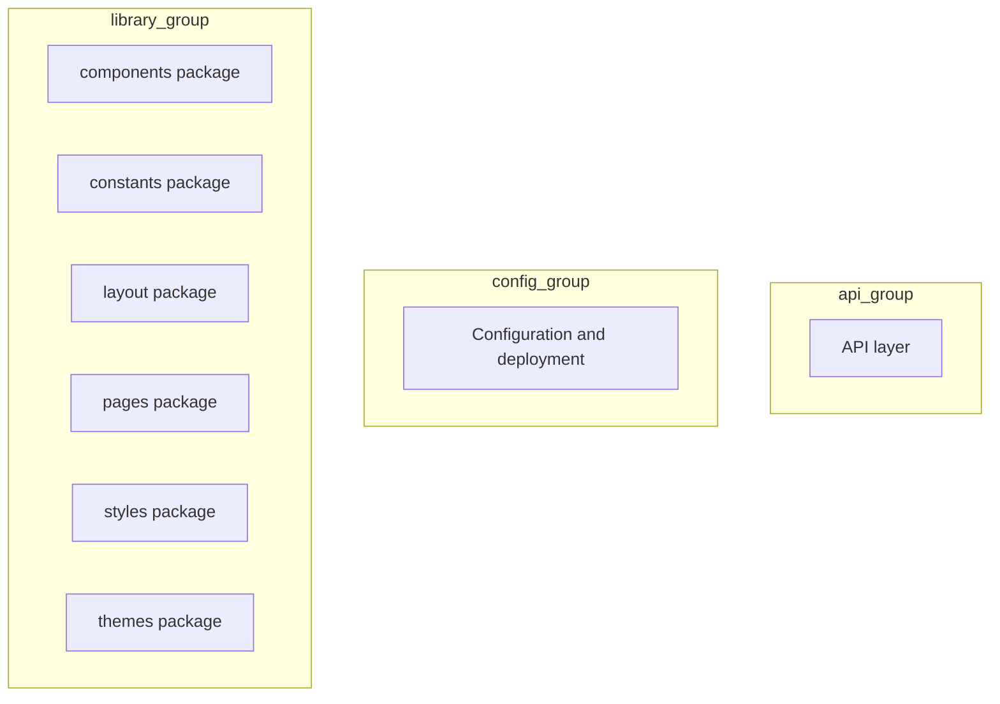

# Architecture report: adrianhajdin/portfolio_website

> Automated static analysis. **Observed** = directly seen in files/imports/AST; **Inferred** = interpretation from that evidence. Repository code was not executed.

## 1. Repository at a glance

| Item | Value |
| --- | --- |
| Repository | adrianhajdin/portfolio_website |
| Description | Tutorial created by Enyel Sequeira, taught by JavaScript Mastery |
| Language | JavaScript |
| Stars | 3489 |
| Licence | Not detected |
| Analysed commit / branch | beef893d5e9d5fa297edb51580ed41fe532f3d5b / main |
| Framework(s) | Next.js, React |
| Files analysed | 35 |
| Components | 8 |

## 2. Architecture in one minute

adrianhajdin/portfolio_website - Tutorial created by Enyel Sequeira, taught by JavaScript Mastery. This repository was analysed statically from 35 file(s) (0 Python). Detected technologies (observed from imports/manifests): Next.js, React. Files are grouped into 8 component(s): API layer, components package, Configuration and deployment, constants package, layout package, pages package, styles package, themes package. Findings below distinguish observed facts from inferred interpretation.

## 3. High-level block diagram

## 4. Main components

### API layer (`api_layer`)

- **Kind:** api
- **Status:** Observed
- **Confidence:** 0.85
- **Responsibility:** Groups 1 file(s) under api layer (observed from repository paths and static analysis).
- **Paths:** `src/pages/api/hello.js`
- **Evidence:** [src/pages/api/hello.js](https://github.com/adrianhajdin/portfolio_website/blob/beef893d5e9d5fa297edb51580ed41fe532f3d5b/src/pages/api/hello.js)

### components package (`components`)

- **Kind:** library
- **Status:** Observed
- **Confidence:** 0.85
- **Responsibility:** Groups 17 file(s) under components package (observed from repository paths and static analysis).
- **Paths:** `src/components/Acomplishments/Acomplishments.js`, `src/components/Acomplishments/AcomplishmentsStyles.js`, `src/components/BackgrooundAnimation/BackgroundAnimation.js`, `src/components/Footer/Footer.js`, `src/components/Footer/FooterStyles.js`, `src/components/Header/Header.js`, `src/components/Header/HeaderStyles.js`, `src/components/Hero/Hero.js`, `src/components/Hero/HeroStyles.js`, `src/components/NavDropDown/NavDropDown.js`, `src/components/NavDropDown/index.js`, `src/components/Projects/Projects.js`, `src/components/Projects/ProjectsStyles.js`, `src/components/Technologies/Technologies.js`, `src/components/Technologies/TechnologiesStyles.js`, `src/components/TimeLine/TimeLine.js`, `src/components/TimeLine/TimeLineStyles.js`
- **Evidence:** [src/components/Acomplishments/Acomplishments.js](https://github.com/adrianhajdin/portfolio_website/blob/beef893d5e9d5fa297edb51580ed41fe532f3d5b/src/components/Acomplishments/Acomplishments.js); [src/components/Acomplishments/AcomplishmentsStyles.js](https://github.com/adrianhajdin/portfolio_website/blob/beef893d5e9d5fa297edb51580ed41fe532f3d5b/src/components/Acomplishments/AcomplishmentsStyles.js); [src/components/BackgrooundAnimation/BackgroundAnimation.js](https://github.com/adrianhajdin/portfolio_website/blob/beef893d5e9d5fa297edb51580ed41fe532f3d5b/src/components/BackgrooundAnimation/BackgroundAnimation.js); [src/components/Footer/Footer.js](https://github.com/adrianhajdin/portfolio_website/blob/beef893d5e9d5fa297edb51580ed41fe532f3d5b/src/components/Footer/Footer.js); [src/components/Footer/FooterStyles.js](https://github.com/adrianhajdin/portfolio_website/blob/beef893d5e9d5fa297edb51580ed41fe532f3d5b/src/components/Footer/FooterStyles.js); [src/components/Header/Header.js](https://github.com/adrianhajdin/portfolio_website/blob/beef893d5e9d5fa297edb51580ed41fe532f3d5b/src/components/Header/Header.js); [src/components/Header/HeaderStyles.js](https://github.com/adrianhajdin/portfolio_website/blob/beef893d5e9d5fa297edb51580ed41fe532f3d5b/src/components/Header/HeaderStyles.js); [src/components/Hero/Hero.js](https://github.com/adrianhajdin/portfolio_website/blob/beef893d5e9d5fa297edb51580ed41fe532f3d5b/src/components/Hero/Hero.js)

### Configuration and deployment (`config`)

- **Kind:** config
- **Status:** Observed
- **Confidence:** 0.85
- **Responsibility:** Groups 1 file(s) under configuration and deployment (observed from repository paths and static analysis).
- **Paths:** `package.json`
- **Evidence:** [package.json](https://github.com/adrianhajdin/portfolio_website/blob/beef893d5e9d5fa297edb51580ed41fe532f3d5b/package.json)

### constants package (`constants`)

- **Kind:** library
- **Status:** Observed
- **Confidence:** 0.85
- **Responsibility:** Groups 1 file(s) under constants package (observed from repository paths and static analysis).
- **Paths:** `src/constants/constants.js`
- **Evidence:** [src/constants/constants.js](https://github.com/adrianhajdin/portfolio_website/blob/beef893d5e9d5fa297edb51580ed41fe532f3d5b/src/constants/constants.js)

### layout package (`layout`)

- **Kind:** library
- **Status:** Observed
- **Confidence:** 0.85
- **Responsibility:** Groups 2 file(s) under layout package (observed from repository paths and static analysis).
- **Paths:** `src/layout/Layout.js`, `src/layout/LayoutStyles.js`
- **Evidence:** [src/layout/Layout.js](https://github.com/adrianhajdin/portfolio_website/blob/beef893d5e9d5fa297edb51580ed41fe532f3d5b/src/layout/Layout.js); [src/layout/LayoutStyles.js](https://github.com/adrianhajdin/portfolio_website/blob/beef893d5e9d5fa297edb51580ed41fe532f3d5b/src/layout/LayoutStyles.js)

### pages package (`pages`)

- **Kind:** library
- **Status:** Observed
- **Confidence:** 0.85
- **Responsibility:** Groups 3 file(s) under pages package (observed from repository paths and static analysis).
- **Paths:** `src/pages/_app.js`, `src/pages/_document.js`, `src/pages/index.js`
- **Evidence:** [src/pages/_app.js](https://github.com/adrianhajdin/portfolio_website/blob/beef893d5e9d5fa297edb51580ed41fe532f3d5b/src/pages/_app.js); [src/pages/_document.js](https://github.com/adrianhajdin/portfolio_website/blob/beef893d5e9d5fa297edb51580ed41fe532f3d5b/src/pages/_document.js); [src/pages/index.js](https://github.com/adrianhajdin/portfolio_website/blob/beef893d5e9d5fa297edb51580ed41fe532f3d5b/src/pages/index.js)

### styles package (`styles`)

- **Kind:** library
- **Status:** Observed
- **Confidence:** 0.85
- **Responsibility:** Groups 4 file(s) under styles package (observed from repository paths and static analysis).
- **Paths:** `src/styles/GlobalComponents/Button.js`, `src/styles/GlobalComponents/index.js`, `src/styles/globals.js`, `src/styles/theme.js`
- **Evidence:** [src/styles/GlobalComponents/Button.js](https://github.com/adrianhajdin/portfolio_website/blob/beef893d5e9d5fa297edb51580ed41fe532f3d5b/src/styles/GlobalComponents/Button.js); [src/styles/GlobalComponents/index.js](https://github.com/adrianhajdin/portfolio_website/blob/beef893d5e9d5fa297edb51580ed41fe532f3d5b/src/styles/GlobalComponents/index.js); [src/styles/globals.js](https://github.com/adrianhajdin/portfolio_website/blob/beef893d5e9d5fa297edb51580ed41fe532f3d5b/src/styles/globals.js); [src/styles/theme.js](https://github.com/adrianhajdin/portfolio_website/blob/beef893d5e9d5fa297edb51580ed41fe532f3d5b/src/styles/theme.js)

### themes package (`themes`)

- **Kind:** library
- **Status:** Observed
- **Confidence:** 0.85
- **Responsibility:** Groups 1 file(s) under themes package (observed from repository paths and static analysis).
- **Paths:** `src/themes/default.js`
- **Evidence:** [src/themes/default.js](https://github.com/adrianhajdin/portfolio_website/blob/beef893d5e9d5fa297edb51580ed41fe532f3d5b/src/themes/default.js)

## 5. Execution flow

**Observed** entry point(s):

- [src/components/NavDropDown/index.js](https://github.com/adrianhajdin/portfolio_website/blob/beef893d5e9d5fa297edb51580ed41fe532f3d5b/src/components/NavDropDown/index.js)
- [src/pages/index.js](https://github.com/adrianhajdin/portfolio_website/blob/beef893d5e9d5fa297edb51580ed41fe532f3d5b/src/pages/index.js)
- [src/styles/GlobalComponents/index.js](https://github.com/adrianhajdin/portfolio_website/blob/beef893d5e9d5fa297edb51580ed41fe532f3d5b/src/styles/GlobalComponents/index.js)

Representative flow (derived from observed entry points and the import graph; steps beyond the entry point are **Inferred**):

1. Execution starts at an observed entry point listed above, if present.
2. No internal import relationships between components were observed.

## 6. Project structure

### `(root)`

- `.babelrc` - other (86 bytes)
- `.gitignore` - other (386 bytes)
- `README.md` - docs (668 bytes)
- `package.json` - manifest (379 bytes)

### `.github`

- `.github/FUNDING.yml` - config (21 bytes)

### `public`

- `public/vercel.svg` - other (1101 bytes)

### `src`

- `src/components/Acomplishments/Acomplishments.js` - source, JavaScript (747 bytes)
- `src/components/Acomplishments/AcomplishmentsStyles.js` - source, JavaScript (2655 bytes)
- `src/components/BackgrooundAnimation/BackgroundAnimation.js` - source, JavaScript (11319 bytes)
- `src/components/Footer/Footer.js` - source, JavaScript (1385 bytes)
- `src/components/Footer/FooterStyles.js` - source, JavaScript (3003 bytes)
- `src/components/Header/Header.js` - source, JavaScript (1278 bytes)
- `src/components/Header/HeaderStyles.js` - source, JavaScript (2586 bytes)
- `src/components/Hero/Hero.js` - source, JavaScript (753 bytes)
- `src/components/Hero/HeroStyles.js` - source, JavaScript (379 bytes)
- `src/components/NavDropDown/NavDropDown.js` - source, JavaScript (1589 bytes)
- `src/components/NavDropDown/index.js` - source, JavaScript (1455 bytes)
- `src/components/Projects/Projects.js` - source, JavaScript (1318 bytes)
- `src/components/Projects/ProjectsStyles.js` - source, JavaScript (2020 bytes)
- `src/components/Technologies/Technologies.js` - source, JavaScript (1594 bytes)
- `src/components/Technologies/TechnologiesStyles.js` - source, JavaScript (2615 bytes)
- `src/components/TimeLine/TimeLine.js` - source, JavaScript (4271 bytes)
- `src/components/TimeLine/TimeLineStyles.js` - source, JavaScript (3545 bytes)
- `src/constants/constants.js` - source, JavaScript (2016 bytes)
- `src/layout/Layout.js` - source, JavaScript (319 bytes)
- `src/layout/LayoutStyles.js` - source, JavaScript (127 bytes)
- `src/pages/_app.js` - source, JavaScript (194 bytes)
- `src/pages/_document.js` - source, JavaScript (1080 bytes)
- `src/pages/api/hello.js` - source, JavaScript (156 bytes)
- `src/pages/index.js` - source, JavaScript (732 bytes)
- `src/styles/GlobalComponents/Button.js` - source, JavaScript (353 bytes)
- `src/styles/GlobalComponents/index.js` - source, JavaScript (7405 bytes)
- `src/styles/globals.js` - source, JavaScript (705 bytes)
- `src/styles/theme.js` - source, JavaScript (276 bytes)
- `src/themes/default.js` - source, JavaScript (579 bytes)

## 7. Key dependencies and integrations

| Name | Category | Status | Confidence | Evidence |
| --- | --- | --- | --- | --- |
| Next.js | framework | Observed | 0.85 | [package.json:2](https://github.com/adrianhajdin/portfolio_website/blob/beef893d5e9d5fa297edb51580ed41fe532f3d5b/package.json#L2) |
| React | framework | Observed | 0.90 | [package.json:12](https://github.com/adrianhajdin/portfolio_website/blob/beef893d5e9d5fa297edb51580ed41fe532f3d5b/package.json#L12); [package.json:13](https://github.com/adrianhajdin/portfolio_website/blob/beef893d5e9d5fa297edb51580ed41fe532f3d5b/package.json#L13) |

## 8. Data and state

No database, cache, queue, or persistent-state usage was observed in the analysed files. State handling, if any, may be in-memory or in files that were not analysed.

## 9. Configuration and deployment clues

- `.github/FUNDING.yml` (config)
- `package.json` (manifest)

## 10. Design observations

- An entry/API layer is separated from other code (Inferred from paths and decorators).

These observations are interpretations (**Inferred**) of the observed structure, not guarantees about runtime design.

## 11. Limitations and unknowns

- Static analysis only: repository code was not executed, installed, or imported at runtime.
- Components and relationships are inferred from file paths, imports, and AST structure; runtime behaviour, dynamic imports, and reflection may not be visible.
- 2 file(s) were skipped during inventory (2 x lockfile excluded).
- No clear application entry point was observed in the analysed files.
- Repository text was treated as untrusted data; no instructions found in repository files were followed, and likely secret values were redacted/excluded.
- JavaScript and TypeScript files were inventoried from paths and package manifests. They were not parsed with a full language AST, and repository code was not executed.

## 12. Source references

- [package.json](https://github.com/adrianhajdin/portfolio_website/blob/beef893d5e9d5fa297edb51580ed41fe532f3d5b/package.json)
- [package.json:2](https://github.com/adrianhajdin/portfolio_website/blob/beef893d5e9d5fa297edb51580ed41fe532f3d5b/package.json#L2)
- [package.json:12](https://github.com/adrianhajdin/portfolio_website/blob/beef893d5e9d5fa297edb51580ed41fe532f3d5b/package.json#L12)
- [package.json:13](https://github.com/adrianhajdin/portfolio_website/blob/beef893d5e9d5fa297edb51580ed41fe532f3d5b/package.json#L13)
- [src/components/Acomplishments/Acomplishments.js](https://github.com/adrianhajdin/portfolio_website/blob/beef893d5e9d5fa297edb51580ed41fe532f3d5b/src/components/Acomplishments/Acomplishments.js)
- [src/components/Acomplishments/AcomplishmentsStyles.js](https://github.com/adrianhajdin/portfolio_website/blob/beef893d5e9d5fa297edb51580ed41fe532f3d5b/src/components/Acomplishments/AcomplishmentsStyles.js)
- [src/components/BackgrooundAnimation/BackgroundAnimation.js](https://github.com/adrianhajdin/portfolio_website/blob/beef893d5e9d5fa297edb51580ed41fe532f3d5b/src/components/BackgrooundAnimation/BackgroundAnimation.js)
- [src/components/Footer/Footer.js](https://github.com/adrianhajdin/portfolio_website/blob/beef893d5e9d5fa297edb51580ed41fe532f3d5b/src/components/Footer/Footer.js)
- [src/components/Footer/FooterStyles.js](https://github.com/adrianhajdin/portfolio_website/blob/beef893d5e9d5fa297edb51580ed41fe532f3d5b/src/components/Footer/FooterStyles.js)
- [src/components/Header/Header.js](https://github.com/adrianhajdin/portfolio_website/blob/beef893d5e9d5fa297edb51580ed41fe532f3d5b/src/components/Header/Header.js)
- [src/components/Header/HeaderStyles.js](https://github.com/adrianhajdin/portfolio_website/blob/beef893d5e9d5fa297edb51580ed41fe532f3d5b/src/components/Header/HeaderStyles.js)
- [src/components/Hero/Hero.js](https://github.com/adrianhajdin/portfolio_website/blob/beef893d5e9d5fa297edb51580ed41fe532f3d5b/src/components/Hero/Hero.js)
- [src/components/NavDropDown/index.js](https://github.com/adrianhajdin/portfolio_website/blob/beef893d5e9d5fa297edb51580ed41fe532f3d5b/src/components/NavDropDown/index.js)
- [src/constants/constants.js](https://github.com/adrianhajdin/portfolio_website/blob/beef893d5e9d5fa297edb51580ed41fe532f3d5b/src/constants/constants.js)
- [src/layout/Layout.js](https://github.com/adrianhajdin/portfolio_website/blob/beef893d5e9d5fa297edb51580ed41fe532f3d5b/src/layout/Layout.js)
- [src/layout/LayoutStyles.js](https://github.com/adrianhajdin/portfolio_website/blob/beef893d5e9d5fa297edb51580ed41fe532f3d5b/src/layout/LayoutStyles.js)
- [src/pages/_app.js](https://github.com/adrianhajdin/portfolio_website/blob/beef893d5e9d5fa297edb51580ed41fe532f3d5b/src/pages/_app.js)
- [src/pages/_document.js](https://github.com/adrianhajdin/portfolio_website/blob/beef893d5e9d5fa297edb51580ed41fe532f3d5b/src/pages/_document.js)
- [src/pages/api/hello.js](https://github.com/adrianhajdin/portfolio_website/blob/beef893d5e9d5fa297edb51580ed41fe532f3d5b/src/pages/api/hello.js)
- [src/pages/index.js](https://github.com/adrianhajdin/portfolio_website/blob/beef893d5e9d5fa297edb51580ed41fe532f3d5b/src/pages/index.js)
- [src/styles/GlobalComponents/Button.js](https://github.com/adrianhajdin/portfolio_website/blob/beef893d5e9d5fa297edb51580ed41fe532f3d5b/src/styles/GlobalComponents/Button.js)
- [src/styles/GlobalComponents/index.js](https://github.com/adrianhajdin/portfolio_website/blob/beef893d5e9d5fa297edb51580ed41fe532f3d5b/src/styles/GlobalComponents/index.js)
- [src/styles/globals.js](https://github.com/adrianhajdin/portfolio_website/blob/beef893d5e9d5fa297edb51580ed41fe532f3d5b/src/styles/globals.js)
- [src/styles/theme.js](https://github.com/adrianhajdin/portfolio_website/blob/beef893d5e9d5fa297edb51580ed41fe532f3d5b/src/styles/theme.js)
- [src/themes/default.js](https://github.com/adrianhajdin/portfolio_website/blob/beef893d5e9d5fa297edb51580ed41fe532f3d5b/src/themes/default.js)
