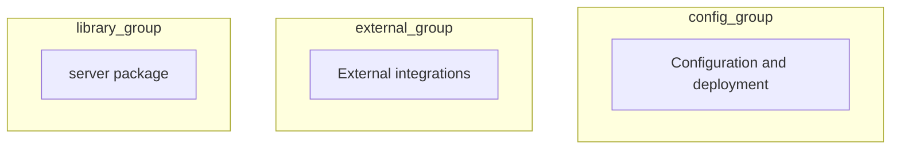

# Architecture report: adrianhajdin/project_chat_application

> Automated static analysis. **Observed** = directly seen in files/imports/AST; **Inferred** = interpretation from that evidence. Repository code was not executed.

## 1. Repository at a glance

| Item | Value |
| --- | --- |
| Repository | adrianhajdin/project_chat_application |
| Description | This is a code repository for the corresponding YouTube video. In this tutorial we are going to build and deploy a real time chat application. Covered topics: React.js, Node.js, Express.js, and Socket.io. |
| Language | JavaScript |
| Stars | 4132 |
| Licence | Not detected |
| Analysed commit / branch | c0b49d1e66cbe78d238419ed2746259ec84be8e8 / master |
| Framework(s) | Express, React |
| Files analysed | 31 |
| Components | 3 |

## 2. Architecture in one minute

adrianhajdin/project_chat_application - This is a code repository for the corresponding YouTube video. In this tutorial we are going to build and deploy a real time chat application. Covered topics: React.js, Node.js, Express.js, and Socke…. This repository was analysed statically from 31 file(s) (0 Python). Detected technologies (observed from imports/manifests): Express, React, React Router. Files are grouped into 3 component(s): Configuration and deployment, External integrations, server package. Findings below distinguish observed facts from inferred interpretation.

## 3. High-level block diagram

## 4. Main components

### Configuration and deployment (`config`)

- **Kind:** config
- **Status:** Observed
- **Confidence:** 0.85
- **Responsibility:** Groups 2 file(s) under configuration and deployment (observed from repository paths and static analysis).
- **Paths:** `client/package.json`, `server/package.json`
- **Evidence:** [client/package.json](https://github.com/adrianhajdin/project_chat_application/blob/c0b49d1e66cbe78d238419ed2746259ec84be8e8/client/package.json); [server/package.json](https://github.com/adrianhajdin/project_chat_application/blob/c0b49d1e66cbe78d238419ed2746259ec84be8e8/server/package.json)

### External integrations (`external_integrations`)

- **Kind:** external
- **Status:** Observed
- **Confidence:** 0.85
- **Responsibility:** Groups 10 file(s) under external integrations (observed from repository paths and static analysis).
- **Paths:** `client/.eslintrc.js`, `client/src/App.js`, `client/src/components/Chat/Chat.js`, `client/src/components/InfoBar/InfoBar.js`, `client/src/components/Input/Input.js`, `client/src/components/Join/Join.js`, `client/src/components/Messages/Message/Message.js`, `client/src/components/Messages/Messages.js`, `client/src/components/TextContainer/TextContainer.js`, `client/src/index.js`
- **Evidence:** [client/.eslintrc.js](https://github.com/adrianhajdin/project_chat_application/blob/c0b49d1e66cbe78d238419ed2746259ec84be8e8/client/.eslintrc.js); [client/src/App.js](https://github.com/adrianhajdin/project_chat_application/blob/c0b49d1e66cbe78d238419ed2746259ec84be8e8/client/src/App.js); [client/src/components/Chat/Chat.js](https://github.com/adrianhajdin/project_chat_application/blob/c0b49d1e66cbe78d238419ed2746259ec84be8e8/client/src/components/Chat/Chat.js); [client/src/components/InfoBar/InfoBar.js](https://github.com/adrianhajdin/project_chat_application/blob/c0b49d1e66cbe78d238419ed2746259ec84be8e8/client/src/components/InfoBar/InfoBar.js); [client/src/components/Input/Input.js](https://github.com/adrianhajdin/project_chat_application/blob/c0b49d1e66cbe78d238419ed2746259ec84be8e8/client/src/components/Input/Input.js); [client/src/components/Join/Join.js](https://github.com/adrianhajdin/project_chat_application/blob/c0b49d1e66cbe78d238419ed2746259ec84be8e8/client/src/components/Join/Join.js); [client/src/components/Messages/Message/Message.js](https://github.com/adrianhajdin/project_chat_application/blob/c0b49d1e66cbe78d238419ed2746259ec84be8e8/client/src/components/Messages/Message/Message.js); [client/src/components/Messages/Messages.js](https://github.com/adrianhajdin/project_chat_application/blob/c0b49d1e66cbe78d238419ed2746259ec84be8e8/client/src/components/Messages/Messages.js)

### server package (`server`)

- **Kind:** library
- **Status:** Observed
- **Confidence:** 0.85
- **Responsibility:** Groups 3 file(s) under server package (observed from repository paths and static analysis).
- **Paths:** `server/index.js`, `server/router.js`, `server/users.js`
- **Evidence:** [server/index.js](https://github.com/adrianhajdin/project_chat_application/blob/c0b49d1e66cbe78d238419ed2746259ec84be8e8/server/index.js); [server/router.js](https://github.com/adrianhajdin/project_chat_application/blob/c0b49d1e66cbe78d238419ed2746259ec84be8e8/server/router.js); [server/users.js](https://github.com/adrianhajdin/project_chat_application/blob/c0b49d1e66cbe78d238419ed2746259ec84be8e8/server/users.js)

## 5. Execution flow

**Observed** entry point(s):

- [client/src/App.js](https://github.com/adrianhajdin/project_chat_application/blob/c0b49d1e66cbe78d238419ed2746259ec84be8e8/client/src/App.js)
- [client/src/index.js](https://github.com/adrianhajdin/project_chat_application/blob/c0b49d1e66cbe78d238419ed2746259ec84be8e8/client/src/index.js)
- [server/index.js](https://github.com/adrianhajdin/project_chat_application/blob/c0b49d1e66cbe78d238419ed2746259ec84be8e8/server/index.js)

Representative flow (derived from observed entry points and the import graph; steps beyond the entry point are **Inferred**):

1. Execution starts at an observed entry point listed above, if present.
2. No internal import relationships between components were observed.

## 6. Project structure

### `(root)`

- `.gitignore` - other (8 bytes)
- `README.md` - docs (965 bytes)

### `.github`

- `.github/FUNDING.yml` - config (21 bytes)

### `.netlify`

- `.netlify/state.json` - config (53 bytes)

### `client`

- `client/.eslintrc.js` - source, JavaScript (1209 bytes)
- `client/.gitignore` - other (223 bytes)
- `client/README.md` - docs (2881 bytes)
- `client/package.json` - manifest (1047 bytes)
- `client/public/index.html` - other (520 bytes)
- `client/src/App.js` - source, JavaScript (363 bytes)
- `client/src/components/Chat/Chat.css` - other (541 bytes)
- `client/src/components/Chat/Chat.js` - source, JavaScript (1681 bytes)
- `client/src/components/InfoBar/InfoBar.css` - other (426 bytes)
- `client/src/components/InfoBar/InfoBar.js` - source, JavaScript (516 bytes)
- `client/src/components/Input/Input.css` - other (411 bytes)
- `client/src/components/Input/Input.js` - source, JavaScript (508 bytes)
- `client/src/components/Join/Join.css` - other (959 bytes)
- `client/src/components/Join/Join.js` - source, JavaScript (905 bytes)
- `client/src/components/Messages/Message/Message.css` - other (854 bytes)
- `client/src/components/Messages/Message/Message.js` - source, JavaScript (975 bytes)
- `client/src/components/Messages/Messages.css` - other (62 bytes)
- `client/src/components/Messages/Messages.js` - source, JavaScript (377 bytes)
- `client/src/components/TextContainer/TextContainer.css` - other (479 bytes)
- `client/src/components/TextContainer/TextContainer.js` - source, JavaScript (1017 bytes)
- `client/src/index.js` - source, JavaScript (146 bytes)

### `server`

- `server/.gitignore` - other (13 bytes)
- `server/Procfile` - other (18 bytes)
- `server/index.js` - source, JavaScript (1483 bytes)
- `server/package.json` - manifest (293 bytes)
- `server/router.js` - source, JavaScript (198 bytes)
- `server/users.js` - source, JavaScript (787 bytes)

## 7. Key dependencies and integrations

| Name | Category | Status | Confidence | Evidence |
| --- | --- | --- | --- | --- |
| Express | framework | Observed | 0.85 | [server/package.json:14](https://github.com/adrianhajdin/project_chat_application/blob/c0b49d1e66cbe78d238419ed2746259ec84be8e8/server/package.json#L14) |
| React | framework | Observed | 0.90 | [client/package.json:7](https://github.com/adrianhajdin/project_chat_application/blob/c0b49d1e66cbe78d238419ed2746259ec84be8e8/client/package.json#L7); [client/package.json:8](https://github.com/adrianhajdin/project_chat_application/blob/c0b49d1e66cbe78d238419ed2746259ec84be8e8/client/package.json#L8) |
| React Router | library | Observed | 0.85 | [client/package.json:10](https://github.com/adrianhajdin/project_chat_application/blob/c0b49d1e66cbe78d238419ed2746259ec84be8e8/client/package.json#L10) |

## 8. Data and state

No database, cache, queue, or persistent-state usage was observed in the analysed files. State handling, if any, may be in-memory or in files that were not analysed.

## 9. Configuration and deployment clues

- `.github/FUNDING.yml` (config)
- `.netlify/state.json` (config)
- `client/package.json` (manifest)
- `server/package.json` (manifest)

## 10. Design observations

- External integrations appear isolated behind a boundary component (Inferred from imports/paths).

These observations are interpretations (**Inferred**) of the observed structure, not guarantees about runtime design.

## 11. Limitations and unknowns

- Static analysis only: repository code was not executed, installed, or imported at runtime.
- Components and relationships are inferred from file paths, imports, and AST structure; runtime behaviour, dynamic imports, and reflection may not be visible.
- 1 file(s) were skipped during inventory (1 x lockfile excluded).
- No clear application entry point was observed in the analysed files.
- Repository text was treated as untrusted data; no instructions found in repository files were followed, and likely secret values were redacted/excluded.
- JavaScript and TypeScript files were inventoried from paths and package manifests. They were not parsed with a full language AST, and repository code was not executed.

## 12. Source references

- [client/.eslintrc.js](https://github.com/adrianhajdin/project_chat_application/blob/c0b49d1e66cbe78d238419ed2746259ec84be8e8/client/.eslintrc.js)
- [client/package.json](https://github.com/adrianhajdin/project_chat_application/blob/c0b49d1e66cbe78d238419ed2746259ec84be8e8/client/package.json)
- [client/package.json:7](https://github.com/adrianhajdin/project_chat_application/blob/c0b49d1e66cbe78d238419ed2746259ec84be8e8/client/package.json#L7)
- [client/package.json:8](https://github.com/adrianhajdin/project_chat_application/blob/c0b49d1e66cbe78d238419ed2746259ec84be8e8/client/package.json#L8)
- [client/package.json:10](https://github.com/adrianhajdin/project_chat_application/blob/c0b49d1e66cbe78d238419ed2746259ec84be8e8/client/package.json#L10)
- [client/src/App.js](https://github.com/adrianhajdin/project_chat_application/blob/c0b49d1e66cbe78d238419ed2746259ec84be8e8/client/src/App.js)
- [client/src/components/Chat/Chat.js](https://github.com/adrianhajdin/project_chat_application/blob/c0b49d1e66cbe78d238419ed2746259ec84be8e8/client/src/components/Chat/Chat.js)
- [client/src/components/InfoBar/InfoBar.js](https://github.com/adrianhajdin/project_chat_application/blob/c0b49d1e66cbe78d238419ed2746259ec84be8e8/client/src/components/InfoBar/InfoBar.js)
- [client/src/components/Input/Input.js](https://github.com/adrianhajdin/project_chat_application/blob/c0b49d1e66cbe78d238419ed2746259ec84be8e8/client/src/components/Input/Input.js)
- [client/src/components/Join/Join.js](https://github.com/adrianhajdin/project_chat_application/blob/c0b49d1e66cbe78d238419ed2746259ec84be8e8/client/src/components/Join/Join.js)
- [client/src/components/Messages/Message/Message.js](https://github.com/adrianhajdin/project_chat_application/blob/c0b49d1e66cbe78d238419ed2746259ec84be8e8/client/src/components/Messages/Message/Message.js)
- [client/src/components/Messages/Messages.js](https://github.com/adrianhajdin/project_chat_application/blob/c0b49d1e66cbe78d238419ed2746259ec84be8e8/client/src/components/Messages/Messages.js)
- [client/src/index.js](https://github.com/adrianhajdin/project_chat_application/blob/c0b49d1e66cbe78d238419ed2746259ec84be8e8/client/src/index.js)
- [server/index.js](https://github.com/adrianhajdin/project_chat_application/blob/c0b49d1e66cbe78d238419ed2746259ec84be8e8/server/index.js)
- [server/package.json](https://github.com/adrianhajdin/project_chat_application/blob/c0b49d1e66cbe78d238419ed2746259ec84be8e8/server/package.json)
- [server/package.json:14](https://github.com/adrianhajdin/project_chat_application/blob/c0b49d1e66cbe78d238419ed2746259ec84be8e8/server/package.json#L14)
- [server/router.js](https://github.com/adrianhajdin/project_chat_application/blob/c0b49d1e66cbe78d238419ed2746259ec84be8e8/server/router.js)
- [server/users.js](https://github.com/adrianhajdin/project_chat_application/blob/c0b49d1e66cbe78d238419ed2746259ec84be8e8/server/users.js)
