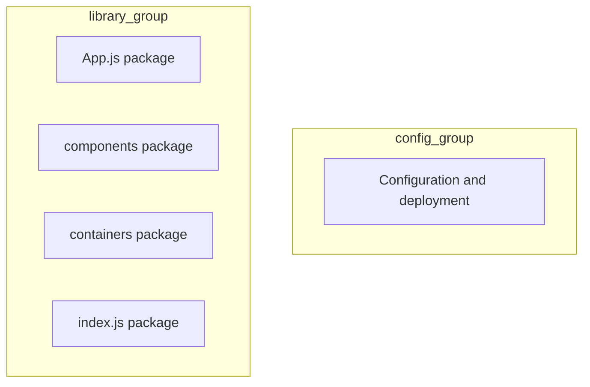

# Architecture report: adrianhajdin/project_modern_ui_ux_gpt3

> Automated static analysis. **Observed** = directly seen in files/imports/AST; **Inferred** = interpretation from that evidence. Repository code was not executed.

## 1. Repository at a glance

| Item | Value |
| --- | --- |
| Repository | adrianhajdin/project_modern_ui_ux_gpt3 |
| Description | Master the creation of Modern UX/UI Websites |
| Language | CSS |
| Stars | 3837 |
| Licence | Not detected |
| Analysed commit / branch | 16457b4ebf5c96aad723519a86076b8d339ce024 / main |
| Framework(s) | React |
| Files analysed | 40 |
| Components | 5 |

## 2. Architecture in one minute

adrianhajdin/project_modern_ui_ux_gpt3 - Master the creation of Modern UX/UI Websites. This repository was analysed statically from 40 file(s) (0 Python). Detected technologies (observed from imports/manifests): React. Files are grouped into 5 component(s): App.js package, components package, Configuration and deployment, containers package, index.js package. Findings below distinguish observed facts from inferred interpretation.

## 3. High-level block diagram

## 4. Main components

### App.js package (`app_js`)

- **Kind:** library
- **Status:** Observed
- **Confidence:** 0.85
- **Responsibility:** Groups 1 file(s) under app.js package (observed from repository paths and static analysis).
- **Paths:** `src/App.js`
- **Evidence:** [src/App.js](https://github.com/adrianhajdin/project_modern_ui_ux_gpt3/blob/16457b4ebf5c96aad723519a86076b8d339ce024/src/App.js)

### components package (`components`)

- **Kind:** library
- **Status:** Observed
- **Confidence:** 0.85
- **Responsibility:** Groups 7 file(s) under components package (observed from repository paths and static analysis).
- **Paths:** `src/components/article/Article.jsx`, `src/components/brand/Brand.jsx`, `src/components/brand/imports.js`, `src/components/cta/CTA.jsx`, `src/components/feature/Feature.jsx`, `src/components/index.js`, `src/components/navbar/Navbar.jsx`
- **Evidence:** [src/components/article/Article.jsx](https://github.com/adrianhajdin/project_modern_ui_ux_gpt3/blob/16457b4ebf5c96aad723519a86076b8d339ce024/src/components/article/Article.jsx); [src/components/brand/Brand.jsx](https://github.com/adrianhajdin/project_modern_ui_ux_gpt3/blob/16457b4ebf5c96aad723519a86076b8d339ce024/src/components/brand/Brand.jsx); [src/components/brand/imports.js](https://github.com/adrianhajdin/project_modern_ui_ux_gpt3/blob/16457b4ebf5c96aad723519a86076b8d339ce024/src/components/brand/imports.js); [src/components/cta/CTA.jsx](https://github.com/adrianhajdin/project_modern_ui_ux_gpt3/blob/16457b4ebf5c96aad723519a86076b8d339ce024/src/components/cta/CTA.jsx); [src/components/feature/Feature.jsx](https://github.com/adrianhajdin/project_modern_ui_ux_gpt3/blob/16457b4ebf5c96aad723519a86076b8d339ce024/src/components/feature/Feature.jsx); [src/components/index.js](https://github.com/adrianhajdin/project_modern_ui_ux_gpt3/blob/16457b4ebf5c96aad723519a86076b8d339ce024/src/components/index.js); [src/components/navbar/Navbar.jsx](https://github.com/adrianhajdin/project_modern_ui_ux_gpt3/blob/16457b4ebf5c96aad723519a86076b8d339ce024/src/components/navbar/Navbar.jsx)

### Configuration and deployment (`config`)

- **Kind:** config
- **Status:** Observed
- **Confidence:** 0.85
- **Responsibility:** Groups 2 file(s) under configuration and deployment (observed from repository paths and static analysis).
- **Paths:** `package.json`, `public/manifest.json`
- **Evidence:** [package.json](https://github.com/adrianhajdin/project_modern_ui_ux_gpt3/blob/16457b4ebf5c96aad723519a86076b8d339ce024/package.json); [public/manifest.json](https://github.com/adrianhajdin/project_modern_ui_ux_gpt3/blob/16457b4ebf5c96aad723519a86076b8d339ce024/public/manifest.json)

### containers package (`containers`)

- **Kind:** library
- **Status:** Observed
- **Confidence:** 0.85
- **Responsibility:** Groups 8 file(s) under containers package (observed from repository paths and static analysis).
- **Paths:** `src/containers/blog/Blog.jsx`, `src/containers/blog/imports.js`, `src/containers/features/Features.jsx`, `src/containers/footer/Footer.jsx`, `src/containers/header/Header.jsx`, `src/containers/index.js`, `src/containers/possibility/Possibility.jsx`, `src/containers/whatGPT3/WhatGPT3.jsx`
- **Evidence:** [src/containers/blog/Blog.jsx](https://github.com/adrianhajdin/project_modern_ui_ux_gpt3/blob/16457b4ebf5c96aad723519a86076b8d339ce024/src/containers/blog/Blog.jsx); [src/containers/blog/imports.js](https://github.com/adrianhajdin/project_modern_ui_ux_gpt3/blob/16457b4ebf5c96aad723519a86076b8d339ce024/src/containers/blog/imports.js); [src/containers/features/Features.jsx](https://github.com/adrianhajdin/project_modern_ui_ux_gpt3/blob/16457b4ebf5c96aad723519a86076b8d339ce024/src/containers/features/Features.jsx); [src/containers/footer/Footer.jsx](https://github.com/adrianhajdin/project_modern_ui_ux_gpt3/blob/16457b4ebf5c96aad723519a86076b8d339ce024/src/containers/footer/Footer.jsx); [src/containers/header/Header.jsx](https://github.com/adrianhajdin/project_modern_ui_ux_gpt3/blob/16457b4ebf5c96aad723519a86076b8d339ce024/src/containers/header/Header.jsx); [src/containers/index.js](https://github.com/adrianhajdin/project_modern_ui_ux_gpt3/blob/16457b4ebf5c96aad723519a86076b8d339ce024/src/containers/index.js); [src/containers/possibility/Possibility.jsx](https://github.com/adrianhajdin/project_modern_ui_ux_gpt3/blob/16457b4ebf5c96aad723519a86076b8d339ce024/src/containers/possibility/Possibility.jsx); [src/containers/whatGPT3/WhatGPT3.jsx](https://github.com/adrianhajdin/project_modern_ui_ux_gpt3/blob/16457b4ebf5c96aad723519a86076b8d339ce024/src/containers/whatGPT3/WhatGPT3.jsx)

### index.js package (`index_js`)

- **Kind:** library
- **Status:** Observed
- **Confidence:** 0.85
- **Responsibility:** Groups 1 file(s) under index.js package (observed from repository paths and static analysis).
- **Paths:** `src/index.js`
- **Evidence:** [src/index.js](https://github.com/adrianhajdin/project_modern_ui_ux_gpt3/blob/16457b4ebf5c96aad723519a86076b8d339ce024/src/index.js)

## 5. Execution flow

**Observed** entry point(s):

- [src/App.js](https://github.com/adrianhajdin/project_modern_ui_ux_gpt3/blob/16457b4ebf5c96aad723519a86076b8d339ce024/src/App.js)
- [src/components/index.js](https://github.com/adrianhajdin/project_modern_ui_ux_gpt3/blob/16457b4ebf5c96aad723519a86076b8d339ce024/src/components/index.js)
- [src/containers/index.js](https://github.com/adrianhajdin/project_modern_ui_ux_gpt3/blob/16457b4ebf5c96aad723519a86076b8d339ce024/src/containers/index.js)
- [src/index.js](https://github.com/adrianhajdin/project_modern_ui_ux_gpt3/blob/16457b4ebf5c96aad723519a86076b8d339ce024/src/index.js)

Representative flow (derived from observed entry points and the import graph; steps beyond the entry point are **Inferred**):

1. Execution starts at an observed entry point listed above, if present.
2. No internal import relationships between components were observed.

## 6. Project structure

### `(root)`

- `.eslintrc.js` - source, JavaScript (1567 bytes)
- `.gitignore` - other (327 bytes)
- `README.md` - docs (1292 bytes)
- `package.json` - manifest (1089 bytes)

### `.github`

- `.github/FUNDING.yml` - config (21 bytes)

### `public`

- `public/index.html` - other (549 bytes)
- `public/manifest.json` - config (492 bytes)
- `public/robots.txt` - docs (67 bytes)

### `src`

- `src/App.css` - other (1895 bytes)
- `src/App.js` - source, JavaScript (452 bytes)
- `src/assets/logo.svg` - other (2204 bytes)
- `src/components/article/Article.jsx` - source, JavaScript (468 bytes)
- `src/components/article/article.css` - other (1129 bytes)
- `src/components/brand/Brand.jsx` - source, JavaScript (472 bytes)
- `src/components/brand/brand.css` - other (281 bytes)
- `src/components/brand/imports.js` - source, JavaScript (305 bytes)
- `src/components/cta/CTA.jsx` - source, JavaScript (402 bytes)
- `src/components/cta/cta.css` - other (1456 bytes)
- `src/components/feature/Feature.jsx` - source, JavaScript (383 bytes)
- `src/components/feature/feature.css` - other (1289 bytes)
- `src/components/index.js` - source, JavaScript (259 bytes)
- `src/components/navbar/Navbar.jsx` - source, JavaScript (1785 bytes)
- `src/components/navbar/navbar.css` - other (2342 bytes)
- `src/containers/blog/Blog.jsx` - source, JavaScript (1227 bytes)
- `src/containers/blog/blog.css` - other (1378 bytes)
- `src/containers/blog/imports.js` - source, JavaScript (293 bytes)
- `src/containers/features/Features.jsx` - source, JavaScript (1462 bytes)
- `src/containers/features/features.css` - other (1091 bytes)
- `src/containers/footer/Footer.jsx` - source, JavaScript (1322 bytes)
- `src/containers/footer/footer.css` - other (2509 bytes)
- `src/containers/header/Header.jsx` - source, JavaScript (1044 bytes)
- `src/containers/header/header.css` - other (3169 bytes)
- `src/containers/index.js` - source, JavaScript (339 bytes)
- `src/containers/possibility/Possibility.jsx` - source, JavaScript (844 bytes)
- `src/containers/possibility/possibility.css` - other (1455 bytes)
- `src/containers/whatGPT3/WhatGPT3.jsx` - source, JavaScript (1302 bytes)
- `src/containers/whatGPT3/whatGPT3.css` - other (3130 bytes)
- `src/index.css` - other (452 bytes)
- `src/index.js` - source, JavaScript (169 bytes)
- `src/logo.svg` - other (2204 bytes)

## 7. Key dependencies and integrations

| Name | Category | Status | Confidence | Evidence |
| --- | --- | --- | --- | --- |
| React | framework | Observed | 0.90 | [package.json:7](https://github.com/adrianhajdin/project_modern_ui_ux_gpt3/blob/16457b4ebf5c96aad723519a86076b8d339ce024/package.json#L7); [package.json:10](https://github.com/adrianhajdin/project_modern_ui_ux_gpt3/blob/16457b4ebf5c96aad723519a86076b8d339ce024/package.json#L10) |

## 8. Data and state

No database, cache, queue, or persistent-state usage was observed in the analysed files. State handling, if any, may be in-memory or in files that were not analysed.

## 9. Configuration and deployment clues

- `.github/FUNDING.yml` (config)
- `package.json` (manifest)
- `public/manifest.json` (config)

## 10. Design observations

- No strong design patterns could be established from the available evidence.

These observations are interpretations (**Inferred**) of the observed structure, not guarantees about runtime design.

## 11. Limitations and unknowns

- Static analysis only: repository code was not executed, installed, or imported at runtime.
- Components and relationships are inferred from file paths, imports, and AST structure; runtime behaviour, dynamic imports, and reflection may not be visible.
- No clear application entry point was observed in the analysed files.
- Repository text was treated as untrusted data; no instructions found in repository files were followed, and likely secret values were redacted/excluded.
- JavaScript and TypeScript files were inventoried from paths and package manifests. They were not parsed with a full language AST, and repository code was not executed.

## 12. Source references

- [package.json](https://github.com/adrianhajdin/project_modern_ui_ux_gpt3/blob/16457b4ebf5c96aad723519a86076b8d339ce024/package.json)
- [package.json:7](https://github.com/adrianhajdin/project_modern_ui_ux_gpt3/blob/16457b4ebf5c96aad723519a86076b8d339ce024/package.json#L7)
- [package.json:10](https://github.com/adrianhajdin/project_modern_ui_ux_gpt3/blob/16457b4ebf5c96aad723519a86076b8d339ce024/package.json#L10)
- [public/manifest.json](https://github.com/adrianhajdin/project_modern_ui_ux_gpt3/blob/16457b4ebf5c96aad723519a86076b8d339ce024/public/manifest.json)
- [src/App.js](https://github.com/adrianhajdin/project_modern_ui_ux_gpt3/blob/16457b4ebf5c96aad723519a86076b8d339ce024/src/App.js)
- [src/components/article/Article.jsx](https://github.com/adrianhajdin/project_modern_ui_ux_gpt3/blob/16457b4ebf5c96aad723519a86076b8d339ce024/src/components/article/Article.jsx)
- [src/components/brand/Brand.jsx](https://github.com/adrianhajdin/project_modern_ui_ux_gpt3/blob/16457b4ebf5c96aad723519a86076b8d339ce024/src/components/brand/Brand.jsx)
- [src/components/brand/imports.js](https://github.com/adrianhajdin/project_modern_ui_ux_gpt3/blob/16457b4ebf5c96aad723519a86076b8d339ce024/src/components/brand/imports.js)
- [src/components/cta/CTA.jsx](https://github.com/adrianhajdin/project_modern_ui_ux_gpt3/blob/16457b4ebf5c96aad723519a86076b8d339ce024/src/components/cta/CTA.jsx)
- [src/components/feature/Feature.jsx](https://github.com/adrianhajdin/project_modern_ui_ux_gpt3/blob/16457b4ebf5c96aad723519a86076b8d339ce024/src/components/feature/Feature.jsx)
- [src/components/index.js](https://github.com/adrianhajdin/project_modern_ui_ux_gpt3/blob/16457b4ebf5c96aad723519a86076b8d339ce024/src/components/index.js)
- [src/components/navbar/Navbar.jsx](https://github.com/adrianhajdin/project_modern_ui_ux_gpt3/blob/16457b4ebf5c96aad723519a86076b8d339ce024/src/components/navbar/Navbar.jsx)
- [src/containers/blog/Blog.jsx](https://github.com/adrianhajdin/project_modern_ui_ux_gpt3/blob/16457b4ebf5c96aad723519a86076b8d339ce024/src/containers/blog/Blog.jsx)
- [src/containers/blog/imports.js](https://github.com/adrianhajdin/project_modern_ui_ux_gpt3/blob/16457b4ebf5c96aad723519a86076b8d339ce024/src/containers/blog/imports.js)
- [src/containers/features/Features.jsx](https://github.com/adrianhajdin/project_modern_ui_ux_gpt3/blob/16457b4ebf5c96aad723519a86076b8d339ce024/src/containers/features/Features.jsx)
- [src/containers/footer/Footer.jsx](https://github.com/adrianhajdin/project_modern_ui_ux_gpt3/blob/16457b4ebf5c96aad723519a86076b8d339ce024/src/containers/footer/Footer.jsx)
- [src/containers/header/Header.jsx](https://github.com/adrianhajdin/project_modern_ui_ux_gpt3/blob/16457b4ebf5c96aad723519a86076b8d339ce024/src/containers/header/Header.jsx)
- [src/containers/index.js](https://github.com/adrianhajdin/project_modern_ui_ux_gpt3/blob/16457b4ebf5c96aad723519a86076b8d339ce024/src/containers/index.js)
- [src/containers/possibility/Possibility.jsx](https://github.com/adrianhajdin/project_modern_ui_ux_gpt3/blob/16457b4ebf5c96aad723519a86076b8d339ce024/src/containers/possibility/Possibility.jsx)
- [src/containers/whatGPT3/WhatGPT3.jsx](https://github.com/adrianhajdin/project_modern_ui_ux_gpt3/blob/16457b4ebf5c96aad723519a86076b8d339ce024/src/containers/whatGPT3/WhatGPT3.jsx)
- [src/index.js](https://github.com/adrianhajdin/project_modern_ui_ux_gpt3/blob/16457b4ebf5c96aad723519a86076b8d339ce024/src/index.js)
