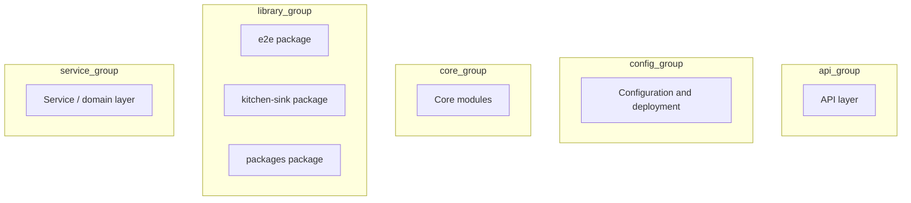

# Architecture report: aidenybai/react-scan

> Automated static analysis. **Observed** = directly seen in files/imports/AST; **Inferred** = interpretation from that evidence. Repository code was not executed.

## 1. Repository at a glance

| Item | Value |
| --- | --- |
| Repository | aidenybai/react-scan |
| Description | Scan and fix React performance issues |
| Language | TypeScript |
| Stars | 21884 |
| Licence | MIT |
| Analysed commit / branch | 0fb31862b697ef3ed2d8ed6990878a35a4ca8a75 / main |
| Framework(s) | Next.js, React |
| Files analysed | 245 |
| Components | 7 |

## 2. Architecture in one minute

aidenybai/react-scan - Scan and fix React performance issues. This repository was analysed statically from 245 file(s) (0 Python). Detected technologies (observed from imports/manifests): GitHub Actions, Next.js, React, Tailwind CSS, TypeScript, Vite. Files are grouped into 7 component(s): API layer, Configuration and deployment, Core modules, e2e package, kitchen-sink package, packages package, Service / domain layer. Findings below distinguish observed facts from inferred interpretation.

## 3. High-level block diagram

## 4. Main components

### API layer (`api_layer`)

- **Kind:** api
- **Status:** Observed
- **Confidence:** 0.85
- **Responsibility:** Groups 28 file(s) under api layer (observed from repository paths and static analysis).
- **Paths:** `packages/scan/src/web/views/index.tsx`, `packages/scan/src/web/views/inspector/components-tree/index.tsx`, `packages/scan/src/web/views/inspector/components-tree/state.ts`, `packages/scan/src/web/views/inspector/diff-value.tsx`, `packages/scan/src/web/views/inspector/flash-overlay.ts`, `packages/scan/src/web/views/inspector/header.tsx`, `packages/scan/src/web/views/inspector/index.tsx`, `packages/scan/src/web/views/inspector/overlay/index.tsx`, `packages/scan/src/web/views/inspector/states.ts`, `packages/scan/src/web/views/inspector/timeline/utils.ts`, `packages/scan/src/web/views/inspector/utils.ts`, `packages/scan/src/web/views/inspector/what-changed.tsx`, `packages/scan/src/web/views/inspector/whats-changed/use-change-store.ts`, `packages/scan/src/web/views/notifications/collapsed-event.tsx`, `packages/scan/src/web/views/notifications/data.ts`, `packages/scan/src/web/views/notifications/details-routes.tsx`, `packages/scan/src/web/views/notifications/icons.tsx`, `packages/scan/src/web/views/notifications/notification-header.tsx`, `packages/scan/src/web/views/notifications/notification-tabs.tsx`, `packages/scan/src/web/views/notifications/notifications.tsx`, `packages/scan/src/web/views/notifications/optimize.tsx`, `packages/scan/src/web/views/notifications/other-visualization.tsx`, `packages/scan/src/web/views/notifications/popover.tsx`, `packages/scan/src/web/views/notifications/render-bar-chart.tsx`, `packages/scan/src/web/views/notifications/render-explanation.tsx`, `packages/scan/src/web/views/notifications/slowdown-history.tsx`, `packages/scan/src/web/views/toolbar/index.tsx`, `packages/website/app/api/waitlist/route.ts`
- **Evidence:** [packages/scan/src/web/views/index.tsx](https://github.com/aidenybai/react-scan/blob/0fb31862b697ef3ed2d8ed6990878a35a4ca8a75/packages/scan/src/web/views/index.tsx); [packages/scan/src/web/views/inspector/components-tree/index.tsx](https://github.com/aidenybai/react-scan/blob/0fb31862b697ef3ed2d8ed6990878a35a4ca8a75/packages/scan/src/web/views/inspector/components-tree/index.tsx); [packages/scan/src/web/views/inspector/components-tree/state.ts](https://github.com/aidenybai/react-scan/blob/0fb31862b697ef3ed2d8ed6990878a35a4ca8a75/packages/scan/src/web/views/inspector/components-tree/state.ts); [packages/scan/src/web/views/inspector/diff-value.tsx](https://github.com/aidenybai/react-scan/blob/0fb31862b697ef3ed2d8ed6990878a35a4ca8a75/packages/scan/src/web/views/inspector/diff-value.tsx); [packages/scan/src/web/views/inspector/flash-overlay.ts](https://github.com/aidenybai/react-scan/blob/0fb31862b697ef3ed2d8ed6990878a35a4ca8a75/packages/scan/src/web/views/inspector/flash-overlay.ts); [packages/scan/src/web/views/inspector/header.tsx](https://github.com/aidenybai/react-scan/blob/0fb31862b697ef3ed2d8ed6990878a35a4ca8a75/packages/scan/src/web/views/inspector/header.tsx); [packages/scan/src/web/views/inspector/index.tsx](https://github.com/aidenybai/react-scan/blob/0fb31862b697ef3ed2d8ed6990878a35a4ca8a75/packages/scan/src/web/views/inspector/index.tsx); [packages/scan/src/web/views/inspector/overlay/index.tsx](https://github.com/aidenybai/react-scan/blob/0fb31862b697ef3ed2d8ed6990878a35a4ca8a75/packages/scan/src/web/views/inspector/overlay/index.tsx)

### Configuration and deployment (`config`)

- **Kind:** config
- **Status:** Observed
- **Confidence:** 0.85
- **Responsibility:** Groups 19 file(s) under configuration and deployment (observed from repository paths and static analysis).
- **Paths:** `kitchen-sink/package.json`, `kitchen-sink/tsconfig.json`, `package.json`, `packages/extension/.env.example`, `packages/extension/package.json`, `packages/extension/src/manifest.chrome.json`, `packages/extension/src/manifest.firefox.json`, `packages/extension/tsconfig.json`, `packages/extension/tsconfig.node.json`, `packages/scan/package.json`, `packages/scan/src/react-component-name/tsconfig.json`, `packages/scan/tsconfig.json`, `packages/vite-plugin-react-scan/package.json`, `packages/vite-plugin-react-scan/tsconfig.json`, `packages/website/package.json`, `packages/website/tsconfig.json`, `pnpm-workspace.yaml`, `tsconfig.json`, `turbo.json`
- **Evidence:** [kitchen-sink/package.json](https://github.com/aidenybai/react-scan/blob/0fb31862b697ef3ed2d8ed6990878a35a4ca8a75/kitchen-sink/package.json); [kitchen-sink/tsconfig.json](https://github.com/aidenybai/react-scan/blob/0fb31862b697ef3ed2d8ed6990878a35a4ca8a75/kitchen-sink/tsconfig.json); [package.json](https://github.com/aidenybai/react-scan/blob/0fb31862b697ef3ed2d8ed6990878a35a4ca8a75/package.json); [packages/extension/.env.example](https://github.com/aidenybai/react-scan/blob/0fb31862b697ef3ed2d8ed6990878a35a4ca8a75/packages/extension/.env.example); [packages/extension/package.json](https://github.com/aidenybai/react-scan/blob/0fb31862b697ef3ed2d8ed6990878a35a4ca8a75/packages/extension/package.json); [packages/extension/src/manifest.chrome.json](https://github.com/aidenybai/react-scan/blob/0fb31862b697ef3ed2d8ed6990878a35a4ca8a75/packages/extension/src/manifest.chrome.json); [packages/extension/src/manifest.firefox.json](https://github.com/aidenybai/react-scan/blob/0fb31862b697ef3ed2d8ed6990878a35a4ca8a75/packages/extension/src/manifest.firefox.json); [packages/extension/tsconfig.json](https://github.com/aidenybai/react-scan/blob/0fb31862b697ef3ed2d8ed6990878a35a4ca8a75/packages/extension/tsconfig.json)

### Core modules (`core`)

- **Kind:** core
- **Status:** Observed
- **Confidence:** 0.85
- **Responsibility:** Groups 2 file(s) under core modules (observed from repository paths and static analysis).
- **Paths:** `playwright.config.ts`, `vite.config.ts`
- **Evidence:** [playwright.config.ts](https://github.com/aidenybai/react-scan/blob/0fb31862b697ef3ed2d8ed6990878a35a4ca8a75/playwright.config.ts); [vite.config.ts](https://github.com/aidenybai/react-scan/blob/0fb31862b697ef3ed2d8ed6990878a35a4ca8a75/vite.config.ts)

### e2e package (`e2e`)

- **Kind:** library
- **Status:** Observed
- **Confidence:** 0.85
- **Responsibility:** Groups 9 file(s) under e2e package (observed from repository paths and static analysis).
- **Paths:** `e2e/helpers.ts`, `e2e/inspector.spec.ts`, `e2e/notifications.spec.ts`, `e2e/outlines.spec.ts`, `e2e/overlay-inspector.spec.ts`, `e2e/overlay-notifications.spec.ts`, `e2e/overlay-toolbar.spec.ts`, `e2e/overlay-widget.spec.ts`, `e2e/toolbar.spec.ts`
- **Evidence:** [e2e/helpers.ts](https://github.com/aidenybai/react-scan/blob/0fb31862b697ef3ed2d8ed6990878a35a4ca8a75/e2e/helpers.ts); [e2e/inspector.spec.ts](https://github.com/aidenybai/react-scan/blob/0fb31862b697ef3ed2d8ed6990878a35a4ca8a75/e2e/inspector.spec.ts); [e2e/notifications.spec.ts](https://github.com/aidenybai/react-scan/blob/0fb31862b697ef3ed2d8ed6990878a35a4ca8a75/e2e/notifications.spec.ts); [e2e/outlines.spec.ts](https://github.com/aidenybai/react-scan/blob/0fb31862b697ef3ed2d8ed6990878a35a4ca8a75/e2e/outlines.spec.ts); [e2e/overlay-inspector.spec.ts](https://github.com/aidenybai/react-scan/blob/0fb31862b697ef3ed2d8ed6990878a35a4ca8a75/e2e/overlay-inspector.spec.ts); [e2e/overlay-notifications.spec.ts](https://github.com/aidenybai/react-scan/blob/0fb31862b697ef3ed2d8ed6990878a35a4ca8a75/e2e/overlay-notifications.spec.ts); [e2e/overlay-toolbar.spec.ts](https://github.com/aidenybai/react-scan/blob/0fb31862b697ef3ed2d8ed6990878a35a4ca8a75/e2e/overlay-toolbar.spec.ts); [e2e/overlay-widget.spec.ts](https://github.com/aidenybai/react-scan/blob/0fb31862b697ef3ed2d8ed6990878a35a4ca8a75/e2e/overlay-widget.spec.ts)

### kitchen-sink package (`kitchen_sink`)

- **Kind:** library
- **Status:** Observed
- **Confidence:** 0.85
- **Responsibility:** Groups 8 file(s) under kitchen-sink package (observed from repository paths and static analysis).
- **Paths:** `kitchen-sink/postcss.config.mjs`, `kitchen-sink/src/examples/e2e-fixture/index.tsx`, `kitchen-sink/src/examples/sierpinski/index.tsx`, `kitchen-sink/src/examples/todo-list/index.tsx`, `kitchen-sink/src/index.tsx`, `kitchen-sink/src/main.tsx`, `kitchen-sink/tailwind.config.mjs`, `kitchen-sink/vite.config.ts`
- **Evidence:** [kitchen-sink/postcss.config.mjs](https://github.com/aidenybai/react-scan/blob/0fb31862b697ef3ed2d8ed6990878a35a4ca8a75/kitchen-sink/postcss.config.mjs); [kitchen-sink/src/examples/e2e-fixture/index.tsx](https://github.com/aidenybai/react-scan/blob/0fb31862b697ef3ed2d8ed6990878a35a4ca8a75/kitchen-sink/src/examples/e2e-fixture/index.tsx); [kitchen-sink/src/examples/sierpinski/index.tsx](https://github.com/aidenybai/react-scan/blob/0fb31862b697ef3ed2d8ed6990878a35a4ca8a75/kitchen-sink/src/examples/sierpinski/index.tsx); [kitchen-sink/src/examples/todo-list/index.tsx](https://github.com/aidenybai/react-scan/blob/0fb31862b697ef3ed2d8ed6990878a35a4ca8a75/kitchen-sink/src/examples/todo-list/index.tsx); [kitchen-sink/src/index.tsx](https://github.com/aidenybai/react-scan/blob/0fb31862b697ef3ed2d8ed6990878a35a4ca8a75/kitchen-sink/src/index.tsx); [kitchen-sink/src/main.tsx](https://github.com/aidenybai/react-scan/blob/0fb31862b697ef3ed2d8ed6990878a35a4ca8a75/kitchen-sink/src/main.tsx); [kitchen-sink/tailwind.config.mjs](https://github.com/aidenybai/react-scan/blob/0fb31862b697ef3ed2d8ed6990878a35a4ca8a75/kitchen-sink/tailwind.config.mjs); [kitchen-sink/vite.config.ts](https://github.com/aidenybai/react-scan/blob/0fb31862b697ef3ed2d8ed6990878a35a4ca8a75/kitchen-sink/vite.config.ts)

### packages package (`packages`)

- **Kind:** library
- **Status:** Observed
- **Confidence:** 0.85
- **Responsibility:** Groups 109 file(s) under packages package (observed from repository paths and static analysis).
- **Paths:** `packages/extension/src/background/icon.ts`, `packages/extension/src/background/index.ts`, `packages/extension/src/content/index.ts`, `packages/extension/src/inject/index.ts`, `packages/extension/src/inject/notification.ts`, `packages/extension/src/inject/react-scan.ts`, `packages/extension/src/types/global.d.ts`, `packages/extension/src/types/messages.ts`, `packages/extension/src/utils/constants.ts`, `packages/extension/src/utils/helpers.ts`, `packages/extension/src/vite-env.d.ts`, `packages/extension/vite.config.ts`, `packages/scan/auto.d.ts`, `packages/scan/bin/cli.js`, `packages/scan/global.d.ts`, `packages/scan/postcss.config.mjs`, `packages/scan/postcss.rem2px.mjs`, `packages/scan/scripts/bump-version.mjs`, `packages/scan/src/auto.ts`, `packages/scan/src/index.ts`, `packages/scan/src/install-hook.ts`, `packages/scan/src/lite/change-description.ts`, `packages/scan/src/lite/constants.ts`, `packages/scan/src/lite/create-emitter.ts`, `packages/scan/src/lite/create-profiling-hooks.ts`, `packages/scan/src/lite/fiber-source.ts`, `packages/scan/src/lite/index.ts`, `packages/scan/src/lite/lane-labels.ts`, `packages/scan/src/lite/lite.test.ts`, `packages/scan/src/lite/types.ts`, `packages/scan/src/lite/walk-fiber.ts`, `packages/scan/src/new-outlines/canvas.ts`, `packages/scan/src/new-outlines/index.ts`, `packages/scan/src/new-outlines/offscreen-canvas.worker.ts`, `packages/scan/src/new-outlines/types.ts`, `packages/scan/src/polyfills.ts`, `packages/scan/src/react-component-name/__tests__/arrow-function.test.ts`, `packages/scan/src/react-component-name/__tests__/complex-patterns.test.ts`, `packages/scan/src/react-component-name/__tests__/function-declarations.test.ts`, `packages/scan/src/react-component-name/__tests__/general-cases.test.ts`, `packages/scan/src/react-component-name/__tests__/react-patterns.test.ts`, `packages/scan/src/react-component-name/__tests__/ts-patterns.test.ts`, `packages/scan/src/react-component-name/__tests__/utils.ts`, `packages/scan/src/react-component-name/astro.ts`, `packages/scan/src/react-component-name/babel/index.ts`, `packages/scan/src/react-component-name/babel/is-componentish-name.ts`, `packages/scan/src/react-component-name/babel/is-nested-expression.ts`, `packages/scan/src/react-component-name/babel/is-path-valid.ts`, `packages/scan/src/react-component-name/babel/path-references-import.ts`, `packages/scan/src/react-component-name/babel/unwrap.ts`, `packages/scan/src/react-component-name/esbuild.ts`, `packages/scan/src/react-component-name/index.ts`, `packages/scan/src/react-component-name/loader.ts`, `packages/scan/src/react-component-name/rolldown.ts`, `packages/scan/src/react-component-name/rollup.ts`, `packages/scan/src/react-component-name/rspack.ts`, `packages/scan/src/react-component-name/vite.ts`, `packages/scan/src/react-component-name/webpack.ts`, `packages/scan/src/types.ts`, `packages/scan/src/web/components/copy-to-clipboard/index.tsx`, `packages/scan/src/web/components/icon/index.tsx`, `packages/scan/src/web/components/svg-sprite/index.tsx`, `packages/scan/src/web/components/toggle/index.tsx`, `packages/scan/src/web/constants.ts`, `packages/scan/src/web/hooks/use-delayed-value.ts`, `packages/scan/src/web/hooks/use-virtual-list.ts`, `packages/scan/src/web/state.ts`, `packages/scan/src/web/toolbar.tsx`, `packages/scan/src/web/utils/check-react-grab-version.ts`, `packages/scan/src/web/utils/constants.ts`, `packages/scan/src/web/utils/copy-focused-element.ts`, `packages/scan/src/web/utils/create-store.ts`, `packages/scan/src/web/utils/has-non-empty-text-selection.ts`, `packages/scan/src/web/utils/helpers.ts`, `packages/scan/src/web/utils/is-finite-non-negative.ts`, `packages/scan/src/web/utils/is-input-like-focused.ts`, `packages/scan/src/web/utils/is-mac.ts`, `packages/scan/src/web/utils/is-plain-object.ts`, `packages/scan/src/web/utils/is-user-react-grab-active.ts`, `packages/scan/src/web/utils/log.ts`, `packages/scan/src/web/utils/parse-safe-area-option.test.ts`, `packages/scan/src/web/utils/parse-safe-area-option.ts`, `packages/scan/src/web/utils/pin.ts`, `packages/scan/src/web/utils/preact/constant.ts`, `packages/scan/src/web/utils/safe-area.ts`, `packages/scan/src/web/widget/fps-meter.tsx`, `packages/scan/src/web/widget/header.tsx`, `packages/scan/src/web/widget/helpers.ts`, `packages/scan/src/web/widget/index.tsx`, `packages/scan/src/web/widget/resize-handle.tsx`, `packages/scan/src/web/widget/types.ts`, `packages/scan/tailwind.config.mjs`, `packages/scan/tsup.config.ts`, `packages/scan/worker-plugin.ts`, `packages/vite-plugin-react-scan/src/global.d.ts`, `packages/vite-plugin-react-scan/src/index.ts`, `packages/vite-plugin-react-scan/vite.config.ts`, `packages/website/app/layout.tsx`, `packages/website/app/page.tsx`, `packages/website/app/replay/page.tsx`, `packages/website/components/companies.tsx`, `packages/website/components/header.tsx`, `packages/website/components/icons/icon-discord.tsx`, `packages/website/components/icons/icon-github.tsx`, `packages/website/components/icons/types.ts`, `packages/website/components/install-guide.tsx`, `packages/website/next.config.ts`, `packages/website/postcss.config.mjs`, `packages/website/tailwind.config.ts`
- **Evidence:** [packages/extension/src/background/icon.ts](https://github.com/aidenybai/react-scan/blob/0fb31862b697ef3ed2d8ed6990878a35a4ca8a75/packages/extension/src/background/icon.ts); [packages/extension/src/background/index.ts](https://github.com/aidenybai/react-scan/blob/0fb31862b697ef3ed2d8ed6990878a35a4ca8a75/packages/extension/src/background/index.ts); [packages/extension/src/content/index.ts](https://github.com/aidenybai/react-scan/blob/0fb31862b697ef3ed2d8ed6990878a35a4ca8a75/packages/extension/src/content/index.ts); [packages/extension/src/inject/index.ts](https://github.com/aidenybai/react-scan/blob/0fb31862b697ef3ed2d8ed6990878a35a4ca8a75/packages/extension/src/inject/index.ts); [packages/extension/src/inject/notification.ts](https://github.com/aidenybai/react-scan/blob/0fb31862b697ef3ed2d8ed6990878a35a4ca8a75/packages/extension/src/inject/notification.ts); [packages/extension/src/inject/react-scan.ts](https://github.com/aidenybai/react-scan/blob/0fb31862b697ef3ed2d8ed6990878a35a4ca8a75/packages/extension/src/inject/react-scan.ts); [packages/extension/src/types/global.d.ts](https://github.com/aidenybai/react-scan/blob/0fb31862b697ef3ed2d8ed6990878a35a4ca8a75/packages/extension/src/types/global.d.ts); [packages/extension/src/types/messages.ts](https://github.com/aidenybai/react-scan/blob/0fb31862b697ef3ed2d8ed6990878a35a4ca8a75/packages/extension/src/types/messages.ts)

### Service / domain layer (`service_layer`)

- **Kind:** service
- **Status:** Observed
- **Confidence:** 0.85
- **Responsibility:** Groups 14 file(s) under service / domain layer (observed from repository paths and static analysis).
- **Paths:** `packages/scan/src/core/all-environments.ts`, `packages/scan/src/core/fast-serialize.test.ts`, `packages/scan/src/core/get-is-production.test.ts`, `packages/scan/src/core/index.ts`, `packages/scan/src/core/instrumentation.ts`, `packages/scan/src/core/notifications/event-tracking.ts`, `packages/scan/src/core/notifications/interaction-store.ts`, `packages/scan/src/core/notifications/outline-overlay.ts`, `packages/scan/src/core/notifications/performance-store.ts`, `packages/scan/src/core/notifications/performance-utils.ts`, `packages/scan/src/core/notifications/performance.ts`, `packages/scan/src/core/notifications/types.ts`, `packages/scan/src/core/utils.ts`, `packages/scan/src/react-component-name/core/options.ts`
- **Evidence:** [packages/scan/src/core/all-environments.ts](https://github.com/aidenybai/react-scan/blob/0fb31862b697ef3ed2d8ed6990878a35a4ca8a75/packages/scan/src/core/all-environments.ts); [packages/scan/src/core/fast-serialize.test.ts](https://github.com/aidenybai/react-scan/blob/0fb31862b697ef3ed2d8ed6990878a35a4ca8a75/packages/scan/src/core/fast-serialize.test.ts); [packages/scan/src/core/get-is-production.test.ts](https://github.com/aidenybai/react-scan/blob/0fb31862b697ef3ed2d8ed6990878a35a4ca8a75/packages/scan/src/core/get-is-production.test.ts); [packages/scan/src/core/index.ts](https://github.com/aidenybai/react-scan/blob/0fb31862b697ef3ed2d8ed6990878a35a4ca8a75/packages/scan/src/core/index.ts); [packages/scan/src/core/instrumentation.ts](https://github.com/aidenybai/react-scan/blob/0fb31862b697ef3ed2d8ed6990878a35a4ca8a75/packages/scan/src/core/instrumentation.ts); [packages/scan/src/core/notifications/event-tracking.ts](https://github.com/aidenybai/react-scan/blob/0fb31862b697ef3ed2d8ed6990878a35a4ca8a75/packages/scan/src/core/notifications/event-tracking.ts); [packages/scan/src/core/notifications/interaction-store.ts](https://github.com/aidenybai/react-scan/blob/0fb31862b697ef3ed2d8ed6990878a35a4ca8a75/packages/scan/src/core/notifications/interaction-store.ts); [packages/scan/src/core/notifications/outline-overlay.ts](https://github.com/aidenybai/react-scan/blob/0fb31862b697ef3ed2d8ed6990878a35a4ca8a75/packages/scan/src/core/notifications/outline-overlay.ts)

## 5. Execution flow

**Observed** entry point(s):

- [kitchen-sink/src/index.tsx](https://github.com/aidenybai/react-scan/blob/0fb31862b697ef3ed2d8ed6990878a35a4ca8a75/kitchen-sink/src/index.tsx)
- [kitchen-sink/src/main.tsx](https://github.com/aidenybai/react-scan/blob/0fb31862b697ef3ed2d8ed6990878a35a4ca8a75/kitchen-sink/src/main.tsx)
- [packages/scan/bin/cli.js](https://github.com/aidenybai/react-scan/blob/0fb31862b697ef3ed2d8ed6990878a35a4ca8a75/packages/scan/bin/cli.js)
- [packages/scan/src/index.ts](https://github.com/aidenybai/react-scan/blob/0fb31862b697ef3ed2d8ed6990878a35a4ca8a75/packages/scan/src/index.ts)
- [packages/vite-plugin-react-scan/src/index.ts](https://github.com/aidenybai/react-scan/blob/0fb31862b697ef3ed2d8ed6990878a35a4ca8a75/packages/vite-plugin-react-scan/src/index.ts)
- [packages/website/app/page.tsx](https://github.com/aidenybai/react-scan/blob/0fb31862b697ef3ed2d8ed6990878a35a4ca8a75/packages/website/app/page.tsx)

Representative flow (derived from observed entry points and the import graph; steps beyond the entry point are **Inferred**):

1. Execution starts at an observed entry point listed above, if present.
2. No internal import relationships between components were observed.

## 6. Project structure

### `(root)`

- `.gitignore` - other (169 bytes)
- `AGENTS.md` - docs (6757 bytes)
- `CONTRIBUTING.md` - docs (3084 bytes)
- `LICENSE` - docs (1081 bytes)
- `README.md` - docs (6304 bytes)
- `package.json` - manifest (1353 bytes)
- `playwright.config.ts` - source, TypeScript (773 bytes)
- `pnpm-workspace.yaml` - config (158 bytes)
- `tsconfig.json` - config (475 bytes)
- `turbo.json` - config (637 bytes)
- `vite.config.ts` - source, TypeScript (2385 bytes)

### `.changeset`

- `.changeset/README.md` - docs (510 bytes)
- `.changeset/config.json` - config (331 bytes)

### `.cursor`

- `.cursor/commands/deslop.md` - docs (2829 bytes)
- `.cursor/skills/animation-best-practices/SKILL.md` - docs (6704 bytes)

### `.github`

- `.github/CODEOWNERS` - other (128 bytes)
- `.github/CODE_OF_CONDUCT.md` - docs (3333 bytes)
- `.github/assets/faire-logo.svg` - other (12180 bytes)
- `.github/assets/logo.svg` - other (5726 bytes)
- `.github/dependabot.yml` - config (118 bytes)
- `.github/workflows/build-extension.yml` - ci, YAML (1417 bytes)
- `.github/workflows/pkg-pr-new.yaml` - ci, YAML (1051 bytes)

### `.vscode`

- `.vscode/settings.json` - config (306 bytes)

### `docs`

- `docs/installation/astro.md` - docs (964 bytes)
- `docs/installation/cdn.md` - docs (366 bytes)
- `docs/installation/create-react-app.md` - docs (1094 bytes)
- `docs/installation/next-js-app-router.md` - docs (1453 bytes)
- `docs/installation/next-js-page-router.md` - docs (1264 bytes)
- `docs/installation/parcel.md` - docs (432 bytes)
- `docs/installation/react-router.md` - docs (1969 bytes)
- `docs/installation/remix.md` - docs (2636 bytes)
- `docs/installation/rsbuild.md` - docs (1513 bytes)
- `docs/installation/tanstack-start.md` - docs (2165 bytes)
- `docs/installation/vite.md` - docs (1133 bytes)

### `e2e`

- `e2e/helpers.ts` - source, TypeScript (6744 bytes)
- `e2e/inspector.spec.ts` - source, TypeScript (1738 bytes)
- `e2e/notifications.spec.ts` - source, TypeScript (1534 bytes)
- `e2e/outlines.spec.ts` - source, TypeScript (2287 bytes)
- `e2e/overlay-inspector.spec.ts` - source, TypeScript (3724 bytes)
- `e2e/overlay-notifications.spec.ts` - source, TypeScript (2576 bytes)
- `e2e/overlay-toolbar.spec.ts` - source, TypeScript (3672 bytes)
- `e2e/overlay-widget.spec.ts` - source, TypeScript (2605 bytes)
- `e2e/toolbar.spec.ts` - source, TypeScript (2282 bytes)

### `kitchen-sink`

- `kitchen-sink/index.html` - other (2273 bytes)
- `kitchen-sink/package.json` - manifest (640 bytes)
- `kitchen-sink/postcss.config.mjs` - source, JavaScript (92 bytes)
- `kitchen-sink/src/examples/e2e-fixture/index.tsx` - source, TypeScript (3602 bytes)
- `kitchen-sink/src/examples/sierpinski/index.tsx` - source, TypeScript (2968 bytes)
- `kitchen-sink/src/examples/sierpinski/styles.css` - other (1078 bytes)
- `kitchen-sink/src/examples/todo-list/index.tsx` - source, TypeScript (2901 bytes)
- `kitchen-sink/src/examples/todo-list/styles.css` - other (2280 bytes)
- `kitchen-sink/src/index.css` - other (22 bytes)
- `kitchen-sink/src/index.tsx` - source, TypeScript (672 bytes)
- `kitchen-sink/src/main.css` - other (89 bytes)
- `kitchen-sink/src/main.tsx` - source, TypeScript (1265 bytes)
- `kitchen-sink/tailwind.config.mjs` - source, JavaScript (63 bytes)
- `kitchen-sink/tsconfig.json` - config (567 bytes)
- `kitchen-sink/vite.config.ts` - source, TypeScript (213 bytes)

### `packages`

- `packages/extension/.env.example` - config (757 bytes)
- `packages/extension/.gitignore` - other (291 bytes)
- `packages/extension/CHANGELOG.md` - docs (741 bytes)
- `packages/extension/README.md` - docs (1526 bytes)
- `packages/extension/package.json` - manifest (1603 bytes)
- `packages/extension/src/assets/css/no-react.css` - other (1958 bytes)
- `packages/extension/src/background/icon.ts` - source, TypeScript (1606 bytes)
- `packages/extension/src/background/index.ts` - source, TypeScript (2709 bytes)
- `packages/extension/src/content/index.ts` - source, TypeScript (1292 bytes)
- `packages/extension/src/inject/index.ts` - source, TypeScript (4913 bytes)
- `packages/extension/src/inject/notification.ts` - source, TypeScript (3933 bytes)
- `packages/extension/src/inject/react-scan.ts` - source, TypeScript (67 bytes)
- `packages/extension/src/manifest.chrome.json` - config (1290 bytes)
- `packages/extension/src/manifest.firefox.json` - config (1270 bytes)
- `packages/extension/src/types/global.d.ts` - source, TypeScript (1078 bytes)
- `packages/extension/src/types/messages.ts` - source, TypeScript (546 bytes)
- `packages/extension/src/utils/constants.ts` - source, TypeScript (110 bytes)
- `packages/extension/src/utils/helpers.ts` - source, TypeScript (5450 bytes)
- `packages/extension/src/vite-env.d.ts` - source, TypeScript (124 bytes)
- `packages/extension/tsconfig.json` - config (876 bytes)
- `packages/extension/tsconfig.node.json` - config (184 bytes)
- `packages/extension/vite.config.ts` - source, TypeScript (2935 bytes)
- `packages/scan/.gitignore` - other (30 bytes)
- `packages/scan/CHANGELOG.md` - docs (1035 bytes)
- `packages/scan/README.md` - docs (13598 bytes)
- `packages/scan/auto.d.ts` - source, TypeScript (29 bytes)
- `packages/scan/bin/cli.js` - source, JavaScript (45 bytes)
- `packages/scan/global.d.ts` - source, TypeScript (78 bytes)
- `packages/scan/package.json` - manifest (8028 bytes)
- `packages/scan/postcss.config.mjs` - source, JavaScript (222 bytes)
- `packages/scan/postcss.rem2px.mjs` - source, JavaScript (1208 bytes)
- `packages/scan/scripts/bump-version.mjs` - source, JavaScript (950 bytes)
- `packages/scan/src/auto.ts` - source, TypeScript (235 bytes)
- `packages/scan/src/cli-utils.mts` - other (13843 bytes)
- `packages/scan/src/cli-utils.test.mts` - other (22989 bytes)
- `packages/scan/src/cli.mts` - other (6462 bytes)
- `packages/scan/src/core/all-environments.ts` - source, TypeScript (265 bytes)
- `packages/scan/src/core/fast-serialize.test.ts` - source, TypeScript (1778 bytes)
- `packages/scan/src/core/get-is-production.test.ts` - source, TypeScript (2488 bytes)
- `packages/scan/src/core/index.ts` - source, TypeScript (16476 bytes)
- `packages/scan/src/core/instrumentation.ts` - source, TypeScript (18052 bytes)
- `packages/scan/src/core/notifications/event-tracking.ts` - source, TypeScript (10820 bytes)
- `packages/scan/src/core/notifications/interaction-store.ts` - source, TypeScript (893 bytes)
- `packages/scan/src/core/notifications/outline-overlay.ts` - source, TypeScript (5922 bytes)
- `packages/scan/src/core/notifications/performance-store.ts` - source, TypeScript (3739 bytes)
- `packages/scan/src/core/notifications/performance-utils.ts` - source, TypeScript (711 bytes)
- `packages/scan/src/core/notifications/performance.ts` - source, TypeScript (30091 bytes)
- `packages/scan/src/core/notifications/types.ts` - source, TypeScript (991 bytes)
- `packages/scan/src/core/utils.ts` - source, TypeScript (4054 bytes)
- `packages/scan/src/index.ts` - source, TypeScript (120 bytes)
- `packages/scan/src/install-hook.ts` - source, TypeScript (44 bytes)
- `packages/scan/src/lite/change-description.ts` - source, TypeScript (4832 bytes)
- `packages/scan/src/lite/constants.ts` - source, TypeScript (650 bytes)
- `packages/scan/src/lite/create-emitter.ts` - source, TypeScript (3496 bytes)
- `packages/scan/src/lite/create-profiling-hooks.ts` - source, TypeScript (3154 bytes)
- `packages/scan/src/lite/fiber-source.ts` - source, TypeScript (2600 bytes)
- `packages/scan/src/lite/index.ts` - source, TypeScript (10339 bytes)
- `packages/scan/src/lite/lane-labels.ts` - source, TypeScript (2869 bytes)
- `packages/scan/src/lite/lite.test.ts` - source, TypeScript (36537 bytes)
- `packages/scan/src/lite/types.ts` - source, TypeScript (10832 bytes)
- `packages/scan/src/lite/walk-fiber.ts` - source, TypeScript (3980 bytes)
- `packages/scan/src/new-outlines/canvas.ts` - source, TypeScript (7932 bytes)
- `packages/scan/src/new-outlines/index.ts` - source, TypeScript (17957 bytes)
- `packages/scan/src/new-outlines/offscreen-canvas.worker.ts` - source, TypeScript (2750 bytes)
- `packages/scan/src/new-outlines/types.ts` - source, TypeScript (731 bytes)
- `packages/scan/src/polyfills.ts` - source, TypeScript (274 bytes)
- `packages/scan/src/react-component-name/__tests__/arrow-function.test.ts` - source, TypeScript (1428 bytes)
- `packages/scan/src/react-component-name/__tests__/complex-patterns.test.ts` - source, TypeScript (2038 bytes)
- `packages/scan/src/react-component-name/__tests__/function-declarations.test.ts` - source, TypeScript (745 bytes)
- `packages/scan/src/react-component-name/__tests__/general-cases.test.ts` - source, TypeScript (27451 bytes)
- `packages/scan/src/react-component-name/__tests__/react-patterns.test.ts` - source, TypeScript (2321 bytes)
- `packages/scan/src/react-component-name/__tests__/ts-patterns.test.ts` - source, TypeScript (1126 bytes)
- `packages/scan/src/react-component-name/__tests__/utils.ts` - source, TypeScript (662 bytes)
- `packages/scan/src/react-component-name/astro.ts` - source, TypeScript (362 bytes)
- `packages/scan/src/react-component-name/babel/index.ts` - source, TypeScript (8316 bytes)
- `packages/scan/src/react-component-name/babel/is-componentish-name.ts` - source, TypeScript (406 bytes)
- `packages/scan/src/react-component-name/babel/is-nested-expression.ts` - source, TypeScript (638 bytes)
- `packages/scan/src/react-component-name/babel/is-path-valid.ts` - source, TypeScript (308 bytes)
- `packages/scan/src/react-component-name/babel/path-references-import.ts` - source, TypeScript (2249 bytes)
- `packages/scan/src/react-component-name/babel/unwrap.ts` - source, TypeScript (1087 bytes)
- `packages/scan/src/react-component-name/core/options.ts` - source, TypeScript (349 bytes)
- `packages/scan/src/react-component-name/esbuild.ts` - source, TypeScript (94 bytes)
- `packages/scan/src/react-component-name/index.ts` - source, TypeScript (2032 bytes)
- `packages/scan/src/react-component-name/loader.ts` - source, TypeScript (1337 bytes)
- `packages/scan/src/react-component-name/rolldown.ts` - source, TypeScript (98 bytes)
- `packages/scan/src/react-component-name/rollup.ts` - source, TypeScript (91 bytes)
- `packages/scan/src/react-component-name/rspack.ts` - source, TypeScript (91 bytes)
- `packages/scan/src/react-component-name/tsconfig.json` - config (353 bytes)
- `packages/scan/src/react-component-name/vite.ts` - source, TypeScript (93 bytes)
- `packages/scan/src/react-component-name/webpack.ts` - source, TypeScript (96 bytes)
- `packages/scan/src/types.ts` - source, TypeScript (1738 bytes)
- `packages/scan/src/web/assets/css/styles.tailwind.css` - other (12773 bytes)
- `packages/scan/src/web/components/copy-to-clipboard/index.tsx` - source, TypeScript (2010 bytes)
- `packages/scan/src/web/components/icon/index.tsx` - source, TypeScript (1076 bytes)
- `packages/scan/src/web/components/svg-sprite/index.tsx` - source, TypeScript (6448 bytes)
- `packages/scan/src/web/components/toggle/index.tsx` - source, TypeScript (462 bytes)
- `packages/scan/src/web/constants.ts` - source, TypeScript (772 bytes)
- `packages/scan/src/web/hooks/use-delayed-value.ts` - source, TypeScript (1636 bytes)
- `packages/scan/src/web/hooks/use-virtual-list.ts` - source, TypeScript (3238 bytes)
- `packages/scan/src/web/state.ts` - source, TypeScript (3390 bytes)
- `packages/scan/src/web/toolbar.tsx` - source, TypeScript (2417 bytes)
- `packages/scan/src/web/utils/check-react-grab-version.ts` - source, TypeScript (1259 bytes)
- `packages/scan/src/web/utils/constants.ts` - source, TypeScript (56 bytes)
- `packages/scan/src/web/utils/copy-focused-element.ts` - source, TypeScript (415 bytes)
- `packages/scan/src/web/utils/create-store.ts` - source, TypeScript (4716 bytes)
- `packages/scan/src/web/utils/has-non-empty-text-selection.ts` - source, TypeScript (169 bytes)
- `packages/scan/src/web/utils/helpers.ts` - source, TypeScript (3481 bytes)
- `packages/scan/src/web/utils/is-finite-non-negative.ts` - source, TypeScript (141 bytes)
- `packages/scan/src/web/utils/is-input-like-focused.ts` - source, TypeScript (326 bytes)
- `packages/scan/src/web/utils/is-mac.ts` - source, TypeScript (263 bytes)
- `packages/scan/src/web/utils/is-plain-object.ts` - source, TypeScript (160 bytes)
- `packages/scan/src/web/utils/is-user-react-grab-active.ts` - source, TypeScript (119 bytes)
- `packages/scan/src/web/utils/log.ts` - source, TypeScript (2862 bytes)
- `packages/scan/src/web/utils/parse-safe-area-option.test.ts` - source, TypeScript (2303 bytes)
- `packages/scan/src/web/utils/parse-safe-area-option.ts` - source, TypeScript (1230 bytes)
- `packages/scan/src/web/utils/pin.ts` - source, TypeScript (676 bytes)
- `packages/scan/src/web/utils/preact/constant.ts` - source, TypeScript (559 bytes)
- `packages/scan/src/web/utils/safe-area.ts` - source, TypeScript (1070 bytes)
- `packages/scan/src/web/views/index.tsx` - source, TypeScript (2549 bytes)
- `packages/scan/src/web/views/inspector/components-tree/index.tsx` - source, TypeScript (35196 bytes)
- `packages/scan/src/web/views/inspector/components-tree/state.ts` - source, TypeScript (666 bytes)
- `packages/scan/src/web/views/inspector/diff-value.tsx` - source, TypeScript (5457 bytes)
- `packages/scan/src/web/views/inspector/flash-overlay.ts` - source, TypeScript (3054 bytes)
- `packages/scan/src/web/views/inspector/header.tsx` - source, TypeScript (4146 bytes)
- `packages/scan/src/web/views/inspector/index.tsx` - source, TypeScript (6156 bytes)
- `packages/scan/src/web/views/inspector/overlay/index.tsx` - source, TypeScript (20224 bytes)
- `packages/scan/src/web/views/inspector/states.ts` - source, TypeScript (4102 bytes)
- `packages/scan/src/web/views/inspector/timeline/utils.ts` - source, TypeScript (13533 bytes)
- `packages/scan/src/web/views/inspector/utils.ts` - source, TypeScript (51056 bytes)
- `packages/scan/src/web/views/inspector/what-changed.tsx` - source, TypeScript (22584 bytes)
- `packages/scan/src/web/views/inspector/whats-changed/use-change-store.ts` - source, TypeScript (12386 bytes)
- `packages/scan/src/web/views/notifications/collapsed-event.tsx` - source, TypeScript (5387 bytes)
- `packages/scan/src/web/views/notifications/data.ts` - source, TypeScript (5630 bytes)
- `packages/scan/src/web/views/notifications/details-routes.tsx` - source, TypeScript (6759 bytes)
- `packages/scan/src/web/views/notifications/icons.tsx` - source, TypeScript (6852 bytes)
- `packages/scan/src/web/views/notifications/notification-header.tsx` - source, TypeScript (4036 bytes)
- `packages/scan/src/web/views/notifications/notification-tabs.tsx` - source, TypeScript (4337 bytes)
- `packages/scan/src/web/views/notifications/notifications.tsx` - source, TypeScript (15500 bytes)
- `packages/scan/src/web/views/notifications/optimize.tsx` - source, TypeScript (28124 bytes)
- `packages/scan/src/web/views/notifications/other-visualization.tsx` - source, TypeScript (23775 bytes)
- `packages/scan/src/web/views/notifications/popover.tsx` - source, TypeScript (5351 bytes)
- `packages/scan/src/web/views/notifications/render-bar-chart.tsx` - source, TypeScript (16282 bytes)
- `packages/scan/src/web/views/notifications/render-explanation.tsx` - source, TypeScript (8843 bytes)
- `packages/scan/src/web/views/notifications/slowdown-history.tsx` - source, TypeScript (13357 bytes)
- `packages/scan/src/web/views/toolbar/index.tsx` - source, TypeScript (6566 bytes)
- `packages/scan/src/web/widget/fps-meter.tsx` - source, TypeScript (1468 bytes)
- `packages/scan/src/web/widget/header.tsx` - source, TypeScript (3431 bytes)
- `packages/scan/src/web/widget/helpers.ts` - source, TypeScript (12683 bytes)
- `packages/scan/src/web/widget/index.tsx` - source, TypeScript (25436 bytes)
- `packages/scan/src/web/widget/resize-handle.tsx` - source, TypeScript (11884 bytes)
- `packages/scan/src/web/widget/types.ts` - source, TypeScript (924 bytes)
- `packages/scan/tailwind.config.mjs` - source, JavaScript (4252 bytes)
- `packages/scan/tsconfig.json` - config (539 bytes)
- `packages/scan/tsup.config.ts` - source, TypeScript (7352 bytes)
- `packages/scan/vite.config.mts` - other (124 bytes)
- `packages/scan/worker-plugin.ts` - source, TypeScript (945 bytes)
- `packages/vite-plugin-react-scan/.npmignore` - other (114 bytes)
- `packages/vite-plugin-react-scan/CHANGELOG.md` - docs (754 bytes)
- `packages/vite-plugin-react-scan/LICENSE` - docs (1081 bytes)
- `packages/vite-plugin-react-scan/README.md` - docs (2212 bytes)
- `packages/vite-plugin-react-scan/package.json` - manifest (1954 bytes)
- `packages/vite-plugin-react-scan/src/global.d.ts` - source, TypeScript (62 bytes)
- `packages/vite-plugin-react-scan/src/index.ts` - source, TypeScript (9013 bytes)
- `packages/vite-plugin-react-scan/tsconfig.json` - config (367 bytes)
- `packages/vite-plugin-react-scan/vite.config.ts` - source, TypeScript (377 bytes)
- `packages/website/.gitignore` - other (463 bytes)
- `packages/website/AGENTS.md` - docs (7450 bytes)
- `packages/website/README.md` - docs (1450 bytes)
- `packages/website/app/api/waitlist/route.ts` - source, TypeScript (1434 bytes)
- `packages/website/app/globals.css` - other (2481 bytes)
- `packages/website/app/layout.tsx` - source, TypeScript (2329 bytes)
- `packages/website/app/page.tsx` - source, TypeScript (2817 bytes)
- `packages/website/app/replay/page.tsx` - source, TypeScript (10119 bytes)
- `packages/website/components/companies.tsx` - source, TypeScript (1076 bytes)
- `packages/website/components/header.tsx` - source, TypeScript (3517 bytes)
- `packages/website/components/icons/icon-discord.tsx` - source, TypeScript (1946 bytes)
- `packages/website/components/icons/icon-github.tsx` - source, TypeScript (1071 bytes)
- `packages/website/components/icons/types.ts` - source, TypeScript (90 bytes)
- `packages/website/components/install-guide.tsx` - source, TypeScript (8472 bytes)
- `packages/website/next.config.ts` - source, TypeScript (314 bytes)
- `packages/website/package.json` - manifest (896 bytes)
- `packages/website/postcss.config.mjs` - source, JavaScript (169 bytes)
- `packages/website/public/discord.svg` - other (5560 bytes)
- `packages/website/public/faire-logo.svg` - other (12180 bytes)
- `packages/website/public/logo.svg` - other (5726 bytes)
- `packages/website/tailwind.config.ts` - source, TypeScript (1004 bytes)
- `packages/website/tsconfig.json` - config (730 bytes)

## 7. Key dependencies and integrations

| Name | Category | Status | Confidence | Evidence |
| --- | --- | --- | --- | --- |
| GitHub Actions | ci | Observed | 0.90 | [.github/workflows/build-extension.yml](https://github.com/aidenybai/react-scan/blob/0fb31862b697ef3ed2d8ed6990878a35a4ca8a75/.github/workflows/build-extension.yml); [.github/workflows/pkg-pr-new.yaml](https://github.com/aidenybai/react-scan/blob/0fb31862b697ef3ed2d8ed6990878a35a4ca8a75/.github/workflows/pkg-pr-new.yaml) |
| Next.js | framework | Observed | 0.90 | [packages/scan/package.json:235](https://github.com/aidenybai/react-scan/blob/0fb31862b697ef3ed2d8ed6990878a35a4ca8a75/packages/scan/package.json#L235); [packages/website/package.json:7](https://github.com/aidenybai/react-scan/blob/0fb31862b697ef3ed2d8ed6990878a35a4ca8a75/packages/website/package.json#L7) |
| React | framework | Observed | 0.90 | [kitchen-sink/package.json:2](https://github.com/aidenybai/react-scan/blob/0fb31862b697ef3ed2d8ed6990878a35a4ca8a75/kitchen-sink/package.json#L2); [kitchen-sink/package.json:15](https://github.com/aidenybai/react-scan/blob/0fb31862b697ef3ed2d8ed6990878a35a4ca8a75/kitchen-sink/package.json#L15); [packages/extension/package.json:2](https://github.com/aidenybai/react-scan/blob/0fb31862b697ef3ed2d8ed6990878a35a4ca8a75/packages/extension/package.json#L2); [packages/extension/package.json:25](https://github.com/aidenybai/react-scan/blob/0fb31862b697ef3ed2d8ed6990878a35a4ca8a75/packages/extension/package.json#L25) |
| Tailwind CSS | library | Observed | 0.90 | [kitchen-sink/package.json:17](https://github.com/aidenybai/react-scan/blob/0fb31862b697ef3ed2d8ed6990878a35a4ca8a75/kitchen-sink/package.json#L17); [packages/scan/package.json:227](https://github.com/aidenybai/react-scan/blob/0fb31862b697ef3ed2d8ed6990878a35a4ca8a75/packages/scan/package.json#L227); [packages/website/package.json:24](https://github.com/aidenybai/react-scan/blob/0fb31862b697ef3ed2d8ed6990878a35a4ca8a75/packages/website/package.json#L24) |
| TypeScript | tooling | Observed | 0.90 | [kitchen-sink/package.json:26](https://github.com/aidenybai/react-scan/blob/0fb31862b697ef3ed2d8ed6990878a35a4ca8a75/kitchen-sink/package.json#L26); [package.json:26](https://github.com/aidenybai/react-scan/blob/0fb31862b697ef3ed2d8ed6990878a35a4ca8a75/package.json#L26); [packages/vite-plugin-react-scan/package.json:62](https://github.com/aidenybai/react-scan/blob/0fb31862b697ef3ed2d8ed6990878a35a4ca8a75/packages/vite-plugin-react-scan/package.json#L62) |
| Vite | tooling | Observed | 0.90 | [kitchen-sink/package.json:23](https://github.com/aidenybai/react-scan/blob/0fb31862b697ef3ed2d8ed6990878a35a4ca8a75/kitchen-sink/package.json#L23); [packages/extension/package.json:35](https://github.com/aidenybai/react-scan/blob/0fb31862b697ef3ed2d8ed6990878a35a4ca8a75/packages/extension/package.json#L35); [packages/vite-plugin-react-scan/package.json:2](https://github.com/aidenybai/react-scan/blob/0fb31862b697ef3ed2d8ed6990878a35a4ca8a75/packages/vite-plugin-react-scan/package.json#L2) |
| Vitest | tooling | Observed | 0.85 | [packages/scan/package.json:245](https://github.com/aidenybai/react-scan/blob/0fb31862b697ef3ed2d8ed6990878a35a4ca8a75/packages/scan/package.json#L245) |

## 8. Data and state

No database, cache, queue, or persistent-state usage was observed in the analysed files. State handling, if any, may be in-memory or in files that were not analysed.

## 9. Configuration and deployment clues

- `.changeset/config.json` (config)
- `.github/dependabot.yml` (config)
- `.github/workflows/build-extension.yml` (ci)
- `.github/workflows/pkg-pr-new.yaml` (ci)
- `.vscode/settings.json` (config)
- `kitchen-sink/package.json` (manifest)
- `kitchen-sink/tsconfig.json` (config)
- `package.json` (manifest)
- `packages/extension/.env.example` (config)
- `packages/extension/package.json` (manifest)
- `packages/extension/src/manifest.chrome.json` (config)
- `packages/extension/src/manifest.firefox.json` (config)
- `packages/extension/tsconfig.json` (config)
- `packages/extension/tsconfig.node.json` (config)
- `packages/scan/package.json` (manifest)
- `packages/scan/src/react-component-name/tsconfig.json` (config)
- `packages/scan/tsconfig.json` (config)
- `packages/vite-plugin-react-scan/package.json` (manifest)
- `packages/vite-plugin-react-scan/tsconfig.json` (config)
- `packages/website/package.json` (manifest)
- `packages/website/tsconfig.json` (config)
- `pnpm-workspace.yaml` (config)
- `tsconfig.json` (config)
- `turbo.json` (config)

Environment variable *names* seen in example env files (values never recorded):

- `packages/extension/.env.example`: `BRAVE_BINARY`, `CHROME_BINARY`, `FIREFOX_BINARY`

## 10. Design observations

- An entry/API layer is separated from other code (Inferred from paths and decorators).
- Service/domain code is distinct from entry and data code, suggesting layered separation (Inferred).

These observations are interpretations (**Inferred**) of the observed structure, not guarantees about runtime design.

## 11. Limitations and unknowns

- Static analysis only: repository code was not executed, installed, or imported at runtime.
- Components and relationships are inferred from file paths, imports, and AST structure; runtime behaviour, dynamic imports, and reflection may not be visible.
- 1 file(s) were skipped during inventory (1 x likely secret file excluded).
- No clear application entry point was observed in the analysed files.
- Repository text was treated as untrusted data; no instructions found in repository files were followed, and likely secret values were redacted/excluded.
- JavaScript and TypeScript files were inventoried from paths and package manifests. They were not parsed with a full language AST, and repository code was not executed.

## 12. Source references

- [.github/workflows/build-extension.yml](https://github.com/aidenybai/react-scan/blob/0fb31862b697ef3ed2d8ed6990878a35a4ca8a75/.github/workflows/build-extension.yml)
- [.github/workflows/pkg-pr-new.yaml](https://github.com/aidenybai/react-scan/blob/0fb31862b697ef3ed2d8ed6990878a35a4ca8a75/.github/workflows/pkg-pr-new.yaml)
- [e2e/helpers.ts](https://github.com/aidenybai/react-scan/blob/0fb31862b697ef3ed2d8ed6990878a35a4ca8a75/e2e/helpers.ts)
- [e2e/inspector.spec.ts](https://github.com/aidenybai/react-scan/blob/0fb31862b697ef3ed2d8ed6990878a35a4ca8a75/e2e/inspector.spec.ts)
- [e2e/notifications.spec.ts](https://github.com/aidenybai/react-scan/blob/0fb31862b697ef3ed2d8ed6990878a35a4ca8a75/e2e/notifications.spec.ts)
- [e2e/outlines.spec.ts](https://github.com/aidenybai/react-scan/blob/0fb31862b697ef3ed2d8ed6990878a35a4ca8a75/e2e/outlines.spec.ts)
- [e2e/overlay-inspector.spec.ts](https://github.com/aidenybai/react-scan/blob/0fb31862b697ef3ed2d8ed6990878a35a4ca8a75/e2e/overlay-inspector.spec.ts)
- [e2e/overlay-notifications.spec.ts](https://github.com/aidenybai/react-scan/blob/0fb31862b697ef3ed2d8ed6990878a35a4ca8a75/e2e/overlay-notifications.spec.ts)
- [e2e/overlay-toolbar.spec.ts](https://github.com/aidenybai/react-scan/blob/0fb31862b697ef3ed2d8ed6990878a35a4ca8a75/e2e/overlay-toolbar.spec.ts)
- [e2e/overlay-widget.spec.ts](https://github.com/aidenybai/react-scan/blob/0fb31862b697ef3ed2d8ed6990878a35a4ca8a75/e2e/overlay-widget.spec.ts)
- [kitchen-sink/package.json](https://github.com/aidenybai/react-scan/blob/0fb31862b697ef3ed2d8ed6990878a35a4ca8a75/kitchen-sink/package.json)
- [kitchen-sink/package.json:2](https://github.com/aidenybai/react-scan/blob/0fb31862b697ef3ed2d8ed6990878a35a4ca8a75/kitchen-sink/package.json#L2)
- [kitchen-sink/package.json:15](https://github.com/aidenybai/react-scan/blob/0fb31862b697ef3ed2d8ed6990878a35a4ca8a75/kitchen-sink/package.json#L15)
- [kitchen-sink/package.json:17](https://github.com/aidenybai/react-scan/blob/0fb31862b697ef3ed2d8ed6990878a35a4ca8a75/kitchen-sink/package.json#L17)
- [kitchen-sink/package.json:23](https://github.com/aidenybai/react-scan/blob/0fb31862b697ef3ed2d8ed6990878a35a4ca8a75/kitchen-sink/package.json#L23)
- [kitchen-sink/package.json:26](https://github.com/aidenybai/react-scan/blob/0fb31862b697ef3ed2d8ed6990878a35a4ca8a75/kitchen-sink/package.json#L26)
- [kitchen-sink/postcss.config.mjs](https://github.com/aidenybai/react-scan/blob/0fb31862b697ef3ed2d8ed6990878a35a4ca8a75/kitchen-sink/postcss.config.mjs)
- [kitchen-sink/src/examples/e2e-fixture/index.tsx](https://github.com/aidenybai/react-scan/blob/0fb31862b697ef3ed2d8ed6990878a35a4ca8a75/kitchen-sink/src/examples/e2e-fixture/index.tsx)
- [kitchen-sink/src/examples/sierpinski/index.tsx](https://github.com/aidenybai/react-scan/blob/0fb31862b697ef3ed2d8ed6990878a35a4ca8a75/kitchen-sink/src/examples/sierpinski/index.tsx)
- [kitchen-sink/src/examples/todo-list/index.tsx](https://github.com/aidenybai/react-scan/blob/0fb31862b697ef3ed2d8ed6990878a35a4ca8a75/kitchen-sink/src/examples/todo-list/index.tsx)
- [kitchen-sink/src/index.tsx](https://github.com/aidenybai/react-scan/blob/0fb31862b697ef3ed2d8ed6990878a35a4ca8a75/kitchen-sink/src/index.tsx)
- [kitchen-sink/src/main.tsx](https://github.com/aidenybai/react-scan/blob/0fb31862b697ef3ed2d8ed6990878a35a4ca8a75/kitchen-sink/src/main.tsx)
- [kitchen-sink/tailwind.config.mjs](https://github.com/aidenybai/react-scan/blob/0fb31862b697ef3ed2d8ed6990878a35a4ca8a75/kitchen-sink/tailwind.config.mjs)
- [kitchen-sink/tsconfig.json](https://github.com/aidenybai/react-scan/blob/0fb31862b697ef3ed2d8ed6990878a35a4ca8a75/kitchen-sink/tsconfig.json)
- [kitchen-sink/vite.config.ts](https://github.com/aidenybai/react-scan/blob/0fb31862b697ef3ed2d8ed6990878a35a4ca8a75/kitchen-sink/vite.config.ts)
- [package.json](https://github.com/aidenybai/react-scan/blob/0fb31862b697ef3ed2d8ed6990878a35a4ca8a75/package.json)
- [package.json:26](https://github.com/aidenybai/react-scan/blob/0fb31862b697ef3ed2d8ed6990878a35a4ca8a75/package.json#L26)
- [packages/extension/.env.example](https://github.com/aidenybai/react-scan/blob/0fb31862b697ef3ed2d8ed6990878a35a4ca8a75/packages/extension/.env.example)
- [packages/extension/package.json](https://github.com/aidenybai/react-scan/blob/0fb31862b697ef3ed2d8ed6990878a35a4ca8a75/packages/extension/package.json)
- [packages/extension/package.json:2](https://github.com/aidenybai/react-scan/blob/0fb31862b697ef3ed2d8ed6990878a35a4ca8a75/packages/extension/package.json#L2)
- [packages/extension/package.json:25](https://github.com/aidenybai/react-scan/blob/0fb31862b697ef3ed2d8ed6990878a35a4ca8a75/packages/extension/package.json#L25)
- [packages/extension/package.json:35](https://github.com/aidenybai/react-scan/blob/0fb31862b697ef3ed2d8ed6990878a35a4ca8a75/packages/extension/package.json#L35)
- [packages/extension/src/background/icon.ts](https://github.com/aidenybai/react-scan/blob/0fb31862b697ef3ed2d8ed6990878a35a4ca8a75/packages/extension/src/background/icon.ts)
- [packages/extension/src/background/index.ts](https://github.com/aidenybai/react-scan/blob/0fb31862b697ef3ed2d8ed6990878a35a4ca8a75/packages/extension/src/background/index.ts)
- [packages/extension/src/content/index.ts](https://github.com/aidenybai/react-scan/blob/0fb31862b697ef3ed2d8ed6990878a35a4ca8a75/packages/extension/src/content/index.ts)
- [packages/extension/src/inject/index.ts](https://github.com/aidenybai/react-scan/blob/0fb31862b697ef3ed2d8ed6990878a35a4ca8a75/packages/extension/src/inject/index.ts)
- [packages/extension/src/inject/notification.ts](https://github.com/aidenybai/react-scan/blob/0fb31862b697ef3ed2d8ed6990878a35a4ca8a75/packages/extension/src/inject/notification.ts)
- [packages/extension/src/inject/react-scan.ts](https://github.com/aidenybai/react-scan/blob/0fb31862b697ef3ed2d8ed6990878a35a4ca8a75/packages/extension/src/inject/react-scan.ts)
- [packages/extension/src/manifest.chrome.json](https://github.com/aidenybai/react-scan/blob/0fb31862b697ef3ed2d8ed6990878a35a4ca8a75/packages/extension/src/manifest.chrome.json)
- [packages/extension/src/manifest.firefox.json](https://github.com/aidenybai/react-scan/blob/0fb31862b697ef3ed2d8ed6990878a35a4ca8a75/packages/extension/src/manifest.firefox.json)
- [packages/extension/src/types/global.d.ts](https://github.com/aidenybai/react-scan/blob/0fb31862b697ef3ed2d8ed6990878a35a4ca8a75/packages/extension/src/types/global.d.ts)
- [packages/extension/src/types/messages.ts](https://github.com/aidenybai/react-scan/blob/0fb31862b697ef3ed2d8ed6990878a35a4ca8a75/packages/extension/src/types/messages.ts)
- [packages/extension/tsconfig.json](https://github.com/aidenybai/react-scan/blob/0fb31862b697ef3ed2d8ed6990878a35a4ca8a75/packages/extension/tsconfig.json)
- [packages/scan/bin/cli.js](https://github.com/aidenybai/react-scan/blob/0fb31862b697ef3ed2d8ed6990878a35a4ca8a75/packages/scan/bin/cli.js)
- [packages/scan/package.json:2](https://github.com/aidenybai/react-scan/blob/0fb31862b697ef3ed2d8ed6990878a35a4ca8a75/packages/scan/package.json#L2)
- [packages/scan/package.json:227](https://github.com/aidenybai/react-scan/blob/0fb31862b697ef3ed2d8ed6990878a35a4ca8a75/packages/scan/package.json#L227)
- [packages/scan/package.json:235](https://github.com/aidenybai/react-scan/blob/0fb31862b697ef3ed2d8ed6990878a35a4ca8a75/packages/scan/package.json#L235)
- [packages/scan/package.json:240](https://github.com/aidenybai/react-scan/blob/0fb31862b697ef3ed2d8ed6990878a35a4ca8a75/packages/scan/package.json#L240)
- [packages/scan/package.json:245](https://github.com/aidenybai/react-scan/blob/0fb31862b697ef3ed2d8ed6990878a35a4ca8a75/packages/scan/package.json#L245)
- [packages/scan/src/core/all-environments.ts](https://github.com/aidenybai/react-scan/blob/0fb31862b697ef3ed2d8ed6990878a35a4ca8a75/packages/scan/src/core/all-environments.ts)
- [packages/scan/src/core/fast-serialize.test.ts](https://github.com/aidenybai/react-scan/blob/0fb31862b697ef3ed2d8ed6990878a35a4ca8a75/packages/scan/src/core/fast-serialize.test.ts)
- [packages/scan/src/core/get-is-production.test.ts](https://github.com/aidenybai/react-scan/blob/0fb31862b697ef3ed2d8ed6990878a35a4ca8a75/packages/scan/src/core/get-is-production.test.ts)
- [packages/scan/src/core/index.ts](https://github.com/aidenybai/react-scan/blob/0fb31862b697ef3ed2d8ed6990878a35a4ca8a75/packages/scan/src/core/index.ts)
- [packages/scan/src/core/instrumentation.ts](https://github.com/aidenybai/react-scan/blob/0fb31862b697ef3ed2d8ed6990878a35a4ca8a75/packages/scan/src/core/instrumentation.ts)
- [packages/scan/src/core/notifications/event-tracking.ts](https://github.com/aidenybai/react-scan/blob/0fb31862b697ef3ed2d8ed6990878a35a4ca8a75/packages/scan/src/core/notifications/event-tracking.ts)
- [packages/scan/src/core/notifications/interaction-store.ts](https://github.com/aidenybai/react-scan/blob/0fb31862b697ef3ed2d8ed6990878a35a4ca8a75/packages/scan/src/core/notifications/interaction-store.ts)
- [packages/scan/src/core/notifications/outline-overlay.ts](https://github.com/aidenybai/react-scan/blob/0fb31862b697ef3ed2d8ed6990878a35a4ca8a75/packages/scan/src/core/notifications/outline-overlay.ts)
- [packages/scan/src/index.ts](https://github.com/aidenybai/react-scan/blob/0fb31862b697ef3ed2d8ed6990878a35a4ca8a75/packages/scan/src/index.ts)
- [packages/scan/src/web/views/index.tsx](https://github.com/aidenybai/react-scan/blob/0fb31862b697ef3ed2d8ed6990878a35a4ca8a75/packages/scan/src/web/views/index.tsx)
- [packages/scan/src/web/views/inspector/components-tree/index.tsx](https://github.com/aidenybai/react-scan/blob/0fb31862b697ef3ed2d8ed6990878a35a4ca8a75/packages/scan/src/web/views/inspector/components-tree/index.tsx)
- [packages/scan/src/web/views/inspector/components-tree/state.ts](https://github.com/aidenybai/react-scan/blob/0fb31862b697ef3ed2d8ed6990878a35a4ca8a75/packages/scan/src/web/views/inspector/components-tree/state.ts)
- [packages/scan/src/web/views/inspector/diff-value.tsx](https://github.com/aidenybai/react-scan/blob/0fb31862b697ef3ed2d8ed6990878a35a4ca8a75/packages/scan/src/web/views/inspector/diff-value.tsx)
- [packages/scan/src/web/views/inspector/flash-overlay.ts](https://github.com/aidenybai/react-scan/blob/0fb31862b697ef3ed2d8ed6990878a35a4ca8a75/packages/scan/src/web/views/inspector/flash-overlay.ts)
- [packages/scan/src/web/views/inspector/header.tsx](https://github.com/aidenybai/react-scan/blob/0fb31862b697ef3ed2d8ed6990878a35a4ca8a75/packages/scan/src/web/views/inspector/header.tsx)
- [packages/scan/src/web/views/inspector/index.tsx](https://github.com/aidenybai/react-scan/blob/0fb31862b697ef3ed2d8ed6990878a35a4ca8a75/packages/scan/src/web/views/inspector/index.tsx)
- [packages/scan/src/web/views/inspector/overlay/index.tsx](https://github.com/aidenybai/react-scan/blob/0fb31862b697ef3ed2d8ed6990878a35a4ca8a75/packages/scan/src/web/views/inspector/overlay/index.tsx)
- [packages/vite-plugin-react-scan/package.json:2](https://github.com/aidenybai/react-scan/blob/0fb31862b697ef3ed2d8ed6990878a35a4ca8a75/packages/vite-plugin-react-scan/package.json#L2)
- [packages/vite-plugin-react-scan/package.json:62](https://github.com/aidenybai/react-scan/blob/0fb31862b697ef3ed2d8ed6990878a35a4ca8a75/packages/vite-plugin-react-scan/package.json#L62)
- [packages/vite-plugin-react-scan/src/index.ts](https://github.com/aidenybai/react-scan/blob/0fb31862b697ef3ed2d8ed6990878a35a4ca8a75/packages/vite-plugin-react-scan/src/index.ts)
- [packages/website/app/page.tsx](https://github.com/aidenybai/react-scan/blob/0fb31862b697ef3ed2d8ed6990878a35a4ca8a75/packages/website/app/page.tsx)
- [packages/website/package.json:2](https://github.com/aidenybai/react-scan/blob/0fb31862b697ef3ed2d8ed6990878a35a4ca8a75/packages/website/package.json#L2)
- [packages/website/package.json:7](https://github.com/aidenybai/react-scan/blob/0fb31862b697ef3ed2d8ed6990878a35a4ca8a75/packages/website/package.json#L7)
- [packages/website/package.json:19](https://github.com/aidenybai/react-scan/blob/0fb31862b697ef3ed2d8ed6990878a35a4ca8a75/packages/website/package.json#L19)
- [packages/website/package.json:24](https://github.com/aidenybai/react-scan/blob/0fb31862b697ef3ed2d8ed6990878a35a4ca8a75/packages/website/package.json#L24)
- [playwright.config.ts](https://github.com/aidenybai/react-scan/blob/0fb31862b697ef3ed2d8ed6990878a35a4ca8a75/playwright.config.ts)
- [vite.config.ts](https://github.com/aidenybai/react-scan/blob/0fb31862b697ef3ed2d8ed6990878a35a4ca8a75/vite.config.ts)
