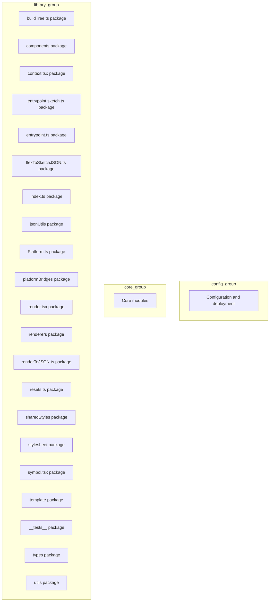

# Architecture report: airbnb/react-sketchapp

> Automated static analysis. **Observed** = directly seen in files/imports/AST; **Inferred** = interpretation from that evidence. Repository code was not executed.

## 1. Repository at a glance

| Item | Value |
| --- | --- |
| Repository | airbnb/react-sketchapp |
| Description | render React components to Sketch ⚛️💎 |
| Language | TypeScript |
| Stars | 14848 |
| Licence | MIT |
| Analysed commit / branch | b238e69c6f1e65ec6b1d8a908a91fbd9a8cc43a7 / master |
| Framework(s) | React |
| Files analysed | 320 |
| Components | 23 |

## 2. Architecture in one minute

airbnb/react-sketchapp - render React components to Sketch ⚛️💎. This repository was analysed statically from 320 file(s) (0 Python). Detected technologies (observed from imports/manifests): React, Jest, TypeScript. Files are grouped into 23 component(s): buildTree.ts package, components package, Configuration and deployment, context.tsx package, Core modules, entrypoint.sketch.ts package, entrypoint.ts package, flexToSketchJSON.ts package. Findings below distinguish observed facts from inferred interpretation.

## 3. High-level block diagram

## 4. Main components

### buildTree.ts package (`buildtree_ts`)

- **Kind:** library
- **Status:** Observed
- **Confidence:** 0.85
- **Responsibility:** Groups 1 file(s) under buildtree.ts package (observed from repository paths and static analysis).
- **Paths:** `src/buildTree.ts`
- **Evidence:** [src/buildTree.ts](https://github.com/airbnb/react-sketchapp/blob/b238e69c6f1e65ec6b1d8a908a91fbd9a8cc43a7/src/buildTree.ts)

### components package (`components`)

- **Kind:** library
- **Status:** Observed
- **Confidence:** 0.85
- **Responsibility:** Groups 38 file(s) under components package (observed from repository paths and static analysis).
- **Paths:** `src/components/Artboard.tsx`, `src/components/Document.tsx`, `src/components/Image.tsx`, `src/components/ImageStylePropTypes.ts`, `src/components/Page.tsx`, `src/components/PageStylePropTypes.ts`, `src/components/RedBox.tsx`, `src/components/ResizeModePropTypes.ts`, `src/components/ResizingConstraintPropTypes.ts`, `src/components/ShadowsPropTypes.ts`, `src/components/Svg/Circle.tsx`, `src/components/Svg/ClipPath.tsx`, `src/components/Svg/Defs.tsx`, `src/components/Svg/Ellipse.tsx`, `src/components/Svg/G.tsx`, `src/components/Svg/Image.tsx`, `src/components/Svg/Line.tsx`, `src/components/Svg/LinearGradient.tsx`, `src/components/Svg/Path.tsx`, `src/components/Svg/Pattern.tsx`, `src/components/Svg/Polygon.tsx`, `src/components/Svg/Polyline.tsx`, `src/components/Svg/RadialGradient.tsx`, `src/components/Svg/Rect.tsx`, `src/components/Svg/Stop.tsx`, `src/components/Svg/Svg.tsx`, `src/components/Svg/Symbol.tsx`, `src/components/Svg/TSpan.tsx`, `src/components/Svg/Text.tsx`, `src/components/Svg/TextPath.tsx`, `src/components/Svg/Use.tsx`, `src/components/Svg/index.tsx`, `src/components/Svg/props.ts`, `src/components/Text.tsx`, `src/components/TextStylePropTypes.ts`, `src/components/View.tsx`, `src/components/ViewStylePropTypes.ts`, `src/components/index.ts`
- **Evidence:** [src/components/Artboard.tsx](https://github.com/airbnb/react-sketchapp/blob/b238e69c6f1e65ec6b1d8a908a91fbd9a8cc43a7/src/components/Artboard.tsx); [src/components/Document.tsx](https://github.com/airbnb/react-sketchapp/blob/b238e69c6f1e65ec6b1d8a908a91fbd9a8cc43a7/src/components/Document.tsx); [src/components/Image.tsx](https://github.com/airbnb/react-sketchapp/blob/b238e69c6f1e65ec6b1d8a908a91fbd9a8cc43a7/src/components/Image.tsx); [src/components/ImageStylePropTypes.ts](https://github.com/airbnb/react-sketchapp/blob/b238e69c6f1e65ec6b1d8a908a91fbd9a8cc43a7/src/components/ImageStylePropTypes.ts); [src/components/Page.tsx](https://github.com/airbnb/react-sketchapp/blob/b238e69c6f1e65ec6b1d8a908a91fbd9a8cc43a7/src/components/Page.tsx); [src/components/PageStylePropTypes.ts](https://github.com/airbnb/react-sketchapp/blob/b238e69c6f1e65ec6b1d8a908a91fbd9a8cc43a7/src/components/PageStylePropTypes.ts); [src/components/RedBox.tsx](https://github.com/airbnb/react-sketchapp/blob/b238e69c6f1e65ec6b1d8a908a91fbd9a8cc43a7/src/components/RedBox.tsx); [src/components/ResizeModePropTypes.ts](https://github.com/airbnb/react-sketchapp/blob/b238e69c6f1e65ec6b1d8a908a91fbd9a8cc43a7/src/components/ResizeModePropTypes.ts)

### Configuration and deployment (`config`)

- **Kind:** config
- **Status:** Observed
- **Confidence:** 0.85
- **Responsibility:** Groups 6 file(s) under configuration and deployment (observed from repository paths and static analysis).
- **Paths:** `book.json`, `package.json`, `template/package.json`, `template/src/manifest.json`, `tsconfig.json`, `tsconfig.module.json`
- **Evidence:** [book.json](https://github.com/airbnb/react-sketchapp/blob/b238e69c6f1e65ec6b1d8a908a91fbd9a8cc43a7/book.json); [package.json](https://github.com/airbnb/react-sketchapp/blob/b238e69c6f1e65ec6b1d8a908a91fbd9a8cc43a7/package.json); [template/package.json](https://github.com/airbnb/react-sketchapp/blob/b238e69c6f1e65ec6b1d8a908a91fbd9a8cc43a7/template/package.json); [template/src/manifest.json](https://github.com/airbnb/react-sketchapp/blob/b238e69c6f1e65ec6b1d8a908a91fbd9a8cc43a7/template/src/manifest.json); [tsconfig.json](https://github.com/airbnb/react-sketchapp/blob/b238e69c6f1e65ec6b1d8a908a91fbd9a8cc43a7/tsconfig.json); [tsconfig.module.json](https://github.com/airbnb/react-sketchapp/blob/b238e69c6f1e65ec6b1d8a908a91fbd9a8cc43a7/tsconfig.module.json)

### context.tsx package (`context_tsx`)

- **Kind:** library
- **Status:** Observed
- **Confidence:** 0.85
- **Responsibility:** Groups 1 file(s) under context.tsx package (observed from repository paths and static analysis).
- **Paths:** `src/context.tsx`
- **Evidence:** [src/context.tsx](https://github.com/airbnb/react-sketchapp/blob/b238e69c6f1e65ec6b1d8a908a91fbd9a8cc43a7/src/context.tsx)

### Core modules (`core`)

- **Kind:** core
- **Status:** Observed
- **Confidence:** 0.85
- **Responsibility:** Groups 2 file(s) under core modules (observed from repository paths and static analysis).
- **Paths:** `jest.config.js`, `prettier.config.js`
- **Evidence:** [jest.config.js](https://github.com/airbnb/react-sketchapp/blob/b238e69c6f1e65ec6b1d8a908a91fbd9a8cc43a7/jest.config.js); [prettier.config.js](https://github.com/airbnb/react-sketchapp/blob/b238e69c6f1e65ec6b1d8a908a91fbd9a8cc43a7/prettier.config.js)

### entrypoint.sketch.ts package (`entrypoint_sketch_ts`)

- **Kind:** library
- **Status:** Observed
- **Confidence:** 0.85
- **Responsibility:** Groups 1 file(s) under entrypoint.sketch.ts package (observed from repository paths and static analysis).
- **Paths:** `src/entrypoint.sketch.ts`
- **Evidence:** [src/entrypoint.sketch.ts](https://github.com/airbnb/react-sketchapp/blob/b238e69c6f1e65ec6b1d8a908a91fbd9a8cc43a7/src/entrypoint.sketch.ts)

### entrypoint.ts package (`entrypoint_ts`)

- **Kind:** library
- **Status:** Observed
- **Confidence:** 0.85
- **Responsibility:** Groups 1 file(s) under entrypoint.ts package (observed from repository paths and static analysis).
- **Paths:** `src/entrypoint.ts`
- **Evidence:** [src/entrypoint.ts](https://github.com/airbnb/react-sketchapp/blob/b238e69c6f1e65ec6b1d8a908a91fbd9a8cc43a7/src/entrypoint.ts)

### flexToSketchJSON.ts package (`flextosketchjson_ts`)

- **Kind:** library
- **Status:** Observed
- **Confidence:** 0.85
- **Responsibility:** Groups 1 file(s) under flextosketchjson.ts package (observed from repository paths and static analysis).
- **Paths:** `src/flexToSketchJSON.ts`
- **Evidence:** [src/flexToSketchJSON.ts](https://github.com/airbnb/react-sketchapp/blob/b238e69c6f1e65ec6b1d8a908a91fbd9a8cc43a7/src/flexToSketchJSON.ts)

### index.ts package (`index_ts`)

- **Kind:** library
- **Status:** Observed
- **Confidence:** 0.85
- **Responsibility:** Groups 1 file(s) under index.ts package (observed from repository paths and static analysis).
- **Paths:** `src/index.ts`
- **Evidence:** [src/index.ts](https://github.com/airbnb/react-sketchapp/blob/b238e69c6f1e65ec6b1d8a908a91fbd9a8cc43a7/src/index.ts)

### jsonUtils package (`jsonutils`)

- **Kind:** library
- **Status:** Observed
- **Confidence:** 0.85
- **Responsibility:** Groups 20 file(s) under jsonutils package (observed from repository paths and static analysis).
- **Paths:** `src/jsonUtils/borders.ts`, `src/jsonUtils/computeTextTree.ts`, `src/jsonUtils/computeYogaNode.ts`, `src/jsonUtils/computeYogaTree.ts`, `src/jsonUtils/hotspotLayer.ts`, `src/jsonUtils/layerGroup.ts`, `src/jsonUtils/makeSvgLayer/graphics/curvePoint.ts`, `src/jsonUtils/makeSvgLayer/graphics/path.ts`, `src/jsonUtils/makeSvgLayer/graphics/point.ts`, `src/jsonUtils/makeSvgLayer/graphics/rect.ts`, `src/jsonUtils/makeSvgLayer/graphics/types.ts`, `src/jsonUtils/makeSvgLayer/index.sketch.ts`, `src/jsonUtils/makeSvgLayer/index.ts`, `src/jsonUtils/models.ts`, `src/jsonUtils/resizeConstraint.ts`, `src/jsonUtils/shapeLayers.ts`, `src/jsonUtils/sketchJson/fromSJSON.ts`, `src/jsonUtils/sketchJson/toSJSON.ts`, `src/jsonUtils/style.ts`, `src/jsonUtils/textLayers.ts`
- **Evidence:** [src/jsonUtils/borders.ts](https://github.com/airbnb/react-sketchapp/blob/b238e69c6f1e65ec6b1d8a908a91fbd9a8cc43a7/src/jsonUtils/borders.ts); [src/jsonUtils/computeTextTree.ts](https://github.com/airbnb/react-sketchapp/blob/b238e69c6f1e65ec6b1d8a908a91fbd9a8cc43a7/src/jsonUtils/computeTextTree.ts); [src/jsonUtils/computeYogaNode.ts](https://github.com/airbnb/react-sketchapp/blob/b238e69c6f1e65ec6b1d8a908a91fbd9a8cc43a7/src/jsonUtils/computeYogaNode.ts); [src/jsonUtils/computeYogaTree.ts](https://github.com/airbnb/react-sketchapp/blob/b238e69c6f1e65ec6b1d8a908a91fbd9a8cc43a7/src/jsonUtils/computeYogaTree.ts); [src/jsonUtils/hotspotLayer.ts](https://github.com/airbnb/react-sketchapp/blob/b238e69c6f1e65ec6b1d8a908a91fbd9a8cc43a7/src/jsonUtils/hotspotLayer.ts); [src/jsonUtils/layerGroup.ts](https://github.com/airbnb/react-sketchapp/blob/b238e69c6f1e65ec6b1d8a908a91fbd9a8cc43a7/src/jsonUtils/layerGroup.ts); [src/jsonUtils/makeSvgLayer/graphics/curvePoint.ts](https://github.com/airbnb/react-sketchapp/blob/b238e69c6f1e65ec6b1d8a908a91fbd9a8cc43a7/src/jsonUtils/makeSvgLayer/graphics/curvePoint.ts); [src/jsonUtils/makeSvgLayer/graphics/path.ts](https://github.com/airbnb/react-sketchapp/blob/b238e69c6f1e65ec6b1d8a908a91fbd9a8cc43a7/src/jsonUtils/makeSvgLayer/graphics/path.ts)

### Platform.ts package (`platform_ts`)

- **Kind:** library
- **Status:** Observed
- **Confidence:** 0.85
- **Responsibility:** Groups 1 file(s) under platform.ts package (observed from repository paths and static analysis).
- **Paths:** `src/Platform.ts`
- **Evidence:** [src/Platform.ts](https://github.com/airbnb/react-sketchapp/blob/b238e69c6f1e65ec6b1d8a908a91fbd9a8cc43a7/src/Platform.ts)

### platformBridges package (`platformbridges`)

- **Kind:** library
- **Status:** Observed
- **Confidence:** 0.85
- **Responsibility:** Groups 5 file(s) under platformbridges package (observed from repository paths and static analysis).
- **Paths:** `src/platformBridges/macos.ts`, `src/platformBridges/sketch/createStringMeasurer.ts`, `src/platformBridges/sketch/findFontName.ts`, `src/platformBridges/sketch/index.ts`, `src/platformBridges/sketch/makeImageDataFromUrl.ts`
- **Evidence:** [src/platformBridges/macos.ts](https://github.com/airbnb/react-sketchapp/blob/b238e69c6f1e65ec6b1d8a908a91fbd9a8cc43a7/src/platformBridges/macos.ts); [src/platformBridges/sketch/createStringMeasurer.ts](https://github.com/airbnb/react-sketchapp/blob/b238e69c6f1e65ec6b1d8a908a91fbd9a8cc43a7/src/platformBridges/sketch/createStringMeasurer.ts); [src/platformBridges/sketch/findFontName.ts](https://github.com/airbnb/react-sketchapp/blob/b238e69c6f1e65ec6b1d8a908a91fbd9a8cc43a7/src/platformBridges/sketch/findFontName.ts); [src/platformBridges/sketch/index.ts](https://github.com/airbnb/react-sketchapp/blob/b238e69c6f1e65ec6b1d8a908a91fbd9a8cc43a7/src/platformBridges/sketch/index.ts); [src/platformBridges/sketch/makeImageDataFromUrl.ts](https://github.com/airbnb/react-sketchapp/blob/b238e69c6f1e65ec6b1d8a908a91fbd9a8cc43a7/src/platformBridges/sketch/makeImageDataFromUrl.ts)

### render.tsx package (`render_tsx`)

- **Kind:** library
- **Status:** Observed
- **Confidence:** 0.85
- **Responsibility:** Groups 1 file(s) under render.tsx package (observed from repository paths and static analysis).
- **Paths:** `src/render.tsx`
- **Evidence:** [src/render.tsx](https://github.com/airbnb/react-sketchapp/blob/b238e69c6f1e65ec6b1d8a908a91fbd9a8cc43a7/src/render.tsx)

### renderers package (`renderers`)

- **Kind:** library
- **Status:** Observed
- **Confidence:** 0.85
- **Responsibility:** Groups 9 file(s) under renderers package (observed from repository paths and static analysis).
- **Paths:** `src/renderers/ArtboardRenderer.ts`, `src/renderers/ImageRenderer.ts`, `src/renderers/SketchRenderer.ts`, `src/renderers/SvgRenderer.ts`, `src/renderers/SymbolInstanceRenderer.ts`, `src/renderers/SymbolMasterRenderer.ts`, `src/renderers/TextRenderer.ts`, `src/renderers/ViewRenderer.ts`, `src/renderers/index.ts`
- **Evidence:** [src/renderers/ArtboardRenderer.ts](https://github.com/airbnb/react-sketchapp/blob/b238e69c6f1e65ec6b1d8a908a91fbd9a8cc43a7/src/renderers/ArtboardRenderer.ts); [src/renderers/ImageRenderer.ts](https://github.com/airbnb/react-sketchapp/blob/b238e69c6f1e65ec6b1d8a908a91fbd9a8cc43a7/src/renderers/ImageRenderer.ts); [src/renderers/SketchRenderer.ts](https://github.com/airbnb/react-sketchapp/blob/b238e69c6f1e65ec6b1d8a908a91fbd9a8cc43a7/src/renderers/SketchRenderer.ts); [src/renderers/SvgRenderer.ts](https://github.com/airbnb/react-sketchapp/blob/b238e69c6f1e65ec6b1d8a908a91fbd9a8cc43a7/src/renderers/SvgRenderer.ts); [src/renderers/SymbolInstanceRenderer.ts](https://github.com/airbnb/react-sketchapp/blob/b238e69c6f1e65ec6b1d8a908a91fbd9a8cc43a7/src/renderers/SymbolInstanceRenderer.ts); [src/renderers/SymbolMasterRenderer.ts](https://github.com/airbnb/react-sketchapp/blob/b238e69c6f1e65ec6b1d8a908a91fbd9a8cc43a7/src/renderers/SymbolMasterRenderer.ts); [src/renderers/TextRenderer.ts](https://github.com/airbnb/react-sketchapp/blob/b238e69c6f1e65ec6b1d8a908a91fbd9a8cc43a7/src/renderers/TextRenderer.ts); [src/renderers/ViewRenderer.ts](https://github.com/airbnb/react-sketchapp/blob/b238e69c6f1e65ec6b1d8a908a91fbd9a8cc43a7/src/renderers/ViewRenderer.ts)

### renderToJSON.ts package (`rendertojson_ts`)

- **Kind:** library
- **Status:** Observed
- **Confidence:** 0.85
- **Responsibility:** Groups 1 file(s) under rendertojson.ts package (observed from repository paths and static analysis).
- **Paths:** `src/renderToJSON.ts`
- **Evidence:** [src/renderToJSON.ts](https://github.com/airbnb/react-sketchapp/blob/b238e69c6f1e65ec6b1d8a908a91fbd9a8cc43a7/src/renderToJSON.ts)

### resets.ts package (`resets_ts`)

- **Kind:** library
- **Status:** Observed
- **Confidence:** 0.85
- **Responsibility:** Groups 1 file(s) under resets.ts package (observed from repository paths and static analysis).
- **Paths:** `src/resets.ts`
- **Evidence:** [src/resets.ts](https://github.com/airbnb/react-sketchapp/blob/b238e69c6f1e65ec6b1d8a908a91fbd9a8cc43a7/src/resets.ts)

### sharedStyles package (`sharedstyles`)

- **Kind:** library
- **Status:** Observed
- **Confidence:** 0.85
- **Responsibility:** Groups 1 file(s) under sharedstyles package (observed from repository paths and static analysis).
- **Paths:** `src/sharedStyles/TextStyles.ts`
- **Evidence:** [src/sharedStyles/TextStyles.ts](https://github.com/airbnb/react-sketchapp/blob/b238e69c6f1e65ec6b1d8a908a91fbd9a8cc43a7/src/sharedStyles/TextStyles.ts)

### stylesheet package (`stylesheet`)

- **Kind:** library
- **Status:** Observed
- **Confidence:** 0.85
- **Responsibility:** Groups 3 file(s) under stylesheet package (observed from repository paths and static analysis).
- **Paths:** `src/stylesheet/expandStyle.ts`, `src/stylesheet/index.ts`, `src/stylesheet/types.ts`
- **Evidence:** [src/stylesheet/expandStyle.ts](https://github.com/airbnb/react-sketchapp/blob/b238e69c6f1e65ec6b1d8a908a91fbd9a8cc43a7/src/stylesheet/expandStyle.ts); [src/stylesheet/index.ts](https://github.com/airbnb/react-sketchapp/blob/b238e69c6f1e65ec6b1d8a908a91fbd9a8cc43a7/src/stylesheet/index.ts); [src/stylesheet/types.ts](https://github.com/airbnb/react-sketchapp/blob/b238e69c6f1e65ec6b1d8a908a91fbd9a8cc43a7/src/stylesheet/types.ts)

### symbol.tsx package (`symbol_tsx`)

- **Kind:** library
- **Status:** Observed
- **Confidence:** 0.85
- **Responsibility:** Groups 1 file(s) under symbol.tsx package (observed from repository paths and static analysis).
- **Paths:** `src/symbol.tsx`
- **Evidence:** [src/symbol.tsx](https://github.com/airbnb/react-sketchapp/blob/b238e69c6f1e65ec6b1d8a908a91fbd9a8cc43a7/src/symbol.tsx)

### template package (`template`)

- **Kind:** library
- **Status:** Observed
- **Confidence:** 0.85
- **Responsibility:** Groups 1 file(s) under template package (observed from repository paths and static analysis).
- **Paths:** `template/src/my-command.js`
- **Evidence:** [template/src/my-command.js](https://github.com/airbnb/react-sketchapp/blob/b238e69c6f1e65ec6b1d8a908a91fbd9a8cc43a7/template/src/my-command.js)

### __tests__ package (`tests`)

- **Kind:** library
- **Status:** Observed
- **Confidence:** 0.85
- **Responsibility:** Groups 25 file(s) under __tests__ package (observed from repository paths and static analysis).
- **Paths:** `__tests__/jest/components/Artboard.tsx`, `__tests__/jest/components/Document.tsx`, `__tests__/jest/components/Image.tsx`, `__tests__/jest/components/Page.tsx`, `__tests__/jest/components/RedBox.tsx`, `__tests__/jest/components/Svg.tsx`, `__tests__/jest/components/Text.tsx`, `__tests__/jest/components/View.tsx`, `__tests__/jest/components/nodeImpl/Svg.tsx`, `__tests__/jest/index.ts`, `__tests__/jest/jsonUtils/computeTextTree.ts`, `__tests__/jest/jsonUtils/computeYogaNode.ts`, `__tests__/jest/jsonUtils/computeYogaTree.ts`, `__tests__/jest/jsonUtils/layerGroup.ts`, `__tests__/jest/jsonUtils/models.ts`, `__tests__/jest/jsonUtils/shapeLayers.ts`, `__tests__/jest/jsonUtils/style.ts`, `__tests__/jest/reactTreeToFlexTree.ts`, `__tests__/jest/sharedStyles/TextStyles.ts`, `__tests__/jest/utils/isDefined.ts`, `__tests__/jest/utils/sortObjectKeys.ts`, `__tests__/jest/utils/zIndex.ts`, `__tests__/skpm/basic.test.js`, `__tests__/skpm/render-context.test.js`, `__tests__/skpm/render-in-wrapped-object.test.js`
- **Evidence:** [__tests__/jest/components/Artboard.tsx](https://github.com/airbnb/react-sketchapp/blob/b238e69c6f1e65ec6b1d8a908a91fbd9a8cc43a7/__tests__/jest/components/Artboard.tsx); [__tests__/jest/components/Document.tsx](https://github.com/airbnb/react-sketchapp/blob/b238e69c6f1e65ec6b1d8a908a91fbd9a8cc43a7/__tests__/jest/components/Document.tsx); [__tests__/jest/components/Image.tsx](https://github.com/airbnb/react-sketchapp/blob/b238e69c6f1e65ec6b1d8a908a91fbd9a8cc43a7/__tests__/jest/components/Image.tsx); [__tests__/jest/components/Page.tsx](https://github.com/airbnb/react-sketchapp/blob/b238e69c6f1e65ec6b1d8a908a91fbd9a8cc43a7/__tests__/jest/components/Page.tsx); [__tests__/jest/components/RedBox.tsx](https://github.com/airbnb/react-sketchapp/blob/b238e69c6f1e65ec6b1d8a908a91fbd9a8cc43a7/__tests__/jest/components/RedBox.tsx); [__tests__/jest/components/Svg.tsx](https://github.com/airbnb/react-sketchapp/blob/b238e69c6f1e65ec6b1d8a908a91fbd9a8cc43a7/__tests__/jest/components/Svg.tsx); [__tests__/jest/components/Text.tsx](https://github.com/airbnb/react-sketchapp/blob/b238e69c6f1e65ec6b1d8a908a91fbd9a8cc43a7/__tests__/jest/components/Text.tsx); [__tests__/jest/components/View.tsx](https://github.com/airbnb/react-sketchapp/blob/b238e69c6f1e65ec6b1d8a908a91fbd9a8cc43a7/__tests__/jest/components/View.tsx)

### types package (`types`)

- **Kind:** library
- **Status:** Observed
- **Confidence:** 0.85
- **Responsibility:** Groups 7 file(s) under types package (observed from repository paths and static analysis).
- **Paths:** `src/types/globals.d.ts`, `src/types/index.ts`, `src/types/intrinsic.d.ts`, `src/types/js-sha1.d.ts`, `src/types/murmur2js.d.ts`, `src/types/node-sketch-bridge.d.ts`, `src/types/normalize-css-color.d.ts`
- **Evidence:** [src/types/globals.d.ts](https://github.com/airbnb/react-sketchapp/blob/b238e69c6f1e65ec6b1d8a908a91fbd9a8cc43a7/src/types/globals.d.ts); [src/types/index.ts](https://github.com/airbnb/react-sketchapp/blob/b238e69c6f1e65ec6b1d8a908a91fbd9a8cc43a7/src/types/index.ts); [src/types/intrinsic.d.ts](https://github.com/airbnb/react-sketchapp/blob/b238e69c6f1e65ec6b1d8a908a91fbd9a8cc43a7/src/types/intrinsic.d.ts); [src/types/js-sha1.d.ts](https://github.com/airbnb/react-sketchapp/blob/b238e69c6f1e65ec6b1d8a908a91fbd9a8cc43a7/src/types/js-sha1.d.ts); [src/types/murmur2js.d.ts](https://github.com/airbnb/react-sketchapp/blob/b238e69c6f1e65ec6b1d8a908a91fbd9a8cc43a7/src/types/murmur2js.d.ts); [src/types/node-sketch-bridge.d.ts](https://github.com/airbnb/react-sketchapp/blob/b238e69c6f1e65ec6b1d8a908a91fbd9a8cc43a7/src/types/node-sketch-bridge.d.ts); [src/types/normalize-css-color.d.ts](https://github.com/airbnb/react-sketchapp/blob/b238e69c6f1e65ec6b1d8a908a91fbd9a8cc43a7/src/types/normalize-css-color.d.ts)

### utils package (`utils`)

- **Kind:** library
- **Status:** Observed
- **Confidence:** 0.85
- **Responsibility:** Groups 22 file(s) under utils package (observed from repository paths and static analysis).
- **Paths:** `src/utils/Context.ts`, `src/utils/constants.ts`, `src/utils/createStringMeasurer.ts`, `src/utils/getDocument.ts`, `src/utils/getImageDataFromURL.ts`, `src/utils/getSketchVersion.ts`, `src/utils/hasAnyDefined.ts`, `src/utils/hashStyle.ts`, `src/utils/isDefined.ts`, `src/utils/isNativeDocument.ts`, `src/utils/isNativePage.ts`, `src/utils/isNativeSymbolsPage.ts`, `src/utils/pick.ts`, `src/utils/processTransform/index.ts`, `src/utils/processTransform/matrix2D.ts`, `src/utils/processTransform/parseTransformOriginProp.ts`, `src/utils/processTransform/parseTransformProp.ts`, `src/utils/same.ts`, `src/utils/sharedTextStyles/index.sketch.ts`, `src/utils/sharedTextStyles/index.ts`, `src/utils/sortObjectKeys.ts`, `src/utils/zIndex.ts`
- **Evidence:** [src/utils/Context.ts](https://github.com/airbnb/react-sketchapp/blob/b238e69c6f1e65ec6b1d8a908a91fbd9a8cc43a7/src/utils/Context.ts); [src/utils/constants.ts](https://github.com/airbnb/react-sketchapp/blob/b238e69c6f1e65ec6b1d8a908a91fbd9a8cc43a7/src/utils/constants.ts); [src/utils/createStringMeasurer.ts](https://github.com/airbnb/react-sketchapp/blob/b238e69c6f1e65ec6b1d8a908a91fbd9a8cc43a7/src/utils/createStringMeasurer.ts); [src/utils/getDocument.ts](https://github.com/airbnb/react-sketchapp/blob/b238e69c6f1e65ec6b1d8a908a91fbd9a8cc43a7/src/utils/getDocument.ts); [src/utils/getImageDataFromURL.ts](https://github.com/airbnb/react-sketchapp/blob/b238e69c6f1e65ec6b1d8a908a91fbd9a8cc43a7/src/utils/getImageDataFromURL.ts); [src/utils/getSketchVersion.ts](https://github.com/airbnb/react-sketchapp/blob/b238e69c6f1e65ec6b1d8a908a91fbd9a8cc43a7/src/utils/getSketchVersion.ts); [src/utils/hasAnyDefined.ts](https://github.com/airbnb/react-sketchapp/blob/b238e69c6f1e65ec6b1d8a908a91fbd9a8cc43a7/src/utils/hasAnyDefined.ts); [src/utils/hashStyle.ts](https://github.com/airbnb/react-sketchapp/blob/b238e69c6f1e65ec6b1d8a908a91fbd9a8cc43a7/src/utils/hashStyle.ts)

## 5. Execution flow

**Observed** entry point(s):

- [src/components/Page.tsx](https://github.com/airbnb/react-sketchapp/blob/b238e69c6f1e65ec6b1d8a908a91fbd9a8cc43a7/src/components/Page.tsx)
- [src/components/Svg/index.tsx](https://github.com/airbnb/react-sketchapp/blob/b238e69c6f1e65ec6b1d8a908a91fbd9a8cc43a7/src/components/Svg/index.tsx)
- [src/components/index.ts](https://github.com/airbnb/react-sketchapp/blob/b238e69c6f1e65ec6b1d8a908a91fbd9a8cc43a7/src/components/index.ts)
- [src/index.ts](https://github.com/airbnb/react-sketchapp/blob/b238e69c6f1e65ec6b1d8a908a91fbd9a8cc43a7/src/index.ts)
- [src/jsonUtils/makeSvgLayer/index.ts](https://github.com/airbnb/react-sketchapp/blob/b238e69c6f1e65ec6b1d8a908a91fbd9a8cc43a7/src/jsonUtils/makeSvgLayer/index.ts)
- [src/platformBridges/sketch/index.ts](https://github.com/airbnb/react-sketchapp/blob/b238e69c6f1e65ec6b1d8a908a91fbd9a8cc43a7/src/platformBridges/sketch/index.ts)
- [src/renderers/index.ts](https://github.com/airbnb/react-sketchapp/blob/b238e69c6f1e65ec6b1d8a908a91fbd9a8cc43a7/src/renderers/index.ts)
- [src/stylesheet/index.ts](https://github.com/airbnb/react-sketchapp/blob/b238e69c6f1e65ec6b1d8a908a91fbd9a8cc43a7/src/stylesheet/index.ts)
- [src/types/index.ts](https://github.com/airbnb/react-sketchapp/blob/b238e69c6f1e65ec6b1d8a908a91fbd9a8cc43a7/src/types/index.ts)
- [src/utils/processTransform/index.ts](https://github.com/airbnb/react-sketchapp/blob/b238e69c6f1e65ec6b1d8a908a91fbd9a8cc43a7/src/utils/processTransform/index.ts)
- [src/utils/sharedTextStyles/index.ts](https://github.com/airbnb/react-sketchapp/blob/b238e69c6f1e65ec6b1d8a908a91fbd9a8cc43a7/src/utils/sharedTextStyles/index.ts)

Representative flow (derived from observed entry points and the import graph; steps beyond the entry point are **Inferred**):

1. Execution starts at an observed entry point listed above, if present.
2. No internal import relationships between components were observed.

## 6. Project structure

### `(root)`

- `.bookignore` - other (49 bytes)
- `.editorconfig` - config (173 bytes)
- `.gitignore` - other (180 bytes)
- `.npmignore` - other (216 bytes)
- `.travis.yml` - ci, YAML (746 bytes)
- `CHANGELOG.md` - docs (5603 bytes)
- `LICENSE` - docs (1063 bytes)
- `README.md` - docs (3106 bytes)
- `book.json` - config (439 bytes)
- `jest.config.js` - source, JavaScript (381 bytes)
- `package.json` - manifest (4035 bytes)
- `prettier.config.js` - source, JavaScript (108 bytes)
- `tsconfig.json` - config (690 bytes)
- `tsconfig.module.json` - config (164 bytes)

### `.github`

- `.github/CODE_OF_CONDUCT.md` - docs (3223 bytes)
- `.github/CONTRIBUTING.md` - docs (4026 bytes)
- `.github/ISSUE_TEMPLATE.md` - docs (778 bytes)

### `__tests__`

- `__tests__/jest/components/Artboard.tsx` - source, TypeScript (1825 bytes)
- `__tests__/jest/components/Document.tsx` - source, TypeScript (325 bytes)
- `__tests__/jest/components/Image.tsx` - source, TypeScript (4394 bytes)
- `__tests__/jest/components/Page.tsx` - source, TypeScript (861 bytes)
- `__tests__/jest/components/RedBox.tsx` - source, TypeScript (1075 bytes)
- `__tests__/jest/components/Svg.tsx` - source, TypeScript (1686 bytes)
- `__tests__/jest/components/Text.tsx` - source, TypeScript (1358 bytes)
- `__tests__/jest/components/View.tsx` - source, TypeScript (1358 bytes)
- `__tests__/jest/components/__snapshots__/Artboard.tsx.snap` - other (1164 bytes)
- `__tests__/jest/components/__snapshots__/Document.tsx.snap` - other (137 bytes)
- `__tests__/jest/components/__snapshots__/Image.tsx.snap` - other (3810 bytes)
- `__tests__/jest/components/__snapshots__/Page.tsx.snap` - other (461 bytes)
- `__tests__/jest/components/__snapshots__/RedBox.tsx.snap` - other (3307 bytes)
- `__tests__/jest/components/__snapshots__/Svg.tsx.snap` - other (1604 bytes)
- `__tests__/jest/components/__snapshots__/Text.tsx.snap` - other (714 bytes)
- `__tests__/jest/components/__snapshots__/View.tsx.snap` - other (787 bytes)
- `__tests__/jest/components/nodeImpl/Svg.tsx` - source, TypeScript (1163 bytes)
- `__tests__/jest/components/nodeImpl/__snapshots__/Svg.tsx.snap` - other (46824 bytes)
- `__tests__/jest/index.ts` - source, TypeScript (1100 bytes)
- `__tests__/jest/jsonUtils/computeTextTree.ts` - source, TypeScript (881 bytes)
- `__tests__/jest/jsonUtils/computeYogaNode.ts` - source, TypeScript (12252 bytes)
- `__tests__/jest/jsonUtils/computeYogaTree.ts` - source, TypeScript (1482 bytes)
- `__tests__/jest/jsonUtils/layerGroup.ts` - source, TypeScript (485 bytes)
- `__tests__/jest/jsonUtils/models.ts` - source, TypeScript (4234 bytes)
- `__tests__/jest/jsonUtils/shapeLayers.ts` - source, TypeScript (1770 bytes)
- `__tests__/jest/jsonUtils/style.ts` - source, TypeScript (1720 bytes)
- `__tests__/jest/reactTreeToFlexTree.ts` - source, TypeScript (3256 bytes)
- `__tests__/jest/sharedStyles/TextStyles.ts` - source, TypeScript (5354 bytes)
- `__tests__/jest/utils/isDefined.ts` - source, TypeScript (513 bytes)
- `__tests__/jest/utils/sortObjectKeys.ts` - source, TypeScript (304 bytes)
- `__tests__/jest/utils/zIndex.ts` - source, TypeScript (1100 bytes)
- `__tests__/skpm/basic.test.js` - source, JavaScript (1603 bytes)
- `__tests__/skpm/render-context.test.js` - source, JavaScript (1115 bytes)
- `__tests__/skpm/render-in-wrapped-object.test.js` - source, JavaScript (1501 bytes)

### `docs`

- `docs/API.md` - docs (20035 bytes)
- `docs/FAQ.md` - docs (4649 bytes)
- `docs/README.md` - docs (1136 bytes)
- `docs/examples.md` - docs (2536 bytes)
- `docs/guides/README.md` - docs (286 bytes)
- `docs/guides/data-fetching.md` - docs (1389 bytes)
- `docs/guides/getting-started.md` - docs (2577 bytes)
- `docs/guides/rendering.md` - docs (2063 bytes)
- `docs/guides/styling.md` - docs (5836 bytes)
- `docs/guides/universal-rendering.md` - docs (3154 bytes)
- `docs/guides/using-skpm.md` - docs (3147 bytes)

### `examples`

- `examples/.eslintrc` - other (79 bytes)
- `examples/.gitignore` - other (18 bytes)
- `examples/basic-setup-typescript/.gitignore` - other (26 bytes)
- `examples/basic-setup-typescript/README.md` - docs (1765 bytes)
- `examples/basic-setup-typescript/manifest.json` - config (263 bytes)
- `examples/basic-setup-typescript/package.json` - manifest (953 bytes)
- `examples/basic-setup-typescript/src/my-command.tsx` - source, TypeScript (1605 bytes)
- `examples/basic-setup-typescript/src/types/sketch.d.ts` - source, TypeScript (25 bytes)
- `examples/basic-setup-typescript/tsconfig.json` - config (313 bytes)
- `examples/basic-setup-typescript/webpack.skpm.config.js` - source, JavaScript (274 bytes)
- `examples/basic-setup/README.md` - docs (792 bytes)
- `examples/basic-setup/package.json` - manifest (674 bytes)
- `examples/basic-setup/src/manifest.json` - config (235 bytes)
- `examples/basic-setup/src/my-command.js` - source, JavaScript (1661 bytes)
- `examples/basic-setup/webpack.skpm.config.js` - source, JavaScript (274 bytes)
- `examples/basic-svg/README.md` - docs (881 bytes)
- `examples/basic-svg/package.json` - manifest (643 bytes)
- `examples/basic-svg/src/manifest.json` - config (233 bytes)
- `examples/basic-svg/src/my-command.js` - source, JavaScript (903 bytes)
- `examples/basic-svg/webpack.skpm.config.js` - source, JavaScript (274 bytes)
- `examples/colors/README.md` - docs (737 bytes)
- `examples/colors/package.json` - manifest (724 bytes)
- `examples/colors/src/main.js` - source, JavaScript (1158 bytes)
- `examples/colors/src/manifest.json` - config (365 bytes)
- `examples/colors/webpack.skpm.config.js` - source, JavaScript (274 bytes)
- `examples/emotion/package.json` - manifest (681 bytes)
- `examples/emotion/src/manifest.json` - config (224 bytes)
- `examples/emotion/src/my-command.js` - source, JavaScript (962 bytes)
- `examples/emotion/webpack.skpm.config.js` - source, JavaScript (274 bytes)
- `examples/form-validation/README.md` - docs (743 bytes)
- `examples/form-validation/package.json` - manifest (858 bytes)
- `examples/form-validation/src/components/Button.js` - source, JavaScript (595 bytes)
- `examples/form-validation/src/components/Register.js` - source, JavaScript (1136 bytes)
- `examples/form-validation/src/components/Space.js` - source, JavaScript (251 bytes)
- `examples/form-validation/src/components/StrengthMeter.js` - source, JavaScript (1858 bytes)
- `examples/form-validation/src/components/TextBox/index.js` - source, JavaScript (932 bytes)
- `examples/form-validation/src/components/TextBox/index.sketch.js` - source, JavaScript (461 bytes)
- `examples/form-validation/src/components/TextBox/style.js` - source, JavaScript (558 bytes)
- `examples/form-validation/src/data.js` - source, JavaScript (390 bytes)
- `examples/form-validation/src/designSystem.js` - source, JavaScript (664 bytes)
- `examples/form-validation/src/main.js` - source, JavaScript (822 bytes)
- `examples/form-validation/src/manifest.json` - config (261 bytes)
- `examples/form-validation/src/web.js` - source, JavaScript (641 bytes)
- `examples/form-validation/webpack.skpm.config.js` - source, JavaScript (274 bytes)
- `examples/foursquare-maps/.eslintrc` - other (40 bytes)
- `examples/foursquare-maps/README.md` - docs (1078 bytes)
- `examples/foursquare-maps/package.json` - manifest (885 bytes)
- `examples/foursquare-maps/src/App.js` - source, JavaScript (2043 bytes)
- `examples/foursquare-maps/src/getVenues.js` - source, JavaScript (651 bytes)
- `examples/foursquare-maps/src/main.js` - source, JavaScript (395 bytes)
- `examples/foursquare-maps/src/manifest.json` - config (270 bytes)
- `examples/foursquare-maps/src/web.js` - source, JavaScript (291 bytes)
- `examples/foursquare-maps/webpack.skpm.config.js` - source, JavaScript (274 bytes)
- `examples/glamorous/README.md` - docs (487 bytes)
- `examples/glamorous/package.json` - manifest (694 bytes)
- `examples/glamorous/src/manifest.json` - config (233 bytes)
- `examples/glamorous/src/my-command.js` - source, JavaScript (790 bytes)
- `examples/glamorous/webpack.skpm.config.js` - source, JavaScript (274 bytes)
- `examples/profile-cards-graphql/README.md` - docs (800 bytes)
- `examples/profile-cards-graphql/package.json` - manifest (818 bytes)
- `examples/profile-cards-graphql/src/components/Profile.js` - source, JavaScript (1191 bytes)
- `examples/profile-cards-graphql/src/components/Space.js` - source, JavaScript (250 bytes)
- `examples/profile-cards-graphql/src/designSystem.js` - source, JavaScript (1324 bytes)
- `examples/profile-cards-graphql/src/main.js` - source, JavaScript (1719 bytes)
- `examples/profile-cards-graphql/src/manifest.json` - config (270 bytes)
- `examples/profile-cards-graphql/webpack.skpm.config.js` - source, JavaScript (274 bytes)
- `examples/profile-cards-primitives/README.md` - docs (963 bytes)
- `examples/profile-cards-primitives/nwb.config.js` - source, JavaScript (141 bytes)
- `examples/profile-cards-primitives/package.json` - manifest (770 bytes)
- `examples/profile-cards-primitives/src/components/Profile.js` - source, JavaScript (1202 bytes)
- `examples/profile-cards-primitives/src/components/Space.js` - source, JavaScript (251 bytes)
- `examples/profile-cards-primitives/src/data.js` - source, JavaScript (1189 bytes)
- `examples/profile-cards-primitives/src/designSystem.js` - source, JavaScript (1324 bytes)
- `examples/profile-cards-primitives/src/main.js` - source, JavaScript (798 bytes)
- `examples/profile-cards-primitives/src/manifest.json` - config (273 bytes)
- `examples/profile-cards-primitives/src/web.js` - source, JavaScript (1083 bytes)
- `examples/profile-cards-primitives/webpack.skpm.config.js` - source, JavaScript (274 bytes)
- `examples/profile-cards-react-with-styles/README.md` - docs (870 bytes)
- `examples/profile-cards-react-with-styles/package.json` - manifest (669 bytes)
- `examples/profile-cards-react-with-styles/src/components/Profile.js` - source, JavaScript (1090 bytes)
- `examples/profile-cards-react-with-styles/src/main.js` - source, JavaScript (1846 bytes)
- `examples/profile-cards-react-with-styles/src/manifest.json` - config (280 bytes)
- `examples/profile-cards-react-with-styles/src/theme.js` - source, JavaScript (1324 bytes)
- `examples/profile-cards-react-with-styles/src/types.js` - source, JavaScript (150 bytes)
- `examples/profile-cards-react-with-styles/src/withStyles.js` - source, JavaScript (519 bytes)
- `examples/profile-cards-react-with-styles/webpack.skpm.config.js` - source, JavaScript (274 bytes)
- `examples/profile-cards/README.md` - docs (734 bytes)
- `examples/profile-cards/package.json` - manifest (598 bytes)
- `examples/profile-cards/src/components/Profile.js` - source, JavaScript (1199 bytes)
- `examples/profile-cards/src/components/Space.js` - source, JavaScript (250 bytes)
- `examples/profile-cards/src/designSystem.js` - source, JavaScript (1324 bytes)
- `examples/profile-cards/src/main.js` - source, JavaScript (1966 bytes)
- `examples/profile-cards/src/manifest.json` - config (259 bytes)
- `examples/profile-cards/webpack.skpm.config.js` - source, JavaScript (274 bytes)
- `examples/react-router-prototyping/README.md` - docs (936 bytes)
- `examples/react-router-prototyping/package.json` - manifest (771 bytes)
- `examples/react-router-prototyping/src/App.js` - source, JavaScript (878 bytes)
- `examples/react-router-prototyping/src/components/AppBar.js` - source, JavaScript (719 bytes)
- `examples/react-router-prototyping/src/components/NavBar.js` - source, JavaScript (695 bytes)
- `examples/react-router-prototyping/src/main.js` - source, JavaScript (592 bytes)
- `examples/react-router-prototyping/src/manifest.json` - config (242 bytes)
- `examples/react-router-prototyping/src/routes/about.js` - source, JavaScript (624 bytes)
- `examples/react-router-prototyping/src/routes/home.js` - source, JavaScript (1073 bytes)
- `examples/react-router-prototyping/src/routes/post.js` - source, JavaScript (1916 bytes)
- `examples/react-router-prototyping/src/routes/profile.js` - source, JavaScript (615 bytes)
- `examples/react-router-prototyping/webpack.skpm.config.js` - source, JavaScript (274 bytes)
- `examples/styled-components/README.md` - docs (687 bytes)
- `examples/styled-components/package.json` - manifest (767 bytes)
- `examples/styled-components/src/manifest.json` - config (241 bytes)
- `examples/styled-components/src/my-command.js` - source, JavaScript (1923 bytes)
- `examples/styled-components/webpack.skpm.config.js` - source, JavaScript (274 bytes)
- `examples/styleguide/.flowconfig` - other (39 bytes)
- `examples/styleguide/README.md` - docs (871 bytes)
- `examples/styleguide/package.json` - manifest (619 bytes)
- `examples/styleguide/src/components/AccessibilityBadge.js` - source, JavaScript (417 bytes)
- `examples/styleguide/src/components/Badge.js` - source, JavaScript (480 bytes)
- `examples/styleguide/src/components/Label.js` - source, JavaScript (303 bytes)
- `examples/styleguide/src/components/Palette.js` - source, JavaScript (435 bytes)
- `examples/styleguide/src/components/Section.js` - source, JavaScript (351 bytes)
- `examples/styleguide/src/components/Swatch.js` - source, JavaScript (629 bytes)
- `examples/styleguide/src/components/TypeSpecimen.js` - source, JavaScript (479 bytes)
- `examples/styleguide/src/designSystem.js` - source, JavaScript (1495 bytes)
- `examples/styleguide/src/main.js` - source, JavaScript (1108 bytes)
- `examples/styleguide/src/manifest.json` - config (256 bytes)
- `examples/styleguide/src/processColor.js` - source, JavaScript (418 bytes)
- `examples/styleguide/webpack.skpm.config.js` - source, JavaScript (274 bytes)
- `examples/symbols/README.md` - docs (629 bytes)
- `examples/symbols/package.json` - manifest (610 bytes)
- `examples/symbols/src/manifest.json` - config (238 bytes)
- `examples/symbols/src/my-command.js` - source, JavaScript (1576 bytes)
- `examples/symbols/webpack.skpm.config.js` - source, JavaScript (274 bytes)
- `examples/timeline-airtable/.eslintrc` - other (39 bytes)
- `examples/timeline-airtable/README.md` - docs (750 bytes)
- `examples/timeline-airtable/package.json` - manifest (641 bytes)
- `examples/timeline-airtable/src/main.js` - source, JavaScript (3564 bytes)
- `examples/timeline-airtable/src/manifest.json` - config (266 bytes)
- `examples/timeline-airtable/webpack.skpm.config.js` - source, JavaScript (274 bytes)

### `src`

- `src/Platform.ts` - source, TypeScript (186 bytes)
- `src/buildTree.ts` - source, TypeScript (3685 bytes)
- `src/components/Artboard.tsx` - source, TypeScript (1311 bytes)
- `src/components/Document.tsx` - source, TypeScript (405 bytes)
- `src/components/Image.tsx` - source, TypeScript (2300 bytes)
- `src/components/ImageStylePropTypes.ts` - source, TypeScript (221 bytes)
- `src/components/Page.tsx` - source, TypeScript (862 bytes)
- `src/components/PageStylePropTypes.ts` - source, TypeScript (38 bytes)
- `src/components/RedBox.tsx` - source, TypeScript (2586 bytes)
- `src/components/ResizeModePropTypes.ts` - source, TypeScript (170 bytes)
- `src/components/ResizingConstraintPropTypes.ts` - source, TypeScript (249 bytes)
- `src/components/ShadowsPropTypes.ts` - source, TypeScript (386 bytes)
- `src/components/Svg/Circle.tsx` - source, TypeScript (576 bytes)
- `src/components/Svg/ClipPath.tsx` - source, TypeScript (404 bytes)
- `src/components/Svg/Defs.tsx` - source, TypeScript (349 bytes)
- `src/components/Svg/Ellipse.tsx` - source, TypeScript (621 bytes)
- `src/components/Svg/G.tsx` - source, TypeScript (427 bytes)
- `src/components/Svg/Image.tsx` - source, TypeScript (767 bytes)
- `src/components/Svg/Line.tsx` - source, TypeScript (612 bytes)
- `src/components/Svg/LinearGradient.tsx` - source, TypeScript (767 bytes)
- `src/components/Svg/Path.tsx` - source, TypeScript (442 bytes)
- `src/components/Svg/Pattern.tsx` - source, TypeScript (695 bytes)
- `src/components/Svg/Polygon.tsx` - source, TypeScript (539 bytes)
- `src/components/Svg/Polyline.tsx` - source, TypeScript (507 bytes)
- `src/components/Svg/RadialGradient.tsx` - source, TypeScript (836 bytes)
- `src/components/Svg/Rect.tsx` - source, TypeScript (680 bytes)
- `src/components/Svg/Stop.tsx` - source, TypeScript (554 bytes)
- `src/components/Svg/Svg.tsx` - source, TypeScript (2328 bytes)
- `src/components/Svg/Symbol.tsx` - source, TypeScript (506 bytes)
- `src/components/Svg/TSpan.tsx` - source, TypeScript (607 bytes)
- `src/components/Svg/Text.tsx` - source, TypeScript (604 bytes)
- `src/components/Svg/TextPath.tsx` - source, TypeScript (643 bytes)
- `src/components/Svg/Use.tsx` - source, TypeScript (859 bytes)
- `src/components/Svg/index.tsx` - source, TypeScript (758 bytes)
- `src/components/Svg/props.ts` - source, TypeScript (15764 bytes)
- `src/components/Text.tsx` - source, TypeScript (879 bytes)
- `src/components/TextStylePropTypes.ts` - source, TypeScript (1200 bytes)
- `src/components/View.tsx` - source, TypeScript (1400 bytes)
- `src/components/ViewStylePropTypes.ts` - source, TypeScript (3798 bytes)
- `src/components/index.ts` - source, TypeScript (280 bytes)
- `src/context.tsx` - source, TypeScript (1416 bytes)
- `src/entrypoint.sketch.ts` - source, TypeScript (1200 bytes)
- `src/entrypoint.ts` - source, TypeScript (1299 bytes)
- `src/flexToSketchJSON.ts` - source, TypeScript (2092 bytes)
- `src/index.ts` - source, TypeScript (283 bytes)
- `src/jsonUtils/borders.ts` - source, TypeScript (5155 bytes)
- `src/jsonUtils/computeTextTree.ts` - source, TypeScript (1799 bytes)
- `src/jsonUtils/computeYogaNode.ts` - source, TypeScript (10988 bytes)
- `src/jsonUtils/computeYogaTree.ts` - source, TypeScript (1252 bytes)
- `src/jsonUtils/hotspotLayer.ts` - source, TypeScript (899 bytes)
- `src/jsonUtils/layerGroup.ts` - source, TypeScript (1193 bytes)
- `src/jsonUtils/makeSvgLayer/graphics/curvePoint.ts` - source, TypeScript (654 bytes)
- `src/jsonUtils/makeSvgLayer/graphics/path.ts` - source, TypeScript (3185 bytes)
- `src/jsonUtils/makeSvgLayer/graphics/point.ts` - source, TypeScript (307 bytes)
- `src/jsonUtils/makeSvgLayer/graphics/rect.ts` - source, TypeScript (3150 bytes)
- `src/jsonUtils/makeSvgLayer/graphics/types.ts` - source, TypeScript (100 bytes)
- `src/jsonUtils/makeSvgLayer/index.sketch.ts` - source, TypeScript (896 bytes)
- `src/jsonUtils/makeSvgLayer/index.ts` - source, TypeScript (3388 bytes)
- `src/jsonUtils/models.ts` - source, TypeScript (7262 bytes)
- `src/jsonUtils/resizeConstraint.ts` - source, TypeScript (2548 bytes)
- `src/jsonUtils/shapeLayers.ts` - source, TypeScript (8116 bytes)
- `src/jsonUtils/sketchJson/fromSJSON.ts` - source, TypeScript (1142 bytes)
- `src/jsonUtils/sketchJson/toSJSON.ts` - source, TypeScript (591 bytes)
- `src/jsonUtils/style.ts` - source, TypeScript (6392 bytes)
- `src/jsonUtils/textLayers.ts` - source, TypeScript (8071 bytes)
- `src/platformBridges/macos.ts` - source, TypeScript (282 bytes)
- `src/platformBridges/sketch/createStringMeasurer.ts` - source, TypeScript (2910 bytes)
- `src/platformBridges/sketch/findFontName.ts` - source, TypeScript (5754 bytes)
- `src/platformBridges/sketch/index.ts` - source, TypeScript (356 bytes)
- `src/platformBridges/sketch/makeImageDataFromUrl.ts` - source, TypeScript (1345 bytes)
- `src/render.tsx` - source, TypeScript (4609 bytes)
- `src/renderToJSON.ts` - source, TypeScript (477 bytes)
- `src/renderers/ArtboardRenderer.ts` - source, TypeScript (2323 bytes)
- `src/renderers/ImageRenderer.ts` - source, TypeScript (1973 bytes)
- `src/renderers/SketchRenderer.ts` - source, TypeScript (1740 bytes)
- `src/renderers/SvgRenderer.ts` - source, TypeScript (2254 bytes)
- `src/renderers/SymbolInstanceRenderer.ts` - source, TypeScript (6791 bytes)
- `src/renderers/SymbolMasterRenderer.ts` - source, TypeScript (530 bytes)
- `src/renderers/TextRenderer.ts` - source, TypeScript (1246 bytes)
- `src/renderers/ViewRenderer.ts` - source, TypeScript (2800 bytes)
- `src/renderers/index.ts` - source, TypeScript (500 bytes)
- `src/resets.ts` - source, TypeScript (1068 bytes)
- `src/sharedStyles/TextStyles.ts` - source, TypeScript (3291 bytes)
- `src/stylesheet/expandStyle.ts` - source, TypeScript (2710 bytes)
- `src/stylesheet/index.ts` - source, TypeScript (3050 bytes)
- `src/stylesheet/types.ts` - source, TypeScript (616 bytes)
- `src/symbol.tsx` - source, TypeScript (8789 bytes)
- `src/types/globals.d.ts` - source, TypeScript (1246 bytes)
- `src/types/index.ts` - source, TypeScript (3307 bytes)
- `src/types/intrinsic.d.ts` - source, TypeScript (706 bytes)
- `src/types/js-sha1.d.ts` - source, TypeScript (418 bytes)
- `src/types/murmur2js.d.ts` - source, TypeScript (90 bytes)
- `src/types/node-sketch-bridge.d.ts` - source, TypeScript (37 bytes)
- `src/types/normalize-css-color.d.ts` - source, TypeScript (212 bytes)
- `src/utils/Context.ts` - source, TypeScript (515 bytes)
- `src/utils/constants.ts` - source, TypeScript (504 bytes)
- `src/utils/createStringMeasurer.ts` - source, TypeScript (628 bytes)
- `src/utils/getDocument.ts` - source, TypeScript (1661 bytes)
- `src/utils/getImageDataFromURL.ts` - source, TypeScript (293 bytes)
- `src/utils/getSketchVersion.ts` - source, TypeScript (212 bytes)
- `src/utils/hasAnyDefined.ts` - source, TypeScript (148 bytes)
- `src/utils/hashStyle.ts` - source, TypeScript (262 bytes)
- `src/utils/isDefined.ts` - source, TypeScript (112 bytes)
- `src/utils/isNativeDocument.ts` - source, TypeScript (207 bytes)
- `src/utils/isNativePage.ts` - source, TypeScript (148 bytes)
- `src/utils/isNativeSymbolsPage.ts` - source, TypeScript (241 bytes)
- `src/utils/pick.ts` - source, TypeScript (223 bytes)
- `src/utils/processTransform/index.ts` - source, TypeScript (2110 bytes)
- `src/utils/processTransform/matrix2D.ts` - source, TypeScript (3099 bytes)
- `src/utils/processTransform/parseTransformOriginProp.ts` - source, TypeScript (1785 bytes)
- `src/utils/processTransform/parseTransformProp.ts` - source, TypeScript (4434 bytes)
- `src/utils/same.ts` - source, TypeScript (87 bytes)
- `src/utils/sharedTextStyles/index.sketch.ts` - source, TypeScript (2725 bytes)
- `src/utils/sharedTextStyles/index.ts` - source, TypeScript (604 bytes)
- `src/utils/sortObjectKeys.ts` - source, TypeScript (237 bytes)
- `src/utils/zIndex.ts` - source, TypeScript (859 bytes)

### `template`

- `template/.gitignore` - other (186 bytes)
- `template/README.md` - docs (2066 bytes)
- `template/package.json` - manifest (614 bytes)
- `template/src/manifest.json` - config (270 bytes)
- `template/src/my-command.js` - source, JavaScript (1386 bytes)

## 7. Key dependencies and integrations

| Name | Category | Status | Confidence | Evidence |
| --- | --- | --- | --- | --- |
| React | framework | Observed | 0.90 | [examples/basic-setup-typescript/package.json:29](https://github.com/airbnb/react-sketchapp/blob/b238e69c6f1e65ec6b1d8a908a91fbd9a8cc43a7/examples/basic-setup-typescript/package.json#L29); [examples/basic-setup/package.json:24](https://github.com/airbnb/react-sketchapp/blob/b238e69c6f1e65ec6b1d8a908a91fbd9a8cc43a7/examples/basic-setup/package.json#L24); [examples/basic-svg/package.json:23](https://github.com/airbnb/react-sketchapp/blob/b238e69c6f1e65ec6b1d8a908a91fbd9a8cc43a7/examples/basic-svg/package.json#L23); [examples/colors/package.json:22](https://github.com/airbnb/react-sketchapp/blob/b238e69c6f1e65ec6b1d8a908a91fbd9a8cc43a7/examples/colors/package.json#L22) |
| Jest | tooling | Observed | 0.85 | [package.json:37](https://github.com/airbnb/react-sketchapp/blob/b238e69c6f1e65ec6b1d8a908a91fbd9a8cc43a7/package.json#L37) |
| TypeScript | tooling | Observed | 0.90 | [examples/basic-setup-typescript/package.json:2](https://github.com/airbnb/react-sketchapp/blob/b238e69c6f1e65ec6b1d8a908a91fbd9a8cc43a7/examples/basic-setup-typescript/package.json#L2); [package.json:109](https://github.com/airbnb/react-sketchapp/blob/b238e69c6f1e65ec6b1d8a908a91fbd9a8cc43a7/package.json#L109) |

## 8. Data and state

No database, cache, queue, or persistent-state usage was observed in the analysed files. State handling, if any, may be in-memory or in files that were not analysed.

## 9. Configuration and deployment clues

- `.editorconfig` (config)
- `.travis.yml` (ci)
- `book.json` (config)
- `examples/basic-setup-typescript/manifest.json` (config)
- `examples/basic-setup-typescript/package.json` (manifest)
- `examples/basic-setup-typescript/tsconfig.json` (config)
- `examples/basic-setup/package.json` (manifest)
- `examples/basic-setup/src/manifest.json` (config)
- `examples/basic-svg/package.json` (manifest)
- `examples/basic-svg/src/manifest.json` (config)
- `examples/colors/package.json` (manifest)
- `examples/colors/src/manifest.json` (config)
- `examples/emotion/package.json` (manifest)
- `examples/emotion/src/manifest.json` (config)
- `examples/form-validation/package.json` (manifest)
- `examples/form-validation/src/manifest.json` (config)
- `examples/foursquare-maps/package.json` (manifest)
- `examples/foursquare-maps/src/manifest.json` (config)
- `examples/glamorous/package.json` (manifest)
- `examples/glamorous/src/manifest.json` (config)
- `examples/profile-cards-graphql/package.json` (manifest)
- `examples/profile-cards-graphql/src/manifest.json` (config)
- `examples/profile-cards-primitives/package.json` (manifest)
- `examples/profile-cards-primitives/src/manifest.json` (config)
- `examples/profile-cards-react-with-styles/package.json` (manifest)
- `examples/profile-cards-react-with-styles/src/manifest.json` (config)
- `examples/profile-cards/package.json` (manifest)
- `examples/profile-cards/src/manifest.json` (config)
- `examples/react-router-prototyping/package.json` (manifest)
- `examples/react-router-prototyping/src/manifest.json` (config)
- `examples/styled-components/package.json` (manifest)
- `examples/styled-components/src/manifest.json` (config)
- `examples/styleguide/package.json` (manifest)
- `examples/styleguide/src/manifest.json` (config)
- `examples/symbols/package.json` (manifest)
- `examples/symbols/src/manifest.json` (config)
- `examples/timeline-airtable/package.json` (manifest)
- `examples/timeline-airtable/src/manifest.json` (config)
- `package.json` (manifest)
- `template/package.json` (manifest)
- `template/src/manifest.json` (config)
- `tsconfig.json` (config)
- `tsconfig.module.json` (config)

## 10. Design observations

- No strong design patterns could be established from the available evidence.

These observations are interpretations (**Inferred**) of the observed structure, not guarantees about runtime design.

## 11. Limitations and unknowns

- Static analysis only: repository code was not executed, installed, or imported at runtime.
- Components and relationships are inferred from file paths, imports, and AST structure; runtime behaviour, dynamic imports, and reflection may not be visible.
- No clear application entry point was observed in the analysed files.
- Repository text was treated as untrusted data; no instructions found in repository files were followed, and likely secret values were redacted/excluded.
- JavaScript and TypeScript files were inventoried from paths and package manifests. They were not parsed with a full language AST, and repository code was not executed.

## 12. Source references

- [__tests__/jest/components/Artboard.tsx](https://github.com/airbnb/react-sketchapp/blob/b238e69c6f1e65ec6b1d8a908a91fbd9a8cc43a7/__tests__/jest/components/Artboard.tsx)
- [__tests__/jest/components/Document.tsx](https://github.com/airbnb/react-sketchapp/blob/b238e69c6f1e65ec6b1d8a908a91fbd9a8cc43a7/__tests__/jest/components/Document.tsx)
- [__tests__/jest/components/Image.tsx](https://github.com/airbnb/react-sketchapp/blob/b238e69c6f1e65ec6b1d8a908a91fbd9a8cc43a7/__tests__/jest/components/Image.tsx)
- [__tests__/jest/components/Page.tsx](https://github.com/airbnb/react-sketchapp/blob/b238e69c6f1e65ec6b1d8a908a91fbd9a8cc43a7/__tests__/jest/components/Page.tsx)
- [__tests__/jest/components/RedBox.tsx](https://github.com/airbnb/react-sketchapp/blob/b238e69c6f1e65ec6b1d8a908a91fbd9a8cc43a7/__tests__/jest/components/RedBox.tsx)
- [__tests__/jest/components/Svg.tsx](https://github.com/airbnb/react-sketchapp/blob/b238e69c6f1e65ec6b1d8a908a91fbd9a8cc43a7/__tests__/jest/components/Svg.tsx)
- [__tests__/jest/components/Text.tsx](https://github.com/airbnb/react-sketchapp/blob/b238e69c6f1e65ec6b1d8a908a91fbd9a8cc43a7/__tests__/jest/components/Text.tsx)
- [__tests__/jest/components/View.tsx](https://github.com/airbnb/react-sketchapp/blob/b238e69c6f1e65ec6b1d8a908a91fbd9a8cc43a7/__tests__/jest/components/View.tsx)
- [book.json](https://github.com/airbnb/react-sketchapp/blob/b238e69c6f1e65ec6b1d8a908a91fbd9a8cc43a7/book.json)
- [examples/basic-setup-typescript/package.json:2](https://github.com/airbnb/react-sketchapp/blob/b238e69c6f1e65ec6b1d8a908a91fbd9a8cc43a7/examples/basic-setup-typescript/package.json#L2)
- [examples/basic-setup-typescript/package.json:29](https://github.com/airbnb/react-sketchapp/blob/b238e69c6f1e65ec6b1d8a908a91fbd9a8cc43a7/examples/basic-setup-typescript/package.json#L29)
- [examples/basic-setup/package.json:24](https://github.com/airbnb/react-sketchapp/blob/b238e69c6f1e65ec6b1d8a908a91fbd9a8cc43a7/examples/basic-setup/package.json#L24)
- [examples/basic-svg/package.json:23](https://github.com/airbnb/react-sketchapp/blob/b238e69c6f1e65ec6b1d8a908a91fbd9a8cc43a7/examples/basic-svg/package.json#L23)
- [examples/colors/package.json:22](https://github.com/airbnb/react-sketchapp/blob/b238e69c6f1e65ec6b1d8a908a91fbd9a8cc43a7/examples/colors/package.json#L22)
- [examples/emotion/package.json:22](https://github.com/airbnb/react-sketchapp/blob/b238e69c6f1e65ec6b1d8a908a91fbd9a8cc43a7/examples/emotion/package.json#L22)
- [examples/form-validation/package.json:15](https://github.com/airbnb/react-sketchapp/blob/b238e69c6f1e65ec6b1d8a908a91fbd9a8cc43a7/examples/form-validation/package.json#L15)
- [examples/form-validation/package.json:22](https://github.com/airbnb/react-sketchapp/blob/b238e69c6f1e65ec6b1d8a908a91fbd9a8cc43a7/examples/form-validation/package.json#L22)
- [examples/foursquare-maps/package.json:14](https://github.com/airbnb/react-sketchapp/blob/b238e69c6f1e65ec6b1d8a908a91fbd9a8cc43a7/examples/foursquare-maps/package.json#L14)
- [jest.config.js](https://github.com/airbnb/react-sketchapp/blob/b238e69c6f1e65ec6b1d8a908a91fbd9a8cc43a7/jest.config.js)
- [package.json](https://github.com/airbnb/react-sketchapp/blob/b238e69c6f1e65ec6b1d8a908a91fbd9a8cc43a7/package.json)
- [package.json:37](https://github.com/airbnb/react-sketchapp/blob/b238e69c6f1e65ec6b1d8a908a91fbd9a8cc43a7/package.json#L37)
- [package.json:109](https://github.com/airbnb/react-sketchapp/blob/b238e69c6f1e65ec6b1d8a908a91fbd9a8cc43a7/package.json#L109)
- [prettier.config.js](https://github.com/airbnb/react-sketchapp/blob/b238e69c6f1e65ec6b1d8a908a91fbd9a8cc43a7/prettier.config.js)
- [src/Platform.ts](https://github.com/airbnb/react-sketchapp/blob/b238e69c6f1e65ec6b1d8a908a91fbd9a8cc43a7/src/Platform.ts)
- [src/buildTree.ts](https://github.com/airbnb/react-sketchapp/blob/b238e69c6f1e65ec6b1d8a908a91fbd9a8cc43a7/src/buildTree.ts)
- [src/components/Artboard.tsx](https://github.com/airbnb/react-sketchapp/blob/b238e69c6f1e65ec6b1d8a908a91fbd9a8cc43a7/src/components/Artboard.tsx)
- [src/components/Document.tsx](https://github.com/airbnb/react-sketchapp/blob/b238e69c6f1e65ec6b1d8a908a91fbd9a8cc43a7/src/components/Document.tsx)
- [src/components/Image.tsx](https://github.com/airbnb/react-sketchapp/blob/b238e69c6f1e65ec6b1d8a908a91fbd9a8cc43a7/src/components/Image.tsx)
- [src/components/ImageStylePropTypes.ts](https://github.com/airbnb/react-sketchapp/blob/b238e69c6f1e65ec6b1d8a908a91fbd9a8cc43a7/src/components/ImageStylePropTypes.ts)
- [src/components/Page.tsx](https://github.com/airbnb/react-sketchapp/blob/b238e69c6f1e65ec6b1d8a908a91fbd9a8cc43a7/src/components/Page.tsx)
- [src/components/PageStylePropTypes.ts](https://github.com/airbnb/react-sketchapp/blob/b238e69c6f1e65ec6b1d8a908a91fbd9a8cc43a7/src/components/PageStylePropTypes.ts)
- [src/components/RedBox.tsx](https://github.com/airbnb/react-sketchapp/blob/b238e69c6f1e65ec6b1d8a908a91fbd9a8cc43a7/src/components/RedBox.tsx)
- [src/components/ResizeModePropTypes.ts](https://github.com/airbnb/react-sketchapp/blob/b238e69c6f1e65ec6b1d8a908a91fbd9a8cc43a7/src/components/ResizeModePropTypes.ts)
- [src/components/Svg/index.tsx](https://github.com/airbnb/react-sketchapp/blob/b238e69c6f1e65ec6b1d8a908a91fbd9a8cc43a7/src/components/Svg/index.tsx)
- [src/components/index.ts](https://github.com/airbnb/react-sketchapp/blob/b238e69c6f1e65ec6b1d8a908a91fbd9a8cc43a7/src/components/index.ts)
- [src/context.tsx](https://github.com/airbnb/react-sketchapp/blob/b238e69c6f1e65ec6b1d8a908a91fbd9a8cc43a7/src/context.tsx)
- [src/entrypoint.sketch.ts](https://github.com/airbnb/react-sketchapp/blob/b238e69c6f1e65ec6b1d8a908a91fbd9a8cc43a7/src/entrypoint.sketch.ts)
- [src/entrypoint.ts](https://github.com/airbnb/react-sketchapp/blob/b238e69c6f1e65ec6b1d8a908a91fbd9a8cc43a7/src/entrypoint.ts)
- [src/flexToSketchJSON.ts](https://github.com/airbnb/react-sketchapp/blob/b238e69c6f1e65ec6b1d8a908a91fbd9a8cc43a7/src/flexToSketchJSON.ts)
- [src/index.ts](https://github.com/airbnb/react-sketchapp/blob/b238e69c6f1e65ec6b1d8a908a91fbd9a8cc43a7/src/index.ts)
- [src/jsonUtils/borders.ts](https://github.com/airbnb/react-sketchapp/blob/b238e69c6f1e65ec6b1d8a908a91fbd9a8cc43a7/src/jsonUtils/borders.ts)
- [src/jsonUtils/computeTextTree.ts](https://github.com/airbnb/react-sketchapp/blob/b238e69c6f1e65ec6b1d8a908a91fbd9a8cc43a7/src/jsonUtils/computeTextTree.ts)
- [src/jsonUtils/computeYogaNode.ts](https://github.com/airbnb/react-sketchapp/blob/b238e69c6f1e65ec6b1d8a908a91fbd9a8cc43a7/src/jsonUtils/computeYogaNode.ts)
- [src/jsonUtils/computeYogaTree.ts](https://github.com/airbnb/react-sketchapp/blob/b238e69c6f1e65ec6b1d8a908a91fbd9a8cc43a7/src/jsonUtils/computeYogaTree.ts)
- [src/jsonUtils/hotspotLayer.ts](https://github.com/airbnb/react-sketchapp/blob/b238e69c6f1e65ec6b1d8a908a91fbd9a8cc43a7/src/jsonUtils/hotspotLayer.ts)
- [src/jsonUtils/layerGroup.ts](https://github.com/airbnb/react-sketchapp/blob/b238e69c6f1e65ec6b1d8a908a91fbd9a8cc43a7/src/jsonUtils/layerGroup.ts)
- [src/jsonUtils/makeSvgLayer/graphics/curvePoint.ts](https://github.com/airbnb/react-sketchapp/blob/b238e69c6f1e65ec6b1d8a908a91fbd9a8cc43a7/src/jsonUtils/makeSvgLayer/graphics/curvePoint.ts)
- [src/jsonUtils/makeSvgLayer/graphics/path.ts](https://github.com/airbnb/react-sketchapp/blob/b238e69c6f1e65ec6b1d8a908a91fbd9a8cc43a7/src/jsonUtils/makeSvgLayer/graphics/path.ts)
- [src/jsonUtils/makeSvgLayer/index.ts](https://github.com/airbnb/react-sketchapp/blob/b238e69c6f1e65ec6b1d8a908a91fbd9a8cc43a7/src/jsonUtils/makeSvgLayer/index.ts)
- [src/platformBridges/macos.ts](https://github.com/airbnb/react-sketchapp/blob/b238e69c6f1e65ec6b1d8a908a91fbd9a8cc43a7/src/platformBridges/macos.ts)
- [src/platformBridges/sketch/createStringMeasurer.ts](https://github.com/airbnb/react-sketchapp/blob/b238e69c6f1e65ec6b1d8a908a91fbd9a8cc43a7/src/platformBridges/sketch/createStringMeasurer.ts)
- [src/platformBridges/sketch/findFontName.ts](https://github.com/airbnb/react-sketchapp/blob/b238e69c6f1e65ec6b1d8a908a91fbd9a8cc43a7/src/platformBridges/sketch/findFontName.ts)
- [src/platformBridges/sketch/index.ts](https://github.com/airbnb/react-sketchapp/blob/b238e69c6f1e65ec6b1d8a908a91fbd9a8cc43a7/src/platformBridges/sketch/index.ts)
- [src/platformBridges/sketch/makeImageDataFromUrl.ts](https://github.com/airbnb/react-sketchapp/blob/b238e69c6f1e65ec6b1d8a908a91fbd9a8cc43a7/src/platformBridges/sketch/makeImageDataFromUrl.ts)
- [src/render.tsx](https://github.com/airbnb/react-sketchapp/blob/b238e69c6f1e65ec6b1d8a908a91fbd9a8cc43a7/src/render.tsx)
- [src/renderToJSON.ts](https://github.com/airbnb/react-sketchapp/blob/b238e69c6f1e65ec6b1d8a908a91fbd9a8cc43a7/src/renderToJSON.ts)
- [src/renderers/ArtboardRenderer.ts](https://github.com/airbnb/react-sketchapp/blob/b238e69c6f1e65ec6b1d8a908a91fbd9a8cc43a7/src/renderers/ArtboardRenderer.ts)
- [src/renderers/ImageRenderer.ts](https://github.com/airbnb/react-sketchapp/blob/b238e69c6f1e65ec6b1d8a908a91fbd9a8cc43a7/src/renderers/ImageRenderer.ts)
- [src/renderers/SketchRenderer.ts](https://github.com/airbnb/react-sketchapp/blob/b238e69c6f1e65ec6b1d8a908a91fbd9a8cc43a7/src/renderers/SketchRenderer.ts)
- [src/renderers/SvgRenderer.ts](https://github.com/airbnb/react-sketchapp/blob/b238e69c6f1e65ec6b1d8a908a91fbd9a8cc43a7/src/renderers/SvgRenderer.ts)
- [src/renderers/SymbolInstanceRenderer.ts](https://github.com/airbnb/react-sketchapp/blob/b238e69c6f1e65ec6b1d8a908a91fbd9a8cc43a7/src/renderers/SymbolInstanceRenderer.ts)
- [src/renderers/SymbolMasterRenderer.ts](https://github.com/airbnb/react-sketchapp/blob/b238e69c6f1e65ec6b1d8a908a91fbd9a8cc43a7/src/renderers/SymbolMasterRenderer.ts)
- [src/renderers/TextRenderer.ts](https://github.com/airbnb/react-sketchapp/blob/b238e69c6f1e65ec6b1d8a908a91fbd9a8cc43a7/src/renderers/TextRenderer.ts)
- [src/renderers/ViewRenderer.ts](https://github.com/airbnb/react-sketchapp/blob/b238e69c6f1e65ec6b1d8a908a91fbd9a8cc43a7/src/renderers/ViewRenderer.ts)
- [src/renderers/index.ts](https://github.com/airbnb/react-sketchapp/blob/b238e69c6f1e65ec6b1d8a908a91fbd9a8cc43a7/src/renderers/index.ts)
- [src/resets.ts](https://github.com/airbnb/react-sketchapp/blob/b238e69c6f1e65ec6b1d8a908a91fbd9a8cc43a7/src/resets.ts)
- [src/sharedStyles/TextStyles.ts](https://github.com/airbnb/react-sketchapp/blob/b238e69c6f1e65ec6b1d8a908a91fbd9a8cc43a7/src/sharedStyles/TextStyles.ts)
- [src/stylesheet/expandStyle.ts](https://github.com/airbnb/react-sketchapp/blob/b238e69c6f1e65ec6b1d8a908a91fbd9a8cc43a7/src/stylesheet/expandStyle.ts)
- [src/stylesheet/index.ts](https://github.com/airbnb/react-sketchapp/blob/b238e69c6f1e65ec6b1d8a908a91fbd9a8cc43a7/src/stylesheet/index.ts)
- [src/stylesheet/types.ts](https://github.com/airbnb/react-sketchapp/blob/b238e69c6f1e65ec6b1d8a908a91fbd9a8cc43a7/src/stylesheet/types.ts)
- [src/symbol.tsx](https://github.com/airbnb/react-sketchapp/blob/b238e69c6f1e65ec6b1d8a908a91fbd9a8cc43a7/src/symbol.tsx)
- [src/types/globals.d.ts](https://github.com/airbnb/react-sketchapp/blob/b238e69c6f1e65ec6b1d8a908a91fbd9a8cc43a7/src/types/globals.d.ts)
- [src/types/index.ts](https://github.com/airbnb/react-sketchapp/blob/b238e69c6f1e65ec6b1d8a908a91fbd9a8cc43a7/src/types/index.ts)
- [src/types/intrinsic.d.ts](https://github.com/airbnb/react-sketchapp/blob/b238e69c6f1e65ec6b1d8a908a91fbd9a8cc43a7/src/types/intrinsic.d.ts)
- [src/types/js-sha1.d.ts](https://github.com/airbnb/react-sketchapp/blob/b238e69c6f1e65ec6b1d8a908a91fbd9a8cc43a7/src/types/js-sha1.d.ts)
- [src/types/murmur2js.d.ts](https://github.com/airbnb/react-sketchapp/blob/b238e69c6f1e65ec6b1d8a908a91fbd9a8cc43a7/src/types/murmur2js.d.ts)
- [src/types/node-sketch-bridge.d.ts](https://github.com/airbnb/react-sketchapp/blob/b238e69c6f1e65ec6b1d8a908a91fbd9a8cc43a7/src/types/node-sketch-bridge.d.ts)
- [src/types/normalize-css-color.d.ts](https://github.com/airbnb/react-sketchapp/blob/b238e69c6f1e65ec6b1d8a908a91fbd9a8cc43a7/src/types/normalize-css-color.d.ts)
- [src/utils/Context.ts](https://github.com/airbnb/react-sketchapp/blob/b238e69c6f1e65ec6b1d8a908a91fbd9a8cc43a7/src/utils/Context.ts)
- [src/utils/constants.ts](https://github.com/airbnb/react-sketchapp/blob/b238e69c6f1e65ec6b1d8a908a91fbd9a8cc43a7/src/utils/constants.ts)
- [src/utils/createStringMeasurer.ts](https://github.com/airbnb/react-sketchapp/blob/b238e69c6f1e65ec6b1d8a908a91fbd9a8cc43a7/src/utils/createStringMeasurer.ts)
- [src/utils/getDocument.ts](https://github.com/airbnb/react-sketchapp/blob/b238e69c6f1e65ec6b1d8a908a91fbd9a8cc43a7/src/utils/getDocument.ts)
- [src/utils/getImageDataFromURL.ts](https://github.com/airbnb/react-sketchapp/blob/b238e69c6f1e65ec6b1d8a908a91fbd9a8cc43a7/src/utils/getImageDataFromURL.ts)
- [src/utils/getSketchVersion.ts](https://github.com/airbnb/react-sketchapp/blob/b238e69c6f1e65ec6b1d8a908a91fbd9a8cc43a7/src/utils/getSketchVersion.ts)
- [src/utils/hasAnyDefined.ts](https://github.com/airbnb/react-sketchapp/blob/b238e69c6f1e65ec6b1d8a908a91fbd9a8cc43a7/src/utils/hasAnyDefined.ts)
- [src/utils/hashStyle.ts](https://github.com/airbnb/react-sketchapp/blob/b238e69c6f1e65ec6b1d8a908a91fbd9a8cc43a7/src/utils/hashStyle.ts)
- [src/utils/processTransform/index.ts](https://github.com/airbnb/react-sketchapp/blob/b238e69c6f1e65ec6b1d8a908a91fbd9a8cc43a7/src/utils/processTransform/index.ts)
- [src/utils/sharedTextStyles/index.ts](https://github.com/airbnb/react-sketchapp/blob/b238e69c6f1e65ec6b1d8a908a91fbd9a8cc43a7/src/utils/sharedTextStyles/index.ts)
- [template/package.json](https://github.com/airbnb/react-sketchapp/blob/b238e69c6f1e65ec6b1d8a908a91fbd9a8cc43a7/template/package.json)
- [template/src/manifest.json](https://github.com/airbnb/react-sketchapp/blob/b238e69c6f1e65ec6b1d8a908a91fbd9a8cc43a7/template/src/manifest.json)
- [template/src/my-command.js](https://github.com/airbnb/react-sketchapp/blob/b238e69c6f1e65ec6b1d8a908a91fbd9a8cc43a7/template/src/my-command.js)
- [tsconfig.json](https://github.com/airbnb/react-sketchapp/blob/b238e69c6f1e65ec6b1d8a908a91fbd9a8cc43a7/tsconfig.json)
- [tsconfig.module.json](https://github.com/airbnb/react-sketchapp/blob/b238e69c6f1e65ec6b1d8a908a91fbd9a8cc43a7/tsconfig.module.json)
