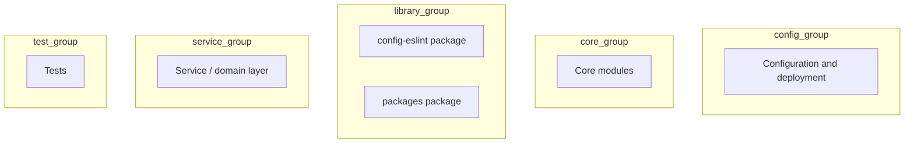

# Architecture report: airbnb/visx

> Automated static analysis. **Observed** = directly seen in files/imports/AST; **Inferred** = interpretation from that evidence. Repository code was not executed.

## 1. Repository at a glance

| Item | Value |
| --- | --- |
| Repository | airbnb/visx |
| Description | 🐯 visx | visualization components |
| Language | TypeScript |
| Stars | 21109 |
| Licence | MIT |
| Analysed commit / branch | 485c0359664ee8e612992defb16e1f035ed40b23 / master |
| Framework(s) | Next.js, React |
| Files analysed | 779 |
| Components | 6 |

## 2. Architecture in one minute

airbnb/visx - 🐯 visx | visualization components. This repository was analysed statically from 779 file(s) (0 Python). Detected technologies (observed from imports/manifests): GitHub Actions, Next.js, React, TypeScript, Vitest. Files are grouped into 6 component(s): Configuration and deployment, config-eslint package, Core modules, packages package, Service / domain layer, Tests. Findings below distinguish observed facts from inferred interpretation.

## 3. High-level block diagram

## 4. Main components

### Configuration and deployment (`config`)

- **Kind:** config
- **Status:** Observed
- **Confidence:** 0.85
- **Responsibility:** Groups 95 file(s) under configuration and deployment (observed from repository paths and static analysis).
- **Paths:** `lerna.json`, `package.json`, `packages/sizes.json`, `packages/visx-a11y/package.json`, `packages/visx-a11y/tsconfig.json`, `packages/visx-annotation/package.json`, `packages/visx-annotation/tsconfig.json`, `packages/visx-axis/package.json`, `packages/visx-axis/tsconfig.json`, `packages/visx-bounds/package.json`, `packages/visx-bounds/tsconfig.json`, `packages/visx-brush/package.json`, `packages/visx-brush/tsconfig.json`, `packages/visx-chart/package.json`, `packages/visx-chart/tsconfig.json`, `packages/visx-chord/package.json`, `packages/visx-chord/tsconfig.json`, `packages/visx-clip-path/package.json`, `packages/visx-clip-path/tsconfig.json`, `packages/visx-curve/package.json`, `packages/visx-curve/tsconfig.json`, `packages/visx-delaunay/package.json`, `packages/visx-delaunay/tsconfig.json`, `packages/visx-demo/package.json`, `packages/visx-demo/src/sandboxes/template/package.json`, `packages/visx-demo/src/sandboxes/visx-annotation/package.json`, `packages/visx-demo/src/sandboxes/visx-area/package.json`, `packages/visx-demo/src/sandboxes/visx-axis/package.json`, `packages/visx-demo/src/sandboxes/visx-bargroup-horizontal/package.json`, `packages/visx-demo/src/sandboxes/visx-bargroup/package.json`, `packages/visx-demo/src/sandboxes/visx-bars/package.json`, `packages/visx-demo/src/sandboxes/visx-barstack-horizontal/package.json`, `packages/visx-demo/src/sandboxes/visx-barstack/package.json`, `packages/visx-demo/src/sandboxes/visx-brush/package.json`, `packages/visx-demo/src/sandboxes/visx-chord/package.json`, `packages/visx-demo/src/sandboxes/visx-curve/package.json`, `packages/visx-demo/src/sandboxes/visx-delaunay-triangulation/package.json`, `packages/visx-demo/src/sandboxes/visx-delaunay-voronoi/package.json`, `packages/visx-demo/src/sandboxes/visx-dendrogram/package.json`, `packages/visx-demo/src/sandboxes/visx-dots/package.json`, `packages/visx-demo/src/sandboxes/visx-drag-i/package.json`, `packages/visx-demo/src/sandboxes/visx-drag-ii/package.json`, `packages/visx-demo/src/sandboxes/visx-geo-albers-usa/package.json`, `packages/visx-demo/src/sandboxes/visx-geo-albers-usa/us-abbr.json`, `packages/visx-demo/src/sandboxes/visx-geo-custom/package.json`, `packages/visx-demo/src/sandboxes/visx-geo-mercator/package.json`, `packages/visx-demo/src/sandboxes/visx-glyph/package.json`, `packages/visx-demo/src/sandboxes/visx-gradient/package.json`, `packages/visx-demo/src/sandboxes/visx-heatmap/package.json`, `packages/visx-demo/src/sandboxes/visx-legend/package.json`, `packages/visx-demo/src/sandboxes/visx-linktypes/package.json`, `packages/visx-demo/src/sandboxes/visx-network/package.json`, `packages/visx-demo/src/sandboxes/visx-pack/package.json`, `packages/visx-demo/src/sandboxes/visx-pattern/package.json`, `packages/visx-demo/src/sandboxes/visx-polygons/package.json`, `packages/visx-demo/src/sandboxes/visx-radar/package.json`, `packages/visx-demo/src/sandboxes/visx-radial-bars/package.json`, `packages/visx-demo/src/sandboxes/visx-responsive/package.json`, `packages/visx-demo/src/sandboxes/visx-sankey/energy.json`, `packages/visx-demo/src/sandboxes/visx-sankey/package.json`, `packages/visx-demo/src/sandboxes/visx-shape-line-radial/package.json`, `packages/visx-demo/src/sandboxes/visx-shape-pie/package.json`, `packages/visx-demo/src/sandboxes/visx-shape-splitlinepath/package.json`, `packages/visx-demo/src/sandboxes/visx-stacked-areas/package.json`, `packages/visx-demo/src/sandboxes/visx-stats/package.json`, `packages/visx-demo/src/sandboxes/visx-streamgraph/package.json`, `packages/visx-demo/src/sandboxes/visx-threshold/package.json`, `packages/visx-demo/src/sandboxes/visx-tooltip/package.json`, `packages/visx-demo/src/sandboxes/visx-tree/package.json`, `packages/visx-demo/src/sandboxes/visx-treemap/package.json`, `packages/visx-demo/src/sandboxes/visx-voronoi/package.json`, `packages/visx-demo/src/sandboxes/visx-wordcloud/package.json`, `packages/visx-demo/src/sandboxes/visx-xychart/package.json`, `packages/visx-demo/src/sandboxes/visx-zoom-i/package.json`, `packages/visx-demo/tsconfig.json`, `packages/visx-demo/vercel.json`, `packages/visx-drag/package.json`, `packages/visx-drag/tsconfig.json`, `packages/visx-event/package.json`, `packages/visx-event/tsconfig.json`, `packages/visx-geo/package.json`, `packages/visx-geo/tsconfig.json`, `packages/visx-glyph/package.json`, `packages/visx-glyph/tsconfig.json`, `packages/visx-gradient/package.json`, `packages/visx-gradient/tsconfig.json`, `packages/visx-grid/package.json`, `packages/visx-grid/tsconfig.json`, `packages/visx-group/package.json`, `packages/visx-group/tsconfig.json`, `packages/visx-heatmap/package.json`, `packages/visx-heatmap/tsconfig.json`, `packages/visx-hierarchy/package.json`, `packages/visx-hierarchy/tsconfig.json`, `packages/visx-kernel/package.json`
- **Evidence:** [lerna.json](https://github.com/airbnb/visx/blob/485c0359664ee8e612992defb16e1f035ed40b23/lerna.json); [package.json](https://github.com/airbnb/visx/blob/485c0359664ee8e612992defb16e1f035ed40b23/package.json); [packages/sizes.json](https://github.com/airbnb/visx/blob/485c0359664ee8e612992defb16e1f035ed40b23/packages/sizes.json); [packages/visx-a11y/package.json](https://github.com/airbnb/visx/blob/485c0359664ee8e612992defb16e1f035ed40b23/packages/visx-a11y/package.json); [packages/visx-a11y/tsconfig.json](https://github.com/airbnb/visx/blob/485c0359664ee8e612992defb16e1f035ed40b23/packages/visx-a11y/tsconfig.json); [packages/visx-annotation/package.json](https://github.com/airbnb/visx/blob/485c0359664ee8e612992defb16e1f035ed40b23/packages/visx-annotation/package.json); [packages/visx-annotation/tsconfig.json](https://github.com/airbnb/visx/blob/485c0359664ee8e612992defb16e1f035ed40b23/packages/visx-annotation/tsconfig.json); [packages/visx-axis/package.json](https://github.com/airbnb/visx/blob/485c0359664ee8e612992defb16e1f035ed40b23/packages/visx-axis/package.json)

### config-eslint package (`config_eslint`)

- **Kind:** library
- **Status:** Observed
- **Confidence:** 0.85
- **Responsibility:** Groups 4 file(s) under config-eslint package (observed from repository paths and static analysis).
- **Paths:** `config-eslint/base.js`, `config-eslint/next.js`, `config-eslint/prettier.js`, `config-eslint/typescript.js`
- **Evidence:** [config-eslint/base.js](https://github.com/airbnb/visx/blob/485c0359664ee8e612992defb16e1f035ed40b23/config-eslint/base.js); [config-eslint/next.js](https://github.com/airbnb/visx/blob/485c0359664ee8e612992defb16e1f035ed40b23/config-eslint/next.js); [config-eslint/prettier.js](https://github.com/airbnb/visx/blob/485c0359664ee8e612992defb16e1f035ed40b23/config-eslint/prettier.js); [config-eslint/typescript.js](https://github.com/airbnb/visx/blob/485c0359664ee8e612992defb16e1f035ed40b23/config-eslint/typescript.js)

### Core modules (`core`)

- **Kind:** core
- **Status:** Observed
- **Confidence:** 0.85
- **Responsibility:** Groups 1 file(s) under core modules (observed from repository paths and static analysis).
- **Paths:** `babel.config.js`
- **Evidence:** [babel.config.js](https://github.com/airbnb/visx/blob/485c0359664ee8e612992defb16e1f035ed40b23/babel.config.js)

### packages package (`packages`)

- **Kind:** library
- **Status:** Observed
- **Confidence:** 0.85
- **Responsibility:** Groups 431 file(s) under packages package (observed from repository paths and static analysis).
- **Paths:** `packages/visx-a11y/src/components/ChartA11yAnnouncer.tsx`, `packages/visx-a11y/src/components/ChartA11yDataTable.tsx`, `packages/visx-a11y/src/generators/ariaProps.ts`, `packages/visx-a11y/src/generators/dataTableHTML.ts`, `packages/visx-a11y/src/generators/description.ts`, `packages/visx-a11y/src/index.ts`, `packages/visx-a11y/src/keyboard/stateMachine.ts`, `packages/visx-a11y/src/react/index.ts`, `packages/visx-a11y/src/server.ts`, `packages/visx-a11y/src/types.ts`, `packages/visx-a11y/src/useChartA11y.tsx`, `packages/visx-a11y/src/useChartKeyboardNav.ts`, `packages/visx-a11y/src/utils/data.ts`, `packages/visx-a11y/src/utils/format.ts`, `packages/visx-a11y/src/utils/table.ts`, `packages/visx-a11y/vitest.config.ts`, `packages/visx-annotation/src/components/Annotation.tsx`, `packages/visx-annotation/src/components/CircleSubject.tsx`, `packages/visx-annotation/src/components/Connector.tsx`, `packages/visx-annotation/src/components/EditableAnnotation.tsx`, `packages/visx-annotation/src/components/HtmlLabel.tsx`, `packages/visx-annotation/src/components/Label.tsx`, `packages/visx-annotation/src/components/LabelAnchorLine.tsx`, `packages/visx-annotation/src/components/LineSubject.tsx`, `packages/visx-annotation/src/context/AnnotationContext.tsx`, `packages/visx-annotation/src/index.ts`, `packages/visx-annotation/src/types/index.ts`, `packages/visx-annotation/vitest.config.ts`, `packages/visx-axis/src/axis/Axis.tsx`, `packages/visx-axis/src/axis/AxisBottom.tsx`, `packages/visx-axis/src/axis/AxisLeft.tsx`, `packages/visx-axis/src/axis/AxisRenderer.tsx`, `packages/visx-axis/src/axis/AxisRight.tsx`, `packages/visx-axis/src/axis/AxisTop.tsx`, `packages/visx-axis/src/axis/Ticks.tsx`, `packages/visx-axis/src/constants/orientation.ts`, `packages/visx-axis/src/index.ts`, `packages/visx-axis/src/react/index.ts`, `packages/visx-axis/src/react/useAxis.ts`, `packages/visx-axis/src/types.ts`, `packages/visx-axis/src/utils/createPoint.ts`, `packages/visx-axis/src/utils/getAxisRangePaddingConfig.ts`, `packages/visx-axis/src/utils/getLabelTransform.ts`, `packages/visx-axis/src/utils/getTickFormatter.ts`, `packages/visx-axis/src/utils/getTickPosition.ts`, `packages/visx-axis/vitest.config.ts`, `packages/visx-bounds/src/enhancers/withBoundingRects.tsx`, `packages/visx-bounds/src/index.ts`, `packages/visx-bounds/vitest.config.ts`, `packages/visx-brush/src/BaseBrush.tsx`, `packages/visx-brush/src/Brush.tsx`, `packages/visx-brush/src/BrushCorner.tsx`, `packages/visx-brush/src/BrushHandle.tsx`, `packages/visx-brush/src/BrushOverlay.tsx`, `packages/visx-brush/src/BrushSelection.tsx`, `packages/visx-brush/src/index.ts`, `packages/visx-brush/src/types.ts`, `packages/visx-brush/src/utils.ts`, `packages/visx-brush/vitest.config.ts`, `packages/visx-chart/src/config.ts`, `packages/visx-chart/src/domains.ts`, `packages/visx-chart/src/index.ts`, `packages/visx-chart/src/responsive.ts`, `packages/visx-chart/src/ticks.ts`, `packages/visx-chart/src/useChartDimensions.ts`, `packages/visx-chart/vitest.config.ts`, `packages/visx-chord/src/Chord.tsx`, `packages/visx-chord/src/Ribbon.tsx`, `packages/visx-chord/src/index.ts`, `packages/visx-chord/vitest.config.ts`, `packages/visx-clip-path/src/clip-paths/CircleClipPath.tsx`, `packages/visx-clip-path/src/clip-paths/ClipPath.tsx`, `packages/visx-clip-path/src/clip-paths/RectClipPath.tsx`, `packages/visx-clip-path/src/index.ts`, `packages/visx-clip-path/vitest.config.ts`, `packages/visx-curve/src/index.ts`, `packages/visx-curve/vitest.config.ts`, `packages/visx-delaunay/src/components/Polygon.tsx`, `packages/visx-delaunay/src/delaunay.ts`, `packages/visx-delaunay/src/index.ts`, `packages/visx-delaunay/src/voronoi.ts`, `packages/visx-delaunay/vitest.config.ts`, `packages/visx-demo/next-env.d.ts`, `packages/visx-demo/next.config.js`, `packages/visx-demo/src/components/ApiTable.tsx`, `packages/visx-demo/src/components/CodeSandboxLink.tsx`, `packages/visx-demo/src/components/Codeblock.tsx`, `packages/visx-demo/src/components/DocPage.tsx`, `packages/visx-demo/src/components/Footer.tsx`, `packages/visx-demo/src/components/Gallery/AnnotationTile.tsx`, `packages/visx-demo/src/components/Gallery/AreaTile.tsx`, `packages/visx-demo/src/components/Gallery/AxisTile.tsx`, `packages/visx-demo/src/components/Gallery/BarGroupHorizontalTile.tsx`, `packages/visx-demo/src/components/Gallery/BarGroupTile.tsx`, `packages/visx-demo/src/components/Gallery/BarStackHorizontalTile.tsx`, `packages/visx-demo/src/components/Gallery/BarStackTile.tsx`, `packages/visx-demo/src/components/Gallery/BarsTile.tsx`, `packages/visx-demo/src/components/Gallery/BrushTile.tsx`, `packages/visx-demo/src/components/Gallery/ChordTile.tsx`, `packages/visx-demo/src/components/Gallery/CurvesTile.tsx`, `packages/visx-demo/src/components/Gallery/DelaunayTriangulationTile.tsx`, `packages/visx-demo/src/components/Gallery/DelaunayVoronoiTile.tsx`, `packages/visx-demo/src/components/Gallery/DendrogramsTile.tsx`, `packages/visx-demo/src/components/Gallery/DotsTile.tsx`, `packages/visx-demo/src/components/Gallery/DragIITile.tsx`, `packages/visx-demo/src/components/Gallery/DragITile.tsx`, `packages/visx-demo/src/components/Gallery/GeoAlbersUsaTile.tsx`, `packages/visx-demo/src/components/Gallery/GeoCustomTile.tsx`, `packages/visx-demo/src/components/Gallery/GeoMercatorTile.tsx`, `packages/visx-demo/src/components/Gallery/GlyphsTile.tsx`, `packages/visx-demo/src/components/Gallery/GradientsTile.tsx`, `packages/visx-demo/src/components/Gallery/HeatmapsTile.tsx`, `packages/visx-demo/src/components/Gallery/LegendsTile.tsx`, `packages/visx-demo/src/components/Gallery/LineRadialTile.tsx`, `packages/visx-demo/src/components/Gallery/LinkTypesTile.tsx`, `packages/visx-demo/src/components/Gallery/NetworkTile.tsx`, `packages/visx-demo/src/components/Gallery/PackTile.tsx`, `packages/visx-demo/src/components/Gallery/PatternsTile.tsx`, `packages/visx-demo/src/components/Gallery/PiesTile.tsx`, `packages/visx-demo/src/components/Gallery/PolygonsTile.tsx`, `packages/visx-demo/src/components/Gallery/RadarTile.tsx`, `packages/visx-demo/src/components/Gallery/RadialBarsTile.tsx`, `packages/visx-demo/src/components/Gallery/ResponsiveTile.tsx`, `packages/visx-demo/src/components/Gallery/SankeyTile.tsx`, `packages/visx-demo/src/components/Gallery/SplitLinePathTile.tsx`, `packages/visx-demo/src/components/Gallery/StackedAreasTile.tsx`, `packages/visx-demo/src/components/Gallery/StatsPlotTile.tsx`, `packages/visx-demo/src/components/Gallery/StreamGraphTile.tsx`, `packages/visx-demo/src/components/Gallery/TextTile.tsx`, `packages/visx-demo/src/components/Gallery/ThresholdTile.tsx`, `packages/visx-demo/src/components/Gallery/TooltipTile.tsx`, `packages/visx-demo/src/components/Gallery/TreemapTile.tsx`, `packages/visx-demo/src/components/Gallery/TreesTile.tsx`, `packages/visx-demo/src/components/Gallery/VoronoiTile.tsx`, `packages/visx-demo/src/components/Gallery/WordcloudTile.tsx`, `packages/visx-demo/src/components/Gallery/XYChartTile.tsx`, `packages/visx-demo/src/components/Gallery/ZoomITile.tsx`, `packages/visx-demo/src/components/Gallery/index.tsx`, `packages/visx-demo/src/components/GalleryTile.tsx`, `packages/visx-demo/src/components/Logo.tsx`, `packages/visx-demo/src/components/Meta.tsx`, `packages/visx-demo/src/components/Nav.tsx`, `packages/visx-demo/src/components/NavItem.tsx`, `packages/visx-demo/src/components/NoSsr.tsx`, `packages/visx-demo/src/components/PackageList.tsx`, `packages/visx-demo/src/components/Page.tsx`, `packages/visx-demo/src/components/Show.tsx`, `packages/visx-demo/src/components/VisxDocLink.tsx`, `packages/visx-demo/src/components/icons/Belo.tsx`, `packages/visx-demo/src/components/icons/GitHub.tsx`, `packages/visx-demo/src/components/icons/Instagram.tsx`, `packages/visx-demo/src/components/icons/Medium.tsx`, `packages/visx-demo/src/components/icons/Twitter.tsx`, `packages/visx-demo/src/components/util/drawData.ts`, `packages/visx-demo/src/components/util/extractVisxDepsFromPackageJson.ts`, `packages/visx-demo/src/components/util/format.ts`, `packages/visx-demo/src/next-env.d.ts`, `packages/visx-demo/src/pages/_app.tsx`, `packages/visx-demo/src/pages/_document.tsx`, `packages/visx-demo/src/pages/annotation.tsx`, `packages/visx-demo/src/pages/areas.tsx`, `packages/visx-demo/src/pages/axis.tsx`, `packages/visx-demo/src/pages/bargroup.tsx`, `packages/visx-demo/src/pages/bargrouphorizontal.tsx`, `packages/visx-demo/src/pages/bars.tsx`, `packages/visx-demo/src/pages/barstack.tsx`, `packages/visx-demo/src/pages/barstackhorizontal.tsx`, `packages/visx-demo/src/pages/brush.tsx`, `packages/visx-demo/src/pages/chord.tsx`, `packages/visx-demo/src/pages/curves.tsx`, `packages/visx-demo/src/pages/delaunay-triangulation.tsx`, `packages/visx-demo/src/pages/delaunay-voronoi.tsx`, `packages/visx-demo/src/pages/dendrograms.tsx`, `packages/visx-demo/src/pages/docs.tsx`, `packages/visx-demo/src/pages/dots.tsx`, `packages/visx-demo/src/pages/drag-i.tsx`, `packages/visx-demo/src/pages/drag-ii.tsx`, `packages/visx-demo/src/pages/gallery.tsx`, `packages/visx-demo/src/pages/geo-albers-usa.tsx`, `packages/visx-demo/src/pages/geo-custom.tsx`, `packages/visx-demo/src/pages/geo-mercator.tsx`, `packages/visx-demo/src/pages/glyphs.tsx`, `packages/visx-demo/src/pages/gradients.tsx`, `packages/visx-demo/src/pages/heatmaps.tsx`, `packages/visx-demo/src/pages/home.tsx`, `packages/visx-demo/src/pages/index.tsx`, `packages/visx-demo/src/pages/legends.tsx`, `packages/visx-demo/src/pages/lineradial.tsx`, `packages/visx-demo/src/pages/linktypes.tsx`, `packages/visx-demo/src/pages/network.tsx`, `packages/visx-demo/src/pages/pack.tsx`, `packages/visx-demo/src/pages/patterns.tsx`, `packages/visx-demo/src/pages/pies.tsx`, `packages/visx-demo/src/pages/polygons.tsx`, `packages/visx-demo/src/pages/radar.tsx`, `packages/visx-demo/src/pages/radial-bars.tsx`, `packages/visx-demo/src/pages/responsive.tsx`, `packages/visx-demo/src/pages/sankey.tsx`, `packages/visx-demo/src/pages/splitlinepath.tsx`, `packages/visx-demo/src/pages/stacked-areas.tsx`, `packages/visx-demo/src/pages/statsplot.tsx`, `packages/visx-demo/src/pages/streamgraph.tsx`, `packages/visx-demo/src/pages/text.tsx`, `packages/visx-demo/src/pages/threshold.tsx`, `packages/visx-demo/src/pages/tooltip.tsx`, `packages/visx-demo/src/pages/treemap.tsx`, `packages/visx-demo/src/pages/trees.tsx`, `packages/visx-demo/src/pages/voronoi.tsx`, `packages/visx-demo/src/pages/wordcloud.tsx`, `packages/visx-demo/src/pages/xychart.tsx`, `packages/visx-demo/src/pages/zoom-i.tsx`, `packages/visx-demo/src/sandboxes/exampleToVisxDependencyLookup.ts`, `packages/visx-demo/src/sandboxes/template/Example.tsx`, `packages/visx-demo/src/sandboxes/template/index.tsx`, `packages/visx-demo/src/sandboxes/visx-annotation/Example.tsx`, `packages/visx-demo/src/sandboxes/visx-annotation/ExampleControls.tsx`, `packages/visx-demo/src/sandboxes/visx-annotation/findNearestDatum.ts`, `packages/visx-demo/src/sandboxes/visx-annotation/index.tsx`, `packages/visx-demo/src/sandboxes/visx-area/Example.tsx`, `packages/visx-demo/src/sandboxes/visx-area/index.tsx`, `packages/visx-demo/src/sandboxes/visx-axis/Example.tsx`, `packages/visx-demo/src/sandboxes/visx-axis/index.tsx`, `packages/visx-demo/src/sandboxes/visx-bargroup-horizontal/Example.tsx`, `packages/visx-demo/src/sandboxes/visx-bargroup-horizontal/index.tsx`, `packages/visx-demo/src/sandboxes/visx-bargroup/Example.tsx`, `packages/visx-demo/src/sandboxes/visx-bargroup/index.tsx`, `packages/visx-demo/src/sandboxes/visx-bars/Example.tsx`, `packages/visx-demo/src/sandboxes/visx-bars/index.tsx`, `packages/visx-demo/src/sandboxes/visx-barstack-horizontal/Example.tsx`, `packages/visx-demo/src/sandboxes/visx-barstack-horizontal/index.tsx`, `packages/visx-demo/src/sandboxes/visx-barstack/Example.tsx`, `packages/visx-demo/src/sandboxes/visx-barstack/index.tsx`, `packages/visx-demo/src/sandboxes/visx-brush/AreaChart.tsx`, `packages/visx-demo/src/sandboxes/visx-brush/Example.tsx`, `packages/visx-demo/src/sandboxes/visx-brush/index.tsx`, `packages/visx-demo/src/sandboxes/visx-chord/Example.tsx`, `packages/visx-demo/src/sandboxes/visx-chord/index.tsx`, `packages/visx-demo/src/sandboxes/visx-curve/Example.tsx`, `packages/visx-demo/src/sandboxes/visx-curve/index.tsx`, `packages/visx-demo/src/sandboxes/visx-delaunay-triangulation/Example.tsx`, `packages/visx-demo/src/sandboxes/visx-delaunay-triangulation/index.tsx`, `packages/visx-demo/src/sandboxes/visx-delaunay-voronoi/Example.tsx`, `packages/visx-demo/src/sandboxes/visx-delaunay-voronoi/index.tsx`, `packages/visx-demo/src/sandboxes/visx-dendrogram/Example.tsx`, `packages/visx-demo/src/sandboxes/visx-dendrogram/index.tsx`, `packages/visx-demo/src/sandboxes/visx-dots/Example.tsx`, `packages/visx-demo/src/sandboxes/visx-dots/index.tsx`, `packages/visx-demo/src/sandboxes/visx-drag-i/Example.tsx`, `packages/visx-demo/src/sandboxes/visx-drag-i/generateCircles.ts`, `packages/visx-demo/src/sandboxes/visx-drag-i/index.tsx`, `packages/visx-demo/src/sandboxes/visx-drag-ii/Example.tsx`, `packages/visx-demo/src/sandboxes/visx-drag-ii/index.tsx`, `packages/visx-demo/src/sandboxes/visx-geo-albers-usa/Example.tsx`, `packages/visx-demo/src/sandboxes/visx-geo-albers-usa/index.tsx`, `packages/visx-demo/src/sandboxes/visx-geo-albers-usa/usa-topo.d.ts`, `packages/visx-demo/src/sandboxes/visx-geo-custom/Example.tsx`, `packages/visx-demo/src/sandboxes/visx-geo-custom/index.tsx`, `packages/visx-demo/src/sandboxes/visx-geo-custom/world-topo.d.ts`, `packages/visx-demo/src/sandboxes/visx-geo-mercator/Example.tsx`, `packages/visx-demo/src/sandboxes/visx-geo-mercator/index.tsx`, `packages/visx-demo/src/sandboxes/visx-geo-mercator/world-topo.d.ts`, `packages/visx-demo/src/sandboxes/visx-glyph/Example.tsx`, `packages/visx-demo/src/sandboxes/visx-glyph/index.tsx`, `packages/visx-demo/src/sandboxes/visx-gradient/Example.tsx`, `packages/visx-demo/src/sandboxes/visx-gradient/index.tsx`, `packages/visx-demo/src/sandboxes/visx-heatmap/Example.tsx`, `packages/visx-demo/src/sandboxes/visx-heatmap/index.tsx`, `packages/visx-demo/src/sandboxes/visx-legend/Example.tsx`, `packages/visx-demo/src/sandboxes/visx-legend/index.tsx`, `packages/visx-demo/src/sandboxes/visx-linktypes/Example.tsx`, `packages/visx-demo/src/sandboxes/visx-linktypes/LinkControls.tsx`, `packages/visx-demo/src/sandboxes/visx-linktypes/getLinkComponent.ts`, `packages/visx-demo/src/sandboxes/visx-linktypes/index.tsx`, `packages/visx-demo/src/sandboxes/visx-linktypes/useForceUpdate.ts`, `packages/visx-demo/src/sandboxes/visx-network/Example.tsx`, `packages/visx-demo/src/sandboxes/visx-network/index.tsx`, `packages/visx-demo/src/sandboxes/visx-pack/Example.tsx`, `packages/visx-demo/src/sandboxes/visx-pack/index.tsx`, `packages/visx-demo/src/sandboxes/visx-pattern/Example.tsx`, `packages/visx-demo/src/sandboxes/visx-pattern/index.tsx`, `packages/visx-demo/src/sandboxes/visx-polygons/Example.tsx`, `packages/visx-demo/src/sandboxes/visx-polygons/index.tsx`, `packages/visx-demo/src/sandboxes/visx-radar/Example.tsx`, `packages/visx-demo/src/sandboxes/visx-radar/index.tsx`, `packages/visx-demo/src/sandboxes/visx-radial-bars/Example.tsx`, `packages/visx-demo/src/sandboxes/visx-radial-bars/index.tsx`, `packages/visx-demo/src/sandboxes/visx-responsive/Example.tsx`, `packages/visx-demo/src/sandboxes/visx-responsive/Lines.tsx`, `packages/visx-demo/src/sandboxes/visx-responsive/index.tsx`, `packages/visx-demo/src/sandboxes/visx-sankey/Example.tsx`, `packages/visx-demo/src/sandboxes/visx-sankey/index.tsx`, `packages/visx-demo/src/sandboxes/visx-shape-line-radial/Example.tsx`, `packages/visx-demo/src/sandboxes/visx-shape-line-radial/index.tsx`, `packages/visx-demo/src/sandboxes/visx-shape-pie/Example.tsx`, `packages/visx-demo/src/sandboxes/visx-shape-pie/index.tsx`, `packages/visx-demo/src/sandboxes/visx-shape-splitlinepath/Example.tsx`, `packages/visx-demo/src/sandboxes/visx-shape-splitlinepath/generateSinPoints.ts`, `packages/visx-demo/src/sandboxes/visx-shape-splitlinepath/generateSinSegments.ts`, `packages/visx-demo/src/sandboxes/visx-shape-splitlinepath/generateSnakePath.ts`, `packages/visx-demo/src/sandboxes/visx-shape-splitlinepath/index.tsx`, `packages/visx-demo/src/sandboxes/visx-stacked-areas/Example.tsx`, `packages/visx-demo/src/sandboxes/visx-stacked-areas/index.tsx`, `packages/visx-demo/src/sandboxes/visx-stats/Example.tsx`, `packages/visx-demo/src/sandboxes/visx-stats/index.tsx`, `packages/visx-demo/src/sandboxes/visx-streamgraph/Example.tsx`, `packages/visx-demo/src/sandboxes/visx-streamgraph/generateData.ts`, `packages/visx-demo/src/sandboxes/visx-streamgraph/index.tsx`, `packages/visx-demo/src/sandboxes/visx-streamgraph/useForceUpdate.ts`, `packages/visx-demo/src/sandboxes/visx-threshold/Example.tsx`, `packages/visx-demo/src/sandboxes/visx-threshold/index.tsx`, `packages/visx-demo/src/sandboxes/visx-tooltip/Example.tsx`, `packages/visx-demo/src/sandboxes/visx-tooltip/index.tsx`, `packages/visx-demo/src/sandboxes/visx-tree/Example.tsx`, `packages/visx-demo/src/sandboxes/visx-tree/index.tsx`, `packages/visx-demo/src/sandboxes/visx-treemap/Example.tsx`, `packages/visx-demo/src/sandboxes/visx-treemap/index.tsx`, `packages/visx-demo/src/sandboxes/visx-voronoi/Example.tsx`, `packages/visx-demo/src/sandboxes/visx-voronoi/index.tsx`, `packages/visx-demo/src/sandboxes/visx-wordcloud/Example.tsx`, `packages/visx-demo/src/sandboxes/visx-wordcloud/index.tsx`, `packages/visx-demo/src/sandboxes/visx-wordcloud/text.fixture.ts`, `packages/visx-demo/src/sandboxes/visx-xychart/CustomChartBackground.tsx`, `packages/visx-demo/src/sandboxes/visx-xychart/Example.tsx`, `packages/visx-demo/src/sandboxes/visx-xychart/ExampleControls.tsx`, `packages/visx-demo/src/sandboxes/visx-xychart/customTheme.ts`, `packages/visx-demo/src/sandboxes/visx-xychart/getAnimatedOrUnanimatedComponents.ts`, `packages/visx-demo/src/sandboxes/visx-xychart/index.tsx`, `packages/visx-demo/src/sandboxes/visx-xychart/userPrefersReducedMotion.ts`, `packages/visx-demo/src/sandboxes/visx-zoom-i/Example.tsx`, `packages/visx-demo/src/sandboxes/visx-zoom-i/index.tsx`, `packages/visx-demo/src/types/index.ts`, `packages/visx-demo/src/types/raw-loader.d.ts`, `packages/visx-demo/src/utils/getDocGenInfo.ts`, `packages/visx-demo/src/utils/getGitHubUrl.ts`, `packages/visx-drag/src/Drag.tsx`, `packages/visx-drag/src/index.ts`, `packages/visx-drag/src/useDrag.ts`, `packages/visx-drag/src/util/clampNumber.ts`, `packages/visx-drag/src/util/getClosestPoint.ts`, `packages/visx-drag/src/util/raise.ts`, `packages/visx-drag/src/util/restrictPoint.ts`, `packages/visx-drag/src/util/useSamplesAlongPath.ts`, `packages/visx-drag/src/util/useStateWithCallback.ts`, `packages/visx-drag/vitest.config.ts`, `packages/visx-event/src/getXAndYFromEvent.ts`, `packages/visx-event/src/index.ts`, `packages/visx-event/src/localPoint.ts`, `packages/visx-event/src/localPointGeneric.ts`, `packages/visx-event/src/touchPoint.ts`, `packages/visx-event/src/typeGuards.ts`, `packages/visx-event/src/types.ts`, `packages/visx-event/vitest.config.ts`, `packages/visx-geo/src/graticule/Graticule.tsx`, `packages/visx-geo/src/index.ts`, `packages/visx-geo/src/projections/Albers.tsx`, `packages/visx-geo/src/projections/AlbersUsa.tsx`, `packages/visx-geo/src/projections/CustomProjection.tsx`, `packages/visx-geo/src/projections/EqualEarth.tsx`, `packages/visx-geo/src/projections/Mercator.tsx`, `packages/visx-geo/src/projections/NaturalEarth.tsx`, `packages/visx-geo/src/projections/Orthographic.tsx`, `packages/visx-geo/src/projections/Projection.tsx`, `packages/visx-geo/src/types.ts`, `packages/visx-geo/vitest.config.ts`, `packages/visx-glyph/src/glyphs/Glyph.tsx`, `packages/visx-glyph/src/glyphs/GlyphCircle.tsx`, `packages/visx-glyph/src/glyphs/GlyphCross.tsx`, `packages/visx-glyph/src/glyphs/GlyphDiamond.tsx`, `packages/visx-glyph/src/glyphs/GlyphDot.tsx`, `packages/visx-glyph/src/glyphs/GlyphSquare.tsx`, `packages/visx-glyph/src/glyphs/GlyphStar.tsx`, `packages/visx-glyph/src/glyphs/GlyphTriangle.tsx`, `packages/visx-glyph/src/glyphs/GlyphWye.tsx`, `packages/visx-glyph/src/index.ts`, `packages/visx-glyph/vitest.config.ts`, `packages/visx-gradient/src/gradients/GradientDarkgreenGreen.tsx`, `packages/visx-gradient/src/gradients/GradientLightgreenGreen.tsx`, `packages/visx-gradient/src/gradients/GradientOrangeRed.tsx`, `packages/visx-gradient/src/gradients/GradientPinkBlue.tsx`, `packages/visx-gradient/src/gradients/GradientPinkRed.tsx`, `packages/visx-gradient/src/gradients/GradientPurpleOrange.tsx`, `packages/visx-gradient/src/gradients/GradientPurpleRed.tsx`, `packages/visx-gradient/src/gradients/GradientPurpleTeal.tsx`, `packages/visx-gradient/src/gradients/GradientSteelPurple.tsx`, `packages/visx-gradient/src/gradients/GradientTealBlue.tsx`, `packages/visx-gradient/src/gradients/LinearGradient.tsx`, `packages/visx-gradient/src/gradients/RadialGradient.tsx`, `packages/visx-gradient/src/index.ts`, `packages/visx-gradient/vitest.config.ts`, `packages/visx-grid/src/grids/Grid.tsx`, `packages/visx-grid/src/grids/GridAngle.tsx`, `packages/visx-grid/src/grids/GridColumns.tsx`, `packages/visx-grid/src/grids/GridPolar.tsx`, `packages/visx-grid/src/grids/GridRadial.tsx`, `packages/visx-grid/src/grids/GridRows.tsx`, `packages/visx-grid/src/index.ts`, `packages/visx-grid/src/types.ts`, `packages/visx-grid/src/utils/getScaleBandwidth.ts`, `packages/visx-grid/src/utils/polarToCartesian.ts`, `packages/visx-grid/vitest.config.ts`, `packages/visx-group/src/Group.tsx`, `packages/visx-group/src/index.ts`, `packages/visx-group/vitest.config.ts`, `packages/visx-heatmap/src/heatmaps/HeatmapCircle.tsx`, `packages/visx-heatmap/src/heatmaps/HeatmapRect.tsx`, `packages/visx-heatmap/src/index.ts`, `packages/visx-heatmap/src/types.ts`, `packages/visx-heatmap/vitest.config.ts`, `packages/visx-hierarchy/src/HierarchyDefaultLink.tsx`, `packages/visx-hierarchy/src/HierarchyDefaultNode.tsx`, `packages/visx-hierarchy/src/HierarchyDefaultRectNode.tsx`, `packages/visx-hierarchy/src/hierarchies/Cluster.tsx`, `packages/visx-hierarchy/src/hierarchies/Pack.tsx`, `packages/visx-hierarchy/src/hierarchies/Partition.tsx`, `packages/visx-hierarchy/src/hierarchies/Tree.tsx`, `packages/visx-hierarchy/src/hierarchies/Treemap.tsx`, `packages/visx-hierarchy/src/index.ts`, `packages/visx-hierarchy/src/types.ts`, `packages/visx-hierarchy/src/utils/setNumOrNumAccessor.ts`, `packages/visx-hierarchy/vitest.config.ts`, `packages/visx-kernel/src/accessors/normalizeAccessor.ts`, `packages/visx-kernel/src/format/formatNumber.ts`, `packages/visx-kernel/src/ids/useStableId.ts`, `packages/visx-kernel/src/index.ts`, `packages/visx-kernel/src/memo/shallowEqual.ts`, `packages/visx-kernel/src/memo/useStructuralMemo.ts`, `packages/visx-kernel/src/path/createPath.ts`, `packages/visx-kernel/src/path/toPath2D.ts`, `packages/visx-kernel/src/refs/useLatestRef.ts`, `packages/visx-kernel/src/refs/useStableCallback.ts`, `packages/visx-kernel/src/warnings.ts`
- **Evidence:** [packages/visx-a11y/src/components/ChartA11yAnnouncer.tsx](https://github.com/airbnb/visx/blob/485c0359664ee8e612992defb16e1f035ed40b23/packages/visx-a11y/src/components/ChartA11yAnnouncer.tsx); [packages/visx-a11y/src/components/ChartA11yDataTable.tsx](https://github.com/airbnb/visx/blob/485c0359664ee8e612992defb16e1f035ed40b23/packages/visx-a11y/src/components/ChartA11yDataTable.tsx); [packages/visx-a11y/src/generators/ariaProps.ts](https://github.com/airbnb/visx/blob/485c0359664ee8e612992defb16e1f035ed40b23/packages/visx-a11y/src/generators/ariaProps.ts); [packages/visx-a11y/src/generators/dataTableHTML.ts](https://github.com/airbnb/visx/blob/485c0359664ee8e612992defb16e1f035ed40b23/packages/visx-a11y/src/generators/dataTableHTML.ts); [packages/visx-a11y/src/generators/description.ts](https://github.com/airbnb/visx/blob/485c0359664ee8e612992defb16e1f035ed40b23/packages/visx-a11y/src/generators/description.ts); [packages/visx-a11y/src/index.ts](https://github.com/airbnb/visx/blob/485c0359664ee8e612992defb16e1f035ed40b23/packages/visx-a11y/src/index.ts); [packages/visx-a11y/src/keyboard/stateMachine.ts](https://github.com/airbnb/visx/blob/485c0359664ee8e612992defb16e1f035ed40b23/packages/visx-a11y/src/keyboard/stateMachine.ts); [packages/visx-a11y/src/react/index.ts](https://github.com/airbnb/visx/blob/485c0359664ee8e612992defb16e1f035ed40b23/packages/visx-a11y/src/react/index.ts)

### Service / domain layer (`service_layer`)

- **Kind:** service
- **Status:** Observed
- **Confidence:** 0.85
- **Responsibility:** Groups 1 file(s) under service / domain layer (observed from repository paths and static analysis).
- **Paths:** `packages/visx-kernel/src/domain/useDomain.ts`
- **Evidence:** [packages/visx-kernel/src/domain/useDomain.ts](https://github.com/airbnb/visx/blob/485c0359664ee8e612992defb16e1f035ed40b23/packages/visx-kernel/src/domain/useDomain.ts)

### Tests (`tests`)

- **Kind:** test
- **Status:** Observed
- **Confidence:** 0.85
- **Responsibility:** Groups 109 file(s) under tests (observed from repository paths and static analysis).
- **Paths:** `packages/visx-a11y/test/announcer.test.tsx`, `packages/visx-a11y/test/data.test.ts`, `packages/visx-a11y/test/dataTable.test.tsx`, `packages/visx-a11y/test/generators.test.ts`, `packages/visx-a11y/test/index.test.ts`, `packages/visx-a11y/test/keyboard.test.tsx`, `packages/visx-a11y/test/useChartA11y.test.tsx`, `packages/visx-annotation/test/Annotation.test.tsx`, `packages/visx-annotation/test/CircleSubject.test.tsx`, `packages/visx-annotation/test/Connector.test.tsx`, `packages/visx-annotation/test/EditableAnnotation.test.tsx`, `packages/visx-annotation/test/HtmlLabel.test.tsx`, `packages/visx-annotation/test/Label.test.tsx`, `packages/visx-annotation/test/LineSubject.test.tsx`, `packages/visx-annotation/test/svgMock.ts`, `packages/visx-annotation/test/tsconfig.json`, `packages/visx-axis/test/Axis.test.tsx`, `packages/visx-axis/test/AxisBottom.test.tsx`, `packages/visx-axis/test/AxisLeft.test.tsx`, `packages/visx-axis/test/AxisRight.test.tsx`, `packages/visx-axis/test/AxisSsr.test.tsx`, `packages/visx-axis/test/AxisTop.test.tsx`, `packages/visx-axis/test/Orientation.test.ts`, `packages/visx-axis/test/scales.test.tsx`, `packages/visx-axis/test/svgMock.ts`, `packages/visx-axis/test/tsconfig.json`, `packages/visx-axis/test/useAxis.test.tsx`, `packages/visx-axis/test/utils/getAxisRangePaddingConfig.test.ts`, `packages/visx-axis/test/utils/getTickPosition.test.ts`, `packages/visx-bounds/test/tsconfig.json`, `packages/visx-bounds/test/withBoundingRects.test.tsx`, `packages/visx-brush/test/Brush.test.tsx`, `packages/visx-brush/test/tsconfig.json`, `packages/visx-brush/test/utils.test.ts`, `packages/visx-chart/test/config.test.ts`, `packages/visx-chart/test/domains.test.ts`, `packages/visx-chart/test/ssr.test.tsx`, `packages/visx-chart/test/ticks.test.ts`, `packages/visx-chart/test/useChartDimensions.test.tsx`, `packages/visx-chord/test/Chord.test.tsx`, `packages/visx-chord/test/Ribbon.test.tsx`, `packages/visx-chord/test/tsconfig.json`, `packages/visx-clip-path/test/ClipPaths.test.tsx`, `packages/visx-clip-path/test/tsconfig.json`, `packages/visx-curve/test/curve.test.ts`, `packages/visx-curve/test/tsconfig.json`, `packages/visx-delaunay/test/Polygon.test.tsx`, `packages/visx-delaunay/test/delaunay.test.ts`, `packages/visx-delaunay/test/tsconfig.json`, `packages/visx-delaunay/test/voronoi.test.ts`, `packages/visx-drag/test/Drag.test.ts`, `packages/visx-drag/test/raise.test.ts`, `packages/visx-drag/test/tsconfig.json`, `packages/visx-drag/test/useDrag.test.tsx`, `packages/visx-drag/test/useStateWithCallback.test.ts`, `packages/visx-event/test/getXandYFromEvent.test.ts`, `packages/visx-event/test/localPoint.test.ts`, `packages/visx-event/test/tsconfig.json`, `packages/visx-geo/test/Albers.test.tsx`, `packages/visx-geo/test/AlbersUsa.test.tsx`, `packages/visx-geo/test/CustomProjection.test.tsx`, `packages/visx-geo/test/EqualEarth.test.tsx`, `packages/visx-geo/test/Mercator.test.tsx`, `packages/visx-geo/test/Orthographic.test.tsx`, `packages/visx-geo/test/Projection.test.tsx`, `packages/visx-geo/test/topo.json`, `packages/visx-geo/test/tsconfig.json`, `packages/visx-glyph/test/Circle.test.tsx`, `packages/visx-glyph/test/Cross.test.tsx`, `packages/visx-glyph/test/Diamond.test.tsx`, `packages/visx-glyph/test/Dot.test.tsx`, `packages/visx-glyph/test/Glyph.test.tsx`, `packages/visx-glyph/test/Square.test.tsx`, `packages/visx-glyph/test/Star.test.tsx`, `packages/visx-glyph/test/Triangle.test.tsx`, `packages/visx-glyph/test/Wye.test.tsx`, `packages/visx-glyph/test/tsconfig.json`, `packages/visx-gradient/test/Gradients.test.tsx`, `packages/visx-gradient/test/LinearGradient.test.tsx`, `packages/visx-gradient/test/RadialGradient.test.tsx`, `packages/visx-gradient/test/tsconfig.json`, `packages/visx-grid/test/Grid.test.tsx`, `packages/visx-grid/test/GridAngle.test.tsx`, `packages/visx-grid/test/GridColumns.test.tsx`, `packages/visx-grid/test/GridPolar.test.tsx`, `packages/visx-grid/test/GridRadial.test.tsx`, `packages/visx-grid/test/GridRows.test.tsx`, `packages/visx-grid/test/tsconfig.json`, `packages/visx-grid/test/utils.test.ts`, `packages/visx-group/test/Group.test.tsx`, `packages/visx-group/test/tsconfig.json`, `packages/visx-heatmap/test/HeatmapCircle.test.tsx`, `packages/visx-heatmap/test/HeatmapRect.test.tsx`, `packages/visx-heatmap/test/tsconfig.json`, `packages/visx-hierarchy/test/Cluster.test.tsx`, `packages/visx-hierarchy/test/Defaults.test.tsx`, `packages/visx-hierarchy/test/Tree.test.tsx`, `packages/visx-hierarchy/test/tsconfig.json`, `packages/visx-kernel/test/api.typecheck.ts`, `packages/visx-kernel/test/apiSurface.test.ts`, `packages/visx-kernel/test/formatNumber.test.ts`, `packages/visx-kernel/test/identityAudit.test.tsx`, `packages/visx-kernel/test/normalizeAccessor.test.ts`, `packages/visx-kernel/test/path.test.ts`, `packages/visx-kernel/test/refs.test.tsx`, `packages/visx-kernel/test/ssr.test.tsx`, `packages/visx-kernel/test/tsconfig.json`, `packages/visx-kernel/test/tsconfig.typecheck.json`, `packages/visx-kernel/test/useDomain.test.tsx`
- **Evidence:** [packages/visx-a11y/test/announcer.test.tsx](https://github.com/airbnb/visx/blob/485c0359664ee8e612992defb16e1f035ed40b23/packages/visx-a11y/test/announcer.test.tsx); [packages/visx-a11y/test/data.test.ts](https://github.com/airbnb/visx/blob/485c0359664ee8e612992defb16e1f035ed40b23/packages/visx-a11y/test/data.test.ts); [packages/visx-a11y/test/dataTable.test.tsx](https://github.com/airbnb/visx/blob/485c0359664ee8e612992defb16e1f035ed40b23/packages/visx-a11y/test/dataTable.test.tsx); [packages/visx-a11y/test/generators.test.ts](https://github.com/airbnb/visx/blob/485c0359664ee8e612992defb16e1f035ed40b23/packages/visx-a11y/test/generators.test.ts); [packages/visx-a11y/test/index.test.ts](https://github.com/airbnb/visx/blob/485c0359664ee8e612992defb16e1f035ed40b23/packages/visx-a11y/test/index.test.ts); [packages/visx-a11y/test/keyboard.test.tsx](https://github.com/airbnb/visx/blob/485c0359664ee8e612992defb16e1f035ed40b23/packages/visx-a11y/test/keyboard.test.tsx); [packages/visx-a11y/test/useChartA11y.test.tsx](https://github.com/airbnb/visx/blob/485c0359664ee8e612992defb16e1f035ed40b23/packages/visx-a11y/test/useChartA11y.test.tsx); [packages/visx-annotation/test/Annotation.test.tsx](https://github.com/airbnb/visx/blob/485c0359664ee8e612992defb16e1f035ed40b23/packages/visx-annotation/test/Annotation.test.tsx)

## 5. Execution flow

**Observed** entry point(s):

- [packages/visx-demo/src/sandboxes/template/index.tsx](https://github.com/airbnb/visx/blob/485c0359664ee8e612992defb16e1f035ed40b23/packages/visx-demo/src/sandboxes/template/index.tsx)
- [packages/visx-demo/src/sandboxes/visx-annotation/index.tsx](https://github.com/airbnb/visx/blob/485c0359664ee8e612992defb16e1f035ed40b23/packages/visx-demo/src/sandboxes/visx-annotation/index.tsx)
- [packages/visx-demo/src/sandboxes/visx-area/index.tsx](https://github.com/airbnb/visx/blob/485c0359664ee8e612992defb16e1f035ed40b23/packages/visx-demo/src/sandboxes/visx-area/index.tsx)
- [packages/visx-demo/src/sandboxes/visx-axis/index.tsx](https://github.com/airbnb/visx/blob/485c0359664ee8e612992defb16e1f035ed40b23/packages/visx-demo/src/sandboxes/visx-axis/index.tsx)
- [packages/visx-demo/src/sandboxes/visx-bargroup-horizontal/index.tsx](https://github.com/airbnb/visx/blob/485c0359664ee8e612992defb16e1f035ed40b23/packages/visx-demo/src/sandboxes/visx-bargroup-horizontal/index.tsx)
- [packages/visx-demo/src/sandboxes/visx-bargroup/index.tsx](https://github.com/airbnb/visx/blob/485c0359664ee8e612992defb16e1f035ed40b23/packages/visx-demo/src/sandboxes/visx-bargroup/index.tsx)
- [packages/visx-demo/src/sandboxes/visx-bars/index.tsx](https://github.com/airbnb/visx/blob/485c0359664ee8e612992defb16e1f035ed40b23/packages/visx-demo/src/sandboxes/visx-bars/index.tsx)
- [packages/visx-demo/src/sandboxes/visx-barstack-horizontal/index.tsx](https://github.com/airbnb/visx/blob/485c0359664ee8e612992defb16e1f035ed40b23/packages/visx-demo/src/sandboxes/visx-barstack-horizontal/index.tsx)
- [packages/visx-demo/src/sandboxes/visx-barstack/index.tsx](https://github.com/airbnb/visx/blob/485c0359664ee8e612992defb16e1f035ed40b23/packages/visx-demo/src/sandboxes/visx-barstack/index.tsx)
- [packages/visx-demo/src/sandboxes/visx-brush/index.tsx](https://github.com/airbnb/visx/blob/485c0359664ee8e612992defb16e1f035ed40b23/packages/visx-demo/src/sandboxes/visx-brush/index.tsx)
- [packages/visx-demo/src/sandboxes/visx-chord/index.tsx](https://github.com/airbnb/visx/blob/485c0359664ee8e612992defb16e1f035ed40b23/packages/visx-demo/src/sandboxes/visx-chord/index.tsx)
- [packages/visx-demo/src/sandboxes/visx-curve/index.tsx](https://github.com/airbnb/visx/blob/485c0359664ee8e612992defb16e1f035ed40b23/packages/visx-demo/src/sandboxes/visx-curve/index.tsx)

Representative flow (derived from observed entry points and the import graph; steps beyond the entry point are **Inferred**):

1. Execution starts at an observed entry point listed above, if present.
2. No internal import relationships between components were observed.

## 6. Project structure

### `(root)`

- `.eslintignore` - other (147 bytes)
- `.eslintrc.js` - source, JavaScript (3054 bytes)
- `.gitignore` - other (476 bytes)
- `.npmignore` - other (465 bytes)
- `.nvmrc` - other (3 bytes)
- `.prettierignore` - other (223 bytes)
- `.yarnrc.yml` - config (422 bytes)
- `ATTRIBUTION.md` - docs (92 bytes)
- `CHANGELOG.md` - docs (158828 bytes)
- `CODE_OF_CONDUCT.md` - docs (651 bytes)
- `CONTRIBUTING.md` - docs (2245 bytes)
- `LICENSE` - docs (1076 bytes)
- `MIGRATION.md` - docs (28944 bytes)
- `PULL_REQUEST_TEMPLATE.md` - docs (142 bytes)
- `README.md` - docs (5611 bytes)
- `babel.config.js` - source, JavaScript (1085 bytes)
- `lerna.json` - config (196 bytes)
- `package.json` - manifest (5133 bytes)

### `.github`

- `.github/workflows/pull_request.yml` - ci, YAML (1763 bytes)
- `.github/workflows/push.yml` - ci, YAML (6102 bytes)

### `assets`

- `assets/happo-wordmark.svg` - other (2968 bytes)

### `config-eslint`

- `config-eslint/base.js` - source, JavaScript (1867 bytes)
- `config-eslint/next.js` - source, JavaScript (4571 bytes)
- `config-eslint/prettier.js` - source, JavaScript (124 bytes)
- `config-eslint/typescript.js` - source, JavaScript (4810 bytes)

### `packages`

- `packages/sizes.json` - config (1712 bytes)
- `packages/visx-a11y/Readme.md` - docs (9703 bytes)
- `packages/visx-a11y/package.json` - manifest (1334 bytes)
- `packages/visx-a11y/src/components/ChartA11yAnnouncer.tsx` - source, TypeScript (935 bytes)
- `packages/visx-a11y/src/components/ChartA11yDataTable.tsx` - source, TypeScript (1224 bytes)
- `packages/visx-a11y/src/generators/ariaProps.ts` - source, TypeScript (2737 bytes)
- `packages/visx-a11y/src/generators/dataTableHTML.ts` - source, TypeScript (1015 bytes)
- `packages/visx-a11y/src/generators/description.ts` - source, TypeScript (4423 bytes)
- `packages/visx-a11y/src/index.ts` - source, TypeScript (940 bytes)
- `packages/visx-a11y/src/keyboard/stateMachine.ts` - source, TypeScript (6056 bytes)
- `packages/visx-a11y/src/react/index.ts` - source, TypeScript (1557 bytes)
- `packages/visx-a11y/src/server.ts` - source, TypeScript (806 bytes)
- `packages/visx-a11y/src/types.ts` - source, TypeScript (2656 bytes)
- `packages/visx-a11y/src/useChartA11y.tsx` - source, TypeScript (4780 bytes)
- `packages/visx-a11y/src/useChartKeyboardNav.ts` - source, TypeScript (6671 bytes)
- `packages/visx-a11y/src/utils/data.ts` - source, TypeScript (2215 bytes)
- `packages/visx-a11y/src/utils/format.ts` - source, TypeScript (1740 bytes)
- `packages/visx-a11y/src/utils/table.ts` - source, TypeScript (2592 bytes)
- `packages/visx-a11y/test/announcer.test.tsx` - test, TypeScript (1437 bytes)
- `packages/visx-a11y/test/data.test.ts` - test, TypeScript (2152 bytes)
- `packages/visx-a11y/test/dataTable.test.tsx` - test, TypeScript (2805 bytes)
- `packages/visx-a11y/test/generators.test.ts` - test, TypeScript (5104 bytes)
- `packages/visx-a11y/test/index.test.ts` - test, TypeScript (1215 bytes)
- `packages/visx-a11y/test/keyboard.test.tsx` - test, TypeScript (7557 bytes)
- `packages/visx-a11y/test/useChartA11y.test.tsx` - test, TypeScript (4908 bytes)
- `packages/visx-a11y/tsconfig.json` - config (284 bytes)
- `packages/visx-a11y/vitest.config.ts` - source, TypeScript (738 bytes)
- `packages/visx-annotation/Readme.md` - docs (2190 bytes)
- `packages/visx-annotation/package.json` - manifest (1252 bytes)
- `packages/visx-annotation/src/components/Annotation.tsx` - source, TypeScript (581 bytes)
- `packages/visx-annotation/src/components/CircleSubject.tsx` - source, TypeScript (1161 bytes)
- `packages/visx-annotation/src/components/Connector.tsx` - source, TypeScript (2297 bytes)
- `packages/visx-annotation/src/components/EditableAnnotation.tsx` - source, TypeScript (6072 bytes)
- `packages/visx-annotation/src/components/HtmlLabel.tsx` - source, TypeScript (3282 bytes)
- `packages/visx-annotation/src/components/Label.tsx` - source, TypeScript (8968 bytes)
- `packages/visx-annotation/src/components/LabelAnchorLine.tsx` - source, TypeScript (1217 bytes)
- `packages/visx-annotation/src/components/LineSubject.tsx` - source, TypeScript (1667 bytes)
- `packages/visx-annotation/src/context/AnnotationContext.tsx` - source, TypeScript (198 bytes)
- `packages/visx-annotation/src/index.ts` - source, TypeScript (1050 bytes)
- `packages/visx-annotation/src/types/index.ts` - source, TypeScript (267 bytes)
- `packages/visx-annotation/test/Annotation.test.tsx` - test, TypeScript (732 bytes)
- `packages/visx-annotation/test/CircleSubject.test.tsx` - test, TypeScript (620 bytes)
- `packages/visx-annotation/test/Connector.test.tsx` - test, TypeScript (487 bytes)
- `packages/visx-annotation/test/EditableAnnotation.test.tsx` - test, TypeScript (2355 bytes)
- `packages/visx-annotation/test/HtmlLabel.test.tsx` - test, TypeScript (529 bytes)
- `packages/visx-annotation/test/Label.test.tsx` - test, TypeScript (1608 bytes)
- `packages/visx-annotation/test/LineSubject.test.tsx` - test, TypeScript (564 bytes)
- `packages/visx-annotation/test/svgMock.ts` - test, TypeScript (666 bytes)
- `packages/visx-annotation/test/tsconfig.json` - test (325 bytes)
- `packages/visx-annotation/tsconfig.json` - config (413 bytes)
- `packages/visx-annotation/vitest.config.ts` - source, TypeScript (619 bytes)
- `packages/visx-axis/Readme.md` - docs (575 bytes)
- `packages/visx-axis/package.json` - manifest (1378 bytes)
- `packages/visx-axis/src/axis/Axis.tsx` - source, TypeScript (1162 bytes)
- `packages/visx-axis/src/axis/AxisBottom.tsx` - source, TypeScript (933 bytes)
- `packages/visx-axis/src/axis/AxisLeft.tsx` - source, TypeScript (937 bytes)
- `packages/visx-axis/src/axis/AxisRenderer.tsx` - source, TypeScript (2663 bytes)
- `packages/visx-axis/src/axis/AxisRight.tsx` - source, TypeScript (1021 bytes)
- `packages/visx-axis/src/axis/AxisTop.tsx` - source, TypeScript (992 bytes)
- `packages/visx-axis/src/axis/Ticks.tsx` - source, TypeScript (1667 bytes)
- `packages/visx-axis/src/constants/orientation.ts` - source, TypeScript (236 bytes)
- `packages/visx-axis/src/index.ts` - source, TypeScript (428 bytes)
- `packages/visx-axis/src/react/index.ts` - source, TypeScript (113 bytes)
- `packages/visx-axis/src/react/useAxis.ts` - source, TypeScript (2684 bytes)
- `packages/visx-axis/src/types.ts` - source, TypeScript (5651 bytes)
- `packages/visx-axis/src/utils/createPoint.ts` - source, TypeScript (185 bytes)
- `packages/visx-axis/src/utils/getAxisRangePaddingConfig.ts` - source, TypeScript (452 bytes)
- `packages/visx-axis/src/utils/getLabelTransform.ts` - source, TypeScript (1276 bytes)
- `packages/visx-axis/src/utils/getTickFormatter.ts` - source, TypeScript (611 bytes)
- `packages/visx-axis/src/utils/getTickPosition.ts` - source, TypeScript (902 bytes)
- `packages/visx-axis/test/Axis.test.tsx` - test, TypeScript (8499 bytes)
- `packages/visx-axis/test/AxisBottom.test.tsx` - test, TypeScript (2643 bytes)
- `packages/visx-axis/test/AxisLeft.test.tsx` - test, TypeScript (3167 bytes)
- `packages/visx-axis/test/AxisRight.test.tsx` - test, TypeScript (3152 bytes)
- `packages/visx-axis/test/AxisSsr.test.tsx` - test, TypeScript (766 bytes)
- `packages/visx-axis/test/AxisTop.test.tsx` - test, TypeScript (3575 bytes)
- `packages/visx-axis/test/Orientation.test.ts` - test, TypeScript (312 bytes)
- `packages/visx-axis/test/scales.test.tsx` - test, TypeScript (4775 bytes)
- `packages/visx-axis/test/svgMock.ts` - test, TypeScript (666 bytes)
- `packages/visx-axis/test/tsconfig.json` - test (325 bytes)
- `packages/visx-axis/test/useAxis.test.tsx` - test, TypeScript (1697 bytes)
- `packages/visx-axis/test/utils/getAxisRangePaddingConfig.test.ts` - test, TypeScript (1199 bytes)
- `packages/visx-axis/test/utils/getTickPosition.test.ts` - test, TypeScript (1442 bytes)
- `packages/visx-axis/tsconfig.json` - config (500 bytes)
- `packages/visx-axis/vitest.config.ts` - source, TypeScript (667 bytes)
- `packages/visx-bounds/Readme.md` - docs (1432 bytes)
- `packages/visx-bounds/package.json` - manifest (1151 bytes)
- `packages/visx-bounds/src/enhancers/withBoundingRects.tsx` - source, TypeScript (1912 bytes)
- `packages/visx-bounds/src/index.ts` - source, TypeScript (268 bytes)
- `packages/visx-bounds/test/tsconfig.json` - test (325 bytes)
- `packages/visx-bounds/test/withBoundingRects.test.tsx` - test, TypeScript (4139 bytes)
- `packages/visx-bounds/tsconfig.json` - config (284 bytes)
- `packages/visx-bounds/vitest.config.ts` - source, TypeScript (607 bytes)
- `packages/visx-brush/Readme.md` - docs (310 bytes)
- `packages/visx-brush/package.json` - manifest (1206 bytes)
- `packages/visx-brush/src/BaseBrush.tsx` - source, TypeScript (21162 bytes)
- `packages/visx-brush/src/Brush.tsx` - source, TypeScript (7986 bytes)
- `packages/visx-brush/src/BrushCorner.tsx` - source, TypeScript (5753 bytes)
- `packages/visx-brush/src/BrushHandle.tsx` - source, TypeScript (6893 bytes)
- `packages/visx-brush/src/BrushOverlay.tsx` - source, TypeScript (726 bytes)
- `packages/visx-brush/src/BrushSelection.tsx` - source, TypeScript (5680 bytes)
- `packages/visx-brush/src/index.ts` - source, TypeScript (408 bytes)
- `packages/visx-brush/src/types.ts` - source, TypeScript (1271 bytes)
- `packages/visx-brush/src/utils.ts` - source, TypeScript (2438 bytes)
- `packages/visx-brush/test/Brush.test.tsx` - test, TypeScript (145 bytes)
- `packages/visx-brush/test/tsconfig.json` - test (325 bytes)
- `packages/visx-brush/test/utils.test.ts` - test, TypeScript (2468 bytes)
- `packages/visx-brush/tsconfig.json` - config (500 bytes)
- `packages/visx-brush/vitest.config.ts` - source, TypeScript (604 bytes)
- `packages/visx-chart/Readme.md` - docs (8421 bytes)
- `packages/visx-chart/package.json` - manifest (1088 bytes)
- `packages/visx-chart/src/config.ts` - source, TypeScript (1464 bytes)
- `packages/visx-chart/src/domains.ts` - source, TypeScript (1238 bytes)
- `packages/visx-chart/src/index.ts` - source, TypeScript (866 bytes)
- `packages/visx-chart/src/responsive.ts` - source, TypeScript (179 bytes)
- `packages/visx-chart/src/ticks.ts` - source, TypeScript (2396 bytes)
- `packages/visx-chart/src/useChartDimensions.ts` - source, TypeScript (1946 bytes)
- `packages/visx-chart/test/config.test.ts` - test, TypeScript (1520 bytes)
- `packages/visx-chart/test/domains.test.ts` - test, TypeScript (1380 bytes)
- `packages/visx-chart/test/ssr.test.tsx` - test, TypeScript (687 bytes)
- `packages/visx-chart/test/ticks.test.ts` - test, TypeScript (1784 bytes)
- `packages/visx-chart/test/useChartDimensions.test.tsx` - test, TypeScript (1960 bytes)
- `packages/visx-chart/tsconfig.json` - config (330 bytes)
- `packages/visx-chart/vitest.config.ts` - source, TypeScript (673 bytes)
- `packages/visx-chord/Readme.md` - docs (334 bytes)
- `packages/visx-chord/package.json` - manifest (1078 bytes)
- `packages/visx-chord/src/Chord.tsx` - source, TypeScript (1875 bytes)
- `packages/visx-chord/src/Ribbon.tsx` - source, TypeScript (2082 bytes)
- `packages/visx-chord/src/index.ts` - source, TypeScript (194 bytes)
- `packages/visx-chord/test/Chord.test.tsx` - test, TypeScript (604 bytes)
- `packages/visx-chord/test/Ribbon.test.tsx` - test, TypeScript (809 bytes)
- `packages/visx-chord/test/tsconfig.json` - test (325 bytes)
- `packages/visx-chord/tsconfig.json` - config (284 bytes)
- `packages/visx-chord/vitest.config.ts` - source, TypeScript (604 bytes)
- `packages/visx-clip-path/Readme.md` - docs (420 bytes)
- `packages/visx-clip-path/package.json` - manifest (994 bytes)
- `packages/visx-clip-path/src/clip-paths/CircleClipPath.tsx` - source, TypeScript (770 bytes)
- `packages/visx-clip-path/src/clip-paths/ClipPath.tsx` - source, TypeScript (548 bytes)
- `packages/visx-clip-path/src/clip-paths/RectClipPath.tsx` - source, TypeScript (740 bytes)
- `packages/visx-clip-path/src/index.ts` - source, TypeScript (222 bytes)
- `packages/visx-clip-path/test/ClipPaths.test.tsx` - test, TypeScript (3186 bytes)
- `packages/visx-clip-path/test/tsconfig.json` - test (325 bytes)
- `packages/visx-clip-path/tsconfig.json` - config (284 bytes)
- `packages/visx-clip-path/vitest.config.ts` - source, TypeScript (616 bytes)
- `packages/visx-curve/Readme.md` - docs (3121 bytes)
- `packages/visx-curve/package.json` - manifest (657 bytes)
- `packages/visx-curve/src/index.ts` - source, TypeScript (389 bytes)
- `packages/visx-curve/test/curve.test.ts` - test, TypeScript (1884 bytes)
- `packages/visx-curve/test/tsconfig.json` - test (325 bytes)
- `packages/visx-curve/tsconfig.json` - config (330 bytes)
- `packages/visx-curve/vitest.config.ts` - source, TypeScript (603 bytes)
- `packages/visx-delaunay/Readme.md` - docs (2104 bytes)
- `packages/visx-delaunay/package.json` - manifest (1052 bytes)
- `packages/visx-delaunay/src/components/Polygon.tsx` - source, TypeScript (883 bytes)
- `packages/visx-delaunay/src/delaunay.ts` - source, TypeScript (577 bytes)
- `packages/visx-delaunay/src/index.ts` - source, TypeScript (175 bytes)
- `packages/visx-delaunay/src/voronoi.ts` - source, TypeScript (888 bytes)
- `packages/visx-delaunay/test/Polygon.test.tsx` - test, TypeScript (1376 bytes)
- `packages/visx-delaunay/test/delaunay.test.ts` - test, TypeScript (776 bytes)
- `packages/visx-delaunay/test/tsconfig.json` - test (325 bytes)
- `packages/visx-delaunay/test/voronoi.test.ts` - test, TypeScript (799 bytes)
- `packages/visx-delaunay/tsconfig.json` - config (330 bytes)
- `packages/visx-delaunay/vitest.config.ts` - source, TypeScript (613 bytes)
- `packages/visx-demo/.gitignore` - other (19 bytes)
- `packages/visx-demo/Readme.md` - docs (209 bytes)
- `packages/visx-demo/next-env.d.ts` - source, TypeScript (264 bytes)
- `packages/visx-demo/next.config.js` - source, JavaScript (1350 bytes)
- `packages/visx-demo/package.json` - manifest (2969 bytes)
- `packages/visx-demo/public/static/doc_styles.css` - other (2916 bytes)
- `packages/visx-demo/public/static/prism/prism-funky.css` - other (2055 bytes)
- `packages/visx-demo/public/static/prism/prism-line-numbers.css` - other (5866 bytes)
- `packages/visx-demo/public/static/style.css` - other (4479 bytes)
- `packages/visx-demo/public/static/x-24.svg` - other (1246 bytes)
- `packages/visx-demo/public/static/x-guide.svg` - other (4856 bytes)
- `packages/visx-demo/public/static/x-light.svg` - other (1479 bytes)
- `packages/visx-demo/src/components/ApiTable.tsx` - source, TypeScript (7243 bytes)
- `packages/visx-demo/src/components/CodeSandboxLink.tsx` - source, TypeScript (1400 bytes)
- `packages/visx-demo/src/components/Codeblock.tsx` - source, TypeScript (1558 bytes)
- `packages/visx-demo/src/components/DocPage.tsx` - source, TypeScript (5764 bytes)
- `packages/visx-demo/src/components/Footer.tsx` - source, TypeScript (1639 bytes)
- `packages/visx-demo/src/components/Gallery/.eslintrc` - other (62 bytes)
- `packages/visx-demo/src/components/Gallery/AnnotationTile.tsx` - source, TypeScript (1001 bytes)
- `packages/visx-demo/src/components/Gallery/AreaTile.tsx` - source, TypeScript (662 bytes)
- `packages/visx-demo/src/components/Gallery/AxisTile.tsx` - source, TypeScript (776 bytes)
- `packages/visx-demo/src/components/Gallery/BarGroupHorizontalTile.tsx` - source, TypeScript (914 bytes)
- `packages/visx-demo/src/components/Gallery/BarGroupTile.tsx` - source, TypeScript (682 bytes)
- `packages/visx-demo/src/components/Gallery/BarStackHorizontalTile.tsx` - source, TypeScript (816 bytes)
- `packages/visx-demo/src/components/Gallery/BarStackTile.tsx` - source, TypeScript (697 bytes)
- `packages/visx-demo/src/components/Gallery/BarsTile.tsx` - source, TypeScript (642 bytes)
- `packages/visx-demo/src/components/Gallery/BrushTile.tsx` - source, TypeScript (805 bytes)
- `packages/visx-demo/src/components/Gallery/ChordTile.tsx` - source, TypeScript (656 bytes)
- `packages/visx-demo/src/components/Gallery/CurvesTile.tsx` - source, TypeScript (739 bytes)
- `packages/visx-demo/src/components/Gallery/DelaunayTriangulationTile.tsx` - source, TypeScript (904 bytes)
- `packages/visx-demo/src/components/Gallery/DelaunayVoronoiTile.tsx` - source, TypeScript (832 bytes)
- `packages/visx-demo/src/components/Gallery/DendrogramsTile.tsx` - source, TypeScript (843 bytes)
- `packages/visx-demo/src/components/Gallery/DotsTile.tsx` - source, TypeScript (711 bytes)
- `packages/visx-demo/src/components/Gallery/DragIITile.tsx` - source, TypeScript (798 bytes)
- `packages/visx-demo/src/components/Gallery/DragITile.tsx` - source, TypeScript (672 bytes)
- `packages/visx-demo/src/components/Gallery/GeoAlbersUsaTile.tsx` - source, TypeScript (771 bytes)
- `packages/visx-demo/src/components/Gallery/GeoCustomTile.tsx` - source, TypeScript (780 bytes)
- `packages/visx-demo/src/components/Gallery/GeoMercatorTile.tsx` - source, TypeScript (707 bytes)
- `packages/visx-demo/src/components/Gallery/GlyphsTile.tsx` - source, TypeScript (801 bytes)
- `packages/visx-demo/src/components/Gallery/GradientsTile.tsx` - source, TypeScript (748 bytes)
- `packages/visx-demo/src/components/Gallery/HeatmapsTile.tsx` - source, TypeScript (702 bytes)
- `packages/visx-demo/src/components/Gallery/LegendsTile.tsx` - source, TypeScript (565 bytes)
- `packages/visx-demo/src/components/Gallery/LineRadialTile.tsx` - source, TypeScript (799 bytes)
- `packages/visx-demo/src/components/Gallery/LinkTypesTile.tsx` - source, TypeScript (681 bytes)
- `packages/visx-demo/src/components/Gallery/NetworkTile.tsx` - source, TypeScript (587 bytes)
- `packages/visx-demo/src/components/Gallery/PackTile.tsx` - source, TypeScript (676 bytes)
- `packages/visx-demo/src/components/Gallery/PatternsTile.tsx` - source, TypeScript (658 bytes)
- `packages/visx-demo/src/components/Gallery/PiesTile.tsx` - source, TypeScript (783 bytes)
- `packages/visx-demo/src/components/Gallery/PolygonsTile.tsx` - source, TypeScript (782 bytes)
- `packages/visx-demo/src/components/Gallery/RadarTile.tsx` - source, TypeScript (674 bytes)
- `packages/visx-demo/src/components/Gallery/RadialBarsTile.tsx` - source, TypeScript (767 bytes)
- `packages/visx-demo/src/components/Gallery/ResponsiveTile.tsx` - source, TypeScript (837 bytes)
- `packages/visx-demo/src/components/Gallery/SankeyTile.tsx` - source, TypeScript (741 bytes)
- `packages/visx-demo/src/components/Gallery/SplitLinePathTile.tsx` - source, TypeScript (826 bytes)
- `packages/visx-demo/src/components/Gallery/StackedAreasTile.tsx` - source, TypeScript (743 bytes)
- `packages/visx-demo/src/components/Gallery/StatsPlotTile.tsx` - source, TypeScript (694 bytes)
- `packages/visx-demo/src/components/Gallery/StreamGraphTile.tsx` - source, TypeScript (800 bytes)
- `packages/visx-demo/src/components/Gallery/TextTile.tsx` - source, TypeScript (1004 bytes)
- `packages/visx-demo/src/components/Gallery/ThresholdTile.tsx` - source, TypeScript (805 bytes)
- `packages/visx-demo/src/components/Gallery/TooltipTile.tsx` - source, TypeScript (730 bytes)
- `packages/visx-demo/src/components/Gallery/TreemapTile.tsx` - source, TypeScript (788 bytes)
- `packages/visx-demo/src/components/Gallery/TreesTile.tsx` - source, TypeScript (781 bytes)
- `packages/visx-demo/src/components/Gallery/VoronoiTile.tsx` - source, TypeScript (801 bytes)
- `packages/visx-demo/src/components/Gallery/WordcloudTile.tsx` - source, TypeScript (753 bytes)
- `packages/visx-demo/src/components/Gallery/XYChartTile.tsx` - source, TypeScript (724 bytes)
- `packages/visx-demo/src/components/Gallery/ZoomITile.tsx` - source, TypeScript (633 bytes)
- `packages/visx-demo/src/components/Gallery/index.tsx` - source, TypeScript (6085 bytes)
- `packages/visx-demo/src/components/GalleryTile.tsx` - source, TypeScript (4170 bytes)
- `packages/visx-demo/src/components/Logo.tsx` - source, TypeScript (355 bytes)
- `packages/visx-demo/src/components/Meta.tsx` - source, TypeScript (6225 bytes)
- `packages/visx-demo/src/components/Nav.tsx` - source, TypeScript (2175 bytes)
- `packages/visx-demo/src/components/NavItem.tsx` - source, TypeScript (1129 bytes)
- `packages/visx-demo/src/components/NoSsr.tsx` - source, TypeScript (288 bytes)
- `packages/visx-demo/src/components/PackageList.tsx` - source, TypeScript (10523 bytes)
- `packages/visx-demo/src/components/Page.tsx` - source, TypeScript (947 bytes)
- `packages/visx-demo/src/components/Show.tsx` - source, TypeScript (3666 bytes)
- `packages/visx-demo/src/components/VisxDocLink.tsx` - source, TypeScript (484 bytes)
- `packages/visx-demo/src/components/icons/Belo.tsx` - source, TypeScript (1177 bytes)
- `packages/visx-demo/src/components/icons/GitHub.tsx` - source, TypeScript (1706 bytes)
- `packages/visx-demo/src/components/icons/Instagram.tsx` - source, TypeScript (3371 bytes)
- `packages/visx-demo/src/components/icons/Medium.tsx` - source, TypeScript (682 bytes)
- `packages/visx-demo/src/components/icons/Twitter.tsx` - source, TypeScript (1578 bytes)
- `packages/visx-demo/src/components/util/drawData.ts` - source, TypeScript (16325 bytes)
- `packages/visx-demo/src/components/util/extractVisxDepsFromPackageJson.ts` - source, TypeScript (315 bytes)
- `packages/visx-demo/src/components/util/format.ts` - source, TypeScript (241 bytes)
- `packages/visx-demo/src/next-env.d.ts` - source, TypeScript (75 bytes)
- `packages/visx-demo/src/pages/.eslintrc` - other (62 bytes)
- `packages/visx-demo/src/pages/_app.tsx` - source, TypeScript (300 bytes)
- `packages/visx-demo/src/pages/_document.tsx` - source, TypeScript (544 bytes)
- `packages/visx-demo/src/pages/annotation.tsx` - source, TypeScript (547 bytes)
- `packages/visx-demo/src/pages/areas.tsx` - source, TypeScript (483 bytes)
- `packages/visx-demo/src/pages/axis.tsx` - source, TypeScript (480 bytes)
- `packages/visx-demo/src/pages/bargroup.tsx` - source, TypeScript (596 bytes)
- `packages/visx-demo/src/pages/bargrouphorizontal.tsx` - source, TypeScript (713 bytes)
- `packages/visx-demo/src/pages/bars.tsx` - source, TypeScript (493 bytes)
- `packages/visx-demo/src/pages/barstack.tsx` - source, TypeScript (595 bytes)
- `packages/visx-demo/src/pages/barstackhorizontal.tsx` - source, TypeScript (753 bytes)
- `packages/visx-demo/src/pages/brush.tsx` - source, TypeScript (590 bytes)
- `packages/visx-demo/src/pages/chord.tsx` - source, TypeScript (492 bytes)
- `packages/visx-demo/src/pages/curves.tsx` - source, TypeScript (494 bytes)
- `packages/visx-demo/src/pages/delaunay-triangulation.tsx` - source, TypeScript (784 bytes)
- `packages/visx-demo/src/pages/delaunay-voronoi.tsx` - source, TypeScript (693 bytes)
- `packages/visx-demo/src/pages/dendrograms.tsx` - source, TypeScript (665 bytes)
- `packages/visx-demo/src/pages/docs.tsx` - source, TypeScript (1382 bytes)
- `packages/visx-demo/src/pages/docs/.eslintrc` - docs (55 bytes)
- `packages/visx-demo/src/pages/docs/annotation.tsx` - docs (899 bytes)
- `packages/visx-demo/src/pages/docs/axis.tsx` - docs (955 bytes)
- `packages/visx-demo/src/pages/docs/bounds.tsx` - docs (269 bytes)
- `packages/visx-demo/src/pages/docs/brush.tsx` - docs (805 bytes)
- `packages/visx-demo/src/pages/docs/chord.tsx` - docs (805 bytes)
- `packages/visx-demo/src/pages/docs/clip-path.tsx` - docs (718 bytes)
- `packages/visx-demo/src/pages/docs/curve.tsx` - docs (377 bytes)
- `packages/visx-demo/src/pages/docs/delaunay.tsx` - docs (1012 bytes)
- `packages/visx-demo/src/pages/docs/drag.tsx` - docs (869 bytes)
- `packages/visx-demo/src/pages/docs/event.tsx` - docs (516 bytes)
- `packages/visx-demo/src/pages/docs/geo.tsx` - docs (978 bytes)
- `packages/visx-demo/src/pages/docs/glyph.tsx` - docs (984 bytes)
- `packages/visx-demo/src/pages/docs/gradient.tsx` - docs (1544 bytes)
- `packages/visx-demo/src/pages/docs/grid.tsx` - docs (1041 bytes)
- `packages/visx-demo/src/pages/docs/group.tsx` - docs (1199 bytes)
- `packages/visx-demo/src/pages/docs/heatmap.tsx` - docs (862 bytes)
- `packages/visx-demo/src/pages/docs/hierarchy.tsx` - docs (1190 bytes)
- `packages/visx-demo/src/pages/docs/legend.tsx` - docs (849 bytes)
- `packages/visx-demo/src/pages/docs/marker.tsx` - docs (694 bytes)
- `packages/visx-demo/src/pages/docs/mock-data.tsx` - docs (764 bytes)
- `packages/visx-demo/src/pages/docs/network.tsx` - docs (859 bytes)
- `packages/visx-demo/src/pages/docs/pattern.tsx` - docs (1034 bytes)
- `packages/visx-demo/src/pages/docs/point.tsx` - docs (374 bytes)
- `packages/visx-demo/src/pages/docs/react-spring.tsx` - docs (894 bytes)
- `packages/visx-demo/src/pages/docs/responsive.tsx` - docs (898 bytes)
- `packages/visx-demo/src/pages/docs/sankey.tsx` - docs (846 bytes)
- `packages/visx-demo/src/pages/docs/scale.tsx` - docs (807 bytes)
- `packages/visx-demo/src/pages/docs/shape.tsx` - docs (1618 bytes)
- `packages/visx-demo/src/pages/docs/stats.tsx` - docs (817 bytes)
- `packages/visx-demo/src/pages/docs/text.tsx` - docs (792 bytes)
- `packages/visx-demo/src/pages/docs/theme.tsx` - docs (264 bytes)
- `packages/visx-demo/src/pages/docs/threshold.tsx` - docs (885 bytes)
- `packages/visx-demo/src/pages/docs/tooltip.tsx` - docs (1189 bytes)
- `packages/visx-demo/src/pages/docs/visx.tsx` - docs (257 bytes)
- `packages/visx-demo/src/pages/docs/voronoi.tsx` - docs (859 bytes)
- `packages/visx-demo/src/pages/docs/wordcloud.tsx` - docs (885 bytes)
- `packages/visx-demo/src/pages/docs/xychart.tsx` - docs (747 bytes)
- `packages/visx-demo/src/pages/docs/zoom.tsx` - docs (795 bytes)
- `packages/visx-demo/src/pages/dots.tsx` - source, TypeScript (480 bytes)
- `packages/visx-demo/src/pages/drag-i.tsx` - source, TypeScript (496 bytes)
- `packages/visx-demo/src/pages/drag-ii.tsx` - source, TypeScript (507 bytes)
- `packages/visx-demo/src/pages/gallery.tsx` - source, TypeScript (257 bytes)
- `packages/visx-demo/src/pages/geo-albers-usa.tsx` - source, TypeScript (590 bytes)
- `packages/visx-demo/src/pages/geo-custom.tsx` - source, TypeScript (553 bytes)
- `packages/visx-demo/src/pages/geo-mercator.tsx` - source, TypeScript (575 bytes)
- `packages/visx-demo/src/pages/glyphs.tsx` - source, TypeScript (498 bytes)
- `packages/visx-demo/src/pages/gradients.tsx` - source, TypeScript (544 bytes)
- `packages/visx-demo/src/pages/heatmaps.tsx` - source, TypeScript (632 bytes)
- `packages/visx-demo/src/pages/home.tsx` - source, TypeScript (9612 bytes)
- `packages/visx-demo/src/pages/index.tsx` - source, TypeScript (49 bytes)
- `packages/visx-demo/src/pages/legends.tsx` - source, TypeScript (522 bytes)
- `packages/visx-demo/src/pages/lineradial.tsx` - source, TypeScript (575 bytes)
- `packages/visx-demo/src/pages/linktypes.tsx` - source, TypeScript (648 bytes)
- `packages/visx-demo/src/pages/network.tsx` - source, TypeScript (513 bytes)
- `packages/visx-demo/src/pages/pack.tsx` - source, TypeScript (480 bytes)
- `packages/visx-demo/src/pages/patterns.tsx` - source, TypeScript (619 bytes)
- `packages/visx-demo/src/pages/pies.tsx` - source, TypeScript (500 bytes)
- `packages/visx-demo/src/pages/polygons.tsx` - source, TypeScript (524 bytes)
- `packages/visx-demo/src/pages/radar.tsx` - source, TypeScript (548 bytes)
- `packages/visx-demo/src/pages/radial-bars.tsx` - source, TypeScript (564 bytes)
- `packages/visx-demo/src/pages/responsive.tsx` - source, TypeScript (546 bytes)
- `packages/visx-demo/src/pages/sankey.tsx` - source, TypeScript (504 bytes)
- `packages/visx-demo/src/pages/splitlinepath.tsx` - source, TypeScript (622 bytes)
- `packages/visx-demo/src/pages/stacked-areas.tsx` - source, TypeScript (669 bytes)
- `packages/visx-demo/src/pages/statsplot.tsx` - source, TypeScript (543 bytes)
- `packages/visx-demo/src/pages/streamgraph.tsx` - source, TypeScript (557 bytes)
- `packages/visx-demo/src/pages/text.tsx` - source, TypeScript (15678 bytes)
- `packages/visx-demo/src/pages/threshold.tsx` - source, TypeScript (1018 bytes)
- `packages/visx-demo/src/pages/tooltip.tsx` - source, TypeScript (513 bytes)
- `packages/visx-demo/src/pages/treemap.tsx` - source, TypeScript (513 bytes)
- `packages/visx-demo/src/pages/trees.tsx` - source, TypeScript (500 bytes)
- `packages/visx-demo/src/pages/voronoi.tsx` - source, TypeScript (641 bytes)
- `packages/visx-demo/src/pages/wordcloud.tsx` - source, TypeScript (705 bytes)
- `packages/visx-demo/src/pages/xychart.tsx` - source, TypeScript (513 bytes)
- `packages/visx-demo/src/pages/zoom-i.tsx` - source, TypeScript (496 bytes)
- `packages/visx-demo/src/sandboxes/.eslintrc` - other (62 bytes)
- `packages/visx-demo/src/sandboxes/README.md` - docs (238 bytes)
- `packages/visx-demo/src/sandboxes/exampleToVisxDependencyLookup.ts` - source, TypeScript (4669 bytes)
- `packages/visx-demo/src/sandboxes/template/Example.tsx` - source, TypeScript (274 bytes)
- `packages/visx-demo/src/sandboxes/template/index.tsx` - source, TypeScript (358 bytes)
- `packages/visx-demo/src/sandboxes/template/package.json` - manifest (444 bytes)
- `packages/visx-demo/src/sandboxes/template/sandbox-styles.css` - other (202 bytes)
- `packages/visx-demo/src/sandboxes/visx-annotation/Example.tsx` - source, TypeScript (4925 bytes)
- `packages/visx-demo/src/sandboxes/visx-annotation/ExampleControls.tsx` - source, TypeScript (10055 bytes)
- `packages/visx-demo/src/sandboxes/visx-annotation/findNearestDatum.ts` - source, TypeScript (807 bytes)
- `packages/visx-demo/src/sandboxes/visx-annotation/index.tsx` - source, TypeScript (358 bytes)
- `packages/visx-demo/src/sandboxes/visx-annotation/package.json` - manifest (631 bytes)
- `packages/visx-demo/src/sandboxes/visx-annotation/sandbox-styles.css` - other (202 bytes)
- `packages/visx-demo/src/sandboxes/visx-area/Example.tsx` - source, TypeScript (6596 bytes)
- `packages/visx-demo/src/sandboxes/visx-area/index.tsx` - source, TypeScript (358 bytes)
- `packages/visx-demo/src/sandboxes/visx-area/package.json` - manifest (728 bytes)
- `packages/visx-demo/src/sandboxes/visx-area/sandbox-styles.css` - other (202 bytes)
- `packages/visx-demo/src/sandboxes/visx-axis/Example.tsx` - source, TypeScript (10258 bytes)
- `packages/visx-demo/src/sandboxes/visx-axis/index.tsx` - source, TypeScript (358 bytes)
- `packages/visx-demo/src/sandboxes/visx-axis/package.json` - manifest (806 bytes)
- `packages/visx-demo/src/sandboxes/visx-axis/sandbox-styles.css` - other (202 bytes)
- `packages/visx-demo/src/sandboxes/visx-bargroup-horizontal/Example.tsx` - source, TypeScript (3645 bytes)
- `packages/visx-demo/src/sandboxes/visx-bargroup-horizontal/index.tsx` - source, TypeScript (358 bytes)
- `packages/visx-demo/src/sandboxes/visx-bargroup-horizontal/package.json` - manifest (674 bytes)
- `packages/visx-demo/src/sandboxes/visx-bargroup-horizontal/sandbox-styles.css` - other (202 bytes)
- `packages/visx-demo/src/sandboxes/visx-bargroup/Example.tsx` - source, TypeScript (3556 bytes)
- `packages/visx-demo/src/sandboxes/visx-bargroup/index.tsx` - source, TypeScript (358 bytes)
- `packages/visx-demo/src/sandboxes/visx-bargroup/package.json` - manifest (651 bytes)
- `packages/visx-demo/src/sandboxes/visx-bargroup/sandbox-styles.css` - other (202 bytes)
- `packages/visx-demo/src/sandboxes/visx-bars/Example.tsx` - source, TypeScript (2126 bytes)
- `packages/visx-demo/src/sandboxes/visx-bars/index.tsx` - source, TypeScript (358 bytes)
- `packages/visx-demo/src/sandboxes/visx-bars/package.json` - manifest (609 bytes)
- `packages/visx-demo/src/sandboxes/visx-bars/sandbox-styles.css` - other (202 bytes)
- `packages/visx-demo/src/sandboxes/visx-barstack-horizontal/Example.tsx` - source, TypeScript (6274 bytes)
- `packages/visx-demo/src/sandboxes/visx-barstack-horizontal/index.tsx` - source, TypeScript (358 bytes)
- `packages/visx-demo/src/sandboxes/visx-barstack-horizontal/package.json` - manifest (762 bytes)
- `packages/visx-demo/src/sandboxes/visx-barstack-horizontal/sandbox-styles.css` - other (202 bytes)
- `packages/visx-demo/src/sandboxes/visx-barstack/Example.tsx` - source, TypeScript (6484 bytes)
- `packages/visx-demo/src/sandboxes/visx-barstack/index.tsx` - source, TypeScript (331 bytes)
- `packages/visx-demo/src/sandboxes/visx-barstack/package.json` - manifest (769 bytes)
- `packages/visx-demo/src/sandboxes/visx-barstack/sandbox-styles.css` - other (202 bytes)
- `packages/visx-demo/src/sandboxes/visx-brush/AreaChart.tsx` - source, TypeScript (2415 bytes)
- `packages/visx-demo/src/sandboxes/visx-brush/Example.tsx` - source, TypeScript (6827 bytes)
- `packages/visx-demo/src/sandboxes/visx-brush/index.tsx` - source, TypeScript (358 bytes)
- `packages/visx-demo/src/sandboxes/visx-brush/package.json` - manifest (779 bytes)
- `packages/visx-demo/src/sandboxes/visx-brush/sandbox-styles.css` - other (202 bytes)
- `packages/visx-demo/src/sandboxes/visx-chord/Example.tsx` - source, TypeScript (3462 bytes)
- `packages/visx-demo/src/sandboxes/visx-chord/index.tsx` - source, TypeScript (358 bytes)
- `packages/visx-demo/src/sandboxes/visx-chord/package.json` - manifest (596 bytes)
- `packages/visx-demo/src/sandboxes/visx-chord/sandbox-styles.css` - other (202 bytes)
- `packages/visx-demo/src/sandboxes/visx-curve/Example.tsx` - source, TypeScript (4745 bytes)
- `packages/visx-demo/src/sandboxes/visx-curve/index.tsx` - source, TypeScript (358 bytes)
- `packages/visx-demo/src/sandboxes/visx-curve/package.json` - manifest (721 bytes)
- `packages/visx-demo/src/sandboxes/visx-curve/sandbox-styles.css` - other (202 bytes)
- `packages/visx-demo/src/sandboxes/visx-delaunay-triangulation/Example.tsx` - source, TypeScript (3090 bytes)
- `packages/visx-demo/src/sandboxes/visx-delaunay-triangulation/index.tsx` - source, TypeScript (358 bytes)
- `packages/visx-demo/src/sandboxes/visx-delaunay-triangulation/package.json` - manifest (707 bytes)
- `packages/visx-demo/src/sandboxes/visx-delaunay-triangulation/sandbox-styles.css` - other (202 bytes)
- `packages/visx-demo/src/sandboxes/visx-delaunay-voronoi/Example.tsx` - source, TypeScript (3430 bytes)
- `packages/visx-demo/src/sandboxes/visx-delaunay-voronoi/index.tsx` - source, TypeScript (358 bytes)
- `packages/visx-demo/src/sandboxes/visx-delaunay-voronoi/package.json` - manifest (690 bytes)
- `packages/visx-demo/src/sandboxes/visx-delaunay-voronoi/sandbox-styles.css` - other (202 bytes)
- `packages/visx-demo/src/sandboxes/visx-dendrogram/Example.tsx` - source, TypeScript (3744 bytes)
- `packages/visx-demo/src/sandboxes/visx-dendrogram/index.tsx` - source, TypeScript (358 bytes)
- `packages/visx-demo/src/sandboxes/visx-dendrogram/package.json` - manifest (616 bytes)
- `packages/visx-demo/src/sandboxes/visx-dendrogram/sandbox-styles.css` - other (202 bytes)
- `packages/visx-demo/src/sandboxes/visx-dots/Example.tsx` - source, TypeScript (4978 bytes)
- `packages/visx-demo/src/sandboxes/visx-dots/index.tsx` - source, TypeScript (358 bytes)
- `packages/visx-demo/src/sandboxes/visx-dots/package.json` - manifest (717 bytes)
- `packages/visx-demo/src/sandboxes/visx-dots/sandbox-styles.css` - other (202 bytes)
- `packages/visx-demo/src/sandboxes/visx-drag-i/Example.tsx` - source, TypeScript (3302 bytes)
- `packages/visx-demo/src/sandboxes/visx-drag-i/generateCircles.ts` - source, TypeScript (684 bytes)
- `packages/visx-demo/src/sandboxes/visx-drag-i/index.tsx` - source, TypeScript (358 bytes)
- `packages/visx-demo/src/sandboxes/visx-drag-i/package.json` - manifest (582 bytes)
- `packages/visx-demo/src/sandboxes/visx-drag-i/sandbox-styles.css` - other (202 bytes)
- `packages/visx-demo/src/sandboxes/visx-drag-ii/Example.tsx` - source, TypeScript (3808 bytes)
- `packages/visx-demo/src/sandboxes/visx-drag-ii/index.tsx` - source, TypeScript (358 bytes)
- `packages/visx-demo/src/sandboxes/visx-drag-ii/package.json` - manifest (591 bytes)
- `packages/visx-demo/src/sandboxes/visx-drag-ii/sandbox-styles.css` - other (202 bytes)
- `packages/visx-demo/src/sandboxes/visx-geo-albers-usa/Example.tsx` - source, TypeScript (4183 bytes)
- `packages/visx-demo/src/sandboxes/visx-geo-albers-usa/index.tsx` - source, TypeScript (358 bytes)
- `packages/visx-demo/src/sandboxes/visx-geo-albers-usa/package.json` - manifest (609 bytes)
- `packages/visx-demo/src/sandboxes/visx-geo-albers-usa/sandbox-styles.css` - other (202 bytes)
- `packages/visx-demo/src/sandboxes/visx-geo-albers-usa/us-abbr.json` - config (829 bytes)
- `packages/visx-demo/src/sandboxes/visx-geo-albers-usa/usa-topo.d.ts` - source, TypeScript (25 bytes)
- `packages/visx-demo/src/sandboxes/visx-geo-custom/Example.tsx` - source, TypeScript (6407 bytes)
- `packages/visx-demo/src/sandboxes/visx-geo-custom/index.tsx` - source, TypeScript (358 bytes)
- `packages/visx-demo/src/sandboxes/visx-geo-custom/package.json` - manifest (646 bytes)
- `packages/visx-demo/src/sandboxes/visx-geo-custom/sandbox-styles.css` - other (202 bytes)
- `packages/visx-demo/src/sandboxes/visx-geo-custom/world-topo.d.ts` - source, TypeScript (25 bytes)
- `packages/visx-demo/src/sandboxes/visx-geo-mercator/Example.tsx` - source, TypeScript (2083 bytes)
- `packages/visx-demo/src/sandboxes/visx-geo-mercator/index.tsx` - source, TypeScript (358 bytes)
- `packages/visx-demo/src/sandboxes/visx-geo-mercator/package.json` - manifest (604 bytes)
- `packages/visx-demo/src/sandboxes/visx-geo-mercator/sandbox-styles.css` - other (202 bytes)
- `packages/visx-demo/src/sandboxes/visx-geo-mercator/world-topo.d.ts` - source, TypeScript (25 bytes)
- `packages/visx-demo/src/sandboxes/visx-glyph/Example.tsx` - source, TypeScript (3405 bytes)
- `packages/visx-demo/src/sandboxes/visx-glyph/index.tsx` - source, TypeScript (358 bytes)
- `packages/visx-demo/src/sandboxes/visx-glyph/package.json` - manifest (650 bytes)
- `packages/visx-demo/src/sandboxes/visx-glyph/sandbox-styles.css` - other (202 bytes)
- `packages/visx-demo/src/sandboxes/visx-gradient/Example.tsx` - source, TypeScript (2059 bytes)
- `packages/visx-demo/src/sandboxes/visx-gradient/index.tsx` - source, TypeScript (358 bytes)
- `packages/visx-demo/src/sandboxes/visx-gradient/package.json` - manifest (542 bytes)
- `packages/visx-demo/src/sandboxes/visx-gradient/sandbox-styles.css` - other (202 bytes)
- `packages/visx-demo/src/sandboxes/visx-heatmap/Example.tsx` - source, TypeScript (4668 bytes)
- `packages/visx-demo/src/sandboxes/visx-heatmap/index.tsx` - source, TypeScript (358 bytes)
- `packages/visx-demo/src/sandboxes/visx-heatmap/package.json` - manifest (589 bytes)
- `packages/visx-demo/src/sandboxes/visx-heatmap/sandbox-styles.css` - other (202 bytes)
- `packages/visx-demo/src/sandboxes/visx-legend/Example.tsx` - source, TypeScript (9236 bytes)
- `packages/visx-demo/src/sandboxes/visx-legend/index.tsx` - source, TypeScript (226 bytes)
- `packages/visx-demo/src/sandboxes/visx-legend/package.json` - manifest (549 bytes)
- `packages/visx-demo/src/sandboxes/visx-legend/sandbox-styles.css` - other (202 bytes)
- `packages/visx-demo/src/sandboxes/visx-linktypes/Example.tsx` - source, TypeScript (6466 bytes)
- `packages/visx-demo/src/sandboxes/visx-linktypes/LinkControls.tsx` - source, TypeScript (2113 bytes)
- `packages/visx-demo/src/sandboxes/visx-linktypes/getLinkComponent.ts` - source, TypeScript (1458 bytes)
- `packages/visx-demo/src/sandboxes/visx-linktypes/index.tsx` - source, TypeScript (358 bytes)
- `packages/visx-demo/src/sandboxes/visx-linktypes/package.json` - manifest (630 bytes)
- `packages/visx-demo/src/sandboxes/visx-linktypes/sandbox-styles.css` - other (202 bytes)
- `packages/visx-demo/src/sandboxes/visx-linktypes/useForceUpdate.ts` - source, TypeScript (203 bytes)
- `packages/visx-demo/src/sandboxes/visx-network/Example.tsx` - source, TypeScript (1538 bytes)
- `packages/visx-demo/src/sandboxes/visx-network/index.tsx` - source, TypeScript (358 bytes)
- `packages/visx-demo/src/sandboxes/visx-network/package.json` - manifest (498 bytes)
- `packages/visx-demo/src/sandboxes/visx-network/sandbox-styles.css` - other (202 bytes)
- `packages/visx-demo/src/sandboxes/visx-pack/Example.tsx` - source, TypeScript (2203 bytes)
- `packages/visx-demo/src/sandboxes/visx-pack/index.tsx` - source, TypeScript (358 bytes)
- `packages/visx-demo/src/sandboxes/visx-pack/package.json` - manifest (609 bytes)
- `packages/visx-demo/src/sandboxes/visx-pack/sandbox-styles.css` - other (202 bytes)
- `packages/visx-demo/src/sandboxes/visx-pattern/Example.tsx` - source, TypeScript (4893 bytes)
- `packages/visx-demo/src/sandboxes/visx-pattern/index.tsx` - source, TypeScript (358 bytes)
- `packages/visx-demo/src/sandboxes/visx-pattern/package.json` - manifest (541 bytes)
- `packages/visx-demo/src/sandboxes/visx-pattern/sandbox-styles.css` - other (202 bytes)
- `packages/visx-demo/src/sandboxes/visx-polygons/Example.tsx` - source, TypeScript (1590 bytes)
- `packages/visx-demo/src/sandboxes/visx-polygons/index.tsx` - source, TypeScript (358 bytes)
- `packages/visx-demo/src/sandboxes/visx-polygons/package.json` - manifest (601 bytes)
- `packages/visx-demo/src/sandboxes/visx-polygons/sandbox-styles.css` - other (202 bytes)
- `packages/visx-demo/src/sandboxes/visx-radar/Example.tsx` - source, TypeScript (3649 bytes)
- `packages/visx-demo/src/sandboxes/visx-radar/index.tsx` - source, TypeScript (358 bytes)
- `packages/visx-demo/src/sandboxes/visx-radar/package.json` - manifest (616 bytes)
- `packages/visx-demo/src/sandboxes/visx-radar/sandbox-styles.css` - other (202 bytes)
- `packages/visx-demo/src/sandboxes/visx-radial-bars/Example.tsx` - source, TypeScript (4914 bytes)
- `packages/visx-demo/src/sandboxes/visx-radial-bars/index.tsx` - source, TypeScript (358 bytes)
- `packages/visx-demo/src/sandboxes/visx-radial-bars/package.json` - manifest (651 bytes)
- `packages/visx-demo/src/sandboxes/visx-radial-bars/sandbox-styles.css` - other (202 bytes)
- `packages/visx-demo/src/sandboxes/visx-responsive/Example.tsx` - source, TypeScript (2035 bytes)
- `packages/visx-demo/src/sandboxes/visx-responsive/Lines.tsx` - source, TypeScript (1546 bytes)
- `packages/visx-demo/src/sandboxes/visx-responsive/index.tsx` - source, TypeScript (358 bytes)
- `packages/visx-demo/src/sandboxes/visx-responsive/package.json` - manifest (609 bytes)
- `packages/visx-demo/src/sandboxes/visx-responsive/sandbox-styles.css` - other (202 bytes)
- `packages/visx-demo/src/sandboxes/visx-sankey/Example.tsx` - source, TypeScript (6046 bytes)
- `packages/visx-demo/src/sandboxes/visx-sankey/energy.json` - config (3955 bytes)
- `packages/visx-demo/src/sandboxes/visx-sankey/index.tsx` - source, TypeScript (358 bytes)
- `packages/visx-demo/src/sandboxes/visx-sankey/package.json` - manifest (669 bytes)
- `packages/visx-demo/src/sandboxes/visx-sankey/sandbox-styles.css` - other (202 bytes)
- `packages/visx-demo/src/sandboxes/visx-shape-line-radial/Example.tsx` - source, TypeScript (5644 bytes)
- `packages/visx-demo/src/sandboxes/visx-shape-line-radial/index.tsx` - source, TypeScript (358 bytes)
- `packages/visx-demo/src/sandboxes/visx-shape-line-radial/package.json` - manifest (778 bytes)
- `packages/visx-demo/src/sandboxes/visx-shape-line-radial/sandbox-styles.css` - other (202 bytes)
- `packages/visx-demo/src/sandboxes/visx-shape-pie/Example.tsx` - source, TypeScript (6804 bytes)
- `packages/visx-demo/src/sandboxes/visx-shape-pie/index.tsx` - source, TypeScript (358 bytes)
- `packages/visx-demo/src/sandboxes/visx-shape-pie/package.json` - manifest (675 bytes)
- `packages/visx-demo/src/sandboxes/visx-shape-pie/sandbox-styles.css` - other (202 bytes)
- `packages/visx-demo/src/sandboxes/visx-shape-splitlinepath/Example.tsx` - source, TypeScript (9700 bytes)
- `packages/visx-demo/src/sandboxes/visx-shape-splitlinepath/generateSinPoints.ts` - source, TypeScript (1117 bytes)
- `packages/visx-demo/src/sandboxes/visx-shape-splitlinepath/generateSinSegments.ts` - source, TypeScript (1482 bytes)
- `packages/visx-demo/src/sandboxes/visx-shape-splitlinepath/generateSnakePath.ts` - source, TypeScript (1387 bytes)
- `packages/visx-demo/src/sandboxes/visx-shape-splitlinepath/index.tsx` - source, TypeScript (358 bytes)
- `packages/visx-demo/src/sandboxes/visx-shape-splitlinepath/package.json` - manifest (606 bytes)
- `packages/visx-demo/src/sandboxes/visx-shape-splitlinepath/sandbox-styles.css` - other (202 bytes)
- `packages/visx-demo/src/sandboxes/visx-stacked-areas/Example.tsx` - source, TypeScript (2337 bytes)
- `packages/visx-demo/src/sandboxes/visx-stacked-areas/index.tsx` - source, TypeScript (358 bytes)
- `packages/visx-demo/src/sandboxes/visx-stacked-areas/package.json` - manifest (635 bytes)
- `packages/visx-demo/src/sandboxes/visx-stacked-areas/sandbox-styles.css` - other (202 bytes)
- `packages/visx-demo/src/sandboxes/visx-stats/Example.tsx` - source, TypeScript (7046 bytes)
- `packages/visx-demo/src/sandboxes/visx-stats/index.tsx` - source, TypeScript (358 bytes)
- `packages/visx-demo/src/sandboxes/visx-stats/package.json` - manifest (709 bytes)
- `packages/visx-demo/src/sandboxes/visx-stats/sandbox-styles.css` - other (202 bytes)
- `packages/visx-demo/src/sandboxes/visx-streamgraph/Example.tsx` - source, TypeScript (3593 bytes)
- `packages/visx-demo/src/sandboxes/visx-streamgraph/generateData.ts` - source, TypeScript (656 bytes)
- `packages/visx-demo/src/sandboxes/visx-streamgraph/index.tsx` - source, TypeScript (358 bytes)
- `packages/visx-demo/src/sandboxes/visx-streamgraph/package.json` - manifest (687 bytes)
- `packages/visx-demo/src/sandboxes/visx-streamgraph/sandbox-styles.css` - other (202 bytes)
- `packages/visx-demo/src/sandboxes/visx-streamgraph/useForceUpdate.ts` - source, TypeScript (203 bytes)
- `packages/visx-demo/src/sandboxes/visx-threshold/Example.tsx` - source, TypeScript (3459 bytes)
- `packages/visx-demo/src/sandboxes/visx-threshold/index.tsx` - source, TypeScript (358 bytes)
- `packages/visx-demo/src/sandboxes/visx-threshold/package.json` - manifest (711 bytes)
- `packages/visx-demo/src/sandboxes/visx-threshold/sandbox-styles.css` - other (202 bytes)
- `packages/visx-demo/src/sandboxes/visx-tooltip/Example.tsx` - source, TypeScript (6018 bytes)
- `packages/visx-demo/src/sandboxes/visx-tooltip/index.tsx` - source, TypeScript (358 bytes)
- `packages/visx-demo/src/sandboxes/visx-tooltip/package.json` - manifest (483 bytes)
- `packages/visx-demo/src/sandboxes/visx-tooltip/sandbox-styles.css` - other (202 bytes)
- `packages/visx-demo/src/sandboxes/visx-tree/Example.tsx` - source, TypeScript (4711 bytes)
- `packages/visx-demo/src/sandboxes/visx-tree/index.tsx` - source, TypeScript (358 bytes)
- `packages/visx-demo/src/sandboxes/visx-tree/package.json` - manifest (598 bytes)
- `packages/visx-demo/src/sandboxes/visx-tree/sandbox-styles.css` - other (202 bytes)
- `packages/visx-demo/src/sandboxes/visx-treemap/Example.tsx` - source, TypeScript (3672 bytes)
- `packages/visx-demo/src/sandboxes/visx-treemap/index.tsx` - source, TypeScript (358 bytes)
- `packages/visx-demo/src/sandboxes/visx-treemap/package.json` - manifest (608 bytes)
- `packages/visx-demo/src/sandboxes/visx-treemap/sandbox-styles.css` - other (202 bytes)
- `packages/visx-demo/src/sandboxes/visx-voronoi/Example.tsx` - source, TypeScript (3876 bytes)
- `packages/visx-demo/src/sandboxes/visx-voronoi/index.tsx` - source, TypeScript (358 bytes)
- `packages/visx-demo/src/sandboxes/visx-voronoi/package.json` - manifest (654 bytes)
- `packages/visx-demo/src/sandboxes/visx-voronoi/sandbox-styles.css` - other (202 bytes)
- `packages/visx-demo/src/sandboxes/visx-wordcloud/Example.tsx` - source, TypeScript (3471 bytes)
- `packages/visx-demo/src/sandboxes/visx-wordcloud/index.tsx` - source, TypeScript (358 bytes)
- `packages/visx-demo/src/sandboxes/visx-wordcloud/package.json` - manifest (504 bytes)
- `packages/visx-demo/src/sandboxes/visx-wordcloud/sandbox-styles.css` - other (202 bytes)
- `packages/visx-demo/src/sandboxes/visx-wordcloud/text.fixture.ts` - source, TypeScript (1470 bytes)
- `packages/visx-demo/src/sandboxes/visx-xychart/CustomChartBackground.tsx` - source, TypeScript (965 bytes)
- `packages/visx-demo/src/sandboxes/visx-xychart/Example.tsx` - source, TypeScript (11718 bytes)
- `packages/visx-demo/src/sandboxes/visx-xychart/ExampleControls.tsx` - source, TypeScript (31123 bytes)
- `packages/visx-demo/src/sandboxes/visx-xychart/customTheme.ts` - source, TypeScript (281 bytes)
- `packages/visx-demo/src/sandboxes/visx-xychart/getAnimatedOrUnanimatedComponents.ts` - source, TypeScript (1525 bytes)
- `packages/visx-demo/src/sandboxes/visx-xychart/index.tsx` - source, TypeScript (358 bytes)
- `packages/visx-demo/src/sandboxes/visx-xychart/package.json` - manifest (676 bytes)
- `packages/visx-demo/src/sandboxes/visx-xychart/sandbox-styles.css` - other (186 bytes)
- `packages/visx-demo/src/sandboxes/visx-xychart/userPrefersReducedMotion.ts` - source, TypeScript (266 bytes)
- `packages/visx-demo/src/sandboxes/visx-zoom-i/Example.tsx` - source, TypeScript (6693 bytes)
- `packages/visx-demo/src/sandboxes/visx-zoom-i/index.tsx` - source, TypeScript (358 bytes)
- `packages/visx-demo/src/sandboxes/visx-zoom-i/package.json` - manifest (648 bytes)
- `packages/visx-demo/src/sandboxes/visx-zoom-i/sandbox-styles.css` - other (202 bytes)
- `packages/visx-demo/src/types/index.ts` - source, TypeScript (1798 bytes)
- `packages/visx-demo/src/types/raw-loader.d.ts` - source, TypeScript (81 bytes)
- `packages/visx-demo/src/utils/getDocGenInfo.ts` - source, TypeScript (2586 bytes)
- `packages/visx-demo/src/utils/getGitHubUrl.ts` - source, TypeScript (536 bytes)
- `packages/visx-demo/tsconfig.json` - config (2420 bytes)
- `packages/visx-demo/vercel.json` - config (40 bytes)
- `packages/visx-drag/Readme.md` - docs (350 bytes)
- `packages/visx-drag/package.json` - manifest (1104 bytes)
- `packages/visx-drag/src/Drag.tsx` - source, TypeScript (1571 bytes)
- `packages/visx-drag/src/index.ts` - source, TypeScript (314 bytes)
- `packages/visx-drag/src/useDrag.ts` - source, TypeScript (7062 bytes)
- `packages/visx-drag/src/util/clampNumber.ts` - source, TypeScript (203 bytes)
- `packages/visx-drag/src/util/getClosestPoint.ts` - source, TypeScript (471 bytes)
- `packages/visx-drag/src/util/raise.ts` - source, TypeScript (341 bytes)
- `packages/visx-drag/src/util/restrictPoint.ts` - source, TypeScript (610 bytes)
- `packages/visx-drag/src/util/useSamplesAlongPath.ts` - source, TypeScript (1112 bytes)
- `packages/visx-drag/src/util/useStateWithCallback.ts` - source, TypeScript (1105 bytes)
- `packages/visx-drag/test/Drag.test.ts` - test, TypeScript (138 bytes)
- `packages/visx-drag/test/raise.test.ts` - test, TypeScript (141 bytes)
- `packages/visx-drag/test/tsconfig.json` - test (325 bytes)
- `packages/visx-drag/test/useDrag.test.tsx` - test, TypeScript (1509 bytes)
- `packages/visx-drag/test/useStateWithCallback.test.ts` - test, TypeScript (208 bytes)
- `packages/visx-drag/tsconfig.json` - config (372 bytes)
- `packages/visx-drag/vitest.config.ts` - source, TypeScript (601 bytes)
- `packages/visx-event/Readme.md` - docs (1239 bytes)
- `packages/visx-event/package.json` - manifest (1014 bytes)
- `packages/visx-event/src/getXAndYFromEvent.ts` - source, TypeScript (995 bytes)
- `packages/visx-event/src/index.ts` - source, TypeScript (123 bytes)
- `packages/visx-event/src/localPoint.ts` - source, TypeScript (635 bytes)
- `packages/visx-event/src/localPointGeneric.ts` - source, TypeScript (987 bytes)
- `packages/visx-event/src/touchPoint.ts` - source, TypeScript (97 bytes)
- `packages/visx-event/src/typeGuards.ts` - source, TypeScript (1249 bytes)
- `packages/visx-event/src/types.ts` - source, TypeScript (260 bytes)
- `packages/visx-event/test/getXandYFromEvent.test.ts` - test, TypeScript (1487 bytes)
- `packages/visx-event/test/localPoint.test.ts` - test, TypeScript (1615 bytes)
- `packages/visx-event/test/tsconfig.json` - test (325 bytes)
- `packages/visx-event/tsconfig.json` - config (329 bytes)
- `packages/visx-event/vitest.config.ts` - source, TypeScript (604 bytes)
- `packages/visx-geo/Readme.md` - docs (693 bytes)
- `packages/visx-geo/package.json` - manifest (1246 bytes)
- `packages/visx-geo/src/graticule/Graticule.tsx` - source, TypeScript (3530 bytes)
- `packages/visx-geo/src/index.ts` - source, TypeScript (700 bytes)
- `packages/visx-geo/src/projections/Albers.tsx` - source, TypeScript (424 bytes)
- `packages/visx-geo/src/projections/AlbersUsa.tsx` - source, TypeScript (433 bytes)
- `packages/visx-geo/src/projections/CustomProjection.tsx` - source, TypeScript (404 bytes)
- `packages/visx-geo/src/projections/EqualEarth.tsx` - source, TypeScript (436 bytes)
- `packages/visx-geo/src/projections/Mercator.tsx` - source, TypeScript (430 bytes)
- `packages/visx-geo/src/projections/NaturalEarth.tsx` - source, TypeScript (442 bytes)
- `packages/visx-geo/src/projections/Orthographic.tsx` - source, TypeScript (442 bytes)
- `packages/visx-geo/src/projections/Projection.tsx` - source, TypeScript (8589 bytes)
- `packages/visx-geo/src/types.ts` - source, TypeScript (423 bytes)
- `packages/visx-geo/test/Albers.test.tsx` - test, TypeScript (148 bytes)
- `packages/visx-geo/test/AlbersUsa.test.tsx` - test, TypeScript (157 bytes)
- `packages/visx-geo/test/CustomProjection.test.tsx` - test, TypeScript (178 bytes)
- `packages/visx-geo/test/EqualEarth.test.tsx` - test, TypeScript (160 bytes)
- `packages/visx-geo/test/Mercator.test.tsx` - test, TypeScript (154 bytes)
- `packages/visx-geo/test/Orthographic.test.tsx` - test, TypeScript (166 bytes)
- `packages/visx-geo/test/Projection.test.tsx` - test, TypeScript (2726 bytes)
- `packages/visx-geo/test/topo.json` - test (760 bytes)
- `packages/visx-geo/test/tsconfig.json` - test (325 bytes)
- `packages/visx-geo/tsconfig.json` - config (373 bytes)
- `packages/visx-geo/vitest.config.ts` - source, TypeScript (598 bytes)
- `packages/visx-glyph/Readme.md` - docs (384 bytes)
- `packages/visx-glyph/package.json` - manifest (1135 bytes)
- `packages/visx-glyph/src/glyphs/Glyph.tsx` - source, TypeScript (633 bytes)
- `packages/visx-glyph/src/glyphs/GlyphCircle.tsx` - source, TypeScript (1400 bytes)
- `packages/visx-glyph/src/glyphs/GlyphCross.tsx` - source, TypeScript (1392 bytes)
- `packages/visx-glyph/src/glyphs/GlyphDiamond.tsx` - source, TypeScript (1408 bytes)
- `packages/visx-glyph/src/glyphs/GlyphDot.tsx` - source, TypeScript (824 bytes)
- `packages/visx-glyph/src/glyphs/GlyphSquare.tsx` - source, TypeScript (1400 bytes)
- `packages/visx-glyph/src/glyphs/GlyphStar.tsx` - source, TypeScript (1383 bytes)
- `packages/visx-glyph/src/glyphs/GlyphTriangle.tsx` - source, TypeScript (1416 bytes)
- `packages/visx-glyph/src/glyphs/GlyphWye.tsx` - source, TypeScript (1381 bytes)
- `packages/visx-glyph/src/index.ts` - source, TypeScript (1093 bytes)
- `packages/visx-glyph/test/Circle.test.tsx` - test, TypeScript (1599 bytes)
- `packages/visx-glyph/test/Cross.test.tsx` - test, TypeScript (1595 bytes)
- `packages/visx-glyph/test/Diamond.test.tsx` - test, TypeScript (1603 bytes)
- `packages/visx-glyph/test/Dot.test.tsx` - test, TypeScript (739 bytes)
- `packages/visx-glyph/test/Glyph.test.tsx` - test, TypeScript (1131 bytes)
- `packages/visx-glyph/test/Square.test.tsx` - test, TypeScript (1599 bytes)
- `packages/visx-glyph/test/Star.test.tsx` - test, TypeScript (1591 bytes)
- `packages/visx-glyph/test/Triangle.test.tsx` - test, TypeScript (1607 bytes)
- `packages/visx-glyph/test/Wye.test.tsx` - test, TypeScript (1587 bytes)
- `packages/visx-glyph/test/tsconfig.json` - test (325 bytes)
- `packages/visx-glyph/tsconfig.json` - config (373 bytes)
- `packages/visx-glyph/vitest.config.ts` - source, TypeScript (604 bytes)
- `packages/visx-gradient/Readme.md` - docs (1331 bytes)
- `packages/visx-gradient/package.json` - manifest (962 bytes)
- `packages/visx-gradient/src/gradients/GradientDarkgreenGreen.tsx` - source, TypeScript (372 bytes)
- `packages/visx-gradient/src/gradients/GradientLightgreenGreen.tsx` - source, TypeScript (373 bytes)
- `packages/visx-gradient/src/gradients/GradientOrangeRed.tsx` - source, TypeScript (367 bytes)
- `packages/visx-gradient/src/gradients/GradientPinkBlue.tsx` - source, TypeScript (366 bytes)
- `packages/visx-gradient/src/gradients/GradientPinkRed.tsx` - source, TypeScript (365 bytes)
- `packages/visx-gradient/src/gradients/GradientPurpleOrange.tsx` - source, TypeScript (370 bytes)
- `packages/visx-gradient/src/gradients/GradientPurpleRed.tsx` - source, TypeScript (367 bytes)
- `packages/visx-gradient/src/gradients/GradientPurpleTeal.tsx` - source, TypeScript (368 bytes)
- `packages/visx-gradient/src/gradients/GradientSteelPurple.tsx` - source, TypeScript (369 bytes)
- `packages/visx-gradient/src/gradients/GradientTealBlue.tsx` - source, TypeScript (366 bytes)
- `packages/visx-gradient/src/gradients/LinearGradient.tsx` - source, TypeScript (2566 bytes)
- `packages/visx-gradient/src/gradients/RadialGradient.tsx` - source, TypeScript (1023 bytes)
- `packages/visx-gradient/src/index.ts` - source, TypeScript (1111 bytes)
- `packages/visx-gradient/test/Gradients.test.tsx` - test, TypeScript (3695 bytes)
- `packages/visx-gradient/test/LinearGradient.test.tsx` - test, TypeScript (440 bytes)
- `packages/visx-gradient/test/RadialGradient.test.tsx` - test, TypeScript (440 bytes)
- `packages/visx-gradient/test/tsconfig.json` - test (325 bytes)
- `packages/visx-gradient/tsconfig.json` - config (284 bytes)
- `packages/visx-gradient/vitest.config.ts` - source, TypeScript (613 bytes)
- `packages/visx-grid/Readme.md` - docs (746 bytes)
- `packages/visx-grid/package.json` - manifest (1234 bytes)
- `packages/visx-grid/src/grids/Grid.tsx` - source, TypeScript (3048 bytes)
- `packages/visx-grid/src/grids/GridAngle.tsx` - source, TypeScript (2398 bytes)
- `packages/visx-grid/src/grids/GridColumns.tsx` - source, TypeScript (2236 bytes)
- `packages/visx-grid/src/grids/GridPolar.tsx` - source, TypeScript (5244 bytes)
- `packages/visx-grid/src/grids/GridRadial.tsx` - source, TypeScript (2740 bytes)
- `packages/visx-grid/src/grids/GridRows.tsx` - source, TypeScript (2205 bytes)
- `packages/visx-grid/src/index.ts` - source, TypeScript (542 bytes)
- `packages/visx-grid/src/types.ts` - source, TypeScript (1535 bytes)
- `packages/visx-grid/src/utils/getScaleBandwidth.ts` - source, TypeScript (163 bytes)
- `packages/visx-grid/src/utils/polarToCartesian.ts` - source, TypeScript (321 bytes)
- `packages/visx-grid/test/Grid.test.tsx` - test, TypeScript (1371 bytes)
- `packages/visx-grid/test/GridAngle.test.tsx` - test, TypeScript (2591 bytes)
- `packages/visx-grid/test/GridColumns.test.tsx` - test, TypeScript (688 bytes)
- `packages/visx-grid/test/GridPolar.test.tsx` - test, TypeScript (1251 bytes)
- `packages/visx-grid/test/GridRadial.test.tsx` - test, TypeScript (2033 bytes)
- `packages/visx-grid/test/GridRows.test.tsx` - test, TypeScript (1072 bytes)
- `packages/visx-grid/test/tsconfig.json` - test (325 bytes)
- `packages/visx-grid/test/utils.test.ts` - test, TypeScript (1155 bytes)
- `packages/visx-grid/tsconfig.json` - config (501 bytes)
- `packages/visx-grid/vitest.config.ts` - source, TypeScript (601 bytes)
- `packages/visx-group/Readme.md` - docs (456 bytes)
- `packages/visx-group/package.json` - manifest (1019 bytes)
- `packages/visx-group/src/Group.tsx` - source, TypeScript (868 bytes)
- `packages/visx-group/src/index.ts` - source, TypeScript (59 bytes)
- `packages/visx-group/test/Group.test.tsx` - test, TypeScript (1517 bytes)
- `packages/visx-group/test/tsconfig.json` - test (325 bytes)
- `packages/visx-group/tsconfig.json` - config (284 bytes)
- `packages/visx-group/vitest.config.ts` - source, TypeScript (604 bytes)
- `packages/visx-heatmap/Readme.md` - docs (1125 bytes)
- `packages/visx-heatmap/package.json` - manifest (1104 bytes)
- `packages/visx-heatmap/src/heatmaps/HeatmapCircle.tsx` - source, TypeScript (3608 bytes)
- `packages/visx-heatmap/src/heatmaps/HeatmapRect.tsx` - source, TypeScript (3767 bytes)
- `packages/visx-heatmap/src/index.ts` - source, TypeScript (388 bytes)
- `packages/visx-heatmap/src/types.ts` - source, TypeScript (700 bytes)
- `packages/visx-heatmap/test/HeatmapCircle.test.tsx` - test, TypeScript (1496 bytes)
- `packages/visx-heatmap/test/HeatmapRect.test.tsx` - test, TypeScript (1606 bytes)
- `packages/visx-heatmap/test/tsconfig.json` - test (325 bytes)
- `packages/visx-heatmap/tsconfig.json` - config (329 bytes)
- `packages/visx-heatmap/vitest.config.ts` - source, TypeScript (610 bytes)
- `packages/visx-hierarchy/Readme.md` - docs (1103 bytes)
- `packages/visx-hierarchy/package.json` - manifest (1170 bytes)
- `packages/visx-hierarchy/src/HierarchyDefaultLink.tsx` - source, TypeScript (470 bytes)
- `packages/visx-hierarchy/src/HierarchyDefaultNode.tsx` - source, TypeScript (248 bytes)
- `packages/visx-hierarchy/src/HierarchyDefaultRectNode.tsx` - source, TypeScript (285 bytes)
- `packages/visx-hierarchy/src/hierarchies/Cluster.tsx` - source, TypeScript (3210 bytes)
- `packages/visx-hierarchy/src/hierarchies/Pack.tsx` - source, TypeScript (2434 bytes)
- `packages/visx-hierarchy/src/hierarchies/Partition.tsx` - source, TypeScript (2196 bytes)
- `packages/visx-hierarchy/src/hierarchies/Tree.tsx` - source, TypeScript (3271 bytes)
- `packages/visx-hierarchy/src/hierarchies/Treemap.tsx` - source, TypeScript (4012 bytes)
- `packages/visx-hierarchy/src/index.ts` - source, TypeScript (1024 bytes)
- `packages/visx-hierarchy/src/types.ts` - source, TypeScript (473 bytes)
- `packages/visx-hierarchy/src/utils/setNumOrNumAccessor.ts` - source, TypeScript (339 bytes)
- `packages/visx-hierarchy/test/Cluster.test.tsx` - test, TypeScript (857 bytes)
- `packages/visx-hierarchy/test/Defaults.test.tsx` - test, TypeScript (1180 bytes)
- `packages/visx-hierarchy/test/Tree.test.tsx` - test, TypeScript (898 bytes)
- `packages/visx-hierarchy/test/tsconfig.json` - test (325 bytes)
- `packages/visx-hierarchy/tsconfig.json` - config (329 bytes)
- `packages/visx-hierarchy/vitest.config.ts` - source, TypeScript (616 bytes)
- `packages/visx-kernel/Readme.md` - docs (5685 bytes)
- `packages/visx-kernel/package.json` - manifest (851 bytes)
- `packages/visx-kernel/src/accessors/normalizeAccessor.ts` - source, TypeScript (2085 bytes)
- `packages/visx-kernel/src/domain/useDomain.ts` - source, TypeScript (3303 bytes)
- `packages/visx-kernel/src/format/formatNumber.ts` - source, TypeScript (308 bytes)
- `packages/visx-kernel/src/ids/useStableId.ts` - source, TypeScript (187 bytes)
- `packages/visx-kernel/src/index.ts` - source, TypeScript (1150 bytes)
- `packages/visx-kernel/src/memo/shallowEqual.ts` - source, TypeScript (1762 bytes)
- `packages/visx-kernel/src/memo/useStructuralMemo.ts` - source, TypeScript (524 bytes)
- `packages/visx-kernel/src/path/createPath.ts` - source, TypeScript (3375 bytes)
- `packages/visx-kernel/src/path/toPath2D.ts` - source, TypeScript (829 bytes)
- `packages/visx-kernel/src/refs/useLatestRef.ts` - source, TypeScript (168 bytes)
- `packages/visx-kernel/src/refs/useStableCallback.ts` - source, TypeScript (496 bytes)
- `packages/visx-kernel/src/warnings.ts` - source, TypeScript (1711 bytes)
- `packages/visx-kernel/test/api.typecheck.ts` - test, TypeScript (1631 bytes)
- `packages/visx-kernel/test/apiSurface.test.ts` - test, TypeScript (429 bytes)
- `packages/visx-kernel/test/formatNumber.test.ts` - test, TypeScript (425 bytes)
- `packages/visx-kernel/test/identityAudit.test.tsx` - test, TypeScript (1537 bytes)
- `packages/visx-kernel/test/normalizeAccessor.test.ts` - test, TypeScript (1516 bytes)
- `packages/visx-kernel/test/path.test.ts` - test, TypeScript (1208 bytes)
- `packages/visx-kernel/test/refs.test.tsx` - test, TypeScript (1077 bytes)
- `packages/visx-kernel/test/ssr.test.tsx` - test, TypeScript (726 bytes)
- `packages/visx-kernel/test/tsconfig.json` - test (325 bytes)
- `packages/visx-kernel/test/tsconfig.typecheck.json` - test (237 bytes)
- `packages/visx-kernel/test/useDomain.test.tsx` - test, TypeScript (3392 bytes)

## 7. Key dependencies and integrations

| Name | Category | Status | Confidence | Evidence |
| --- | --- | --- | --- | --- |
| GitHub Actions | ci | Observed | 0.90 | [.github/workflows/pull_request.yml](https://github.com/airbnb/visx/blob/485c0359664ee8e612992defb16e1f035ed40b23/.github/workflows/pull_request.yml); [.github/workflows/push.yml](https://github.com/airbnb/visx/blob/485c0359664ee8e612992defb16e1f035ed40b23/.github/workflows/push.yml) |
| Next.js | framework | Observed | 0.85 | [packages/visx-demo/package.json:7](https://github.com/airbnb/visx/blob/485c0359664ee8e612992defb16e1f035ed40b23/packages/visx-demo/package.json#L7) |
| React | framework | Observed | 0.90 | [package.json:7](https://github.com/airbnb/visx/blob/485c0359664ee8e612992defb16e1f035ed40b23/package.json#L7); [package.json:83](https://github.com/airbnb/visx/blob/485c0359664ee8e612992defb16e1f035ed40b23/package.json#L83); [packages/visx-a11y/package.json:15](https://github.com/airbnb/visx/blob/485c0359664ee8e612992defb16e1f035ed40b23/packages/visx-a11y/package.json#L15); [packages/visx-annotation/package.json:26](https://github.com/airbnb/visx/blob/485c0359664ee8e612992defb16e1f035ed40b23/packages/visx-annotation/package.json#L26) |
| TypeScript | tooling | Observed | 0.90 | [package.json:73](https://github.com/airbnb/visx/blob/485c0359664ee8e612992defb16e1f035ed40b23/package.json#L73); [packages/visx-demo/src/sandboxes/template/package.json:14](https://github.com/airbnb/visx/blob/485c0359664ee8e612992defb16e1f035ed40b23/packages/visx-demo/src/sandboxes/template/package.json#L14); [packages/visx-demo/src/sandboxes/visx-annotation/package.json:19](https://github.com/airbnb/visx/blob/485c0359664ee8e612992defb16e1f035ed40b23/packages/visx-demo/src/sandboxes/visx-annotation/package.json#L19); [packages/visx-demo/src/sandboxes/visx-area/package.json:23](https://github.com/airbnb/visx/blob/485c0359664ee8e612992defb16e1f035ed40b23/packages/visx-demo/src/sandboxes/visx-area/package.json#L23) |
| Vitest | tooling | Observed | 0.85 | [package.json:52](https://github.com/airbnb/visx/blob/485c0359664ee8e612992defb16e1f035ed40b23/package.json#L52) |

## 8. Data and state

No database, cache, queue, or persistent-state usage was observed in the analysed files. State handling, if any, may be in-memory or in files that were not analysed.

## 9. Configuration and deployment clues

- `.github/workflows/pull_request.yml` (ci)
- `.github/workflows/push.yml` (ci)
- `.yarnrc.yml` (config)
- `lerna.json` (config)
- `package.json` (manifest)
- `packages/sizes.json` (config)
- `packages/visx-a11y/package.json` (manifest)
- `packages/visx-a11y/tsconfig.json` (config)
- `packages/visx-annotation/package.json` (manifest)
- `packages/visx-annotation/tsconfig.json` (config)
- `packages/visx-axis/package.json` (manifest)
- `packages/visx-axis/tsconfig.json` (config)
- `packages/visx-bounds/package.json` (manifest)
- `packages/visx-bounds/tsconfig.json` (config)
- `packages/visx-brush/package.json` (manifest)
- `packages/visx-brush/tsconfig.json` (config)
- `packages/visx-chart/package.json` (manifest)
- `packages/visx-chart/tsconfig.json` (config)
- `packages/visx-chord/package.json` (manifest)
- `packages/visx-chord/tsconfig.json` (config)
- `packages/visx-clip-path/package.json` (manifest)
- `packages/visx-clip-path/tsconfig.json` (config)
- `packages/visx-curve/package.json` (manifest)
- `packages/visx-curve/tsconfig.json` (config)
- `packages/visx-delaunay/package.json` (manifest)
- `packages/visx-delaunay/tsconfig.json` (config)
- `packages/visx-demo/package.json` (manifest)
- `packages/visx-demo/src/sandboxes/template/package.json` (manifest)
- `packages/visx-demo/src/sandboxes/visx-annotation/package.json` (manifest)
- `packages/visx-demo/src/sandboxes/visx-area/package.json` (manifest)
- `packages/visx-demo/src/sandboxes/visx-axis/package.json` (manifest)
- `packages/visx-demo/src/sandboxes/visx-bargroup-horizontal/package.json` (manifest)
- `packages/visx-demo/src/sandboxes/visx-bargroup/package.json` (manifest)
- `packages/visx-demo/src/sandboxes/visx-bars/package.json` (manifest)
- `packages/visx-demo/src/sandboxes/visx-barstack-horizontal/package.json` (manifest)
- `packages/visx-demo/src/sandboxes/visx-barstack/package.json` (manifest)
- `packages/visx-demo/src/sandboxes/visx-brush/package.json` (manifest)
- `packages/visx-demo/src/sandboxes/visx-chord/package.json` (manifest)
- `packages/visx-demo/src/sandboxes/visx-curve/package.json` (manifest)
- `packages/visx-demo/src/sandboxes/visx-delaunay-triangulation/package.json` (manifest)
- `packages/visx-demo/src/sandboxes/visx-delaunay-voronoi/package.json` (manifest)
- `packages/visx-demo/src/sandboxes/visx-dendrogram/package.json` (manifest)
- `packages/visx-demo/src/sandboxes/visx-dots/package.json` (manifest)
- `packages/visx-demo/src/sandboxes/visx-drag-i/package.json` (manifest)
- `packages/visx-demo/src/sandboxes/visx-drag-ii/package.json` (manifest)
- `packages/visx-demo/src/sandboxes/visx-geo-albers-usa/package.json` (manifest)
- `packages/visx-demo/src/sandboxes/visx-geo-albers-usa/us-abbr.json` (config)
- `packages/visx-demo/src/sandboxes/visx-geo-custom/package.json` (manifest)
- `packages/visx-demo/src/sandboxes/visx-geo-mercator/package.json` (manifest)
- `packages/visx-demo/src/sandboxes/visx-glyph/package.json` (manifest)
- `packages/visx-demo/src/sandboxes/visx-gradient/package.json` (manifest)
- `packages/visx-demo/src/sandboxes/visx-heatmap/package.json` (manifest)
- `packages/visx-demo/src/sandboxes/visx-legend/package.json` (manifest)
- `packages/visx-demo/src/sandboxes/visx-linktypes/package.json` (manifest)
- `packages/visx-demo/src/sandboxes/visx-network/package.json` (manifest)
- `packages/visx-demo/src/sandboxes/visx-pack/package.json` (manifest)
- `packages/visx-demo/src/sandboxes/visx-pattern/package.json` (manifest)
- `packages/visx-demo/src/sandboxes/visx-polygons/package.json` (manifest)
- `packages/visx-demo/src/sandboxes/visx-radar/package.json` (manifest)
- `packages/visx-demo/src/sandboxes/visx-radial-bars/package.json` (manifest)
- `packages/visx-demo/src/sandboxes/visx-responsive/package.json` (manifest)
- `packages/visx-demo/src/sandboxes/visx-sankey/energy.json` (config)
- `packages/visx-demo/src/sandboxes/visx-sankey/package.json` (manifest)
- `packages/visx-demo/src/sandboxes/visx-shape-line-radial/package.json` (manifest)
- `packages/visx-demo/src/sandboxes/visx-shape-pie/package.json` (manifest)
- `packages/visx-demo/src/sandboxes/visx-shape-splitlinepath/package.json` (manifest)
- `packages/visx-demo/src/sandboxes/visx-stacked-areas/package.json` (manifest)
- `packages/visx-demo/src/sandboxes/visx-stats/package.json` (manifest)
- `packages/visx-demo/src/sandboxes/visx-streamgraph/package.json` (manifest)
- `packages/visx-demo/src/sandboxes/visx-threshold/package.json` (manifest)
- `packages/visx-demo/src/sandboxes/visx-tooltip/package.json` (manifest)
- `packages/visx-demo/src/sandboxes/visx-tree/package.json` (manifest)
- `packages/visx-demo/src/sandboxes/visx-treemap/package.json` (manifest)
- `packages/visx-demo/src/sandboxes/visx-voronoi/package.json` (manifest)
- `packages/visx-demo/src/sandboxes/visx-wordcloud/package.json` (manifest)
- `packages/visx-demo/src/sandboxes/visx-xychart/package.json` (manifest)
- `packages/visx-demo/src/sandboxes/visx-zoom-i/package.json` (manifest)
- `packages/visx-demo/tsconfig.json` (config)
- `packages/visx-demo/vercel.json` (config)
- `packages/visx-drag/package.json` (manifest)
- `packages/visx-drag/tsconfig.json` (config)
- `packages/visx-event/package.json` (manifest)
- `packages/visx-event/tsconfig.json` (config)
- `packages/visx-geo/package.json` (manifest)
- `packages/visx-geo/tsconfig.json` (config)
- `packages/visx-glyph/package.json` (manifest)
- `packages/visx-glyph/tsconfig.json` (config)
- `packages/visx-gradient/package.json` (manifest)
- `packages/visx-gradient/tsconfig.json` (config)
- `packages/visx-grid/package.json` (manifest)
- `packages/visx-grid/tsconfig.json` (config)
- `packages/visx-group/package.json` (manifest)
- `packages/visx-group/tsconfig.json` (config)
- `packages/visx-heatmap/package.json` (manifest)
- `packages/visx-heatmap/tsconfig.json` (config)
- `packages/visx-hierarchy/package.json` (manifest)
- `packages/visx-hierarchy/tsconfig.json` (config)
- `packages/visx-kernel/package.json` (manifest)

## 10. Design observations

- Service/domain code is distinct from entry and data code, suggesting layered separation (Inferred).
- Tests are present alongside source code (Observed from test file paths).

These observations are interpretations (**Inferred**) of the observed structure, not guarantees about runtime design.

## 11. Limitations and unknowns

- Static analysis only: repository code was not executed, installed, or imported at runtime.
- Components and relationships are inferred from file paths, imports, and AST structure; runtime behaviour, dynamic imports, and reflection may not be visible.
- 21 file(s) were skipped during inventory (21 x likely secret file excluded).
- No clear application entry point was observed in the analysed files.
- Repository text was treated as untrusted data; no instructions found in repository files were followed, and likely secret values were redacted/excluded.
- JavaScript and TypeScript files were inventoried from paths and package manifests. They were not parsed with a full language AST, and repository code was not executed.

## 12. Source references

- [.github/workflows/pull_request.yml](https://github.com/airbnb/visx/blob/485c0359664ee8e612992defb16e1f035ed40b23/.github/workflows/pull_request.yml)
- [.github/workflows/push.yml](https://github.com/airbnb/visx/blob/485c0359664ee8e612992defb16e1f035ed40b23/.github/workflows/push.yml)
- [babel.config.js](https://github.com/airbnb/visx/blob/485c0359664ee8e612992defb16e1f035ed40b23/babel.config.js)
- [config-eslint/base.js](https://github.com/airbnb/visx/blob/485c0359664ee8e612992defb16e1f035ed40b23/config-eslint/base.js)
- [config-eslint/next.js](https://github.com/airbnb/visx/blob/485c0359664ee8e612992defb16e1f035ed40b23/config-eslint/next.js)
- [config-eslint/prettier.js](https://github.com/airbnb/visx/blob/485c0359664ee8e612992defb16e1f035ed40b23/config-eslint/prettier.js)
- [config-eslint/typescript.js](https://github.com/airbnb/visx/blob/485c0359664ee8e612992defb16e1f035ed40b23/config-eslint/typescript.js)
- [lerna.json](https://github.com/airbnb/visx/blob/485c0359664ee8e612992defb16e1f035ed40b23/lerna.json)
- [package.json](https://github.com/airbnb/visx/blob/485c0359664ee8e612992defb16e1f035ed40b23/package.json)
- [package.json:7](https://github.com/airbnb/visx/blob/485c0359664ee8e612992defb16e1f035ed40b23/package.json#L7)
- [package.json:52](https://github.com/airbnb/visx/blob/485c0359664ee8e612992defb16e1f035ed40b23/package.json#L52)
- [package.json:73](https://github.com/airbnb/visx/blob/485c0359664ee8e612992defb16e1f035ed40b23/package.json#L73)
- [package.json:83](https://github.com/airbnb/visx/blob/485c0359664ee8e612992defb16e1f035ed40b23/package.json#L83)
- [packages/sizes.json](https://github.com/airbnb/visx/blob/485c0359664ee8e612992defb16e1f035ed40b23/packages/sizes.json)
- [packages/visx-a11y/package.json](https://github.com/airbnb/visx/blob/485c0359664ee8e612992defb16e1f035ed40b23/packages/visx-a11y/package.json)
- [packages/visx-a11y/package.json:15](https://github.com/airbnb/visx/blob/485c0359664ee8e612992defb16e1f035ed40b23/packages/visx-a11y/package.json#L15)
- [packages/visx-a11y/src/components/ChartA11yAnnouncer.tsx](https://github.com/airbnb/visx/blob/485c0359664ee8e612992defb16e1f035ed40b23/packages/visx-a11y/src/components/ChartA11yAnnouncer.tsx)
- [packages/visx-a11y/src/components/ChartA11yDataTable.tsx](https://github.com/airbnb/visx/blob/485c0359664ee8e612992defb16e1f035ed40b23/packages/visx-a11y/src/components/ChartA11yDataTable.tsx)
- [packages/visx-a11y/src/generators/ariaProps.ts](https://github.com/airbnb/visx/blob/485c0359664ee8e612992defb16e1f035ed40b23/packages/visx-a11y/src/generators/ariaProps.ts)
- [packages/visx-a11y/src/generators/dataTableHTML.ts](https://github.com/airbnb/visx/blob/485c0359664ee8e612992defb16e1f035ed40b23/packages/visx-a11y/src/generators/dataTableHTML.ts)
- [packages/visx-a11y/src/generators/description.ts](https://github.com/airbnb/visx/blob/485c0359664ee8e612992defb16e1f035ed40b23/packages/visx-a11y/src/generators/description.ts)
- [packages/visx-a11y/src/index.ts](https://github.com/airbnb/visx/blob/485c0359664ee8e612992defb16e1f035ed40b23/packages/visx-a11y/src/index.ts)
- [packages/visx-a11y/src/keyboard/stateMachine.ts](https://github.com/airbnb/visx/blob/485c0359664ee8e612992defb16e1f035ed40b23/packages/visx-a11y/src/keyboard/stateMachine.ts)
- [packages/visx-a11y/src/react/index.ts](https://github.com/airbnb/visx/blob/485c0359664ee8e612992defb16e1f035ed40b23/packages/visx-a11y/src/react/index.ts)
- [packages/visx-a11y/test/announcer.test.tsx](https://github.com/airbnb/visx/blob/485c0359664ee8e612992defb16e1f035ed40b23/packages/visx-a11y/test/announcer.test.tsx)
- [packages/visx-a11y/test/data.test.ts](https://github.com/airbnb/visx/blob/485c0359664ee8e612992defb16e1f035ed40b23/packages/visx-a11y/test/data.test.ts)
- [packages/visx-a11y/test/dataTable.test.tsx](https://github.com/airbnb/visx/blob/485c0359664ee8e612992defb16e1f035ed40b23/packages/visx-a11y/test/dataTable.test.tsx)
- [packages/visx-a11y/test/generators.test.ts](https://github.com/airbnb/visx/blob/485c0359664ee8e612992defb16e1f035ed40b23/packages/visx-a11y/test/generators.test.ts)
- [packages/visx-a11y/test/index.test.ts](https://github.com/airbnb/visx/blob/485c0359664ee8e612992defb16e1f035ed40b23/packages/visx-a11y/test/index.test.ts)
- [packages/visx-a11y/test/keyboard.test.tsx](https://github.com/airbnb/visx/blob/485c0359664ee8e612992defb16e1f035ed40b23/packages/visx-a11y/test/keyboard.test.tsx)
- [packages/visx-a11y/test/useChartA11y.test.tsx](https://github.com/airbnb/visx/blob/485c0359664ee8e612992defb16e1f035ed40b23/packages/visx-a11y/test/useChartA11y.test.tsx)
- [packages/visx-a11y/tsconfig.json](https://github.com/airbnb/visx/blob/485c0359664ee8e612992defb16e1f035ed40b23/packages/visx-a11y/tsconfig.json)
- [packages/visx-annotation/package.json](https://github.com/airbnb/visx/blob/485c0359664ee8e612992defb16e1f035ed40b23/packages/visx-annotation/package.json)
- [packages/visx-annotation/package.json:26](https://github.com/airbnb/visx/blob/485c0359664ee8e612992defb16e1f035ed40b23/packages/visx-annotation/package.json#L26)
- [packages/visx-annotation/test/Annotation.test.tsx](https://github.com/airbnb/visx/blob/485c0359664ee8e612992defb16e1f035ed40b23/packages/visx-annotation/test/Annotation.test.tsx)
- [packages/visx-annotation/tsconfig.json](https://github.com/airbnb/visx/blob/485c0359664ee8e612992defb16e1f035ed40b23/packages/visx-annotation/tsconfig.json)
- [packages/visx-axis/package.json](https://github.com/airbnb/visx/blob/485c0359664ee8e612992defb16e1f035ed40b23/packages/visx-axis/package.json)
- [packages/visx-axis/package.json:15](https://github.com/airbnb/visx/blob/485c0359664ee8e612992defb16e1f035ed40b23/packages/visx-axis/package.json#L15)
- [packages/visx-bounds/package.json:26](https://github.com/airbnb/visx/blob/485c0359664ee8e612992defb16e1f035ed40b23/packages/visx-bounds/package.json#L26)
- [packages/visx-bounds/package.json:41](https://github.com/airbnb/visx/blob/485c0359664ee8e612992defb16e1f035ed40b23/packages/visx-bounds/package.json#L41)
- [packages/visx-brush/package.json:19](https://github.com/airbnb/visx/blob/485c0359664ee8e612992defb16e1f035ed40b23/packages/visx-brush/package.json#L19)
- [packages/visx-demo/package.json:7](https://github.com/airbnb/visx/blob/485c0359664ee8e612992defb16e1f035ed40b23/packages/visx-demo/package.json#L7)
- [packages/visx-demo/src/sandboxes/template/index.tsx](https://github.com/airbnb/visx/blob/485c0359664ee8e612992defb16e1f035ed40b23/packages/visx-demo/src/sandboxes/template/index.tsx)
- [packages/visx-demo/src/sandboxes/template/package.json:14](https://github.com/airbnb/visx/blob/485c0359664ee8e612992defb16e1f035ed40b23/packages/visx-demo/src/sandboxes/template/package.json#L14)
- [packages/visx-demo/src/sandboxes/visx-annotation/index.tsx](https://github.com/airbnb/visx/blob/485c0359664ee8e612992defb16e1f035ed40b23/packages/visx-demo/src/sandboxes/visx-annotation/index.tsx)
- [packages/visx-demo/src/sandboxes/visx-annotation/package.json:19](https://github.com/airbnb/visx/blob/485c0359664ee8e612992defb16e1f035ed40b23/packages/visx-demo/src/sandboxes/visx-annotation/package.json#L19)
- [packages/visx-demo/src/sandboxes/visx-area/index.tsx](https://github.com/airbnb/visx/blob/485c0359664ee8e612992defb16e1f035ed40b23/packages/visx-demo/src/sandboxes/visx-area/index.tsx)
- [packages/visx-demo/src/sandboxes/visx-area/package.json:23](https://github.com/airbnb/visx/blob/485c0359664ee8e612992defb16e1f035ed40b23/packages/visx-demo/src/sandboxes/visx-area/package.json#L23)
- [packages/visx-demo/src/sandboxes/visx-axis/index.tsx](https://github.com/airbnb/visx/blob/485c0359664ee8e612992defb16e1f035ed40b23/packages/visx-demo/src/sandboxes/visx-axis/index.tsx)
- [packages/visx-demo/src/sandboxes/visx-axis/package.json:25](https://github.com/airbnb/visx/blob/485c0359664ee8e612992defb16e1f035ed40b23/packages/visx-demo/src/sandboxes/visx-axis/package.json#L25)
- [packages/visx-demo/src/sandboxes/visx-bargroup-horizontal/index.tsx](https://github.com/airbnb/visx/blob/485c0359664ee8e612992defb16e1f035ed40b23/packages/visx-demo/src/sandboxes/visx-bargroup-horizontal/index.tsx)
- [packages/visx-demo/src/sandboxes/visx-bargroup-horizontal/package.json:20](https://github.com/airbnb/visx/blob/485c0359664ee8e612992defb16e1f035ed40b23/packages/visx-demo/src/sandboxes/visx-bargroup-horizontal/package.json#L20)
- [packages/visx-demo/src/sandboxes/visx-bargroup/index.tsx](https://github.com/airbnb/visx/blob/485c0359664ee8e612992defb16e1f035ed40b23/packages/visx-demo/src/sandboxes/visx-bargroup/index.tsx)
- [packages/visx-demo/src/sandboxes/visx-bargroup/package.json:20](https://github.com/airbnb/visx/blob/485c0359664ee8e612992defb16e1f035ed40b23/packages/visx-demo/src/sandboxes/visx-bargroup/package.json#L20)
- [packages/visx-demo/src/sandboxes/visx-bars/index.tsx](https://github.com/airbnb/visx/blob/485c0359664ee8e612992defb16e1f035ed40b23/packages/visx-demo/src/sandboxes/visx-bars/index.tsx)
- [packages/visx-demo/src/sandboxes/visx-bars/package.json:19](https://github.com/airbnb/visx/blob/485c0359664ee8e612992defb16e1f035ed40b23/packages/visx-demo/src/sandboxes/visx-bars/package.json#L19)
- [packages/visx-demo/src/sandboxes/visx-barstack-horizontal/index.tsx](https://github.com/airbnb/visx/blob/485c0359664ee8e612992defb16e1f035ed40b23/packages/visx-demo/src/sandboxes/visx-barstack-horizontal/index.tsx)
- [packages/visx-demo/src/sandboxes/visx-barstack/index.tsx](https://github.com/airbnb/visx/blob/485c0359664ee8e612992defb16e1f035ed40b23/packages/visx-demo/src/sandboxes/visx-barstack/index.tsx)
- [packages/visx-demo/src/sandboxes/visx-brush/index.tsx](https://github.com/airbnb/visx/blob/485c0359664ee8e612992defb16e1f035ed40b23/packages/visx-demo/src/sandboxes/visx-brush/index.tsx)
- [packages/visx-demo/src/sandboxes/visx-chord/index.tsx](https://github.com/airbnb/visx/blob/485c0359664ee8e612992defb16e1f035ed40b23/packages/visx-demo/src/sandboxes/visx-chord/index.tsx)
- [packages/visx-demo/src/sandboxes/visx-curve/index.tsx](https://github.com/airbnb/visx/blob/485c0359664ee8e612992defb16e1f035ed40b23/packages/visx-demo/src/sandboxes/visx-curve/index.tsx)
- [packages/visx-kernel/src/domain/useDomain.ts](https://github.com/airbnb/visx/blob/485c0359664ee8e612992defb16e1f035ed40b23/packages/visx-kernel/src/domain/useDomain.ts)
