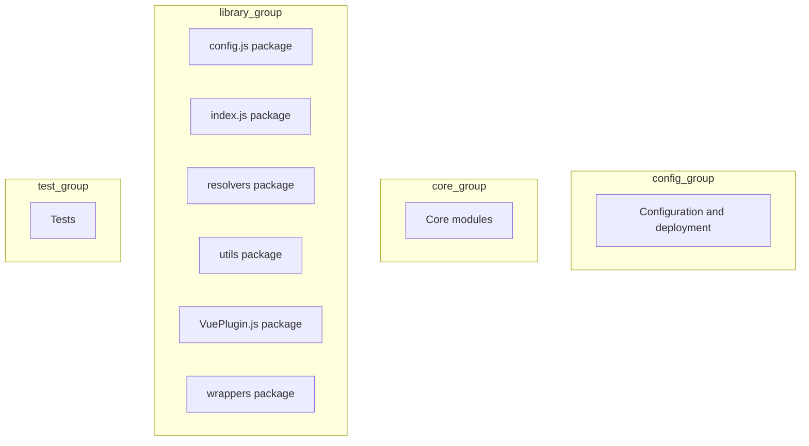

# Architecture report: akxcv/vuera

> Automated static analysis. **Observed** = directly seen in files/imports/AST; **Inferred** = interpretation from that evidence. Repository code was not executed.

## 1. Repository at a glance

| Item | Value |
| --- | --- |
| Repository | akxcv/vuera |
| Description | :eyes: Vue in React, React in Vue. Seamless integration of the two. :dancers: |
| Language | JavaScript |
| Stars | 4278 |
| Licence | MIT |
| Analysed commit / branch | 6322eba843982917e9585d5ee705576a7d42788d / master |
| Framework(s) | React, Vue |
| Files analysed | 56 |
| Components | 9 |

## 2. Architecture in one minute

akxcv/vuera - :eyes: Vue in React, React in Vue. Seamless integration of the two. :dancers:. This repository was analysed statically from 56 file(s) (0 Python). Detected technologies (observed from imports/manifests): React, Vue, Jest. Files are grouped into 9 component(s): Configuration and deployment, config.js package, Core modules, index.js package, resolvers package, Tests, utils package, VuePlugin.js package. Findings below distinguish observed facts from inferred interpretation.

## 3. High-level block diagram

## 4. Main components

### Configuration and deployment (`config`)

- **Kind:** config
- **Status:** Observed
- **Confidence:** 0.85
- **Responsibility:** Groups 1 file(s) under configuration and deployment (observed from repository paths and static analysis).
- **Paths:** `package.json`
- **Evidence:** [package.json](https://github.com/akxcv/vuera/blob/6322eba843982917e9585d5ee705576a7d42788d/package.json)

### config.js package (`config_js`)

- **Kind:** library
- **Status:** Observed
- **Confidence:** 0.85
- **Responsibility:** Groups 1 file(s) under config.js package (observed from repository paths and static analysis).
- **Paths:** `src/config.js`
- **Evidence:** [src/config.js](https://github.com/akxcv/vuera/blob/6322eba843982917e9585d5ee705576a7d42788d/src/config.js)

### Core modules (`core`)

- **Kind:** core
- **Status:** Observed
- **Confidence:** 0.85
- **Responsibility:** Groups 3 file(s) under core modules (observed from repository paths and static analysis).
- **Paths:** `babel.js`, `jest.config.js`, `rollup.config.js`
- **Evidence:** [babel.js](https://github.com/akxcv/vuera/blob/6322eba843982917e9585d5ee705576a7d42788d/babel.js); [jest.config.js](https://github.com/akxcv/vuera/blob/6322eba843982917e9585d5ee705576a7d42788d/jest.config.js); [rollup.config.js](https://github.com/akxcv/vuera/blob/6322eba843982917e9585d5ee705576a7d42788d/rollup.config.js)

### index.js package (`index_js`)

- **Kind:** library
- **Status:** Observed
- **Confidence:** 0.85
- **Responsibility:** Groups 1 file(s) under index.js package (observed from repository paths and static analysis).
- **Paths:** `src/index.js`
- **Evidence:** [src/index.js](https://github.com/akxcv/vuera/blob/6322eba843982917e9585d5ee705576a7d42788d/src/index.js)

### resolvers package (`resolvers`)

- **Kind:** library
- **Status:** Observed
- **Confidence:** 0.85
- **Responsibility:** Groups 2 file(s) under resolvers package (observed from repository paths and static analysis).
- **Paths:** `src/resolvers/React.js`, `src/resolvers/Vue.js`
- **Evidence:** [src/resolvers/React.js](https://github.com/akxcv/vuera/blob/6322eba843982917e9585d5ee705576a7d42788d/src/resolvers/React.js); [src/resolvers/Vue.js](https://github.com/akxcv/vuera/blob/6322eba843982917e9585d5ee705576a7d42788d/src/resolvers/Vue.js)

### Tests (`tests`)

- **Kind:** test
- **Status:** Observed
- **Confidence:** 0.85
- **Responsibility:** Groups 34 file(s) under tests (observed from repository paths and static analysis).
- **Paths:** `tests/.eslintrc.json`, `tests/VuePlugin-test.js`, `tests/__setup__.js`, `tests/babel-test.js`, `tests/config-test.js`, `tests/fixtures/ReactChildlessComponent.js`, `tests/fixtures/ReactComponent.js`, `tests/fixtures/ReactFunctionalComponent.js`, `tests/fixtures/ReactPureFunctionalComponent.js`, `tests/fixtures/StyledComponent.js`, `tests/fixtures/VueComponent.js`, `tests/fixtures/VueInstanceOptionsComponent.js`, `tests/fixtures/VueRegisteredComponent.js`, `tests/fixtures/VueSingleFileComponent.vue`, `tests/fixtures/babel/CreateElementAliased-result.js`, `tests/fixtures/babel/CreateElementAliased.js`, `tests/fixtures/babel/DOMElementInReact.js`, `tests/fixtures/babel/DifferentDefaultImportName-result.js`, `tests/fixtures/babel/DifferentDefaultImportName.js`, `tests/fixtures/babel/MixedImports-result.js`, `tests/fixtures/babel/MixedImports.js`, `tests/fixtures/babel/NoReactDefaultImport.js`, `tests/fixtures/babel/OnlyCreateClassImported.js`, `tests/fixtures/babel/OnlyCreateElementImported-result.js`, `tests/fixtures/babel/OnlyCreateElementImported.js`, `tests/fixtures/babel/VueComponentInReact-result.js`, `tests/fixtures/babel/VueComponentInReact.js`, `tests/polyfills/raf.js`, `tests/resolvers/ReactResolver-test.js`, `tests/resolvers/babelReactResolver-test.js`, `tests/utils/isReactComponent-test.js`, `tests/utils/olderVueCompat.js`, `tests/wrappers/ReactWrapper-test.js`, `tests/wrappers/VueWrapper-test.js`
- **Evidence:** [tests/.eslintrc.json](https://github.com/akxcv/vuera/blob/6322eba843982917e9585d5ee705576a7d42788d/tests/.eslintrc.json); [tests/VuePlugin-test.js](https://github.com/akxcv/vuera/blob/6322eba843982917e9585d5ee705576a7d42788d/tests/VuePlugin-test.js); [tests/__setup__.js](https://github.com/akxcv/vuera/blob/6322eba843982917e9585d5ee705576a7d42788d/tests/__setup__.js); [tests/babel-test.js](https://github.com/akxcv/vuera/blob/6322eba843982917e9585d5ee705576a7d42788d/tests/babel-test.js); [tests/config-test.js](https://github.com/akxcv/vuera/blob/6322eba843982917e9585d5ee705576a7d42788d/tests/config-test.js); [tests/fixtures/ReactChildlessComponent.js](https://github.com/akxcv/vuera/blob/6322eba843982917e9585d5ee705576a7d42788d/tests/fixtures/ReactChildlessComponent.js); [tests/fixtures/ReactComponent.js](https://github.com/akxcv/vuera/blob/6322eba843982917e9585d5ee705576a7d42788d/tests/fixtures/ReactComponent.js); [tests/fixtures/ReactFunctionalComponent.js](https://github.com/akxcv/vuera/blob/6322eba843982917e9585d5ee705576a7d42788d/tests/fixtures/ReactFunctionalComponent.js)

### utils package (`utils`)

- **Kind:** library
- **Status:** Observed
- **Confidence:** 0.85
- **Responsibility:** Groups 1 file(s) under utils package (observed from repository paths and static analysis).
- **Paths:** `src/utils/isReactComponent.js`
- **Evidence:** [src/utils/isReactComponent.js](https://github.com/akxcv/vuera/blob/6322eba843982917e9585d5ee705576a7d42788d/src/utils/isReactComponent.js)

### VuePlugin.js package (`vueplugin_js`)

- **Kind:** library
- **Status:** Observed
- **Confidence:** 0.85
- **Responsibility:** Groups 1 file(s) under vueplugin.js package (observed from repository paths and static analysis).
- **Paths:** `src/VuePlugin.js`
- **Evidence:** [src/VuePlugin.js](https://github.com/akxcv/vuera/blob/6322eba843982917e9585d5ee705576a7d42788d/src/VuePlugin.js)

### wrappers package (`wrappers`)

- **Kind:** library
- **Status:** Observed
- **Confidence:** 0.85
- **Responsibility:** Groups 2 file(s) under wrappers package (observed from repository paths and static analysis).
- **Paths:** `src/wrappers/React.js`, `src/wrappers/Vue.js`
- **Evidence:** [src/wrappers/React.js](https://github.com/akxcv/vuera/blob/6322eba843982917e9585d5ee705576a7d42788d/src/wrappers/React.js); [src/wrappers/Vue.js](https://github.com/akxcv/vuera/blob/6322eba843982917e9585d5ee705576a7d42788d/src/wrappers/Vue.js)

## 5. Execution flow

**Observed** entry point(s):

- [src/index.js](https://github.com/akxcv/vuera/blob/6322eba843982917e9585d5ee705576a7d42788d/src/index.js)

Representative flow (derived from observed entry points and the import graph; steps beyond the entry point are **Inferred**):

1. Execution starts at an observed entry point listed above, if present.
2. No internal import relationships between components were observed.

## 6. Project structure

### `(root)`

- `.babelrc` - other (388 bytes)
- `.eslintignore` - other (59 bytes)
- `.eslintrc.json` - config (343 bytes)
- `.gitignore` - other (40 bytes)
- `.hound.yml` - config (133 bytes)
- `.prettierrc.json` - config (64 bytes)
- `.travis.yml` - ci, YAML (567 bytes)
- `CHANGELOG.md` - docs (1808 bytes)
- `LICENSE` - docs (1074 bytes)
- `README.md` - docs (6799 bytes)
- `babel.js` - source, JavaScript (2588 bytes)
- `jest.config.js` - source, JavaScript (342 bytes)
- `package.json` - manifest (2298 bytes)
- `rollup.config.js` - source, JavaScript (892 bytes)

### `src`

- `src/VuePlugin.js` - source, JavaScript (1030 bytes)
- `src/config.js` - source, JavaScript (112 bytes)
- `src/index.js` - source, JavaScript (399 bytes)
- `src/resolvers/React.js` - source, JavaScript (764 bytes)
- `src/resolvers/Vue.js` - source, JavaScript (502 bytes)
- `src/utils/isReactComponent.js` - source, JavaScript (542 bytes)
- `src/wrappers/React.js` - source, JavaScript (2925 bytes)
- `src/wrappers/Vue.js` - source, JavaScript (3121 bytes)

### `tests`

- `tests/.eslintrc.json` - test (221 bytes)
- `tests/VuePlugin-test.js` - test, JavaScript (3362 bytes)
- `tests/__setup__.js` - test, JavaScript (230 bytes)
- `tests/babel-test.js` - test, JavaScript (1922 bytes)
- `tests/config-test.js` - test, JavaScript (174 bytes)
- `tests/fixtures/ReactChildlessComponent.js` - test, JavaScript (616 bytes)
- `tests/fixtures/ReactComponent.js` - test, JavaScript (236 bytes)
- `tests/fixtures/ReactFunctionalComponent.js` - test, JavaScript (165 bytes)
- `tests/fixtures/ReactPureFunctionalComponent.js` - test, JavaScript (197 bytes)
- `tests/fixtures/StyledComponent.js` - test, JavaScript (315 bytes)
- `tests/fixtures/VueComponent.js` - test, JavaScript (262 bytes)
- `tests/fixtures/VueInstanceOptionsComponent.js` - test, JavaScript (518 bytes)
- `tests/fixtures/VueRegisteredComponent.js` - test, JavaScript (328 bytes)
- `tests/fixtures/VueSingleFileComponent.vue` - test, Vue (320 bytes)
- `tests/fixtures/babel/CreateElementAliased-result.js` - test, JavaScript (362 bytes)
- `tests/fixtures/babel/CreateElementAliased.js` - test, JavaScript (279 bytes)
- `tests/fixtures/babel/DOMElementInReact.js` - test, JavaScript (78 bytes)
- `tests/fixtures/babel/DifferentDefaultImportName-result.js` - test, JavaScript (348 bytes)
- `tests/fixtures/babel/DifferentDefaultImportName.js` - test, JavaScript (307 bytes)
- `tests/fixtures/babel/MixedImports-result.js` - test, JavaScript (364 bytes)
- `tests/fixtures/babel/MixedImports.js` - test, JavaScript (311 bytes)
- `tests/fixtures/babel/NoReactDefaultImport.js` - test, JavaScript (278 bytes)
- `tests/fixtures/babel/OnlyCreateClassImported.js` - test, JavaScript (341 bytes)
- `tests/fixtures/babel/OnlyCreateElementImported-result.js` - test, JavaScript (357 bytes)
- `tests/fixtures/babel/OnlyCreateElementImported.js` - test, JavaScript (298 bytes)
- `tests/fixtures/babel/VueComponentInReact-result.js` - test, JavaScript (345 bytes)
- `tests/fixtures/babel/VueComponentInReact.js` - test, JavaScript (298 bytes)
- `tests/polyfills/raf.js` - test, JavaScript (947 bytes)
- `tests/resolvers/ReactResolver-test.js` - test, JavaScript (2007 bytes)
- `tests/resolvers/babelReactResolver-test.js` - test, JavaScript (1949 bytes)
- `tests/utils/isReactComponent-test.js` - test, JavaScript (1123 bytes)
- `tests/utils/olderVueCompat.js` - test, JavaScript (392 bytes)
- `tests/wrappers/ReactWrapper-test.js` - test, JavaScript (6744 bytes)
- `tests/wrappers/VueWrapper-test.js` - test, JavaScript (6601 bytes)

## 7. Key dependencies and integrations

| Name | Category | Status | Confidence | Evidence |
| --- | --- | --- | --- | --- |
| React | framework | Observed | 0.90 | [package.json:3](https://github.com/akxcv/vuera/blob/6322eba843982917e9585d5ee705576a7d42788d/package.json#L3); [package.json:15](https://github.com/akxcv/vuera/blob/6322eba843982917e9585d5ee705576a7d42788d/package.json#L15) |
| Vue | framework | Observed | 0.90 | [package.json:2](https://github.com/akxcv/vuera/blob/6322eba843982917e9585d5ee705576a7d42788d/package.json#L2) |
| Jest | tooling | Observed | 0.85 | [package.json:21](https://github.com/akxcv/vuera/blob/6322eba843982917e9585d5ee705576a7d42788d/package.json#L21) |

## 8. Data and state

No database, cache, queue, or persistent-state usage was observed in the analysed files. State handling, if any, may be in-memory or in files that were not analysed.

## 9. Configuration and deployment clues

- `.eslintrc.json` (config)
- `.hound.yml` (config)
- `.prettierrc.json` (config)
- `.travis.yml` (ci)
- `package.json` (manifest)

## 10. Design observations

- Tests are present alongside source code (Observed from test file paths).

These observations are interpretations (**Inferred**) of the observed structure, not guarantees about runtime design.

## 11. Limitations and unknowns

- Static analysis only: repository code was not executed, installed, or imported at runtime.
- Components and relationships are inferred from file paths, imports, and AST structure; runtime behaviour, dynamic imports, and reflection may not be visible.
- 4 file(s) were skipped during inventory (1 x lockfile excluded; 3 x vendored/generated directory excluded).
- No clear application entry point was observed in the analysed files.
- Repository text was treated as untrusted data; no instructions found in repository files were followed, and likely secret values were redacted/excluded.
- JavaScript and TypeScript files were inventoried from paths and package manifests. They were not parsed with a full language AST, and repository code was not executed.
- The GitHub repository was marked archived at selection time.

## 12. Source references

- [babel.js](https://github.com/akxcv/vuera/blob/6322eba843982917e9585d5ee705576a7d42788d/babel.js)
- [jest.config.js](https://github.com/akxcv/vuera/blob/6322eba843982917e9585d5ee705576a7d42788d/jest.config.js)
- [package.json](https://github.com/akxcv/vuera/blob/6322eba843982917e9585d5ee705576a7d42788d/package.json)
- [package.json:2](https://github.com/akxcv/vuera/blob/6322eba843982917e9585d5ee705576a7d42788d/package.json#L2)
- [package.json:3](https://github.com/akxcv/vuera/blob/6322eba843982917e9585d5ee705576a7d42788d/package.json#L3)
- [package.json:15](https://github.com/akxcv/vuera/blob/6322eba843982917e9585d5ee705576a7d42788d/package.json#L15)
- [package.json:21](https://github.com/akxcv/vuera/blob/6322eba843982917e9585d5ee705576a7d42788d/package.json#L21)
- [rollup.config.js](https://github.com/akxcv/vuera/blob/6322eba843982917e9585d5ee705576a7d42788d/rollup.config.js)
- [src/VuePlugin.js](https://github.com/akxcv/vuera/blob/6322eba843982917e9585d5ee705576a7d42788d/src/VuePlugin.js)
- [src/config.js](https://github.com/akxcv/vuera/blob/6322eba843982917e9585d5ee705576a7d42788d/src/config.js)
- [src/index.js](https://github.com/akxcv/vuera/blob/6322eba843982917e9585d5ee705576a7d42788d/src/index.js)
- [src/resolvers/React.js](https://github.com/akxcv/vuera/blob/6322eba843982917e9585d5ee705576a7d42788d/src/resolvers/React.js)
- [src/resolvers/Vue.js](https://github.com/akxcv/vuera/blob/6322eba843982917e9585d5ee705576a7d42788d/src/resolvers/Vue.js)
- [src/utils/isReactComponent.js](https://github.com/akxcv/vuera/blob/6322eba843982917e9585d5ee705576a7d42788d/src/utils/isReactComponent.js)
- [src/wrappers/React.js](https://github.com/akxcv/vuera/blob/6322eba843982917e9585d5ee705576a7d42788d/src/wrappers/React.js)
- [src/wrappers/Vue.js](https://github.com/akxcv/vuera/blob/6322eba843982917e9585d5ee705576a7d42788d/src/wrappers/Vue.js)
- [tests/.eslintrc.json](https://github.com/akxcv/vuera/blob/6322eba843982917e9585d5ee705576a7d42788d/tests/.eslintrc.json)
- [tests/VuePlugin-test.js](https://github.com/akxcv/vuera/blob/6322eba843982917e9585d5ee705576a7d42788d/tests/VuePlugin-test.js)
- [tests/__setup__.js](https://github.com/akxcv/vuera/blob/6322eba843982917e9585d5ee705576a7d42788d/tests/__setup__.js)
- [tests/babel-test.js](https://github.com/akxcv/vuera/blob/6322eba843982917e9585d5ee705576a7d42788d/tests/babel-test.js)
- [tests/config-test.js](https://github.com/akxcv/vuera/blob/6322eba843982917e9585d5ee705576a7d42788d/tests/config-test.js)
- [tests/fixtures/ReactChildlessComponent.js](https://github.com/akxcv/vuera/blob/6322eba843982917e9585d5ee705576a7d42788d/tests/fixtures/ReactChildlessComponent.js)
- [tests/fixtures/ReactComponent.js](https://github.com/akxcv/vuera/blob/6322eba843982917e9585d5ee705576a7d42788d/tests/fixtures/ReactComponent.js)
- [tests/fixtures/ReactFunctionalComponent.js](https://github.com/akxcv/vuera/blob/6322eba843982917e9585d5ee705576a7d42788d/tests/fixtures/ReactFunctionalComponent.js)
