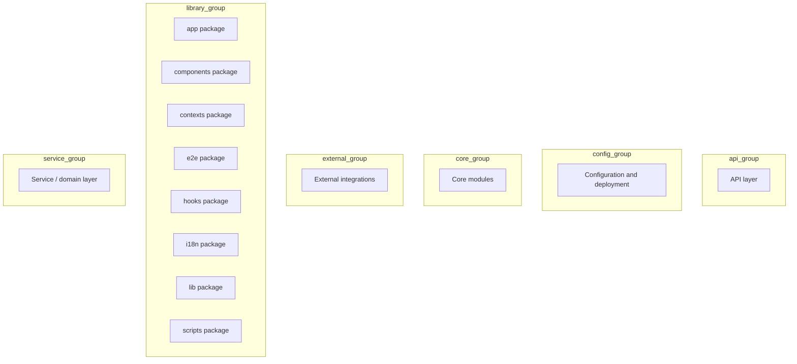

# Architecture report: al1abb/invoify

> Automated static analysis. **Observed** = directly seen in files/imports/AST; **Inferred** = interpretation from that evidence. Repository code was not executed.

## 1. Repository at a glance

| Item | Value |
| --- | --- |
| Repository | al1abb/invoify |
| Description | An invoice generator app built using Next.js, Typescript, and Shadcn |
| Language | TypeScript |
| Stars | 6391 |
| Licence | MIT |
| Analysed commit / branch | 3859b3cbae28ca4ec559db5ef87e41b798740340 / master |
| Framework(s) | Next.js, React |
| Files analysed | 195 |
| Components | 13 |

## 2. Architecture in one minute

al1abb/invoify - An invoice generator app built using Next.js, Typescript, and Shadcn. This repository was analysed statically from 195 file(s) (0 Python). Detected technologies (observed from imports/manifests): GitHub Actions, Next.js, React, Tailwind CSS, Docker, TypeScript. Files are grouped into 13 component(s): API layer, app package, components package, Configuration and deployment, contexts package, Core modules, e2e package, External integrations. Findings below distinguish observed facts from inferred interpretation.

## 3. High-level block diagram

## 4. Main components

### API layer (`api_layer`)

- **Kind:** api
- **Status:** Observed
- **Confidence:** 0.85
- **Responsibility:** Groups 4 file(s) under api layer (observed from repository paths and static analysis).
- **Paths:** `app/api/invoice/export/route.ts`, `app/api/invoice/generate/route.ts`, `app/api/invoice/send/route.ts`, `app/api/invoice/warm/route.ts`
- **Evidence:** [app/api/invoice/export/route.ts](https://github.com/al1abb/invoify/blob/3859b3cbae28ca4ec559db5ef87e41b798740340/app/api/invoice/export/route.ts); [app/api/invoice/generate/route.ts](https://github.com/al1abb/invoify/blob/3859b3cbae28ca4ec559db5ef87e41b798740340/app/api/invoice/generate/route.ts); [app/api/invoice/send/route.ts](https://github.com/al1abb/invoify/blob/3859b3cbae28ca4ec559db5ef87e41b798740340/app/api/invoice/send/route.ts); [app/api/invoice/warm/route.ts](https://github.com/al1abb/invoify/blob/3859b3cbae28ca4ec559db5ef87e41b798740340/app/api/invoice/warm/route.ts)

### app package (`app`)

- **Kind:** library
- **Status:** Observed
- **Confidence:** 0.85
- **Responsibility:** Groups 84 file(s) under app package (observed from repository paths and static analysis).
- **Paths:** `app/[locale]/[...rest]/page.tsx`, `app/[locale]/guide/page.tsx`, `app/[locale]/layout.tsx`, `app/[locale]/opengraph-image.tsx`, `app/[locale]/page.tsx`, `app/components/dev/DevDebug.tsx`, `app/components/index.ts`, `app/components/invoice/InvoiceActions.tsx`, `app/components/invoice/InvoiceForm.tsx`, `app/components/invoice/InvoiceMain.tsx`, `app/components/invoice/actions/FinalPdf.tsx`, `app/components/invoice/actions/LivePreview.tsx`, `app/components/invoice/actions/MobilePreviewSheet.tsx`, `app/components/invoice/actions/PdfViewer.tsx`, `app/components/invoice/form/AutosaveIndicator.tsx`, `app/components/invoice/form/Charges.tsx`, `app/components/invoice/form/PartyPicker.tsx`, `app/components/invoice/form/PaymentTermPresets.tsx`, `app/components/invoice/form/SingleItem.tsx`, `app/components/invoice/form/TemplateGallery.tsx`, `app/components/invoice/form/VoiceInput.tsx`, `app/components/invoice/form/sections/BillFromSection.tsx`, `app/components/invoice/form/sections/BillToSection.tsx`, `app/components/invoice/form/sections/ImportJsonButton.tsx`, `app/components/invoice/form/sections/InvoiceDetails.tsx`, `app/components/invoice/form/sections/InvoiceSummary.tsx`, `app/components/invoice/form/sections/Items.tsx`, `app/components/invoice/form/sections/PaymentInformation.tsx`, `app/components/invoice/form/wizard/WizardNavigation.tsx`, `app/components/invoice/form/wizard/WizardProgress.tsx`, `app/components/invoice/form/wizard/WizardStep.tsx`, `app/components/layout/BaseFooter.tsx`, `app/components/layout/BaseNavbar.tsx`, `app/components/layout/LandingContent.tsx`, `app/components/layout/MobileActionBar.tsx`, `app/components/modals/alerts/NewInvoiceAlert.tsx`, `app/components/modals/email/SendPdfToEmailModal.tsx`, `app/components/modals/invoice/InvoiceExportModal.tsx`, `app/components/modals/invoice/InvoiceLoaderModal.tsx`, `app/components/modals/invoice/components/SavedInvoicesList.tsx`, `app/components/modals/signature/SignatureModal.tsx`, `app/components/modals/signature/components/SignatureColorSelector.tsx`, `app/components/modals/signature/components/SignatureFontSelector.tsx`, `app/components/modals/signature/tabs/DrawSignature.tsx`, `app/components/modals/signature/tabs/TypeSignature.tsx`, `app/components/modals/signature/tabs/UploadSignature.tsx`, `app/components/reusables/BaseButton.tsx`, `app/components/reusables/LanguageSelector.tsx`, `app/components/reusables/Subheading.tsx`, `app/components/reusables/ThemeSwitcher.tsx`, `app/components/reusables/form-fields/ChargeInput.tsx`, `app/components/reusables/form-fields/CurrencySelector.tsx`, `app/components/reusables/form-fields/DatePickerFormField.tsx`, `app/components/reusables/form-fields/FormCustomInput.tsx`, `app/components/reusables/form-fields/FormFile.tsx`, `app/components/reusables/form-fields/FormInput.tsx`, `app/components/reusables/form-fields/FormTextarea.tsx`, `app/components/reusables/form-fields/fieldStyles.ts`, `app/components/templates/email/SendPdfEmail.tsx`, `app/components/templates/invoice-pdf/DynamicInvoiceTemplate.tsx`, `app/components/templates/invoice-pdf/TemplateFrame.tsx`, `app/components/templates/invoice-pdf/invoiceLabels.ts`, `app/components/templates/invoice-pdf/invoiceTheme.ts`, `app/components/templates/invoice-pdf/layouts/BoldHeader.tsx`, `app/components/templates/invoice-pdf/layouts/Bordered.tsx`, `app/components/templates/invoice-pdf/layouts/Classic.tsx`, `app/components/templates/invoice-pdf/layouts/Column.tsx`, `app/components/templates/invoice-pdf/layouts/Compact.tsx`, `app/components/templates/invoice-pdf/layouts/Corner.tsx`, `app/components/templates/invoice-pdf/layouts/LeftRail.tsx`, `app/components/templates/invoice-pdf/layouts/Letterhead.tsx`, `app/components/templates/invoice-pdf/layouts/Minimal.tsx`, `app/components/templates/invoice-pdf/layouts/Modern.tsx`, `app/components/templates/invoice-pdf/layouts/Sidebar.tsx`, `app/components/templates/invoice-pdf/layouts/Statement.tsx`, `app/components/templates/invoice-pdf/layouts/TwoTone.tsx`, `app/components/templates/invoice-pdf/parts/index.tsx`, `app/components/templates/invoice-pdf/registry.ts`, `app/layout.tsx`, `app/manifest.ts`, `app/not-found.tsx`, `app/page.tsx`, `app/robots.ts`, `app/sitemap.ts`
- **Evidence:** [app/[locale]/[...rest]/page.tsx](https://github.com/al1abb/invoify/blob/3859b3cbae28ca4ec559db5ef87e41b798740340/app/%5Blocale%5D/%5B...rest%5D/page.tsx); [app/[locale]/guide/page.tsx](https://github.com/al1abb/invoify/blob/3859b3cbae28ca4ec559db5ef87e41b798740340/app/%5Blocale%5D/guide/page.tsx); [app/[locale]/layout.tsx](https://github.com/al1abb/invoify/blob/3859b3cbae28ca4ec559db5ef87e41b798740340/app/%5Blocale%5D/layout.tsx); [app/[locale]/opengraph-image.tsx](https://github.com/al1abb/invoify/blob/3859b3cbae28ca4ec559db5ef87e41b798740340/app/%5Blocale%5D/opengraph-image.tsx); [app/[locale]/page.tsx](https://github.com/al1abb/invoify/blob/3859b3cbae28ca4ec559db5ef87e41b798740340/app/%5Blocale%5D/page.tsx); [app/components/dev/DevDebug.tsx](https://github.com/al1abb/invoify/blob/3859b3cbae28ca4ec559db5ef87e41b798740340/app/components/dev/DevDebug.tsx); [app/components/index.ts](https://github.com/al1abb/invoify/blob/3859b3cbae28ca4ec559db5ef87e41b798740340/app/components/index.ts); [app/components/invoice/InvoiceActions.tsx](https://github.com/al1abb/invoify/blob/3859b3cbae28ca4ec559db5ef87e41b798740340/app/components/invoice/InvoiceActions.tsx)

### components package (`components`)

- **Kind:** library
- **Status:** Observed
- **Confidence:** 0.85
- **Responsibility:** Groups 25 file(s) under components package (observed from repository paths and static analysis).
- **Paths:** `components/ui/alert-dialog.tsx`, `components/ui/aspect-ratio.tsx`, `components/ui/badge.tsx`, `components/ui/button.tsx`, `components/ui/calendar.tsx`, `components/ui/card.tsx`, `components/ui/dialog.tsx`, `components/ui/form.tsx`, `components/ui/input.tsx`, `components/ui/label.tsx`, `components/ui/popover.tsx`, `components/ui/progress.tsx`, `components/ui/scroll-area.tsx`, `components/ui/select.tsx`, `components/ui/separator.tsx`, `components/ui/sheet.tsx`, `components/ui/skeleton.tsx`, `components/ui/switch.tsx`, `components/ui/table.tsx`, `components/ui/tabs.tsx`, `components/ui/textarea.tsx`, `components/ui/toast.tsx`, `components/ui/toaster.tsx`, `components/ui/tooltip.tsx`, `components/ui/use-toast.ts`
- **Evidence:** [components/ui/alert-dialog.tsx](https://github.com/al1abb/invoify/blob/3859b3cbae28ca4ec559db5ef87e41b798740340/components/ui/alert-dialog.tsx); [components/ui/aspect-ratio.tsx](https://github.com/al1abb/invoify/blob/3859b3cbae28ca4ec559db5ef87e41b798740340/components/ui/aspect-ratio.tsx); [components/ui/badge.tsx](https://github.com/al1abb/invoify/blob/3859b3cbae28ca4ec559db5ef87e41b798740340/components/ui/badge.tsx); [components/ui/button.tsx](https://github.com/al1abb/invoify/blob/3859b3cbae28ca4ec559db5ef87e41b798740340/components/ui/button.tsx); [components/ui/calendar.tsx](https://github.com/al1abb/invoify/blob/3859b3cbae28ca4ec559db5ef87e41b798740340/components/ui/calendar.tsx); [components/ui/card.tsx](https://github.com/al1abb/invoify/blob/3859b3cbae28ca4ec559db5ef87e41b798740340/components/ui/card.tsx); [components/ui/dialog.tsx](https://github.com/al1abb/invoify/blob/3859b3cbae28ca4ec559db5ef87e41b798740340/components/ui/dialog.tsx); [components/ui/form.tsx](https://github.com/al1abb/invoify/blob/3859b3cbae28ca4ec559db5ef87e41b798740340/components/ui/form.tsx)

### Configuration and deployment (`config`)

- **Kind:** config
- **Status:** Observed
- **Confidence:** 0.85
- **Responsibility:** Groups 23 file(s) under configuration and deployment (observed from repository paths and static analysis).
- **Paths:** `Dockerfile`, `components.json`, `i18n/locales/ar.json`, `i18n/locales/az.json`, `i18n/locales/ca.json`, `i18n/locales/de.json`, `i18n/locales/en.json`, `i18n/locales/es.json`, `i18n/locales/fr.json`, `i18n/locales/he.json`, `i18n/locales/id.json`, `i18n/locales/it.json`, `i18n/locales/ja.json`, `i18n/locales/nb-NO.json`, `i18n/locales/nn-NO.json`, `i18n/locales/pl.json`, `i18n/locales/pt-BR.json`, `i18n/locales/sr.json`, `i18n/locales/tr.json`, `i18n/locales/zh-CN.json`, `package.json`, `public/assets/data/currencies.json`, `tsconfig.json`
- **Evidence:** [Dockerfile](https://github.com/al1abb/invoify/blob/3859b3cbae28ca4ec559db5ef87e41b798740340/Dockerfile); [components.json](https://github.com/al1abb/invoify/blob/3859b3cbae28ca4ec559db5ef87e41b798740340/components.json); [i18n/locales/ar.json](https://github.com/al1abb/invoify/blob/3859b3cbae28ca4ec559db5ef87e41b798740340/i18n/locales/ar.json); [i18n/locales/az.json](https://github.com/al1abb/invoify/blob/3859b3cbae28ca4ec559db5ef87e41b798740340/i18n/locales/az.json); [i18n/locales/ca.json](https://github.com/al1abb/invoify/blob/3859b3cbae28ca4ec559db5ef87e41b798740340/i18n/locales/ca.json); [i18n/locales/de.json](https://github.com/al1abb/invoify/blob/3859b3cbae28ca4ec559db5ef87e41b798740340/i18n/locales/de.json); [i18n/locales/en.json](https://github.com/al1abb/invoify/blob/3859b3cbae28ca4ec559db5ef87e41b798740340/i18n/locales/en.json); [i18n/locales/es.json](https://github.com/al1abb/invoify/blob/3859b3cbae28ca4ec559db5ef87e41b798740340/i18n/locales/es.json)

### contexts package (`contexts`)

- **Kind:** library
- **Status:** Observed
- **Confidence:** 0.85
- **Responsibility:** Groups 7 file(s) under contexts package (observed from repository paths and static analysis).
- **Paths:** `contexts/ChargesContext.tsx`, `contexts/InvoiceContext.tsx`, `contexts/Providers.tsx`, `contexts/SignatureContext.tsx`, `contexts/ThemeProvider.tsx`, `contexts/TranslationContext.tsx`, `contexts/WizardContext.tsx`
- **Evidence:** [contexts/ChargesContext.tsx](https://github.com/al1abb/invoify/blob/3859b3cbae28ca4ec559db5ef87e41b798740340/contexts/ChargesContext.tsx); [contexts/InvoiceContext.tsx](https://github.com/al1abb/invoify/blob/3859b3cbae28ca4ec559db5ef87e41b798740340/contexts/InvoiceContext.tsx); [contexts/Providers.tsx](https://github.com/al1abb/invoify/blob/3859b3cbae28ca4ec559db5ef87e41b798740340/contexts/Providers.tsx); [contexts/SignatureContext.tsx](https://github.com/al1abb/invoify/blob/3859b3cbae28ca4ec559db5ef87e41b798740340/contexts/SignatureContext.tsx); [contexts/ThemeProvider.tsx](https://github.com/al1abb/invoify/blob/3859b3cbae28ca4ec559db5ef87e41b798740340/contexts/ThemeProvider.tsx); [contexts/TranslationContext.tsx](https://github.com/al1abb/invoify/blob/3859b3cbae28ca4ec559db5ef87e41b798740340/contexts/TranslationContext.tsx); [contexts/WizardContext.tsx](https://github.com/al1abb/invoify/blob/3859b3cbae28ca4ec559db5ef87e41b798740340/contexts/WizardContext.tsx)

### Core modules (`core`)

- **Kind:** core
- **Status:** Observed
- **Confidence:** 0.85
- **Responsibility:** Groups 9 file(s) under core modules (observed from repository paths and static analysis).
- **Paths:** `eslint.config.mjs`, `middleware.ts`, `next-env.d.ts`, `next.config.js`, `playwright.config.ts`, `postcss.config.js`, `puppeteer.config.cjs`, `tailwind.config.js`, `types.ts`
- **Evidence:** [eslint.config.mjs](https://github.com/al1abb/invoify/blob/3859b3cbae28ca4ec559db5ef87e41b798740340/eslint.config.mjs); [middleware.ts](https://github.com/al1abb/invoify/blob/3859b3cbae28ca4ec559db5ef87e41b798740340/middleware.ts); [next-env.d.ts](https://github.com/al1abb/invoify/blob/3859b3cbae28ca4ec559db5ef87e41b798740340/next-env.d.ts); [next.config.js](https://github.com/al1abb/invoify/blob/3859b3cbae28ca4ec559db5ef87e41b798740340/next.config.js); [playwright.config.ts](https://github.com/al1abb/invoify/blob/3859b3cbae28ca4ec559db5ef87e41b798740340/playwright.config.ts); [postcss.config.js](https://github.com/al1abb/invoify/blob/3859b3cbae28ca4ec559db5ef87e41b798740340/postcss.config.js); [puppeteer.config.cjs](https://github.com/al1abb/invoify/blob/3859b3cbae28ca4ec559db5ef87e41b798740340/puppeteer.config.cjs); [tailwind.config.js](https://github.com/al1abb/invoify/blob/3859b3cbae28ca4ec559db5ef87e41b798740340/tailwind.config.js)

### e2e package (`e2e`)

- **Kind:** library
- **Status:** Observed
- **Confidence:** 0.85
- **Responsibility:** Groups 1 file(s) under e2e package (observed from repository paths and static analysis).
- **Paths:** `e2e/smoke.spec.ts`
- **Evidence:** [e2e/smoke.spec.ts](https://github.com/al1abb/invoify/blob/3859b3cbae28ca4ec559db5ef87e41b798740340/e2e/smoke.spec.ts)

### External integrations (`external_integrations`)

- **Kind:** external
- **Status:** Observed
- **Confidence:** 0.85
- **Responsibility:** Groups 1 file(s) under external integrations (observed from repository paths and static analysis).
- **Paths:** `services/invoice/client/exportInvoice.ts`
- **Evidence:** [services/invoice/client/exportInvoice.ts](https://github.com/al1abb/invoify/blob/3859b3cbae28ca4ec559db5ef87e41b798740340/services/invoice/client/exportInvoice.ts)

### hooks package (`hooks`)

- **Kind:** library
- **Status:** Observed
- **Confidence:** 0.85
- **Responsibility:** Groups 4 file(s) under hooks package (observed from repository paths and static analysis).
- **Paths:** `hooks/useCurrencies.tsx`, `hooks/useFitScale.ts`, `hooks/useMediaQuery.tsx`, `hooks/useToasts.tsx`
- **Evidence:** [hooks/useCurrencies.tsx](https://github.com/al1abb/invoify/blob/3859b3cbae28ca4ec559db5ef87e41b798740340/hooks/useCurrencies.tsx); [hooks/useFitScale.ts](https://github.com/al1abb/invoify/blob/3859b3cbae28ca4ec559db5ef87e41b798740340/hooks/useFitScale.ts); [hooks/useMediaQuery.tsx](https://github.com/al1abb/invoify/blob/3859b3cbae28ca4ec559db5ef87e41b798740340/hooks/useMediaQuery.tsx); [hooks/useToasts.tsx](https://github.com/al1abb/invoify/blob/3859b3cbae28ca4ec559db5ef87e41b798740340/hooks/useToasts.tsx)

### i18n package (`i18n`)

- **Kind:** library
- **Status:** Observed
- **Confidence:** 0.85
- **Responsibility:** Groups 4 file(s) under i18n package (observed from repository paths and static analysis).
- **Paths:** `i18n/messages.ts`, `i18n/navigation.ts`, `i18n/request.ts`, `i18n/routing.ts`
- **Evidence:** [i18n/messages.ts](https://github.com/al1abb/invoify/blob/3859b3cbae28ca4ec559db5ef87e41b798740340/i18n/messages.ts); [i18n/navigation.ts](https://github.com/al1abb/invoify/blob/3859b3cbae28ca4ec559db5ef87e41b798740340/i18n/navigation.ts); [i18n/request.ts](https://github.com/al1abb/invoify/blob/3859b3cbae28ca4ec559db5ef87e41b798740340/i18n/request.ts); [i18n/routing.ts](https://github.com/al1abb/invoify/blob/3859b3cbae28ca4ec559db5ef87e41b798740340/i18n/routing.ts)

### lib package (`lib`)

- **Kind:** library
- **Status:** Observed
- **Confidence:** 0.85
- **Responsibility:** Groups 12 file(s) under lib package (observed from repository paths and static analysis).
- **Paths:** `lib/fonts.ts`, `lib/helpers.ts`, `lib/invoiceNumber.ts`, `lib/partyStore.ts`, `lib/schemas.ts`, `lib/secureStore.ts`, `lib/seo.ts`, `lib/server/rateLimit.ts`, `lib/server/validateRequest.ts`, `lib/utils.ts`, `lib/variables.ts`, `lib/wizardSteps.ts`
- **Evidence:** [lib/fonts.ts](https://github.com/al1abb/invoify/blob/3859b3cbae28ca4ec559db5ef87e41b798740340/lib/fonts.ts); [lib/helpers.ts](https://github.com/al1abb/invoify/blob/3859b3cbae28ca4ec559db5ef87e41b798740340/lib/helpers.ts); [lib/invoiceNumber.ts](https://github.com/al1abb/invoify/blob/3859b3cbae28ca4ec559db5ef87e41b798740340/lib/invoiceNumber.ts); [lib/partyStore.ts](https://github.com/al1abb/invoify/blob/3859b3cbae28ca4ec559db5ef87e41b798740340/lib/partyStore.ts); [lib/schemas.ts](https://github.com/al1abb/invoify/blob/3859b3cbae28ca4ec559db5ef87e41b798740340/lib/schemas.ts); [lib/secureStore.ts](https://github.com/al1abb/invoify/blob/3859b3cbae28ca4ec559db5ef87e41b798740340/lib/secureStore.ts); [lib/seo.ts](https://github.com/al1abb/invoify/blob/3859b3cbae28ca4ec559db5ef87e41b798740340/lib/seo.ts); [lib/server/rateLimit.ts](https://github.com/al1abb/invoify/blob/3859b3cbae28ca4ec559db5ef87e41b798740340/lib/server/rateLimit.ts)

### scripts package (`scripts`)

- **Kind:** library
- **Status:** Observed
- **Confidence:** 0.85
- **Responsibility:** Groups 1 file(s) under scripts package (observed from repository paths and static analysis).
- **Paths:** `scripts/build-pdf-css.mjs`
- **Evidence:** [scripts/build-pdf-css.mjs](https://github.com/al1abb/invoify/blob/3859b3cbae28ca4ec559db5ef87e41b798740340/scripts/build-pdf-css.mjs)

### Service / domain layer (`service_layer`)

- **Kind:** service
- **Status:** Observed
- **Confidence:** 0.85
- **Responsibility:** Groups 6 file(s) under service / domain layer (observed from repository paths and static analysis).
- **Paths:** `services/invoice/server/browser.ts`, `services/invoice/server/exportInvoiceService.ts`, `services/invoice/server/generatePdfService.ts`, `services/invoice/server/pdfCache.ts`, `services/invoice/server/pdfPage.ts`, `services/invoice/server/sendPdfToEmailService.ts`
- **Evidence:** [services/invoice/server/browser.ts](https://github.com/al1abb/invoify/blob/3859b3cbae28ca4ec559db5ef87e41b798740340/services/invoice/server/browser.ts); [services/invoice/server/exportInvoiceService.ts](https://github.com/al1abb/invoify/blob/3859b3cbae28ca4ec559db5ef87e41b798740340/services/invoice/server/exportInvoiceService.ts); [services/invoice/server/generatePdfService.ts](https://github.com/al1abb/invoify/blob/3859b3cbae28ca4ec559db5ef87e41b798740340/services/invoice/server/generatePdfService.ts); [services/invoice/server/pdfCache.ts](https://github.com/al1abb/invoify/blob/3859b3cbae28ca4ec559db5ef87e41b798740340/services/invoice/server/pdfCache.ts); [services/invoice/server/pdfPage.ts](https://github.com/al1abb/invoify/blob/3859b3cbae28ca4ec559db5ef87e41b798740340/services/invoice/server/pdfPage.ts); [services/invoice/server/sendPdfToEmailService.ts](https://github.com/al1abb/invoify/blob/3859b3cbae28ca4ec559db5ef87e41b798740340/services/invoice/server/sendPdfToEmailService.ts)

## 5. Execution flow

**Observed** entry point(s):

- [app/[locale]/[...rest]/page.tsx](https://github.com/al1abb/invoify/blob/3859b3cbae28ca4ec559db5ef87e41b798740340/app/%5Blocale%5D/%5B...rest%5D/page.tsx)
- [app/[locale]/guide/page.tsx](https://github.com/al1abb/invoify/blob/3859b3cbae28ca4ec559db5ef87e41b798740340/app/%5Blocale%5D/guide/page.tsx)
- [app/[locale]/page.tsx](https://github.com/al1abb/invoify/blob/3859b3cbae28ca4ec559db5ef87e41b798740340/app/%5Blocale%5D/page.tsx)
- [app/components/index.ts](https://github.com/al1abb/invoify/blob/3859b3cbae28ca4ec559db5ef87e41b798740340/app/components/index.ts)
- [app/page.tsx](https://github.com/al1abb/invoify/blob/3859b3cbae28ca4ec559db5ef87e41b798740340/app/page.tsx)

Representative flow (derived from observed entry points and the import graph; steps beyond the entry point are **Inferred**):

1. Execution starts at an observed entry point listed above, if present.
2. No internal import relationships between components were observed.

## 6. Project structure

### `(root)`

- `.editorconfig` - config (147 bytes)
- `.gitignore` - other (922 bytes)
- `.prettierignore` - other (107 bytes)
- `.prettierrc.json` - config (308 bytes)
- `Dockerfile` - container (1192 bytes)
- `LICENSE` - docs (1068 bytes)
- `README.md` - docs (6789 bytes)
- `components.json` - config (364 bytes)
- `eslint.config.mjs` - source, JavaScript (1326 bytes)
- `middleware.ts` - source, TypeScript (369 bytes)
- `next-env.d.ts` - source, TypeScript (211 bytes)
- `next.config.js` - source, JavaScript (569 bytes)
- `package.json` - manifest (3159 bytes)
- `playwright.config.ts` - source, TypeScript (2156 bytes)
- `postcss.config.js` - source, JavaScript (82 bytes)
- `puppeteer.config.cjs` - source, JavaScript (219 bytes)
- `tailwind.config.js` - source, JavaScript (5405 bytes)
- `tsconfig.json` - config (598 bytes)
- `types.ts` - source, TypeScript (1019 bytes)

### `.claude`

- `.claude/launch.json` - config (183 bytes)

### `.github`

- `.github/ISSUE_TEMPLATE/bug_report.md` - docs (1204 bytes)
- `.github/ISSUE_TEMPLATE/feature_request.md` - docs (609 bytes)
- `.github/dependabot.yml` - config (767 bytes)
- `.github/workflows/ci.yml` - ci, YAML (1004 bytes)

### `app`

- `app/[locale]/[...rest]/page.tsx` - source, TypeScript (104 bytes)
- `app/[locale]/guide/page.tsx` - source, TypeScript (2142 bytes)
- `app/[locale]/layout.tsx` - source, TypeScript (5928 bytes)
- `app/[locale]/opengraph-image.tsx` - source, TypeScript (3798 bytes)
- `app/[locale]/page.tsx` - source, TypeScript (1749 bytes)
- `app/api/invoice/export/route.ts` - source, TypeScript (264 bytes)
- `app/api/invoice/generate/route.ts` - source, TypeScript (323 bytes)
- `app/api/invoice/send/route.ts` - source, TypeScript (1123 bytes)
- `app/api/invoice/warm/route.ts` - source, TypeScript (1896 bytes)
- `app/components/dev/DevDebug.tsx` - source, TypeScript (1625 bytes)
- `app/components/index.ts` - source, TypeScript (5353 bytes)
- `app/components/invoice/InvoiceActions.tsx` - source, TypeScript (9400 bytes)
- `app/components/invoice/InvoiceForm.tsx` - source, TypeScript (5698 bytes)
- `app/components/invoice/InvoiceMain.tsx` - source, TypeScript (3569 bytes)
- `app/components/invoice/actions/FinalPdf.tsx` - source, TypeScript (4798 bytes)
- `app/components/invoice/actions/LivePreview.tsx` - source, TypeScript (6665 bytes)
- `app/components/invoice/actions/MobilePreviewSheet.tsx` - source, TypeScript (1548 bytes)
- `app/components/invoice/actions/PdfViewer.tsx` - source, TypeScript (2191 bytes)
- `app/components/invoice/form/AutosaveIndicator.tsx` - source, TypeScript (1920 bytes)
- `app/components/invoice/form/Charges.tsx` - source, TypeScript (6189 bytes)
- `app/components/invoice/form/PartyPicker.tsx` - source, TypeScript (8562 bytes)
- `app/components/invoice/form/PaymentTermPresets.tsx` - source, TypeScript (2233 bytes)
- `app/components/invoice/form/SingleItem.tsx` - source, TypeScript (7431 bytes)
- `app/components/invoice/form/TemplateGallery.tsx` - source, TypeScript (29403 bytes)
- `app/components/invoice/form/VoiceInput.tsx` - source, TypeScript (27818 bytes)
- `app/components/invoice/form/sections/BillFromSection.tsx` - source, TypeScript (3753 bytes)
- `app/components/invoice/form/sections/BillToSection.tsx` - source, TypeScript (3501 bytes)
- `app/components/invoice/form/sections/ImportJsonButton.tsx` - source, TypeScript (2375 bytes)
- `app/components/invoice/form/sections/InvoiceDetails.tsx` - source, TypeScript (2688 bytes)
- `app/components/invoice/form/sections/InvoiceSummary.tsx` - source, TypeScript (2029 bytes)
- `app/components/invoice/form/sections/Items.tsx` - source, TypeScript (4309 bytes)
- `app/components/invoice/form/sections/PaymentInformation.tsx` - source, TypeScript (1369 bytes)
- `app/components/invoice/form/wizard/WizardNavigation.tsx` - source, TypeScript (2736 bytes)
- `app/components/invoice/form/wizard/WizardProgress.tsx` - source, TypeScript (15322 bytes)
- `app/components/invoice/form/wizard/WizardStep.tsx` - source, TypeScript (1016 bytes)
- `app/components/layout/BaseFooter.tsx` - source, TypeScript (1444 bytes)
- `app/components/layout/BaseNavbar.tsx` - source, TypeScript (3737 bytes)
- `app/components/layout/LandingContent.tsx` - source, TypeScript (7476 bytes)
- `app/components/layout/MobileActionBar.tsx` - source, TypeScript (2133 bytes)
- `app/components/modals/alerts/NewInvoiceAlert.tsx` - source, TypeScript (2328 bytes)
- `app/components/modals/email/SendPdfToEmailModal.tsx` - source, TypeScript (2539 bytes)
- `app/components/modals/invoice/InvoiceExportModal.tsx` - source, TypeScript (2750 bytes)
- `app/components/modals/invoice/InvoiceLoaderModal.tsx` - source, TypeScript (1265 bytes)
- `app/components/modals/invoice/components/SavedInvoicesList.tsx` - source, TypeScript (6394 bytes)
- `app/components/modals/signature/SignatureModal.tsx` - source, TypeScript (8149 bytes)
- `app/components/modals/signature/components/SignatureColorSelector.tsx` - source, TypeScript (1312 bytes)
- `app/components/modals/signature/components/SignatureFontSelector.tsx` - source, TypeScript (1985 bytes)
- `app/components/modals/signature/tabs/DrawSignature.tsx` - source, TypeScript (7523 bytes)
- `app/components/modals/signature/tabs/TypeSignature.tsx` - source, TypeScript (3221 bytes)
- `app/components/modals/signature/tabs/UploadSignature.tsx` - source, TypeScript (2809 bytes)
- `app/components/reusables/BaseButton.tsx` - source, TypeScript (1743 bytes)
- `app/components/reusables/LanguageSelector.tsx` - source, TypeScript (8555 bytes)
- `app/components/reusables/Subheading.tsx` - source, TypeScript (733 bytes)
- `app/components/reusables/ThemeSwitcher.tsx` - source, TypeScript (849 bytes)
- `app/components/reusables/form-fields/ChargeInput.tsx` - source, TypeScript (2755 bytes)
- `app/components/reusables/form-fields/CurrencySelector.tsx` - source, TypeScript (5856 bytes)
- `app/components/reusables/form-fields/DatePickerFormField.tsx` - source, TypeScript (4989 bytes)
- `app/components/reusables/form-fields/FormCustomInput.tsx` - source, TypeScript (1469 bytes)
- `app/components/reusables/form-fields/FormFile.tsx` - source, TypeScript (4690 bytes)
- `app/components/reusables/form-fields/FormInput.tsx` - source, TypeScript (2945 bytes)
- `app/components/reusables/form-fields/FormTextarea.tsx` - source, TypeScript (1779 bytes)
- `app/components/reusables/form-fields/fieldStyles.ts` - source, TypeScript (2865 bytes)
- `app/components/templates/email/SendPdfEmail.tsx` - source, TypeScript (1966 bytes)
- `app/components/templates/invoice-pdf/DynamicInvoiceTemplate.tsx` - source, TypeScript (1461 bytes)
- `app/components/templates/invoice-pdf/TemplateFrame.tsx` - source, TypeScript (3635 bytes)
- `app/components/templates/invoice-pdf/invoiceLabels.ts` - source, TypeScript (3036 bytes)
- `app/components/templates/invoice-pdf/invoiceTheme.ts` - source, TypeScript (6462 bytes)
- `app/components/templates/invoice-pdf/layouts/BoldHeader.tsx` - source, TypeScript (3209 bytes)
- `app/components/templates/invoice-pdf/layouts/Bordered.tsx` - source, TypeScript (3611 bytes)
- `app/components/templates/invoice-pdf/layouts/Classic.tsx` - source, TypeScript (2826 bytes)
- `app/components/templates/invoice-pdf/layouts/Column.tsx` - source, TypeScript (2743 bytes)
- `app/components/templates/invoice-pdf/layouts/Compact.tsx` - source, TypeScript (3283 bytes)
- `app/components/templates/invoice-pdf/layouts/Corner.tsx` - source, TypeScript (3738 bytes)
- `app/components/templates/invoice-pdf/layouts/LeftRail.tsx` - source, TypeScript (3134 bytes)
- `app/components/templates/invoice-pdf/layouts/Letterhead.tsx` - source, TypeScript (3175 bytes)
- `app/components/templates/invoice-pdf/layouts/Minimal.tsx` - source, TypeScript (2387 bytes)
- `app/components/templates/invoice-pdf/layouts/Modern.tsx` - source, TypeScript (2566 bytes)
- `app/components/templates/invoice-pdf/layouts/Sidebar.tsx` - source, TypeScript (4375 bytes)
- `app/components/templates/invoice-pdf/layouts/Statement.tsx` - source, TypeScript (3948 bytes)
- `app/components/templates/invoice-pdf/layouts/TwoTone.tsx` - source, TypeScript (2933 bytes)
- `app/components/templates/invoice-pdf/parts/index.tsx` - source, TypeScript (19833 bytes)
- `app/components/templates/invoice-pdf/registry.ts` - source, TypeScript (3123 bytes)
- `app/globals.css` - other (4414 bytes)
- `app/layout.tsx` - source, TypeScript (316 bytes)
- `app/manifest.ts` - source, TypeScript (1171 bytes)
- `app/not-found.tsx` - source, TypeScript (392 bytes)
- `app/page.tsx` - source, TypeScript (183 bytes)
- `app/robots.ts` - source, TypeScript (596 bytes)
- `app/sitemap.ts` - source, TypeScript (1235 bytes)

### `components`

- `components/ui/alert-dialog.tsx` - source, TypeScript (4521 bytes)
- `components/ui/aspect-ratio.tsx` - source, TypeScript (154 bytes)
- `components/ui/badge.tsx` - source, TypeScript (1128 bytes)
- `components/ui/button.tsx` - source, TypeScript (1817 bytes)
- `components/ui/calendar.tsx` - source, TypeScript (5334 bytes)
- `components/ui/card.tsx` - source, TypeScript (2057 bytes)
- `components/ui/dialog.tsx` - source, TypeScript (4172 bytes)
- `components/ui/form.tsx` - source, TypeScript (4085 bytes)
- `components/ui/input.tsx` - source, TypeScript (1738 bytes)
- `components/ui/label.tsx` - source, TypeScript (724 bytes)
- `components/ui/popover.tsx` - source, TypeScript (1244 bytes)
- `components/ui/progress.tsx` - source, TypeScript (1505 bytes)
- `components/ui/scroll-area.tsx` - source, TypeScript (1720 bytes)
- `components/ui/select.tsx` - source, TypeScript (4370 bytes)
- `components/ui/separator.tsx` - source, TypeScript (1151 bytes)
- `components/ui/sheet.tsx` - source, TypeScript (4711 bytes)
- `components/ui/skeleton.tsx` - source, TypeScript (261 bytes)
- `components/ui/switch.tsx` - source, TypeScript (1162 bytes)
- `components/ui/table.tsx` - source, TypeScript (2730 bytes)
- `components/ui/tabs.tsx` - source, TypeScript (1897 bytes)
- `components/ui/textarea.tsx` - source, TypeScript (888 bytes)
- `components/ui/toast.tsx` - source, TypeScript (4845 bytes)
- `components/ui/toaster.tsx` - source, TypeScript (794 bytes)
- `components/ui/tooltip.tsx` - source, TypeScript (1159 bytes)
- `components/ui/use-toast.ts` - source, TypeScript (3927 bytes)

### `contexts`

- `contexts/ChargesContext.tsx` - source, TypeScript (9785 bytes)
- `contexts/InvoiceContext.tsx` - source, TypeScript (18220 bytes)
- `contexts/Providers.tsx` - source, TypeScript (3621 bytes)
- `contexts/SignatureContext.tsx` - source, TypeScript (8034 bytes)
- `contexts/ThemeProvider.tsx` - source, TypeScript (302 bytes)
- `contexts/TranslationContext.tsx` - source, TypeScript (775 bytes)
- `contexts/WizardContext.tsx` - source, TypeScript (5012 bytes)

### `e2e`

- `e2e/smoke.spec.ts` - source, TypeScript (64366 bytes)

### `hooks`

- `hooks/useCurrencies.tsx` - source, TypeScript (2155 bytes)
- `hooks/useFitScale.ts` - source, TypeScript (3096 bytes)
- `hooks/useMediaQuery.tsx` - source, TypeScript (1985 bytes)
- `hooks/useToasts.tsx` - source, TypeScript (4270 bytes)

### `i18n`

- `i18n/locales/ar.json` - config (4548 bytes)
- `i18n/locales/az.json` - config (13382 bytes)
- `i18n/locales/ca.json` - config (4511 bytes)
- `i18n/locales/de.json` - config (4491 bytes)
- `i18n/locales/en.json` - config (12222 bytes)
- `i18n/locales/es.json` - config (4522 bytes)
- `i18n/locales/fr.json` - config (4686 bytes)
- `i18n/locales/he.json` - config (9759 bytes)
- `i18n/locales/id.json` - config (4367 bytes)
- `i18n/locales/it.json` - config (4513 bytes)
- `i18n/locales/ja.json` - config (2880 bytes)
- `i18n/locales/nb-NO.json` - config (4353 bytes)
- `i18n/locales/nn-NO.json` - config (4319 bytes)
- `i18n/locales/pl.json` - config (4447 bytes)
- `i18n/locales/pt-BR.json` - config (4753 bytes)
- `i18n/locales/sr.json` - config (2766 bytes)
- `i18n/locales/tr.json` - config (4451 bytes)
- `i18n/locales/zh-CN.json` - config (4018 bytes)
- `i18n/messages.ts` - source, TypeScript (1895 bytes)
- `i18n/navigation.ts` - source, TypeScript (197 bytes)
- `i18n/request.ts` - source, TypeScript (483 bytes)
- `i18n/routing.ts` - source, TypeScript (235 bytes)

### `lib`

- `lib/fonts.ts` - source, TypeScript (946 bytes)
- `lib/helpers.ts` - source, TypeScript (9280 bytes)
- `lib/invoiceNumber.ts` - source, TypeScript (2030 bytes)
- `lib/partyStore.ts` - source, TypeScript (4618 bytes)
- `lib/schemas.ts` - source, TypeScript (7307 bytes)
- `lib/secureStore.ts` - source, TypeScript (11972 bytes)
- `lib/seo.ts` - source, TypeScript (2965 bytes)
- `lib/server/rateLimit.ts` - source, TypeScript (2321 bytes)
- `lib/server/validateRequest.ts` - source, TypeScript (2936 bytes)
- `lib/utils.ts` - source, TypeScript (167 bytes)
- `lib/variables.ts` - source, TypeScript (8663 bytes)
- `lib/wizardSteps.ts` - source, TypeScript (4623 bytes)

### `public`

- `public/assets/data/currencies.json` - config (25421 bytes)
- `public/assets/favicon/site.webmanifest` - other (263 bytes)
- `public/assets/img/invoify-logo.svg` - other (7406 bytes)

### `scripts`

- `scripts/build-pdf-css.mjs` - source, JavaScript (7811 bytes)

### `services`

- `services/invoice/client/exportInvoice.ts` - source, TypeScript (1539 bytes)
- `services/invoice/server/browser.ts` - source, TypeScript (3713 bytes)
- `services/invoice/server/exportInvoiceService.ts` - source, TypeScript (3721 bytes)
- `services/invoice/server/generatePdfService.ts` - source, TypeScript (6749 bytes)
- `services/invoice/server/pdfCache.ts` - source, TypeScript (2254 bytes)
- `services/invoice/server/pdfPage.ts` - source, TypeScript (2956 bytes)
- `services/invoice/server/sendPdfToEmailService.ts` - source, TypeScript (5100 bytes)

## 7. Key dependencies and integrations

| Name | Category | Status | Confidence | Evidence |
| --- | --- | --- | --- | --- |
| GitHub Actions | ci | Observed | 0.85 | [.github/workflows/ci.yml](https://github.com/al1abb/invoify/blob/3859b3cbae28ca4ec559db5ef87e41b798740340/.github/workflows/ci.yml) |
| Next.js | framework | Observed | 0.85 | [package.json:6](https://github.com/al1abb/invoify/blob/3859b3cbae28ca4ec559db5ef87e41b798740340/package.json#L6) |
| React | framework | Observed | 0.90 | [package.json:25](https://github.com/al1abb/invoify/blob/3859b3cbae28ca4ec559db5ef87e41b798740340/package.json#L25); [package.json:55](https://github.com/al1abb/invoify/blob/3859b3cbae28ca4ec559db5ef87e41b798740340/package.json#L55) |
| Tailwind CSS | library | Observed | 0.85 | [package.json:61](https://github.com/al1abb/invoify/blob/3859b3cbae28ca4ec559db5ef87e41b798740340/package.json#L61) |
| Docker | tooling | Observed | 0.85 | [Dockerfile](https://github.com/al1abb/invoify/blob/3859b3cbae28ca4ec559db5ef87e41b798740340/Dockerfile) |
| TypeScript | tooling | Observed | 0.85 | [package.json:63](https://github.com/al1abb/invoify/blob/3859b3cbae28ca4ec559db5ef87e41b798740340/package.json#L63) |

## 8. Data and state

No database, cache, queue, or persistent-state usage was observed in the analysed files. State handling, if any, may be in-memory or in files that were not analysed.

## 9. Configuration and deployment clues

- `.claude/launch.json` (config)
- `.editorconfig` (config)
- `.github/dependabot.yml` (config)
- `.github/workflows/ci.yml` (ci)
- `.prettierrc.json` (config)
- `Dockerfile` (container)
- `components.json` (config)
- `i18n/locales/ar.json` (config)
- `i18n/locales/az.json` (config)
- `i18n/locales/ca.json` (config)
- `i18n/locales/de.json` (config)
- `i18n/locales/en.json` (config)
- `i18n/locales/es.json` (config)
- `i18n/locales/fr.json` (config)
- `i18n/locales/he.json` (config)
- `i18n/locales/id.json` (config)
- `i18n/locales/it.json` (config)
- `i18n/locales/ja.json` (config)
- `i18n/locales/nb-NO.json` (config)
- `i18n/locales/nn-NO.json` (config)
- `i18n/locales/pl.json` (config)
- `i18n/locales/pt-BR.json` (config)
- `i18n/locales/sr.json` (config)
- `i18n/locales/tr.json` (config)
- `i18n/locales/zh-CN.json` (config)
- `package.json` (manifest)
- `public/assets/data/currencies.json` (config)
- `tsconfig.json` (config)

## 10. Design observations

- An entry/API layer is separated from other code (Inferred from paths and decorators).
- Service/domain code is distinct from entry and data code, suggesting layered separation (Inferred).
- External integrations appear isolated behind a boundary component (Inferred from imports/paths).

These observations are interpretations (**Inferred**) of the observed structure, not guarantees about runtime design.

## 11. Limitations and unknowns

- Static analysis only: repository code was not executed, installed, or imported at runtime.
- Components and relationships are inferred from file paths, imports, and AST structure; runtime behaviour, dynamic imports, and reflection may not be visible.
- No clear application entry point was observed in the analysed files.
- Repository text was treated as untrusted data; no instructions found in repository files were followed, and likely secret values were redacted/excluded.
- JavaScript and TypeScript files were inventoried from paths and package manifests. They were not parsed with a full language AST, and repository code was not executed.

## 12. Source references

- [.github/workflows/ci.yml](https://github.com/al1abb/invoify/blob/3859b3cbae28ca4ec559db5ef87e41b798740340/.github/workflows/ci.yml)
- [Dockerfile](https://github.com/al1abb/invoify/blob/3859b3cbae28ca4ec559db5ef87e41b798740340/Dockerfile)
- [app/[locale]/[...rest]/page.tsx](https://github.com/al1abb/invoify/blob/3859b3cbae28ca4ec559db5ef87e41b798740340/app/%5Blocale%5D/%5B...rest%5D/page.tsx)
- [app/[locale]/guide/page.tsx](https://github.com/al1abb/invoify/blob/3859b3cbae28ca4ec559db5ef87e41b798740340/app/%5Blocale%5D/guide/page.tsx)
- [app/[locale]/layout.tsx](https://github.com/al1abb/invoify/blob/3859b3cbae28ca4ec559db5ef87e41b798740340/app/%5Blocale%5D/layout.tsx)
- [app/[locale]/opengraph-image.tsx](https://github.com/al1abb/invoify/blob/3859b3cbae28ca4ec559db5ef87e41b798740340/app/%5Blocale%5D/opengraph-image.tsx)
- [app/[locale]/page.tsx](https://github.com/al1abb/invoify/blob/3859b3cbae28ca4ec559db5ef87e41b798740340/app/%5Blocale%5D/page.tsx)
- [app/api/invoice/export/route.ts](https://github.com/al1abb/invoify/blob/3859b3cbae28ca4ec559db5ef87e41b798740340/app/api/invoice/export/route.ts)
- [app/api/invoice/generate/route.ts](https://github.com/al1abb/invoify/blob/3859b3cbae28ca4ec559db5ef87e41b798740340/app/api/invoice/generate/route.ts)
- [app/api/invoice/send/route.ts](https://github.com/al1abb/invoify/blob/3859b3cbae28ca4ec559db5ef87e41b798740340/app/api/invoice/send/route.ts)
- [app/api/invoice/warm/route.ts](https://github.com/al1abb/invoify/blob/3859b3cbae28ca4ec559db5ef87e41b798740340/app/api/invoice/warm/route.ts)
- [app/components/dev/DevDebug.tsx](https://github.com/al1abb/invoify/blob/3859b3cbae28ca4ec559db5ef87e41b798740340/app/components/dev/DevDebug.tsx)
- [app/components/index.ts](https://github.com/al1abb/invoify/blob/3859b3cbae28ca4ec559db5ef87e41b798740340/app/components/index.ts)
- [app/components/invoice/InvoiceActions.tsx](https://github.com/al1abb/invoify/blob/3859b3cbae28ca4ec559db5ef87e41b798740340/app/components/invoice/InvoiceActions.tsx)
- [app/page.tsx](https://github.com/al1abb/invoify/blob/3859b3cbae28ca4ec559db5ef87e41b798740340/app/page.tsx)
- [components.json](https://github.com/al1abb/invoify/blob/3859b3cbae28ca4ec559db5ef87e41b798740340/components.json)
- [components/ui/alert-dialog.tsx](https://github.com/al1abb/invoify/blob/3859b3cbae28ca4ec559db5ef87e41b798740340/components/ui/alert-dialog.tsx)
- [components/ui/aspect-ratio.tsx](https://github.com/al1abb/invoify/blob/3859b3cbae28ca4ec559db5ef87e41b798740340/components/ui/aspect-ratio.tsx)
- [components/ui/badge.tsx](https://github.com/al1abb/invoify/blob/3859b3cbae28ca4ec559db5ef87e41b798740340/components/ui/badge.tsx)
- [components/ui/button.tsx](https://github.com/al1abb/invoify/blob/3859b3cbae28ca4ec559db5ef87e41b798740340/components/ui/button.tsx)
- [components/ui/calendar.tsx](https://github.com/al1abb/invoify/blob/3859b3cbae28ca4ec559db5ef87e41b798740340/components/ui/calendar.tsx)
- [components/ui/card.tsx](https://github.com/al1abb/invoify/blob/3859b3cbae28ca4ec559db5ef87e41b798740340/components/ui/card.tsx)
- [components/ui/dialog.tsx](https://github.com/al1abb/invoify/blob/3859b3cbae28ca4ec559db5ef87e41b798740340/components/ui/dialog.tsx)
- [components/ui/form.tsx](https://github.com/al1abb/invoify/blob/3859b3cbae28ca4ec559db5ef87e41b798740340/components/ui/form.tsx)
- [contexts/ChargesContext.tsx](https://github.com/al1abb/invoify/blob/3859b3cbae28ca4ec559db5ef87e41b798740340/contexts/ChargesContext.tsx)
- [contexts/InvoiceContext.tsx](https://github.com/al1abb/invoify/blob/3859b3cbae28ca4ec559db5ef87e41b798740340/contexts/InvoiceContext.tsx)
- [contexts/Providers.tsx](https://github.com/al1abb/invoify/blob/3859b3cbae28ca4ec559db5ef87e41b798740340/contexts/Providers.tsx)
- [contexts/SignatureContext.tsx](https://github.com/al1abb/invoify/blob/3859b3cbae28ca4ec559db5ef87e41b798740340/contexts/SignatureContext.tsx)
- [contexts/ThemeProvider.tsx](https://github.com/al1abb/invoify/blob/3859b3cbae28ca4ec559db5ef87e41b798740340/contexts/ThemeProvider.tsx)
- [contexts/TranslationContext.tsx](https://github.com/al1abb/invoify/blob/3859b3cbae28ca4ec559db5ef87e41b798740340/contexts/TranslationContext.tsx)
- [contexts/WizardContext.tsx](https://github.com/al1abb/invoify/blob/3859b3cbae28ca4ec559db5ef87e41b798740340/contexts/WizardContext.tsx)
- [e2e/smoke.spec.ts](https://github.com/al1abb/invoify/blob/3859b3cbae28ca4ec559db5ef87e41b798740340/e2e/smoke.spec.ts)
- [eslint.config.mjs](https://github.com/al1abb/invoify/blob/3859b3cbae28ca4ec559db5ef87e41b798740340/eslint.config.mjs)
- [hooks/useCurrencies.tsx](https://github.com/al1abb/invoify/blob/3859b3cbae28ca4ec559db5ef87e41b798740340/hooks/useCurrencies.tsx)
- [hooks/useFitScale.ts](https://github.com/al1abb/invoify/blob/3859b3cbae28ca4ec559db5ef87e41b798740340/hooks/useFitScale.ts)
- [hooks/useMediaQuery.tsx](https://github.com/al1abb/invoify/blob/3859b3cbae28ca4ec559db5ef87e41b798740340/hooks/useMediaQuery.tsx)
- [hooks/useToasts.tsx](https://github.com/al1abb/invoify/blob/3859b3cbae28ca4ec559db5ef87e41b798740340/hooks/useToasts.tsx)
- [i18n/locales/ar.json](https://github.com/al1abb/invoify/blob/3859b3cbae28ca4ec559db5ef87e41b798740340/i18n/locales/ar.json)
- [i18n/locales/az.json](https://github.com/al1abb/invoify/blob/3859b3cbae28ca4ec559db5ef87e41b798740340/i18n/locales/az.json)
- [i18n/locales/ca.json](https://github.com/al1abb/invoify/blob/3859b3cbae28ca4ec559db5ef87e41b798740340/i18n/locales/ca.json)
- [i18n/locales/de.json](https://github.com/al1abb/invoify/blob/3859b3cbae28ca4ec559db5ef87e41b798740340/i18n/locales/de.json)
- [i18n/locales/en.json](https://github.com/al1abb/invoify/blob/3859b3cbae28ca4ec559db5ef87e41b798740340/i18n/locales/en.json)
- [i18n/locales/es.json](https://github.com/al1abb/invoify/blob/3859b3cbae28ca4ec559db5ef87e41b798740340/i18n/locales/es.json)
- [i18n/messages.ts](https://github.com/al1abb/invoify/blob/3859b3cbae28ca4ec559db5ef87e41b798740340/i18n/messages.ts)
- [i18n/navigation.ts](https://github.com/al1abb/invoify/blob/3859b3cbae28ca4ec559db5ef87e41b798740340/i18n/navigation.ts)
- [i18n/request.ts](https://github.com/al1abb/invoify/blob/3859b3cbae28ca4ec559db5ef87e41b798740340/i18n/request.ts)
- [i18n/routing.ts](https://github.com/al1abb/invoify/blob/3859b3cbae28ca4ec559db5ef87e41b798740340/i18n/routing.ts)
- [lib/fonts.ts](https://github.com/al1abb/invoify/blob/3859b3cbae28ca4ec559db5ef87e41b798740340/lib/fonts.ts)
- [lib/helpers.ts](https://github.com/al1abb/invoify/blob/3859b3cbae28ca4ec559db5ef87e41b798740340/lib/helpers.ts)
- [lib/invoiceNumber.ts](https://github.com/al1abb/invoify/blob/3859b3cbae28ca4ec559db5ef87e41b798740340/lib/invoiceNumber.ts)
- [lib/partyStore.ts](https://github.com/al1abb/invoify/blob/3859b3cbae28ca4ec559db5ef87e41b798740340/lib/partyStore.ts)
- [lib/schemas.ts](https://github.com/al1abb/invoify/blob/3859b3cbae28ca4ec559db5ef87e41b798740340/lib/schemas.ts)
- [lib/secureStore.ts](https://github.com/al1abb/invoify/blob/3859b3cbae28ca4ec559db5ef87e41b798740340/lib/secureStore.ts)
- [lib/seo.ts](https://github.com/al1abb/invoify/blob/3859b3cbae28ca4ec559db5ef87e41b798740340/lib/seo.ts)
- [lib/server/rateLimit.ts](https://github.com/al1abb/invoify/blob/3859b3cbae28ca4ec559db5ef87e41b798740340/lib/server/rateLimit.ts)
- [middleware.ts](https://github.com/al1abb/invoify/blob/3859b3cbae28ca4ec559db5ef87e41b798740340/middleware.ts)
- [next-env.d.ts](https://github.com/al1abb/invoify/blob/3859b3cbae28ca4ec559db5ef87e41b798740340/next-env.d.ts)
- [next.config.js](https://github.com/al1abb/invoify/blob/3859b3cbae28ca4ec559db5ef87e41b798740340/next.config.js)
- [package.json:6](https://github.com/al1abb/invoify/blob/3859b3cbae28ca4ec559db5ef87e41b798740340/package.json#L6)
- [package.json:25](https://github.com/al1abb/invoify/blob/3859b3cbae28ca4ec559db5ef87e41b798740340/package.json#L25)
- [package.json:55](https://github.com/al1abb/invoify/blob/3859b3cbae28ca4ec559db5ef87e41b798740340/package.json#L55)
- [package.json:61](https://github.com/al1abb/invoify/blob/3859b3cbae28ca4ec559db5ef87e41b798740340/package.json#L61)
- [package.json:63](https://github.com/al1abb/invoify/blob/3859b3cbae28ca4ec559db5ef87e41b798740340/package.json#L63)
- [playwright.config.ts](https://github.com/al1abb/invoify/blob/3859b3cbae28ca4ec559db5ef87e41b798740340/playwright.config.ts)
- [postcss.config.js](https://github.com/al1abb/invoify/blob/3859b3cbae28ca4ec559db5ef87e41b798740340/postcss.config.js)
- [puppeteer.config.cjs](https://github.com/al1abb/invoify/blob/3859b3cbae28ca4ec559db5ef87e41b798740340/puppeteer.config.cjs)
- [scripts/build-pdf-css.mjs](https://github.com/al1abb/invoify/blob/3859b3cbae28ca4ec559db5ef87e41b798740340/scripts/build-pdf-css.mjs)
- [services/invoice/client/exportInvoice.ts](https://github.com/al1abb/invoify/blob/3859b3cbae28ca4ec559db5ef87e41b798740340/services/invoice/client/exportInvoice.ts)
- [services/invoice/server/browser.ts](https://github.com/al1abb/invoify/blob/3859b3cbae28ca4ec559db5ef87e41b798740340/services/invoice/server/browser.ts)
- [services/invoice/server/exportInvoiceService.ts](https://github.com/al1abb/invoify/blob/3859b3cbae28ca4ec559db5ef87e41b798740340/services/invoice/server/exportInvoiceService.ts)
- [services/invoice/server/generatePdfService.ts](https://github.com/al1abb/invoify/blob/3859b3cbae28ca4ec559db5ef87e41b798740340/services/invoice/server/generatePdfService.ts)
- [services/invoice/server/pdfCache.ts](https://github.com/al1abb/invoify/blob/3859b3cbae28ca4ec559db5ef87e41b798740340/services/invoice/server/pdfCache.ts)
- [services/invoice/server/pdfPage.ts](https://github.com/al1abb/invoify/blob/3859b3cbae28ca4ec559db5ef87e41b798740340/services/invoice/server/pdfPage.ts)
- [services/invoice/server/sendPdfToEmailService.ts](https://github.com/al1abb/invoify/blob/3859b3cbae28ca4ec559db5ef87e41b798740340/services/invoice/server/sendPdfToEmailService.ts)
- [tailwind.config.js](https://github.com/al1abb/invoify/blob/3859b3cbae28ca4ec559db5ef87e41b798740340/tailwind.config.js)
