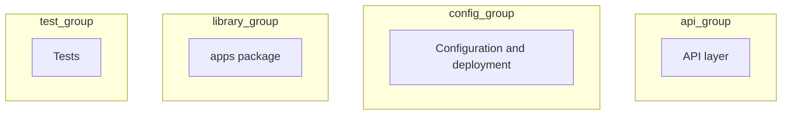

# Architecture report: alan2207/bulletproof-react

> Automated static analysis. **Observed** = directly seen in files/imports/AST; **Inferred** = interpretation from that evidence. Repository code was not executed.

## 1. Repository at a glance

| Item | Value |
| --- | --- |
| Repository | alan2207/bulletproof-react |
| Description | 🛡️ ⚛️ A simple, scalable, and powerful architecture for building production ready React applications.  |
| Language | TypeScript |
| Stars | 36080 |
| Licence | MIT |
| Analysed commit / branch | 9506629ed003a561c6627735480cce4994244bb4 / master |
| Framework(s) | Express, Next.js, React |
| Files analysed | 519 |
| Components | 4 |

## 2. Architecture in one minute

alan2207/bulletproof-react - 🛡️ ⚛️ A simple, scalable, and powerful architecture for building production ready React applications. . This repository was analysed statically from 519 file(s) (0 Python). Detected technologies (observed from imports/manifests): GitHub Actions, Express, Next.js, React, axios, React Router. Files are grouped into 4 component(s): API layer, apps package, Configuration and deployment, Tests. Findings below distinguish observed facts from inferred interpretation.

## 3. High-level block diagram

## 4. Main components

### API layer (`api_layer`)

- **Kind:** api
- **Status:** Observed
- **Confidence:** 0.85
- **Responsibility:** Groups 66 file(s) under api layer (observed from repository paths and static analysis).
- **Paths:** `apps/nextjs-app/src/features/comments/api/create-comment.ts`, `apps/nextjs-app/src/features/comments/api/delete-comment.ts`, `apps/nextjs-app/src/features/comments/api/get-comments.ts`, `apps/nextjs-app/src/features/discussions/api/create-discussion.ts`, `apps/nextjs-app/src/features/discussions/api/delete-discussion.ts`, `apps/nextjs-app/src/features/discussions/api/get-discussion.ts`, `apps/nextjs-app/src/features/discussions/api/get-discussions.ts`, `apps/nextjs-app/src/features/discussions/api/update-discussion.ts`, `apps/nextjs-app/src/features/teams/api/get-teams.ts`, `apps/nextjs-app/src/features/users/api/delete-user.ts`, `apps/nextjs-app/src/features/users/api/get-users.ts`, `apps/nextjs-app/src/features/users/api/update-profile.ts`, `apps/nextjs-app/src/testing/mocks/handlers/auth.ts`, `apps/nextjs-app/src/testing/mocks/handlers/comments.ts`, `apps/nextjs-app/src/testing/mocks/handlers/discussions.ts`, `apps/nextjs-app/src/testing/mocks/handlers/index.ts`, `apps/nextjs-app/src/testing/mocks/handlers/teams.ts`, `apps/nextjs-app/src/testing/mocks/handlers/users.ts`, `apps/nextjs-pages/src/features/comments/api/create-comment.ts`, `apps/nextjs-pages/src/features/comments/api/delete-comment.ts`, `apps/nextjs-pages/src/features/comments/api/get-comments.ts`, `apps/nextjs-pages/src/features/discussions/api/create-discussion.ts`, `apps/nextjs-pages/src/features/discussions/api/delete-discussion.ts`, `apps/nextjs-pages/src/features/discussions/api/get-discussion.ts`, `apps/nextjs-pages/src/features/discussions/api/get-discussions.ts`, `apps/nextjs-pages/src/features/discussions/api/update-discussion.ts`, `apps/nextjs-pages/src/features/teams/api/get-teams.ts`, `apps/nextjs-pages/src/features/users/api/delete-user.ts`, `apps/nextjs-pages/src/features/users/api/get-users.ts`, `apps/nextjs-pages/src/features/users/api/update-profile.ts`, `apps/nextjs-pages/src/testing/mocks/handlers/auth.ts`, `apps/nextjs-pages/src/testing/mocks/handlers/comments.ts`, `apps/nextjs-pages/src/testing/mocks/handlers/discussions.ts`, `apps/nextjs-pages/src/testing/mocks/handlers/index.ts`, `apps/nextjs-pages/src/testing/mocks/handlers/teams.ts`, `apps/nextjs-pages/src/testing/mocks/handlers/users.ts`, `apps/react-vite/src/app/routes/app/dashboard.tsx`, `apps/react-vite/src/app/routes/app/discussions/__tests__/discussion.test.tsx`, `apps/react-vite/src/app/routes/app/discussions/__tests__/discussions.test.tsx`, `apps/react-vite/src/app/routes/app/discussions/discussion.tsx`, `apps/react-vite/src/app/routes/app/discussions/discussions.tsx`, `apps/react-vite/src/app/routes/app/profile.tsx`, `apps/react-vite/src/app/routes/app/root.tsx`, `apps/react-vite/src/app/routes/app/users.tsx`, `apps/react-vite/src/app/routes/auth/login.tsx`, `apps/react-vite/src/app/routes/auth/register.tsx`, `apps/react-vite/src/app/routes/landing.tsx`, `apps/react-vite/src/app/routes/not-found.tsx`, `apps/react-vite/src/features/comments/api/create-comment.ts`, `apps/react-vite/src/features/comments/api/delete-comment.ts`, `apps/react-vite/src/features/comments/api/get-comments.ts`, `apps/react-vite/src/features/discussions/api/create-discussion.ts`, `apps/react-vite/src/features/discussions/api/delete-discussion.ts`, `apps/react-vite/src/features/discussions/api/get-discussion.ts`, `apps/react-vite/src/features/discussions/api/get-discussions.ts`, `apps/react-vite/src/features/discussions/api/update-discussion.ts`, `apps/react-vite/src/features/teams/api/get-teams.ts`, `apps/react-vite/src/features/users/api/delete-user.ts`, `apps/react-vite/src/features/users/api/get-users.ts`, `apps/react-vite/src/features/users/api/update-profile.ts`, `apps/react-vite/src/testing/mocks/handlers/auth.ts`, `apps/react-vite/src/testing/mocks/handlers/comments.ts`, `apps/react-vite/src/testing/mocks/handlers/discussions.ts`, `apps/react-vite/src/testing/mocks/handlers/index.ts`, `apps/react-vite/src/testing/mocks/handlers/teams.ts`, `apps/react-vite/src/testing/mocks/handlers/users.ts`
- **Evidence:** [apps/nextjs-app/src/features/comments/api/create-comment.ts](https://github.com/alan2207/bulletproof-react/blob/9506629ed003a561c6627735480cce4994244bb4/apps/nextjs-app/src/features/comments/api/create-comment.ts); [apps/nextjs-app/src/features/comments/api/delete-comment.ts](https://github.com/alan2207/bulletproof-react/blob/9506629ed003a561c6627735480cce4994244bb4/apps/nextjs-app/src/features/comments/api/delete-comment.ts); [apps/nextjs-app/src/features/comments/api/get-comments.ts](https://github.com/alan2207/bulletproof-react/blob/9506629ed003a561c6627735480cce4994244bb4/apps/nextjs-app/src/features/comments/api/get-comments.ts); [apps/nextjs-app/src/features/discussions/api/create-discussion.ts](https://github.com/alan2207/bulletproof-react/blob/9506629ed003a561c6627735480cce4994244bb4/apps/nextjs-app/src/features/discussions/api/create-discussion.ts); [apps/nextjs-app/src/features/discussions/api/delete-discussion.ts](https://github.com/alan2207/bulletproof-react/blob/9506629ed003a561c6627735480cce4994244bb4/apps/nextjs-app/src/features/discussions/api/delete-discussion.ts); [apps/nextjs-app/src/features/discussions/api/get-discussion.ts](https://github.com/alan2207/bulletproof-react/blob/9506629ed003a561c6627735480cce4994244bb4/apps/nextjs-app/src/features/discussions/api/get-discussion.ts); [apps/nextjs-app/src/features/discussions/api/get-discussions.ts](https://github.com/alan2207/bulletproof-react/blob/9506629ed003a561c6627735480cce4994244bb4/apps/nextjs-app/src/features/discussions/api/get-discussions.ts); [apps/nextjs-app/src/features/discussions/api/update-discussion.ts](https://github.com/alan2207/bulletproof-react/blob/9506629ed003a561c6627735480cce4994244bb4/apps/nextjs-app/src/features/discussions/api/update-discussion.ts)

### apps package (`apps`)

- **Kind:** library
- **Status:** Observed
- **Confidence:** 0.85
- **Responsibility:** Groups 366 file(s) under apps package (observed from repository paths and static analysis).
- **Paths:** `apps/nextjs-app/.eslintrc.cjs`, `apps/nextjs-app/.storybook/main.ts`, `apps/nextjs-app/.storybook/preview.tsx`, `apps/nextjs-app/__mocks__/vitest-env.d.ts`, `apps/nextjs-app/__mocks__/zustand.ts`, `apps/nextjs-app/e2e/.eslintrc.cjs`, `apps/nextjs-app/generators/component/index.cjs`, `apps/nextjs-app/lint-staged.config.mjs`, `apps/nextjs-app/mock-server.ts`, `apps/nextjs-app/next-env.d.ts`, `apps/nextjs-app/next.config.mjs`, `apps/nextjs-app/playwright.config.ts`, `apps/nextjs-app/plopfile.cjs`, `apps/nextjs-app/postcss.config.cjs`, `apps/nextjs-app/public/mockServiceWorker.js`, `apps/nextjs-app/src/app/app/_components/dashboard-info.tsx`, `apps/nextjs-app/src/app/app/_components/dashboard-layout.tsx`, `apps/nextjs-app/src/app/app/discussions/[discussionId]/__tests__/discussion.test.tsx`, `apps/nextjs-app/src/app/app/discussions/[discussionId]/_components/discussion.tsx`, `apps/nextjs-app/src/app/app/discussions/[discussionId]/page.tsx`, `apps/nextjs-app/src/app/app/discussions/__tests__/discussions.test.tsx`, `apps/nextjs-app/src/app/app/discussions/_components/discussions.tsx`, `apps/nextjs-app/src/app/app/discussions/page.tsx`, `apps/nextjs-app/src/app/app/layout.tsx`, `apps/nextjs-app/src/app/app/page.tsx`, `apps/nextjs-app/src/app/app/profile/_components/profile.tsx`, `apps/nextjs-app/src/app/app/profile/page.tsx`, `apps/nextjs-app/src/app/app/users/_components/admin-guard.tsx`, `apps/nextjs-app/src/app/app/users/_components/users.tsx`, `apps/nextjs-app/src/app/app/users/page.tsx`, `apps/nextjs-app/src/app/auth/_components/auth-layout.tsx`, `apps/nextjs-app/src/app/auth/layout.tsx`, `apps/nextjs-app/src/app/auth/login/page.tsx`, `apps/nextjs-app/src/app/auth/register/page.tsx`, `apps/nextjs-app/src/app/layout.tsx`, `apps/nextjs-app/src/app/not-found.tsx`, `apps/nextjs-app/src/app/page.tsx`, `apps/nextjs-app/src/app/provider.tsx`, `apps/nextjs-app/src/app/public/discussions/[discussionId]/page.tsx`, `apps/nextjs-app/src/components/errors/main.tsx`, `apps/nextjs-app/src/components/layouts/content-layout.tsx`, `apps/nextjs-app/src/components/ui/button/button.stories.tsx`, `apps/nextjs-app/src/components/ui/button/button.tsx`, `apps/nextjs-app/src/components/ui/button/index.ts`, `apps/nextjs-app/src/components/ui/dialog/__tests__/dialog.test.tsx`, `apps/nextjs-app/src/components/ui/dialog/confirmation-dialog/__tests__/confirmation-dialog.test.tsx`, `apps/nextjs-app/src/components/ui/dialog/confirmation-dialog/confirmation-dialog.stories.tsx`, `apps/nextjs-app/src/components/ui/dialog/confirmation-dialog/confirmation-dialog.tsx`, `apps/nextjs-app/src/components/ui/dialog/confirmation-dialog/index.ts`, `apps/nextjs-app/src/components/ui/dialog/dialog.stories.tsx`, `apps/nextjs-app/src/components/ui/dialog/dialog.tsx`, `apps/nextjs-app/src/components/ui/dialog/index.ts`, `apps/nextjs-app/src/components/ui/drawer/__tests__/drawer.test.tsx`, `apps/nextjs-app/src/components/ui/drawer/drawer.stories.tsx`, `apps/nextjs-app/src/components/ui/drawer/drawer.tsx`, `apps/nextjs-app/src/components/ui/drawer/index.ts`, `apps/nextjs-app/src/components/ui/dropdown/dropdown.stories.tsx`, `apps/nextjs-app/src/components/ui/dropdown/dropdown.tsx`, `apps/nextjs-app/src/components/ui/dropdown/index.ts`, `apps/nextjs-app/src/components/ui/form/__tests__/form.test.tsx`, `apps/nextjs-app/src/components/ui/form/error.tsx`, `apps/nextjs-app/src/components/ui/form/field-wrapper.tsx`, `apps/nextjs-app/src/components/ui/form/form-drawer.tsx`, `apps/nextjs-app/src/components/ui/form/form.stories.tsx`, `apps/nextjs-app/src/components/ui/form/form.tsx`, `apps/nextjs-app/src/components/ui/form/index.ts`, `apps/nextjs-app/src/components/ui/form/input.tsx`, `apps/nextjs-app/src/components/ui/form/label.tsx`, `apps/nextjs-app/src/components/ui/form/select.tsx`, `apps/nextjs-app/src/components/ui/form/switch.tsx`, `apps/nextjs-app/src/components/ui/form/textarea.tsx`, `apps/nextjs-app/src/components/ui/link/index.ts`, `apps/nextjs-app/src/components/ui/link/link.stories.tsx`, `apps/nextjs-app/src/components/ui/link/link.tsx`, `apps/nextjs-app/src/components/ui/md-preview/index.ts`, `apps/nextjs-app/src/components/ui/md-preview/md-preview.stories.tsx`, `apps/nextjs-app/src/components/ui/md-preview/md-preview.tsx`, `apps/nextjs-app/src/components/ui/notifications/__tests__/notifications.test.ts`, `apps/nextjs-app/src/components/ui/notifications/index.ts`, `apps/nextjs-app/src/components/ui/notifications/notification.stories.tsx`, `apps/nextjs-app/src/components/ui/notifications/notification.tsx`, `apps/nextjs-app/src/components/ui/notifications/notifications-store.ts`, `apps/nextjs-app/src/components/ui/notifications/notifications.tsx`, `apps/nextjs-app/src/components/ui/spinner/index.ts`, `apps/nextjs-app/src/components/ui/spinner/spinner.stories.tsx`, `apps/nextjs-app/src/components/ui/spinner/spinner.tsx`, `apps/nextjs-app/src/components/ui/table/index.ts`, `apps/nextjs-app/src/components/ui/table/pagination.tsx`, `apps/nextjs-app/src/components/ui/table/table.stories.tsx`, `apps/nextjs-app/src/components/ui/table/table.tsx`, `apps/nextjs-app/src/features/auth/components/__tests__/login-form.test.tsx`, `apps/nextjs-app/src/features/auth/components/__tests__/register-form.test.tsx`, `apps/nextjs-app/src/features/auth/components/login-form.tsx`, `apps/nextjs-app/src/features/auth/components/register-form.tsx`, `apps/nextjs-app/src/features/comments/components/comments-list.tsx`, `apps/nextjs-app/src/features/comments/components/comments.tsx`, `apps/nextjs-app/src/features/comments/components/create-comment.tsx`, `apps/nextjs-app/src/features/comments/components/delete-comment.tsx`, `apps/nextjs-app/src/features/discussions/components/create-discussion.tsx`, `apps/nextjs-app/src/features/discussions/components/delete-discussion.tsx`, `apps/nextjs-app/src/features/discussions/components/discussion-view.tsx`, `apps/nextjs-app/src/features/discussions/components/discussions-list.tsx`, `apps/nextjs-app/src/features/discussions/components/update-discussion.tsx`, `apps/nextjs-app/src/features/users/components/delete-user.tsx`, `apps/nextjs-app/src/features/users/components/update-profile.tsx`, `apps/nextjs-app/src/features/users/components/users-list.tsx`, `apps/nextjs-app/src/hooks/__tests__/use-disclosure.test.ts`, `apps/nextjs-app/src/hooks/use-disclosure.ts`, `apps/nextjs-app/src/lib/__tests__/authorization.test.tsx`, `apps/nextjs-app/src/lib/api-client.ts`, `apps/nextjs-app/src/lib/auth.tsx`, `apps/nextjs-app/src/lib/authorization.ts`, `apps/nextjs-app/src/lib/react-query.ts`, `apps/nextjs-app/src/testing/data-generators.ts`, `apps/nextjs-app/src/testing/mocks/browser.ts`, `apps/nextjs-app/src/testing/mocks/db.ts`, `apps/nextjs-app/src/testing/mocks/index.ts`, `apps/nextjs-app/src/testing/mocks/server.ts`, `apps/nextjs-app/src/testing/mocks/utils.ts`, `apps/nextjs-app/src/testing/setup-tests.ts`, `apps/nextjs-app/src/testing/test-utils.tsx`, `apps/nextjs-app/src/types/api.ts`, `apps/nextjs-app/src/utils/auth.ts`, `apps/nextjs-app/src/utils/cn.ts`, `apps/nextjs-app/src/utils/format.ts`, `apps/nextjs-app/tailwind.config.cjs`, `apps/nextjs-app/vitest.config.ts`, `apps/nextjs-pages/.eslintrc.cjs`, `apps/nextjs-pages/.storybook/main.ts`, `apps/nextjs-pages/.storybook/preview.tsx`, `apps/nextjs-pages/__mocks__/vitest-env.d.ts`, `apps/nextjs-pages/__mocks__/zustand.ts`, `apps/nextjs-pages/e2e/.eslintrc.cjs`, `apps/nextjs-pages/generators/component/index.cjs`, `apps/nextjs-pages/lint-staged.config.mjs`, `apps/nextjs-pages/mock-server.ts`, `apps/nextjs-pages/next-env.d.ts`, `apps/nextjs-pages/next.config.mjs`, `apps/nextjs-pages/playwright.config.ts`, `apps/nextjs-pages/plopfile.cjs`, `apps/nextjs-pages/postcss.config.cjs`, `apps/nextjs-pages/public/mockServiceWorker.js`, `apps/nextjs-pages/src/app/pages/app/dashboard.tsx`, `apps/nextjs-pages/src/app/pages/app/discussions/__tests__/discussion.test.tsx`, `apps/nextjs-pages/src/app/pages/app/discussions/__tests__/discussions.test.tsx`, `apps/nextjs-pages/src/app/pages/app/discussions/discussion.tsx`, `apps/nextjs-pages/src/app/pages/app/discussions/discussions.tsx`, `apps/nextjs-pages/src/app/pages/app/profile.tsx`, `apps/nextjs-pages/src/app/pages/app/users.tsx`, `apps/nextjs-pages/src/app/pages/auth/login.tsx`, `apps/nextjs-pages/src/app/pages/auth/register.tsx`, `apps/nextjs-pages/src/app/provider.tsx`, `apps/nextjs-pages/src/components/errors/main.tsx`, `apps/nextjs-pages/src/components/layouts/auth-layout.tsx`, `apps/nextjs-pages/src/components/layouts/content-layout.tsx`, `apps/nextjs-pages/src/components/layouts/dashboard-layout.tsx`, `apps/nextjs-pages/src/components/layouts/index.ts`, `apps/nextjs-pages/src/components/seo/head.tsx`, `apps/nextjs-pages/src/components/seo/index.ts`, `apps/nextjs-pages/src/components/ui/button/button.stories.tsx`, `apps/nextjs-pages/src/components/ui/button/button.tsx`, `apps/nextjs-pages/src/components/ui/button/index.ts`, `apps/nextjs-pages/src/components/ui/dialog/__tests__/dialog.test.tsx`, `apps/nextjs-pages/src/components/ui/dialog/confirmation-dialog/__tests__/confirmation-dialog.test.tsx`, `apps/nextjs-pages/src/components/ui/dialog/confirmation-dialog/confirmation-dialog.stories.tsx`, `apps/nextjs-pages/src/components/ui/dialog/confirmation-dialog/confirmation-dialog.tsx`, `apps/nextjs-pages/src/components/ui/dialog/confirmation-dialog/index.ts`, `apps/nextjs-pages/src/components/ui/dialog/dialog.stories.tsx`, `apps/nextjs-pages/src/components/ui/dialog/dialog.tsx`, `apps/nextjs-pages/src/components/ui/dialog/index.ts`, `apps/nextjs-pages/src/components/ui/drawer/__tests__/drawer.test.tsx`, `apps/nextjs-pages/src/components/ui/drawer/drawer.stories.tsx`, `apps/nextjs-pages/src/components/ui/drawer/drawer.tsx`, `apps/nextjs-pages/src/components/ui/drawer/index.ts`, `apps/nextjs-pages/src/components/ui/dropdown/dropdown.stories.tsx`, `apps/nextjs-pages/src/components/ui/dropdown/dropdown.tsx`, `apps/nextjs-pages/src/components/ui/dropdown/index.ts`, `apps/nextjs-pages/src/components/ui/form/__tests__/form.test.tsx`, `apps/nextjs-pages/src/components/ui/form/error.tsx`, `apps/nextjs-pages/src/components/ui/form/field-wrapper.tsx`, `apps/nextjs-pages/src/components/ui/form/form-drawer.tsx`, `apps/nextjs-pages/src/components/ui/form/form.stories.tsx`, `apps/nextjs-pages/src/components/ui/form/form.tsx`, `apps/nextjs-pages/src/components/ui/form/index.ts`, `apps/nextjs-pages/src/components/ui/form/input.tsx`, `apps/nextjs-pages/src/components/ui/form/label.tsx`, `apps/nextjs-pages/src/components/ui/form/select.tsx`, `apps/nextjs-pages/src/components/ui/form/switch.tsx`, `apps/nextjs-pages/src/components/ui/form/textarea.tsx`, `apps/nextjs-pages/src/components/ui/link/index.ts`, `apps/nextjs-pages/src/components/ui/link/link.stories.tsx`, `apps/nextjs-pages/src/components/ui/link/link.tsx`, `apps/nextjs-pages/src/components/ui/md-preview/index.ts`, `apps/nextjs-pages/src/components/ui/md-preview/md-preview.stories.tsx`, `apps/nextjs-pages/src/components/ui/md-preview/md-preview.tsx`, `apps/nextjs-pages/src/components/ui/notifications/__tests__/notifications.test.ts`, `apps/nextjs-pages/src/components/ui/notifications/index.ts`, `apps/nextjs-pages/src/components/ui/notifications/notification.stories.tsx`, `apps/nextjs-pages/src/components/ui/notifications/notification.tsx`, `apps/nextjs-pages/src/components/ui/notifications/notifications-store.ts`, `apps/nextjs-pages/src/components/ui/notifications/notifications.tsx`, `apps/nextjs-pages/src/components/ui/spinner/index.ts`, `apps/nextjs-pages/src/components/ui/spinner/spinner.stories.tsx`, `apps/nextjs-pages/src/components/ui/spinner/spinner.tsx`, `apps/nextjs-pages/src/components/ui/table/index.ts`, `apps/nextjs-pages/src/components/ui/table/pagination.tsx`, `apps/nextjs-pages/src/components/ui/table/table.stories.tsx`, `apps/nextjs-pages/src/components/ui/table/table.tsx`, `apps/nextjs-pages/src/features/auth/components/__tests__/login-form.test.tsx`, `apps/nextjs-pages/src/features/auth/components/__tests__/register-form.test.tsx`, `apps/nextjs-pages/src/features/auth/components/login-form.tsx`, `apps/nextjs-pages/src/features/auth/components/register-form.tsx`, `apps/nextjs-pages/src/features/comments/components/comments-list.tsx`, `apps/nextjs-pages/src/features/comments/components/comments.tsx`, `apps/nextjs-pages/src/features/comments/components/create-comment.tsx`, `apps/nextjs-pages/src/features/comments/components/delete-comment.tsx`, `apps/nextjs-pages/src/features/discussions/components/create-discussion.tsx`, `apps/nextjs-pages/src/features/discussions/components/delete-discussion.tsx`, `apps/nextjs-pages/src/features/discussions/components/discussion-view.tsx`, `apps/nextjs-pages/src/features/discussions/components/discussions-list.tsx`, `apps/nextjs-pages/src/features/discussions/components/update-discussion.tsx`, `apps/nextjs-pages/src/features/users/components/delete-user.tsx`, `apps/nextjs-pages/src/features/users/components/update-profile.tsx`, `apps/nextjs-pages/src/features/users/components/users-list.tsx`, `apps/nextjs-pages/src/hooks/__tests__/use-disclosure.test.ts`, `apps/nextjs-pages/src/hooks/use-disclosure.ts`, `apps/nextjs-pages/src/lib/__tests__/authorization.test.tsx`, `apps/nextjs-pages/src/lib/api-client.ts`, `apps/nextjs-pages/src/lib/auth.tsx`, `apps/nextjs-pages/src/lib/authorization.tsx`, `apps/nextjs-pages/src/lib/react-query.ts`, `apps/nextjs-pages/src/pages/404.tsx`, `apps/nextjs-pages/src/pages/_app.tsx`, `apps/nextjs-pages/src/pages/app/discussions/[discussionId].tsx`, `apps/nextjs-pages/src/pages/app/discussions/index.tsx`, `apps/nextjs-pages/src/pages/app/index.tsx`, `apps/nextjs-pages/src/pages/app/profile.tsx`, `apps/nextjs-pages/src/pages/app/users.tsx`, `apps/nextjs-pages/src/pages/auth/login.tsx`, `apps/nextjs-pages/src/pages/auth/register.tsx`, `apps/nextjs-pages/src/pages/index.tsx`, `apps/nextjs-pages/src/pages/public/discussions/[discussionId].tsx`, `apps/nextjs-pages/src/testing/data-generators.ts`, `apps/nextjs-pages/src/testing/mocks/browser.ts`, `apps/nextjs-pages/src/testing/mocks/db.ts`, `apps/nextjs-pages/src/testing/mocks/index.ts`, `apps/nextjs-pages/src/testing/mocks/server.ts`, `apps/nextjs-pages/src/testing/mocks/utils.ts`, `apps/nextjs-pages/src/testing/setup-tests.ts`, `apps/nextjs-pages/src/testing/test-utils.tsx`, `apps/nextjs-pages/src/types/api.ts`, `apps/nextjs-pages/src/utils/cn.ts`, `apps/nextjs-pages/src/utils/format.ts`, `apps/nextjs-pages/tailwind.config.cjs`, `apps/nextjs-pages/vitest.config.ts`, `apps/react-vite/.eslintrc.cjs`, `apps/react-vite/.storybook/main.ts`, `apps/react-vite/.storybook/preview.tsx`, `apps/react-vite/__mocks__/vitest-env.d.ts`, `apps/react-vite/__mocks__/zustand.ts`, `apps/react-vite/e2e/.eslintrc.cjs`, `apps/react-vite/generators/component/index.cjs`, `apps/react-vite/mock-server.ts`, `apps/react-vite/playwright.config.ts`, `apps/react-vite/plopfile.cjs`, `apps/react-vite/postcss.config.cjs`, `apps/react-vite/public/mockServiceWorker.js`, `apps/react-vite/src/app/index.tsx`, `apps/react-vite/src/app/provider.tsx`, `apps/react-vite/src/app/router.tsx`, `apps/react-vite/src/components/errors/main.tsx`, `apps/react-vite/src/components/layouts/auth-layout.tsx`, `apps/react-vite/src/components/layouts/content-layout.tsx`, `apps/react-vite/src/components/layouts/dashboard-layout.tsx`, `apps/react-vite/src/components/layouts/index.ts`, `apps/react-vite/src/components/seo/__tests__/head.test.tsx`, `apps/react-vite/src/components/seo/head.tsx`, `apps/react-vite/src/components/seo/index.ts`, `apps/react-vite/src/components/ui/button/button.stories.tsx`, `apps/react-vite/src/components/ui/button/button.tsx`, `apps/react-vite/src/components/ui/button/index.ts`, `apps/react-vite/src/components/ui/dialog/__tests__/dialog.test.tsx`, `apps/react-vite/src/components/ui/dialog/confirmation-dialog/__tests__/confirmation-dialog.test.tsx`, `apps/react-vite/src/components/ui/dialog/confirmation-dialog/confirmation-dialog.stories.tsx`, `apps/react-vite/src/components/ui/dialog/confirmation-dialog/confirmation-dialog.tsx`, `apps/react-vite/src/components/ui/dialog/confirmation-dialog/index.ts`, `apps/react-vite/src/components/ui/dialog/dialog.stories.tsx`, `apps/react-vite/src/components/ui/dialog/dialog.tsx`, `apps/react-vite/src/components/ui/dialog/index.ts`, `apps/react-vite/src/components/ui/drawer/__tests__/drawer.test.tsx`, `apps/react-vite/src/components/ui/drawer/drawer.stories.tsx`, `apps/react-vite/src/components/ui/drawer/drawer.tsx`, `apps/react-vite/src/components/ui/drawer/index.ts`, `apps/react-vite/src/components/ui/dropdown/dropdown.stories.tsx`, `apps/react-vite/src/components/ui/dropdown/dropdown.tsx`, `apps/react-vite/src/components/ui/dropdown/index.ts`, `apps/react-vite/src/components/ui/form/__tests__/form.test.tsx`, `apps/react-vite/src/components/ui/form/error.tsx`, `apps/react-vite/src/components/ui/form/field-wrapper.tsx`, `apps/react-vite/src/components/ui/form/form-drawer.tsx`, `apps/react-vite/src/components/ui/form/form.stories.tsx`, `apps/react-vite/src/components/ui/form/form.tsx`, `apps/react-vite/src/components/ui/form/index.ts`, `apps/react-vite/src/components/ui/form/input.tsx`, `apps/react-vite/src/components/ui/form/label.tsx`, `apps/react-vite/src/components/ui/form/select.tsx`, `apps/react-vite/src/components/ui/form/switch.tsx`, `apps/react-vite/src/components/ui/form/textarea.tsx`, `apps/react-vite/src/components/ui/link/index.ts`, `apps/react-vite/src/components/ui/link/link.stories.tsx`, `apps/react-vite/src/components/ui/link/link.tsx`, `apps/react-vite/src/components/ui/md-preview/index.ts`, `apps/react-vite/src/components/ui/md-preview/md-preview.stories.tsx`, `apps/react-vite/src/components/ui/md-preview/md-preview.tsx`, `apps/react-vite/src/components/ui/notifications/__tests__/notifications.test.ts`, `apps/react-vite/src/components/ui/notifications/index.ts`, `apps/react-vite/src/components/ui/notifications/notification.stories.tsx`, `apps/react-vite/src/components/ui/notifications/notification.tsx`, `apps/react-vite/src/components/ui/notifications/notifications-store.ts`, `apps/react-vite/src/components/ui/notifications/notifications.tsx`, `apps/react-vite/src/components/ui/spinner/index.ts`, `apps/react-vite/src/components/ui/spinner/spinner.stories.tsx`, `apps/react-vite/src/components/ui/spinner/spinner.tsx`, `apps/react-vite/src/components/ui/table/index.ts`, `apps/react-vite/src/components/ui/table/pagination.tsx`, `apps/react-vite/src/components/ui/table/table.stories.tsx`, `apps/react-vite/src/components/ui/table/table.tsx`, `apps/react-vite/src/features/auth/components/__tests__/login-form.test.tsx`, `apps/react-vite/src/features/auth/components/__tests__/register-form.test.tsx`, `apps/react-vite/src/features/auth/components/login-form.tsx`, `apps/react-vite/src/features/auth/components/register-form.tsx`, `apps/react-vite/src/features/comments/components/comments-list.tsx`, `apps/react-vite/src/features/comments/components/comments.tsx`, `apps/react-vite/src/features/comments/components/create-comment.tsx`, `apps/react-vite/src/features/comments/components/delete-comment.tsx`, `apps/react-vite/src/features/discussions/components/create-discussion.tsx`, `apps/react-vite/src/features/discussions/components/delete-discussion.tsx`, `apps/react-vite/src/features/discussions/components/discussion-view.tsx`, `apps/react-vite/src/features/discussions/components/discussions-list.tsx`, `apps/react-vite/src/features/discussions/components/update-discussion.tsx`, `apps/react-vite/src/features/users/components/delete-user.tsx`, `apps/react-vite/src/features/users/components/update-profile.tsx`, `apps/react-vite/src/features/users/components/users-list.tsx`, `apps/react-vite/src/hooks/__tests__/use-disclosure.test.ts`, `apps/react-vite/src/hooks/use-disclosure.ts`, `apps/react-vite/src/lib/__tests__/authorization.test.tsx`, `apps/react-vite/src/lib/api-client.ts`, `apps/react-vite/src/lib/auth.tsx`, `apps/react-vite/src/lib/authorization.tsx`, `apps/react-vite/src/lib/react-query.ts`, `apps/react-vite/src/main.tsx`, `apps/react-vite/src/testing/data-generators.ts`, `apps/react-vite/src/testing/mocks/browser.ts`, `apps/react-vite/src/testing/mocks/db.ts`, `apps/react-vite/src/testing/mocks/index.ts`, `apps/react-vite/src/testing/mocks/server.ts`, `apps/react-vite/src/testing/mocks/utils.ts`, `apps/react-vite/src/testing/setup-tests.ts`, `apps/react-vite/src/testing/test-utils.tsx`, `apps/react-vite/src/types/api.ts`, `apps/react-vite/src/utils/cn.ts`, `apps/react-vite/src/utils/format.ts`, `apps/react-vite/src/vite-env.d.ts`, `apps/react-vite/tailwind.config.cjs`, `apps/react-vite/vite-env.d.ts`, `apps/react-vite/vite.config.ts`
- **Evidence:** [apps/nextjs-app/.eslintrc.cjs](https://github.com/alan2207/bulletproof-react/blob/9506629ed003a561c6627735480cce4994244bb4/apps/nextjs-app/.eslintrc.cjs); [apps/nextjs-app/.storybook/main.ts](https://github.com/alan2207/bulletproof-react/blob/9506629ed003a561c6627735480cce4994244bb4/apps/nextjs-app/.storybook/main.ts); [apps/nextjs-app/.storybook/preview.tsx](https://github.com/alan2207/bulletproof-react/blob/9506629ed003a561c6627735480cce4994244bb4/apps/nextjs-app/.storybook/preview.tsx); [apps/nextjs-app/__mocks__/vitest-env.d.ts](https://github.com/alan2207/bulletproof-react/blob/9506629ed003a561c6627735480cce4994244bb4/apps/nextjs-app/__mocks__/vitest-env.d.ts); [apps/nextjs-app/__mocks__/zustand.ts](https://github.com/alan2207/bulletproof-react/blob/9506629ed003a561c6627735480cce4994244bb4/apps/nextjs-app/__mocks__/zustand.ts); [apps/nextjs-app/e2e/.eslintrc.cjs](https://github.com/alan2207/bulletproof-react/blob/9506629ed003a561c6627735480cce4994244bb4/apps/nextjs-app/e2e/.eslintrc.cjs); [apps/nextjs-app/generators/component/index.cjs](https://github.com/alan2207/bulletproof-react/blob/9506629ed003a561c6627735480cce4994244bb4/apps/nextjs-app/generators/component/index.cjs); [apps/nextjs-app/lint-staged.config.mjs](https://github.com/alan2207/bulletproof-react/blob/9506629ed003a561c6627735480cce4994244bb4/apps/nextjs-app/lint-staged.config.mjs)

### Configuration and deployment (`config`)

- **Kind:** config
- **Status:** Observed
- **Confidence:** 0.85
- **Responsibility:** Groups 22 file(s) under configuration and deployment (observed from repository paths and static analysis).
- **Paths:** `apps/nextjs-app/.env.example`, `apps/nextjs-app/.vscode/extensions.json`, `apps/nextjs-app/.vscode/settings.json`, `apps/nextjs-app/package.json`, `apps/nextjs-app/src/config/env.ts`, `apps/nextjs-app/src/config/paths.ts`, `apps/nextjs-app/tsconfig.json`, `apps/nextjs-pages/.env.example`, `apps/nextjs-pages/.vscode/extensions.json`, `apps/nextjs-pages/.vscode/settings.json`, `apps/nextjs-pages/package.json`, `apps/nextjs-pages/src/config/env.ts`, `apps/nextjs-pages/src/config/paths.ts`, `apps/nextjs-pages/tsconfig.json`, `apps/react-vite/.env.example`, `apps/react-vite/.vscode/extensions.json`, `apps/react-vite/.vscode/settings.json`, `apps/react-vite/package.json`, `apps/react-vite/src/config/env.ts`, `apps/react-vite/src/config/paths.ts`, `apps/react-vite/tsconfig.json`, `package.json`
- **Evidence:** [apps/nextjs-app/.env.example](https://github.com/alan2207/bulletproof-react/blob/9506629ed003a561c6627735480cce4994244bb4/apps/nextjs-app/.env.example); [apps/nextjs-app/.vscode/extensions.json](https://github.com/alan2207/bulletproof-react/blob/9506629ed003a561c6627735480cce4994244bb4/apps/nextjs-app/.vscode/extensions.json); [apps/nextjs-app/.vscode/settings.json](https://github.com/alan2207/bulletproof-react/blob/9506629ed003a561c6627735480cce4994244bb4/apps/nextjs-app/.vscode/settings.json); [apps/nextjs-app/package.json](https://github.com/alan2207/bulletproof-react/blob/9506629ed003a561c6627735480cce4994244bb4/apps/nextjs-app/package.json); [apps/nextjs-app/src/config/env.ts](https://github.com/alan2207/bulletproof-react/blob/9506629ed003a561c6627735480cce4994244bb4/apps/nextjs-app/src/config/env.ts); [apps/nextjs-app/src/config/paths.ts](https://github.com/alan2207/bulletproof-react/blob/9506629ed003a561c6627735480cce4994244bb4/apps/nextjs-app/src/config/paths.ts); [apps/nextjs-app/tsconfig.json](https://github.com/alan2207/bulletproof-react/blob/9506629ed003a561c6627735480cce4994244bb4/apps/nextjs-app/tsconfig.json); [apps/nextjs-pages/.env.example](https://github.com/alan2207/bulletproof-react/blob/9506629ed003a561c6627735480cce4994244bb4/apps/nextjs-pages/.env.example)

### Tests (`tests`)

- **Kind:** test
- **Status:** Observed
- **Confidence:** 0.85
- **Responsibility:** Groups 9 file(s) under tests (observed from repository paths and static analysis).
- **Paths:** `apps/nextjs-app/e2e/tests/auth.setup.ts`, `apps/nextjs-app/e2e/tests/profile.spec.ts`, `apps/nextjs-app/e2e/tests/smoke.spec.ts`, `apps/nextjs-pages/e2e/tests/auth.setup.ts`, `apps/nextjs-pages/e2e/tests/profile.spec.ts`, `apps/nextjs-pages/e2e/tests/smoke.spec.ts`, `apps/react-vite/e2e/tests/auth.setup.ts`, `apps/react-vite/e2e/tests/profile.spec.ts`, `apps/react-vite/e2e/tests/smoke.spec.ts`
- **Evidence:** [apps/nextjs-app/e2e/tests/auth.setup.ts](https://github.com/alan2207/bulletproof-react/blob/9506629ed003a561c6627735480cce4994244bb4/apps/nextjs-app/e2e/tests/auth.setup.ts); [apps/nextjs-app/e2e/tests/profile.spec.ts](https://github.com/alan2207/bulletproof-react/blob/9506629ed003a561c6627735480cce4994244bb4/apps/nextjs-app/e2e/tests/profile.spec.ts); [apps/nextjs-app/e2e/tests/smoke.spec.ts](https://github.com/alan2207/bulletproof-react/blob/9506629ed003a561c6627735480cce4994244bb4/apps/nextjs-app/e2e/tests/smoke.spec.ts); [apps/nextjs-pages/e2e/tests/auth.setup.ts](https://github.com/alan2207/bulletproof-react/blob/9506629ed003a561c6627735480cce4994244bb4/apps/nextjs-pages/e2e/tests/auth.setup.ts); [apps/nextjs-pages/e2e/tests/profile.spec.ts](https://github.com/alan2207/bulletproof-react/blob/9506629ed003a561c6627735480cce4994244bb4/apps/nextjs-pages/e2e/tests/profile.spec.ts); [apps/nextjs-pages/e2e/tests/smoke.spec.ts](https://github.com/alan2207/bulletproof-react/blob/9506629ed003a561c6627735480cce4994244bb4/apps/nextjs-pages/e2e/tests/smoke.spec.ts); [apps/react-vite/e2e/tests/auth.setup.ts](https://github.com/alan2207/bulletproof-react/blob/9506629ed003a561c6627735480cce4994244bb4/apps/react-vite/e2e/tests/auth.setup.ts); [apps/react-vite/e2e/tests/profile.spec.ts](https://github.com/alan2207/bulletproof-react/blob/9506629ed003a561c6627735480cce4994244bb4/apps/react-vite/e2e/tests/profile.spec.ts)

## 5. Execution flow

**Observed** entry point(s):

- [apps/nextjs-app/.storybook/main.ts](https://github.com/alan2207/bulletproof-react/blob/9506629ed003a561c6627735480cce4994244bb4/apps/nextjs-app/.storybook/main.ts)
- [apps/nextjs-pages/.storybook/main.ts](https://github.com/alan2207/bulletproof-react/blob/9506629ed003a561c6627735480cce4994244bb4/apps/nextjs-pages/.storybook/main.ts)
- [apps/react-vite/.storybook/main.ts](https://github.com/alan2207/bulletproof-react/blob/9506629ed003a561c6627735480cce4994244bb4/apps/react-vite/.storybook/main.ts)
- [apps/react-vite/src/main.tsx](https://github.com/alan2207/bulletproof-react/blob/9506629ed003a561c6627735480cce4994244bb4/apps/react-vite/src/main.tsx)

Representative flow (derived from observed entry points and the import graph; steps beyond the entry point are **Inferred**):

1. Execution starts at an observed entry point listed above, if present.
2. No internal import relationships between components were observed.

## 6. Project structure

### `(root)`

- `.gitignore` - other (60 bytes)
- `AGENTS.md` - docs (9161 bytes)
- `LICENSE` - docs (1071 bytes)
- `README.md` - docs (4579 bytes)
- `package.json` - manifest (359 bytes)

### `.github`

- `.github/workflows/nextjs-app-ci.yml` - ci, YAML (1567 bytes)
- `.github/workflows/nextjs-pages-ci.yml` - ci, YAML (1573 bytes)
- `.github/workflows/react-vite-ci.yml` - ci, YAML (1566 bytes)

### `.husky`

- `.husky/pre-commit` - other (124 bytes)

### `apps`

- `apps/nextjs-app/.env.example` - config (151 bytes)
- `apps/nextjs-app/.eslintrc.cjs` - source, JavaScript (4597 bytes)
- `apps/nextjs-app/.gitignore` - other (524 bytes)
- `apps/nextjs-app/.prettierignore` - other (5 bytes)
- `apps/nextjs-app/.prettierrc` - other (109 bytes)
- `apps/nextjs-app/.storybook/main.ts` - source, TypeScript (477 bytes)
- `apps/nextjs-app/.storybook/preview.tsx` - source, TypeScript (190 bytes)
- `apps/nextjs-app/.vscode/extensions.json` - config (200 bytes)
- `apps/nextjs-app/.vscode/settings.json` - config (110 bytes)
- `apps/nextjs-app/README.md` - docs (587 bytes)
- `apps/nextjs-app/__mocks__/vitest-env.d.ts` - source, TypeScript (79 bytes)
- `apps/nextjs-app/__mocks__/zustand.ts` - source, TypeScript (1754 bytes)
- `apps/nextjs-app/e2e/.eslintrc.cjs` - source, JavaScript (119 bytes)
- `apps/nextjs-app/e2e/tests/auth.setup.ts` - test, TypeScript (1665 bytes)
- `apps/nextjs-app/e2e/tests/profile.spec.ts` - test, TypeScript (658 bytes)
- `apps/nextjs-app/e2e/tests/smoke.spec.ts` - test, TypeScript (3340 bytes)
- `apps/nextjs-app/generators/component/component.stories.tsx.hbs` - other (330 bytes)
- `apps/nextjs-app/generators/component/component.tsx.hbs` - other (219 bytes)
- `apps/nextjs-app/generators/component/index.cjs` - source, JavaScript (1532 bytes)
- `apps/nextjs-app/generators/component/index.ts.hbs` - other (40 bytes)
- `apps/nextjs-app/index.html` - other (610 bytes)
- `apps/nextjs-app/lint-staged.config.mjs` - source, JavaScript (345 bytes)
- `apps/nextjs-app/mock-server.ts` - source, TypeScript (921 bytes)
- `apps/nextjs-app/next-env.d.ts` - source, TypeScript (201 bytes)
- `apps/nextjs-app/next.config.mjs` - source, JavaScript (118 bytes)
- `apps/nextjs-app/package.json` - manifest (3728 bytes)
- `apps/nextjs-app/playwright.config.ts` - source, TypeScript (1613 bytes)
- `apps/nextjs-app/plopfile.cjs` - source, JavaScript (216 bytes)
- `apps/nextjs-app/postcss.config.cjs` - source, JavaScript (83 bytes)
- `apps/nextjs-app/public/_redirects` - other (18 bytes)
- `apps/nextjs-app/public/logo.svg` - other (2632 bytes)
- `apps/nextjs-app/public/mockServiceWorker.js` - source, JavaScript (7514 bytes)
- `apps/nextjs-app/public/robots.txt` - docs (67 bytes)
- `apps/nextjs-app/src/app/app/_components/dashboard-info.tsx` - source, TypeScript (934 bytes)
- `apps/nextjs-app/src/app/app/_components/dashboard-layout.tsx` - source, TypeScript (6424 bytes)
- `apps/nextjs-app/src/app/app/discussions/[discussionId]/__tests__/discussion.test.tsx` - source, TypeScript (4100 bytes)
- `apps/nextjs-app/src/app/app/discussions/[discussionId]/_components/discussion.tsx` - source, TypeScript (906 bytes)
- `apps/nextjs-app/src/app/app/discussions/[discussionId]/page.tsx` - source, TypeScript (1650 bytes)
- `apps/nextjs-app/src/app/app/discussions/__tests__/discussions.test.tsx` - source, TypeScript (2352 bytes)
- `apps/nextjs-app/src/app/app/discussions/_components/discussions.tsx` - source, TypeScript (978 bytes)
- `apps/nextjs-app/src/app/app/discussions/page.tsx` - source, TypeScript (811 bytes)
- `apps/nextjs-app/src/app/app/layout.tsx` - source, TypeScript (332 bytes)
- `apps/nextjs-app/src/app/app/page.tsx` - source, TypeScript (241 bytes)
- `apps/nextjs-app/src/app/app/profile/_components/profile.tsx` - source, TypeScript (1534 bytes)
- `apps/nextjs-app/src/app/app/profile/page.tsx` - source, TypeScript (208 bytes)
- `apps/nextjs-app/src/app/app/users/_components/admin-guard.tsx` - source, TypeScript (438 bytes)
- `apps/nextjs-app/src/app/app/users/_components/users.tsx` - source, TypeScript (531 bytes)
- `apps/nextjs-app/src/app/app/users/page.tsx` - source, TypeScript (428 bytes)
- `apps/nextjs-app/src/app/auth/_components/auth-layout.tsx` - source, TypeScript (1694 bytes)
- `apps/nextjs-app/src/app/auth/layout.tsx` - source, TypeScript (778 bytes)
- `apps/nextjs-app/src/app/auth/login/page.tsx` - source, TypeScript (569 bytes)
- `apps/nextjs-app/src/app/auth/register/page.tsx` - source, TypeScript (947 bytes)
- `apps/nextjs-app/src/app/layout.tsx` - source, TypeScript (1065 bytes)
- `apps/nextjs-app/src/app/not-found.tsx` - source, TypeScript (422 bytes)
- `apps/nextjs-app/src/app/page.tsx` - source, TypeScript (3311 bytes)
- `apps/nextjs-app/src/app/provider.tsx` - source, TypeScript (944 bytes)
- `apps/nextjs-app/src/app/public/discussions/[discussionId]/page.tsx` - source, TypeScript (1421 bytes)
- `apps/nextjs-app/src/components/errors/main.tsx` - source, TypeScript (467 bytes)
- `apps/nextjs-app/src/components/layouts/content-layout.tsx` - source, TypeScript (497 bytes)
- `apps/nextjs-app/src/components/ui/button/button.stories.tsx` - source, TypeScript (307 bytes)
- `apps/nextjs-app/src/components/ui/button/button.tsx` - source, TypeScript (2225 bytes)
- `apps/nextjs-app/src/components/ui/button/index.ts` - source, TypeScript (26 bytes)
- `apps/nextjs-app/src/components/ui/dialog/__tests__/dialog.test.tsx` - source, TypeScript (1753 bytes)
- `apps/nextjs-app/src/components/ui/dialog/confirmation-dialog/__tests__/confirmation-dialog.test.tsx` - source, TypeScript (1176 bytes)
- `apps/nextjs-app/src/components/ui/dialog/confirmation-dialog/confirmation-dialog.stories.tsx` - source, TypeScript (757 bytes)
- `apps/nextjs-app/src/components/ui/dialog/confirmation-dialog/confirmation-dialog.tsx` - source, TypeScript (2147 bytes)
- `apps/nextjs-app/src/components/ui/dialog/confirmation-dialog/index.ts` - source, TypeScript (39 bytes)
- `apps/nextjs-app/src/components/ui/dialog/dialog.stories.tsx` - source, TypeScript (1444 bytes)
- `apps/nextjs-app/src/components/ui/dialog/dialog.tsx` - source, TypeScript (3901 bytes)
- `apps/nextjs-app/src/components/ui/dialog/index.ts` - source, TypeScript (65 bytes)
- `apps/nextjs-app/src/components/ui/drawer/__tests__/drawer.test.tsx` - source, TypeScript (1655 bytes)
- `apps/nextjs-app/src/components/ui/drawer/drawer.stories.tsx` - source, TypeScript (1536 bytes)
- `apps/nextjs-app/src/components/ui/drawer/drawer.tsx` - source, TypeScript (4381 bytes)
- `apps/nextjs-app/src/components/ui/drawer/index.ts` - source, TypeScript (26 bytes)
- `apps/nextjs-app/src/components/ui/dropdown/dropdown.stories.tsx` - source, TypeScript (3024 bytes)
- `apps/nextjs-app/src/components/ui/dropdown/dropdown.tsx` - source, TypeScript (7397 bytes)
- `apps/nextjs-app/src/components/ui/dropdown/index.ts` - source, TypeScript (28 bytes)
- `apps/nextjs-app/src/components/ui/form/__tests__/form.test.tsx` - source, TypeScript (1954 bytes)
- `apps/nextjs-app/src/components/ui/form/error.tsx` - source, TypeScript (325 bytes)
- `apps/nextjs-app/src/components/ui/form/field-wrapper.tsx` - source, TypeScript (668 bytes)
- `apps/nextjs-app/src/components/ui/form/form-drawer.tsx` - source, TypeScript (1492 bytes)
- `apps/nextjs-app/src/components/ui/form/form.stories.tsx` - source, TypeScript (2046 bytes)
- `apps/nextjs-app/src/components/ui/form/form.tsx` - source, TypeScript (5070 bytes)
- `apps/nextjs-app/src/components/ui/form/index.ts` - source, TypeScript (185 bytes)
- `apps/nextjs-app/src/components/ui/form/input.tsx` - source, TypeScript (1194 bytes)
- `apps/nextjs-app/src/components/ui/form/label.tsx` - source, TypeScript (733 bytes)
- `apps/nextjs-app/src/components/ui/form/select.tsx` - source, TypeScript (1168 bytes)
- `apps/nextjs-app/src/components/ui/form/switch.tsx` - source, TypeScript (1170 bytes)
- `apps/nextjs-app/src/components/ui/form/textarea.tsx` - source, TypeScript (1118 bytes)
- `apps/nextjs-app/src/components/ui/link/index.ts` - source, TypeScript (24 bytes)
- `apps/nextjs-app/src/components/ui/link/link.stories.tsx` - source, TypeScript (287 bytes)
- `apps/nextjs-app/src/components/ui/link/link.tsx` - source, TypeScript (473 bytes)
- `apps/nextjs-app/src/components/ui/md-preview/index.ts` - source, TypeScript (30 bytes)
- `apps/nextjs-app/src/components/ui/md-preview/md-preview.stories.tsx` - source, TypeScript (306 bytes)
- `apps/nextjs-app/src/components/ui/md-preview/md-preview.tsx` - source, TypeScript (378 bytes)
- `apps/nextjs-app/src/components/ui/notifications/__tests__/notifications.test.ts` - source, TypeScript (740 bytes)
- `apps/nextjs-app/src/components/ui/notifications/index.ts` - source, TypeScript (72 bytes)
- `apps/nextjs-app/src/components/ui/notifications/notification.stories.tsx` - source, TypeScript (1371 bytes)
- `apps/nextjs-app/src/components/ui/notifications/notification.tsx` - source, TypeScript (1889 bytes)
- `apps/nextjs-app/src/components/ui/notifications/notifications-store.ts` - source, TypeScript (823 bytes)
- `apps/nextjs-app/src/components/ui/notifications/notifications.tsx` - source, TypeScript (624 bytes)
- `apps/nextjs-app/src/components/ui/spinner/index.ts` - source, TypeScript (27 bytes)
- `apps/nextjs-app/src/components/ui/spinner/spinner.stories.tsx` - source, TypeScript (281 bytes)
- `apps/nextjs-app/src/components/ui/spinner/spinner.tsx` - source, TypeScript (964 bytes)
- `apps/nextjs-app/src/components/ui/table/index.ts` - source, TypeScript (25 bytes)
- `apps/nextjs-app/src/components/ui/table/pagination.tsx` - source, TypeScript (4586 bytes)
- `apps/nextjs-app/src/components/ui/table/table.stories.tsx` - source, TypeScript (1041 bytes)
- `apps/nextjs-app/src/components/ui/table/table.tsx` - source, TypeScript (4433 bytes)
- `apps/nextjs-app/src/config/env.ts` - source, TypeScript (1041 bytes)
- `apps/nextjs-app/src/config/paths.ts` - source, TypeScript (917 bytes)
- `apps/nextjs-app/src/features/auth/components/__tests__/login-form.test.tsx` - source, TypeScript (722 bytes)
- `apps/nextjs-app/src/features/auth/components/__tests__/register-form.test.tsx` - source, TypeScript (1079 bytes)
- `apps/nextjs-app/src/features/auth/components/login-form.tsx` - source, TypeScript (1765 bytes)
- `apps/nextjs-app/src/features/auth/components/register-form.tsx` - source, TypeScript (3602 bytes)
- `apps/nextjs-app/src/features/comments/api/create-comment.ts` - source, TypeScript (1245 bytes)
- `apps/nextjs-app/src/features/comments/api/delete-comment.ts` - source, TypeScript (946 bytes)
- `apps/nextjs-app/src/features/comments/api/get-comments.ts` - source, TypeScript (1253 bytes)
- `apps/nextjs-app/src/features/comments/components/comments-list.tsx` - source, TypeScript (2777 bytes)
- `apps/nextjs-app/src/features/comments/components/comments.tsx` - source, TypeScript (666 bytes)
- `apps/nextjs-app/src/features/comments/components/create-comment.tsx` - source, TypeScript (1846 bytes)
- `apps/nextjs-app/src/features/comments/components/delete-comment.tsx` - source, TypeScript (1412 bytes)
- `apps/nextjs-app/src/features/discussions/api/create-discussion.ts` - source, TypeScript (1246 bytes)
- `apps/nextjs-app/src/features/discussions/api/delete-discussion.ts` - source, TypeScript (928 bytes)
- `apps/nextjs-app/src/features/discussions/api/get-discussion.ts` - source, TypeScript (878 bytes)
- `apps/nextjs-app/src/features/discussions/api/get-discussions.ts` - source, TypeScript (921 bytes)
- `apps/nextjs-app/src/features/discussions/api/update-discussion.ts` - source, TypeScript (1316 bytes)
- `apps/nextjs-app/src/features/discussions/components/create-discussion.tsx` - source, TypeScript (2676 bytes)
- `apps/nextjs-app/src/features/discussions/components/delete-discussion.tsx` - source, TypeScript (1492 bytes)
- `apps/nextjs-app/src/features/discussions/components/discussion-view.tsx` - source, TypeScript (2294 bytes)
- `apps/nextjs-app/src/features/discussions/components/discussions-list.tsx` - source, TypeScript (2463 bytes)
- `apps/nextjs-app/src/features/discussions/components/update-discussion.tsx` - source, TypeScript (3047 bytes)
- `apps/nextjs-app/src/features/teams/api/get-teams.ts` - source, TypeScript (657 bytes)
- `apps/nextjs-app/src/features/users/api/delete-user.ts` - source, TypeScript (891 bytes)
- `apps/nextjs-app/src/features/users/api/get-users.ts` - source, TypeScript (644 bytes)
- `apps/nextjs-app/src/features/users/api/update-profile.ts` - source, TypeScript (1096 bytes)
- `apps/nextjs-app/src/features/users/components/delete-user.tsx` - source, TypeScript (1205 bytes)
- `apps/nextjs-app/src/features/users/components/update-profile.tsx` - source, TypeScript (2413 bytes)
- `apps/nextjs-app/src/features/users/components/users-list.tsx` - source, TypeScript (1292 bytes)
- `apps/nextjs-app/src/hooks/__tests__/use-disclosure.test.ts` - source, TypeScript (1177 bytes)
- `apps/nextjs-app/src/hooks/use-disclosure.ts` - source, TypeScript (387 bytes)
- `apps/nextjs-app/src/lib/__tests__/authorization.test.tsx` - source, TypeScript (2731 bytes)
- `apps/nextjs-app/src/lib/api-client.ts` - source, TypeScript (3254 bytes)
- `apps/nextjs-app/src/lib/auth.tsx` - source, TypeScript (2744 bytes)
- `apps/nextjs-app/src/lib/authorization.ts` - source, TypeScript (727 bytes)
- `apps/nextjs-app/src/lib/react-query.ts` - source, TypeScript (667 bytes)
- `apps/nextjs-app/src/styles/globals.css` - other (1944 bytes)
- `apps/nextjs-app/src/testing/data-generators.ts` - source, TypeScript (1643 bytes)
- `apps/nextjs-app/src/testing/mocks/browser.ts` - source, TypeScript (132 bytes)
- `apps/nextjs-app/src/testing/mocks/db.ts` - source, TypeScript (2503 bytes)
- `apps/nextjs-app/src/testing/mocks/handlers/auth.ts` - source, TypeScript (3952 bytes)
- `apps/nextjs-app/src/testing/mocks/handlers/comments.ts` - source, TypeScript (3546 bytes)
- `apps/nextjs-app/src/testing/mocks/handlers/discussions.ts` - source, TypeScript (6053 bytes)
- `apps/nextjs-app/src/testing/mocks/handlers/index.ts` - source, TypeScript (612 bytes)
- `apps/nextjs-app/src/testing/mocks/handlers/teams.ts` - source, TypeScript (519 bytes)
- `apps/nextjs-app/src/testing/mocks/handlers/users.ts` - source, TypeScript (2469 bytes)
- `apps/nextjs-app/src/testing/mocks/index.ts` - source, TypeScript (273 bytes)
- `apps/nextjs-app/src/testing/mocks/server.ts` - source, TypeScript (129 bytes)
- `apps/nextjs-app/src/testing/mocks/utils.ts` - source, TypeScript (2446 bytes)
- `apps/nextjs-app/src/testing/setup-tests.ts` - source, TypeScript (1080 bytes)
- `apps/nextjs-app/src/testing/test-utils.tsx` - source, TypeScript (1947 bytes)
- `apps/nextjs-app/src/types/api.ts` - source, TypeScript (892 bytes)
- `apps/nextjs-app/src/utils/auth.ts` - source, TypeScript (453 bytes)
- `apps/nextjs-app/src/utils/cn.ts` - source, TypeScript (169 bytes)
- `apps/nextjs-app/src/utils/format.ts` - source, TypeScript (132 bytes)
- `apps/nextjs-app/tailwind.config.cjs` - source, JavaScript (2219 bytes)
- `apps/nextjs-app/tsconfig.json` - config (599 bytes)
- `apps/nextjs-app/vitest.config.ts` - source, TypeScript (475 bytes)
- `apps/nextjs-pages/.env.example` - config (151 bytes)
- `apps/nextjs-pages/.eslintrc.cjs` - source, JavaScript (4586 bytes)
- `apps/nextjs-pages/.gitignore` - other (524 bytes)
- `apps/nextjs-pages/.prettierignore` - other (5 bytes)
- `apps/nextjs-pages/.prettierrc` - other (109 bytes)
- `apps/nextjs-pages/.storybook/main.ts` - source, TypeScript (477 bytes)
- `apps/nextjs-pages/.storybook/preview.tsx` - source, TypeScript (190 bytes)
- `apps/nextjs-pages/.vscode/extensions.json` - config (200 bytes)
- `apps/nextjs-pages/.vscode/settings.json` - config (110 bytes)
- `apps/nextjs-pages/README.md` - docs (957 bytes)
- `apps/nextjs-pages/__mocks__/vitest-env.d.ts` - source, TypeScript (79 bytes)
- `apps/nextjs-pages/__mocks__/zustand.ts` - source, TypeScript (1754 bytes)
- `apps/nextjs-pages/e2e/.eslintrc.cjs` - source, JavaScript (119 bytes)
- `apps/nextjs-pages/e2e/tests/auth.setup.ts` - test, TypeScript (1665 bytes)
- `apps/nextjs-pages/e2e/tests/profile.spec.ts` - test, TypeScript (658 bytes)
- `apps/nextjs-pages/e2e/tests/smoke.spec.ts` - test, TypeScript (3340 bytes)
- `apps/nextjs-pages/generators/component/component.stories.tsx.hbs` - other (330 bytes)
- `apps/nextjs-pages/generators/component/component.tsx.hbs` - other (219 bytes)
- `apps/nextjs-pages/generators/component/index.cjs` - source, JavaScript (1532 bytes)
- `apps/nextjs-pages/generators/component/index.ts.hbs` - other (40 bytes)
- `apps/nextjs-pages/lint-staged.config.mjs` - source, JavaScript (345 bytes)
- `apps/nextjs-pages/mock-server.ts` - source, TypeScript (735 bytes)
- `apps/nextjs-pages/next-env.d.ts` - source, TypeScript (267 bytes)
- `apps/nextjs-pages/next.config.mjs` - source, JavaScript (118 bytes)
- `apps/nextjs-pages/package.json` - manifest (3820 bytes)
- `apps/nextjs-pages/playwright.config.ts` - source, TypeScript (1613 bytes)
- `apps/nextjs-pages/plopfile.cjs` - source, JavaScript (216 bytes)
- `apps/nextjs-pages/postcss.config.cjs` - source, JavaScript (83 bytes)
- `apps/nextjs-pages/public/_redirects` - other (18 bytes)
- `apps/nextjs-pages/public/logo.svg` - other (2632 bytes)
- `apps/nextjs-pages/public/mockServiceWorker.js` - source, JavaScript (7514 bytes)
- `apps/nextjs-pages/public/robots.txt` - docs (67 bytes)
- `apps/nextjs-pages/src/app/pages/app/dashboard.tsx` - source, TypeScript (1292 bytes)
- `apps/nextjs-pages/src/app/pages/app/discussions/__tests__/discussion.test.tsx` - source, TypeScript (3758 bytes)
- `apps/nextjs-pages/src/app/pages/app/discussions/__tests__/discussions.test.tsx` - source, TypeScript (2348 bytes)
- `apps/nextjs-pages/src/app/pages/app/discussions/discussion.tsx` - source, TypeScript (2557 bytes)
- `apps/nextjs-pages/src/app/pages/app/discussions/discussions.tsx` - source, TypeScript (1144 bytes)
- `apps/nextjs-pages/src/app/pages/app/profile.tsx` - source, TypeScript (1778 bytes)
- `apps/nextjs-pages/src/app/pages/app/users.tsx` - source, TypeScript (693 bytes)
- `apps/nextjs-pages/src/app/pages/auth/login.tsx` - source, TypeScript (662 bytes)
- `apps/nextjs-pages/src/app/pages/auth/register.tsx` - source, TypeScript (1015 bytes)
- `apps/nextjs-pages/src/app/provider.tsx` - source, TypeScript (1191 bytes)
- `apps/nextjs-pages/src/components/errors/main.tsx` - source, TypeScript (467 bytes)
- `apps/nextjs-pages/src/components/layouts/auth-layout.tsx` - source, TypeScript (1453 bytes)
- `apps/nextjs-pages/src/components/layouts/content-layout.tsx` - source, TypeScript (586 bytes)
- `apps/nextjs-pages/src/components/layouts/dashboard-layout.tsx` - source, TypeScript (8297 bytes)
- `apps/nextjs-pages/src/components/layouts/index.ts` - source, TypeScript (70 bytes)
- `apps/nextjs-pages/src/components/seo/head.tsx` - source, TypeScript (311 bytes)
- `apps/nextjs-pages/src/components/seo/index.ts` - source, TypeScript (24 bytes)
- `apps/nextjs-pages/src/components/ui/button/button.stories.tsx` - source, TypeScript (307 bytes)
- `apps/nextjs-pages/src/components/ui/button/button.tsx` - source, TypeScript (2225 bytes)
- `apps/nextjs-pages/src/components/ui/button/index.ts` - source, TypeScript (26 bytes)
- `apps/nextjs-pages/src/components/ui/dialog/__tests__/dialog.test.tsx` - source, TypeScript (1753 bytes)
- `apps/nextjs-pages/src/components/ui/dialog/confirmation-dialog/__tests__/confirmation-dialog.test.tsx` - source, TypeScript (1176 bytes)
- `apps/nextjs-pages/src/components/ui/dialog/confirmation-dialog/confirmation-dialog.stories.tsx` - source, TypeScript (757 bytes)
- `apps/nextjs-pages/src/components/ui/dialog/confirmation-dialog/confirmation-dialog.tsx` - source, TypeScript (2132 bytes)
- `apps/nextjs-pages/src/components/ui/dialog/confirmation-dialog/index.ts` - source, TypeScript (39 bytes)
- `apps/nextjs-pages/src/components/ui/dialog/dialog.stories.tsx` - source, TypeScript (1444 bytes)
- `apps/nextjs-pages/src/components/ui/dialog/dialog.tsx` - source, TypeScript (3886 bytes)
- `apps/nextjs-pages/src/components/ui/dialog/index.ts` - source, TypeScript (65 bytes)
- `apps/nextjs-pages/src/components/ui/drawer/__tests__/drawer.test.tsx` - source, TypeScript (1655 bytes)
- `apps/nextjs-pages/src/components/ui/drawer/drawer.stories.tsx` - source, TypeScript (1536 bytes)
- `apps/nextjs-pages/src/components/ui/drawer/drawer.tsx` - source, TypeScript (4366 bytes)
- `apps/nextjs-pages/src/components/ui/drawer/index.ts` - source, TypeScript (26 bytes)
- `apps/nextjs-pages/src/components/ui/dropdown/dropdown.stories.tsx` - source, TypeScript (3024 bytes)
- `apps/nextjs-pages/src/components/ui/dropdown/dropdown.tsx` - source, TypeScript (7382 bytes)
- `apps/nextjs-pages/src/components/ui/dropdown/index.ts` - source, TypeScript (28 bytes)
- `apps/nextjs-pages/src/components/ui/form/__tests__/form.test.tsx` - source, TypeScript (1954 bytes)
- `apps/nextjs-pages/src/components/ui/form/error.tsx` - source, TypeScript (325 bytes)
- `apps/nextjs-pages/src/components/ui/form/field-wrapper.tsx` - source, TypeScript (668 bytes)
- `apps/nextjs-pages/src/components/ui/form/form-drawer.tsx` - source, TypeScript (1477 bytes)
- `apps/nextjs-pages/src/components/ui/form/form.stories.tsx` - source, TypeScript (2046 bytes)
- `apps/nextjs-pages/src/components/ui/form/form.tsx` - source, TypeScript (5055 bytes)
- `apps/nextjs-pages/src/components/ui/form/index.ts` - source, TypeScript (185 bytes)
- `apps/nextjs-pages/src/components/ui/form/input.tsx` - source, TypeScript (1194 bytes)
- `apps/nextjs-pages/src/components/ui/form/label.tsx` - source, TypeScript (718 bytes)
- `apps/nextjs-pages/src/components/ui/form/select.tsx` - source, TypeScript (1153 bytes)
- `apps/nextjs-pages/src/components/ui/form/switch.tsx` - source, TypeScript (1155 bytes)
- `apps/nextjs-pages/src/components/ui/form/textarea.tsx` - source, TypeScript (1118 bytes)
- `apps/nextjs-pages/src/components/ui/link/index.ts` - source, TypeScript (24 bytes)
- `apps/nextjs-pages/src/components/ui/link/link.stories.tsx` - source, TypeScript (287 bytes)
- `apps/nextjs-pages/src/components/ui/link/link.tsx` - source, TypeScript (473 bytes)
- `apps/nextjs-pages/src/components/ui/md-preview/index.ts` - source, TypeScript (30 bytes)
- `apps/nextjs-pages/src/components/ui/md-preview/md-preview.stories.tsx` - source, TypeScript (306 bytes)
- `apps/nextjs-pages/src/components/ui/md-preview/md-preview.tsx` - source, TypeScript (378 bytes)
- `apps/nextjs-pages/src/components/ui/notifications/__tests__/notifications.test.ts` - source, TypeScript (740 bytes)
- `apps/nextjs-pages/src/components/ui/notifications/index.ts` - source, TypeScript (72 bytes)
- `apps/nextjs-pages/src/components/ui/notifications/notification.stories.tsx` - source, TypeScript (1371 bytes)
- `apps/nextjs-pages/src/components/ui/notifications/notification.tsx` - source, TypeScript (1874 bytes)
- `apps/nextjs-pages/src/components/ui/notifications/notifications-store.ts` - source, TypeScript (823 bytes)
- `apps/nextjs-pages/src/components/ui/notifications/notifications.tsx` - source, TypeScript (609 bytes)
- `apps/nextjs-pages/src/components/ui/spinner/index.ts` - source, TypeScript (27 bytes)
- `apps/nextjs-pages/src/components/ui/spinner/spinner.stories.tsx` - source, TypeScript (281 bytes)
- `apps/nextjs-pages/src/components/ui/spinner/spinner.tsx` - source, TypeScript (964 bytes)
- `apps/nextjs-pages/src/components/ui/table/index.ts` - source, TypeScript (25 bytes)
- `apps/nextjs-pages/src/components/ui/table/pagination.tsx` - source, TypeScript (4586 bytes)
- `apps/nextjs-pages/src/components/ui/table/table.stories.tsx` - source, TypeScript (1041 bytes)
- `apps/nextjs-pages/src/components/ui/table/table.tsx` - source, TypeScript (4433 bytes)
- `apps/nextjs-pages/src/config/env.ts` - source, TypeScript (1041 bytes)
- `apps/nextjs-pages/src/config/paths.ts` - source, TypeScript (917 bytes)
- `apps/nextjs-pages/src/features/auth/components/__tests__/login-form.test.tsx` - source, TypeScript (722 bytes)
- `apps/nextjs-pages/src/features/auth/components/__tests__/register-form.test.tsx` - source, TypeScript (1079 bytes)
- `apps/nextjs-pages/src/features/auth/components/login-form.tsx` - source, TypeScript (1742 bytes)
- `apps/nextjs-pages/src/features/auth/components/register-form.tsx` - source, TypeScript (3579 bytes)
- `apps/nextjs-pages/src/features/comments/api/create-comment.ts` - source, TypeScript (1245 bytes)
- `apps/nextjs-pages/src/features/comments/api/delete-comment.ts` - source, TypeScript (946 bytes)
- `apps/nextjs-pages/src/features/comments/api/get-comments.ts` - source, TypeScript (1371 bytes)
- `apps/nextjs-pages/src/features/comments/components/comments-list.tsx` - source, TypeScript (2997 bytes)
- `apps/nextjs-pages/src/features/comments/components/comments.tsx` - source, TypeScript (651 bytes)
- `apps/nextjs-pages/src/features/comments/components/create-comment.tsx` - source, TypeScript (1831 bytes)
- `apps/nextjs-pages/src/features/comments/components/delete-comment.tsx` - source, TypeScript (1397 bytes)
- `apps/nextjs-pages/src/features/discussions/api/create-discussion.ts` - source, TypeScript (1246 bytes)
- `apps/nextjs-pages/src/features/discussions/api/delete-discussion.ts` - source, TypeScript (928 bytes)
- `apps/nextjs-pages/src/features/discussions/api/get-discussion.ts` - source, TypeScript (1003 bytes)
- `apps/nextjs-pages/src/features/discussions/api/get-discussions.ts` - source, TypeScript (1059 bytes)
- `apps/nextjs-pages/src/features/discussions/api/update-discussion.ts` - source, TypeScript (1316 bytes)
- `apps/nextjs-pages/src/features/discussions/components/create-discussion.tsx` - source, TypeScript (2721 bytes)
- `apps/nextjs-pages/src/features/discussions/components/delete-discussion.tsx` - source, TypeScript (1487 bytes)
- `apps/nextjs-pages/src/features/discussions/components/discussion-view.tsx` - source, TypeScript (2279 bytes)
- `apps/nextjs-pages/src/features/discussions/components/discussions-list.tsx` - source, TypeScript (2411 bytes)
- `apps/nextjs-pages/src/features/discussions/components/update-discussion.tsx` - source, TypeScript (3098 bytes)
- `apps/nextjs-pages/src/features/teams/api/get-teams.ts` - source, TypeScript (657 bytes)
- `apps/nextjs-pages/src/features/users/api/delete-user.ts` - source, TypeScript (891 bytes)
- `apps/nextjs-pages/src/features/users/api/get-users.ts` - source, TypeScript (644 bytes)
- `apps/nextjs-pages/src/features/users/api/update-profile.ts` - source, TypeScript (1096 bytes)
- `apps/nextjs-pages/src/features/users/components/delete-user.tsx` - source, TypeScript (1190 bytes)
- `apps/nextjs-pages/src/features/users/components/update-profile.tsx` - source, TypeScript (2398 bytes)
- `apps/nextjs-pages/src/features/users/components/users-list.tsx` - source, TypeScript (1277 bytes)
- `apps/nextjs-pages/src/hooks/__tests__/use-disclosure.test.ts` - source, TypeScript (1177 bytes)
- `apps/nextjs-pages/src/hooks/use-disclosure.ts` - source, TypeScript (387 bytes)
- `apps/nextjs-pages/src/lib/__tests__/authorization.test.tsx` - source, TypeScript (2304 bytes)
- `apps/nextjs-pages/src/lib/api-client.ts` - source, TypeScript (1494 bytes)
- `apps/nextjs-pages/src/lib/auth.tsx` - source, TypeScript (2410 bytes)
- `apps/nextjs-pages/src/lib/authorization.tsx` - source, TypeScript (1778 bytes)
- `apps/nextjs-pages/src/lib/react-query.ts` - source, TypeScript (667 bytes)
- `apps/nextjs-pages/src/pages/404.tsx` - source, TypeScript (422 bytes)
- `apps/nextjs-pages/src/pages/_app.tsx` - source, TypeScript (677 bytes)
- `apps/nextjs-pages/src/pages/app/discussions/[discussionId].tsx` - source, TypeScript (84 bytes)
- `apps/nextjs-pages/src/pages/app/discussions/index.tsx` - source, TypeScript (86 bytes)
- `apps/nextjs-pages/src/pages/app/index.tsx` - source, TypeScript (70 bytes)
- `apps/nextjs-pages/src/pages/app/profile.tsx` - source, TypeScript (66 bytes)
- `apps/nextjs-pages/src/pages/app/users.tsx` - source, TypeScript (62 bytes)
- `apps/nextjs-pages/src/pages/auth/login.tsx` - source, TypeScript (63 bytes)
- `apps/nextjs-pages/src/pages/auth/register.tsx` - source, TypeScript (69 bytes)
- `apps/nextjs-pages/src/pages/index.tsx` - source, TypeScript (3570 bytes)
- `apps/nextjs-pages/src/pages/public/discussions/[discussionId].tsx` - source, TypeScript (115 bytes)
- `apps/nextjs-pages/src/styles/globals.css` - other (1944 bytes)
- `apps/nextjs-pages/src/testing/data-generators.ts` - source, TypeScript (1643 bytes)
- `apps/nextjs-pages/src/testing/mocks/browser.ts` - source, TypeScript (132 bytes)
- `apps/nextjs-pages/src/testing/mocks/db.ts` - source, TypeScript (2503 bytes)
- `apps/nextjs-pages/src/testing/mocks/handlers/auth.ts` - source, TypeScript (3952 bytes)
- `apps/nextjs-pages/src/testing/mocks/handlers/comments.ts` - source, TypeScript (3546 bytes)
- `apps/nextjs-pages/src/testing/mocks/handlers/discussions.ts` - source, TypeScript (6053 bytes)
- `apps/nextjs-pages/src/testing/mocks/handlers/index.ts` - source, TypeScript (612 bytes)
- `apps/nextjs-pages/src/testing/mocks/handlers/teams.ts` - source, TypeScript (519 bytes)
- `apps/nextjs-pages/src/testing/mocks/handlers/users.ts` - source, TypeScript (2469 bytes)
- `apps/nextjs-pages/src/testing/mocks/index.ts` - source, TypeScript (273 bytes)
- `apps/nextjs-pages/src/testing/mocks/server.ts` - source, TypeScript (129 bytes)
- `apps/nextjs-pages/src/testing/mocks/utils.ts` - source, TypeScript (2446 bytes)
- `apps/nextjs-pages/src/testing/setup-tests.ts` - source, TypeScript (782 bytes)
- `apps/nextjs-pages/src/testing/test-utils.tsx` - source, TypeScript (1947 bytes)
- `apps/nextjs-pages/src/types/api.ts` - source, TypeScript (892 bytes)
- `apps/nextjs-pages/src/utils/cn.ts` - source, TypeScript (169 bytes)
- `apps/nextjs-pages/src/utils/format.ts` - source, TypeScript (132 bytes)
- `apps/nextjs-pages/tailwind.config.cjs` - source, JavaScript (2219 bytes)
- `apps/nextjs-pages/tsconfig.json` - config (599 bytes)
- `apps/nextjs-pages/vitest.config.ts` - source, TypeScript (475 bytes)
- `apps/react-vite/.env.example` - config (80 bytes)
- `apps/react-vite/.eslintrc.cjs` - source, JavaScript (4508 bytes)
- `apps/react-vite/.gitignore` - other (490 bytes)
- `apps/react-vite/.prettierignore` - other (5 bytes)
- `apps/react-vite/.prettierrc` - other (109 bytes)
- `apps/react-vite/.storybook/main.ts` - source, TypeScript (515 bytes)
- `apps/react-vite/.storybook/preview.tsx` - source, TypeScript (281 bytes)
- `apps/react-vite/.vscode/extensions.json` - config (200 bytes)
- `apps/react-vite/.vscode/settings.json` - config (110 bytes)
- `apps/react-vite/README.md` - docs (685 bytes)
- `apps/react-vite/__mocks__/vitest-env.d.ts` - source, TypeScript (79 bytes)
- `apps/react-vite/__mocks__/zustand.ts` - source, TypeScript (1754 bytes)
- `apps/react-vite/e2e/.eslintrc.cjs` - source, JavaScript (119 bytes)
- `apps/react-vite/e2e/tests/auth.setup.ts` - test, TypeScript (1665 bytes)
- `apps/react-vite/e2e/tests/profile.spec.ts` - test, TypeScript (658 bytes)
- `apps/react-vite/e2e/tests/smoke.spec.ts` - test, TypeScript (3340 bytes)
- `apps/react-vite/generators/component/component.stories.tsx.hbs` - other (330 bytes)
- `apps/react-vite/generators/component/component.tsx.hbs` - other (219 bytes)
- `apps/react-vite/generators/component/index.cjs` - source, JavaScript (1532 bytes)
- `apps/react-vite/generators/component/index.ts.hbs` - other (40 bytes)
- `apps/react-vite/index.html` - other (610 bytes)
- `apps/react-vite/mock-server.ts` - source, TypeScript (708 bytes)
- `apps/react-vite/package.json` - manifest (3918 bytes)
- `apps/react-vite/playwright.config.ts` - source, TypeScript (1613 bytes)
- `apps/react-vite/plopfile.cjs` - source, JavaScript (216 bytes)
- `apps/react-vite/postcss.config.cjs` - source, JavaScript (83 bytes)
- `apps/react-vite/public/_redirects` - other (18 bytes)
- `apps/react-vite/public/mockServiceWorker.js` - source, JavaScript (7515 bytes)
- `apps/react-vite/public/robots.txt` - docs (67 bytes)
- `apps/react-vite/src/app/index.tsx` - source, TypeScript (184 bytes)
- `apps/react-vite/src/app/provider.tsx` - source, TypeScript (1618 bytes)
- `apps/react-vite/src/app/router.tsx` - source, TypeScript (2479 bytes)
- `apps/react-vite/src/app/routes/app/dashboard.tsx` - source, TypeScript (1095 bytes)
- `apps/react-vite/src/app/routes/app/discussions/__tests__/discussion.test.tsx` - source, TypeScript (3607 bytes)
- `apps/react-vite/src/app/routes/app/discussions/__tests__/discussions.test.tsx` - source, TypeScript (2298 bytes)
- `apps/react-vite/src/app/routes/app/discussions/discussion.tsx` - source, TypeScript (2237 bytes)
- `apps/react-vite/src/app/routes/app/discussions/discussions.tsx` - source, TypeScript (1516 bytes)
- `apps/react-vite/src/app/routes/app/profile.tsx` - source, TypeScript (1672 bytes)
- `apps/react-vite/src/app/routes/app/root.tsx` - source, TypeScript (311 bytes)
- `apps/react-vite/src/app/routes/app/users.tsx` - source, TypeScript (836 bytes)
- `apps/react-vite/src/app/routes/auth/login.tsx` - source, TypeScript (739 bytes)
- `apps/react-vite/src/app/routes/auth/register.tsx` - source, TypeScript (1120 bytes)
- `apps/react-vite/src/app/routes/landing.tsx` - source, TypeScript (3555 bytes)
- `apps/react-vite/src/app/routes/not-found.tsx` - source, TypeScript (422 bytes)
- `apps/react-vite/src/assets/logo.svg` - other (2632 bytes)
- `apps/react-vite/src/components/errors/main.tsx` - source, TypeScript (467 bytes)
- `apps/react-vite/src/components/layouts/auth-layout.tsx` - source, TypeScript (1673 bytes)
- `apps/react-vite/src/components/layouts/content-layout.tsx` - source, TypeScript (586 bytes)
- `apps/react-vite/src/components/layouts/dashboard-layout.tsx` - source, TypeScript (6859 bytes)
- `apps/react-vite/src/components/layouts/index.ts` - source, TypeScript (70 bytes)
- `apps/react-vite/src/components/seo/__tests__/head.test.tsx` - source, TypeScript (580 bytes)
- `apps/react-vite/src/components/seo/head.tsx` - source, TypeScript (480 bytes)
- `apps/react-vite/src/components/seo/index.ts` - source, TypeScript (24 bytes)
- `apps/react-vite/src/components/ui/button/button.stories.tsx` - source, TypeScript (307 bytes)
- `apps/react-vite/src/components/ui/button/button.tsx` - source, TypeScript (2225 bytes)
- `apps/react-vite/src/components/ui/button/index.ts` - source, TypeScript (26 bytes)
- `apps/react-vite/src/components/ui/dialog/__tests__/dialog.test.tsx` - source, TypeScript (1753 bytes)
- `apps/react-vite/src/components/ui/dialog/confirmation-dialog/__tests__/confirmation-dialog.test.tsx` - source, TypeScript (1176 bytes)
- `apps/react-vite/src/components/ui/dialog/confirmation-dialog/confirmation-dialog.stories.tsx` - source, TypeScript (757 bytes)
- `apps/react-vite/src/components/ui/dialog/confirmation-dialog/confirmation-dialog.tsx` - source, TypeScript (2132 bytes)
- `apps/react-vite/src/components/ui/dialog/confirmation-dialog/index.ts` - source, TypeScript (39 bytes)
- `apps/react-vite/src/components/ui/dialog/dialog.stories.tsx` - source, TypeScript (1444 bytes)
- `apps/react-vite/src/components/ui/dialog/dialog.tsx` - source, TypeScript (3886 bytes)
- `apps/react-vite/src/components/ui/dialog/index.ts` - source, TypeScript (65 bytes)
- `apps/react-vite/src/components/ui/drawer/__tests__/drawer.test.tsx` - source, TypeScript (1655 bytes)
- `apps/react-vite/src/components/ui/drawer/drawer.stories.tsx` - source, TypeScript (1536 bytes)
- `apps/react-vite/src/components/ui/drawer/drawer.tsx` - source, TypeScript (4366 bytes)
- `apps/react-vite/src/components/ui/drawer/index.ts` - source, TypeScript (26 bytes)
- `apps/react-vite/src/components/ui/dropdown/dropdown.stories.tsx` - source, TypeScript (3024 bytes)
- `apps/react-vite/src/components/ui/dropdown/dropdown.tsx` - source, TypeScript (7382 bytes)
- `apps/react-vite/src/components/ui/dropdown/index.ts` - source, TypeScript (28 bytes)
- `apps/react-vite/src/components/ui/form/__tests__/form.test.tsx` - source, TypeScript (1954 bytes)
- `apps/react-vite/src/components/ui/form/error.tsx` - source, TypeScript (325 bytes)
- `apps/react-vite/src/components/ui/form/field-wrapper.tsx` - source, TypeScript (668 bytes)
- `apps/react-vite/src/components/ui/form/form-drawer.tsx` - source, TypeScript (1477 bytes)
- `apps/react-vite/src/components/ui/form/form.stories.tsx` - source, TypeScript (2046 bytes)
- `apps/react-vite/src/components/ui/form/form.tsx` - source, TypeScript (5055 bytes)
- `apps/react-vite/src/components/ui/form/index.ts` - source, TypeScript (185 bytes)
- `apps/react-vite/src/components/ui/form/input.tsx` - source, TypeScript (1194 bytes)
- `apps/react-vite/src/components/ui/form/label.tsx` - source, TypeScript (718 bytes)
- `apps/react-vite/src/components/ui/form/select.tsx` - source, TypeScript (1153 bytes)
- `apps/react-vite/src/components/ui/form/switch.tsx` - source, TypeScript (1155 bytes)
- `apps/react-vite/src/components/ui/form/textarea.tsx` - source, TypeScript (1118 bytes)
- `apps/react-vite/src/components/ui/link/index.ts` - source, TypeScript (24 bytes)
- `apps/react-vite/src/components/ui/link/link.stories.tsx` - source, TypeScript (285 bytes)
- `apps/react-vite/src/components/ui/link/link.tsx` - source, TypeScript (333 bytes)
- `apps/react-vite/src/components/ui/md-preview/index.ts` - source, TypeScript (30 bytes)
- `apps/react-vite/src/components/ui/md-preview/md-preview.stories.tsx` - source, TypeScript (306 bytes)
- `apps/react-vite/src/components/ui/md-preview/md-preview.tsx` - source, TypeScript (417 bytes)
- `apps/react-vite/src/components/ui/notifications/__tests__/notifications.test.ts` - source, TypeScript (740 bytes)
- `apps/react-vite/src/components/ui/notifications/index.ts` - source, TypeScript (72 bytes)
- `apps/react-vite/src/components/ui/notifications/notification.stories.tsx` - source, TypeScript (1371 bytes)
- `apps/react-vite/src/components/ui/notifications/notification.tsx` - source, TypeScript (1874 bytes)
- `apps/react-vite/src/components/ui/notifications/notifications-store.ts` - source, TypeScript (823 bytes)
- `apps/react-vite/src/components/ui/notifications/notifications.tsx` - source, TypeScript (609 bytes)
- `apps/react-vite/src/components/ui/spinner/index.ts` - source, TypeScript (27 bytes)
- `apps/react-vite/src/components/ui/spinner/spinner.stories.tsx` - source, TypeScript (281 bytes)
- `apps/react-vite/src/components/ui/spinner/spinner.tsx` - source, TypeScript (964 bytes)
- `apps/react-vite/src/components/ui/table/index.ts` - source, TypeScript (25 bytes)
- `apps/react-vite/src/components/ui/table/pagination.tsx` - source, TypeScript (4584 bytes)
- `apps/react-vite/src/components/ui/table/table.stories.tsx` - source, TypeScript (1041 bytes)
- `apps/react-vite/src/components/ui/table/table.tsx` - source, TypeScript (4433 bytes)
- `apps/react-vite/src/config/env.ts` - source, TypeScript (1015 bytes)
- `apps/react-vite/src/config/paths.ts` - source, TypeScript (1035 bytes)
- `apps/react-vite/src/features/auth/components/__tests__/login-form.test.tsx` - source, TypeScript (722 bytes)
- `apps/react-vite/src/features/auth/components/__tests__/register-form.test.tsx` - source, TypeScript (1079 bytes)
- `apps/react-vite/src/features/auth/components/login-form.tsx` - source, TypeScript (1710 bytes)
- `apps/react-vite/src/features/auth/components/register-form.tsx` - source, TypeScript (3547 bytes)
- `apps/react-vite/src/features/comments/api/create-comment.ts` - source, TypeScript (1245 bytes)
- `apps/react-vite/src/features/comments/api/delete-comment.ts` - source, TypeScript (946 bytes)
- `apps/react-vite/src/features/comments/api/get-comments.ts` - source, TypeScript (1253 bytes)
- `apps/react-vite/src/features/comments/components/comments-list.tsx` - source, TypeScript (2803 bytes)
- `apps/react-vite/src/features/comments/components/comments.tsx` - source, TypeScript (491 bytes)
- `apps/react-vite/src/features/comments/components/create-comment.tsx` - source, TypeScript (1831 bytes)
- `apps/react-vite/src/features/comments/components/delete-comment.tsx` - source, TypeScript (1397 bytes)
- `apps/react-vite/src/features/discussions/api/create-discussion.ts` - source, TypeScript (1223 bytes)
- `apps/react-vite/src/features/discussions/api/delete-discussion.ts` - source, TypeScript (928 bytes)
- `apps/react-vite/src/features/discussions/api/get-discussion.ts` - source, TypeScript (878 bytes)
- `apps/react-vite/src/features/discussions/api/get-discussions.ts` - source, TypeScript (905 bytes)
- `apps/react-vite/src/features/discussions/api/update-discussion.ts` - source, TypeScript (1293 bytes)
- `apps/react-vite/src/features/discussions/components/create-discussion.tsx` - source, TypeScript (1974 bytes)
- `apps/react-vite/src/features/discussions/components/delete-discussion.tsx` - source, TypeScript (1487 bytes)
- `apps/react-vite/src/features/discussions/components/discussion-view.tsx` - source, TypeScript (1512 bytes)
- `apps/react-vite/src/features/discussions/components/discussions-list.tsx` - source, TypeScript (2392 bytes)
- `apps/react-vite/src/features/discussions/components/update-discussion.tsx` - source, TypeScript (2456 bytes)
- `apps/react-vite/src/features/teams/api/get-teams.ts` - source, TypeScript (657 bytes)
- `apps/react-vite/src/features/users/api/delete-user.ts` - source, TypeScript (891 bytes)
- `apps/react-vite/src/features/users/api/get-users.ts` - source, TypeScript (644 bytes)
- `apps/react-vite/src/features/users/api/update-profile.ts` - source, TypeScript (1096 bytes)
- `apps/react-vite/src/features/users/components/delete-user.tsx` - source, TypeScript (1190 bytes)
- `apps/react-vite/src/features/users/components/update-profile.tsx` - source, TypeScript (2398 bytes)
- `apps/react-vite/src/features/users/components/users-list.tsx` - source, TypeScript (1277 bytes)
- `apps/react-vite/src/hooks/__tests__/use-disclosure.test.ts` - source, TypeScript (1177 bytes)
- `apps/react-vite/src/hooks/use-disclosure.ts` - source, TypeScript (387 bytes)
- `apps/react-vite/src/index.css` - other (1936 bytes)
- `apps/react-vite/src/lib/__tests__/authorization.test.tsx` - source, TypeScript (2258 bytes)
- `apps/react-vite/src/lib/api-client.ts` - source, TypeScript (1101 bytes)
- `apps/react-vite/src/lib/auth.tsx` - source, TypeScript (2372 bytes)
- `apps/react-vite/src/lib/authorization.tsx` - source, TypeScript (1598 bytes)
- `apps/react-vite/src/lib/react-query.ts` - source, TypeScript (667 bytes)
- `apps/react-vite/src/main.tsx` - source, TypeScript (408 bytes)
- `apps/react-vite/src/testing/data-generators.ts` - source, TypeScript (1627 bytes)
- `apps/react-vite/src/testing/mocks/browser.ts` - source, TypeScript (132 bytes)
- `apps/react-vite/src/testing/mocks/db.ts` - source, TypeScript (2482 bytes)
- `apps/react-vite/src/testing/mocks/handlers/auth.ts` - source, TypeScript (3952 bytes)
- `apps/react-vite/src/testing/mocks/handlers/comments.ts` - source, TypeScript (3343 bytes)
- `apps/react-vite/src/testing/mocks/handlers/discussions.ts` - source, TypeScript (5509 bytes)
- `apps/react-vite/src/testing/mocks/handlers/index.ts` - source, TypeScript (612 bytes)
- `apps/react-vite/src/testing/mocks/handlers/teams.ts` - source, TypeScript (519 bytes)
- `apps/react-vite/src/testing/mocks/handlers/users.ts` - source, TypeScript (2469 bytes)
- `apps/react-vite/src/testing/mocks/index.ts` - source, TypeScript (273 bytes)
- `apps/react-vite/src/testing/mocks/server.ts` - source, TypeScript (129 bytes)
- `apps/react-vite/src/testing/mocks/utils.ts` - source, TypeScript (2450 bytes)
- `apps/react-vite/src/testing/setup-tests.ts` - source, TypeScript (714 bytes)
- `apps/react-vite/src/testing/test-utils.tsx` - source, TypeScript (2408 bytes)
- `apps/react-vite/src/types/api.ts` - source, TypeScript (873 bytes)
- `apps/react-vite/src/utils/cn.ts` - source, TypeScript (169 bytes)
- `apps/react-vite/src/utils/format.ts` - source, TypeScript (132 bytes)
- `apps/react-vite/src/vite-env.d.ts` - source, TypeScript (38 bytes)
- `apps/react-vite/tailwind.config.cjs` - source, JavaScript (2219 bytes)
- `apps/react-vite/tsconfig.json` - config (655 bytes)
- `apps/react-vite/vite-env.d.ts` - source, TypeScript (38 bytes)
- `apps/react-vite/vite.config.ts` - source, TypeScript (756 bytes)

### `docs`

- `docs/additional-resources.md` - docs (1055 bytes)
- `docs/api-layer.md` - docs (1885 bytes)
- `docs/application-overview.md` - docs (1152 bytes)
- `docs/assets/logo.svg` - docs (5099 bytes)
- `docs/components-and-styling.md` - docs (5451 bytes)
- `docs/deployment.md` - docs (307 bytes)
- `docs/error-handling.md` - docs (1306 bytes)
- `docs/performance.md` - docs (5611 bytes)
- `docs/project-standards.md` - docs (4684 bytes)
- `docs/project-structure.md` - docs (5903 bytes)
- `docs/security.md` - docs (4804 bytes)
- `docs/state-management.md` - docs (5080 bytes)
- `docs/testing.md` - docs (4585 bytes)

## 7. Key dependencies and integrations

| Name | Category | Status | Confidence | Evidence |
| --- | --- | --- | --- | --- |
| GitHub Actions | ci | Observed | 0.90 | [.github/workflows/nextjs-app-ci.yml](https://github.com/alan2207/bulletproof-react/blob/9506629ed003a561c6627735480cce4994244bb4/.github/workflows/nextjs-app-ci.yml); [.github/workflows/nextjs-pages-ci.yml](https://github.com/alan2207/bulletproof-react/blob/9506629ed003a561c6627735480cce4994244bb4/.github/workflows/nextjs-pages-ci.yml); [.github/workflows/react-vite-ci.yml](https://github.com/alan2207/bulletproof-react/blob/9506629ed003a561c6627735480cce4994244bb4/.github/workflows/react-vite-ci.yml) |
| Express | framework | Observed | 0.90 | [apps/nextjs-app/package.json:93](https://github.com/alan2207/bulletproof-react/blob/9506629ed003a561c6627735480cce4994244bb4/apps/nextjs-app/package.json#L93); [apps/nextjs-pages/package.json:95](https://github.com/alan2207/bulletproof-react/blob/9506629ed003a561c6627735480cce4994244bb4/apps/nextjs-pages/package.json#L95); [apps/react-vite/package.json:93](https://github.com/alan2207/bulletproof-react/blob/9506629ed003a561c6627735480cce4994244bb4/apps/react-vite/package.json#L93) |
| Next.js | framework | Observed | 0.90 | [apps/nextjs-app/package.json:2](https://github.com/alan2207/bulletproof-react/blob/9506629ed003a561c6627735480cce4994244bb4/apps/nextjs-app/package.json#L2); [apps/nextjs-pages/package.json:2](https://github.com/alan2207/bulletproof-react/blob/9506629ed003a561c6627735480cce4994244bb4/apps/nextjs-pages/package.json#L2) |
| React | framework | Observed | 0.90 | [apps/nextjs-app/package.json:2](https://github.com/alan2207/bulletproof-react/blob/9506629ed003a561c6627735480cce4994244bb4/apps/nextjs-app/package.json#L2); [apps/nextjs-app/package.json:42](https://github.com/alan2207/bulletproof-react/blob/9506629ed003a561c6627735480cce4994244bb4/apps/nextjs-app/package.json#L42); [apps/nextjs-pages/package.json:2](https://github.com/alan2207/bulletproof-react/blob/9506629ed003a561c6627735480cce4994244bb4/apps/nextjs-pages/package.json#L2); [apps/nextjs-pages/package.json:43](https://github.com/alan2207/bulletproof-react/blob/9506629ed003a561c6627735480cce4994244bb4/apps/nextjs-pages/package.json#L43) |
| axios | library | Observed | 0.90 | [apps/nextjs-pages/package.json:32](https://github.com/alan2207/bulletproof-react/blob/9506629ed003a561c6627735480cce4994244bb4/apps/nextjs-pages/package.json#L32); [apps/react-vite/package.json:31](https://github.com/alan2207/bulletproof-react/blob/9506629ed003a561c6627735480cce4994244bb4/apps/react-vite/package.json#L31) |
| React Router | library | Observed | 0.85 | [apps/react-vite/package.json:46](https://github.com/alan2207/bulletproof-react/blob/9506629ed003a561c6627735480cce4994244bb4/apps/react-vite/package.json#L46) |
| Tailwind CSS | library | Observed | 0.90 | [apps/nextjs-app/package.json:46](https://github.com/alan2207/bulletproof-react/blob/9506629ed003a561c6627735480cce4994244bb4/apps/nextjs-app/package.json#L46); [apps/nextjs-pages/package.json:48](https://github.com/alan2207/bulletproof-react/blob/9506629ed003a561c6627735480cce4994244bb4/apps/nextjs-pages/package.json#L48); [apps/react-vite/package.json:48](https://github.com/alan2207/bulletproof-react/blob/9506629ed003a561c6627735480cce4994244bb4/apps/react-vite/package.json#L48) |
| TypeScript | tooling | Observed | 0.90 | [apps/nextjs-app/package.json:73](https://github.com/alan2207/bulletproof-react/blob/9506629ed003a561c6627735480cce4994244bb4/apps/nextjs-app/package.json#L73); [apps/nextjs-pages/package.json:75](https://github.com/alan2207/bulletproof-react/blob/9506629ed003a561c6627735480cce4994244bb4/apps/nextjs-pages/package.json#L75); [apps/react-vite/package.json:75](https://github.com/alan2207/bulletproof-react/blob/9506629ed003a561c6627735480cce4994244bb4/apps/react-vite/package.json#L75) |
| Vite | tooling | Observed | 0.85 | [apps/react-vite/package.json:2](https://github.com/alan2207/bulletproof-react/blob/9506629ed003a561c6627735480cce4994244bb4/apps/react-vite/package.json#L2) |
| Vitest | tooling | Observed | 0.90 | [apps/nextjs-app/package.json:11](https://github.com/alan2207/bulletproof-react/blob/9506629ed003a561c6627735480cce4994244bb4/apps/nextjs-app/package.json#L11); [apps/nextjs-pages/package.json:11](https://github.com/alan2207/bulletproof-react/blob/9506629ed003a561c6627735480cce4994244bb4/apps/nextjs-pages/package.json#L11); [apps/react-vite/package.json:10](https://github.com/alan2207/bulletproof-react/blob/9506629ed003a561c6627735480cce4994244bb4/apps/react-vite/package.json#L10) |

## 8. Data and state

No database, cache, queue, or persistent-state usage was observed in the analysed files. State handling, if any, may be in-memory or in files that were not analysed.

## 9. Configuration and deployment clues

- `.github/workflows/nextjs-app-ci.yml` (ci)
- `.github/workflows/nextjs-pages-ci.yml` (ci)
- `.github/workflows/react-vite-ci.yml` (ci)
- `apps/nextjs-app/.env.example` (config)
- `apps/nextjs-app/.vscode/extensions.json` (config)
- `apps/nextjs-app/.vscode/settings.json` (config)
- `apps/nextjs-app/package.json` (manifest)
- `apps/nextjs-app/tsconfig.json` (config)
- `apps/nextjs-pages/.env.example` (config)
- `apps/nextjs-pages/.vscode/extensions.json` (config)
- `apps/nextjs-pages/.vscode/settings.json` (config)
- `apps/nextjs-pages/package.json` (manifest)
- `apps/nextjs-pages/tsconfig.json` (config)
- `apps/react-vite/.env.example` (config)
- `apps/react-vite/.vscode/extensions.json` (config)
- `apps/react-vite/.vscode/settings.json` (config)
- `apps/react-vite/package.json` (manifest)
- `apps/react-vite/tsconfig.json` (config)
- `package.json` (manifest)

Environment variable *names* seen in example env files (values never recorded):

- `apps/nextjs-app/.env.example`: `NEXT_PUBLIC_API_URL`, `NEXT_PUBLIC_ENABLE_API_MOCKING`, `NEXT_PUBLIC_MOCK_API_PORT`, `NEXT_PUBLIC_URL`
- `apps/nextjs-pages/.env.example`: `NEXT_PUBLIC_API_URL`, `NEXT_PUBLIC_ENABLE_API_MOCKING`, `NEXT_PUBLIC_MOCK_API_PORT`, `NEXT_PUBLIC_URL`
- `apps/react-vite/.env.example`: `VITE_APP_API_URL`, `VITE_APP_ENABLE_API_MOCKING`

## 10. Design observations

- An entry/API layer is separated from other code (Inferred from paths and decorators).
- Tests are present alongside source code (Observed from test file paths).

These observations are interpretations (**Inferred**) of the observed structure, not guarantees about runtime design.

## 11. Limitations and unknowns

- Static analysis only: repository code was not executed, installed, or imported at runtime.
- Components and relationships are inferred from file paths, imports, and AST structure; runtime behaviour, dynamic imports, and reflection may not be visible.
- 3 file(s) were skipped during inventory (3 x likely secret file excluded).
- No clear application entry point was observed in the analysed files.
- Repository text was treated as untrusted data; no instructions found in repository files were followed, and likely secret values were redacted/excluded.
- JavaScript and TypeScript files were inventoried from paths and package manifests. They were not parsed with a full language AST, and repository code was not executed.

## 12. Source references

- [.github/workflows/nextjs-app-ci.yml](https://github.com/alan2207/bulletproof-react/blob/9506629ed003a561c6627735480cce4994244bb4/.github/workflows/nextjs-app-ci.yml)
- [.github/workflows/nextjs-pages-ci.yml](https://github.com/alan2207/bulletproof-react/blob/9506629ed003a561c6627735480cce4994244bb4/.github/workflows/nextjs-pages-ci.yml)
- [.github/workflows/react-vite-ci.yml](https://github.com/alan2207/bulletproof-react/blob/9506629ed003a561c6627735480cce4994244bb4/.github/workflows/react-vite-ci.yml)
- [apps/nextjs-app/.env.example](https://github.com/alan2207/bulletproof-react/blob/9506629ed003a561c6627735480cce4994244bb4/apps/nextjs-app/.env.example)
- [apps/nextjs-app/.eslintrc.cjs](https://github.com/alan2207/bulletproof-react/blob/9506629ed003a561c6627735480cce4994244bb4/apps/nextjs-app/.eslintrc.cjs)
- [apps/nextjs-app/.storybook/main.ts](https://github.com/alan2207/bulletproof-react/blob/9506629ed003a561c6627735480cce4994244bb4/apps/nextjs-app/.storybook/main.ts)
- [apps/nextjs-app/.storybook/preview.tsx](https://github.com/alan2207/bulletproof-react/blob/9506629ed003a561c6627735480cce4994244bb4/apps/nextjs-app/.storybook/preview.tsx)
- [apps/nextjs-app/.vscode/extensions.json](https://github.com/alan2207/bulletproof-react/blob/9506629ed003a561c6627735480cce4994244bb4/apps/nextjs-app/.vscode/extensions.json)
- [apps/nextjs-app/.vscode/settings.json](https://github.com/alan2207/bulletproof-react/blob/9506629ed003a561c6627735480cce4994244bb4/apps/nextjs-app/.vscode/settings.json)
- [apps/nextjs-app/__mocks__/vitest-env.d.ts](https://github.com/alan2207/bulletproof-react/blob/9506629ed003a561c6627735480cce4994244bb4/apps/nextjs-app/__mocks__/vitest-env.d.ts)
- [apps/nextjs-app/__mocks__/zustand.ts](https://github.com/alan2207/bulletproof-react/blob/9506629ed003a561c6627735480cce4994244bb4/apps/nextjs-app/__mocks__/zustand.ts)
- [apps/nextjs-app/e2e/.eslintrc.cjs](https://github.com/alan2207/bulletproof-react/blob/9506629ed003a561c6627735480cce4994244bb4/apps/nextjs-app/e2e/.eslintrc.cjs)
- [apps/nextjs-app/e2e/tests/auth.setup.ts](https://github.com/alan2207/bulletproof-react/blob/9506629ed003a561c6627735480cce4994244bb4/apps/nextjs-app/e2e/tests/auth.setup.ts)
- [apps/nextjs-app/e2e/tests/profile.spec.ts](https://github.com/alan2207/bulletproof-react/blob/9506629ed003a561c6627735480cce4994244bb4/apps/nextjs-app/e2e/tests/profile.spec.ts)
- [apps/nextjs-app/e2e/tests/smoke.spec.ts](https://github.com/alan2207/bulletproof-react/blob/9506629ed003a561c6627735480cce4994244bb4/apps/nextjs-app/e2e/tests/smoke.spec.ts)
- [apps/nextjs-app/generators/component/index.cjs](https://github.com/alan2207/bulletproof-react/blob/9506629ed003a561c6627735480cce4994244bb4/apps/nextjs-app/generators/component/index.cjs)
- [apps/nextjs-app/lint-staged.config.mjs](https://github.com/alan2207/bulletproof-react/blob/9506629ed003a561c6627735480cce4994244bb4/apps/nextjs-app/lint-staged.config.mjs)
- [apps/nextjs-app/package.json](https://github.com/alan2207/bulletproof-react/blob/9506629ed003a561c6627735480cce4994244bb4/apps/nextjs-app/package.json)
- [apps/nextjs-app/package.json:2](https://github.com/alan2207/bulletproof-react/blob/9506629ed003a561c6627735480cce4994244bb4/apps/nextjs-app/package.json#L2)
- [apps/nextjs-app/package.json:11](https://github.com/alan2207/bulletproof-react/blob/9506629ed003a561c6627735480cce4994244bb4/apps/nextjs-app/package.json#L11)
- [apps/nextjs-app/package.json:42](https://github.com/alan2207/bulletproof-react/blob/9506629ed003a561c6627735480cce4994244bb4/apps/nextjs-app/package.json#L42)
- [apps/nextjs-app/package.json:46](https://github.com/alan2207/bulletproof-react/blob/9506629ed003a561c6627735480cce4994244bb4/apps/nextjs-app/package.json#L46)
- [apps/nextjs-app/package.json:73](https://github.com/alan2207/bulletproof-react/blob/9506629ed003a561c6627735480cce4994244bb4/apps/nextjs-app/package.json#L73)
- [apps/nextjs-app/package.json:93](https://github.com/alan2207/bulletproof-react/blob/9506629ed003a561c6627735480cce4994244bb4/apps/nextjs-app/package.json#L93)
- [apps/nextjs-app/src/config/env.ts](https://github.com/alan2207/bulletproof-react/blob/9506629ed003a561c6627735480cce4994244bb4/apps/nextjs-app/src/config/env.ts)
- [apps/nextjs-app/src/config/paths.ts](https://github.com/alan2207/bulletproof-react/blob/9506629ed003a561c6627735480cce4994244bb4/apps/nextjs-app/src/config/paths.ts)
- [apps/nextjs-app/src/features/comments/api/create-comment.ts](https://github.com/alan2207/bulletproof-react/blob/9506629ed003a561c6627735480cce4994244bb4/apps/nextjs-app/src/features/comments/api/create-comment.ts)
- [apps/nextjs-app/src/features/comments/api/delete-comment.ts](https://github.com/alan2207/bulletproof-react/blob/9506629ed003a561c6627735480cce4994244bb4/apps/nextjs-app/src/features/comments/api/delete-comment.ts)
- [apps/nextjs-app/src/features/comments/api/get-comments.ts](https://github.com/alan2207/bulletproof-react/blob/9506629ed003a561c6627735480cce4994244bb4/apps/nextjs-app/src/features/comments/api/get-comments.ts)
- [apps/nextjs-app/src/features/discussions/api/create-discussion.ts](https://github.com/alan2207/bulletproof-react/blob/9506629ed003a561c6627735480cce4994244bb4/apps/nextjs-app/src/features/discussions/api/create-discussion.ts)
- [apps/nextjs-app/src/features/discussions/api/delete-discussion.ts](https://github.com/alan2207/bulletproof-react/blob/9506629ed003a561c6627735480cce4994244bb4/apps/nextjs-app/src/features/discussions/api/delete-discussion.ts)
- [apps/nextjs-app/src/features/discussions/api/get-discussion.ts](https://github.com/alan2207/bulletproof-react/blob/9506629ed003a561c6627735480cce4994244bb4/apps/nextjs-app/src/features/discussions/api/get-discussion.ts)
- [apps/nextjs-app/src/features/discussions/api/get-discussions.ts](https://github.com/alan2207/bulletproof-react/blob/9506629ed003a561c6627735480cce4994244bb4/apps/nextjs-app/src/features/discussions/api/get-discussions.ts)
- [apps/nextjs-app/src/features/discussions/api/update-discussion.ts](https://github.com/alan2207/bulletproof-react/blob/9506629ed003a561c6627735480cce4994244bb4/apps/nextjs-app/src/features/discussions/api/update-discussion.ts)
- [apps/nextjs-app/tsconfig.json](https://github.com/alan2207/bulletproof-react/blob/9506629ed003a561c6627735480cce4994244bb4/apps/nextjs-app/tsconfig.json)
- [apps/nextjs-pages/.env.example](https://github.com/alan2207/bulletproof-react/blob/9506629ed003a561c6627735480cce4994244bb4/apps/nextjs-pages/.env.example)
- [apps/nextjs-pages/.storybook/main.ts](https://github.com/alan2207/bulletproof-react/blob/9506629ed003a561c6627735480cce4994244bb4/apps/nextjs-pages/.storybook/main.ts)
- [apps/nextjs-pages/e2e/tests/auth.setup.ts](https://github.com/alan2207/bulletproof-react/blob/9506629ed003a561c6627735480cce4994244bb4/apps/nextjs-pages/e2e/tests/auth.setup.ts)
- [apps/nextjs-pages/e2e/tests/profile.spec.ts](https://github.com/alan2207/bulletproof-react/blob/9506629ed003a561c6627735480cce4994244bb4/apps/nextjs-pages/e2e/tests/profile.spec.ts)
- [apps/nextjs-pages/e2e/tests/smoke.spec.ts](https://github.com/alan2207/bulletproof-react/blob/9506629ed003a561c6627735480cce4994244bb4/apps/nextjs-pages/e2e/tests/smoke.spec.ts)
- [apps/nextjs-pages/package.json:2](https://github.com/alan2207/bulletproof-react/blob/9506629ed003a561c6627735480cce4994244bb4/apps/nextjs-pages/package.json#L2)
- [apps/nextjs-pages/package.json:11](https://github.com/alan2207/bulletproof-react/blob/9506629ed003a561c6627735480cce4994244bb4/apps/nextjs-pages/package.json#L11)
- [apps/nextjs-pages/package.json:32](https://github.com/alan2207/bulletproof-react/blob/9506629ed003a561c6627735480cce4994244bb4/apps/nextjs-pages/package.json#L32)
- [apps/nextjs-pages/package.json:43](https://github.com/alan2207/bulletproof-react/blob/9506629ed003a561c6627735480cce4994244bb4/apps/nextjs-pages/package.json#L43)
- [apps/nextjs-pages/package.json:48](https://github.com/alan2207/bulletproof-react/blob/9506629ed003a561c6627735480cce4994244bb4/apps/nextjs-pages/package.json#L48)
- [apps/nextjs-pages/package.json:75](https://github.com/alan2207/bulletproof-react/blob/9506629ed003a561c6627735480cce4994244bb4/apps/nextjs-pages/package.json#L75)
- [apps/nextjs-pages/package.json:95](https://github.com/alan2207/bulletproof-react/blob/9506629ed003a561c6627735480cce4994244bb4/apps/nextjs-pages/package.json#L95)
- [apps/react-vite/.storybook/main.ts](https://github.com/alan2207/bulletproof-react/blob/9506629ed003a561c6627735480cce4994244bb4/apps/react-vite/.storybook/main.ts)
- [apps/react-vite/e2e/tests/auth.setup.ts](https://github.com/alan2207/bulletproof-react/blob/9506629ed003a561c6627735480cce4994244bb4/apps/react-vite/e2e/tests/auth.setup.ts)
- [apps/react-vite/e2e/tests/profile.spec.ts](https://github.com/alan2207/bulletproof-react/blob/9506629ed003a561c6627735480cce4994244bb4/apps/react-vite/e2e/tests/profile.spec.ts)
- [apps/react-vite/package.json:2](https://github.com/alan2207/bulletproof-react/blob/9506629ed003a561c6627735480cce4994244bb4/apps/react-vite/package.json#L2)
- [apps/react-vite/package.json:10](https://github.com/alan2207/bulletproof-react/blob/9506629ed003a561c6627735480cce4994244bb4/apps/react-vite/package.json#L10)
- [apps/react-vite/package.json:31](https://github.com/alan2207/bulletproof-react/blob/9506629ed003a561c6627735480cce4994244bb4/apps/react-vite/package.json#L31)
- [apps/react-vite/package.json:41](https://github.com/alan2207/bulletproof-react/blob/9506629ed003a561c6627735480cce4994244bb4/apps/react-vite/package.json#L41)
- [apps/react-vite/package.json:46](https://github.com/alan2207/bulletproof-react/blob/9506629ed003a561c6627735480cce4994244bb4/apps/react-vite/package.json#L46)
- [apps/react-vite/package.json:48](https://github.com/alan2207/bulletproof-react/blob/9506629ed003a561c6627735480cce4994244bb4/apps/react-vite/package.json#L48)
- [apps/react-vite/package.json:75](https://github.com/alan2207/bulletproof-react/blob/9506629ed003a561c6627735480cce4994244bb4/apps/react-vite/package.json#L75)
- [apps/react-vite/package.json:93](https://github.com/alan2207/bulletproof-react/blob/9506629ed003a561c6627735480cce4994244bb4/apps/react-vite/package.json#L93)
- [apps/react-vite/src/main.tsx](https://github.com/alan2207/bulletproof-react/blob/9506629ed003a561c6627735480cce4994244bb4/apps/react-vite/src/main.tsx)
