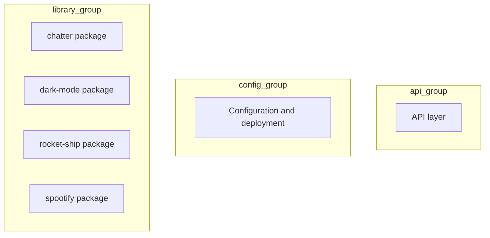

# Architecture report: alexgurr/react-coding-challenges

> Automated static analysis. **Observed** = directly seen in files/imports/AST; **Inferred** = interpretation from that evidence. Repository code was not executed.

## 1. Repository at a glance

| Item | Value |
| --- | --- |
| Repository | alexgurr/react-coding-challenges |
| Description | A series of ReactJS coding challenges with a variety of difficulties.  |
| Language | SCSS |
| Stars | 3425 |
| Licence | Not detected |
| Analysed commit / branch | fc446a3dadc2aca69b7e55fc72ed62b413d382b4 / master |
| Framework(s) | React |
| Files analysed | 100 |
| Components | 6 |

## 2. Architecture in one minute

alexgurr/react-coding-challenges - A series of ReactJS coding challenges with a variety of difficulties. . This repository was analysed statically from 100 file(s) (0 Python). Detected technologies (observed from imports/manifests): React, axios. Files are grouped into 6 component(s): API layer, chatter package, Configuration and deployment, dark-mode package, rocket-ship package, spootify package. Findings below distinguish observed facts from inferred interpretation.

## 3. High-level block diagram

## 4. Main components

### API layer (`api_layer`)

- **Kind:** api
- **Status:** Observed
- **Confidence:** 0.85
- **Responsibility:** Groups 15 file(s) under api layer (observed from repository paths and static analysis).
- **Paths:** `dark-mode/src/routes/App/components/App.js`, `dark-mode/src/routes/App/index.js`, `dark-mode/src/routes/index.js`, `rocket-ship/src/routes/LaunchPad/components/LaunchPad.js`, `rocket-ship/src/routes/LaunchPad/components/Rocket/components/Rocket.js`, `rocket-ship/src/routes/LaunchPad/components/Rocket/components/RocketCore.js`, `rocket-ship/src/routes/LaunchPad/components/Rocket/index.js`, `rocket-ship/src/routes/LaunchPad/index.js`, `rocket-ship/src/routes/index.js`, `spootify/src/routes/Discover/components/Discover.js`, `spootify/src/routes/Discover/components/DiscoverBlock/components/DiscoverBlock.js`, `spootify/src/routes/Discover/components/DiscoverBlock/components/DiscoverItem.js`, `spootify/src/routes/Discover/components/DiscoverBlock/index.js`, `spootify/src/routes/Discover/index.js`, `spootify/src/routes/index.js`
- **Evidence:** [dark-mode/src/routes/App/components/App.js](https://github.com/alexgurr/react-coding-challenges/blob/fc446a3dadc2aca69b7e55fc72ed62b413d382b4/dark-mode/src/routes/App/components/App.js); [dark-mode/src/routes/App/index.js](https://github.com/alexgurr/react-coding-challenges/blob/fc446a3dadc2aca69b7e55fc72ed62b413d382b4/dark-mode/src/routes/App/index.js); [dark-mode/src/routes/index.js](https://github.com/alexgurr/react-coding-challenges/blob/fc446a3dadc2aca69b7e55fc72ed62b413d382b4/dark-mode/src/routes/index.js); [rocket-ship/src/routes/LaunchPad/components/LaunchPad.js](https://github.com/alexgurr/react-coding-challenges/blob/fc446a3dadc2aca69b7e55fc72ed62b413d382b4/rocket-ship/src/routes/LaunchPad/components/LaunchPad.js); [rocket-ship/src/routes/LaunchPad/components/Rocket/components/Rocket.js](https://github.com/alexgurr/react-coding-challenges/blob/fc446a3dadc2aca69b7e55fc72ed62b413d382b4/rocket-ship/src/routes/LaunchPad/components/Rocket/components/Rocket.js); [rocket-ship/src/routes/LaunchPad/components/Rocket/components/RocketCore.js](https://github.com/alexgurr/react-coding-challenges/blob/fc446a3dadc2aca69b7e55fc72ed62b413d382b4/rocket-ship/src/routes/LaunchPad/components/Rocket/components/RocketCore.js); [rocket-ship/src/routes/LaunchPad/components/Rocket/index.js](https://github.com/alexgurr/react-coding-challenges/blob/fc446a3dadc2aca69b7e55fc72ed62b413d382b4/rocket-ship/src/routes/LaunchPad/components/Rocket/index.js); [rocket-ship/src/routes/LaunchPad/index.js](https://github.com/alexgurr/react-coding-challenges/blob/fc446a3dadc2aca69b7e55fc72ed62b413d382b4/rocket-ship/src/routes/LaunchPad/index.js)

### chatter package (`chatter`)

- **Kind:** library
- **Status:** Observed
- **Confidence:** 0.85
- **Responsibility:** Groups 24 file(s) under chatter package (observed from repository paths and static analysis).
- **Paths:** `chatter/src/App.js`, `chatter/src/common/components/UserProfile/UserProfile.js`, `chatter/src/common/components/UserProfile/index.js`, `chatter/src/common/constants/initialBottyMessage.js`, `chatter/src/components/ContactPanel/ContactPanel.js`, `chatter/src/components/ContactPanel/index.js`, `chatter/src/components/Messages/components/Footer.js`, `chatter/src/components/Messages/components/Header.js`, `chatter/src/components/Messages/components/Message.js`, `chatter/src/components/Messages/components/Messages.js`, `chatter/src/components/Messages/components/TypingMessage.js`, `chatter/src/components/Messages/index.js`, `chatter/src/components/UserList/UserList.js`, `chatter/src/components/UserList/constants/users.js`, `chatter/src/components/UserList/index.js`, `chatter/src/config.js`, `chatter/src/contexts/LatestMessages/LatestMessages.js`, `chatter/src/contexts/LatestMessages/constants/initialMessages.js`, `chatter/src/contexts/LatestMessages/index.js`, `chatter/src/index.js`, `chatter/src/layouts/CoreLayout/components/CoreLayout.js`, `chatter/src/layouts/CoreLayout/components/IconBackground.js`, `chatter/src/layouts/CoreLayout/constants/icons.js`, `chatter/src/layouts/CoreLayout/index.js`
- **Evidence:** [chatter/src/App.js](https://github.com/alexgurr/react-coding-challenges/blob/fc446a3dadc2aca69b7e55fc72ed62b413d382b4/chatter/src/App.js); [chatter/src/common/components/UserProfile/UserProfile.js](https://github.com/alexgurr/react-coding-challenges/blob/fc446a3dadc2aca69b7e55fc72ed62b413d382b4/chatter/src/common/components/UserProfile/UserProfile.js); [chatter/src/common/components/UserProfile/index.js](https://github.com/alexgurr/react-coding-challenges/blob/fc446a3dadc2aca69b7e55fc72ed62b413d382b4/chatter/src/common/components/UserProfile/index.js); [chatter/src/common/constants/initialBottyMessage.js](https://github.com/alexgurr/react-coding-challenges/blob/fc446a3dadc2aca69b7e55fc72ed62b413d382b4/chatter/src/common/constants/initialBottyMessage.js); [chatter/src/components/ContactPanel/ContactPanel.js](https://github.com/alexgurr/react-coding-challenges/blob/fc446a3dadc2aca69b7e55fc72ed62b413d382b4/chatter/src/components/ContactPanel/ContactPanel.js); [chatter/src/components/ContactPanel/index.js](https://github.com/alexgurr/react-coding-challenges/blob/fc446a3dadc2aca69b7e55fc72ed62b413d382b4/chatter/src/components/ContactPanel/index.js); [chatter/src/components/Messages/components/Footer.js](https://github.com/alexgurr/react-coding-challenges/blob/fc446a3dadc2aca69b7e55fc72ed62b413d382b4/chatter/src/components/Messages/components/Footer.js); [chatter/src/components/Messages/components/Header.js](https://github.com/alexgurr/react-coding-challenges/blob/fc446a3dadc2aca69b7e55fc72ed62b413d382b4/chatter/src/components/Messages/components/Header.js)

### Configuration and deployment (`config`)

- **Kind:** config
- **Status:** Observed
- **Confidence:** 0.85
- **Responsibility:** Groups 8 file(s) under configuration and deployment (observed from repository paths and static analysis).
- **Paths:** `chatter/package.json`, `chatter/public/manifest.json`, `dark-mode/package.json`, `dark-mode/public/manifest.json`, `rocket-ship/package.json`, `rocket-ship/public/manifest.json`, `spootify/package.json`, `spootify/public/manifest.json`
- **Evidence:** [chatter/package.json](https://github.com/alexgurr/react-coding-challenges/blob/fc446a3dadc2aca69b7e55fc72ed62b413d382b4/chatter/package.json); [chatter/public/manifest.json](https://github.com/alexgurr/react-coding-challenges/blob/fc446a3dadc2aca69b7e55fc72ed62b413d382b4/chatter/public/manifest.json); [dark-mode/package.json](https://github.com/alexgurr/react-coding-challenges/blob/fc446a3dadc2aca69b7e55fc72ed62b413d382b4/dark-mode/package.json); [dark-mode/public/manifest.json](https://github.com/alexgurr/react-coding-challenges/blob/fc446a3dadc2aca69b7e55fc72ed62b413d382b4/dark-mode/public/manifest.json); [rocket-ship/package.json](https://github.com/alexgurr/react-coding-challenges/blob/fc446a3dadc2aca69b7e55fc72ed62b413d382b4/rocket-ship/package.json); [rocket-ship/public/manifest.json](https://github.com/alexgurr/react-coding-challenges/blob/fc446a3dadc2aca69b7e55fc72ed62b413d382b4/rocket-ship/public/manifest.json); [spootify/package.json](https://github.com/alexgurr/react-coding-challenges/blob/fc446a3dadc2aca69b7e55fc72ed62b413d382b4/spootify/package.json); [spootify/public/manifest.json](https://github.com/alexgurr/react-coding-challenges/blob/fc446a3dadc2aca69b7e55fc72ed62b413d382b4/spootify/public/manifest.json)

### dark-mode package (`dark_mode`)

- **Kind:** library
- **Status:** Observed
- **Confidence:** 0.85
- **Responsibility:** Groups 2 file(s) under dark-mode package (observed from repository paths and static analysis).
- **Paths:** `dark-mode/src/common/containers/App.js`, `dark-mode/src/index.js`
- **Evidence:** [dark-mode/src/common/containers/App.js](https://github.com/alexgurr/react-coding-challenges/blob/fc446a3dadc2aca69b7e55fc72ed62b413d382b4/dark-mode/src/common/containers/App.js); [dark-mode/src/index.js](https://github.com/alexgurr/react-coding-challenges/blob/fc446a3dadc2aca69b7e55fc72ed62b413d382b4/dark-mode/src/index.js)

### rocket-ship package (`rocket_ship`)

- **Kind:** library
- **Status:** Observed
- **Confidence:** 0.85
- **Responsibility:** Groups 1 file(s) under rocket-ship package (observed from repository paths and static analysis).
- **Paths:** `rocket-ship/src/index.js`
- **Evidence:** [rocket-ship/src/index.js](https://github.com/alexgurr/react-coding-challenges/blob/fc446a3dadc2aca69b7e55fc72ed62b413d382b4/rocket-ship/src/index.js)

### spootify package (`spootify`)

- **Kind:** library
- **Status:** Observed
- **Confidence:** 0.85
- **Responsibility:** Groups 9 file(s) under spootify package (observed from repository paths and static analysis).
- **Paths:** `spootify/src/common/components/Header/Header.js`, `spootify/src/common/components/Header/index.js`, `spootify/src/common/components/Player/Player.js`, `spootify/src/common/components/Player/index.js`, `spootify/src/common/components/SideBar/SideBar.js`, `spootify/src/common/components/SideBar/index.js`, `spootify/src/common/layouts/CoreLayout.js`, `spootify/src/config.js`, `spootify/src/index.js`
- **Evidence:** [spootify/src/common/components/Header/Header.js](https://github.com/alexgurr/react-coding-challenges/blob/fc446a3dadc2aca69b7e55fc72ed62b413d382b4/spootify/src/common/components/Header/Header.js); [spootify/src/common/components/Header/index.js](https://github.com/alexgurr/react-coding-challenges/blob/fc446a3dadc2aca69b7e55fc72ed62b413d382b4/spootify/src/common/components/Header/index.js); [spootify/src/common/components/Player/Player.js](https://github.com/alexgurr/react-coding-challenges/blob/fc446a3dadc2aca69b7e55fc72ed62b413d382b4/spootify/src/common/components/Player/Player.js); [spootify/src/common/components/Player/index.js](https://github.com/alexgurr/react-coding-challenges/blob/fc446a3dadc2aca69b7e55fc72ed62b413d382b4/spootify/src/common/components/Player/index.js); [spootify/src/common/components/SideBar/SideBar.js](https://github.com/alexgurr/react-coding-challenges/blob/fc446a3dadc2aca69b7e55fc72ed62b413d382b4/spootify/src/common/components/SideBar/SideBar.js); [spootify/src/common/components/SideBar/index.js](https://github.com/alexgurr/react-coding-challenges/blob/fc446a3dadc2aca69b7e55fc72ed62b413d382b4/spootify/src/common/components/SideBar/index.js); [spootify/src/common/layouts/CoreLayout.js](https://github.com/alexgurr/react-coding-challenges/blob/fc446a3dadc2aca69b7e55fc72ed62b413d382b4/spootify/src/common/layouts/CoreLayout.js); [spootify/src/config.js](https://github.com/alexgurr/react-coding-challenges/blob/fc446a3dadc2aca69b7e55fc72ed62b413d382b4/spootify/src/config.js)

## 5. Execution flow

**Observed** entry point(s):

- [chatter/src/App.js](https://github.com/alexgurr/react-coding-challenges/blob/fc446a3dadc2aca69b7e55fc72ed62b413d382b4/chatter/src/App.js)
- [chatter/src/index.js](https://github.com/alexgurr/react-coding-challenges/blob/fc446a3dadc2aca69b7e55fc72ed62b413d382b4/chatter/src/index.js)
- [dark-mode/src/index.js](https://github.com/alexgurr/react-coding-challenges/blob/fc446a3dadc2aca69b7e55fc72ed62b413d382b4/dark-mode/src/index.js)
- [dark-mode/src/routes/index.js](https://github.com/alexgurr/react-coding-challenges/blob/fc446a3dadc2aca69b7e55fc72ed62b413d382b4/dark-mode/src/routes/index.js)
- [rocket-ship/src/index.js](https://github.com/alexgurr/react-coding-challenges/blob/fc446a3dadc2aca69b7e55fc72ed62b413d382b4/rocket-ship/src/index.js)
- [rocket-ship/src/routes/index.js](https://github.com/alexgurr/react-coding-challenges/blob/fc446a3dadc2aca69b7e55fc72ed62b413d382b4/rocket-ship/src/routes/index.js)
- [spootify/src/index.js](https://github.com/alexgurr/react-coding-challenges/blob/fc446a3dadc2aca69b7e55fc72ed62b413d382b4/spootify/src/index.js)
- [spootify/src/routes/index.js](https://github.com/alexgurr/react-coding-challenges/blob/fc446a3dadc2aca69b7e55fc72ed62b413d382b4/spootify/src/routes/index.js)

Representative flow (derived from observed entry points and the import graph; steps beyond the entry point are **Inferred**):

1. Execution starts at an observed entry point listed above, if present.
2. No internal import relationships between components were observed.

## 6. Project structure

### `(root)`

- `.gitignore` - other (315 bytes)
- `README.md` - docs (5258 bytes)
- `issue_template.md` - docs (1425 bytes)
- `new_challenge_template.md` - docs (1277 bytes)
- `pull_request_template.md` - docs (1060 bytes)

### `chatter`

- `chatter/README.md` - docs (2215 bytes)
- `chatter/package.json` - manifest (937 bytes)
- `chatter/public/index.html` - other (1939 bytes)
- `chatter/public/manifest.json` - config (492 bytes)
- `chatter/public/robots.txt` - docs (67 bytes)
- `chatter/src/App.js` - source, JavaScript (144 bytes)
- `chatter/src/_index.scss` - other (733 bytes)
- `chatter/src/common/components/UserProfile/UserProfile.js` - source, JavaScript (384 bytes)
- `chatter/src/common/components/UserProfile/_user-profile.scss` - other (309 bytes)
- `chatter/src/common/components/UserProfile/index.js` - source, JavaScript (41 bytes)
- `chatter/src/common/constants/initialBottyMessage.js` - source, JavaScript (40 bytes)
- `chatter/src/components/ContactPanel/ContactPanel.js` - source, JavaScript (2129 bytes)
- `chatter/src/components/ContactPanel/_contact-panel.scss` - other (3719 bytes)
- `chatter/src/components/ContactPanel/index.js` - source, JavaScript (42 bytes)
- `chatter/src/components/Messages/components/Footer.js` - source, JavaScript (741 bytes)
- `chatter/src/components/Messages/components/Header.js` - source, JavaScript (921 bytes)
- `chatter/src/components/Messages/components/Message.js` - source, JavaScript (574 bytes)
- `chatter/src/components/Messages/components/Messages.js` - source, JavaScript (993 bytes)
- `chatter/src/components/Messages/components/TypingMessage.js` - source, JavaScript (551 bytes)
- `chatter/src/components/Messages/index.js` - source, JavaScript (49 bytes)
- `chatter/src/components/Messages/styles/_messages.scss` - other (4501 bytes)
- `chatter/src/components/UserList/UserList.js` - source, JavaScript (1354 bytes)
- `chatter/src/components/UserList/_user-list.scss` - other (2905 bytes)
- `chatter/src/components/UserList/constants/users.js` - source, JavaScript (1569 bytes)
- `chatter/src/components/UserList/index.js` - source, JavaScript (38 bytes)
- `chatter/src/config.js` - source, JavaScript (189 bytes)
- `chatter/src/contexts/LatestMessages/LatestMessages.js` - source, JavaScript (606 bytes)
- `chatter/src/contexts/LatestMessages/constants/initialMessages.js` - source, JavaScript (546 bytes)
- `chatter/src/contexts/LatestMessages/index.js` - source, JavaScript (60 bytes)
- `chatter/src/index.js` - source, JavaScript (221 bytes)
- `chatter/src/layouts/CoreLayout/components/CoreLayout.js` - source, JavaScript (595 bytes)
- `chatter/src/layouts/CoreLayout/components/IconBackground.js` - source, JavaScript (1479 bytes)
- `chatter/src/layouts/CoreLayout/constants/icons.js` - source, JavaScript (515 bytes)
- `chatter/src/layouts/CoreLayout/index.js` - source, JavaScript (51 bytes)
- `chatter/src/layouts/CoreLayout/styles/_core-layout.scss` - other (174 bytes)
- `chatter/src/layouts/CoreLayout/styles/_icon-background.scss` - other (281 bytes)
- `chatter/src/styles/_vars.scss` - other (117 bytes)

### `dark-mode`

- `dark-mode/README.md` - docs (1109 bytes)
- `dark-mode/package.json` - manifest (859 bytes)
- `dark-mode/public/index.html` - other (1718 bytes)
- `dark-mode/public/manifest.json` - config (492 bytes)
- `dark-mode/public/robots.txt` - docs (67 bytes)
- `dark-mode/src/common/containers/App.js` - source, JavaScript (93 bytes)
- `dark-mode/src/index.js` - source, JavaScript (280 bytes)
- `dark-mode/src/routes/App/components/App.js` - source, JavaScript (2016 bytes)
- `dark-mode/src/routes/App/index.js` - source, JavaScript (44 bytes)
- `dark-mode/src/routes/App/styles/_app.scss` - other (485 bytes)
- `dark-mode/src/routes/index.js` - source, JavaScript (120 bytes)
- `dark-mode/src/styles/_dark-mode.scss` - other (778 bytes)
- `dark-mode/src/styles/_main.scss` - other (712 bytes)

### `rocket-ship`

- `rocket-ship/README.md` - docs (688 bytes)
- `rocket-ship/package.json` - manifest (666 bytes)
- `rocket-ship/public/index.html` - other (1722 bytes)
- `rocket-ship/public/manifest.json` - config (492 bytes)
- `rocket-ship/public/robots.txt` - docs (67 bytes)
- `rocket-ship/src/index.js` - source, JavaScript (191 bytes)
- `rocket-ship/src/routes/LaunchPad/components/LaunchPad.js` - source, JavaScript (415 bytes)
- `rocket-ship/src/routes/LaunchPad/components/Rocket/components/Rocket.js` - source, JavaScript (533 bytes)
- `rocket-ship/src/routes/LaunchPad/components/Rocket/components/RocketCore.js` - source, JavaScript (1258 bytes)
- `rocket-ship/src/routes/LaunchPad/components/Rocket/index.js` - source, JavaScript (69 bytes)
- `rocket-ship/src/routes/LaunchPad/components/Rocket/styles/_rocket.scss` - other (5832 bytes)
- `rocket-ship/src/routes/LaunchPad/index.js` - source, JavaScript (50 bytes)
- `rocket-ship/src/routes/LaunchPad/styles/_launchpad.scss` - other (254 bytes)
- `rocket-ship/src/routes/index.js` - source, JavaScript (136 bytes)
- `rocket-ship/src/styles/_main.scss` - other (77 bytes)

### `spootify`

- `spootify/README.md` - docs (1470 bytes)
- `spootify/package.json` - manifest (907 bytes)
- `spootify/public/index.html` - other (2103 bytes)
- `spootify/public/manifest.json` - config (492 bytes)
- `spootify/public/robots.txt` - docs (67 bytes)
- `spootify/src/assets/images/avatar.svg` - other (4406 bytes)
- `spootify/src/assets/images/hero.svg` - other (15529 bytes)
- `spootify/src/common/components/Header/Header.js` - source, JavaScript (527 bytes)
- `spootify/src/common/components/Header/_header.scss` - other (2484 bytes)
- `spootify/src/common/components/Header/index.js` - source, JavaScript (36 bytes)
- `spootify/src/common/components/Player/Player.js` - source, JavaScript (1206 bytes)
- `spootify/src/common/components/Player/_player.scss` - other (2768 bytes)
- `spootify/src/common/components/Player/index.js` - source, JavaScript (36 bytes)
- `spootify/src/common/components/SideBar/SideBar.js` - source, JavaScript (1193 bytes)
- `spootify/src/common/components/SideBar/_sidebar.scss` - other (1742 bytes)
- `spootify/src/common/components/SideBar/index.js` - source, JavaScript (37 bytes)
- `spootify/src/common/layouts/CoreLayout.js` - source, JavaScript (495 bytes)
- `spootify/src/config.js` - source, JavaScript (247 bytes)
- `spootify/src/index.js` - source, JavaScript (327 bytes)
- `spootify/src/routes/Discover/components/Discover.js` - source, JavaScript (731 bytes)
- `spootify/src/routes/Discover/components/DiscoverBlock/components/DiscoverBlock.js` - source, JavaScript (1458 bytes)
- `spootify/src/routes/Discover/components/DiscoverBlock/components/DiscoverItem.js` - source, JavaScript (397 bytes)
- `spootify/src/routes/Discover/components/DiscoverBlock/index.js` - source, JavaScript (54 bytes)
- `spootify/src/routes/Discover/components/DiscoverBlock/styles/_discover-block.scss` - other (1177 bytes)
- `spootify/src/routes/Discover/components/DiscoverBlock/styles/_discover-item.scss` - other (524 bytes)
- `spootify/src/routes/Discover/index.js` - source, JavaScript (49 bytes)
- `spootify/src/routes/Discover/styles/_discover.scss` - other (87 bytes)
- `spootify/src/routes/index.js` - source, JavaScript (165 bytes)
- `spootify/src/styles/_main.scss` - other (887 bytes)
- `spootify/src/styles/_vars.scss` - other (276 bytes)

## 7. Key dependencies and integrations

| Name | Category | Status | Confidence | Evidence |
| --- | --- | --- | --- | --- |
| React | framework | Observed | 0.90 | [chatter/package.json:10](https://github.com/alexgurr/react-coding-challenges/blob/fc446a3dadc2aca69b7e55fc72ed62b413d382b4/chatter/package.json#L10); [chatter/package.json:15](https://github.com/alexgurr/react-coding-challenges/blob/fc446a3dadc2aca69b7e55fc72ed62b413d382b4/chatter/package.json#L15); [dark-mode/package.json:11](https://github.com/alexgurr/react-coding-challenges/blob/fc446a3dadc2aca69b7e55fc72ed62b413d382b4/dark-mode/package.json#L11); [dark-mode/package.json:15](https://github.com/alexgurr/react-coding-challenges/blob/fc446a3dadc2aca69b7e55fc72ed62b413d382b4/dark-mode/package.json#L15) |
| axios | library | Observed | 0.85 | [spootify/package.json:14](https://github.com/alexgurr/react-coding-challenges/blob/fc446a3dadc2aca69b7e55fc72ed62b413d382b4/spootify/package.json#L14) |

## 8. Data and state

No database, cache, queue, or persistent-state usage was observed in the analysed files. State handling, if any, may be in-memory or in files that were not analysed.

## 9. Configuration and deployment clues

- `chatter/package.json` (manifest)
- `chatter/public/manifest.json` (config)
- `dark-mode/package.json` (manifest)
- `dark-mode/public/manifest.json` (config)
- `rocket-ship/package.json` (manifest)
- `rocket-ship/public/manifest.json` (config)
- `spootify/package.json` (manifest)
- `spootify/public/manifest.json` (config)

## 10. Design observations

- An entry/API layer is separated from other code (Inferred from paths and decorators).

These observations are interpretations (**Inferred**) of the observed structure, not guarantees about runtime design.

## 11. Limitations and unknowns

- Static analysis only: repository code was not executed, installed, or imported at runtime.
- Components and relationships are inferred from file paths, imports, and AST structure; runtime behaviour, dynamic imports, and reflection may not be visible.
- 1 file(s) were skipped during inventory (1 x likely secret file excluded).
- No clear application entry point was observed in the analysed files.
- Repository text was treated as untrusted data; no instructions found in repository files were followed, and likely secret values were redacted/excluded.
- JavaScript and TypeScript files were inventoried from paths and package manifests. They were not parsed with a full language AST, and repository code was not executed.

## 12. Source references

- [chatter/package.json](https://github.com/alexgurr/react-coding-challenges/blob/fc446a3dadc2aca69b7e55fc72ed62b413d382b4/chatter/package.json)
- [chatter/package.json:10](https://github.com/alexgurr/react-coding-challenges/blob/fc446a3dadc2aca69b7e55fc72ed62b413d382b4/chatter/package.json#L10)
- [chatter/package.json:15](https://github.com/alexgurr/react-coding-challenges/blob/fc446a3dadc2aca69b7e55fc72ed62b413d382b4/chatter/package.json#L15)
- [chatter/public/manifest.json](https://github.com/alexgurr/react-coding-challenges/blob/fc446a3dadc2aca69b7e55fc72ed62b413d382b4/chatter/public/manifest.json)
- [chatter/src/App.js](https://github.com/alexgurr/react-coding-challenges/blob/fc446a3dadc2aca69b7e55fc72ed62b413d382b4/chatter/src/App.js)
- [chatter/src/common/components/UserProfile/UserProfile.js](https://github.com/alexgurr/react-coding-challenges/blob/fc446a3dadc2aca69b7e55fc72ed62b413d382b4/chatter/src/common/components/UserProfile/UserProfile.js)
- [chatter/src/common/components/UserProfile/index.js](https://github.com/alexgurr/react-coding-challenges/blob/fc446a3dadc2aca69b7e55fc72ed62b413d382b4/chatter/src/common/components/UserProfile/index.js)
- [chatter/src/common/constants/initialBottyMessage.js](https://github.com/alexgurr/react-coding-challenges/blob/fc446a3dadc2aca69b7e55fc72ed62b413d382b4/chatter/src/common/constants/initialBottyMessage.js)
- [chatter/src/components/ContactPanel/ContactPanel.js](https://github.com/alexgurr/react-coding-challenges/blob/fc446a3dadc2aca69b7e55fc72ed62b413d382b4/chatter/src/components/ContactPanel/ContactPanel.js)
- [chatter/src/components/ContactPanel/index.js](https://github.com/alexgurr/react-coding-challenges/blob/fc446a3dadc2aca69b7e55fc72ed62b413d382b4/chatter/src/components/ContactPanel/index.js)
- [chatter/src/components/Messages/components/Footer.js](https://github.com/alexgurr/react-coding-challenges/blob/fc446a3dadc2aca69b7e55fc72ed62b413d382b4/chatter/src/components/Messages/components/Footer.js)
- [chatter/src/components/Messages/components/Header.js](https://github.com/alexgurr/react-coding-challenges/blob/fc446a3dadc2aca69b7e55fc72ed62b413d382b4/chatter/src/components/Messages/components/Header.js)
- [chatter/src/index.js](https://github.com/alexgurr/react-coding-challenges/blob/fc446a3dadc2aca69b7e55fc72ed62b413d382b4/chatter/src/index.js)
- [dark-mode/package.json](https://github.com/alexgurr/react-coding-challenges/blob/fc446a3dadc2aca69b7e55fc72ed62b413d382b4/dark-mode/package.json)
- [dark-mode/package.json:11](https://github.com/alexgurr/react-coding-challenges/blob/fc446a3dadc2aca69b7e55fc72ed62b413d382b4/dark-mode/package.json#L11)
- [dark-mode/package.json:15](https://github.com/alexgurr/react-coding-challenges/blob/fc446a3dadc2aca69b7e55fc72ed62b413d382b4/dark-mode/package.json#L15)
- [dark-mode/public/manifest.json](https://github.com/alexgurr/react-coding-challenges/blob/fc446a3dadc2aca69b7e55fc72ed62b413d382b4/dark-mode/public/manifest.json)
- [dark-mode/src/common/containers/App.js](https://github.com/alexgurr/react-coding-challenges/blob/fc446a3dadc2aca69b7e55fc72ed62b413d382b4/dark-mode/src/common/containers/App.js)
- [dark-mode/src/index.js](https://github.com/alexgurr/react-coding-challenges/blob/fc446a3dadc2aca69b7e55fc72ed62b413d382b4/dark-mode/src/index.js)
- [dark-mode/src/routes/App/components/App.js](https://github.com/alexgurr/react-coding-challenges/blob/fc446a3dadc2aca69b7e55fc72ed62b413d382b4/dark-mode/src/routes/App/components/App.js)
- [dark-mode/src/routes/App/index.js](https://github.com/alexgurr/react-coding-challenges/blob/fc446a3dadc2aca69b7e55fc72ed62b413d382b4/dark-mode/src/routes/App/index.js)
- [dark-mode/src/routes/index.js](https://github.com/alexgurr/react-coding-challenges/blob/fc446a3dadc2aca69b7e55fc72ed62b413d382b4/dark-mode/src/routes/index.js)
- [rocket-ship/package.json](https://github.com/alexgurr/react-coding-challenges/blob/fc446a3dadc2aca69b7e55fc72ed62b413d382b4/rocket-ship/package.json)
- [rocket-ship/package.json:9](https://github.com/alexgurr/react-coding-challenges/blob/fc446a3dadc2aca69b7e55fc72ed62b413d382b4/rocket-ship/package.json#L9)
- [rocket-ship/package.json:10](https://github.com/alexgurr/react-coding-challenges/blob/fc446a3dadc2aca69b7e55fc72ed62b413d382b4/rocket-ship/package.json#L10)
- [rocket-ship/public/manifest.json](https://github.com/alexgurr/react-coding-challenges/blob/fc446a3dadc2aca69b7e55fc72ed62b413d382b4/rocket-ship/public/manifest.json)
- [rocket-ship/src/index.js](https://github.com/alexgurr/react-coding-challenges/blob/fc446a3dadc2aca69b7e55fc72ed62b413d382b4/rocket-ship/src/index.js)
- [rocket-ship/src/routes/LaunchPad/components/LaunchPad.js](https://github.com/alexgurr/react-coding-challenges/blob/fc446a3dadc2aca69b7e55fc72ed62b413d382b4/rocket-ship/src/routes/LaunchPad/components/LaunchPad.js)
- [rocket-ship/src/routes/LaunchPad/components/Rocket/components/Rocket.js](https://github.com/alexgurr/react-coding-challenges/blob/fc446a3dadc2aca69b7e55fc72ed62b413d382b4/rocket-ship/src/routes/LaunchPad/components/Rocket/components/Rocket.js)
- [rocket-ship/src/routes/LaunchPad/components/Rocket/components/RocketCore.js](https://github.com/alexgurr/react-coding-challenges/blob/fc446a3dadc2aca69b7e55fc72ed62b413d382b4/rocket-ship/src/routes/LaunchPad/components/Rocket/components/RocketCore.js)
- [rocket-ship/src/routes/LaunchPad/components/Rocket/index.js](https://github.com/alexgurr/react-coding-challenges/blob/fc446a3dadc2aca69b7e55fc72ed62b413d382b4/rocket-ship/src/routes/LaunchPad/components/Rocket/index.js)
- [rocket-ship/src/routes/LaunchPad/index.js](https://github.com/alexgurr/react-coding-challenges/blob/fc446a3dadc2aca69b7e55fc72ed62b413d382b4/rocket-ship/src/routes/LaunchPad/index.js)
- [rocket-ship/src/routes/index.js](https://github.com/alexgurr/react-coding-challenges/blob/fc446a3dadc2aca69b7e55fc72ed62b413d382b4/rocket-ship/src/routes/index.js)
- [spootify/package.json](https://github.com/alexgurr/react-coding-challenges/blob/fc446a3dadc2aca69b7e55fc72ed62b413d382b4/spootify/package.json)
- [spootify/package.json:12](https://github.com/alexgurr/react-coding-challenges/blob/fc446a3dadc2aca69b7e55fc72ed62b413d382b4/spootify/package.json#L12)
- [spootify/package.json:14](https://github.com/alexgurr/react-coding-challenges/blob/fc446a3dadc2aca69b7e55fc72ed62b413d382b4/spootify/package.json#L14)
- [spootify/package.json:18](https://github.com/alexgurr/react-coding-challenges/blob/fc446a3dadc2aca69b7e55fc72ed62b413d382b4/spootify/package.json#L18)
- [spootify/public/manifest.json](https://github.com/alexgurr/react-coding-challenges/blob/fc446a3dadc2aca69b7e55fc72ed62b413d382b4/spootify/public/manifest.json)
- [spootify/src/common/components/Header/Header.js](https://github.com/alexgurr/react-coding-challenges/blob/fc446a3dadc2aca69b7e55fc72ed62b413d382b4/spootify/src/common/components/Header/Header.js)
- [spootify/src/common/components/Header/index.js](https://github.com/alexgurr/react-coding-challenges/blob/fc446a3dadc2aca69b7e55fc72ed62b413d382b4/spootify/src/common/components/Header/index.js)
- [spootify/src/common/components/Player/Player.js](https://github.com/alexgurr/react-coding-challenges/blob/fc446a3dadc2aca69b7e55fc72ed62b413d382b4/spootify/src/common/components/Player/Player.js)
- [spootify/src/common/components/Player/index.js](https://github.com/alexgurr/react-coding-challenges/blob/fc446a3dadc2aca69b7e55fc72ed62b413d382b4/spootify/src/common/components/Player/index.js)
- [spootify/src/common/components/SideBar/SideBar.js](https://github.com/alexgurr/react-coding-challenges/blob/fc446a3dadc2aca69b7e55fc72ed62b413d382b4/spootify/src/common/components/SideBar/SideBar.js)
- [spootify/src/common/components/SideBar/index.js](https://github.com/alexgurr/react-coding-challenges/blob/fc446a3dadc2aca69b7e55fc72ed62b413d382b4/spootify/src/common/components/SideBar/index.js)
- [spootify/src/common/layouts/CoreLayout.js](https://github.com/alexgurr/react-coding-challenges/blob/fc446a3dadc2aca69b7e55fc72ed62b413d382b4/spootify/src/common/layouts/CoreLayout.js)
- [spootify/src/config.js](https://github.com/alexgurr/react-coding-challenges/blob/fc446a3dadc2aca69b7e55fc72ed62b413d382b4/spootify/src/config.js)
- [spootify/src/index.js](https://github.com/alexgurr/react-coding-challenges/blob/fc446a3dadc2aca69b7e55fc72ed62b413d382b4/spootify/src/index.js)
- [spootify/src/routes/index.js](https://github.com/alexgurr/react-coding-challenges/blob/fc446a3dadc2aca69b7e55fc72ed62b413d382b4/spootify/src/routes/index.js)
