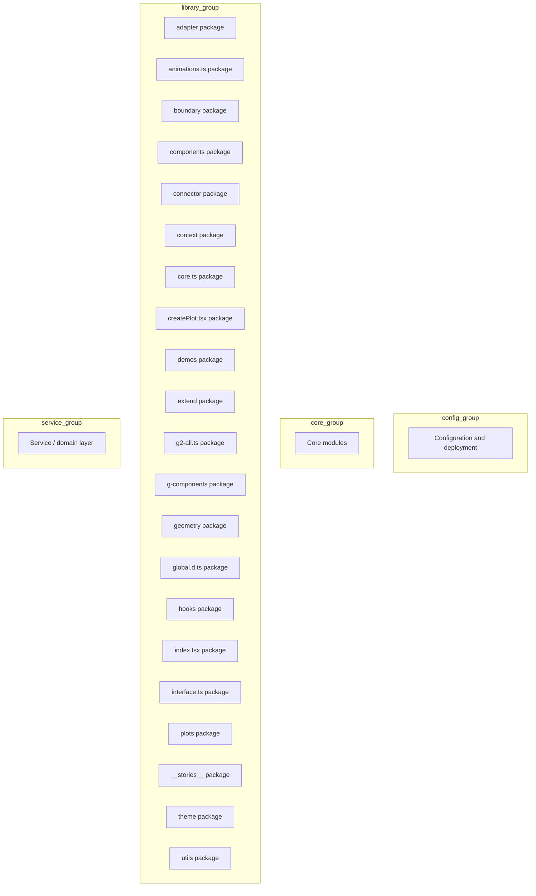

# Architecture report: alibaba/BizCharts

> Automated static analysis. **Observed** = directly seen in files/imports/AST; **Inferred** = interpretation from that evidence. Repository code was not executed.

## 1. Repository at a glance

| Item | Value |
| --- | --- |
| Repository | alibaba/BizCharts |
| Description | Powerful data visualization library based on G2 and React. |
| Language | TypeScript |
| Stars | 6181 |
| Licence | Not detected |
| Analysed commit / branch | 0be043c2fe36dd1ef56fa252e7a075a0a31115b5 / master |
| Framework(s) | React |
| Files analysed | 800 |
| Components | 24 |

## 2. Architecture in one minute

alibaba/BizCharts - Powerful data visualization library based on G2 and React.. This repository was analysed statically from 800 file(s) (0 Python). Detected technologies (observed from imports/manifests): React, Jest, TypeScript, webpack. Files are grouped into 24 component(s): adapter package, animations.ts package, boundary package, components package, Configuration and deployment, connector package, context package, Core modules. Findings below distinguish observed facts from inferred interpretation.

## 3. High-level block diagram

## 4. Main components

### adapter package (`adapter`)

- **Kind:** library
- **Status:** Observed
- **Confidence:** 0.85
- **Responsibility:** Groups 2 file(s) under adapter package (observed from repository paths and static analysis).
- **Paths:** `src/adapter/Guide.tsx`, `src/adapter/paddingCheck.ts`
- **Evidence:** [src/adapter/Guide.tsx](https://github.com/alibaba/BizCharts/blob/0be043c2fe36dd1ef56fa252e7a075a0a31115b5/src/adapter/Guide.tsx); [src/adapter/paddingCheck.ts](https://github.com/alibaba/BizCharts/blob/0be043c2fe36dd1ef56fa252e7a075a0a31115b5/src/adapter/paddingCheck.ts)

### animations.ts package (`animations_ts`)

- **Kind:** library
- **Status:** Observed
- **Confidence:** 0.85
- **Responsibility:** Groups 1 file(s) under animations.ts package (observed from repository paths and static analysis).
- **Paths:** `src/animations.ts`
- **Evidence:** [src/animations.ts](https://github.com/alibaba/BizCharts/blob/0be043c2fe36dd1ef56fa252e7a075a0a31115b5/src/animations.ts)

### boundary package (`boundary`)

- **Kind:** library
- **Status:** Observed
- **Confidence:** 0.85
- **Responsibility:** Groups 2 file(s) under boundary package (observed from repository paths and static analysis).
- **Paths:** `src/boundary/ErrorBoundary.tsx`, `src/boundary/withContainer.tsx`
- **Evidence:** [src/boundary/ErrorBoundary.tsx](https://github.com/alibaba/BizCharts/blob/0be043c2fe36dd1ef56fa252e7a075a0a31115b5/src/boundary/ErrorBoundary.tsx); [src/boundary/withContainer.tsx](https://github.com/alibaba/BizCharts/blob/0be043c2fe36dd1ef56fa252e7a075a0a31115b5/src/boundary/withContainer.tsx)

### components package (`components`)

- **Kind:** library
- **Status:** Observed
- **Confidence:** 0.85
- **Responsibility:** Groups 32 file(s) under components package (observed from repository paths and static analysis).
- **Paths:** `src/components/Annotation/arc.tsx`, `src/components/Annotation/base.tsx`, `src/components/Annotation/dataMarker.tsx`, `src/components/Annotation/dataRegion.tsx`, `src/components/Annotation/html.tsx`, `src/components/Annotation/image.tsx`, `src/components/Annotation/index.tsx`, `src/components/Annotation/line.tsx`, `src/components/Annotation/reactElement/component.ts`, `src/components/Annotation/reactElement/index.tsx`, `src/components/Annotation/region.tsx`, `src/components/Annotation/regionFilter.tsx`, `src/components/Annotation/text.tsx`, `src/components/Axis/index.tsx`, `src/components/Chart/chartHelper.ts`, `src/components/Chart/events.ts`, `src/components/Chart/index.tsx`, `src/components/Coordinate/coord.tsx`, `src/components/Coordinate/index.tsx`, `src/components/Effects/index.tsx`, `src/components/Facet/index.tsx`, `src/components/Interaction/brush.tsx`, `src/components/Interaction/index.tsx`, `src/components/Legend/actions.ts`, `src/components/Legend/index.tsx`, `src/components/Slider/index.tsx`, `src/components/Tooltip/ReactTooltip.tsx`, `src/components/Tooltip/actions.ts`, `src/components/Tooltip/index.tsx`, `src/components/Tooltip/inner.tsx`, `src/components/View/index.tsx`, `src/components/View/viewHelper.ts`
- **Evidence:** [src/components/Annotation/arc.tsx](https://github.com/alibaba/BizCharts/blob/0be043c2fe36dd1ef56fa252e7a075a0a31115b5/src/components/Annotation/arc.tsx); [src/components/Annotation/base.tsx](https://github.com/alibaba/BizCharts/blob/0be043c2fe36dd1ef56fa252e7a075a0a31115b5/src/components/Annotation/base.tsx); [src/components/Annotation/dataMarker.tsx](https://github.com/alibaba/BizCharts/blob/0be043c2fe36dd1ef56fa252e7a075a0a31115b5/src/components/Annotation/dataMarker.tsx); [src/components/Annotation/dataRegion.tsx](https://github.com/alibaba/BizCharts/blob/0be043c2fe36dd1ef56fa252e7a075a0a31115b5/src/components/Annotation/dataRegion.tsx); [src/components/Annotation/html.tsx](https://github.com/alibaba/BizCharts/blob/0be043c2fe36dd1ef56fa252e7a075a0a31115b5/src/components/Annotation/html.tsx); [src/components/Annotation/image.tsx](https://github.com/alibaba/BizCharts/blob/0be043c2fe36dd1ef56fa252e7a075a0a31115b5/src/components/Annotation/image.tsx); [src/components/Annotation/index.tsx](https://github.com/alibaba/BizCharts/blob/0be043c2fe36dd1ef56fa252e7a075a0a31115b5/src/components/Annotation/index.tsx); [src/components/Annotation/line.tsx](https://github.com/alibaba/BizCharts/blob/0be043c2fe36dd1ef56fa252e7a075a0a31115b5/src/components/Annotation/line.tsx)

### Configuration and deployment (`config`)

- **Kind:** config
- **Status:** Observed
- **Confidence:** 0.85
- **Responsibility:** Groups 2 file(s) under configuration and deployment (observed from repository paths and static analysis).
- **Paths:** `manifest.json`, `package.json`
- **Evidence:** [manifest.json](https://github.com/alibaba/BizCharts/blob/0be043c2fe36dd1ef56fa252e7a075a0a31115b5/manifest.json); [package.json](https://github.com/alibaba/BizCharts/blob/0be043c2fe36dd1ef56fa252e7a075a0a31115b5/package.json)

### connector package (`connector`)

- **Kind:** library
- **Status:** Observed
- **Confidence:** 0.85
- **Responsibility:** Groups 1 file(s) under connector package (observed from repository paths and static analysis).
- **Paths:** `src/connector/createTooltipConnector.ts`
- **Evidence:** [src/connector/createTooltipConnector.ts](https://github.com/alibaba/BizCharts/blob/0be043c2fe36dd1ef56fa252e7a075a0a31115b5/src/connector/createTooltipConnector.ts)

### context package (`context`)

- **Kind:** library
- **Status:** Observed
- **Confidence:** 0.85
- **Responsibility:** Groups 4 file(s) under context package (observed from repository paths and static analysis).
- **Paths:** `src/context/canvas.tsx`, `src/context/group.tsx`, `src/context/root.tsx`, `src/context/view.tsx`
- **Evidence:** [src/context/canvas.tsx](https://github.com/alibaba/BizCharts/blob/0be043c2fe36dd1ef56fa252e7a075a0a31115b5/src/context/canvas.tsx); [src/context/group.tsx](https://github.com/alibaba/BizCharts/blob/0be043c2fe36dd1ef56fa252e7a075a0a31115b5/src/context/group.tsx); [src/context/root.tsx](https://github.com/alibaba/BizCharts/blob/0be043c2fe36dd1ef56fa252e7a075a0a31115b5/src/context/root.tsx); [src/context/view.tsx](https://github.com/alibaba/BizCharts/blob/0be043c2fe36dd1ef56fa252e7a075a0a31115b5/src/context/view.tsx)

### Core modules (`core`)

- **Kind:** core
- **Status:** Observed
- **Confidence:** 0.85
- **Responsibility:** Groups 1 file(s) under core modules (observed from repository paths and static analysis).
- **Paths:** `gulpfile.js`
- **Evidence:** [gulpfile.js](https://github.com/alibaba/BizCharts/blob/0be043c2fe36dd1ef56fa252e7a075a0a31115b5/gulpfile.js)

### core.ts package (`core_ts`)

- **Kind:** library
- **Status:** Observed
- **Confidence:** 0.85
- **Responsibility:** Groups 1 file(s) under core.ts package (observed from repository paths and static analysis).
- **Paths:** `src/core.ts`
- **Evidence:** [src/core.ts](https://github.com/alibaba/BizCharts/blob/0be043c2fe36dd1ef56fa252e7a075a0a31115b5/src/core.ts)

### createPlot.tsx package (`createplot_tsx`)

- **Kind:** library
- **Status:** Observed
- **Confidence:** 0.85
- **Responsibility:** Groups 1 file(s) under createplot.tsx package (observed from repository paths and static analysis).
- **Paths:** `src/createPlot.tsx`
- **Evidence:** [src/createPlot.tsx](https://github.com/alibaba/BizCharts/blob/0be043c2fe36dd1ef56fa252e7a075a0a31115b5/src/createPlot.tsx)

### demos package (`demos`)

- **Kind:** library
- **Status:** Observed
- **Confidence:** 0.85
- **Responsibility:** Groups 82 file(s) under demos package (observed from repository paths and static analysis).
- **Paths:** `demos/adepter/coord.jsx`, `demos/adepter/geom-label.jsx`, `demos/area/areaWithNull.jsx`, `demos/area/basicArea.jsx`, `demos/area/basicAreaWithNegativeValues.jsx`, `demos/area/colorBlock.jsx`, `demos/area/intervalArea.jsx`, `demos/area/percentStackingArea.jsx`, `demos/area/stackingArea.jsx`, `demos/box/basicBox.jsx`, `demos/bugs/plot-bar.jsx`, `demos/bugs/view-changeData.jsx`, `demos/candle/data.js`, `demos/candle/stock.jsx`, `demos/components/annotation-text.js`, `demos/components/annotation.jsx`, `demos/components/autoFit.jsx`, `demos/components/axis.jsx`, `demos/components/coordinate.jsx`, `demos/components/facet.jsx`, `demos/components/view.jsx`, `demos/dashboard/basicDashboard.jsx`, `demos/features/JsxTooltip.jsx`, `demos/features/changeData.jsx`, `demos/features/chartManager.jsx`, `demos/features/effects.jsx`, `demos/features/facet.jsx`, `demos/features/fiber-reconciler.jsx`, `demos/features/filter.jsx`, `demos/features/interaction.jsx`, `demos/features/pure.jsx`, `demos/features/resize.jsx`, `demos/features/selected.jsx`, `demos/features/slider.jsx`, `demos/features/tooltip-linkage.jsx`, `demos/features/transform.jsx`, `demos/funnel/basicFunnel.jsx`, `demos/g-components/basic.tsx`, `demos/geom/LineAdvance.jsx`, `demos/geom/area.jsx`, `demos/geom/interval-group.jsx`, `demos/geom/interval.jsx`, `demos/geom/line.jsx`, `demos/geom/path.jsx`, `demos/heatMap/calendar.jsx`, `demos/heatMap/heatMap.jsx`, `demos/interval/basicBar.tsx`, `demos/interval/basicColumn.jsx`, `demos/interval/bezier.jsx`, `demos/interval/colorGroupedStackedColumns.jsx`, `demos/interval/comparedBar.jsx`, `demos/interval/gradientBar.jsx`, `demos/interval/groupedBar.jsx`, `demos/interval/groupedColumns.jsx`, `demos/interval/groupedStackedColumns.jsx`, `demos/interval/histogram.jsx`, `demos/interval/intervalColumn.jsx`, `demos/interval/percentStackedColumn.jsx`, `demos/interval/polarCoordinate.jsx`, `demos/interval/roundedColumn.jsx`, `demos/interval/stackedBars.jsx`, `demos/interval/stackedColumn.jsx`, `demos/line/gradientPolyline.jsx`, `demos/line/ordinaryCurve.jsx`, `demos/line/ordinaryPolyline.jsx`, `demos/line/stepPolyline.jsx`, `demos/pie/RoseChart-limitedAngleRange.jsx`, `demos/pie/basicPie.jsx`, `demos/pie/multicolorNightingaleRoseillustration.jsx`, `demos/pie/nestedPie.jsx`, `demos/pie/nightingaleRoseIllustration.jsx`, `demos/pie/nightingaleRosette.jsx`, `demos/pie/visualizationOfDailyWork.jsx`, `demos/plot/gauge.jsx`, `demos/plot/line.jsx`, `demos/plot/plots.jsx`, `demos/plot/ring.jsx`, `demos/point/basicPoint.jsx`, `demos/point/bubble.jsx`, `demos/point/multiShapeScatter.jsx`, `demos/radar/radar.jsx`, `demos/theme/index.jsx`
- **Evidence:** [demos/adepter/coord.jsx](https://github.com/alibaba/BizCharts/blob/0be043c2fe36dd1ef56fa252e7a075a0a31115b5/demos/adepter/coord.jsx); [demos/adepter/geom-label.jsx](https://github.com/alibaba/BizCharts/blob/0be043c2fe36dd1ef56fa252e7a075a0a31115b5/demos/adepter/geom-label.jsx); [demos/area/areaWithNull.jsx](https://github.com/alibaba/BizCharts/blob/0be043c2fe36dd1ef56fa252e7a075a0a31115b5/demos/area/areaWithNull.jsx); [demos/area/basicArea.jsx](https://github.com/alibaba/BizCharts/blob/0be043c2fe36dd1ef56fa252e7a075a0a31115b5/demos/area/basicArea.jsx); [demos/area/basicAreaWithNegativeValues.jsx](https://github.com/alibaba/BizCharts/blob/0be043c2fe36dd1ef56fa252e7a075a0a31115b5/demos/area/basicAreaWithNegativeValues.jsx); [demos/area/colorBlock.jsx](https://github.com/alibaba/BizCharts/blob/0be043c2fe36dd1ef56fa252e7a075a0a31115b5/demos/area/colorBlock.jsx); [demos/area/intervalArea.jsx](https://github.com/alibaba/BizCharts/blob/0be043c2fe36dd1ef56fa252e7a075a0a31115b5/demos/area/intervalArea.jsx); [demos/area/percentStackingArea.jsx](https://github.com/alibaba/BizCharts/blob/0be043c2fe36dd1ef56fa252e7a075a0a31115b5/demos/area/percentStackingArea.jsx)

### extend package (`extend`)

- **Kind:** library
- **Status:** Observed
- **Confidence:** 0.85
- **Responsibility:** Groups 2 file(s) under extend package (observed from repository paths and static analysis).
- **Paths:** `src/extend/scale/linear-tick.ts`, `src/extend/scale/scale.ts`
- **Evidence:** [src/extend/scale/linear-tick.ts](https://github.com/alibaba/BizCharts/blob/0be043c2fe36dd1ef56fa252e7a075a0a31115b5/src/extend/scale/linear-tick.ts); [src/extend/scale/scale.ts](https://github.com/alibaba/BizCharts/blob/0be043c2fe36dd1ef56fa252e7a075a0a31115b5/src/extend/scale/scale.ts)

### g2-all.ts package (`g2_all_ts`)

- **Kind:** library
- **Status:** Observed
- **Confidence:** 0.85
- **Responsibility:** Groups 1 file(s) under g2-all.ts package (observed from repository paths and static analysis).
- **Paths:** `src/g2-all.ts`
- **Evidence:** [src/g2-all.ts](https://github.com/alibaba/BizCharts/blob/0be043c2fe36dd1ef56fa252e7a075a0a31115b5/src/g2-all.ts)

### g-components package (`g_components`)

- **Kind:** library
- **Status:** Observed
- **Confidence:** 0.85
- **Responsibility:** Groups 17 file(s) under g-components package (observed from repository paths and static analysis).
- **Paths:** `src/g-components/Base/Helper.ts`, `src/g-components/Base/events.ts`, `src/g-components/Base/index.tsx`, `src/g-components/Canvas.tsx`, `src/g-components/Circle.tsx`, `src/g-components/Ellipse.tsx`, `src/g-components/Group.tsx`, `src/g-components/Image.tsx`, `src/g-components/Line.tsx`, `src/g-components/Marker.tsx`, `src/g-components/Path.tsx`, `src/g-components/Polygon.tsx`, `src/g-components/Polyline.tsx`, `src/g-components/Rect.tsx`, `src/g-components/Text.tsx`, `src/g-components/index.ts`, `src/g-components/reconciler/index.tsx`
- **Evidence:** [src/g-components/Base/Helper.ts](https://github.com/alibaba/BizCharts/blob/0be043c2fe36dd1ef56fa252e7a075a0a31115b5/src/g-components/Base/Helper.ts); [src/g-components/Base/events.ts](https://github.com/alibaba/BizCharts/blob/0be043c2fe36dd1ef56fa252e7a075a0a31115b5/src/g-components/Base/events.ts); [src/g-components/Base/index.tsx](https://github.com/alibaba/BizCharts/blob/0be043c2fe36dd1ef56fa252e7a075a0a31115b5/src/g-components/Base/index.tsx); [src/g-components/Canvas.tsx](https://github.com/alibaba/BizCharts/blob/0be043c2fe36dd1ef56fa252e7a075a0a31115b5/src/g-components/Canvas.tsx); [src/g-components/Circle.tsx](https://github.com/alibaba/BizCharts/blob/0be043c2fe36dd1ef56fa252e7a075a0a31115b5/src/g-components/Circle.tsx); [src/g-components/Ellipse.tsx](https://github.com/alibaba/BizCharts/blob/0be043c2fe36dd1ef56fa252e7a075a0a31115b5/src/g-components/Ellipse.tsx); [src/g-components/Group.tsx](https://github.com/alibaba/BizCharts/blob/0be043c2fe36dd1ef56fa252e7a075a0a31115b5/src/g-components/Group.tsx); [src/g-components/Image.tsx](https://github.com/alibaba/BizCharts/blob/0be043c2fe36dd1ef56fa252e7a075a0a31115b5/src/g-components/Image.tsx)

### geometry package (`geometry`)

- **Kind:** library
- **Status:** Observed
- **Confidence:** 0.85
- **Responsibility:** Groups 14 file(s) under geometry package (observed from repository paths and static analysis).
- **Paths:** `src/geometry/Area.tsx`, `src/geometry/Base.tsx`, `src/geometry/Edge.tsx`, `src/geometry/Heatmap.tsx`, `src/geometry/Interval.tsx`, `src/geometry/Label.tsx`, `src/geometry/Line.tsx`, `src/geometry/LineAdvance.tsx`, `src/geometry/Path.tsx`, `src/geometry/Point.tsx`, `src/geometry/Polygon.tsx`, `src/geometry/Schema.tsx`, `src/geometry/actions.ts`, `src/geometry/index.tsx`
- **Evidence:** [src/geometry/Area.tsx](https://github.com/alibaba/BizCharts/blob/0be043c2fe36dd1ef56fa252e7a075a0a31115b5/src/geometry/Area.tsx); [src/geometry/Base.tsx](https://github.com/alibaba/BizCharts/blob/0be043c2fe36dd1ef56fa252e7a075a0a31115b5/src/geometry/Base.tsx); [src/geometry/Edge.tsx](https://github.com/alibaba/BizCharts/blob/0be043c2fe36dd1ef56fa252e7a075a0a31115b5/src/geometry/Edge.tsx); [src/geometry/Heatmap.tsx](https://github.com/alibaba/BizCharts/blob/0be043c2fe36dd1ef56fa252e7a075a0a31115b5/src/geometry/Heatmap.tsx); [src/geometry/Interval.tsx](https://github.com/alibaba/BizCharts/blob/0be043c2fe36dd1ef56fa252e7a075a0a31115b5/src/geometry/Interval.tsx); [src/geometry/Label.tsx](https://github.com/alibaba/BizCharts/blob/0be043c2fe36dd1ef56fa252e7a075a0a31115b5/src/geometry/Label.tsx); [src/geometry/Line.tsx](https://github.com/alibaba/BizCharts/blob/0be043c2fe36dd1ef56fa252e7a075a0a31115b5/src/geometry/Line.tsx); [src/geometry/LineAdvance.tsx](https://github.com/alibaba/BizCharts/blob/0be043c2fe36dd1ef56fa252e7a075a0a31115b5/src/geometry/LineAdvance.tsx)

### global.d.ts package (`global_d_ts`)

- **Kind:** library
- **Status:** Observed
- **Confidence:** 0.85
- **Responsibility:** Groups 1 file(s) under global.d.ts package (observed from repository paths and static analysis).
- **Paths:** `src/global.d.ts`
- **Evidence:** [src/global.d.ts](https://github.com/alibaba/BizCharts/blob/0be043c2fe36dd1ef56fa252e7a075a0a31115b5/src/global.d.ts)

### hooks package (`hooks`)

- **Kind:** library
- **Status:** Observed
- **Confidence:** 0.85
- **Responsibility:** Groups 3 file(s) under hooks package (observed from repository paths and static analysis).
- **Paths:** `src/hooks/useChartInstance.tsx`, `src/hooks/useChartView.tsx`, `src/hooks/useTheme.ts`
- **Evidence:** [src/hooks/useChartInstance.tsx](https://github.com/alibaba/BizCharts/blob/0be043c2fe36dd1ef56fa252e7a075a0a31115b5/src/hooks/useChartInstance.tsx); [src/hooks/useChartView.tsx](https://github.com/alibaba/BizCharts/blob/0be043c2fe36dd1ef56fa252e7a075a0a31115b5/src/hooks/useChartView.tsx); [src/hooks/useTheme.ts](https://github.com/alibaba/BizCharts/blob/0be043c2fe36dd1ef56fa252e7a075a0a31115b5/src/hooks/useTheme.ts)

### index.tsx package (`index_tsx`)

- **Kind:** library
- **Status:** Observed
- **Confidence:** 0.85
- **Responsibility:** Groups 1 file(s) under index.tsx package (observed from repository paths and static analysis).
- **Paths:** `src/index.tsx`
- **Evidence:** [src/index.tsx](https://github.com/alibaba/BizCharts/blob/0be043c2fe36dd1ef56fa252e7a075a0a31115b5/src/index.tsx)

### interface.ts package (`interface_ts`)

- **Kind:** library
- **Status:** Observed
- **Confidence:** 0.85
- **Responsibility:** Groups 1 file(s) under interface.ts package (observed from repository paths and static analysis).
- **Paths:** `src/interface.ts`
- **Evidence:** [src/interface.ts](https://github.com/alibaba/BizCharts/blob/0be043c2fe36dd1ef56fa252e7a075a0a31115b5/src/interface.ts)

### plots package (`plots`)

- **Kind:** library
- **Status:** Observed
- **Confidence:** 0.85
- **Responsibility:** Groups 44 file(s) under plots package (observed from repository paths and static analysis).
- **Paths:** `src/plots/AreaChart.tsx`, `src/plots/BarChart.tsx`, `src/plots/BubbleChart.tsx`, `src/plots/BulletChart.tsx`, `src/plots/CalendarChart.tsx`, `src/plots/ColumnChart.tsx`, `src/plots/DensityHeatmapChart.tsx`, `src/plots/DonutChart.tsx`, `src/plots/DualAxesChart.tsx`, `src/plots/FunnelChart.tsx`, `src/plots/GaugeChart.tsx`, `src/plots/GroupedBarChart.tsx`, `src/plots/GroupedColumnChart.tsx`, `src/plots/GroupedRoseChart.tsx`, `src/plots/HeatmapChart.tsx`, `src/plots/HistogramChart.tsx`, `src/plots/LineChart.tsx`, `src/plots/LiquidChart.tsx`, `src/plots/PercentStackedAreaChart.tsx`, `src/plots/PercentStackedBarChart.tsx`, `src/plots/PercentStackedColumnChart.tsx`, `src/plots/PieChart.tsx`, `src/plots/PlotAdapter.tsx`, `src/plots/ProgressChart.tsx`, `src/plots/RadarChart.tsx`, `src/plots/RangeBarChart.tsx`, `src/plots/RangeColumnChart.tsx`, `src/plots/RingProgressChart.tsx`, `src/plots/RoseChart.tsx`, `src/plots/ScatterChart.tsx`, `src/plots/StackedAreaChart.tsx`, `src/plots/StackedBarChart.tsx`, `src/plots/StackedColumnChart.tsx`, `src/plots/StackedRoseChart.tsx`, `src/plots/StepLineChart.tsx`, `src/plots/TinyAreaChart.tsx`, `src/plots/TinyColumnChart.tsx`, `src/plots/TinyLineChart.tsx`, `src/plots/TreemapChart.tsx`, `src/plots/WaterfallChart.tsx`, `src/plots/WordCloudChart.tsx`, `src/plots/index.tsx`, `src/plots/plots.tsx`, `src/plots/sparkline.tsx`
- **Evidence:** [src/plots/AreaChart.tsx](https://github.com/alibaba/BizCharts/blob/0be043c2fe36dd1ef56fa252e7a075a0a31115b5/src/plots/AreaChart.tsx); [src/plots/BarChart.tsx](https://github.com/alibaba/BizCharts/blob/0be043c2fe36dd1ef56fa252e7a075a0a31115b5/src/plots/BarChart.tsx); [src/plots/BubbleChart.tsx](https://github.com/alibaba/BizCharts/blob/0be043c2fe36dd1ef56fa252e7a075a0a31115b5/src/plots/BubbleChart.tsx); [src/plots/BulletChart.tsx](https://github.com/alibaba/BizCharts/blob/0be043c2fe36dd1ef56fa252e7a075a0a31115b5/src/plots/BulletChart.tsx); [src/plots/CalendarChart.tsx](https://github.com/alibaba/BizCharts/blob/0be043c2fe36dd1ef56fa252e7a075a0a31115b5/src/plots/CalendarChart.tsx); [src/plots/ColumnChart.tsx](https://github.com/alibaba/BizCharts/blob/0be043c2fe36dd1ef56fa252e7a075a0a31115b5/src/plots/ColumnChart.tsx); [src/plots/DensityHeatmapChart.tsx](https://github.com/alibaba/BizCharts/blob/0be043c2fe36dd1ef56fa252e7a075a0a31115b5/src/plots/DensityHeatmapChart.tsx); [src/plots/DonutChart.tsx](https://github.com/alibaba/BizCharts/blob/0be043c2fe36dd1ef56fa252e7a075a0a31115b5/src/plots/DonutChart.tsx)

### Service / domain layer (`service_layer`)

- **Kind:** service
- **Status:** Observed
- **Confidence:** 0.85
- **Responsibility:** Groups 3 file(s) under service / domain layer (observed from repository paths and static analysis).
- **Paths:** `src/plots/core/dependents.ts`, `src/plots/core/interface.ts`, `src/plots/core/polyfill.ts`
- **Evidence:** [src/plots/core/dependents.ts](https://github.com/alibaba/BizCharts/blob/0be043c2fe36dd1ef56fa252e7a075a0a31115b5/src/plots/core/dependents.ts); [src/plots/core/interface.ts](https://github.com/alibaba/BizCharts/blob/0be043c2fe36dd1ef56fa252e7a075a0a31115b5/src/plots/core/interface.ts); [src/plots/core/polyfill.ts](https://github.com/alibaba/BizCharts/blob/0be043c2fe36dd1ef56fa252e7a075a0a31115b5/src/plots/core/polyfill.ts)

### __stories__ package (`stories`)

- **Kind:** library
- **Status:** Observed
- **Confidence:** 0.85
- **Responsibility:** Groups 21 file(s) under __stories__ package (observed from repository paths and static analysis).
- **Paths:** `__stories__/area.stories.tsx`, `__stories__/base.stories.tsx`, `__stories__/box.stories.tsx`, `__stories__/bugs.stories.tsx`, `__stories__/candle.stories.tsx`, `__stories__/dashboard.stories.tsx`, `__stories__/feature.stories.tsx`, `__stories__/funnel.stories.tsx`, `__stories__/g.stories.tsx`, `__stories__/geometry.stories.tsx`, `__stories__/heatMap.stories.tsx`, `__stories__/interval.stories.tsx`, `__stories__/line.stories.tsx`, `__stories__/path.stories.tsx`, `__stories__/pie.stories.tsx`, `__stories__/plot.stories.tsx`, `__stories__/plots/area.stories.tsx`, `__stories__/point.stories.tsx`, `__stories__/radar.stories.tsx`, `__stories__/temp.stories.tsx`, `__stories__/theme.stories.tsx`
- **Evidence:** [__stories__/area.stories.tsx](https://github.com/alibaba/BizCharts/blob/0be043c2fe36dd1ef56fa252e7a075a0a31115b5/__stories__/area.stories.tsx); [__stories__/base.stories.tsx](https://github.com/alibaba/BizCharts/blob/0be043c2fe36dd1ef56fa252e7a075a0a31115b5/__stories__/base.stories.tsx); [__stories__/box.stories.tsx](https://github.com/alibaba/BizCharts/blob/0be043c2fe36dd1ef56fa252e7a075a0a31115b5/__stories__/box.stories.tsx); [__stories__/bugs.stories.tsx](https://github.com/alibaba/BizCharts/blob/0be043c2fe36dd1ef56fa252e7a075a0a31115b5/__stories__/bugs.stories.tsx); [__stories__/candle.stories.tsx](https://github.com/alibaba/BizCharts/blob/0be043c2fe36dd1ef56fa252e7a075a0a31115b5/__stories__/candle.stories.tsx); [__stories__/dashboard.stories.tsx](https://github.com/alibaba/BizCharts/blob/0be043c2fe36dd1ef56fa252e7a075a0a31115b5/__stories__/dashboard.stories.tsx); [__stories__/feature.stories.tsx](https://github.com/alibaba/BizCharts/blob/0be043c2fe36dd1ef56fa252e7a075a0a31115b5/__stories__/feature.stories.tsx); [__stories__/funnel.stories.tsx](https://github.com/alibaba/BizCharts/blob/0be043c2fe36dd1ef56fa252e7a075a0a31115b5/__stories__/funnel.stories.tsx)

### theme package (`theme`)

- **Kind:** library
- **Status:** Observed
- **Confidence:** 0.85
- **Responsibility:** Groups 1 file(s) under theme package (observed from repository paths and static analysis).
- **Paths:** `src/theme/index.tsx`
- **Evidence:** [src/theme/index.tsx](https://github.com/alibaba/BizCharts/blob/0be043c2fe36dd1ef56fa252e7a075a0a31115b5/src/theme/index.tsx)

### utils package (`utils`)

- **Kind:** library
- **Status:** Observed
- **Confidence:** 0.85
- **Responsibility:** Groups 16 file(s) under utils package (observed from repository paths and static analysis).
- **Paths:** `src/utils/cloneDeep.ts`, `src/utils/compareProps.ts`, `src/utils/constant.ts`, `src/utils/data-transform/fold.ts`, `src/utils/data-transform/minifyNum.ts`, `src/utils/data-transform/partition.ts`, `src/utils/data-transform/percentage.ts`, `src/utils/data-transform/simple-sort-by.ts`, `src/utils/data-transform/splitBySeparator.ts`, `src/utils/data-transform/sum.ts`, `src/utils/getElementSize.ts`, `src/utils/index.ts`, `src/utils/isEqual.ts`, `src/utils/pickWithout.ts`, `src/utils/plotTools.ts`, `src/utils/shallowEqual.ts`
- **Evidence:** [src/utils/cloneDeep.ts](https://github.com/alibaba/BizCharts/blob/0be043c2fe36dd1ef56fa252e7a075a0a31115b5/src/utils/cloneDeep.ts); [src/utils/compareProps.ts](https://github.com/alibaba/BizCharts/blob/0be043c2fe36dd1ef56fa252e7a075a0a31115b5/src/utils/compareProps.ts); [src/utils/constant.ts](https://github.com/alibaba/BizCharts/blob/0be043c2fe36dd1ef56fa252e7a075a0a31115b5/src/utils/constant.ts); [src/utils/data-transform/fold.ts](https://github.com/alibaba/BizCharts/blob/0be043c2fe36dd1ef56fa252e7a075a0a31115b5/src/utils/data-transform/fold.ts); [src/utils/data-transform/minifyNum.ts](https://github.com/alibaba/BizCharts/blob/0be043c2fe36dd1ef56fa252e7a075a0a31115b5/src/utils/data-transform/minifyNum.ts); [src/utils/data-transform/partition.ts](https://github.com/alibaba/BizCharts/blob/0be043c2fe36dd1ef56fa252e7a075a0a31115b5/src/utils/data-transform/partition.ts); [src/utils/data-transform/percentage.ts](https://github.com/alibaba/BizCharts/blob/0be043c2fe36dd1ef56fa252e7a075a0a31115b5/src/utils/data-transform/percentage.ts); [src/utils/data-transform/simple-sort-by.ts](https://github.com/alibaba/BizCharts/blob/0be043c2fe36dd1ef56fa252e7a075a0a31115b5/src/utils/data-transform/simple-sort-by.ts)

## 5. Execution flow

**Observed** entry point(s):

- [.storybook/main.js](https://github.com/alibaba/BizCharts/blob/0be043c2fe36dd1ef56fa252e7a075a0a31115b5/.storybook/main.js)
- [demos/theme/index.jsx](https://github.com/alibaba/BizCharts/blob/0be043c2fe36dd1ef56fa252e7a075a0a31115b5/demos/theme/index.jsx)
- [src/components/Annotation/index.tsx](https://github.com/alibaba/BizCharts/blob/0be043c2fe36dd1ef56fa252e7a075a0a31115b5/src/components/Annotation/index.tsx)
- [src/components/Axis/index.tsx](https://github.com/alibaba/BizCharts/blob/0be043c2fe36dd1ef56fa252e7a075a0a31115b5/src/components/Axis/index.tsx)
- [src/components/Chart/index.tsx](https://github.com/alibaba/BizCharts/blob/0be043c2fe36dd1ef56fa252e7a075a0a31115b5/src/components/Chart/index.tsx)
- [src/components/Coordinate/index.tsx](https://github.com/alibaba/BizCharts/blob/0be043c2fe36dd1ef56fa252e7a075a0a31115b5/src/components/Coordinate/index.tsx)
- [src/components/Effects/index.tsx](https://github.com/alibaba/BizCharts/blob/0be043c2fe36dd1ef56fa252e7a075a0a31115b5/src/components/Effects/index.tsx)
- [src/components/Facet/index.tsx](https://github.com/alibaba/BizCharts/blob/0be043c2fe36dd1ef56fa252e7a075a0a31115b5/src/components/Facet/index.tsx)
- [src/components/Interaction/index.tsx](https://github.com/alibaba/BizCharts/blob/0be043c2fe36dd1ef56fa252e7a075a0a31115b5/src/components/Interaction/index.tsx)
- [src/components/Legend/index.tsx](https://github.com/alibaba/BizCharts/blob/0be043c2fe36dd1ef56fa252e7a075a0a31115b5/src/components/Legend/index.tsx)
- [src/components/Slider/index.tsx](https://github.com/alibaba/BizCharts/blob/0be043c2fe36dd1ef56fa252e7a075a0a31115b5/src/components/Slider/index.tsx)
- [src/components/Tooltip/index.tsx](https://github.com/alibaba/BizCharts/blob/0be043c2fe36dd1ef56fa252e7a075a0a31115b5/src/components/Tooltip/index.tsx)

Representative flow (derived from observed entry points and the import graph; steps beyond the entry point are **Inferred**):

1. Execution starts at an observed entry point listed above, if present.
2. No internal import relationships between components were observed.

## 6. Project structure

### `(root)`

- `.babelrc` - other (2177 bytes)
- `.eslintignore` - other (68 bytes)
- `.eslintrc.js` - source, JavaScript (655 bytes)
- `.fatherrc.js` - source, JavaScript (136 bytes)
- `.gitignore` - other (103 bytes)
- `.prettierrc.js` - source, JavaScript (86 bytes)
- `CHANGELOG.md` - docs (2316 bytes)
- `README.md` - docs (3305 bytes)
- `SECURITY.md` - docs (357 bytes)
- `gulpfile.js` - source, JavaScript (681 bytes)
- `manifest.json` - config (5974 bytes)
- `package.json` - manifest (5368 bytes)

### `.github`

- `.github/ISSUE_TEMPLATE.md` - docs (137 bytes)

### `.storybook`

- `.storybook/.eslintrc` - other (130 bytes)
- `.storybook/main.js` - source, JavaScript (225 bytes)
- `.storybook/preview.js` - source, JavaScript (1312 bytes)
- `.storybook/webpack.config.js` - source, JavaScript (1213 bytes)

### `__stories__`

- `__stories__/area.stories.tsx` - source, TypeScript (990 bytes)
- `__stories__/base.stories.tsx` - source, TypeScript (732 bytes)
- `__stories__/box.stories.tsx` - source, TypeScript (179 bytes)
- `__stories__/bugs.stories.tsx` - source, TypeScript (294 bytes)
- `__stories__/candle.stories.tsx` - source, TypeScript (182 bytes)
- `__stories__/dashboard.stories.tsx` - source, TypeScript (209 bytes)
- `__stories__/feature.stories.tsx` - source, TypeScript (1107 bytes)
- `__stories__/funnel.stories.tsx` - source, TypeScript (194 bytes)
- `__stories__/g.stories.tsx` - source, TypeScript (176 bytes)
- `__stories__/geometry.stories.tsx` - source, TypeScript (509 bytes)
- `__stories__/heatMap.stories.tsx` - source, TypeScript (292 bytes)
- `__stories__/interval.stories.tsx` - source, TypeScript (2253 bytes)
- `__stories__/line.stories.tsx` - source, TypeScript (581 bytes)
- `__stories__/path.stories.tsx` - source, TypeScript (164 bytes)
- `__stories__/pie.stories.tsx` - source, TypeScript (1123 bytes)
- `__stories__/plot.stories.tsx` - source, TypeScript (710 bytes)
- `__stories__/plots/area.stories.tsx` - source, TypeScript (631 bytes)
- `__stories__/point.stories.tsx` - source, TypeScript (423 bytes)
- `__stories__/radar.stories.tsx` - source, TypeScript (168 bytes)
- `__stories__/temp.stories.tsx` - source, TypeScript (138 bytes)
- `__stories__/theme.stories.tsx` - source, TypeScript (276 bytes)

### `demos`

- `demos/adepter/coord.jsx` - source, JavaScript (0 bytes)
- `demos/adepter/geom-label.jsx` - source, JavaScript (0 bytes)
- `demos/area/areaWithNull.jsx` - source, JavaScript (1890 bytes)
- `demos/area/basicArea.jsx` - source, JavaScript (1490 bytes)
- `demos/area/basicAreaWithNegativeValues.jsx` - source, JavaScript (1753 bytes)
- `demos/area/colorBlock.jsx` - source, JavaScript (2442 bytes)
- `demos/area/intervalArea.jsx` - source, JavaScript (4010 bytes)
- `demos/area/percentStackingArea.jsx` - source, JavaScript (2469 bytes)
- `demos/area/stackingArea.jsx` - source, JavaScript (2031 bytes)
- `demos/box/basicBox.jsx` - source, JavaScript (2314 bytes)
- `demos/bugs/plot-bar.jsx` - source, JavaScript (568 bytes)
- `demos/bugs/view-changeData.jsx` - source, JavaScript (2068 bytes)
- `demos/candle/data.js` - source, JavaScript (22716 bytes)
- `demos/candle/stock.jsx` - source, JavaScript (3219 bytes)
- `demos/components/annotation-text.js` - source, JavaScript (2611 bytes)
- `demos/components/annotation.jsx` - source, JavaScript (2563 bytes)
- `demos/components/autoFit.jsx` - source, JavaScript (1167 bytes)
- `demos/components/axis.jsx` - source, JavaScript (1087 bytes)
- `demos/components/coordinate.jsx` - source, JavaScript (564 bytes)
- `demos/components/facet.jsx` - source, JavaScript (6343 bytes)
- `demos/components/view.jsx` - source, JavaScript (6350 bytes)
- `demos/dashboard/basicDashboard.jsx` - source, JavaScript (2711 bytes)
- `demos/external/index.html` - other (353 bytes)
- `demos/features/JsxTooltip.jsx` - source, JavaScript (3285 bytes)
- `demos/features/changeData.jsx` - source, JavaScript (1548 bytes)
- `demos/features/chartManager.jsx` - source, JavaScript (1692 bytes)
- `demos/features/effects.jsx` - source, JavaScript (1597 bytes)
- `demos/features/facet.jsx` - source, JavaScript (3000 bytes)
- `demos/features/fiber-reconciler.jsx` - source, JavaScript (1475 bytes)
- `demos/features/filter.jsx` - source, JavaScript (1580 bytes)
- `demos/features/interaction.jsx` - source, JavaScript (0 bytes)
- `demos/features/pure.jsx` - source, JavaScript (675 bytes)
- `demos/features/resize.jsx` - source, JavaScript (1428 bytes)
- `demos/features/selected.jsx` - source, JavaScript (668 bytes)
- `demos/features/slider.jsx` - source, JavaScript (1030 bytes)
- `demos/features/tooltip-linkage.jsx` - source, JavaScript (3243 bytes)
- `demos/features/transform.jsx` - source, JavaScript (1293 bytes)
- `demos/funnel/basicFunnel.jsx` - source, JavaScript (2519 bytes)
- `demos/g-components/basic.tsx` - source, TypeScript (7545 bytes)
- `demos/geom/LineAdvance.jsx` - source, JavaScript (2465 bytes)
- `demos/geom/area.jsx` - source, JavaScript (1004 bytes)
- `demos/geom/interval-group.jsx` - source, JavaScript (1361 bytes)
- `demos/geom/interval.jsx` - source, JavaScript (957 bytes)
- `demos/geom/line.jsx` - source, JavaScript (1943 bytes)
- `demos/geom/path.jsx` - source, JavaScript (1847 bytes)
- `demos/heatMap/calendar.jsx` - source, JavaScript (2970 bytes)
- `demos/heatMap/heatMap.jsx` - source, JavaScript (1023 bytes)
- `demos/interval/basicBar.tsx` - source, TypeScript (3495 bytes)
- `demos/interval/basicColumn.jsx` - source, JavaScript (586 bytes)
- `demos/interval/bezier.jsx` - source, JavaScript (2509 bytes)
- `demos/interval/colorGroupedStackedColumns.jsx` - source, JavaScript (3581 bytes)
- `demos/interval/comparedBar.jsx` - source, JavaScript (5168 bytes)
- `demos/interval/gradientBar.jsx` - source, JavaScript (1241 bytes)
- `demos/interval/groupedBar.jsx` - source, JavaScript (1521 bytes)
- `demos/interval/groupedColumns.jsx` - source, JavaScript (1436 bytes)
- `demos/interval/groupedStackedColumns.jsx` - source, JavaScript (4741 bytes)
- `demos/interval/histogram.jsx` - source, JavaScript (1827 bytes)
- `demos/interval/intervalColumn.jsx` - source, JavaScript (773 bytes)
- `demos/interval/percentStackedColumn.jsx` - source, JavaScript (1736 bytes)
- `demos/interval/polarCoordinate.jsx` - source, JavaScript (1483 bytes)
- `demos/interval/roundedColumn.jsx` - source, JavaScript (4069 bytes)
- `demos/interval/stackedBars.jsx` - source, JavaScript (1555 bytes)
- `demos/interval/stackedColumn.jsx` - source, JavaScript (1402 bytes)
- `demos/line/gradientPolyline.jsx` - source, JavaScript (874 bytes)
- `demos/line/ordinaryCurve.jsx` - source, JavaScript (2655 bytes)
- `demos/line/ordinaryPolyline.jsx` - source, JavaScript (508 bytes)
- `demos/line/stepPolyline.jsx` - source, JavaScript (1023 bytes)
- `demos/pie/RoseChart-limitedAngleRange.jsx` - source, JavaScript (1185 bytes)
- `demos/pie/basicPie.jsx` - source, JavaScript (1889 bytes)
- `demos/pie/multicolorNightingaleRoseillustration.jsx` - source, JavaScript (1104 bytes)
- `demos/pie/nestedPie.jsx` - source, JavaScript (2083 bytes)
- `demos/pie/nightingaleRoseIllustration.jsx` - source, JavaScript (1083 bytes)
- `demos/pie/nightingaleRosette.jsx` - source, JavaScript (1122 bytes)
- `demos/pie/visualizationOfDailyWork.jsx` - source, JavaScript (3667 bytes)
- `demos/plot/gauge.jsx` - source, JavaScript (543 bytes)
- `demos/plot/line.jsx` - source, JavaScript (1255 bytes)
- `demos/plot/plots.jsx` - source, JavaScript (2833 bytes)
- `demos/plot/ring.jsx` - source, JavaScript (1072 bytes)
- `demos/point/basicPoint.jsx` - source, JavaScript (696 bytes)
- `demos/point/bubble.jsx` - source, JavaScript (1866 bytes)
- `demos/point/multiShapeScatter.jsx` - source, JavaScript (704 bytes)
- `demos/radar/radar.jsx` - source, JavaScript (1306 bytes)
- `demos/theme/index.jsx` - source, JavaScript (2550 bytes)

### `docs`

- `docs/BizCharts/API文档/Axis.md` - docs (11675 bytes)
- `docs/BizCharts/API文档/BizCharts 概览.md` - docs (5333 bytes)
- `docs/BizCharts/API文档/Chart.md` - docs (8325 bytes)
- `docs/BizCharts/API文档/Connector.md` - docs (2767 bytes)
- `docs/BizCharts/API文档/Coord.md` - docs (5637 bytes)
- `docs/BizCharts/API文档/DataSet.md` - docs (11042 bytes)
- `docs/BizCharts/API文档/Facet.md` - docs (6279 bytes)
- `docs/BizCharts/API文档/Geom.md` - docs (15634 bytes)
- `docs/BizCharts/API文档/Guide.md` - docs (29711 bytes)
- `docs/BizCharts/API文档/Label.md` - docs (5532 bytes)
- `docs/BizCharts/API文档/Legend.md` - docs (15270 bytes)
- `docs/BizCharts/API文档/Scale.md` - docs (9356 bytes)
- `docs/BizCharts/API文档/Slider.md` - docs (4596 bytes)
- `docs/BizCharts/API文档/Theme.md` - docs (3078 bytes)
- `docs/BizCharts/API文档/Tooltip.md` - docs (11396 bytes)
- `docs/BizCharts/API文档/Transform.md` - docs (20899 bytes)
- `docs/BizCharts/API文档/View.md` - docs (2432 bytes)
- `docs/BizCharts/API文档/canvas 属性.md` - docs (4806 bytes)
- `docs/BizCharts/API文档/data.json` - config (405 bytes)
- `docs/BizCharts/API文档/图表事件.md` - docs (7791 bytes)
- `docs/BizCharts/API文档/自定义 Shape.md` - docs (8559 bytes)
- `docs/BizCharts/Demo/2015 年波士顿每天的平均温度可视化.md` - docs (3521 bytes)
- `docs/BizCharts/Demo/2维行列分面.md` - docs (1361 bytes)
- `docs/BizCharts/Demo/BizCharts 使用 onLegendItemClick 管理 legend 状态.md` - docs (3594 bytes)
- `docs/BizCharts/Demo/BizCharts 导出图片.md` - docs (2768 bytes)
- `docs/BizCharts/Demo/BizCharts-基础饼图.md` - docs (3131 bytes)
- `docs/BizCharts/Demo/BizCharts@3.x Demo.md` - docs (3218 bytes)
- `docs/BizCharts/Demo/BizCharts分组条形图.md` - docs (1809 bytes)
- `docs/BizCharts/Demo/BizCharts分组柱状图.md` - docs (1810 bytes)
- `docs/BizCharts/Demo/BizCharts基础条形图.md` - docs (1500 bytes)
- `docs/BizCharts/Demo/BizCharts基础漏斗图(各层总和100%).md` - docs (3391 bytes)
- `docs/BizCharts/Demo/BizCharts基础漏斗图(最上层100%).md` - docs (3444 bytes)
- `docs/BizCharts/Demo/BizCharts基础面积图.md` - docs (1687 bytes)
- `docs/BizCharts/Demo/BizCharts堆叠条形图.md` - docs (1954 bytes)
- `docs/BizCharts/Demo/BizCharts堆叠柱状图.md` - docs (1697 bytes)
- `docs/BizCharts/Demo/BizCharts堆叠柱状图使用 Label 显示当前总数.md` - docs (3626 bytes)
- `docs/BizCharts/Demo/BizCharts堆叠面积图.md` - docs (3412 bytes)
- `docs/BizCharts/Demo/BizCharts散点图.md` - docs (1590 bytes)
- `docs/BizCharts/Demo/BizCharts百分比堆叠柱状图.md` - docs (2731 bytes)
- `docs/BizCharts/Demo/BizCharts自定义柱状图.md` - docs (3838 bytes)
- `docs/BizCharts/Demo/BizCharts饼图-分割空白.md` - docs (1516 bytes)
- `docs/BizCharts/Demo/Circle Packing.md` - docs (2104 bytes)
- `docs/BizCharts/Demo/Guide-DataMarker.md` - docs (1959 bytes)
- `docs/BizCharts/Demo/Guide-html.md` - docs (1245 bytes)
- `docs/BizCharts/Demo/Guide-region.md` - docs (4558 bytes)
- `docs/BizCharts/Demo/Guide.Html.md` - docs (3815 bytes)
- `docs/BizCharts/Demo/Guide均值线与图例联动.md` - docs (5034 bytes)
- `docs/BizCharts/Demo/Invalid Date in fecha.format.md` - docs (3610 bytes)
- `docs/BizCharts/Demo/Invalid Time: 20200229.md` - docs (1226 bytes)
- `docs/BizCharts/Demo/Kagi Chart.md` - docs (7777 bytes)
- `docs/BizCharts/Demo/Pizza Chart.md` - docs (1417 bytes)
- `docs/BizCharts/Demo/Polar Heatmap.md` - docs (1428 bytes)
- `docs/BizCharts/Demo/Punch Card.md` - docs (5520 bytes)
- `docs/BizCharts/Demo/Radial Bar Chart.md` - docs (2391 bytes)
- `docs/BizCharts/Demo/Wind Rose.md` - docs (11861 bytes)
- `docs/BizCharts/Demo/bizcharts-plugin-slider.md` - docs (4330 bytes)
- `docs/BizCharts/Demo/bizcharts分面柱图.md` - docs (2636 bytes)
- `docs/BizCharts/Demo/color映射多字段，通过*连接.md` - docs (4360 bytes)
- `docs/BizCharts/Demo/diverging 正负对比条形图.md` - docs (5477 bytes)
- `docs/BizCharts/Demo/g2-brush 多边形.md` - docs (4390 bytes)
- `docs/BizCharts/Demo/g2-brush 折线图.md` - docs (3171 bytes)
- `docs/BizCharts/Demo/g2-brush 柱状图.md` - docs (2106 bytes)
- `docs/BizCharts/Demo/g2-brush 结合 DataSet.md` - docs (3032 bytes)
- `docs/BizCharts/Demo/g2-brush 过滤图形.md` - docs (2792 bytes)
- `docs/BizCharts/Demo/g2-brush 高亮图形.md` - docs (6858 bytes)
- `docs/BizCharts/Demo/interval-onplotclick.md` - docs (1872 bytes)
- `docs/BizCharts/Demo/legend-custom.md` - docs (3265 bytes)
- `docs/BizCharts/Demo/legend-position.md` - docs (2956 bytes)
- `docs/BizCharts/Demo/list分面.md` - docs (1411 bytes)
- `docs/BizCharts/Demo/onAxisLabelClick.md` - docs (2070 bytes)
- `docs/BizCharts/Demo/streamgraph.md` - docs (2727 bytes)
- `docs/BizCharts/Demo/tree 分面.md` - docs (1882 bytes)
- `docs/BizCharts/Demo/voronoi图.md` - docs (1192 bytes)
- `docs/BizCharts/Demo/一维箱形图.md` - docs (1284 bytes)
- `docs/BizCharts/Demo/个性化 legend.md` - docs (4333 bytes)
- `docs/BizCharts/Demo/个性化 tooltip.md` - docs (2353 bytes)
- `docs/BizCharts/Demo/个性化标签饼图.md` - docs (1565 bytes)
- `docs/BizCharts/Demo/仪表盘.md` - docs (3225 bytes)
- `docs/BizCharts/Demo/仪表盘（多色）.md` - docs (4709 bytes)
- `docs/BizCharts/Demo/仪表盘（文字）.md` - docs (4117 bytes)
- `docs/BizCharts/Demo/使用html语法显示图表标题.md` - docs (2066 bytes)
- `docs/BizCharts/Demo/元素周期表.md` - docs (1586 bytes)
- `docs/BizCharts/Demo/六边形分箱.md` - docs (2009 bytes)
- `docs/BizCharts/Demo/六边形大小分箱图.md` - docs (1778 bytes)
- `docs/BizCharts/Demo/分块热力图.md` - docs (1279 bytes)
- `docs/BizCharts/Demo/分片饼图.md` - docs (3615 bytes)
- `docs/BizCharts/Demo/分组层叠柱状图.md` - docs (5028 bytes)
- `docs/BizCharts/Demo/分组箱形图.md` - docs (2171 bytes)
- `docs/BizCharts/Demo/分面条形图.md` - docs (3392 bytes)
- `docs/BizCharts/Demo/列分面.md` - docs (1353 bytes)
- `docs/BizCharts/Demo/刻度仪表盘.md` - docs (2844 bytes)
- `docs/BizCharts/Demo/北京市2010至2015年空气质量指数.md` - docs (4403 bytes)
- `docs/BizCharts/Demo/区域图（存在空值）.md` - docs (2819 bytes)
- `docs/BizCharts/Demo/区域着色1.md` - docs (2317 bytes)
- `docs/BizCharts/Demo/区域着色2.md` - docs (3270 bytes)
- `docs/BizCharts/Demo/区间条形图.md` - docs (1745 bytes)
- `docs/BizCharts/Demo/区间柱状图.md` - docs (1189 bytes)
- `docs/BizCharts/Demo/区间面积图.md` - docs (6209 bytes)
- `docs/BizCharts/Demo/华夫图.md` - docs (4514 bytes)
- `docs/BizCharts/Demo/单元测试覆盖率可视化.md` - docs (3323 bytes)
- `docs/BizCharts/Demo/单色南丁格尔玫瑰图.md` - docs (1653 bytes)
- `docs/BizCharts/Demo/南丁格尔玫瑰图.md` - docs (3380 bytes)
- `docs/BizCharts/Demo/南丁格尔玫瑰彩图.md` - docs (1699 bytes)
- `docs/BizCharts/Demo/南丁格尔玫瑰环图.md` - docs (1718 bytes)
- `docs/BizCharts/Demo/双环图.md` - docs (3256 bytes)
- `docs/BizCharts/Demo/双轴图表.md` - docs (3987 bytes)
- `docs/BizCharts/Demo/双轴图隐藏Y轴.md` - docs (5579 bytes)
- `docs/BizCharts/Demo/双轴并列柱图.md` - docs (4078 bytes)
- `docs/BizCharts/Demo/和弦图.md` - docs (2006 bytes)
- `docs/BizCharts/Demo/回归曲线.md` - docs (1879 bytes)
- `docs/BizCharts/Demo/图例位置.md` - docs (2953 bytes)
- `docs/BizCharts/Demo/图例默认选中.md` - docs (2561 bytes)
- `docs/BizCharts/Demo/图片华夫图.md` - docs (1903 bytes)
- `docs/BizCharts/Demo/圆头折线图.md` - docs (942 bytes)
- `docs/BizCharts/Demo/圆形分面.md` - docs (1675 bytes)
- `docs/BizCharts/Demo/圆角堆叠柱状图.md` - docs (6370 bytes)
- `docs/BizCharts/Demo/圆角柱状图.md` - docs (5883 bytes)
- `docs/BizCharts/Demo/圆角矩形.md` - docs (5394 bytes)
- `docs/BizCharts/Demo/地平线图.md` - docs (1975 bytes)
- `docs/BizCharts/Demo/基础BizCharts饼图.md` - docs (1462 bytes)
- `docs/BizCharts/Demo/基础柱状图.md` - docs (1443 bytes)
- `docs/BizCharts/Demo/基础环图.md` - docs (2784 bytes)
- `docs/BizCharts/Demo/基础箱形图.md` - docs (3477 bytes)
- `docs/BizCharts/Demo/基础箱形图（有异常值）.md` - docs (4443 bytes)
- `docs/BizCharts/Demo/基础雷达图.md` - docs (2809 bytes)
- `docs/BizCharts/Demo/基础雷达图（线）.md` - docs (2902 bytes)
- `docs/BizCharts/Demo/基础面积图（有负值）.md` - docs (3028 bytes)
- `docs/BizCharts/Demo/基础饼图-内部文本.md` - docs (2526 bytes)
- `docs/BizCharts/Demo/堆叠柱状图Label展示.md` - docs (2327 bytes)
- `docs/BizCharts/Demo/多层面积图.md` - docs (4029 bytes)
- `docs/BizCharts/Demo/多层饼图.md` - docs (3567 bytes)
- `docs/BizCharts/Demo/多形状散点图.md` - docs (1177 bytes)
- `docs/BizCharts/Demo/多条折线图（增加趋势预测）.md` - docs (4853 bytes)
- `docs/BizCharts/Demo/多条阶梯折线图.md` - docs (2207 bytes)
- `docs/BizCharts/Demo/多环图.md` - docs (2152 bytes)
- `docs/BizCharts/Demo/多级 tree 分面.md` - docs (3071 bytes)
- `docs/BizCharts/Demo/多色散点图.md` - docs (1654 bytes)
- `docs/BizCharts/Demo/大规模区域图.md` - docs (4323 bytes)
- `docs/BizCharts/Demo/子弹图.md` - docs (4570 bytes)
- `docs/BizCharts/Demo/实时更新数据的折线图.md` - docs (2219 bytes)
- `docs/BizCharts/Demo/对比漏斗图.md` - docs (3041 bytes)
- `docs/BizCharts/Demo/对称漏斗图.md` - docs (3579 bytes)
- `docs/BizCharts/Demo/尖底漏斗图.md` - docs (1811 bytes)
- `docs/BizCharts/Demo/尾部跟随图例.md` - docs (4928 bytes)
- `docs/BizCharts/Demo/层叠直方图.md` - docs (1484 bytes)
- `docs/BizCharts/Demo/带文本的气泡图.md` - docs (4934 bytes)
- `docs/BizCharts/Demo/带有label的条形图.md` - docs (1589 bytes)
- `docs/BizCharts/Demo/带有slider的柱状图.md` - docs (2051 bytes)
- `docs/BizCharts/Demo/带有坐标轴的南丁格尔玫瑰图.md` - docs (2110 bytes)
- `docs/BizCharts/Demo/带标识的柱状图.md` - docs (3592 bytes)
- `docs/BizCharts/Demo/带虚线部分的折线图.md` - docs (5099 bytes)
- `docs/BizCharts/Demo/弧长链接图.md` - docs (1968 bytes)
- `docs/BizCharts/Demo/径向系统树图.md` - docs (2535 bytes)
- `docs/BizCharts/Demo/径向紧凑树图.md` - docs (2554 bytes)
- `docs/BizCharts/Demo/扰动点图.md` - docs (1641 bytes)
- `docs/BizCharts/Demo/折线图特定区域变色.md` - docs (3387 bytes)
- `docs/BizCharts/Demo/日历色块图.md` - docs (3440 bytes)
- `docs/BizCharts/Demo/日常作息可视化.md` - docs (4434 bytes)
- `docs/BizCharts/Demo/旭日图.md` - docs (1880 bytes)
- `docs/BizCharts/Demo/时间序列气泡图.md` - docs (2440 bytes)
- `docs/BizCharts/Demo/普通折线图.md` - docs (2741 bytes)
- `docs/BizCharts/Demo/普通折线图（曲线）.md` - docs (3634 bytes)
- `docs/BizCharts/Demo/普通折线图（渐变色）.md` - docs (2223 bytes)
- `docs/BizCharts/Demo/极坐标 voronoi 图.md` - docs (1667 bytes)
- `docs/BizCharts/Demo/极坐标下的层叠柱状图.md` - docs (2985 bytes)
- `docs/BizCharts/Demo/极坐标弧长链接图.md` - docs (2024 bytes)
- `docs/BizCharts/Demo/极坐标相邻关系图.md` - docs (1308 bytes)
- `docs/BizCharts/Demo/极坐标系下箱形图.md` - docs (2512 bytes)
- `docs/BizCharts/Demo/柱状图 Region覆盖.md` - docs (1837 bytes)
- `docs/BizCharts/Demo/柱状图带更新动效.md` - docs (2001 bytes)
- `docs/BizCharts/Demo/柱状图饼图联动.md` - docs (3628 bytes)
- `docs/BizCharts/Demo/柱线混合图.md` - docs (4724 bytes)
- `docs/BizCharts/Demo/核函数概率密度分布.md` - docs (1407 bytes)
- `docs/BizCharts/Demo/核函数概率密度回归曲线.md` - docs (2336 bytes)
- `docs/BizCharts/Demo/核函数概率密度回归曲线（两字段）.md` - docs (2091 bytes)
- `docs/BizCharts/Demo/桑基图布局.md` - docs (2319 bytes)
- `docs/BizCharts/Demo/气泡图-自定义 shape.md` - docs (3296 bytes)
- `docs/BizCharts/Demo/气泡图.md` - docs (2358 bytes)
- `docs/BizCharts/Demo/水平日历色块图.md` - docs (4123 bytes)
- `docs/BizCharts/Demo/水波图 - 自定义圆形路径.md` - docs (1468 bytes)
- `docs/BizCharts/Demo/水波图 - 自定义路径.md` - docs (2578 bytes)
- `docs/BizCharts/Demo/水波图.md` - docs (2558 bytes)
- `docs/BizCharts/Demo/渐变折线图.md` - docs (3113 bytes)
- `docs/BizCharts/Demo/渐变条形图带label.md` - docs (1459 bytes)
- `docs/BizCharts/Demo/渐变色面积图.md` - docs (1928 bytes)
- `docs/BizCharts/Demo/滑动图例的大小.md` - docs (3317 bytes)
- `docs/BizCharts/Demo/瀑布图.md` - docs (4560 bytes)
- `docs/BizCharts/Demo/热力图.md` - docs (1340 bytes)
- `docs/BizCharts/Demo/热力图动态更新.md` - docs (1725 bytes)
- `docs/BizCharts/Demo/特殊数据点标注和特殊数据区间标注.md` - docs (2099 bytes)
- `docs/BizCharts/Demo/玉珏图.md` - docs (2248 bytes)
- `docs/BizCharts/Demo/玫瑰图-限定角度范围.md` - docs (1793 bytes)
- `docs/BizCharts/Demo/玫瑰图镜像分面.md` - docs (2823 bytes)
- `docs/BizCharts/Demo/甘特图.md` - docs (3145 bytes)
- `docs/BizCharts/Demo/生态树布局.md` - docs (2681 bytes)
- `docs/BizCharts/Demo/百分比堆叠面积图.md` - docs (3336 bytes)
- `docs/BizCharts/Demo/直方图.md` - docs (2142 bytes)
- `docs/BizCharts/Demo/相邻层次图.md` - docs (1288 bytes)
- `docs/BizCharts/Demo/矩形分箱图.md` - docs (1902 bytes)
- `docs/BizCharts/Demo/矩形大小分箱图.md` - docs (1450 bytes)
- `docs/BizCharts/Demo/矩形树图.md` - docs (3641 bytes)
- `docs/BizCharts/Demo/矩阵分面.md` - docs (2016 bytes)
- `docs/BizCharts/Demo/符号华夫图.md` - docs (3238 bytes)
- `docs/BizCharts/Demo/紧凑树布局.md` - docs (2686 bytes)
- `docs/BizCharts/Demo/缩进树布局.md` - docs (2927 bytes)
- `docs/BizCharts/Demo/股票图.md` - docs (6244 bytes)
- `docs/BizCharts/Demo/股票图与范围区域图.md` - docs (2798 bytes)
- `docs/BizCharts/Demo/自定义 tooltip 为表格.md` - docs (4297 bytes)
- `docs/BizCharts/Demo/自定义tooltip样式.md` - docs (3837 bytes)
- `docs/BizCharts/Demo/自定义柱状图.md` - docs (1894 bytes)
- `docs/BizCharts/Demo/色块图.md` - docs (3262 bytes)
- `docs/BizCharts/Demo/范围区域图与线图.md` - docs (10500 bytes)
- `docs/BizCharts/Demo/螺旋坐标系.md` - docs (1672 bytes)
- `docs/BizCharts/Demo/行分面.md` - docs (1357 bytes)
- `docs/BizCharts/Demo/访问地区分布图 AreaMap.md` - docs (4361 bytes)
- `docs/BizCharts/Demo/词云.md` - docs (9249 bytes)
- `docs/BizCharts/Demo/负值X轴对齐.md` - docs (1878 bytes)
- `docs/BizCharts/Demo/路径图.md` - docs (2392 bytes)
- `docs/BizCharts/Demo/镜像分面(转置).md` - docs (2282 bytes)
- `docs/BizCharts/Demo/镜像分面.md` - docs (2292 bytes)
- `docs/BizCharts/Demo/阶梯折线图.md` - docs (1562 bytes)
- `docs/BizCharts/Demo/雨量流量关系图.md` - docs (3455 bytes)
- `docs/BizCharts/Demo/雨量流量对比.md` - docs (4105 bytes)
- `docs/BizCharts/Demo/雷达图 圆圈底纹.md` - docs (2987 bytes)
- `docs/BizCharts/Demo/雷达图复杂曲线.md` - docs (1280 bytes)
- `docs/BizCharts/Demo/韦恩图.md` - docs (1641 bytes)
- `docs/BizCharts/Demo/饼图-三角.md` - docs (2609 bytes)
- `docs/BizCharts/Demo/饼图-分割空白.md` - docs (2622 bytes)
- `docs/BizCharts/Demo/饼图-半径大小.md` - docs (2270 bytes)
- `docs/BizCharts/Demo/饼图-柱状图.md` - docs (4549 bytes)
- `docs/BizCharts/Demo/饼图-花瓣图.md` - docs (2989 bytes)
- `docs/BizCharts/Demo/饼图-限定角度范围.md` - docs (1421 bytes)
- `docs/BizCharts/Demo/饼图选中联动.md` - docs (3852 bytes)
- `docs/BizCharts/Demo/饼图默认选中.md` - docs (2447 bytes)
- `docs/BizCharts/Demo/高度自适应.md` - docs (5823 bytes)
- `docs/BizCharts/使用指南/DataSet Package.md` - docs (8322 bytes)
- `docs/BizCharts/使用指南/G2 的数据处理流程.md` - docs (4893 bytes)
- `docs/BizCharts/使用指南/data.json` - config (409 bytes)
- `docs/BizCharts/使用指南/主题.md` - docs (751 bytes)
- `docs/BizCharts/使用指南/几何标记和数据调整.md` - docs (7128 bytes)
- `docs/BizCharts/使用指南/图表交互.md` - docs (1178 bytes)
- `docs/BizCharts/使用指南/图表构成.md` - docs (5275 bytes)
- `docs/BizCharts/使用指南/图表类型.md` - docs (9231 bytes)
- `docs/BizCharts/使用指南/如何自定义动画.md` - docs (3630 bytes)
- `docs/BizCharts/使用指南/快速入门.md` - docs (3298 bytes)
- `docs/BizCharts/使用指南/按需加载.md` - docs (2600 bytes)
- `docs/BizCharts/使用指南/源数据的处理.md` - docs (744 bytes)
- `docs/BizCharts/使用指南/答疑Issue复现教程.md` - docs (955 bytes)
- `docs/BizCharts/使用指南/闰年日期0229异常处理.md` - docs (4046 bytes)
- `docs/BizCharts/使用指南/高定制Tooltip插件.md` - docs (2393 bytes)
- `docs/BizCharts/实战/BizCharts 3.x_G2 格式化指南.md` - docs (7764 bytes)
- `docs/BizCharts/实战/data.json` - config (400 bytes)
- `docs/BizCharts@4.x/API文档/G组件/Canvas.md` - docs (947 bytes)
- `docs/BizCharts@4.x/API文档/G组件/Circle.md` - docs (361 bytes)
- `docs/BizCharts@4.x/API文档/G组件/Ellipse.md` - docs (569 bytes)
- `docs/BizCharts@4.x/API文档/G组件/Group.md` - docs (461 bytes)
- `docs/BizCharts@4.x/API文档/G组件/Image.md` - docs (594 bytes)
- `docs/BizCharts@4.x/API文档/G组件/Line.md` - docs (516 bytes)
- `docs/BizCharts@4.x/API文档/G组件/Marker.md` - docs (726 bytes)
- `docs/BizCharts@4.x/API文档/G组件/Path.md` - docs (563 bytes)
- `docs/BizCharts@4.x/API文档/G组件/Polygon.md` - docs (629 bytes)
- `docs/BizCharts@4.x/API文档/G组件/Polyline.md` - docs (404 bytes)
- `docs/BizCharts@4.x/API文档/G组件/Rect.md` - docs (869 bytes)
- `docs/BizCharts@4.x/API文档/G组件/Text.md` - docs (1248 bytes)
- `docs/BizCharts@4.x/API文档/G组件/通用属性.md` - docs (4298 bytes)
- `docs/BizCharts@4.x/API文档/图形组件/Area.md` - docs (6613 bytes)
- `docs/BizCharts@4.x/API文档/图形组件/Edge.md` - docs (6528 bytes)
- `docs/BizCharts@4.x/API文档/图形组件/Geom 通用图形组件.md` - docs (11449 bytes)
- `docs/BizCharts@4.x/API文档/图形组件/Heatmap.md` - docs (2909 bytes)
- `docs/BizCharts@4.x/API文档/图形组件/Interval.md` - docs (6863 bytes)
- `docs/BizCharts@4.x/API文档/图形组件/Line.md` - docs (6755 bytes)
- `docs/BizCharts@4.x/API文档/图形组件/LineAdvance.md` - docs (7317 bytes)
- `docs/BizCharts@4.x/API文档/图形组件/Path.md` - docs (6252 bytes)
- `docs/BizCharts@4.x/API文档/图形组件/Point.md` - docs (7560 bytes)
- `docs/BizCharts@4.x/API文档/图形组件/Polygon.md` - docs (3985 bytes)
- `docs/BizCharts@4.x/API文档/图形组件/Schema.md` - docs (6286 bytes)
- `docs/BizCharts@4.x/API文档/基础组件/Annotation.md` - docs (8046 bytes)
- `docs/BizCharts@4.x/API文档/基础组件/Axis.md` - docs (11124 bytes)
- `docs/BizCharts@4.x/API文档/基础组件/Chart.md` - docs (14552 bytes)
- `docs/BizCharts@4.x/API文档/基础组件/Coordinate.md` - docs (5076 bytes)
- `docs/BizCharts@4.x/API文档/基础组件/Facet.md` - docs (7544 bytes)
- `docs/BizCharts@4.x/API文档/基础组件/Interaction.md` - docs (7410 bytes)
- `docs/BizCharts@4.x/API文档/基础组件/Legend.md` - docs (13322 bytes)
- `docs/BizCharts@4.x/API文档/基础组件/Slider.md` - docs (1427 bytes)
- `docs/BizCharts@4.x/API文档/基础组件/Tooltip.md` - docs (8741 bytes)
- `docs/BizCharts@4.x/API文档/基础组件/View.md` - docs (1182 bytes)
- `docs/BizCharts@4.x/API文档/扩展组件&Hooks/Effects.md` - docs (425 bytes)
- `docs/BizCharts@4.x/API文档/扩展组件&Hooks/useChartInstance.md` - docs (648 bytes)
- `docs/BizCharts@4.x/API文档/扩展组件&Hooks/useView.md` - docs (46 bytes)
- `docs/BizCharts@4.x/Demo/ 自定义Legend的使用.md` - docs (2600 bytes)
- `docs/BizCharts@4.x/Demo/3D效果柱状图（Interval）.md` - docs (2087 bytes)
- `docs/BizCharts@4.x/Demo/Annotation.DataMarker Annotation.DataRegion.md` - docs (2766 bytes)
- `docs/BizCharts@4.x/Demo/Annotation.Html替代axis label.md` - docs (1847 bytes)
- `docs/BizCharts@4.x/Demo/Annotation.Region Demo.md` - docs (2179 bytes)
- `docs/BizCharts@4.x/Demo/Annotation.Text（BizCharts@4）.md` - docs (3318 bytes)
- `docs/BizCharts@4.x/Demo/Annotation显示隐藏.md` - docs (11143 bytes)
- `docs/BizCharts@4.x/Demo/Axis label 旋转.md` - docs (2527 bytes)
- `docs/BizCharts@4.x/Demo/BizCharts分组条形图（BizCharts@4）.md` - docs (1848 bytes)
- `docs/BizCharts@4.x/Demo/Facet 登录注册成功率分面图（BizCharts@4.x）.md` - docs (10222 bytes)
- `docs/BizCharts@4.x/Demo/Facet使用Demo（BizCharts@4.x）.md` - docs (6961 bytes)
- `docs/BizCharts@4.x/Demo/Guide均值线与图例联动（BizCharts@4）.md` - docs (5047 bytes)
- `docs/BizCharts@4.x/Demo/Interaction使用Demo（BizCharts@4.x）.md` - docs (871 bytes)
- `docs/BizCharts@4.x/Demo/Invalid Time: 20200229（BizCharts@4）.md` - docs (1247 bytes)
- `docs/BizCharts@4.x/Demo/KPI进度图.md` - docs (5881 bytes)
- `docs/BizCharts@4.x/Demo/PieChart使用Demo.md` - docs (1075 bytes)
- `docs/BizCharts@4.x/Demo/Style样式配置.md` - docs (871 bytes)
- `docs/BizCharts@4.x/Demo/Tooltip允许鼠标移入+activeRegion (要点击一下图表，具体看代码注释).md` - docs (2686 bytes)
- `docs/BizCharts@4.x/Demo/X轴可拖拽的点图.md` - docs (1434 bytes)
- `docs/BizCharts@4.x/Demo/color映射多字段,分组堆叠柱状图(BizCharts@4).md` - docs (4202 bytes)
- `docs/BizCharts@4.x/Demo/diverging 正负对比图(BizCharts@4).md` - docs (4641 bytes)
- `docs/BizCharts@4.x/Demo/geom  style回调.md` - docs (1355 bytes)
- `docs/BizCharts@4.x/Demo/label颜色自定义(BizCharts@4).md` - docs (1249 bytes)
- `docs/BizCharts@4.x/Demo/onAxisLabelClick label.md` - docs (2307 bytes)
- `docs/BizCharts@4.x/Demo/tab切换 Annotation.md` - docs (7120 bytes)
- `docs/BizCharts@4.x/Demo/tooltip formatter数据格式化.md` - docs (4629 bytes)
- `docs/BizCharts@4.x/Demo/tree分面（BizCharts@4）.md` - docs (1867 bytes)
- `docs/BizCharts@4.x/Demo/一维箱形图（BizCharts@4）.md` - docs (1356 bytes)
- `docs/BizCharts@4.x/Demo/两组分组柱状图(BizCharts@4).md` - docs (3932 bytes)
- `docs/BizCharts@4.x/Demo/使用filter实现默认隐藏某图例下的数据.md` - docs (3032 bytes)
- `docs/BizCharts@4.x/Demo/使用memo实现更改图表无关状态时图表不刷新.md` - docs (3271 bytes)
- `docs/BizCharts@4.x/Demo/修复Invalid Date in fecha.format.md` - docs (3895 bytes)
- `docs/BizCharts@4.x/Demo/内置预设的折线图形LineAdvance.md` - docs (2030 bytes)
- `docs/BizCharts@4.x/Demo/分组堆叠柱状图(BizCharts@4).md` - docs (5035 bytes)
- `docs/BizCharts@4.x/Demo/分组条形图(BizCharts@4).md` - docs (1757 bytes)
- `docs/BizCharts@4.x/Demo/分组柱多折线混合图.md` - docs (6180 bytes)
- `docs/BizCharts@4.x/Demo/分组柱状图 数值量级差异过大 type=log.md` - docs (1767 bytes)
- `docs/BizCharts@4.x/Demo/分组柱状图(BizCharts@4).md` - docs (1619 bytes)
- `docs/BizCharts@4.x/Demo/分组柱状图数值为null时居中展示.md` - docs (2150 bytes)
- `docs/BizCharts@4.x/Demo/分组柱状图（adjust）.md` - docs (1649 bytes)
- `docs/BizCharts@4.x/Demo/分组柱线混合图.md` - docs (3617 bytes)
- `docs/BizCharts@4.x/Demo/分组滚动柱状图（BizCharts@4）.md` - docs (3304 bytes)
- `docs/BizCharts@4.x/Demo/分面条形图（BizCharts@4）.md` - docs (3377 bytes)
- `docs/BizCharts@4.x/Demo/区间条形图（BizCharts@4）.md` - docs (1766 bytes)
- `docs/BizCharts@4.x/Demo/区间柱状图(BizCharts@4).md` - docs (1153 bytes)
- `docs/BizCharts@4.x/Demo/区间面积图(BizCharts@4).md` - docs (4196 bytes)
- `docs/BizCharts@4.x/Demo/南丁格尔玫瑰图(BizCharts@4).md` - docs (1267 bytes)
- `docs/BizCharts@4.x/Demo/南丁格尔玫瑰环图(BizCharts@4).md` - docs (1309 bytes)
- `docs/BizCharts@4.x/Demo/双Y轴、Axis Tooltip format.md` - docs (4113 bytes)
- `docs/BizCharts@4.x/Demo/双轴折柱混合图表（BizCharts@4）.md` - docs (2638 bytes)
- `docs/BizCharts@4.x/Demo/可缩放的散点图.md` - docs (1258 bytes)
- `docs/BizCharts@4.x/Demo/图例单选.md` - docs (2683 bytes)
- `docs/BizCharts@4.x/Demo/图表标题（BizChart@4）.md` - docs (786 bytes)
- `docs/BizCharts@4.x/Demo/圆形分面（BizCharts@4）.md` - docs (1754 bytes)
- `docs/BizCharts@4.x/Demo/圆角柱状图(BizCharts@4).md` - docs (4289 bytes)
- `docs/BizCharts@4.x/Demo/在表格中使用.md` - docs (2767 bytes)
- `docs/BizCharts@4.x/Demo/坐标轴显示首尾刻度点.md` - docs (46807 bytes)
- `docs/BizCharts@4.x/Demo/坐标轴标题(BizCharts@4).md` - docs (1175 bytes)
- `docs/BizCharts@4.x/Demo/基础仪表盘(BizCharts@4).md` - docs (2846 bytes)
- `docs/BizCharts@4.x/Demo/基础图表全局主题配置.md` - docs (5111 bytes)
- `docs/BizCharts@4.x/Demo/基础散点图(BizCharts@4).md` - docs (1105 bytes)
- `docs/BizCharts@4.x/Demo/基础条形图(BizCharts@4).md` - docs (898 bytes)
- `docs/BizCharts@4.x/Demo/基础柱状图（BizCharts@4）.md` - docs (762 bytes)
- `docs/BizCharts@4.x/Demo/基础柱状图（Interval）.md` - docs (751 bytes)
- `docs/BizCharts@4.x/Demo/基础漏斗图(BizCharts@4).md` - docs (2453 bytes)
- `docs/BizCharts@4.x/Demo/基础点图（Point）.md` - docs (705 bytes)
- `docs/BizCharts@4.x/Demo/基础箱型图(BizCharts@4).md` - docs (2496 bytes)
- `docs/BizCharts@4.x/Demo/基础面积图(BizCharts@4).md` - docs (1023 bytes)
- `docs/BizCharts@4.x/Demo/基础面积图（Area）.md` - docs (926 bytes)
- `docs/BizCharts@4.x/Demo/基础饼图(BizCharts@4).md` - docs (1806 bytes)
- `docs/BizCharts@4.x/Demo/堆叠条形图(BizCharts@4).md` - docs (2052 bytes)
- `docs/BizCharts@4.x/Demo/堆叠柱状图(BizCharts@4).md` - docs (3415 bytes)
- `docs/BizCharts@4.x/Demo/堆叠柱状图:label自动隐藏.md` - docs (2766 bytes)
- `docs/BizCharts@4.x/Demo/堆叠柱状图排序(BizCharts@4).md` - docs (2053 bytes)
- `docs/BizCharts@4.x/Demo/堆叠面积图(BizCharts@4).md` - docs (1040 bytes)
- `docs/BizCharts@4.x/Demo/多view slider(BizCharts@4.x).md` - docs (4527 bytes)
- `docs/BizCharts@4.x/Demo/多层饼图（BizCharts@4.0）.md` - docs (2293 bytes)
- `docs/BizCharts@4.x/Demo/多形状散点图(BizCharts@4).md` - docs (905 bytes)
- `docs/BizCharts@4.x/Demo/多条阶梯折线图（BizCharts@4）.md` - docs (1837 bytes)
- `docs/BizCharts@4.x/Demo/多段区间条形图（BizCharts@4）.md` - docs (1869 bytes)
- `docs/BizCharts@4.x/Demo/多级 tree 分面（BizCharts@4）.md` - docs (3197 bytes)
- `docs/BizCharts@4.x/Demo/多色南丁格尔玫瑰图(BizCharts@4).md` - docs (1294 bytes)
- `docs/BizCharts@4.x/Demo/多色折线图（BizCharts@4）.md` - docs (2461 bytes)
- `docs/BizCharts@4.x/Demo/多色虚实折线图（BizCharts@4）.md` - docs (2282 bytes)
- `docs/BizCharts@4.x/Demo/存在空值的面积图（BizCharts@4）.md` - docs (1862 bytes)
- `docs/BizCharts@4.x/Demo/实时更新折线图(BizCharts@4.x).md` - docs (2844 bytes)
- `docs/BizCharts@4.x/Demo/对比漏斗图(bizCharts@4).md` - docs (3221 bytes)
- `docs/BizCharts@4.x/Demo/尖底漏斗图(BizCharts@4).md` - docs (1773 bytes)
- `docs/BizCharts@4.x/Demo/嵌套饼图(BizCharts@4).md` - docs (2258 bytes)
- `docs/BizCharts@4.x/Demo/带有label的条形图（BizCharts@4）.md` - docs (1593 bytes)
- `docs/BizCharts@4.x/Demo/平滑虚线折线图.md` - docs (1306 bytes)
- `docs/BizCharts@4.x/Demo/平行柱 控制 间距.md` - docs (3888 bytes)
- `docs/BizCharts@4.x/Demo/弧形链接图(BizCharts@4).md` - docs (1697 bytes)
- `docs/BizCharts@4.x/Demo/弧形链接线（Edge）.md` - docs (1694 bytes)
- `docs/BizCharts@4.x/Demo/折线-水位图(辅助线).md` - docs (3260 bytes)
- `docs/BizCharts@4.x/Demo/折线图特定区域变色(BizCharts@4).md` - docs (3553 bytes)
- `docs/BizCharts@4.x/Demo/控制透明色.md` - docs (938 bytes)
- `docs/BizCharts@4.x/Demo/散点图+趋势线(BizCharts@4).md` - docs (1358 bytes)
- `docs/BizCharts@4.x/Demo/数据全部为零时显示Y轴.md` - docs (2377 bytes)
- `docs/BizCharts@4.x/Demo/日历色块图(BizCharts@4).md` - docs (3292 bytes)
- `docs/BizCharts@4.x/Demo/日常作息可视化(BizCharts@4).md` - docs (3543 bytes)
- `docs/BizCharts@4.x/Demo/旭日图（BizCharts@4）.md` - docs (1738 bytes)
- `docs/BizCharts@4.x/Demo/普通折线图(BizCharts@4).md` - docs (1114 bytes)
- `docs/BizCharts@4.x/Demo/有负值的基础面积图（BizCharts@4）.md` - docs (1968 bytes)
- `docs/BizCharts@4.x/Demo/极坐标下的柱状图（Coordinate）.md` - docs (1706 bytes)
- `docs/BizCharts@4.x/Demo/极坐标分组柱状图(BizCharts@4).md` - docs (1664 bytes)
- `docs/BizCharts@4.x/Demo/极简Demo.md` - docs (4035 bytes)
- `docs/BizCharts@4.x/Demo/极简环图(BizCharts@4).md` - docs (2207 bytes)
- `docs/BizCharts@4.x/Demo/柱状图 color label callback自定义配置.md` - docs (2162 bytes)
- `docs/BizCharts@4.x/Demo/柱状图背景常亮.md` - docs (959 bytes)
- `docs/BizCharts@4.x/Demo/柱状图鼠标hover样式.md` - docs (1218 bytes)
- `docs/BizCharts@4.x/Demo/框选高亮散点图(BizCharts@4).md` - docs (2369 bytes)
- `docs/BizCharts@4.x/Demo/桑基图布局(BizCharts@4).md` - docs (3225 bytes)
- `docs/BizCharts@4.x/Demo/气泡图(BizCharts@4).md` - docs (1640 bytes)
- `docs/BizCharts@4.x/Demo/气泡散点图.md` - docs (30116 bytes)
- `docs/BizCharts@4.x/Demo/水波图(BizCharts@4.x).md` - docs (1760 bytes)
- `docs/BizCharts@4.x/Demo/渐变条形图带label(BizCharts@4).md` - docs (1469 bytes)
- `docs/BizCharts@4.x/Demo/渐变网格折线图 LineAdvance.md` - docs (3556 bytes)
- `docs/BizCharts@4.x/Demo/渐变色折线图（BizCharts@4）.md` - docs (1100 bytes)
- `docs/BizCharts@4.x/Demo/渐变色配置示范.md` - docs (1908 bytes)
- `docs/BizCharts@4.x/Demo/热力图(BizCharts@4).md` - docs (1293 bytes)
- `docs/BizCharts@4.x/Demo/热力图（Heatmap）.md` - docs (1301 bytes)
- `docs/BizCharts@4.x/Demo/父容器transform scale导致tooltip位置错误.md` - docs (3209 bytes)
- `docs/BizCharts@4.x/Demo/玫瑰图-限定角度范围(BizCharts@4).md` - docs (1376 bytes)
- `docs/BizCharts@4.x/Demo/环图 pieStyle 样式问题.md` - docs (1085 bytes)
- `docs/BizCharts@4.x/Demo/环形盘(BizCharts@4).md` - docs (2195 bytes)
- `docs/BizCharts@4.x/Demo/百分比堆叠柱状图(BizCharts@4).md` - docs (1935 bytes)
- `docs/BizCharts@4.x/Demo/百分比堆叠面积图(BizCharts@4).md` - docs (2638 bytes)
- `docs/BizCharts@4.x/Demo/直方图(BizCharts@4).md` - docs (1932 bytes)
- `docs/BizCharts@4.x/Demo/矩形树图(BizCharts@4).md` - docs (2191 bytes)
- `docs/BizCharts@4.x/Demo/禁止lable自动隐藏和旋转.md` - docs (742 bytes)
- `docs/BizCharts@4.x/Demo/箱形图（Schema）.md` - docs (2496 bytes)
- `docs/BizCharts@4.x/Demo/缩略轴使用demo.md` - docs (1575 bytes)
- `docs/BizCharts@4.x/Demo/股票图与范围区域图（BizCharts@4）.md` - docs (2409 bytes)
- `docs/BizCharts@4.x/Demo/股票图于柱状图(BizCharts@4).md` - docs (3652 bytes)
- `docs/BizCharts@4.x/Demo/自定义 tooltip 为表格（BizCharts@4）.md` - docs (3116 bytes)
- `docs/BizCharts@4.x/Demo/自定义active-region背景色.md` - docs (1029 bytes)
- `docs/BizCharts@4.x/Demo/自定义tooltip样式_Legend Marker（BizCharts@4）.md` - docs (3201 bytes)
- `docs/BizCharts@4.x/Demo/自定义主题(bizcharts@4.x).md` - docs (1286 bytes)
- `docs/BizCharts@4.x/Demo/自定义图例（BizCharts@4）.md` - docs (2487 bytes)
- `docs/BizCharts@4.x/Demo/自定义图形交互 registerInteraction.md` - docs (1677 bytes)
- `docs/BizCharts@4.x/Demo/自定义柱状图hover背景色.md` - docs (871 bytes)
- `docs/BizCharts@4.x/Demo/自定义柱状图（BizCharts@4）.md` - docs (1875 bytes)
- `docs/BizCharts@4.x/Demo/色块图(BizCharts@4).md` - docs (2706 bytes)
- `docs/BizCharts@4.x/Demo/色块图(Polygon).md` - docs (2693 bytes)
- `docs/BizCharts@4.x/Demo/词云(BizCharts@4.x).md` - docs (9214 bytes)
- `docs/BizCharts@4.x/Demo/财年累计返利趋势变化.md` - docs (6223 bytes)
- `docs/BizCharts@4.x/Demo/路径动画（Path）.md` - docs (1477 bytes)
- `docs/BizCharts@4.x/Demo/选中样式设置(BizCharts@4).md` - docs (1432 bytes)
- `docs/BizCharts@4.x/Demo/阶梯折线图(BizCharts@4).md` - docs (1459 bytes)
- `docs/BizCharts@4.x/Demo/雷达图 Axis配置与 Tooltip开启crosshairs.md` - docs (1878 bytes)
- `docs/BizCharts@4.x/Demo/雷达图 圆圈底纹（Bizcharts@4）.md` - docs (3024 bytes)
- `docs/BizCharts@4.x/Demo/雷达图(BizCharts@4).md` - docs (1802 bytes)
- `docs/BizCharts@4.x/Demo/雷达图(Line组件).md` - docs (1033 bytes)
- `docs/BizCharts@4.x/Demo/雷达图-图片标注(BizCharts@4).md` - docs (1783 bytes)
- `docs/BizCharts@4.x/Demo/雷达图复杂曲线（BizCharts@4）.md` - docs (1364 bytes)
- `docs/BizCharts@4.x/Demo/非对称漏斗图(BizCharts@4).md` - docs (2706 bytes)
- `docs/BizCharts@4.x/Demo/饼图-分割图（Bizcharts@4）.md` - docs (1765 bytes)
- `docs/BizCharts@4.x/Demo/饼图默认选中(@BizCharts 4.x).md` - docs (1373 bytes)
- `docs/BizCharts@4.x/Demo/饼图（theta）.md` - docs (1393 bytes)
- `docs/BizCharts@4.x/Demo/默认选中-基础条形图(BizCharts@4).md` - docs (1335 bytes)
- `docs/BizCharts@4.x/Plots/plot 升级指南/4.1 Plots 升级文档.md` - docs (2924 bytes)
- `docs/BizCharts@4.x/Plots/图表/AreaChart.md` - docs (20896 bytes)
- `docs/BizCharts@4.x/Plots/图表/BarChart.md` - docs (16911 bytes)
- `docs/BizCharts@4.x/Plots/图表/BulletChart.md` - docs (12623 bytes)
- `docs/BizCharts@4.x/Plots/图表/CalendarChart.md` - docs (10734 bytes)
- `docs/BizCharts@4.x/Plots/图表/ColumnChart.md` - docs (20015 bytes)
- `docs/BizCharts@4.x/Plots/图表/DensityHeatmapChart.md` - docs (17420 bytes)
- `docs/BizCharts@4.x/Plots/图表/DonutChart.md` - docs (13081 bytes)
- `docs/BizCharts@4.x/Plots/图表/FunnelChart.md` - docs (10814 bytes)
- `docs/BizCharts@4.x/Plots/图表/GaugeChart.md` - docs (9356 bytes)
- `docs/BizCharts@4.x/Plots/图表/GroupedBarChart.md` - docs (16782 bytes)
- `docs/BizCharts@4.x/Plots/图表/GroupedColumnChart.md` - docs (17983 bytes)
- `docs/BizCharts@4.x/Plots/图表/GroupedRoseChart.md` - docs (12308 bytes)
- `docs/BizCharts@4.x/Plots/图表/HeatmapChart.md` - docs (16112 bytes)
- `docs/BizCharts@4.x/Plots/图表/HistogramChart.md` - docs (16677 bytes)
- `docs/BizCharts@4.x/Plots/图表/LineChart.md` - docs (20151 bytes)
- `docs/BizCharts@4.x/Plots/图表/LiquidChart.md` - docs (7080 bytes)
- `docs/BizCharts@4.x/Plots/图表/PieChart.md` - docs (12726 bytes)
- `docs/BizCharts@4.x/Plots/图表/RadarChart.md` - docs (17991 bytes)
- `docs/BizCharts@4.x/Plots/图表/RangeBarChart.md` - docs (16258 bytes)
- `docs/BizCharts@4.x/Plots/图表/RangeColumnChart.md` - docs (18174 bytes)
- `docs/BizCharts@4.x/Plots/图表/RoseChart.md` - docs (11720 bytes)
- `docs/BizCharts@4.x/Plots/图表/ScatterChart.md` - docs (20150 bytes)
- `docs/BizCharts@4.x/Plots/图表/StackedAreaChart.md` - docs (21026 bytes)
- `docs/BizCharts@4.x/Plots/图表/StackedBarChart.md` - docs (16005 bytes)
- `docs/BizCharts@4.x/Plots/图表/StackedColumnChart.md` - docs (19670 bytes)
- `docs/BizCharts@4.x/Plots/图表/StackedRoseChart.md` - docs (12315 bytes)
- `docs/BizCharts@4.x/Plots/图表/StepLineChart.md` - docs (20985 bytes)
- `docs/BizCharts@4.x/Plots/图表/TreemapChart.md` - docs (12810 bytes)
- `docs/BizCharts@4.x/Plots/图表/WaterfallChart.md` - docs (16759 bytes)
- `docs/BizCharts@4.x/Plots/图表/WordCloudChart.md` - docs (5985 bytes)
- `docs/BizCharts@4.x/Plots/迷你图表/ProgressChart.md` - docs (2560 bytes)
- `docs/BizCharts@4.x/Plots/迷你图表/TinyAreaChart.md` - docs (4236 bytes)
- `docs/BizCharts@4.x/Plots/迷你图表/TinyLineChart.md` - docs (4126 bytes)
- `docs/BizCharts@4.x/使用指南/data.json` - config (48888 bytes)
- `docs/BizCharts@4.x/使用指南/基础教程/BizCharts 4.0 升级.md` - docs (4696 bytes)
- `docs/BizCharts@4.x/使用指南/基础教程/GComponent的使用介绍.md` - docs (1404 bytes)
- `docs/BizCharts@4.x/使用指南/基础教程/图表事件使用.md` - docs (4681 bytes)
- `docs/BizCharts@4.x/使用指南/基础教程/快速开始.md` - docs (5421 bytes)
- `docs/BizCharts@4.x/使用指南/基础教程/数据格式化和重命名.md` - docs (3702 bytes)
- `docs/BizCharts@4.x/使用指南/开发者教程/DataSet Api.md` - docs (8886 bytes)
- `docs/BizCharts@4.x/使用指南/开发者教程/DataSet Transform.md` - docs (20908 bytes)
- `docs/BizCharts@4.x/使用指南/开发者教程/Label属性及自定义label.md` - docs (9161 bytes)
- `docs/BizCharts@4.x/使用指南/开发者教程/使用DataSet.md` - docs (8432 bytes)
- `docs/BizCharts@4.x/使用指南/开发者教程/绘图属性Style.md` - docs (7421 bytes)
- `docs/BizCharts@4.x/使用指南/开发者教程/自定义主题.md` - docs (1622 bytes)
- `docs/BizCharts@4.x/使用指南/开发者教程/自定义图形.md` - docs (1146 bytes)
- `docs/BizCharts@4.x/使用指南/开发者教程/配置动画.md` - docs (7140 bytes)
- `docs/BizGoblin/API文档/Axis.md` - docs (4927 bytes)
- `docs/BizGoblin/API文档/Chart.md` - docs (3619 bytes)
- `docs/BizGoblin/API文档/Coord.md` - docs (1339 bytes)
- `docs/BizGoblin/API文档/Geom.md` - docs (7994 bytes)
- `docs/BizGoblin/API文档/Guide.md` - docs (11262 bytes)
- `docs/BizGoblin/API文档/Legend.md` - docs (8856 bytes)
- `docs/BizGoblin/API文档/Tooltip.md` - docs (3179 bytes)
- `docs/BizGoblin/Demo/BizGoblin折线图.md` - docs (3667 bytes)
- `docs/BizGoblin/Demo/bizGoblin多折线图.md` - docs (17611 bytes)
- `docs/BizGoblin/Demo/bizgoblin分组柱状图.md` - docs (2001 bytes)
- `docs/BizGoblin/Demo/bizgoblin区域图（存在空值）.md` - docs (3672 bytes)
- `docs/BizGoblin/Demo/bizgoblin区间柱状图.md` - docs (1358 bytes)
- `docs/BizGoblin/Demo/bizgoblin圆弧柱状图.md` - docs (2033 bytes)
- `docs/BizGoblin/Demo/bizgoblin基础条形图.md` - docs (1454 bytes)
- `docs/BizGoblin/Demo/bizgoblin基础柱状图.md` - docs (1501 bytes)
- `docs/BizGoblin/Demo/bizgoblin基础面积图.md` - docs (1510 bytes)
- `docs/BizGoblin/Demo/bizgoblin基础饼图.md` - docs (1743 bytes)
- `docs/BizGoblin/Demo/bizgoblin层叠柱状图.md` - docs (2655 bytes)
- `docs/BizGoblin/Demo/bizgoblin层叠面积图.md` - docs (3387 bytes)
- `docs/BizGoblin/Demo/bizgoblin带负值面积图.md` - docs (1772 bytes)
- `docs/BizGoblin/Demo/bizgoblin散点图.md` - docs (6743 bytes)
- `docs/BizGoblin/Demo/bizgoblin玫瑰图.md` - docs (1044 bytes)
- `docs/BizGoblin/Demo/bizgoblin百分比层叠柱状图.md` - docs (3030 bytes)
- `docs/BizGoblin/Demo/bizgoblin百分比层叠面积图.md` - docs (4160 bytes)
- `docs/BizGoblin/Demo/bizgoblin雷达图.md` - docs (2308 bytes)
- `docs/BizGoblin/Demo/bizgolin气泡图.md` - docs (2604 bytes)
- `docs/BizGoblin/Demo/自定义图例.md` - docs (2463 bytes)
- `docs/BizGoblin/使用指南/图表介绍.md` - docs (1221 bytes)
- `docs/BizGoblin/使用指南/常见问题.md` - docs (604 bytes)
- `docs/BizGoblin/使用指南/快速入门.md` - docs (2547 bytes)
- `docs/category_list.json` - config (12413 bytes)
- `docs/常见问题/faq.md` - docs (16103 bytes)

### `src`

- `src/adapter/Guide.tsx` - source, TypeScript (915 bytes)
- `src/adapter/paddingCheck.ts` - source, TypeScript (436 bytes)
- `src/animations.ts` - source, TypeScript (1252 bytes)
- `src/boundary/ErrorBoundary.tsx` - source, TypeScript (805 bytes)
- `src/boundary/withContainer.tsx` - source, TypeScript (833 bytes)
- `src/components/Annotation/arc.tsx` - source, TypeScript (391 bytes)
- `src/components/Annotation/base.tsx` - source, TypeScript (2336 bytes)
- `src/components/Annotation/dataMarker.tsx` - source, TypeScript (309 bytes)
- `src/components/Annotation/dataRegion.tsx` - source, TypeScript (309 bytes)
- `src/components/Annotation/html.tsx` - source, TypeScript (340 bytes)
- `src/components/Annotation/image.tsx` - source, TypeScript (279 bytes)
- `src/components/Annotation/index.tsx` - source, TypeScript (570 bytes)
- `src/components/Annotation/line.tsx` - source, TypeScript (272 bytes)
- `src/components/Annotation/reactElement/component.ts` - source, TypeScript (1829 bytes)
- `src/components/Annotation/reactElement/index.tsx` - source, TypeScript (362 bytes)
- `src/components/Annotation/region.tsx` - source, TypeScript (292 bytes)
- `src/components/Annotation/regionFilter.tsx` - source, TypeScript (321 bytes)
- `src/components/Annotation/text.tsx` - source, TypeScript (276 bytes)
- `src/components/Axis/index.tsx` - source, TypeScript (4393 bytes)
- `src/components/Chart/chartHelper.ts` - source, TypeScript (6979 bytes)
- `src/components/Chart/events.ts` - source, TypeScript (3236 bytes)
- `src/components/Chart/index.tsx` - source, TypeScript (4637 bytes)
- `src/components/Coordinate/coord.tsx` - source, TypeScript (335 bytes)
- `src/components/Coordinate/index.tsx` - source, TypeScript (1754 bytes)
- `src/components/Effects/index.tsx` - source, TypeScript (536 bytes)
- `src/components/Facet/index.tsx` - source, TypeScript (2078 bytes)
- `src/components/Interaction/brush.tsx` - source, TypeScript (2769 bytes)
- `src/components/Interaction/index.tsx` - source, TypeScript (609 bytes)
- `src/components/Legend/actions.ts` - source, TypeScript (1748 bytes)
- `src/components/Legend/index.tsx` - source, TypeScript (2355 bytes)
- `src/components/Slider/index.tsx` - source, TypeScript (994 bytes)
- `src/components/Tooltip/ReactTooltip.tsx` - source, TypeScript (2106 bytes)
- `src/components/Tooltip/actions.ts` - source, TypeScript (3488 bytes)
- `src/components/Tooltip/index.scss` - other (45 bytes)
- `src/components/Tooltip/index.tsx` - source, TypeScript (3819 bytes)
- `src/components/Tooltip/inner.tsx` - source, TypeScript (300 bytes)
- `src/components/View/index.tsx` - source, TypeScript (889 bytes)
- `src/components/View/viewHelper.ts` - source, TypeScript (2933 bytes)
- `src/connector/createTooltipConnector.ts` - source, TypeScript (3019 bytes)
- `src/context/canvas.tsx` - source, TypeScript (491 bytes)
- `src/context/group.tsx` - source, TypeScript (485 bytes)
- `src/context/root.tsx` - source, TypeScript (529 bytes)
- `src/context/view.tsx` - source, TypeScript (408 bytes)
- `src/core.ts` - source, TypeScript (1584 bytes)
- `src/createPlot.tsx` - source, TypeScript (12253 bytes)
- `src/extend/scale/linear-tick.ts` - source, TypeScript (4238 bytes)
- `src/extend/scale/scale.ts` - source, TypeScript (970 bytes)
- `src/g-components/Base/Helper.ts` - source, TypeScript (2399 bytes)
- `src/g-components/Base/events.ts` - source, TypeScript (483 bytes)
- `src/g-components/Base/index.tsx` - source, TypeScript (361 bytes)
- `src/g-components/Canvas.tsx` - source, TypeScript (1996 bytes)
- `src/g-components/Circle.tsx` - source, TypeScript (533 bytes)
- `src/g-components/Ellipse.tsx` - source, TypeScript (557 bytes)
- `src/g-components/Group.tsx` - source, TypeScript (2970 bytes)
- `src/g-components/Image.tsx` - source, TypeScript (552 bytes)
- `src/g-components/Line.tsx` - source, TypeScript (541 bytes)
- `src/g-components/Marker.tsx` - source, TypeScript (554 bytes)
- `src/g-components/Path.tsx` - source, TypeScript (681 bytes)
- `src/g-components/Polygon.tsx` - source, TypeScript (524 bytes)
- `src/g-components/Polyline.tsx` - source, TypeScript (530 bytes)
- `src/g-components/Rect.tsx` - source, TypeScript (567 bytes)
- `src/g-components/Text.tsx` - source, TypeScript (524 bytes)
- `src/g-components/index.ts` - source, TypeScript (611 bytes)
- `src/g-components/reconciler/index.tsx` - source, TypeScript (1521 bytes)
- `src/g2-all.ts` - source, TypeScript (30 bytes)
- `src/geometry/Area.tsx` - source, TypeScript (375 bytes)
- `src/geometry/Base.tsx` - source, TypeScript (3980 bytes)
- `src/geometry/Edge.tsx` - source, TypeScript (375 bytes)
- `src/geometry/Heatmap.tsx` - source, TypeScript (356 bytes)
- `src/geometry/Interval.tsx` - source, TypeScript (1447 bytes)
- `src/geometry/Label.tsx` - source, TypeScript (1535 bytes)
- `src/geometry/Line.tsx` - source, TypeScript (429 bytes)
- `src/geometry/LineAdvance.tsx` - source, TypeScript (4052 bytes)
- `src/geometry/Path.tsx` - source, TypeScript (454 bytes)
- `src/geometry/Point.tsx` - source, TypeScript (508 bytes)
- `src/geometry/Polygon.tsx` - source, TypeScript (456 bytes)
- `src/geometry/Schema.tsx` - source, TypeScript (493 bytes)
- `src/geometry/actions.ts` - source, TypeScript (3298 bytes)
- `src/geometry/index.tsx` - source, TypeScript (1004 bytes)
- `src/global.d.ts` - source, TypeScript (120 bytes)
- `src/hooks/useChartInstance.tsx` - source, TypeScript (322 bytes)
- `src/hooks/useChartView.tsx` - source, TypeScript (227 bytes)
- `src/hooks/useTheme.ts` - source, TypeScript (463 bytes)
- `src/index.tsx` - source, TypeScript (2488 bytes)
- `src/interface.ts` - source, TypeScript (15957 bytes)
- `src/plots/AreaChart.tsx` - source, TypeScript (1176 bytes)
- `src/plots/BarChart.tsx` - source, TypeScript (1440 bytes)
- `src/plots/BubbleChart.tsx` - source, TypeScript (1248 bytes)
- `src/plots/BulletChart.tsx` - source, TypeScript (4510 bytes)
- `src/plots/CalendarChart.tsx` - source, TypeScript (4093 bytes)
- `src/plots/ColumnChart.tsx` - source, TypeScript (1396 bytes)
- `src/plots/DensityHeatmapChart.tsx` - source, TypeScript (1049 bytes)
- `src/plots/DonutChart.tsx` - source, TypeScript (956 bytes)
- `src/plots/DualAxesChart.tsx` - source, TypeScript (581 bytes)
- `src/plots/FunnelChart.tsx` - source, TypeScript (949 bytes)
- `src/plots/GaugeChart.tsx` - source, TypeScript (2634 bytes)
- `src/plots/GroupedBarChart.tsx` - source, TypeScript (1371 bytes)
- `src/plots/GroupedColumnChart.tsx` - source, TypeScript (1192 bytes)
- `src/plots/GroupedRoseChart.tsx` - source, TypeScript (1805 bytes)
- `src/plots/HeatmapChart.tsx` - source, TypeScript (1141 bytes)
- `src/plots/HistogramChart.tsx` - source, TypeScript (595 bytes)
- `src/plots/LineChart.tsx` - source, TypeScript (906 bytes)
- `src/plots/LiquidChart.tsx` - source, TypeScript (1599 bytes)
- `src/plots/PercentStackedAreaChart.tsx` - source, TypeScript (601 bytes)
- `src/plots/PercentStackedBarChart.tsx` - source, TypeScript (609 bytes)
- `src/plots/PercentStackedColumnChart.tsx` - source, TypeScript (604 bytes)
- `src/plots/PieChart.tsx` - source, TypeScript (542 bytes)
- `src/plots/PlotAdapter.tsx` - source, TypeScript (1521 bytes)
- `src/plots/ProgressChart.tsx` - source, TypeScript (454 bytes)
- `src/plots/RadarChart.tsx` - source, TypeScript (3912 bytes)
- `src/plots/RangeBarChart.tsx` - source, TypeScript (540 bytes)
- `src/plots/RangeColumnChart.tsx` - source, TypeScript (577 bytes)
- `src/plots/RingProgressChart.tsx` - source, TypeScript (486 bytes)
- `src/plots/RoseChart.tsx` - source, TypeScript (1867 bytes)
- `src/plots/ScatterChart.tsx` - source, TypeScript (2188 bytes)
- `src/plots/StackedAreaChart.tsx` - source, TypeScript (565 bytes)
- `src/plots/StackedBarChart.tsx` - source, TypeScript (553 bytes)
- `src/plots/StackedColumnChart.tsx` - source, TypeScript (591 bytes)
- `src/plots/StackedRoseChart.tsx` - source, TypeScript (1976 bytes)
- `src/plots/StepLineChart.tsx` - source, TypeScript (564 bytes)
- `src/plots/TinyAreaChart.tsx` - source, TypeScript (800 bytes)
- `src/plots/TinyColumnChart.tsx` - source, TypeScript (1364 bytes)
- `src/plots/TinyLineChart.tsx` - source, TypeScript (1493 bytes)
- `src/plots/TreemapChart.tsx` - source, TypeScript (1557 bytes)
- `src/plots/WaterfallChart.tsx` - source, TypeScript (308 bytes)
- `src/plots/WordCloudChart.tsx` - source, TypeScript (2810 bytes)
- `src/plots/core/dependents.ts` - source, TypeScript (1913 bytes)
- `src/plots/core/interface.ts` - source, TypeScript (4099 bytes)
- `src/plots/core/polyfill.ts` - source, TypeScript (5920 bytes)
- `src/plots/index.tsx` - source, TypeScript (111 bytes)
- `src/plots/plots.tsx` - source, TypeScript (2164 bytes)
- `src/plots/sparkline.tsx` - source, TypeScript (313 bytes)
- `src/theme/index.tsx` - source, TypeScript (526 bytes)
- `src/utils/cloneDeep.ts` - source, TypeScript (899 bytes)
- `src/utils/compareProps.ts` - source, TypeScript (841 bytes)
- `src/utils/constant.ts` - source, TypeScript (84 bytes)
- `src/utils/data-transform/fold.ts` - source, TypeScript (570 bytes)
- `src/utils/data-transform/minifyNum.ts` - source, TypeScript (333 bytes)
- `src/utils/data-transform/partition.ts` - source, TypeScript (1304 bytes)
- `src/utils/data-transform/percentage.ts` - source, TypeScript (1075 bytes)
- `src/utils/data-transform/simple-sort-by.ts` - source, TypeScript (942 bytes)
- `src/utils/data-transform/splitBySeparator.ts` - source, TypeScript (165 bytes)
- `src/utils/data-transform/sum.ts` - source, TypeScript (1699 bytes)
- `src/utils/getElementSize.ts` - source, TypeScript (288 bytes)
- `src/utils/index.ts` - source, TypeScript (482 bytes)
- `src/utils/isEqual.ts` - source, TypeScript (927 bytes)
- `src/utils/pickWithout.ts` - source, TypeScript (583 bytes)
- `src/utils/plotTools.ts` - source, TypeScript (775 bytes)
- `src/utils/shallowEqual.ts` - source, TypeScript (916 bytes)

## 7. Key dependencies and integrations

| Name | Category | Status | Confidence | Evidence |
| --- | --- | --- | --- | --- |
| React | framework | Observed | 0.90 | [package.json:84](https://github.com/alibaba/BizCharts/blob/0be043c2fe36dd1ef56fa252e7a075a0a31115b5/package.json#L84); [package.json:109](https://github.com/alibaba/BizCharts/blob/0be043c2fe36dd1ef56fa252e7a075a0a31115b5/package.json#L109) |
| Jest | tooling | Observed | 0.85 | [package.json:40](https://github.com/alibaba/BizCharts/blob/0be043c2fe36dd1ef56fa252e7a075a0a31115b5/package.json#L40) |
| TypeScript | tooling | Observed | 0.85 | [package.json:132](https://github.com/alibaba/BizCharts/blob/0be043c2fe36dd1ef56fa252e7a075a0a31115b5/package.json#L132) |
| webpack | tooling | Observed | 0.85 | [package.json:45](https://github.com/alibaba/BizCharts/blob/0be043c2fe36dd1ef56fa252e7a075a0a31115b5/package.json#L45) |

## 8. Data and state

No database, cache, queue, or persistent-state usage was observed in the analysed files. State handling, if any, may be in-memory or in files that were not analysed.

## 9. Configuration and deployment clues

- `docs/BizCharts/API文档/data.json` (config)
- `docs/BizCharts/使用指南/data.json` (config)
- `docs/BizCharts/实战/data.json` (config)
- `docs/BizCharts@4.x/使用指南/data.json` (config)
- `docs/category_list.json` (config)
- `manifest.json` (config)
- `package.json` (manifest)

## 10. Design observations

- Service/domain code is distinct from entry and data code, suggesting layered separation (Inferred).

These observations are interpretations (**Inferred**) of the observed structure, not guarantees about runtime design.

## 11. Limitations and unknowns

- Static analysis only: repository code was not executed, installed, or imported at runtime.
- Components and relationships are inferred from file paths, imports, and AST structure; runtime behaviour, dynamic imports, and reflection may not be visible.
- No clear application entry point was observed in the analysed files.
- Repository text was treated as untrusted data; no instructions found in repository files were followed, and likely secret values were redacted/excluded.
- JavaScript and TypeScript files were inventoried from paths and package manifests. They were not parsed with a full language AST, and repository code was not executed.

## 12. Source references

- [.storybook/main.js](https://github.com/alibaba/BizCharts/blob/0be043c2fe36dd1ef56fa252e7a075a0a31115b5/.storybook/main.js)
- [__stories__/area.stories.tsx](https://github.com/alibaba/BizCharts/blob/0be043c2fe36dd1ef56fa252e7a075a0a31115b5/__stories__/area.stories.tsx)
- [__stories__/base.stories.tsx](https://github.com/alibaba/BizCharts/blob/0be043c2fe36dd1ef56fa252e7a075a0a31115b5/__stories__/base.stories.tsx)
- [__stories__/box.stories.tsx](https://github.com/alibaba/BizCharts/blob/0be043c2fe36dd1ef56fa252e7a075a0a31115b5/__stories__/box.stories.tsx)
- [__stories__/bugs.stories.tsx](https://github.com/alibaba/BizCharts/blob/0be043c2fe36dd1ef56fa252e7a075a0a31115b5/__stories__/bugs.stories.tsx)
- [__stories__/candle.stories.tsx](https://github.com/alibaba/BizCharts/blob/0be043c2fe36dd1ef56fa252e7a075a0a31115b5/__stories__/candle.stories.tsx)
- [__stories__/dashboard.stories.tsx](https://github.com/alibaba/BizCharts/blob/0be043c2fe36dd1ef56fa252e7a075a0a31115b5/__stories__/dashboard.stories.tsx)
- [__stories__/feature.stories.tsx](https://github.com/alibaba/BizCharts/blob/0be043c2fe36dd1ef56fa252e7a075a0a31115b5/__stories__/feature.stories.tsx)
- [__stories__/funnel.stories.tsx](https://github.com/alibaba/BizCharts/blob/0be043c2fe36dd1ef56fa252e7a075a0a31115b5/__stories__/funnel.stories.tsx)
- [demos/adepter/coord.jsx](https://github.com/alibaba/BizCharts/blob/0be043c2fe36dd1ef56fa252e7a075a0a31115b5/demos/adepter/coord.jsx)
- [demos/adepter/geom-label.jsx](https://github.com/alibaba/BizCharts/blob/0be043c2fe36dd1ef56fa252e7a075a0a31115b5/demos/adepter/geom-label.jsx)
- [demos/area/areaWithNull.jsx](https://github.com/alibaba/BizCharts/blob/0be043c2fe36dd1ef56fa252e7a075a0a31115b5/demos/area/areaWithNull.jsx)
- [demos/area/basicArea.jsx](https://github.com/alibaba/BizCharts/blob/0be043c2fe36dd1ef56fa252e7a075a0a31115b5/demos/area/basicArea.jsx)
- [demos/area/basicAreaWithNegativeValues.jsx](https://github.com/alibaba/BizCharts/blob/0be043c2fe36dd1ef56fa252e7a075a0a31115b5/demos/area/basicAreaWithNegativeValues.jsx)
- [demos/area/colorBlock.jsx](https://github.com/alibaba/BizCharts/blob/0be043c2fe36dd1ef56fa252e7a075a0a31115b5/demos/area/colorBlock.jsx)
- [demos/area/intervalArea.jsx](https://github.com/alibaba/BizCharts/blob/0be043c2fe36dd1ef56fa252e7a075a0a31115b5/demos/area/intervalArea.jsx)
- [demos/area/percentStackingArea.jsx](https://github.com/alibaba/BizCharts/blob/0be043c2fe36dd1ef56fa252e7a075a0a31115b5/demos/area/percentStackingArea.jsx)
- [demos/theme/index.jsx](https://github.com/alibaba/BizCharts/blob/0be043c2fe36dd1ef56fa252e7a075a0a31115b5/demos/theme/index.jsx)
- [gulpfile.js](https://github.com/alibaba/BizCharts/blob/0be043c2fe36dd1ef56fa252e7a075a0a31115b5/gulpfile.js)
- [manifest.json](https://github.com/alibaba/BizCharts/blob/0be043c2fe36dd1ef56fa252e7a075a0a31115b5/manifest.json)
- [package.json](https://github.com/alibaba/BizCharts/blob/0be043c2fe36dd1ef56fa252e7a075a0a31115b5/package.json)
- [package.json:40](https://github.com/alibaba/BizCharts/blob/0be043c2fe36dd1ef56fa252e7a075a0a31115b5/package.json#L40)
- [package.json:45](https://github.com/alibaba/BizCharts/blob/0be043c2fe36dd1ef56fa252e7a075a0a31115b5/package.json#L45)
- [package.json:84](https://github.com/alibaba/BizCharts/blob/0be043c2fe36dd1ef56fa252e7a075a0a31115b5/package.json#L84)
- [package.json:109](https://github.com/alibaba/BizCharts/blob/0be043c2fe36dd1ef56fa252e7a075a0a31115b5/package.json#L109)
- [package.json:132](https://github.com/alibaba/BizCharts/blob/0be043c2fe36dd1ef56fa252e7a075a0a31115b5/package.json#L132)
- [src/adapter/Guide.tsx](https://github.com/alibaba/BizCharts/blob/0be043c2fe36dd1ef56fa252e7a075a0a31115b5/src/adapter/Guide.tsx)
- [src/adapter/paddingCheck.ts](https://github.com/alibaba/BizCharts/blob/0be043c2fe36dd1ef56fa252e7a075a0a31115b5/src/adapter/paddingCheck.ts)
- [src/animations.ts](https://github.com/alibaba/BizCharts/blob/0be043c2fe36dd1ef56fa252e7a075a0a31115b5/src/animations.ts)
- [src/boundary/ErrorBoundary.tsx](https://github.com/alibaba/BizCharts/blob/0be043c2fe36dd1ef56fa252e7a075a0a31115b5/src/boundary/ErrorBoundary.tsx)
- [src/boundary/withContainer.tsx](https://github.com/alibaba/BizCharts/blob/0be043c2fe36dd1ef56fa252e7a075a0a31115b5/src/boundary/withContainer.tsx)
- [src/components/Annotation/arc.tsx](https://github.com/alibaba/BizCharts/blob/0be043c2fe36dd1ef56fa252e7a075a0a31115b5/src/components/Annotation/arc.tsx)
- [src/components/Annotation/base.tsx](https://github.com/alibaba/BizCharts/blob/0be043c2fe36dd1ef56fa252e7a075a0a31115b5/src/components/Annotation/base.tsx)
- [src/components/Annotation/dataMarker.tsx](https://github.com/alibaba/BizCharts/blob/0be043c2fe36dd1ef56fa252e7a075a0a31115b5/src/components/Annotation/dataMarker.tsx)
- [src/components/Annotation/dataRegion.tsx](https://github.com/alibaba/BizCharts/blob/0be043c2fe36dd1ef56fa252e7a075a0a31115b5/src/components/Annotation/dataRegion.tsx)
- [src/components/Annotation/html.tsx](https://github.com/alibaba/BizCharts/blob/0be043c2fe36dd1ef56fa252e7a075a0a31115b5/src/components/Annotation/html.tsx)
- [src/components/Annotation/image.tsx](https://github.com/alibaba/BizCharts/blob/0be043c2fe36dd1ef56fa252e7a075a0a31115b5/src/components/Annotation/image.tsx)
- [src/components/Annotation/index.tsx](https://github.com/alibaba/BizCharts/blob/0be043c2fe36dd1ef56fa252e7a075a0a31115b5/src/components/Annotation/index.tsx)
- [src/components/Annotation/line.tsx](https://github.com/alibaba/BizCharts/blob/0be043c2fe36dd1ef56fa252e7a075a0a31115b5/src/components/Annotation/line.tsx)
- [src/components/Axis/index.tsx](https://github.com/alibaba/BizCharts/blob/0be043c2fe36dd1ef56fa252e7a075a0a31115b5/src/components/Axis/index.tsx)
- [src/components/Chart/index.tsx](https://github.com/alibaba/BizCharts/blob/0be043c2fe36dd1ef56fa252e7a075a0a31115b5/src/components/Chart/index.tsx)
- [src/components/Coordinate/index.tsx](https://github.com/alibaba/BizCharts/blob/0be043c2fe36dd1ef56fa252e7a075a0a31115b5/src/components/Coordinate/index.tsx)
- [src/components/Effects/index.tsx](https://github.com/alibaba/BizCharts/blob/0be043c2fe36dd1ef56fa252e7a075a0a31115b5/src/components/Effects/index.tsx)
- [src/components/Facet/index.tsx](https://github.com/alibaba/BizCharts/blob/0be043c2fe36dd1ef56fa252e7a075a0a31115b5/src/components/Facet/index.tsx)
- [src/components/Interaction/index.tsx](https://github.com/alibaba/BizCharts/blob/0be043c2fe36dd1ef56fa252e7a075a0a31115b5/src/components/Interaction/index.tsx)
- [src/components/Legend/index.tsx](https://github.com/alibaba/BizCharts/blob/0be043c2fe36dd1ef56fa252e7a075a0a31115b5/src/components/Legend/index.tsx)
- [src/components/Slider/index.tsx](https://github.com/alibaba/BizCharts/blob/0be043c2fe36dd1ef56fa252e7a075a0a31115b5/src/components/Slider/index.tsx)
- [src/components/Tooltip/index.tsx](https://github.com/alibaba/BizCharts/blob/0be043c2fe36dd1ef56fa252e7a075a0a31115b5/src/components/Tooltip/index.tsx)
- [src/connector/createTooltipConnector.ts](https://github.com/alibaba/BizCharts/blob/0be043c2fe36dd1ef56fa252e7a075a0a31115b5/src/connector/createTooltipConnector.ts)
- [src/context/canvas.tsx](https://github.com/alibaba/BizCharts/blob/0be043c2fe36dd1ef56fa252e7a075a0a31115b5/src/context/canvas.tsx)
- [src/context/group.tsx](https://github.com/alibaba/BizCharts/blob/0be043c2fe36dd1ef56fa252e7a075a0a31115b5/src/context/group.tsx)
- [src/context/root.tsx](https://github.com/alibaba/BizCharts/blob/0be043c2fe36dd1ef56fa252e7a075a0a31115b5/src/context/root.tsx)
- [src/context/view.tsx](https://github.com/alibaba/BizCharts/blob/0be043c2fe36dd1ef56fa252e7a075a0a31115b5/src/context/view.tsx)
- [src/core.ts](https://github.com/alibaba/BizCharts/blob/0be043c2fe36dd1ef56fa252e7a075a0a31115b5/src/core.ts)
- [src/createPlot.tsx](https://github.com/alibaba/BizCharts/blob/0be043c2fe36dd1ef56fa252e7a075a0a31115b5/src/createPlot.tsx)
- [src/extend/scale/linear-tick.ts](https://github.com/alibaba/BizCharts/blob/0be043c2fe36dd1ef56fa252e7a075a0a31115b5/src/extend/scale/linear-tick.ts)
- [src/extend/scale/scale.ts](https://github.com/alibaba/BizCharts/blob/0be043c2fe36dd1ef56fa252e7a075a0a31115b5/src/extend/scale/scale.ts)
- [src/g-components/Base/Helper.ts](https://github.com/alibaba/BizCharts/blob/0be043c2fe36dd1ef56fa252e7a075a0a31115b5/src/g-components/Base/Helper.ts)
- [src/g-components/Base/events.ts](https://github.com/alibaba/BizCharts/blob/0be043c2fe36dd1ef56fa252e7a075a0a31115b5/src/g-components/Base/events.ts)
- [src/g-components/Base/index.tsx](https://github.com/alibaba/BizCharts/blob/0be043c2fe36dd1ef56fa252e7a075a0a31115b5/src/g-components/Base/index.tsx)
- [src/g-components/Canvas.tsx](https://github.com/alibaba/BizCharts/blob/0be043c2fe36dd1ef56fa252e7a075a0a31115b5/src/g-components/Canvas.tsx)
- [src/g-components/Circle.tsx](https://github.com/alibaba/BizCharts/blob/0be043c2fe36dd1ef56fa252e7a075a0a31115b5/src/g-components/Circle.tsx)
- [src/g-components/Ellipse.tsx](https://github.com/alibaba/BizCharts/blob/0be043c2fe36dd1ef56fa252e7a075a0a31115b5/src/g-components/Ellipse.tsx)
- [src/g-components/Group.tsx](https://github.com/alibaba/BizCharts/blob/0be043c2fe36dd1ef56fa252e7a075a0a31115b5/src/g-components/Group.tsx)
- [src/g-components/Image.tsx](https://github.com/alibaba/BizCharts/blob/0be043c2fe36dd1ef56fa252e7a075a0a31115b5/src/g-components/Image.tsx)
- [src/g2-all.ts](https://github.com/alibaba/BizCharts/blob/0be043c2fe36dd1ef56fa252e7a075a0a31115b5/src/g2-all.ts)
- [src/geometry/Area.tsx](https://github.com/alibaba/BizCharts/blob/0be043c2fe36dd1ef56fa252e7a075a0a31115b5/src/geometry/Area.tsx)
- [src/geometry/Base.tsx](https://github.com/alibaba/BizCharts/blob/0be043c2fe36dd1ef56fa252e7a075a0a31115b5/src/geometry/Base.tsx)
- [src/geometry/Edge.tsx](https://github.com/alibaba/BizCharts/blob/0be043c2fe36dd1ef56fa252e7a075a0a31115b5/src/geometry/Edge.tsx)
- [src/geometry/Heatmap.tsx](https://github.com/alibaba/BizCharts/blob/0be043c2fe36dd1ef56fa252e7a075a0a31115b5/src/geometry/Heatmap.tsx)
- [src/geometry/Interval.tsx](https://github.com/alibaba/BizCharts/blob/0be043c2fe36dd1ef56fa252e7a075a0a31115b5/src/geometry/Interval.tsx)
- [src/geometry/Label.tsx](https://github.com/alibaba/BizCharts/blob/0be043c2fe36dd1ef56fa252e7a075a0a31115b5/src/geometry/Label.tsx)
- [src/geometry/Line.tsx](https://github.com/alibaba/BizCharts/blob/0be043c2fe36dd1ef56fa252e7a075a0a31115b5/src/geometry/Line.tsx)
- [src/geometry/LineAdvance.tsx](https://github.com/alibaba/BizCharts/blob/0be043c2fe36dd1ef56fa252e7a075a0a31115b5/src/geometry/LineAdvance.tsx)
- [src/global.d.ts](https://github.com/alibaba/BizCharts/blob/0be043c2fe36dd1ef56fa252e7a075a0a31115b5/src/global.d.ts)
- [src/hooks/useChartInstance.tsx](https://github.com/alibaba/BizCharts/blob/0be043c2fe36dd1ef56fa252e7a075a0a31115b5/src/hooks/useChartInstance.tsx)
- [src/hooks/useChartView.tsx](https://github.com/alibaba/BizCharts/blob/0be043c2fe36dd1ef56fa252e7a075a0a31115b5/src/hooks/useChartView.tsx)
- [src/hooks/useTheme.ts](https://github.com/alibaba/BizCharts/blob/0be043c2fe36dd1ef56fa252e7a075a0a31115b5/src/hooks/useTheme.ts)
- [src/index.tsx](https://github.com/alibaba/BizCharts/blob/0be043c2fe36dd1ef56fa252e7a075a0a31115b5/src/index.tsx)
- [src/interface.ts](https://github.com/alibaba/BizCharts/blob/0be043c2fe36dd1ef56fa252e7a075a0a31115b5/src/interface.ts)
- [src/plots/AreaChart.tsx](https://github.com/alibaba/BizCharts/blob/0be043c2fe36dd1ef56fa252e7a075a0a31115b5/src/plots/AreaChart.tsx)
- [src/plots/BarChart.tsx](https://github.com/alibaba/BizCharts/blob/0be043c2fe36dd1ef56fa252e7a075a0a31115b5/src/plots/BarChart.tsx)
- [src/plots/BubbleChart.tsx](https://github.com/alibaba/BizCharts/blob/0be043c2fe36dd1ef56fa252e7a075a0a31115b5/src/plots/BubbleChart.tsx)
- [src/plots/BulletChart.tsx](https://github.com/alibaba/BizCharts/blob/0be043c2fe36dd1ef56fa252e7a075a0a31115b5/src/plots/BulletChart.tsx)
- [src/plots/CalendarChart.tsx](https://github.com/alibaba/BizCharts/blob/0be043c2fe36dd1ef56fa252e7a075a0a31115b5/src/plots/CalendarChart.tsx)
- [src/plots/ColumnChart.tsx](https://github.com/alibaba/BizCharts/blob/0be043c2fe36dd1ef56fa252e7a075a0a31115b5/src/plots/ColumnChart.tsx)
- [src/plots/DensityHeatmapChart.tsx](https://github.com/alibaba/BizCharts/blob/0be043c2fe36dd1ef56fa252e7a075a0a31115b5/src/plots/DensityHeatmapChart.tsx)
- [src/plots/DonutChart.tsx](https://github.com/alibaba/BizCharts/blob/0be043c2fe36dd1ef56fa252e7a075a0a31115b5/src/plots/DonutChart.tsx)
- [src/plots/core/dependents.ts](https://github.com/alibaba/BizCharts/blob/0be043c2fe36dd1ef56fa252e7a075a0a31115b5/src/plots/core/dependents.ts)
- [src/plots/core/interface.ts](https://github.com/alibaba/BizCharts/blob/0be043c2fe36dd1ef56fa252e7a075a0a31115b5/src/plots/core/interface.ts)
- [src/plots/core/polyfill.ts](https://github.com/alibaba/BizCharts/blob/0be043c2fe36dd1ef56fa252e7a075a0a31115b5/src/plots/core/polyfill.ts)
- [src/theme/index.tsx](https://github.com/alibaba/BizCharts/blob/0be043c2fe36dd1ef56fa252e7a075a0a31115b5/src/theme/index.tsx)
- [src/utils/cloneDeep.ts](https://github.com/alibaba/BizCharts/blob/0be043c2fe36dd1ef56fa252e7a075a0a31115b5/src/utils/cloneDeep.ts)
- [src/utils/compareProps.ts](https://github.com/alibaba/BizCharts/blob/0be043c2fe36dd1ef56fa252e7a075a0a31115b5/src/utils/compareProps.ts)
- [src/utils/constant.ts](https://github.com/alibaba/BizCharts/blob/0be043c2fe36dd1ef56fa252e7a075a0a31115b5/src/utils/constant.ts)
- [src/utils/data-transform/fold.ts](https://github.com/alibaba/BizCharts/blob/0be043c2fe36dd1ef56fa252e7a075a0a31115b5/src/utils/data-transform/fold.ts)
- [src/utils/data-transform/minifyNum.ts](https://github.com/alibaba/BizCharts/blob/0be043c2fe36dd1ef56fa252e7a075a0a31115b5/src/utils/data-transform/minifyNum.ts)
- [src/utils/data-transform/partition.ts](https://github.com/alibaba/BizCharts/blob/0be043c2fe36dd1ef56fa252e7a075a0a31115b5/src/utils/data-transform/partition.ts)
- [src/utils/data-transform/percentage.ts](https://github.com/alibaba/BizCharts/blob/0be043c2fe36dd1ef56fa252e7a075a0a31115b5/src/utils/data-transform/percentage.ts)
- [src/utils/data-transform/simple-sort-by.ts](https://github.com/alibaba/BizCharts/blob/0be043c2fe36dd1ef56fa252e7a075a0a31115b5/src/utils/data-transform/simple-sort-by.ts)
