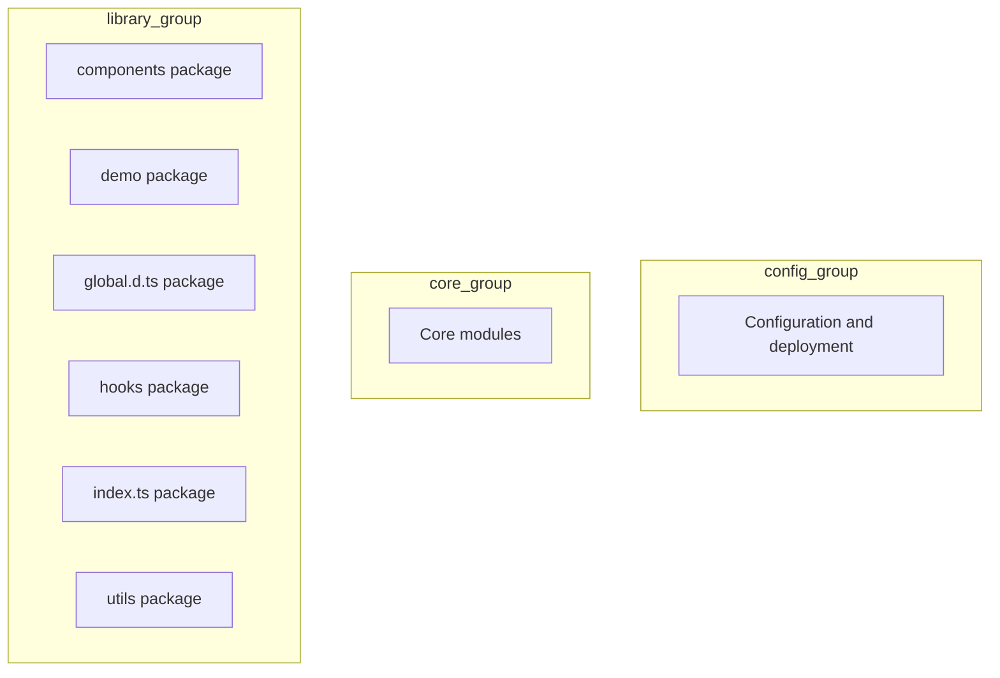

# Architecture report: alibaba/ChatUI

> Automated static analysis. **Observed** = directly seen in files/imports/AST; **Inferred** = interpretation from that evidence. Repository code was not executed.

## 1. Repository at a glance

| Item | Value |
| --- | --- |
| Repository | alibaba/ChatUI |
| Description | The UI design language and React library for Conversational UI |
| Language | TypeScript |
| Stars | 4464 |
| Licence | MIT |
| Analysed commit / branch | 06c3126ad25a0735c9b48f40582075371ad04cf3 / master |
| Framework(s) | React |
| Files analysed | 510 |
| Components | 8 |

## 2. Architecture in one minute

alibaba/ChatUI - The UI design language and React library for Conversational UI. This repository was analysed statically from 510 file(s) (0 Python). Detected technologies (observed from imports/manifests): React, React Router, Jest, TypeScript, Vite. Files are grouped into 8 component(s): components package, Configuration and deployment, Core modules, demo package, global.d.ts package, hooks package, index.ts package, utils package. Findings below distinguish observed facts from inferred interpretation.

## 3. High-level block diagram

## 4. Main components

### components package (`components`)

- **Kind:** library
- **Status:** Observed
- **Confidence:** 0.85
- **Responsibility:** Groups 207 file(s) under components package (observed from repository paths and static analysis).
- **Paths:** `src/components/Avatar/__tests__/index.test.tsx`, `src/components/Avatar/index.tsx`, `src/components/BackBottom/index.tsx`, `src/components/Backdrop/__tests__/index.test.tsx`, `src/components/Backdrop/index.tsx`, `src/components/Bubble/__tests__/index.test.tsx`, `src/components/Bubble/index.tsx`, `src/components/Button/__tests__/index.test.tsx`, `src/components/Button/index.tsx`, `src/components/Card/Card.tsx`, `src/components/Card/CardActions.tsx`, `src/components/Card/CardContent.tsx`, `src/components/Card/CardHeader.tsx`, `src/components/Card/CardMedia.tsx`, `src/components/Card/CardText.tsx`, `src/components/Card/CardTitle.tsx`, `src/components/Card/__tests__/actions.test.tsx`, `src/components/Card/__tests__/content.test.tsx`, `src/components/Card/__tests__/index.test.tsx`, `src/components/Card/__tests__/media.test.tsx`, `src/components/Card/__tests__/text.test.tsx`, `src/components/Card/__tests__/title.test.tsx`, `src/components/Card/index.ts`, `src/components/Carousel/Item.tsx`, `src/components/Carousel/index.tsx`, `src/components/Chat/index.tsx`, `src/components/Checkbox/Checkbox.tsx`, `src/components/Checkbox/CheckboxGroup.tsx`, `src/components/Checkbox/__tests__/group.test.tsx`, `src/components/Checkbox/__tests__/index.test.tsx`, `src/components/Checkbox/index.ts`, `src/components/ClickOutside/__tests__/index.test.tsx`, `src/components/ClickOutside/index.tsx`, `src/components/ComponentsProvider/ComponentsContext.ts`, `src/components/ComponentsProvider/index.tsx`, `src/components/ComponentsProvider/interface.ts`, `src/components/ComponentsProvider/useComponents.ts`, `src/components/Composer/AccessoryWrap.tsx`, `src/components/Composer/Action.tsx`, `src/components/Composer/ComposerInput.tsx`, `src/components/Composer/MarqueeBorder.tsx`, `src/components/Composer/SendButton.tsx`, `src/components/Composer/ToolbarItem.tsx`, `src/components/Composer/index.tsx`, `src/components/Composer/riseInput.ts`, `src/components/Composer/viewportTop.ts`, `src/components/ConfigProvider/__tests__/index.test.tsx`, `src/components/ConfigProvider/index.tsx`, `src/components/ConfigProvider/locales/ar_EG.ts`, `src/components/ConfigProvider/locales/en_US.ts`, `src/components/ConfigProvider/locales/fr_FR.ts`, `src/components/ConfigProvider/locales/index.ts`, `src/components/ConfigProvider/locales/zh_CN.ts`, `src/components/Countdown/index.tsx`, `src/components/Coupon/index.tsx`, `src/components/Divider/__tests__/index.test.tsx`, `src/components/Divider/index.tsx`, `src/components/Empty/__tests__/index.test.tsx`, `src/components/Empty/index.tsx`, `src/components/ErrorBoundary/index.tsx`, `src/components/FileCard/__tests__/index.test.tsx`, `src/components/FileCard/index.tsx`, `src/components/Filter/index.tsx`, `src/components/Flex/Flex.tsx`, `src/components/Flex/FlexItem.tsx`, `src/components/Flex/__tests__/index.test.tsx`, `src/components/Flex/__tests__/item.test.tsx`, `src/components/Flex/index.ts`, `src/components/Form/Form.tsx`, `src/components/Form/FormActions.tsx`, `src/components/Form/FormItem.tsx`, `src/components/Form/__tests__/actions.test.tsx`, `src/components/Form/__tests__/index.test.tsx`, `src/components/Form/__tests__/item.test.tsx`, `src/components/Form/index.ts`, `src/components/Goods/__tests__/index.test.tsx`, `src/components/Goods/index.tsx`, `src/components/HelpText/__tests__/index.test.tsx`, `src/components/HelpText/index.tsx`, `src/components/Icon/__tests__/index.test.tsx`, `src/components/Icon/index.tsx`, `src/components/IconButton/__tests__/index.test.tsx`, `src/components/IconButton/index.tsx`, `src/components/Image/__tests__/index.test.tsx`, `src/components/Image/index.tsx`, `src/components/ImageList/index.tsx`, `src/components/InfiniteScroll/index.tsx`, `src/components/Input/__tests__/index.test.tsx`, `src/components/Input/index.tsx`, `src/components/KvList/KvItem.tsx`, `src/components/KvList/KvList.tsx`, `src/components/KvList/index.ts`, `src/components/Label/__tests__/index.test.tsx`, `src/components/Label/index.tsx`, `src/components/LazyComponent/SuspenseWrap.tsx`, `src/components/LazyComponent/index.tsx`, `src/components/LazyComponent/interface.ts`, `src/components/List/List.tsx`, `src/components/List/ListItem.tsx`, `src/components/List/__tests__/index.test.tsx`, `src/components/List/index.ts`, `src/components/Loading/__tests__/index.test.tsx`, `src/components/Loading/index.tsx`, `src/components/MediaObject/__tests__/index.test.tsx`, `src/components/MediaObject/index.tsx`, `src/components/Message/Message.tsx`, `src/components/Message/SystemMessage.tsx`, `src/components/Message/__tests__/index.test.tsx`, `src/components/Message/index.ts`, `src/components/MessageContainer/__tests__/index.test.tsx`, `src/components/MessageContainer/index.tsx`, `src/components/MessageStatus/index.tsx`, `src/components/Modal/Base.tsx`, `src/components/Modal/Confirm.tsx`, `src/components/Modal/Modal.tsx`, `src/components/Modal/Popup.tsx`, `src/components/Modal/__tests__/base.test.tsx`, `src/components/Modal/__tests__/confirm.test.tsx`, `src/components/Modal/__tests__/modal.test.tsx`, `src/components/Modal/__tests__/popup.test.tsx`, `src/components/Modal/index.ts`, `src/components/MultiRedPacket/index.tsx`, `src/components/Navbar/__tests__/index.test.tsx`, `src/components/Navbar/index.tsx`, `src/components/Notice/__tests__/index.test.tsx`, `src/components/Notice/index.tsx`, `src/components/OrderObject/index.tsx`, `src/components/Popover/__tests__/index.test.tsx`, `src/components/Popover/index.tsx`, `src/components/Portal/index.ts`, `src/components/Price/__tests__/index.test.tsx`, `src/components/Price/index.tsx`, `src/components/Progress/__tests__/index.test.tsx`, `src/components/Progress/index.tsx`, `src/components/PullToRefresh/index.tsx`, `src/components/QuickReplies/QuickReplies.tsx`, `src/components/QuickReplies/QuickReply.tsx`, `src/components/QuickReplies/__tests__/index.test.tsx`, `src/components/QuickReplies/__tests__/item.test.tsx`, `src/components/QuickReplies/index.ts`, `src/components/Quote/index.tsx`, `src/components/Radio/Radio.tsx`, `src/components/Radio/RadioGroup.tsx`, `src/components/Radio/__tests__/group.test.tsx`, `src/components/Radio/__tests__/index.test.tsx`, `src/components/Radio/index.ts`, `src/components/RateActions/__tests__/index.test.tsx`, `src/components/RateActions/index.tsx`, `src/components/Recorder/index.tsx`, `src/components/RedPacket/index.tsx`, `src/components/Ribbon/index.tsx`, `src/components/RichText/__tests__/index.test.tsx`, `src/components/RichText/configDOMPurify.ts`, `src/components/RichText/index.tsx`, `src/components/ScrollGrid/index.tsx`, `src/components/ScrollView/Item.tsx`, `src/components/ScrollView/ScrollView.tsx`, `src/components/ScrollView/__tests__/index.test.tsx`, `src/components/ScrollView/index.ts`, `src/components/Search/index.tsx`, `src/components/Select/index.tsx`, `src/components/SendConfirm/SendConfirm.tsx`, `src/components/SendConfirm/index.ts`, `src/components/Skeleton/index.tsx`, `src/components/Stepper/Step.tsx`, `src/components/Stepper/Stepper.tsx`, `src/components/Stepper/__tests__/index.test.tsx`, `src/components/Stepper/__tests__/step.test.tsx`, `src/components/Stepper/index.ts`, `src/components/Tabs/Tab.tsx`, `src/components/Tabs/Tabs.tsx`, `src/components/Tabs/__tests__/index.test.tsx`, `src/components/Tabs/__tests__/tab.test.tsx`, `src/components/Tabs/index.ts`, `src/components/Tag/__tests__/index.test.tsx`, `src/components/Tag/index.tsx`, `src/components/Text/__tests__/index.test.tsx`, `src/components/Text/index.tsx`, `src/components/Think/index.tsx`, `src/components/Time/Time.tsx`, `src/components/Time/__tests__/index.test.tsx`, `src/components/Time/__tests__/parser.test.ts`, `src/components/Time/index.ts`, `src/components/Time/parser.ts`, `src/components/Tips/index.tsx`, `src/components/Toast/Toast.tsx`, `src/components/Toast/__tests__/index.test.ts`, `src/components/Toast/__tests__/toast.test.tsx`, `src/components/Toast/index.tsx`, `src/components/Toolbar/Toolbar.tsx`, `src/components/Toolbar/ToolbarButton.tsx`, `src/components/Toolbar/__tests__/button.test.tsx`, `src/components/Toolbar/__tests__/index.test.tsx`, `src/components/Toolbar/index.ts`, `src/components/Tree/Tree.tsx`, `src/components/Tree/TreeNode.tsx`, `src/components/Tree/index.ts`, `src/components/Typing/Typing.tsx`, `src/components/Typing/__tests__/index.test.tsx`, `src/components/Typing/index.ts`, `src/components/TypingBubble/index.tsx`, `src/components/Video/__tests__/index.test.tsx`, `src/components/Video/index.tsx`, `src/components/VisuallyHidden/__tests__/index.test.tsx`, `src/components/VisuallyHidden/index.tsx`, `src/components/VoiceInput/SoundWave.tsx`, `src/components/VoiceInput/index.tsx`
- **Evidence:** [src/components/Avatar/__tests__/index.test.tsx](https://github.com/alibaba/ChatUI/blob/06c3126ad25a0735c9b48f40582075371ad04cf3/src/components/Avatar/__tests__/index.test.tsx); [src/components/Avatar/index.tsx](https://github.com/alibaba/ChatUI/blob/06c3126ad25a0735c9b48f40582075371ad04cf3/src/components/Avatar/index.tsx); [src/components/BackBottom/index.tsx](https://github.com/alibaba/ChatUI/blob/06c3126ad25a0735c9b48f40582075371ad04cf3/src/components/BackBottom/index.tsx); [src/components/Backdrop/__tests__/index.test.tsx](https://github.com/alibaba/ChatUI/blob/06c3126ad25a0735c9b48f40582075371ad04cf3/src/components/Backdrop/__tests__/index.test.tsx); [src/components/Backdrop/index.tsx](https://github.com/alibaba/ChatUI/blob/06c3126ad25a0735c9b48f40582075371ad04cf3/src/components/Backdrop/index.tsx); [src/components/Bubble/__tests__/index.test.tsx](https://github.com/alibaba/ChatUI/blob/06c3126ad25a0735c9b48f40582075371ad04cf3/src/components/Bubble/__tests__/index.test.tsx); [src/components/Bubble/index.tsx](https://github.com/alibaba/ChatUI/blob/06c3126ad25a0735c9b48f40582075371ad04cf3/src/components/Bubble/index.tsx); [src/components/Button/__tests__/index.test.tsx](https://github.com/alibaba/ChatUI/blob/06c3126ad25a0735c9b48f40582075371ad04cf3/src/components/Button/__tests__/index.test.tsx)

### Configuration and deployment (`config`)

- **Kind:** config
- **Status:** Observed
- **Confidence:** 0.85
- **Responsibility:** Groups 8 file(s) under configuration and deployment (observed from repository paths and static analysis).
- **Paths:** `demo/package.json`, `demo/tsconfig.app.json`, `demo/tsconfig.json`, `demo/tsconfig.node.json`, `package.json`, `tsconfig.build.json`, `tsconfig.eslint.json`, `tsconfig.json`
- **Evidence:** [demo/package.json](https://github.com/alibaba/ChatUI/blob/06c3126ad25a0735c9b48f40582075371ad04cf3/demo/package.json); [demo/tsconfig.app.json](https://github.com/alibaba/ChatUI/blob/06c3126ad25a0735c9b48f40582075371ad04cf3/demo/tsconfig.app.json); [demo/tsconfig.json](https://github.com/alibaba/ChatUI/blob/06c3126ad25a0735c9b48f40582075371ad04cf3/demo/tsconfig.json); [demo/tsconfig.node.json](https://github.com/alibaba/ChatUI/blob/06c3126ad25a0735c9b48f40582075371ad04cf3/demo/tsconfig.node.json); [package.json](https://github.com/alibaba/ChatUI/blob/06c3126ad25a0735c9b48f40582075371ad04cf3/package.json); [tsconfig.build.json](https://github.com/alibaba/ChatUI/blob/06c3126ad25a0735c9b48f40582075371ad04cf3/tsconfig.build.json); [tsconfig.eslint.json](https://github.com/alibaba/ChatUI/blob/06c3126ad25a0735c9b48f40582075371ad04cf3/tsconfig.eslint.json); [tsconfig.json](https://github.com/alibaba/ChatUI/blob/06c3126ad25a0735c9b48f40582075371ad04cf3/tsconfig.json)

### Core modules (`core`)

- **Kind:** core
- **Status:** Observed
- **Confidence:** 0.85
- **Responsibility:** Groups 6 file(s) under core modules (observed from repository paths and static analysis).
- **Paths:** `babel.config.js`, `commitlint.config.js`, `jest.config.js`, `jest.setup.ts`, `postcss.config.js`, `rollup.config.js`
- **Evidence:** [babel.config.js](https://github.com/alibaba/ChatUI/blob/06c3126ad25a0735c9b48f40582075371ad04cf3/babel.config.js); [commitlint.config.js](https://github.com/alibaba/ChatUI/blob/06c3126ad25a0735c9b48f40582075371ad04cf3/commitlint.config.js); [jest.config.js](https://github.com/alibaba/ChatUI/blob/06c3126ad25a0735c9b48f40582075371ad04cf3/jest.config.js); [jest.setup.ts](https://github.com/alibaba/ChatUI/blob/06c3126ad25a0735c9b48f40582075371ad04cf3/jest.setup.ts); [postcss.config.js](https://github.com/alibaba/ChatUI/blob/06c3126ad25a0735c9b48f40582075371ad04cf3/postcss.config.js); [rollup.config.js](https://github.com/alibaba/ChatUI/blob/06c3126ad25a0735c9b48f40582075371ad04cf3/rollup.config.js)

### demo package (`demo`)

- **Kind:** library
- **Status:** Observed
- **Confidence:** 0.85
- **Responsibility:** Groups 78 file(s) under demo package (observed from repository paths and static analysis).
- **Paths:** `demo/src/components/DemoIndex.tsx`, `demo/src/components/DemoPage.tsx`, `demo/src/components/DemoSection.tsx`, `demo/src/components/LangSwitcher.tsx`, `demo/src/components/index.ts`, `demo/src/demo/Avatar.tsx`, `demo/src/demo/Bubble.tsx`, `demo/src/demo/Button.tsx`, `demo/src/demo/Card.tsx`, `demo/src/demo/Carousel.tsx`, `demo/src/demo/Chat.tsx`, `demo/src/demo/Checkbox.tsx`, `demo/src/demo/ComponentProvider.tsx`, `demo/src/demo/Confirm.tsx`, `demo/src/demo/Countdown.tsx`, `demo/src/demo/Coupon.tsx`, `demo/src/demo/Divider.tsx`, `demo/src/demo/Empty.tsx`, `demo/src/demo/ErrorBoundary.tsx`, `demo/src/demo/FileCard.tsx`, `demo/src/demo/Filter.tsx`, `demo/src/demo/Flex.tsx`, `demo/src/demo/Form.tsx`, `demo/src/demo/Goods.tsx`, `demo/src/demo/Icon.tsx`, `demo/src/demo/Image.tsx`, `demo/src/demo/InfiniteScroll.tsx`, `demo/src/demo/Input.tsx`, `demo/src/demo/KvList.tsx`, `demo/src/demo/List.tsx`, `demo/src/demo/Loading.tsx`, `demo/src/demo/MediaObject.tsx`, `demo/src/demo/MessageStatus.tsx`, `demo/src/demo/Modal.tsx`, `demo/src/demo/MultiRedPacket.tsx`, `demo/src/demo/Navbar.tsx`, `demo/src/demo/Notice.tsx`, `demo/src/demo/OrdderSelector.tsx`, `demo/src/demo/OrderObject.tsx`, `demo/src/demo/Popup.tsx`, `demo/src/demo/Portal.tsx`, `demo/src/demo/Price.tsx`, `demo/src/demo/Progress.tsx`, `demo/src/demo/PullToRefresh.tsx`, `demo/src/demo/Quote.tsx`, `demo/src/demo/Radio.tsx`, `demo/src/demo/RateActions.tsx`, `demo/src/demo/RedPacket.tsx`, `demo/src/demo/Ribbon.tsx`, `demo/src/demo/RichText.tsx`, `demo/src/demo/ScrollGrid.tsx`, `demo/src/demo/ScrollView.tsx`, `demo/src/demo/Search.tsx`, `demo/src/demo/Select.tsx`, `demo/src/demo/Skeleton.tsx`, `demo/src/demo/Stepper.tsx`, `demo/src/demo/SystemMessage.tsx`, `demo/src/demo/Tabs.tsx`, `demo/src/demo/Tag.tsx`, `demo/src/demo/Text.tsx`, `demo/src/demo/Think.tsx`, `demo/src/demo/Time.tsx`, `demo/src/demo/Tips.tsx`, `demo/src/demo/Toast.tsx`, `demo/src/demo/Typing.tsx`, `demo/src/demo/TypingBubble.tsx`, `demo/src/demo/Video.tsx`, `demo/src/demo/VisuallyHidden.tsx`, `demo/src/demo/index.ts`, `demo/src/main.tsx`, `demo/src/navConfig.ts`, `demo/src/routerConfig.tsx`, `demo/src/utils/applyUrlParams.ts`, `demo/src/utils/getUrlParam.ts`, `demo/src/utils/index.ts`, `demo/src/utils/toPascalCase.ts`, `demo/src/vite-env.d.ts`, `demo/vite.config.ts`
- **Evidence:** [demo/src/components/DemoIndex.tsx](https://github.com/alibaba/ChatUI/blob/06c3126ad25a0735c9b48f40582075371ad04cf3/demo/src/components/DemoIndex.tsx); [demo/src/components/DemoPage.tsx](https://github.com/alibaba/ChatUI/blob/06c3126ad25a0735c9b48f40582075371ad04cf3/demo/src/components/DemoPage.tsx); [demo/src/components/DemoSection.tsx](https://github.com/alibaba/ChatUI/blob/06c3126ad25a0735c9b48f40582075371ad04cf3/demo/src/components/DemoSection.tsx); [demo/src/components/LangSwitcher.tsx](https://github.com/alibaba/ChatUI/blob/06c3126ad25a0735c9b48f40582075371ad04cf3/demo/src/components/LangSwitcher.tsx); [demo/src/components/index.ts](https://github.com/alibaba/ChatUI/blob/06c3126ad25a0735c9b48f40582075371ad04cf3/demo/src/components/index.ts); [demo/src/demo/Avatar.tsx](https://github.com/alibaba/ChatUI/blob/06c3126ad25a0735c9b48f40582075371ad04cf3/demo/src/demo/Avatar.tsx); [demo/src/demo/Bubble.tsx](https://github.com/alibaba/ChatUI/blob/06c3126ad25a0735c9b48f40582075371ad04cf3/demo/src/demo/Bubble.tsx); [demo/src/demo/Button.tsx](https://github.com/alibaba/ChatUI/blob/06c3126ad25a0735c9b48f40582075371ad04cf3/demo/src/demo/Button.tsx)

### global.d.ts package (`global_d_ts`)

- **Kind:** library
- **Status:** Observed
- **Confidence:** 0.85
- **Responsibility:** Groups 1 file(s) under global.d.ts package (observed from repository paths and static analysis).
- **Paths:** `src/global.d.ts`
- **Evidence:** [src/global.d.ts](https://github.com/alibaba/ChatUI/blob/06c3126ad25a0735c9b48f40582075371ad04cf3/src/global.d.ts)

### hooks package (`hooks`)

- **Kind:** library
- **Status:** Observed
- **Confidence:** 0.85
- **Responsibility:** Groups 16 file(s) under hooks package (observed from repository paths and static analysis).
- **Paths:** `src/hooks/__test__/useMessages.test.tsx`, `src/hooks/__test__/useNextId.test.tsx`, `src/hooks/__test__/useQuickReplies.test.tsx`, `src/hooks/useClickOutside.ts`, `src/hooks/useColorScheme.ts`, `src/hooks/useCountdown.ts`, `src/hooks/useForwardRef.ts`, `src/hooks/useIsomorphicLayoutEffect.ts`, `src/hooks/useLatest.ts`, `src/hooks/useMessages.ts`, `src/hooks/useMount.ts`, `src/hooks/useNextId.ts`, `src/hooks/useQuickReplies.ts`, `src/hooks/useTitleTyping.ts`, `src/hooks/useTypewriter.ts`, `src/hooks/useWindowResize.ts`
- **Evidence:** [src/hooks/__test__/useMessages.test.tsx](https://github.com/alibaba/ChatUI/blob/06c3126ad25a0735c9b48f40582075371ad04cf3/src/hooks/__test__/useMessages.test.tsx); [src/hooks/__test__/useNextId.test.tsx](https://github.com/alibaba/ChatUI/blob/06c3126ad25a0735c9b48f40582075371ad04cf3/src/hooks/__test__/useNextId.test.tsx); [src/hooks/__test__/useQuickReplies.test.tsx](https://github.com/alibaba/ChatUI/blob/06c3126ad25a0735c9b48f40582075371ad04cf3/src/hooks/__test__/useQuickReplies.test.tsx); [src/hooks/useClickOutside.ts](https://github.com/alibaba/ChatUI/blob/06c3126ad25a0735c9b48f40582075371ad04cf3/src/hooks/useClickOutside.ts); [src/hooks/useColorScheme.ts](https://github.com/alibaba/ChatUI/blob/06c3126ad25a0735c9b48f40582075371ad04cf3/src/hooks/useColorScheme.ts); [src/hooks/useCountdown.ts](https://github.com/alibaba/ChatUI/blob/06c3126ad25a0735c9b48f40582075371ad04cf3/src/hooks/useCountdown.ts); [src/hooks/useForwardRef.ts](https://github.com/alibaba/ChatUI/blob/06c3126ad25a0735c9b48f40582075371ad04cf3/src/hooks/useForwardRef.ts); [src/hooks/useIsomorphicLayoutEffect.ts](https://github.com/alibaba/ChatUI/blob/06c3126ad25a0735c9b48f40582075371ad04cf3/src/hooks/useIsomorphicLayoutEffect.ts)

### index.ts package (`index_ts`)

- **Kind:** library
- **Status:** Observed
- **Confidence:** 0.85
- **Responsibility:** Groups 1 file(s) under index.ts package (observed from repository paths and static analysis).
- **Paths:** `src/index.ts`
- **Evidence:** [src/index.ts](https://github.com/alibaba/ChatUI/blob/06c3126ad25a0735c9b48f40582075371ad04cf3/src/index.ts)

### utils package (`utils`)

- **Kind:** library
- **Status:** Observed
- **Confidence:** 0.85
- **Responsibility:** Groups 24 file(s) under utils package (observed from repository paths and static analysis).
- **Paths:** `src/utils/__tests__/getExtName.test.ts`, `src/utils/__tests__/index.test.tsx`, `src/utils/__tests__/prettyBytes.test.ts`, `src/utils/__tests__/style.test.tsx`, `src/utils/__tests__/toggleClass.test.tsx`, `src/utils/canUse.ts`, `src/utils/countLines.ts`, `src/utils/date.ts`, `src/utils/formatTime.ts`, `src/utils/getExtName.ts`, `src/utils/getFps.ts`, `src/utils/getRandomInt.ts`, `src/utils/getToBottom.ts`, `src/utils/importScript.ts`, `src/utils/index.ts`, `src/utils/lazyComponent.tsx`, `src/utils/mountComponent.ts`, `src/utils/parseDataTransfer.ts`, `src/utils/prettyBytes.ts`, `src/utils/smoothScroll.ts`, `src/utils/style.ts`, `src/utils/throttle.ts`, `src/utils/toggleClass.ts`, `src/utils/ua.ts`
- **Evidence:** [src/utils/__tests__/getExtName.test.ts](https://github.com/alibaba/ChatUI/blob/06c3126ad25a0735c9b48f40582075371ad04cf3/src/utils/__tests__/getExtName.test.ts); [src/utils/__tests__/index.test.tsx](https://github.com/alibaba/ChatUI/blob/06c3126ad25a0735c9b48f40582075371ad04cf3/src/utils/__tests__/index.test.tsx); [src/utils/__tests__/prettyBytes.test.ts](https://github.com/alibaba/ChatUI/blob/06c3126ad25a0735c9b48f40582075371ad04cf3/src/utils/__tests__/prettyBytes.test.ts); [src/utils/__tests__/style.test.tsx](https://github.com/alibaba/ChatUI/blob/06c3126ad25a0735c9b48f40582075371ad04cf3/src/utils/__tests__/style.test.tsx); [src/utils/__tests__/toggleClass.test.tsx](https://github.com/alibaba/ChatUI/blob/06c3126ad25a0735c9b48f40582075371ad04cf3/src/utils/__tests__/toggleClass.test.tsx); [src/utils/canUse.ts](https://github.com/alibaba/ChatUI/blob/06c3126ad25a0735c9b48f40582075371ad04cf3/src/utils/canUse.ts); [src/utils/countLines.ts](https://github.com/alibaba/ChatUI/blob/06c3126ad25a0735c9b48f40582075371ad04cf3/src/utils/countLines.ts); [src/utils/date.ts](https://github.com/alibaba/ChatUI/blob/06c3126ad25a0735c9b48f40582075371ad04cf3/src/utils/date.ts)

## 5. Execution flow

**Observed** entry point(s):

- [demo/src/components/index.ts](https://github.com/alibaba/ChatUI/blob/06c3126ad25a0735c9b48f40582075371ad04cf3/demo/src/components/index.ts)
- [demo/src/demo/index.ts](https://github.com/alibaba/ChatUI/blob/06c3126ad25a0735c9b48f40582075371ad04cf3/demo/src/demo/index.ts)
- [demo/src/main.tsx](https://github.com/alibaba/ChatUI/blob/06c3126ad25a0735c9b48f40582075371ad04cf3/demo/src/main.tsx)
- [demo/src/utils/index.ts](https://github.com/alibaba/ChatUI/blob/06c3126ad25a0735c9b48f40582075371ad04cf3/demo/src/utils/index.ts)
- [src/components/Avatar/index.tsx](https://github.com/alibaba/ChatUI/blob/06c3126ad25a0735c9b48f40582075371ad04cf3/src/components/Avatar/index.tsx)
- [src/components/BackBottom/index.tsx](https://github.com/alibaba/ChatUI/blob/06c3126ad25a0735c9b48f40582075371ad04cf3/src/components/BackBottom/index.tsx)
- [src/components/Backdrop/index.tsx](https://github.com/alibaba/ChatUI/blob/06c3126ad25a0735c9b48f40582075371ad04cf3/src/components/Backdrop/index.tsx)
- [src/components/Bubble/index.tsx](https://github.com/alibaba/ChatUI/blob/06c3126ad25a0735c9b48f40582075371ad04cf3/src/components/Bubble/index.tsx)
- [src/components/Button/index.tsx](https://github.com/alibaba/ChatUI/blob/06c3126ad25a0735c9b48f40582075371ad04cf3/src/components/Button/index.tsx)
- [src/components/Card/index.ts](https://github.com/alibaba/ChatUI/blob/06c3126ad25a0735c9b48f40582075371ad04cf3/src/components/Card/index.ts)
- [src/components/Carousel/index.tsx](https://github.com/alibaba/ChatUI/blob/06c3126ad25a0735c9b48f40582075371ad04cf3/src/components/Carousel/index.tsx)
- [src/components/Chat/index.tsx](https://github.com/alibaba/ChatUI/blob/06c3126ad25a0735c9b48f40582075371ad04cf3/src/components/Chat/index.tsx)

Representative flow (derived from observed entry points and the import graph; steps beyond the entry point are **Inferred**):

1. Execution starts at an observed entry point listed above, if present.
2. No internal import relationships between components were observed.

## 6. Project structure

### `(root)`

- `.eslintignore` - other (26 bytes)
- `.eslintrc.js` - source, JavaScript (864 bytes)
- `.gitignore` - other (176 bytes)
- `.prettierrc` - other (118 bytes)
- `CHANGELOG.md` - docs (36056 bytes)
- `LICENSE` - docs (1064 bytes)
- `README.md` - docs (4536 bytes)
- `README.zh-CN.md` - docs (4635 bytes)
- `babel.config.js` - source, JavaScript (1126 bytes)
- `commitlint.config.js` - source, JavaScript (70 bytes)
- `jest.config.js` - source, JavaScript (199 bytes)
- `jest.setup.ts` - source, TypeScript (152 bytes)
- `package.json` - manifest (3543 bytes)
- `postcss.config.js` - source, JavaScript (581 bytes)
- `rollup.config.js` - source, JavaScript (829 bytes)
- `tsconfig.build.json` - config (348 bytes)
- `tsconfig.eslint.json` - config (61 bytes)
- `tsconfig.json` - config (933 bytes)

### `.github`

- `.github/ISSUE_TEMPLATE/bug-report.md` - docs (427 bytes)
- `.github/ISSUE_TEMPLATE/feature-request-------.md` - docs (356 bytes)

### `.husky`

- `.husky/.gitignore` - other (2 bytes)
- `.husky/commit-msg` - other (82 bytes)

### `demo`

- `demo/.gitignore` - other (253 bytes)
- `demo/index.html` - other (454 bytes)
- `demo/package.json` - manifest (556 bytes)
- `demo/src/components/DemoIndex.tsx` - source, TypeScript (1169 bytes)
- `demo/src/components/DemoPage.tsx` - source, TypeScript (967 bytes)
- `demo/src/components/DemoSection.tsx` - source, TypeScript (340 bytes)
- `demo/src/components/LangSwitcher.tsx` - source, TypeScript (475 bytes)
- `demo/src/components/index.ts` - source, TypeScript (131 bytes)
- `demo/src/demo/Avatar.tsx` - source, TypeScript (614 bytes)
- `demo/src/demo/Bubble.tsx` - source, TypeScript (1182 bytes)
- `demo/src/demo/Button.tsx` - source, TypeScript (1968 bytes)
- `demo/src/demo/Card.tsx` - source, TypeScript (8746 bytes)
- `demo/src/demo/Carousel.tsx` - source, TypeScript (742 bytes)
- `demo/src/demo/Chat.tsx` - source, TypeScript (11536 bytes)
- `demo/src/demo/Checkbox.tsx` - source, TypeScript (3446 bytes)
- `demo/src/demo/ComponentProvider.tsx` - source, TypeScript (8300 bytes)
- `demo/src/demo/Confirm.tsx` - source, TypeScript (984 bytes)
- `demo/src/demo/Countdown.tsx` - source, TypeScript (448 bytes)
- `demo/src/demo/Coupon.tsx` - source, TypeScript (4073 bytes)
- `demo/src/demo/Divider.tsx` - source, TypeScript (535 bytes)
- `demo/src/demo/Empty.tsx` - source, TypeScript (1374 bytes)
- `demo/src/demo/ErrorBoundary.tsx` - source, TypeScript (1307 bytes)
- `demo/src/demo/FileCard.tsx` - source, TypeScript (598 bytes)
- `demo/src/demo/Filter.tsx` - source, TypeScript (2871 bytes)
- `demo/src/demo/Flex.tsx` - source, TypeScript (3602 bytes)
- `demo/src/demo/Form.tsx` - source, TypeScript (2500 bytes)
- `demo/src/demo/Goods.tsx` - source, TypeScript (8373 bytes)
- `demo/src/demo/Icon.tsx` - source, TypeScript (892 bytes)
- `demo/src/demo/Image.tsx` - source, TypeScript (1154 bytes)
- `demo/src/demo/InfiniteScroll.tsx` - source, TypeScript (978 bytes)
- `demo/src/demo/Input.tsx` - source, TypeScript (1806 bytes)
- `demo/src/demo/KvList.tsx` - source, TypeScript (2439 bytes)
- `demo/src/demo/List.tsx` - source, TypeScript (2142 bytes)
- `demo/src/demo/Loading.tsx` - source, TypeScript (347 bytes)
- `demo/src/demo/MediaObject.tsx` - source, TypeScript (515 bytes)
- `demo/src/demo/MessageStatus.tsx` - source, TypeScript (751 bytes)
- `demo/src/demo/Modal.tsx` - source, TypeScript (3482 bytes)
- `demo/src/demo/MultiRedPacket.tsx` - source, TypeScript (877 bytes)
- `demo/src/demo/Navbar.tsx` - source, TypeScript (1849 bytes)
- `demo/src/demo/Notice.tsx` - source, TypeScript (1239 bytes)
- `demo/src/demo/OrdderSelector.tsx` - source, TypeScript (2920 bytes)
- `demo/src/demo/OrderObject.tsx` - source, TypeScript (1916 bytes)
- `demo/src/demo/Popup.tsx` - source, TypeScript (4732 bytes)
- `demo/src/demo/Portal.tsx` - source, TypeScript (781 bytes)
- `demo/src/demo/Price.tsx` - source, TypeScript (3340 bytes)
- `demo/src/demo/Progress.tsx` - source, TypeScript (936 bytes)
- `demo/src/demo/PullToRefresh.tsx` - source, TypeScript (449 bytes)
- `demo/src/demo/Quote.tsx` - source, TypeScript (1265 bytes)
- `demo/src/demo/Radio.tsx` - source, TypeScript (3236 bytes)
- `demo/src/demo/RateActions.tsx` - source, TypeScript (916 bytes)
- `demo/src/demo/RedPacket.tsx` - source, TypeScript (9000 bytes)
- `demo/src/demo/Ribbon.tsx` - source, TypeScript (1985 bytes)
- `demo/src/demo/RichText.tsx` - source, TypeScript (380 bytes)
- `demo/src/demo/ScrollGrid.tsx` - source, TypeScript (1130 bytes)
- `demo/src/demo/ScrollView.tsx` - source, TypeScript (943 bytes)
- `demo/src/demo/Search.tsx` - source, TypeScript (567 bytes)
- `demo/src/demo/Select.tsx` - source, TypeScript (1846 bytes)
- `demo/src/demo/Skeleton.tsx` - source, TypeScript (677 bytes)
- `demo/src/demo/Stepper.tsx` - source, TypeScript (3526 bytes)
- `demo/src/demo/SystemMessage.tsx` - source, TypeScript (578 bytes)
- `demo/src/demo/Tabs.tsx` - source, TypeScript (1927 bytes)
- `demo/src/demo/Tag.tsx` - source, TypeScript (443 bytes)
- `demo/src/demo/Text.tsx` - source, TypeScript (894 bytes)
- `demo/src/demo/Think.tsx` - source, TypeScript (796 bytes)
- `demo/src/demo/Time.tsx` - source, TypeScript (1096 bytes)
- `demo/src/demo/Tips.tsx` - source, TypeScript (1089 bytes)
- `demo/src/demo/Toast.tsx` - source, TypeScript (1468 bytes)
- `demo/src/demo/Typing.tsx` - source, TypeScript (475 bytes)
- `demo/src/demo/TypingBubble.tsx` - source, TypeScript (4744 bytes)
- `demo/src/demo/Video.tsx` - source, TypeScript (510 bytes)
- `demo/src/demo/VisuallyHidden.tsx` - source, TypeScript (597 bytes)
- `demo/src/demo/index.ts` - source, TypeScript (3010 bytes)
- `demo/src/index.less` - other (3738 bytes)
- `demo/src/main.tsx` - source, TypeScript (609 bytes)
- `demo/src/navConfig.ts` - source, TypeScript (3317 bytes)
- `demo/src/routerConfig.tsx` - source, TypeScript (527 bytes)
- `demo/src/utils/applyUrlParams.ts` - source, TypeScript (456 bytes)
- `demo/src/utils/getUrlParam.ts` - source, TypeScript (263 bytes)
- `demo/src/utils/index.ts` - source, TypeScript (176 bytes)
- `demo/src/utils/toPascalCase.ts` - source, TypeScript (161 bytes)
- `demo/src/vite-env.d.ts` - source, TypeScript (38 bytes)
- `demo/tsconfig.app.json` - config (665 bytes)
- `demo/tsconfig.json` - config (119 bytes)
- `demo/tsconfig.node.json` - config (593 bytes)
- `demo/vite.config.ts` - source, TypeScript (741 bytes)

### `src`

- `src/components/Avatar/README.md` - docs (2009 bytes)
- `src/components/Avatar/__tests__/index.test.tsx` - source, TypeScript (1291 bytes)
- `src/components/Avatar/index.tsx` - source, TypeScript (705 bytes)
- `src/components/Avatar/style.less` - other (358 bytes)
- `src/components/BackBottom/README.md` - docs (924 bytes)
- `src/components/BackBottom/index.tsx` - source, TypeScript (807 bytes)
- `src/components/BackBottom/style.less` - other (290 bytes)
- `src/components/Backdrop/README.md` - docs (996 bytes)
- `src/components/Backdrop/__tests__/index.test.tsx` - source, TypeScript (418 bytes)
- `src/components/Backdrop/index.tsx` - source, TypeScript (426 bytes)
- `src/components/Backdrop/style.less` - other (246 bytes)
- `src/components/Bubble/README.md` - docs (1265 bytes)
- `src/components/Bubble/__tests__/index.test.tsx` - source, TypeScript (1227 bytes)
- `src/components/Bubble/index.tsx` - source, TypeScript (455 bytes)
- `src/components/Bubble/style.less` - other (988 bytes)
- `src/components/Button/README.md` - docs (2149 bytes)
- `src/components/Button/__tests__/index.test.tsx` - source, TypeScript (2359 bytes)
- `src/components/Button/index.tsx` - source, TypeScript (1590 bytes)
- `src/components/Button/style.less` - other (2386 bytes)
- `src/components/Card/Card.tsx` - source, TypeScript (649 bytes)
- `src/components/Card/CardActions.tsx` - source, TypeScript (464 bytes)
- `src/components/Card/CardContent.tsx` - source, TypeScript (362 bytes)
- `src/components/Card/CardHeader.tsx` - source, TypeScript (1543 bytes)
- `src/components/Card/CardMedia.tsx` - source, TypeScript (959 bytes)
- `src/components/Card/CardText.tsx` - source, TypeScript (401 bytes)
- `src/components/Card/CardTitle.tsx` - source, TypeScript (764 bytes)
- `src/components/Card/README.md` - docs (3070 bytes)
- `src/components/Card/__tests__/actions.test.tsx` - source, TypeScript (715 bytes)
- `src/components/Card/__tests__/content.test.tsx` - source, TypeScript (453 bytes)
- `src/components/Card/__tests__/index.test.tsx` - source, TypeScript (848 bytes)
- `src/components/Card/__tests__/media.test.tsx` - source, TypeScript (1214 bytes)
- `src/components/Card/__tests__/text.test.tsx` - source, TypeScript (614 bytes)
- `src/components/Card/__tests__/title.test.tsx` - source, TypeScript (1338 bytes)
- `src/components/Card/index.ts` - source, TypeScript (650 bytes)
- `src/components/Card/style.less` - other (4311 bytes)
- `src/components/Carousel/Item.tsx` - source, TypeScript (307 bytes)
- `src/components/Carousel/README.md` - docs (1928 bytes)
- `src/components/Carousel/index.tsx` - source, TypeScript (11325 bytes)
- `src/components/Carousel/style.less` - other (1030 bytes)
- `src/components/Chat/README.md` - docs (1742 bytes)
- `src/components/Chat/index.tsx` - source, TypeScript (6830 bytes)
- `src/components/Chat/style.less` - other (1048 bytes)
- `src/components/Checkbox/Checkbox.tsx` - source, TypeScript (838 bytes)
- `src/components/Checkbox/CheckboxGroup.tsx` - source, TypeScript (1527 bytes)
- `src/components/Checkbox/README.md` - docs (6456 bytes)
- `src/components/Checkbox/__tests__/group.test.tsx` - source, TypeScript (2830 bytes)
- `src/components/Checkbox/__tests__/index.test.tsx` - source, TypeScript (2383 bytes)
- `src/components/Checkbox/index.ts` - source, TypeScript (211 bytes)
- `src/components/ClickOutside/README.md` - docs (898 bytes)
- `src/components/ClickOutside/__tests__/index.test.tsx` - source, TypeScript (1244 bytes)
- `src/components/ClickOutside/index.tsx` - source, TypeScript (1013 bytes)
- `src/components/ComponentsProvider/ComponentsContext.ts` - source, TypeScript (256 bytes)
- `src/components/ComponentsProvider/index.tsx` - source, TypeScript (2334 bytes)
- `src/components/ComponentsProvider/interface.ts` - source, TypeScript (1248 bytes)
- `src/components/ComponentsProvider/useComponents.ts` - source, TypeScript (167 bytes)
- `src/components/Composer/AccessoryWrap.tsx` - source, TypeScript (324 bytes)
- `src/components/Composer/Action.tsx` - source, TypeScript (260 bytes)
- `src/components/Composer/ComposerInput.tsx` - source, TypeScript (1801 bytes)
- `src/components/Composer/MarqueeBorder.tsx` - source, TypeScript (2026 bytes)
- `src/components/Composer/README.md` - docs (3115 bytes)
- `src/components/Composer/SendButton.tsx` - source, TypeScript (962 bytes)
- `src/components/Composer/ToolbarItem.tsx` - source, TypeScript (533 bytes)
- `src/components/Composer/index.tsx` - source, TypeScript (13504 bytes)
- `src/components/Composer/riseInput.ts` - source, TypeScript (1404 bytes)
- `src/components/Composer/style.less` - other (6718 bytes)
- `src/components/Composer/viewportTop.ts` - source, TypeScript (609 bytes)
- `src/components/ConfigProvider/README.md` - docs (1413 bytes)
- `src/components/ConfigProvider/__tests__/index.test.tsx` - source, TypeScript (2687 bytes)
- `src/components/ConfigProvider/index.tsx` - source, TypeScript (1425 bytes)
- `src/components/ConfigProvider/locales/ar_EG.ts` - source, TypeScript (1192 bytes)
- `src/components/ConfigProvider/locales/en_US.ts` - source, TypeScript (939 bytes)
- `src/components/ConfigProvider/locales/fr_FR.ts` - source, TypeScript (1050 bytes)
- `src/components/ConfigProvider/locales/index.ts` - source, TypeScript (285 bytes)
- `src/components/ConfigProvider/locales/zh_CN.ts` - source, TypeScript (1027 bytes)
- `src/components/Countdown/README.md` - docs (936 bytes)
- `src/components/Countdown/index.tsx` - source, TypeScript (734 bytes)
- `src/components/Countdown/style.less` - other (297 bytes)
- `src/components/Coupon/README.md` - docs (1769 bytes)
- `src/components/Coupon/index.tsx` - source, TypeScript (3408 bytes)
- `src/components/Coupon/style.less` - other (3250 bytes)
- `src/components/Divider/README.md` - docs (1279 bytes)
- `src/components/Divider/__tests__/index.test.tsx` - source, TypeScript (755 bytes)
- `src/components/Divider/index.tsx` - source, TypeScript (513 bytes)
- `src/components/Divider/style.less` - other (637 bytes)
- `src/components/Empty/README.md` - docs (2448 bytes)
- `src/components/Empty/__tests__/index.test.tsx` - source, TypeScript (6652 bytes)
- `src/components/Empty/index.tsx` - source, TypeScript (1880 bytes)
- `src/components/Empty/style.less` - other (354 bytes)
- `src/components/ErrorBoundary/README.md` - docs (1152 bytes)
- `src/components/ErrorBoundary/index.tsx` - source, TypeScript (1212 bytes)
- `src/components/FileCard/README.md` - docs (790 bytes)
- `src/components/FileCard/__tests__/index.test.tsx` - source, TypeScript (977 bytes)
- `src/components/FileCard/index.tsx` - source, TypeScript (1233 bytes)
- `src/components/FileCard/style.less` - other (993 bytes)
- `src/components/Filter/README.md` - docs (2322 bytes)
- `src/components/Filter/index.tsx` - source, TypeScript (6596 bytes)
- `src/components/Filter/style.less` - other (1919 bytes)
- `src/components/Flex/Flex.tsx` - source, TypeScript (1836 bytes)
- `src/components/Flex/FlexItem.tsx` - source, TypeScript (623 bytes)
- `src/components/Flex/README.md` - docs (3160 bytes)
- `src/components/Flex/__tests__/index.test.tsx` - source, TypeScript (1730 bytes)
- `src/components/Flex/__tests__/item.test.tsx` - source, TypeScript (1362 bytes)
- `src/components/Flex/index.ts` - source, TypeScript (160 bytes)
- `src/components/Flex/style.less` - other (865 bytes)
- `src/components/Form/Form.tsx` - source, TypeScript (587 bytes)
- `src/components/Form/FormActions.tsx` - source, TypeScript (243 bytes)
- `src/components/Form/FormItem.tsx` - source, TypeScript (652 bytes)
- `src/components/Form/README.md` - docs (1554 bytes)
- `src/components/Form/__tests__/actions.test.tsx` - source, TypeScript (722 bytes)
- `src/components/Form/__tests__/index.test.tsx` - source, TypeScript (564 bytes)
- `src/components/Form/__tests__/item.test.tsx` - source, TypeScript (1402 bytes)
- `src/components/Form/index.ts` - source, TypeScript (219 bytes)
- `src/components/Form/style.less` - other (990 bytes)
- `src/components/Goods/README.md` - docs (2270 bytes)
- `src/components/Goods/__tests__/index.test.tsx` - source, TypeScript (3344 bytes)
- `src/components/Goods/index.tsx` - source, TypeScript (4809 bytes)
- `src/components/Goods/style.less` - other (2760 bytes)
- `src/components/HelpText/README.md` - docs (469 bytes)
- `src/components/HelpText/__tests__/index.test.tsx` - source, TypeScript (493 bytes)
- `src/components/HelpText/index.tsx` - source, TypeScript (216 bytes)
- `src/components/HelpText/style.less` - other (78 bytes)
- `src/components/Icon/README.md` - docs (1450 bytes)
- `src/components/Icon/__tests__/index.test.tsx` - source, TypeScript (1345 bytes)
- `src/components/Icon/index.tsx` - source, TypeScript (574 bytes)
- `src/components/Icon/style.less` - other (320 bytes)
- `src/components/IconButton/README.md` - docs (1864 bytes)
- `src/components/IconButton/__tests__/index.test.tsx` - source, TypeScript (671 bytes)
- `src/components/IconButton/index.tsx` - source, TypeScript (533 bytes)
- `src/components/IconButton/style.less` - other (468 bytes)
- `src/components/Image/README.md` - docs (1605 bytes)
- `src/components/Image/__tests__/index.test.tsx` - source, TypeScript (1388 bytes)
- `src/components/Image/index.tsx` - source, TypeScript (1357 bytes)
- `src/components/Image/style.less` - other (154 bytes)
- `src/components/ImageList/README.md` - docs (830 bytes)
- `src/components/ImageList/index.tsx` - source, TypeScript (1084 bytes)
- `src/components/ImageList/style.less` - other (736 bytes)
- `src/components/InfiniteScroll/README.md` - docs (953 bytes)
- `src/components/InfiniteScroll/index.tsx` - source, TypeScript (1174 bytes)
- `src/components/InfiniteScroll/style.less` - other (79 bytes)
- `src/components/Input/README.md` - docs (2664 bytes)
- `src/components/Input/__tests__/index.test.tsx` - source, TypeScript (4018 bytes)
- `src/components/Input/index.tsx` - source, TypeScript (3832 bytes)
- `src/components/Input/style.less` - other (1497 bytes)
- `src/components/KvList/KvItem.tsx` - source, TypeScript (1471 bytes)
- `src/components/KvList/KvList.tsx` - source, TypeScript (396 bytes)
- `src/components/KvList/README.md` - docs (1658 bytes)
- `src/components/KvList/index.ts` - source, TypeScript (161 bytes)
- `src/components/KvList/style.less` - other (1942 bytes)
- `src/components/Label/README.md` - docs (446 bytes)
- `src/components/Label/__tests__/index.test.tsx` - source, TypeScript (385 bytes)
- `src/components/Label/index.tsx` - source, TypeScript (274 bytes)
- `src/components/Label/style.less` - other (93 bytes)
- `src/components/LazyComponent/README.md` - docs (1686 bytes)
- `src/components/LazyComponent/SuspenseWrap.tsx` - source, TypeScript (477 bytes)
- `src/components/LazyComponent/index.tsx` - source, TypeScript (1176 bytes)
- `src/components/LazyComponent/interface.ts` - source, TypeScript (641 bytes)
- `src/components/List/List.tsx` - source, TypeScript (530 bytes)
- `src/components/List/ListItem.tsx` - source, TypeScript (1074 bytes)
- `src/components/List/README.md` - docs (2947 bytes)
- `src/components/List/__tests__/index.test.tsx` - source, TypeScript (1009 bytes)
- `src/components/List/index.ts` - source, TypeScript (160 bytes)
- `src/components/List/style.less` - other (1346 bytes)
- `src/components/Loading/README.md` - docs (1030 bytes)
- `src/components/Loading/__tests__/index.test.tsx` - source, TypeScript (398 bytes)
- `src/components/Loading/index.tsx` - source, TypeScript (429 bytes)
- `src/components/Loading/style.less` - other (181 bytes)
- `src/components/MediaObject/README.md` - docs (1039 bytes)
- `src/components/MediaObject/__tests__/index.test.tsx` - source, TypeScript (1286 bytes)
- `src/components/MediaObject/index.tsx` - source, TypeScript (816 bytes)
- `src/components/MediaObject/style.less` - other (380 bytes)
- `src/components/Message/Message.tsx` - source, TypeScript (2087 bytes)
- `src/components/Message/README.md` - docs (2899 bytes)
- `src/components/Message/SystemMessage.tsx` - source, TypeScript (1077 bytes)
- `src/components/Message/__tests__/index.test.tsx` - source, TypeScript (1889 bytes)
- `src/components/Message/index.ts` - source, TypeScript (214 bytes)
- `src/components/Message/style.less` - other (1957 bytes)
- `src/components/MessageContainer/README.md` - docs (1654 bytes)
- `src/components/MessageContainer/__tests__/index.test.tsx` - source, TypeScript (1889 bytes)
- `src/components/MessageContainer/index.tsx` - source, TypeScript (6407 bytes)
- `src/components/MessageContainer/style.less` - other (268 bytes)
- `src/components/MessageStatus/README.md` - docs (1397 bytes)
- `src/components/MessageStatus/index.tsx` - source, TypeScript (2317 bytes)
- `src/components/MessageStatus/style.less` - other (728 bytes)
- `src/components/Modal/Base.tsx` - source, TypeScript (5219 bytes)
- `src/components/Modal/Confirm.tsx` - source, TypeScript (1024 bytes)
- `src/components/Modal/Modal.tsx` - source, TypeScript (179 bytes)
- `src/components/Modal/Popup.tsx` - source, TypeScript (169 bytes)
- `src/components/Modal/README.md` - docs (3332 bytes)
- `src/components/Modal/__tests__/base.test.tsx` - source, TypeScript (4292 bytes)
- `src/components/Modal/__tests__/confirm.test.tsx` - source, TypeScript (608 bytes)
- `src/components/Modal/__tests__/modal.test.tsx` - source, TypeScript (332 bytes)
- `src/components/Modal/__tests__/popup.test.tsx` - source, TypeScript (410 bytes)
- `src/components/Modal/index.ts` - source, TypeScript (157 bytes)
- `src/components/Modal/style.less` - other (5815 bytes)
- `src/components/MultiRedPacket/README.md` - docs (1186 bytes)
- `src/components/MultiRedPacket/index.tsx` - source, TypeScript (1485 bytes)
- `src/components/MultiRedPacket/style.less` - other (1389 bytes)
- `src/components/Navbar/README.md` - docs (2513 bytes)
- `src/components/Navbar/__tests__/index.test.tsx` - source, TypeScript (929 bytes)
- `src/components/Navbar/index.tsx` - source, TypeScript (1439 bytes)
- `src/components/Navbar/style.less` - other (1264 bytes)
- `src/components/Notice/README.md` - docs (1466 bytes)
- `src/components/Notice/__tests__/index.test.tsx` - source, TypeScript (1886 bytes)
- `src/components/Notice/index.tsx` - source, TypeScript (965 bytes)
- `src/components/Notice/style.less` - other (466 bytes)
- `src/components/OrderObject/README.md` - docs (1323 bytes)
- `src/components/OrderObject/index.tsx` - source, TypeScript (1205 bytes)
- `src/components/OrderObject/style.less` - other (423 bytes)
- `src/components/Popover/README.md` - docs (2531 bytes)
- `src/components/Popover/__tests__/index.test.tsx` - source, TypeScript (1107 bytes)
- `src/components/Popover/index.tsx` - source, TypeScript (1578 bytes)
- `src/components/Popover/style.less` - other (391 bytes)
- `src/components/Portal/README.md` - docs (917 bytes)
- `src/components/Portal/index.ts` - source, TypeScript (955 bytes)
- `src/components/Price/README.md` - docs (1074 bytes)
- `src/components/Price/__tests__/index.test.tsx` - source, TypeScript (1218 bytes)
- `src/components/Price/index.tsx` - source, TypeScript (2331 bytes)
- `src/components/Price/style.less` - other (1092 bytes)
- `src/components/Progress/README.md` - docs (1399 bytes)
- `src/components/Progress/__tests__/index.test.tsx` - source, TypeScript (868 bytes)
- `src/components/Progress/index.tsx` - source, TypeScript (749 bytes)
- `src/components/Progress/style.less` - other (460 bytes)
- `src/components/PullToRefresh/README.md` - docs (1672 bytes)
- `src/components/PullToRefresh/index.tsx` - source, TypeScript (7773 bytes)
- `src/components/PullToRefresh/style.less` - other (565 bytes)
- `src/components/QuickReplies/QuickReplies.tsx` - source, TypeScript (1433 bytes)
- `src/components/QuickReplies/QuickReply.tsx` - source, TypeScript (1056 bytes)
- `src/components/QuickReplies/README.md` - docs (2269 bytes)
- `src/components/QuickReplies/__tests__/index.test.tsx` - source, TypeScript (1572 bytes)
- `src/components/QuickReplies/__tests__/item.test.tsx` - source, TypeScript (1850 bytes)
- `src/components/QuickReplies/index.ts` - source, TypeScript (232 bytes)
- `src/components/QuickReplies/style.less` - other (1644 bytes)
- `src/components/Quote/README.md` - docs (1000 bytes)
- `src/components/Quote/index.tsx` - source, TypeScript (545 bytes)
- `src/components/Quote/style.less` - other (704 bytes)
- `src/components/Radio/README.md` - docs (6152 bytes)
- `src/components/Radio/Radio.tsx` - source, TypeScript (800 bytes)
- `src/components/Radio/RadioGroup.tsx` - source, TypeScript (1258 bytes)
- `src/components/Radio/__tests__/group.test.tsx` - source, TypeScript (2494 bytes)
- `src/components/Radio/__tests__/index.test.tsx` - source, TypeScript (1971 bytes)
- `src/components/Radio/index.ts` - source, TypeScript (184 bytes)
- `src/components/Radio/style.less` - other (1855 bytes)
- `src/components/RateActions/README.md` - docs (823 bytes)
- `src/components/RateActions/__tests__/index.test.tsx` - source, TypeScript (1992 bytes)
- `src/components/RateActions/index.tsx` - source, TypeScript (1425 bytes)
- `src/components/RateActions/style.less` - other (526 bytes)
- `src/components/Recorder/README.md` - docs (1092 bytes)
- `src/components/Recorder/index.tsx` - source, TypeScript (3978 bytes)
- `src/components/Recorder/style.less` - other (1574 bytes)
- `src/components/RedPacket/README.md` - docs (1914 bytes)
- `src/components/RedPacket/index.tsx` - source, TypeScript (3612 bytes)
- `src/components/RedPacket/style.less` - other (4110 bytes)
- `src/components/Ribbon/README.md` - docs (2848 bytes)
- `src/components/Ribbon/index.tsx` - source, TypeScript (932 bytes)
- `src/components/Ribbon/style.less` - other (1588 bytes)
- `src/components/RichText/README.md` - docs (835 bytes)
- `src/components/RichText/__tests__/index.test.tsx` - source, TypeScript (826 bytes)
- `src/components/RichText/configDOMPurify.ts` - source, TypeScript (861 bytes)
- `src/components/RichText/index.tsx` - source, TypeScript (756 bytes)
- `src/components/RichText/style.less` - other (68 bytes)
- `src/components/ScrollGrid/README.md` - docs (1141 bytes)
- `src/components/ScrollGrid/index.tsx` - source, TypeScript (2128 bytes)
- `src/components/ScrollGrid/style.less` - other (849 bytes)
- `src/components/ScrollView/Item.tsx` - source, TypeScript (1270 bytes)
- `src/components/ScrollView/README.md` - docs (1856 bytes)
- `src/components/ScrollView/ScrollView.tsx` - source, TypeScript (3167 bytes)
- `src/components/ScrollView/__tests__/index.test.tsx` - source, TypeScript (1485 bytes)
- `src/components/ScrollView/index.ts` - source, TypeScript (96 bytes)
- `src/components/ScrollView/style.less` - other (1018 bytes)
- `src/components/Search/README.md` - docs (1410 bytes)
- `src/components/Search/index.tsx` - source, TypeScript (2701 bytes)
- `src/components/Search/style.less` - other (1302 bytes)
- `src/components/Select/README.md` - docs (2318 bytes)
- `src/components/Select/index.tsx` - source, TypeScript (585 bytes)
- `src/components/Select/style.less` - other (422 bytes)
- `src/components/SendConfirm/README.md` - docs (845 bytes)
- `src/components/SendConfirm/SendConfirm.tsx` - source, TypeScript (1157 bytes)
- `src/components/SendConfirm/index.ts` - source, TypeScript (46 bytes)
- `src/components/SendConfirm/style.less` - other (259 bytes)
- `src/components/Skeleton/README.md` - docs (1355 bytes)
- `src/components/Skeleton/index.tsx` - source, TypeScript (546 bytes)
- `src/components/Skeleton/style.less` - other (472 bytes)
- `src/components/Stepper/README.md` - docs (3088 bytes)
- `src/components/Stepper/Step.tsx` - source, TypeScript (1678 bytes)
- `src/components/Stepper/Stepper.tsx` - source, TypeScript (1135 bytes)
- `src/components/Stepper/__tests__/index.test.tsx` - source, TypeScript (1218 bytes)
- `src/components/Stepper/__tests__/step.test.tsx` - source, TypeScript (1813 bytes)
- `src/components/Stepper/index.ts` - source, TypeScript (156 bytes)
- `src/components/Stepper/style.less` - other (1821 bytes)
- `src/components/Tabs/README.md` - docs (2066 bytes)
- `src/components/Tabs/Tab.tsx` - source, TypeScript (176 bytes)
- `src/components/Tabs/Tabs.tsx` - source, TypeScript (4109 bytes)
- `src/components/Tabs/__tests__/index.test.tsx` - source, TypeScript (5113 bytes)
- `src/components/Tabs/__tests__/tab.test.tsx` - source, TypeScript (380 bytes)
- `src/components/Tabs/index.ts` - source, TypeScript (140 bytes)
- `src/components/Tabs/style.less` - other (1736 bytes)
- `src/components/Tag/README.md` - docs (1316 bytes)
- `src/components/Tag/__tests__/index.test.tsx` - source, TypeScript (399 bytes)
- `src/components/Tag/index.tsx` - source, TypeScript (553 bytes)
- `src/components/Tag/style.less` - other (934 bytes)
- `src/components/Text/README.md` - docs (2204 bytes)
- `src/components/Text/__tests__/index.test.tsx` - source, TypeScript (762 bytes)
- `src/components/Text/index.tsx` - source, TypeScript (826 bytes)
- `src/components/Text/style.less` - other (374 bytes)
- `src/components/Think/README.md` - docs (928 bytes)
- `src/components/Think/index.tsx` - source, TypeScript (892 bytes)
- `src/components/Think/style.less` - other (1234 bytes)
- `src/components/Time/Time.tsx` - source, TypeScript (444 bytes)
- `src/components/Time/__tests__/index.test.tsx` - source, TypeScript (834 bytes)
- `src/components/Time/__tests__/parser.test.ts` - source, TypeScript (1580 bytes)
- `src/components/Time/index.ts` - source, TypeScript (72 bytes)
- `src/components/Time/parser.ts` - source, TypeScript (1417 bytes)
- `src/components/Time/style.less` - other (79 bytes)
- `src/components/Tips/README.md` - docs (1063 bytes)
- `src/components/Tips/index.tsx` - source, TypeScript (626 bytes)
- `src/components/Tips/style.less` - other (446 bytes)
- `src/components/Toast/README.md` - docs (2758 bytes)
- `src/components/Toast/Toast.tsx` - source, TypeScript (1320 bytes)
- `src/components/Toast/__tests__/index.test.ts` - source, TypeScript (1740 bytes)
- `src/components/Toast/__tests__/toast.test.tsx` - source, TypeScript (1301 bytes)
- `src/components/Toast/index.tsx` - source, TypeScript (650 bytes)
- `src/components/Toast/style.less` - other (894 bytes)
- `src/components/Toolbar/Toolbar.tsx` - source, TypeScript (486 bytes)
- `src/components/Toolbar/ToolbarButton.tsx` - source, TypeScript (900 bytes)
- `src/components/Toolbar/__tests__/button.test.tsx` - source, TypeScript (1214 bytes)
- `src/components/Toolbar/__tests__/index.test.tsx` - source, TypeScript (1074 bytes)
- `src/components/Toolbar/index.ts` - source, TypeScript (141 bytes)
- `src/components/Toolbar/style.less` - other (1567 bytes)
- `src/components/Tooltip/style.less` - other (854 bytes)
- `src/components/Tree/Tree.tsx` - source, TypeScript (325 bytes)
- `src/components/Tree/TreeNode.tsx` - source, TypeScript (1957 bytes)
- `src/components/Tree/index.ts` - source, TypeScript (160 bytes)
- `src/components/Tree/style.less` - other (761 bytes)
- `src/components/Typing/README.md` - docs (1007 bytes)
- `src/components/Typing/Typing.tsx` - source, TypeScript (488 bytes)
- `src/components/Typing/__tests__/__snapshots__/index.test.tsx.snap` - other (392 bytes)
- `src/components/Typing/__tests__/index.test.tsx` - source, TypeScript (306 bytes)
- `src/components/Typing/index.ts` - source, TypeScript (34 bytes)
- `src/components/Typing/style.less` - other (751 bytes)
- `src/components/TypingBubble/README.md` - docs (1345 bytes)
- `src/components/TypingBubble/index.tsx` - source, TypeScript (1619 bytes)
- `src/components/Video/README.md` - docs (1410 bytes)
- `src/components/Video/__tests__/index.test.tsx` - source, TypeScript (1539 bytes)
- `src/components/Video/index.tsx` - source, TypeScript (2323 bytes)
- `src/components/Video/style.less` - other (620 bytes)
- `src/components/VisuallyHidden/README.md` - docs (741 bytes)
- `src/components/VisuallyHidden/__tests__/__snapshots__/index.test.tsx.snap` - other (243 bytes)
- `src/components/VisuallyHidden/__tests__/index.test.tsx` - source, TypeScript (330 bytes)
- `src/components/VisuallyHidden/index.tsx` - source, TypeScript (308 bytes)
- `src/components/VisuallyHidden/style.less` - other (0 bytes)
- `src/components/VoiceInput/SoundWave.tsx` - source, TypeScript (16278 bytes)
- `src/components/VoiceInput/index.tsx` - source, TypeScript (4793 bytes)
- `src/components/VoiceInput/style.less` - other (1241 bytes)
- `src/global.d.ts` - source, TypeScript (353 bytes)
- `src/hooks/__test__/useMessages.test.tsx` - source, TypeScript (8171 bytes)
- `src/hooks/__test__/useNextId.test.tsx` - source, TypeScript (1013 bytes)
- `src/hooks/__test__/useQuickReplies.test.tsx` - source, TypeScript (5441 bytes)
- `src/hooks/useClickOutside.ts` - source, TypeScript (633 bytes)
- `src/hooks/useColorScheme.ts` - source, TypeScript (2280 bytes)
- `src/hooks/useCountdown.ts` - source, TypeScript (1413 bytes)
- `src/hooks/useForwardRef.ts` - source, TypeScript (417 bytes)
- `src/hooks/useIsomorphicLayoutEffect.ts` - source, TypeScript (358 bytes)
- `src/hooks/useLatest.ts` - source, TypeScript (143 bytes)
- `src/hooks/useMessages.ts` - source, TypeScript (1692 bytes)
- `src/hooks/useMount.ts` - source, TypeScript (978 bytes)
- `src/hooks/useNextId.ts` - source, TypeScript (253 bytes)
- `src/hooks/useQuickReplies.ts` - source, TypeScript (1065 bytes)
- `src/hooks/useTitleTyping.ts` - source, TypeScript (1295 bytes)
- `src/hooks/useTypewriter.ts` - source, TypeScript (875 bytes)
- `src/hooks/useWindowResize.ts` - source, TypeScript (681 bytes)
- `src/index.ts` - source, TypeScript (9215 bytes)
- `src/styles/animation.less` - other (752 bytes)
- `src/styles/dark.less` - other (964 bytes)
- `src/styles/font-face.less` - other (615 bytes)
- `src/styles/index.less` - other (2872 bytes)
- `src/styles/root.less` - other (4373 bytes)
- `src/styles/scale.less` - other (334 bytes)
- `src/styles/utils.less` - other (127 bytes)
- `src/styles/var.less` - other (8582 bytes)
- `src/utils/__tests__/getExtName.test.ts` - source, TypeScript (557 bytes)
- `src/utils/__tests__/index.test.tsx` - source, TypeScript (716 bytes)
- `src/utils/__tests__/prettyBytes.test.ts` - source, TypeScript (593 bytes)
- `src/utils/__tests__/style.test.tsx` - source, TypeScript (702 bytes)
- `src/utils/__tests__/toggleClass.test.tsx` - source, TypeScript (860 bytes)
- `src/utils/canUse.ts` - source, TypeScript (718 bytes)
- `src/utils/countLines.ts` - source, TypeScript (220 bytes)
- `src/utils/date.ts` - source, TypeScript (847 bytes)
- `src/utils/formatTime.ts` - source, TypeScript (422 bytes)
- `src/utils/getExtName.ts` - source, TypeScript (122 bytes)
- `src/utils/getFps.ts` - source, TypeScript (545 bytes)
- `src/utils/getRandomInt.ts` - source, TypeScript (127 bytes)
- `src/utils/getToBottom.ts` - source, TypeScript (116 bytes)
- `src/utils/importScript.ts` - source, TypeScript (3831 bytes)
- `src/utils/index.ts` - source, TypeScript (911 bytes)
- `src/utils/lazyComponent.tsx` - source, TypeScript (856 bytes)
- `src/utils/mountComponent.ts` - source, TypeScript (491 bytes)
- `src/utils/parseDataTransfer.ts` - source, TypeScript (579 bytes)
- `src/utils/prettyBytes.ts` - source, TypeScript (355 bytes)
- `src/utils/smoothScroll.ts` - source, TypeScript (808 bytes)
- `src/utils/style.ts` - source, TypeScript (353 bytes)
- `src/utils/throttle.ts` - source, TypeScript (253 bytes)
- `src/utils/toggleClass.ts` - source, TypeScript (181 bytes)
- `src/utils/ua.ts` - source, TypeScript (507 bytes)

## 7. Key dependencies and integrations

| Name | Category | Status | Confidence | Evidence |
| --- | --- | --- | --- | --- |
| React | framework | Observed | 0.90 | [demo/package.json:13](https://github.com/alibaba/ChatUI/blob/06c3126ad25a0735c9b48f40582075371ad04cf3/demo/package.json#L13); [demo/package.json:14](https://github.com/alibaba/ChatUI/blob/06c3126ad25a0735c9b48f40582075371ad04cf3/demo/package.json#L14); [package.json:4](https://github.com/alibaba/ChatUI/blob/06c3126ad25a0735c9b48f40582075371ad04cf3/package.json#L4); [package.json:59](https://github.com/alibaba/ChatUI/blob/06c3126ad25a0735c9b48f40582075371ad04cf3/package.json#L59) |
| React Router | library | Observed | 0.85 | [demo/package.json:15](https://github.com/alibaba/ChatUI/blob/06c3126ad25a0735c9b48f40582075371ad04cf3/demo/package.json#L15) |
| Jest | tooling | Observed | 0.85 | [package.json:27](https://github.com/alibaba/ChatUI/blob/06c3126ad25a0735c9b48f40582075371ad04cf3/package.json#L27) |
| TypeScript | tooling | Observed | 0.90 | [demo/package.json:22](https://github.com/alibaba/ChatUI/blob/06c3126ad25a0735c9b48f40582075371ad04cf3/demo/package.json#L22); [package.json:47](https://github.com/alibaba/ChatUI/blob/06c3126ad25a0735c9b48f40582075371ad04cf3/package.json#L47) |
| Vite | tooling | Observed | 0.85 | [demo/package.json:7](https://github.com/alibaba/ChatUI/blob/06c3126ad25a0735c9b48f40582075371ad04cf3/demo/package.json#L7) |

## 8. Data and state

No database, cache, queue, or persistent-state usage was observed in the analysed files. State handling, if any, may be in-memory or in files that were not analysed.

## 9. Configuration and deployment clues

- `demo/package.json` (manifest)
- `demo/tsconfig.app.json` (config)
- `demo/tsconfig.json` (config)
- `demo/tsconfig.node.json` (config)
- `package.json` (manifest)
- `tsconfig.build.json` (config)
- `tsconfig.eslint.json` (config)
- `tsconfig.json` (config)

## 10. Design observations

- No strong design patterns could be established from the available evidence.

These observations are interpretations (**Inferred**) of the observed structure, not guarantees about runtime design.

## 11. Limitations and unknowns

- Static analysis only: repository code was not executed, installed, or imported at runtime.
- Components and relationships are inferred from file paths, imports, and AST structure; runtime behaviour, dynamic imports, and reflection may not be visible.
- No clear application entry point was observed in the analysed files.
- Repository text was treated as untrusted data; no instructions found in repository files were followed, and likely secret values were redacted/excluded.
- JavaScript and TypeScript files were inventoried from paths and package manifests. They were not parsed with a full language AST, and repository code was not executed.

## 12. Source references

- [babel.config.js](https://github.com/alibaba/ChatUI/blob/06c3126ad25a0735c9b48f40582075371ad04cf3/babel.config.js)
- [commitlint.config.js](https://github.com/alibaba/ChatUI/blob/06c3126ad25a0735c9b48f40582075371ad04cf3/commitlint.config.js)
- [demo/package.json](https://github.com/alibaba/ChatUI/blob/06c3126ad25a0735c9b48f40582075371ad04cf3/demo/package.json)
- [demo/package.json:7](https://github.com/alibaba/ChatUI/blob/06c3126ad25a0735c9b48f40582075371ad04cf3/demo/package.json#L7)
- [demo/package.json:13](https://github.com/alibaba/ChatUI/blob/06c3126ad25a0735c9b48f40582075371ad04cf3/demo/package.json#L13)
- [demo/package.json:14](https://github.com/alibaba/ChatUI/blob/06c3126ad25a0735c9b48f40582075371ad04cf3/demo/package.json#L14)
- [demo/package.json:15](https://github.com/alibaba/ChatUI/blob/06c3126ad25a0735c9b48f40582075371ad04cf3/demo/package.json#L15)
- [demo/package.json:22](https://github.com/alibaba/ChatUI/blob/06c3126ad25a0735c9b48f40582075371ad04cf3/demo/package.json#L22)
- [demo/src/components/DemoIndex.tsx](https://github.com/alibaba/ChatUI/blob/06c3126ad25a0735c9b48f40582075371ad04cf3/demo/src/components/DemoIndex.tsx)
- [demo/src/components/DemoPage.tsx](https://github.com/alibaba/ChatUI/blob/06c3126ad25a0735c9b48f40582075371ad04cf3/demo/src/components/DemoPage.tsx)
- [demo/src/components/DemoSection.tsx](https://github.com/alibaba/ChatUI/blob/06c3126ad25a0735c9b48f40582075371ad04cf3/demo/src/components/DemoSection.tsx)
- [demo/src/components/LangSwitcher.tsx](https://github.com/alibaba/ChatUI/blob/06c3126ad25a0735c9b48f40582075371ad04cf3/demo/src/components/LangSwitcher.tsx)
- [demo/src/components/index.ts](https://github.com/alibaba/ChatUI/blob/06c3126ad25a0735c9b48f40582075371ad04cf3/demo/src/components/index.ts)
- [demo/src/demo/Avatar.tsx](https://github.com/alibaba/ChatUI/blob/06c3126ad25a0735c9b48f40582075371ad04cf3/demo/src/demo/Avatar.tsx)
- [demo/src/demo/Bubble.tsx](https://github.com/alibaba/ChatUI/blob/06c3126ad25a0735c9b48f40582075371ad04cf3/demo/src/demo/Bubble.tsx)
- [demo/src/demo/Button.tsx](https://github.com/alibaba/ChatUI/blob/06c3126ad25a0735c9b48f40582075371ad04cf3/demo/src/demo/Button.tsx)
- [demo/src/demo/index.ts](https://github.com/alibaba/ChatUI/blob/06c3126ad25a0735c9b48f40582075371ad04cf3/demo/src/demo/index.ts)
- [demo/src/main.tsx](https://github.com/alibaba/ChatUI/blob/06c3126ad25a0735c9b48f40582075371ad04cf3/demo/src/main.tsx)
- [demo/src/utils/index.ts](https://github.com/alibaba/ChatUI/blob/06c3126ad25a0735c9b48f40582075371ad04cf3/demo/src/utils/index.ts)
- [demo/tsconfig.app.json](https://github.com/alibaba/ChatUI/blob/06c3126ad25a0735c9b48f40582075371ad04cf3/demo/tsconfig.app.json)
- [demo/tsconfig.json](https://github.com/alibaba/ChatUI/blob/06c3126ad25a0735c9b48f40582075371ad04cf3/demo/tsconfig.json)
- [demo/tsconfig.node.json](https://github.com/alibaba/ChatUI/blob/06c3126ad25a0735c9b48f40582075371ad04cf3/demo/tsconfig.node.json)
- [jest.config.js](https://github.com/alibaba/ChatUI/blob/06c3126ad25a0735c9b48f40582075371ad04cf3/jest.config.js)
- [jest.setup.ts](https://github.com/alibaba/ChatUI/blob/06c3126ad25a0735c9b48f40582075371ad04cf3/jest.setup.ts)
- [package.json](https://github.com/alibaba/ChatUI/blob/06c3126ad25a0735c9b48f40582075371ad04cf3/package.json)
- [package.json:4](https://github.com/alibaba/ChatUI/blob/06c3126ad25a0735c9b48f40582075371ad04cf3/package.json#L4)
- [package.json:27](https://github.com/alibaba/ChatUI/blob/06c3126ad25a0735c9b48f40582075371ad04cf3/package.json#L27)
- [package.json:47](https://github.com/alibaba/ChatUI/blob/06c3126ad25a0735c9b48f40582075371ad04cf3/package.json#L47)
- [package.json:59](https://github.com/alibaba/ChatUI/blob/06c3126ad25a0735c9b48f40582075371ad04cf3/package.json#L59)
- [postcss.config.js](https://github.com/alibaba/ChatUI/blob/06c3126ad25a0735c9b48f40582075371ad04cf3/postcss.config.js)
- [rollup.config.js](https://github.com/alibaba/ChatUI/blob/06c3126ad25a0735c9b48f40582075371ad04cf3/rollup.config.js)
- [src/components/Avatar/__tests__/index.test.tsx](https://github.com/alibaba/ChatUI/blob/06c3126ad25a0735c9b48f40582075371ad04cf3/src/components/Avatar/__tests__/index.test.tsx)
- [src/components/Avatar/index.tsx](https://github.com/alibaba/ChatUI/blob/06c3126ad25a0735c9b48f40582075371ad04cf3/src/components/Avatar/index.tsx)
- [src/components/BackBottom/index.tsx](https://github.com/alibaba/ChatUI/blob/06c3126ad25a0735c9b48f40582075371ad04cf3/src/components/BackBottom/index.tsx)
- [src/components/Backdrop/__tests__/index.test.tsx](https://github.com/alibaba/ChatUI/blob/06c3126ad25a0735c9b48f40582075371ad04cf3/src/components/Backdrop/__tests__/index.test.tsx)
- [src/components/Backdrop/index.tsx](https://github.com/alibaba/ChatUI/blob/06c3126ad25a0735c9b48f40582075371ad04cf3/src/components/Backdrop/index.tsx)
- [src/components/Bubble/__tests__/index.test.tsx](https://github.com/alibaba/ChatUI/blob/06c3126ad25a0735c9b48f40582075371ad04cf3/src/components/Bubble/__tests__/index.test.tsx)
- [src/components/Bubble/index.tsx](https://github.com/alibaba/ChatUI/blob/06c3126ad25a0735c9b48f40582075371ad04cf3/src/components/Bubble/index.tsx)
- [src/components/Button/__tests__/index.test.tsx](https://github.com/alibaba/ChatUI/blob/06c3126ad25a0735c9b48f40582075371ad04cf3/src/components/Button/__tests__/index.test.tsx)
- [src/components/Button/index.tsx](https://github.com/alibaba/ChatUI/blob/06c3126ad25a0735c9b48f40582075371ad04cf3/src/components/Button/index.tsx)
- [src/components/Card/index.ts](https://github.com/alibaba/ChatUI/blob/06c3126ad25a0735c9b48f40582075371ad04cf3/src/components/Card/index.ts)
- [src/components/Carousel/index.tsx](https://github.com/alibaba/ChatUI/blob/06c3126ad25a0735c9b48f40582075371ad04cf3/src/components/Carousel/index.tsx)
- [src/components/Chat/index.tsx](https://github.com/alibaba/ChatUI/blob/06c3126ad25a0735c9b48f40582075371ad04cf3/src/components/Chat/index.tsx)
- [src/global.d.ts](https://github.com/alibaba/ChatUI/blob/06c3126ad25a0735c9b48f40582075371ad04cf3/src/global.d.ts)
- [src/hooks/__test__/useMessages.test.tsx](https://github.com/alibaba/ChatUI/blob/06c3126ad25a0735c9b48f40582075371ad04cf3/src/hooks/__test__/useMessages.test.tsx)
- [src/hooks/__test__/useNextId.test.tsx](https://github.com/alibaba/ChatUI/blob/06c3126ad25a0735c9b48f40582075371ad04cf3/src/hooks/__test__/useNextId.test.tsx)
- [src/hooks/__test__/useQuickReplies.test.tsx](https://github.com/alibaba/ChatUI/blob/06c3126ad25a0735c9b48f40582075371ad04cf3/src/hooks/__test__/useQuickReplies.test.tsx)
- [src/hooks/useClickOutside.ts](https://github.com/alibaba/ChatUI/blob/06c3126ad25a0735c9b48f40582075371ad04cf3/src/hooks/useClickOutside.ts)
- [src/hooks/useColorScheme.ts](https://github.com/alibaba/ChatUI/blob/06c3126ad25a0735c9b48f40582075371ad04cf3/src/hooks/useColorScheme.ts)
- [src/hooks/useCountdown.ts](https://github.com/alibaba/ChatUI/blob/06c3126ad25a0735c9b48f40582075371ad04cf3/src/hooks/useCountdown.ts)
- [src/hooks/useForwardRef.ts](https://github.com/alibaba/ChatUI/blob/06c3126ad25a0735c9b48f40582075371ad04cf3/src/hooks/useForwardRef.ts)
- [src/hooks/useIsomorphicLayoutEffect.ts](https://github.com/alibaba/ChatUI/blob/06c3126ad25a0735c9b48f40582075371ad04cf3/src/hooks/useIsomorphicLayoutEffect.ts)
- [src/index.ts](https://github.com/alibaba/ChatUI/blob/06c3126ad25a0735c9b48f40582075371ad04cf3/src/index.ts)
- [src/utils/__tests__/getExtName.test.ts](https://github.com/alibaba/ChatUI/blob/06c3126ad25a0735c9b48f40582075371ad04cf3/src/utils/__tests__/getExtName.test.ts)
- [src/utils/__tests__/index.test.tsx](https://github.com/alibaba/ChatUI/blob/06c3126ad25a0735c9b48f40582075371ad04cf3/src/utils/__tests__/index.test.tsx)
- [src/utils/__tests__/prettyBytes.test.ts](https://github.com/alibaba/ChatUI/blob/06c3126ad25a0735c9b48f40582075371ad04cf3/src/utils/__tests__/prettyBytes.test.ts)
- [src/utils/__tests__/style.test.tsx](https://github.com/alibaba/ChatUI/blob/06c3126ad25a0735c9b48f40582075371ad04cf3/src/utils/__tests__/style.test.tsx)
- [src/utils/__tests__/toggleClass.test.tsx](https://github.com/alibaba/ChatUI/blob/06c3126ad25a0735c9b48f40582075371ad04cf3/src/utils/__tests__/toggleClass.test.tsx)
- [src/utils/canUse.ts](https://github.com/alibaba/ChatUI/blob/06c3126ad25a0735c9b48f40582075371ad04cf3/src/utils/canUse.ts)
- [src/utils/countLines.ts](https://github.com/alibaba/ChatUI/blob/06c3126ad25a0735c9b48f40582075371ad04cf3/src/utils/countLines.ts)
- [src/utils/date.ts](https://github.com/alibaba/ChatUI/blob/06c3126ad25a0735c9b48f40582075371ad04cf3/src/utils/date.ts)
- [tsconfig.build.json](https://github.com/alibaba/ChatUI/blob/06c3126ad25a0735c9b48f40582075371ad04cf3/tsconfig.build.json)
- [tsconfig.eslint.json](https://github.com/alibaba/ChatUI/blob/06c3126ad25a0735c9b48f40582075371ad04cf3/tsconfig.eslint.json)
- [tsconfig.json](https://github.com/alibaba/ChatUI/blob/06c3126ad25a0735c9b48f40582075371ad04cf3/tsconfig.json)
