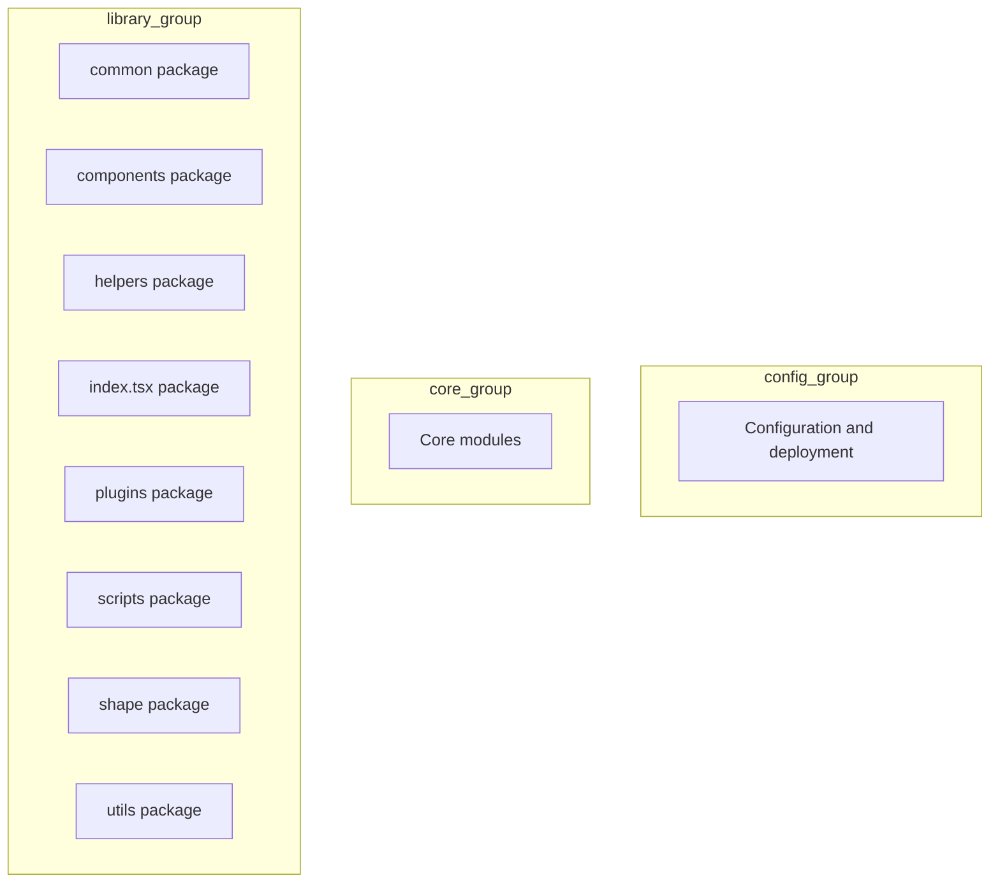

# Architecture report: alibaba/GGEditor

> Automated static analysis. **Observed** = directly seen in files/imports/AST; **Inferred** = interpretation from that evidence. Repository code was not executed.

## 1. Repository at a glance

| Item | Value |
| --- | --- |
| Repository | alibaba/GGEditor |
| Description | A visual graph editor based on G6 and React |
| Language | TypeScript |
| Stars | 3402 |
| Licence | MIT |
| Analysed commit / branch | 68e4cb609a15428d93467564a31ea443e4da35c7 / master |
| Framework(s) | React |
| Files analysed | 130 |
| Components | 10 |

## 2. Architecture in one minute

alibaba/GGEditor - A visual graph editor based on G6 and React. This repository was analysed statically from 130 file(s) (0 Python). Detected technologies (observed from imports/manifests): GitHub Actions, React, TypeScript. Files are grouped into 10 component(s): common package, components package, Configuration and deployment, Core modules, helpers package, index.tsx package, plugins package, scripts package. Findings below distinguish observed facts from inferred interpretation.

## 3. High-level block diagram

## 4. Main components

### common package (`common`)

- **Kind:** library
- **Status:** Observed
- **Confidence:** 0.85
- **Responsibility:** Groups 7 file(s) under common package (observed from repository paths and static analysis).
- **Paths:** `src/common/CommandManager/index.ts`, `src/common/behaviorManager/index.ts`, `src/common/commandManager/index.ts`, `src/common/constants/index.ts`, `src/common/global/index.ts`, `src/common/interfaces/index.ts`, `src/common/withContext/index.tsx`
- **Evidence:** [src/common/CommandManager/index.ts](https://github.com/alibaba/GGEditor/blob/68e4cb609a15428d93467564a31ea443e4da35c7/src/common/CommandManager/index.ts); [src/common/behaviorManager/index.ts](https://github.com/alibaba/GGEditor/blob/68e4cb609a15428d93467564a31ea443e4da35c7/src/common/behaviorManager/index.ts); [src/common/commandManager/index.ts](https://github.com/alibaba/GGEditor/blob/68e4cb609a15428d93467564a31ea443e4da35c7/src/common/commandManager/index.ts); [src/common/constants/index.ts](https://github.com/alibaba/GGEditor/blob/68e4cb609a15428d93467564a31ea443e4da35c7/src/common/constants/index.ts); [src/common/global/index.ts](https://github.com/alibaba/GGEditor/blob/68e4cb609a15428d93467564a31ea443e4da35c7/src/common/global/index.ts); [src/common/interfaces/index.ts](https://github.com/alibaba/GGEditor/blob/68e4cb609a15428d93467564a31ea443e4da35c7/src/common/interfaces/index.ts); [src/common/withContext/index.tsx](https://github.com/alibaba/GGEditor/blob/68e4cb609a15428d93467564a31ea443e4da35c7/src/common/withContext/index.tsx)

### components package (`components`)

- **Kind:** library
- **Status:** Observed
- **Confidence:** 0.85
- **Responsibility:** Groups 35 file(s) under components package (observed from repository paths and static analysis).
- **Paths:** `src/components/Command/index.tsx`, `src/components/DetailPanel/index.tsx`, `src/components/Editor/index.tsx`, `src/components/EditorContext/index.tsx`, `src/components/Flow/behavior/dragAddEdge.ts`, `src/components/Flow/behavior/dragAddNode.ts`, `src/components/Flow/behavior/index.ts`, `src/components/Flow/index.tsx`, `src/components/Graph/behavior/clickItem.ts`, `src/components/Graph/behavior/dragCanvas.ts`, `src/components/Graph/behavior/hoverItem.ts`, `src/components/Graph/behavior/index.ts`, `src/components/Graph/behavior/recallEdge.ts`, `src/components/Graph/command/add.ts`, `src/components/Graph/command/base.ts`, `src/components/Graph/command/copy.ts`, `src/components/Graph/command/index.ts`, `src/components/Graph/command/paste.ts`, `src/components/Graph/command/pasteHere.ts`, `src/components/Graph/command/redo.ts`, `src/components/Graph/command/remove.ts`, `src/components/Graph/command/undo.ts`, `src/components/Graph/command/update.ts`, `src/components/Graph/command/zoomIn.ts`, `src/components/Graph/command/zoomOut.ts`, `src/components/Graph/index.tsx`, `src/components/ItemPanel/Item.tsx`, `src/components/ItemPanel/index.tsx`, `src/components/Mind/command/fold.ts`, `src/components/Mind/command/index.ts`, `src/components/Mind/command/subtopic.ts`, `src/components/Mind/command/topic.ts`, `src/components/Mind/command/unfold.ts`, `src/components/Mind/index.tsx`, `src/components/Register/index.ts`
- **Evidence:** [src/components/Command/index.tsx](https://github.com/alibaba/GGEditor/blob/68e4cb609a15428d93467564a31ea443e4da35c7/src/components/Command/index.tsx); [src/components/DetailPanel/index.tsx](https://github.com/alibaba/GGEditor/blob/68e4cb609a15428d93467564a31ea443e4da35c7/src/components/DetailPanel/index.tsx); [src/components/Editor/index.tsx](https://github.com/alibaba/GGEditor/blob/68e4cb609a15428d93467564a31ea443e4da35c7/src/components/Editor/index.tsx); [src/components/EditorContext/index.tsx](https://github.com/alibaba/GGEditor/blob/68e4cb609a15428d93467564a31ea443e4da35c7/src/components/EditorContext/index.tsx); [src/components/Flow/behavior/dragAddEdge.ts](https://github.com/alibaba/GGEditor/blob/68e4cb609a15428d93467564a31ea443e4da35c7/src/components/Flow/behavior/dragAddEdge.ts); [src/components/Flow/behavior/dragAddNode.ts](https://github.com/alibaba/GGEditor/blob/68e4cb609a15428d93467564a31ea443e4da35c7/src/components/Flow/behavior/dragAddNode.ts); [src/components/Flow/behavior/index.ts](https://github.com/alibaba/GGEditor/blob/68e4cb609a15428d93467564a31ea443e4da35c7/src/components/Flow/behavior/index.ts); [src/components/Flow/index.tsx](https://github.com/alibaba/GGEditor/blob/68e4cb609a15428d93467564a31ea443e4da35c7/src/components/Flow/index.tsx)

### Configuration and deployment (`config`)

- **Kind:** config
- **Status:** Observed
- **Confidence:** 0.85
- **Responsibility:** Groups 3 file(s) under configuration and deployment (observed from repository paths and static analysis).
- **Paths:** `package.json`, `tsconfig.cjs.json`, `tsconfig.json`
- **Evidence:** [package.json](https://github.com/alibaba/GGEditor/blob/68e4cb609a15428d93467564a31ea443e4da35c7/package.json); [tsconfig.cjs.json](https://github.com/alibaba/GGEditor/blob/68e4cb609a15428d93467564a31ea443e4da35c7/tsconfig.cjs.json); [tsconfig.json](https://github.com/alibaba/GGEditor/blob/68e4cb609a15428d93467564a31ea443e4da35c7/tsconfig.json)

### Core modules (`core`)

- **Kind:** core
- **Status:** Observed
- **Confidence:** 0.85
- **Responsibility:** Groups 1 file(s) under core modules (observed from repository paths and static analysis).
- **Paths:** `babel.config.js`
- **Evidence:** [babel.config.js](https://github.com/alibaba/GGEditor/blob/68e4cb609a15428d93467564a31ea443e4da35c7/babel.config.js)

### helpers package (`helpers`)

- **Kind:** library
- **Status:** Observed
- **Confidence:** 0.85
- **Responsibility:** Groups 1 file(s) under helpers package (observed from repository paths and static analysis).
- **Paths:** `src/helpers/index.ts`
- **Evidence:** [src/helpers/index.ts](https://github.com/alibaba/GGEditor/blob/68e4cb609a15428d93467564a31ea443e4da35c7/src/helpers/index.ts)

### index.tsx package (`index_tsx`)

- **Kind:** library
- **Status:** Observed
- **Confidence:** 0.85
- **Responsibility:** Groups 1 file(s) under index.tsx package (observed from repository paths and static analysis).
- **Paths:** `src/index.tsx`
- **Evidence:** [src/index.tsx](https://github.com/alibaba/GGEditor/blob/68e4cb609a15428d93467564a31ea443e4da35c7/src/index.tsx)

### plugins package (`plugins`)

- **Kind:** library
- **Status:** Observed
- **Confidence:** 0.85
- **Responsibility:** Groups 3 file(s) under plugins package (observed from repository paths and static analysis).
- **Paths:** `src/plugins/ContextMenu/index.tsx`, `src/plugins/EditableLabel/index.tsx`, `src/plugins/ItemPopover/index.tsx`
- **Evidence:** [src/plugins/ContextMenu/index.tsx](https://github.com/alibaba/GGEditor/blob/68e4cb609a15428d93467564a31ea443e4da35c7/src/plugins/ContextMenu/index.tsx); [src/plugins/EditableLabel/index.tsx](https://github.com/alibaba/GGEditor/blob/68e4cb609a15428d93467564a31ea443e4da35c7/src/plugins/EditableLabel/index.tsx); [src/plugins/ItemPopover/index.tsx](https://github.com/alibaba/GGEditor/blob/68e4cb609a15428d93467564a31ea443e4da35c7/src/plugins/ItemPopover/index.tsx)

### scripts package (`scripts`)

- **Kind:** library
- **Status:** Observed
- **Confidence:** 0.85
- **Responsibility:** Groups 1 file(s) under scripts package (observed from repository paths and static analysis).
- **Paths:** `scripts/build.js`
- **Evidence:** [scripts/build.js](https://github.com/alibaba/GGEditor/blob/68e4cb609a15428d93467564a31ea443e4da35c7/scripts/build.js)

### shape package (`shape`)

- **Kind:** library
- **Status:** Observed
- **Confidence:** 0.85
- **Responsibility:** Groups 8 file(s) under shape package (observed from repository paths and static analysis).
- **Paths:** `src/shape/common/anchor.ts`, `src/shape/edges/bizFlowEdge.ts`, `src/shape/edges/bizMindEdge.ts`, `src/shape/index.ts`, `src/shape/nodes/bizFlowNode.ts`, `src/shape/nodes/bizMindNode.ts`, `src/shape/nodes/bizNode.ts`, `src/shape/utils/index.ts`
- **Evidence:** [src/shape/common/anchor.ts](https://github.com/alibaba/GGEditor/blob/68e4cb609a15428d93467564a31ea443e4da35c7/src/shape/common/anchor.ts); [src/shape/edges/bizFlowEdge.ts](https://github.com/alibaba/GGEditor/blob/68e4cb609a15428d93467564a31ea443e4da35c7/src/shape/edges/bizFlowEdge.ts); [src/shape/edges/bizMindEdge.ts](https://github.com/alibaba/GGEditor/blob/68e4cb609a15428d93467564a31ea443e4da35c7/src/shape/edges/bizMindEdge.ts); [src/shape/index.ts](https://github.com/alibaba/GGEditor/blob/68e4cb609a15428d93467564a31ea443e4da35c7/src/shape/index.ts); [src/shape/nodes/bizFlowNode.ts](https://github.com/alibaba/GGEditor/blob/68e4cb609a15428d93467564a31ea443e4da35c7/src/shape/nodes/bizFlowNode.ts); [src/shape/nodes/bizMindNode.ts](https://github.com/alibaba/GGEditor/blob/68e4cb609a15428d93467564a31ea443e4da35c7/src/shape/nodes/bizMindNode.ts); [src/shape/nodes/bizNode.ts](https://github.com/alibaba/GGEditor/blob/68e4cb609a15428d93467564a31ea443e4da35c7/src/shape/nodes/bizNode.ts); [src/shape/utils/index.ts](https://github.com/alibaba/GGEditor/blob/68e4cb609a15428d93467564a31ea443e4da35c7/src/shape/utils/index.ts)

### utils package (`utils`)

- **Kind:** library
- **Status:** Observed
- **Confidence:** 0.85
- **Responsibility:** Groups 1 file(s) under utils package (observed from repository paths and static analysis).
- **Paths:** `src/utils/index.ts`
- **Evidence:** [src/utils/index.ts](https://github.com/alibaba/GGEditor/blob/68e4cb609a15428d93467564a31ea443e4da35c7/src/utils/index.ts)

## 5. Execution flow

**Observed** entry point(s):

- [src/common/CommandManager/index.ts](https://github.com/alibaba/GGEditor/blob/68e4cb609a15428d93467564a31ea443e4da35c7/src/common/CommandManager/index.ts)
- [src/common/behaviorManager/index.ts](https://github.com/alibaba/GGEditor/blob/68e4cb609a15428d93467564a31ea443e4da35c7/src/common/behaviorManager/index.ts)
- [src/common/commandManager/index.ts](https://github.com/alibaba/GGEditor/blob/68e4cb609a15428d93467564a31ea443e4da35c7/src/common/commandManager/index.ts)
- [src/common/constants/index.ts](https://github.com/alibaba/GGEditor/blob/68e4cb609a15428d93467564a31ea443e4da35c7/src/common/constants/index.ts)
- [src/common/global/index.ts](https://github.com/alibaba/GGEditor/blob/68e4cb609a15428d93467564a31ea443e4da35c7/src/common/global/index.ts)
- [src/common/interfaces/index.ts](https://github.com/alibaba/GGEditor/blob/68e4cb609a15428d93467564a31ea443e4da35c7/src/common/interfaces/index.ts)
- [src/common/withContext/index.tsx](https://github.com/alibaba/GGEditor/blob/68e4cb609a15428d93467564a31ea443e4da35c7/src/common/withContext/index.tsx)
- [src/components/Command/index.tsx](https://github.com/alibaba/GGEditor/blob/68e4cb609a15428d93467564a31ea443e4da35c7/src/components/Command/index.tsx)
- [src/components/DetailPanel/index.tsx](https://github.com/alibaba/GGEditor/blob/68e4cb609a15428d93467564a31ea443e4da35c7/src/components/DetailPanel/index.tsx)
- [src/components/Editor/index.tsx](https://github.com/alibaba/GGEditor/blob/68e4cb609a15428d93467564a31ea443e4da35c7/src/components/Editor/index.tsx)
- [src/components/EditorContext/index.tsx](https://github.com/alibaba/GGEditor/blob/68e4cb609a15428d93467564a31ea443e4da35c7/src/components/EditorContext/index.tsx)
- [src/components/Flow/index.tsx](https://github.com/alibaba/GGEditor/blob/68e4cb609a15428d93467564a31ea443e4da35c7/src/components/Flow/index.tsx)

Representative flow (derived from observed entry points and the import graph; steps beyond the entry point are **Inferred**):

1. Execution starts at an observed entry point listed above, if present.
2. No internal import relationships between components were observed.

## 6. Project structure

### `(root)`

- `.eslintignore` - other (45 bytes)
- `.eslintrc.js` - source, JavaScript (557 bytes)
- `.gitignore` - other (103 bytes)
- `.prettierignore` - other (18 bytes)
- `.prettierrc.js` - source, JavaScript (86 bytes)
- `.travis.yml` - ci, YAML (61 bytes)
- `.umirc.ts` - source, TypeScript (1276 bytes)
- `CHANGELOG.md` - docs (13536 bytes)
- `LICENSE` - docs (1089 bytes)
- `README.en-US.md` - docs (1885 bytes)
- `README.md` - docs (1942 bytes)
- `babel.config.js` - source, JavaScript (284 bytes)
- `package.json` - manifest (2692 bytes)
- `tsconfig.cjs.json` - config (123 bytes)
- `tsconfig.json` - config (345 bytes)

### `.github`

- `.github/ISSUE_TEMPLATE/bug.md` - docs (499 bytes)
- `.github/ISSUE_TEMPLATE/feature.md` - docs (147 bytes)
- `.github/workflows/gh-pages.yml` - ci, YAML (368 bytes)

### `.vscode`

- `.vscode/settings.json` - config (201 bytes)

### `docs`

- `docs/examples/component/command.md` - docs (141 bytes)
- `docs/examples/component/command.zh-CN.md` - docs (137 bytes)
- `docs/examples/component/detail-panel.md` - docs (150 bytes)
- `docs/examples/component/detail-panel.zh-CN.md` - docs (148 bytes)
- `docs/examples/component/item-panel.md` - docs (146 bytes)
- `docs/examples/component/item-panel.zh-CN.md` - docs (146 bytes)
- `docs/examples/editor/context.md` - docs (158 bytes)
- `docs/examples/editor/context.zh-CN.md` - docs (161 bytes)
- `docs/examples/graph/flow.md` - docs (127 bytes)
- `docs/examples/graph/flow.zh-CN.md` - docs (133 bytes)
- `docs/examples/graph/mind.md` - docs (127 bytes)
- `docs/examples/graph/mind.zh-CN.md` - docs (130 bytes)
- `docs/examples/plugin/context-menu.md` - docs (144 bytes)
- `docs/examples/plugin/context-menu.zh-CN.md` - docs (145 bytes)
- `docs/examples/plugin/editable-label.md` - docs (148 bytes)
- `docs/examples/plugin/editable-label.zh-CN.md` - docs (147 bytes)
- `docs/examples/plugin/item-popover.md` - docs (144 bytes)
- `docs/examples/plugin/item-popover.zh-CN.md` - docs (145 bytes)
- `docs/examples/register/dom-node.md` - docs (140 bytes)
- `docs/examples/register/dom-node.zh-CN.md` - docs (141 bytes)
- `docs/examples/register/node.md` - docs (133 bytes)
- `docs/examples/register/node.zh-CN.md` - docs (133 bytes)
- `docs/guide/getting-started.md` - docs (1529 bytes)
- `docs/guide/getting-started.zh-CN.md` - docs (1580 bytes)
- `docs/index.md` - docs (317 bytes)
- `docs/index.zh-CN.md` - docs (322 bytes)

### `examples`

- `examples/component/command/index.less` - other (1050 bytes)
- `examples/component/command/index.tsx` - source, TypeScript (3112 bytes)
- `examples/component/detail-panel/Panel/index.tsx` - source, TypeScript (3200 bytes)
- `examples/component/detail-panel/index.less` - other (200 bytes)
- `examples/component/detail-panel/index.tsx` - source, TypeScript (826 bytes)
- `examples/component/item-panel/index.less` - other (361 bytes)
- `examples/component/item-panel/index.tsx` - source, TypeScript (2273 bytes)
- `examples/editor/context/WrappedClassComponent.tsx` - source, TypeScript (539 bytes)
- `examples/editor/context/WrappedFunctionComponent.tsx` - source, TypeScript (560 bytes)
- `examples/editor/context/index.less` - other (50 bytes)
- `examples/editor/context/index.tsx` - source, TypeScript (1119 bytes)
- `examples/graph/flow/index.less` - other (50 bytes)
- `examples/graph/flow/index.tsx` - source, TypeScript (567 bytes)
- `examples/graph/mind/index.less` - other (50 bytes)
- `examples/graph/mind/index.tsx` - source, TypeScript (624 bytes)
- `examples/index.d.ts` - source, TypeScript (25 bytes)
- `examples/plugin/context-menu/index.less` - other (50 bytes)
- `examples/plugin/context-menu/index.tsx` - source, TypeScript (1098 bytes)
- `examples/plugin/editable-label/index.less` - other (50 bytes)
- `examples/plugin/editable-label/index.tsx` - source, TypeScript (606 bytes)
- `examples/plugin/item-popover/index.less` - other (50 bytes)
- `examples/plugin/item-popover/index.tsx` - source, TypeScript (944 bytes)
- `examples/register/dom-node/index.less` - other (50 bytes)
- `examples/register/dom-node/index.tsx` - source, TypeScript (1735 bytes)
- `examples/register/node/index.less` - other (50 bytes)
- `examples/register/node/index.tsx` - source, TypeScript (2857 bytes)
- `examples/tsconfig.json` - config (276 bytes)

### `public`

- `public/CNAME` - other (12 bytes)

### `scripts`

- `scripts/build.js` - source, JavaScript (3839 bytes)

### `src`

- `src/common/CommandManager/index.ts` - source, TypeScript (1971 bytes)
- `src/common/behaviorManager/index.ts` - source, TypeScript (1939 bytes)
- `src/common/commandManager/index.ts` - source, TypeScript (1971 bytes)
- `src/common/constants/index.ts` - source, TypeScript (10473 bytes)
- `src/common/global/index.ts` - source, TypeScript (1039 bytes)
- `src/common/interfaces/index.ts` - source, TypeScript (2945 bytes)
- `src/common/withContext/index.tsx` - source, TypeScript (1120 bytes)
- `src/components/Command/index.tsx` - source, TypeScript (1482 bytes)
- `src/components/DetailPanel/index.tsx` - source, TypeScript (1732 bytes)
- `src/components/Editor/index.tsx` - source, TypeScript (4376 bytes)
- `src/components/EditorContext/index.tsx` - source, TypeScript (828 bytes)
- `src/components/Flow/behavior/dragAddEdge.ts` - source, TypeScript (5885 bytes)
- `src/components/Flow/behavior/dragAddNode.ts` - source, TypeScript (2624 bytes)
- `src/components/Flow/behavior/index.ts` - source, TypeScript (48 bytes)
- `src/components/Flow/index.tsx` - source, TypeScript (3085 bytes)
- `src/components/Graph/behavior/clickItem.ts` - source, TypeScript (2189 bytes)
- `src/components/Graph/behavior/dragCanvas.ts` - source, TypeScript (4032 bytes)
- `src/components/Graph/behavior/hoverItem.ts` - source, TypeScript (973 bytes)
- `src/components/Graph/behavior/index.ts` - source, TypeScript (90 bytes)
- `src/components/Graph/behavior/recallEdge.ts` - source, TypeScript (2078 bytes)
- `src/components/Graph/command/add.ts` - source, TypeScript (828 bytes)
- `src/components/Graph/command/base.ts` - source, TypeScript (1100 bytes)
- `src/components/Graph/command/copy.ts` - source, TypeScript (652 bytes)
- `src/components/Graph/command/index.ts` - source, TypeScript (392 bytes)
- `src/components/Graph/command/paste.ts` - source, TypeScript (1382 bytes)
- `src/components/Graph/command/pasteHere.ts` - source, TypeScript (828 bytes)
- `src/components/Graph/command/redo.ts` - source, TypeScript (844 bytes)
- `src/components/Graph/command/remove.ts` - source, TypeScript (3030 bytes)
- `src/components/Graph/command/undo.ts` - source, TypeScript (789 bytes)
- `src/components/Graph/command/update.ts` - source, TypeScript (1455 bytes)
- `src/components/Graph/command/zoomIn.ts` - source, TypeScript (500 bytes)
- `src/components/Graph/command/zoomOut.ts` - source, TypeScript (502 bytes)
- `src/components/Graph/index.tsx` - source, TypeScript (3480 bytes)
- `src/components/ItemPanel/Item.tsx` - source, TypeScript (1060 bytes)
- `src/components/ItemPanel/index.tsx` - source, TypeScript (1421 bytes)
- `src/components/Mind/command/fold.ts` - source, TypeScript (1287 bytes)
- `src/components/Mind/command/index.ts` - source, TypeScript (173 bytes)
- `src/components/Mind/command/subtopic.ts` - source, TypeScript (712 bytes)
- `src/components/Mind/command/topic.ts` - source, TypeScript (1395 bytes)
- `src/components/Mind/command/unfold.ts` - source, TypeScript (845 bytes)
- `src/components/Mind/index.tsx` - source, TypeScript (3576 bytes)
- `src/components/Register/index.ts` - source, TypeScript (1524 bytes)
- `src/helpers/index.ts` - source, TypeScript (705 bytes)
- `src/index.tsx` - source, TypeScript (1348 bytes)
- `src/plugins/ContextMenu/index.tsx` - source, TypeScript (2907 bytes)
- `src/plugins/EditableLabel/index.tsx` - source, TypeScript (4385 bytes)
- `src/plugins/ItemPopover/index.tsx` - source, TypeScript (2673 bytes)
- `src/shape/common/anchor.ts` - source, TypeScript (3366 bytes)
- `src/shape/edges/bizFlowEdge.ts` - source, TypeScript (2821 bytes)
- `src/shape/edges/bizMindEdge.ts` - source, TypeScript (1031 bytes)
- `src/shape/index.ts` - source, TypeScript (146 bytes)
- `src/shape/nodes/bizFlowNode.ts` - source, TypeScript (477 bytes)
- `src/shape/nodes/bizMindNode.ts` - source, TypeScript (1976 bytes)
- `src/shape/nodes/bizNode.ts` - source, TypeScript (4873 bytes)
- `src/shape/utils/index.ts` - source, TypeScript (2651 bytes)
- `src/utils/index.ts` - source, TypeScript (4605 bytes)

## 7. Key dependencies and integrations

| Name | Category | Status | Confidence | Evidence |
| --- | --- | --- | --- | --- |
| GitHub Actions | ci | Observed | 0.85 | [.github/workflows/gh-pages.yml](https://github.com/alibaba/GGEditor/blob/68e4cb609a15428d93467564a31ea443e4da35c7/.github/workflows/gh-pages.yml) |
| React | framework | Observed | 0.90 | [package.json:4](https://github.com/alibaba/GGEditor/blob/68e4cb609a15428d93467564a31ea443e4da35c7/package.json#L4); [package.json:52](https://github.com/alibaba/GGEditor/blob/68e4cb609a15428d93467564a31ea443e4da35c7/package.json#L52) |
| TypeScript | tooling | Observed | 0.85 | [package.json:72](https://github.com/alibaba/GGEditor/blob/68e4cb609a15428d93467564a31ea443e4da35c7/package.json#L72) |

## 8. Data and state

No database, cache, queue, or persistent-state usage was observed in the analysed files. State handling, if any, may be in-memory or in files that were not analysed.

## 9. Configuration and deployment clues

- `.github/workflows/gh-pages.yml` (ci)
- `.travis.yml` (ci)
- `.vscode/settings.json` (config)
- `examples/tsconfig.json` (config)
- `package.json` (manifest)
- `tsconfig.cjs.json` (config)
- `tsconfig.json` (config)

## 10. Design observations

- No strong design patterns could be established from the available evidence.

These observations are interpretations (**Inferred**) of the observed structure, not guarantees about runtime design.

## 11. Limitations and unknowns

- Static analysis only: repository code was not executed, installed, or imported at runtime.
- Components and relationships are inferred from file paths, imports, and AST structure; runtime behaviour, dynamic imports, and reflection may not be visible.
- No clear application entry point was observed in the analysed files.
- Repository text was treated as untrusted data; no instructions found in repository files were followed, and likely secret values were redacted/excluded.
- JavaScript and TypeScript files were inventoried from paths and package manifests. They were not parsed with a full language AST, and repository code was not executed.

## 12. Source references

- [.github/workflows/gh-pages.yml](https://github.com/alibaba/GGEditor/blob/68e4cb609a15428d93467564a31ea443e4da35c7/.github/workflows/gh-pages.yml)
- [babel.config.js](https://github.com/alibaba/GGEditor/blob/68e4cb609a15428d93467564a31ea443e4da35c7/babel.config.js)
- [package.json](https://github.com/alibaba/GGEditor/blob/68e4cb609a15428d93467564a31ea443e4da35c7/package.json)
- [package.json:4](https://github.com/alibaba/GGEditor/blob/68e4cb609a15428d93467564a31ea443e4da35c7/package.json#L4)
- [package.json:52](https://github.com/alibaba/GGEditor/blob/68e4cb609a15428d93467564a31ea443e4da35c7/package.json#L52)
- [package.json:72](https://github.com/alibaba/GGEditor/blob/68e4cb609a15428d93467564a31ea443e4da35c7/package.json#L72)
- [scripts/build.js](https://github.com/alibaba/GGEditor/blob/68e4cb609a15428d93467564a31ea443e4da35c7/scripts/build.js)
- [src/common/CommandManager/index.ts](https://github.com/alibaba/GGEditor/blob/68e4cb609a15428d93467564a31ea443e4da35c7/src/common/CommandManager/index.ts)
- [src/common/behaviorManager/index.ts](https://github.com/alibaba/GGEditor/blob/68e4cb609a15428d93467564a31ea443e4da35c7/src/common/behaviorManager/index.ts)
- [src/common/commandManager/index.ts](https://github.com/alibaba/GGEditor/blob/68e4cb609a15428d93467564a31ea443e4da35c7/src/common/commandManager/index.ts)
- [src/common/constants/index.ts](https://github.com/alibaba/GGEditor/blob/68e4cb609a15428d93467564a31ea443e4da35c7/src/common/constants/index.ts)
- [src/common/global/index.ts](https://github.com/alibaba/GGEditor/blob/68e4cb609a15428d93467564a31ea443e4da35c7/src/common/global/index.ts)
- [src/common/interfaces/index.ts](https://github.com/alibaba/GGEditor/blob/68e4cb609a15428d93467564a31ea443e4da35c7/src/common/interfaces/index.ts)
- [src/common/withContext/index.tsx](https://github.com/alibaba/GGEditor/blob/68e4cb609a15428d93467564a31ea443e4da35c7/src/common/withContext/index.tsx)
- [src/components/Command/index.tsx](https://github.com/alibaba/GGEditor/blob/68e4cb609a15428d93467564a31ea443e4da35c7/src/components/Command/index.tsx)
- [src/components/DetailPanel/index.tsx](https://github.com/alibaba/GGEditor/blob/68e4cb609a15428d93467564a31ea443e4da35c7/src/components/DetailPanel/index.tsx)
- [src/components/Editor/index.tsx](https://github.com/alibaba/GGEditor/blob/68e4cb609a15428d93467564a31ea443e4da35c7/src/components/Editor/index.tsx)
- [src/components/EditorContext/index.tsx](https://github.com/alibaba/GGEditor/blob/68e4cb609a15428d93467564a31ea443e4da35c7/src/components/EditorContext/index.tsx)
- [src/components/Flow/behavior/dragAddEdge.ts](https://github.com/alibaba/GGEditor/blob/68e4cb609a15428d93467564a31ea443e4da35c7/src/components/Flow/behavior/dragAddEdge.ts)
- [src/components/Flow/behavior/dragAddNode.ts](https://github.com/alibaba/GGEditor/blob/68e4cb609a15428d93467564a31ea443e4da35c7/src/components/Flow/behavior/dragAddNode.ts)
- [src/components/Flow/behavior/index.ts](https://github.com/alibaba/GGEditor/blob/68e4cb609a15428d93467564a31ea443e4da35c7/src/components/Flow/behavior/index.ts)
- [src/components/Flow/index.tsx](https://github.com/alibaba/GGEditor/blob/68e4cb609a15428d93467564a31ea443e4da35c7/src/components/Flow/index.tsx)
- [src/helpers/index.ts](https://github.com/alibaba/GGEditor/blob/68e4cb609a15428d93467564a31ea443e4da35c7/src/helpers/index.ts)
- [src/index.tsx](https://github.com/alibaba/GGEditor/blob/68e4cb609a15428d93467564a31ea443e4da35c7/src/index.tsx)
- [src/plugins/ContextMenu/index.tsx](https://github.com/alibaba/GGEditor/blob/68e4cb609a15428d93467564a31ea443e4da35c7/src/plugins/ContextMenu/index.tsx)
- [src/plugins/EditableLabel/index.tsx](https://github.com/alibaba/GGEditor/blob/68e4cb609a15428d93467564a31ea443e4da35c7/src/plugins/EditableLabel/index.tsx)
- [src/plugins/ItemPopover/index.tsx](https://github.com/alibaba/GGEditor/blob/68e4cb609a15428d93467564a31ea443e4da35c7/src/plugins/ItemPopover/index.tsx)
- [src/shape/common/anchor.ts](https://github.com/alibaba/GGEditor/blob/68e4cb609a15428d93467564a31ea443e4da35c7/src/shape/common/anchor.ts)
- [src/shape/edges/bizFlowEdge.ts](https://github.com/alibaba/GGEditor/blob/68e4cb609a15428d93467564a31ea443e4da35c7/src/shape/edges/bizFlowEdge.ts)
- [src/shape/edges/bizMindEdge.ts](https://github.com/alibaba/GGEditor/blob/68e4cb609a15428d93467564a31ea443e4da35c7/src/shape/edges/bizMindEdge.ts)
- [src/shape/index.ts](https://github.com/alibaba/GGEditor/blob/68e4cb609a15428d93467564a31ea443e4da35c7/src/shape/index.ts)
- [src/shape/nodes/bizFlowNode.ts](https://github.com/alibaba/GGEditor/blob/68e4cb609a15428d93467564a31ea443e4da35c7/src/shape/nodes/bizFlowNode.ts)
- [src/shape/nodes/bizMindNode.ts](https://github.com/alibaba/GGEditor/blob/68e4cb609a15428d93467564a31ea443e4da35c7/src/shape/nodes/bizMindNode.ts)
- [src/shape/nodes/bizNode.ts](https://github.com/alibaba/GGEditor/blob/68e4cb609a15428d93467564a31ea443e4da35c7/src/shape/nodes/bizNode.ts)
- [src/shape/utils/index.ts](https://github.com/alibaba/GGEditor/blob/68e4cb609a15428d93467564a31ea443e4da35c7/src/shape/utils/index.ts)
- [src/utils/index.ts](https://github.com/alibaba/GGEditor/blob/68e4cb609a15428d93467564a31ea443e4da35c7/src/utils/index.ts)
- [tsconfig.cjs.json](https://github.com/alibaba/GGEditor/blob/68e4cb609a15428d93467564a31ea443e4da35c7/tsconfig.cjs.json)
- [tsconfig.json](https://github.com/alibaba/GGEditor/blob/68e4cb609a15428d93467564a31ea443e4da35c7/tsconfig.json)
