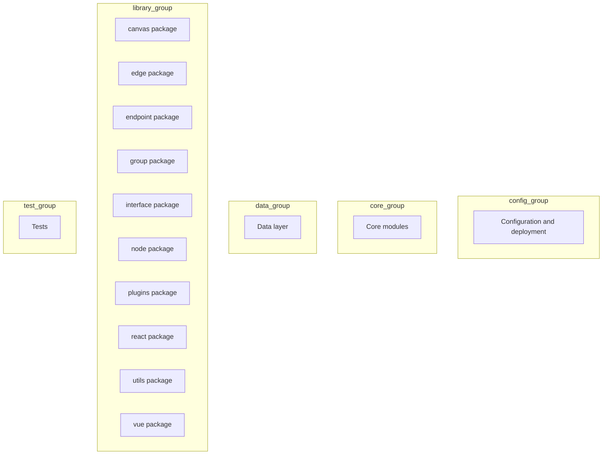

# Architecture report: alibaba/butterfly

> Automated static analysis. **Observed** = directly seen in files/imports/AST; **Inferred** = interpretation from that evidence. Repository code was not executed.

## 1. Repository at a glance

| Item | Value |
| --- | --- |
| Repository | alibaba/butterfly |
| Description | 🦋Butterfly，A JavaScript/React/Vue2 Diagramming library which concentrate on flow layout field.    (基于JavaScript/React/Vue2的流程图组件) |
| Language | JavaScript |
| Stars | 4637 |
| Licence | MIT |
| Analysed commit / branch | a44f36a23a81aa513579e35a007f309ba8f5e0d7 / master |
| Framework(s) | React, Vue |
| Files analysed | 549 |
| Components | 14 |

## 2. Architecture in one minute

alibaba/butterfly - 🦋Butterfly，A JavaScript/React/Vue2 Diagramming library which concentrate on flow layout field.    (基于JavaScript/React/Vue2的流程图组件). This repository was analysed statically from 549 file(s) (0 Python). Detected technologies (observed from imports/manifests): React, Vue, axios, React Router, webpack. Files are grouped into 14 component(s): canvas package, Configuration and deployment, Core modules, Data layer, edge package, endpoint package, group package, interface package. Findings below distinguish observed facts from inferred interpretation.

## 3. High-level block diagram

## 4. Main components

### canvas package (`canvas`)

- **Kind:** library
- **Status:** Observed
- **Confidence:** 0.85
- **Responsibility:** Groups 2 file(s) under canvas package (observed from repository paths and static analysis).
- **Paths:** `src/canvas/baseCanvas.js`, `src/canvas/treeCanvas.js`
- **Evidence:** [src/canvas/baseCanvas.js](https://github.com/alibaba/butterfly/blob/a44f36a23a81aa513579e35a007f309ba8f5e0d7/src/canvas/baseCanvas.js); [src/canvas/treeCanvas.js](https://github.com/alibaba/butterfly/blob/a44f36a23a81aa513579e35a007f309ba8f5e0d7/src/canvas/treeCanvas.js)

### Configuration and deployment (`config`)

- **Kind:** config
- **Status:** Observed
- **Confidence:** 0.85
- **Responsibility:** Groups 14 file(s) under configuration and deployment (observed from repository paths and static analysis).
- **Paths:** `azure-pipelines.yml`, `package.json`, `plugins/hotkey/package.json`, `plugins/layout/example/package.json`, `plugins/layout/example/src/mock_data.json`, `plugins/layout/example/src/mock_data1.json`, `plugins/layout/example/src/mock_data2.json`, `plugins/layout/package.json`, `plugins/panel/example/package.json`, `plugins/panel/package.json`, `react/example/package.json`, `react/package.json`, `vue/example/package.json`, `vue/package.json`
- **Evidence:** [azure-pipelines.yml](https://github.com/alibaba/butterfly/blob/a44f36a23a81aa513579e35a007f309ba8f5e0d7/azure-pipelines.yml); [package.json](https://github.com/alibaba/butterfly/blob/a44f36a23a81aa513579e35a007f309ba8f5e0d7/package.json); [plugins/hotkey/package.json](https://github.com/alibaba/butterfly/blob/a44f36a23a81aa513579e35a007f309ba8f5e0d7/plugins/hotkey/package.json); [plugins/layout/example/package.json](https://github.com/alibaba/butterfly/blob/a44f36a23a81aa513579e35a007f309ba8f5e0d7/plugins/layout/example/package.json); [plugins/layout/example/src/mock_data.json](https://github.com/alibaba/butterfly/blob/a44f36a23a81aa513579e35a007f309ba8f5e0d7/plugins/layout/example/src/mock_data.json); [plugins/layout/example/src/mock_data1.json](https://github.com/alibaba/butterfly/blob/a44f36a23a81aa513579e35a007f309ba8f5e0d7/plugins/layout/example/src/mock_data1.json); [plugins/layout/example/src/mock_data2.json](https://github.com/alibaba/butterfly/blob/a44f36a23a81aa513579e35a007f309ba8f5e0d7/plugins/layout/example/src/mock_data2.json); [plugins/layout/package.json](https://github.com/alibaba/butterfly/blob/a44f36a23a81aa513579e35a007f309ba8f5e0d7/plugins/layout/package.json)

### Core modules (`core`)

- **Kind:** core
- **Status:** Observed
- **Confidence:** 0.85
- **Responsibility:** Groups 4 file(s) under core modules (observed from repository paths and static analysis).
- **Paths:** `index.d.ts`, `index.js`, `rollup.config.js`, `webpack.config.js`
- **Evidence:** [index.d.ts](https://github.com/alibaba/butterfly/blob/a44f36a23a81aa513579e35a007f309ba8f5e0d7/index.d.ts); [index.js](https://github.com/alibaba/butterfly/blob/a44f36a23a81aa513579e35a007f309ba8f5e0d7/index.js); [rollup.config.js](https://github.com/alibaba/butterfly/blob/a44f36a23a81aa513579e35a007f309ba8f5e0d7/rollup.config.js); [webpack.config.js](https://github.com/alibaba/butterfly/blob/a44f36a23a81aa513579e35a007f309ba8f5e0d7/webpack.config.js)

### Data layer (`data_layer`)

- **Kind:** data
- **Status:** Observed
- **Confidence:** 0.85
- **Responsibility:** Groups 1 file(s) under data layer (observed from repository paths and static analysis).
- **Paths:** `plugins/layout/src/kedroviz/data/normalize-data.js`
- **Evidence:** [plugins/layout/src/kedroviz/data/normalize-data.js](https://github.com/alibaba/butterfly/blob/a44f36a23a81aa513579e35a007f309ba8f5e0d7/plugins/layout/src/kedroviz/data/normalize-data.js)

### edge package (`edge`)

- **Kind:** library
- **Status:** Observed
- **Confidence:** 0.85
- **Responsibility:** Groups 1 file(s) under edge package (observed from repository paths and static analysis).
- **Paths:** `src/edge/baseEdge.js`
- **Evidence:** [src/edge/baseEdge.js](https://github.com/alibaba/butterfly/blob/a44f36a23a81aa513579e35a007f309ba8f5e0d7/src/edge/baseEdge.js)

### endpoint package (`endpoint`)

- **Kind:** library
- **Status:** Observed
- **Confidence:** 0.85
- **Responsibility:** Groups 1 file(s) under endpoint package (observed from repository paths and static analysis).
- **Paths:** `src/endpoint/baseEndpoint.js`
- **Evidence:** [src/endpoint/baseEndpoint.js](https://github.com/alibaba/butterfly/blob/a44f36a23a81aa513579e35a007f309ba8f5e0d7/src/endpoint/baseEndpoint.js)

### group package (`group`)

- **Kind:** library
- **Status:** Observed
- **Confidence:** 0.85
- **Responsibility:** Groups 1 file(s) under group package (observed from repository paths and static analysis).
- **Paths:** `src/group/baseGroup.js`
- **Evidence:** [src/group/baseGroup.js](https://github.com/alibaba/butterfly/blob/a44f36a23a81aa513579e35a007f309ba8f5e0d7/src/group/baseGroup.js)

### interface package (`interface`)

- **Kind:** library
- **Status:** Observed
- **Confidence:** 0.85
- **Responsibility:** Groups 5 file(s) under interface package (observed from repository paths and static analysis).
- **Paths:** `src/interface/canvas.js`, `src/interface/edge.js`, `src/interface/endpoint.js`, `src/interface/group.js`, `src/interface/node.js`
- **Evidence:** [src/interface/canvas.js](https://github.com/alibaba/butterfly/blob/a44f36a23a81aa513579e35a007f309ba8f5e0d7/src/interface/canvas.js); [src/interface/edge.js](https://github.com/alibaba/butterfly/blob/a44f36a23a81aa513579e35a007f309ba8f5e0d7/src/interface/edge.js); [src/interface/endpoint.js](https://github.com/alibaba/butterfly/blob/a44f36a23a81aa513579e35a007f309ba8f5e0d7/src/interface/endpoint.js); [src/interface/group.js](https://github.com/alibaba/butterfly/blob/a44f36a23a81aa513579e35a007f309ba8f5e0d7/src/interface/group.js); [src/interface/node.js](https://github.com/alibaba/butterfly/blob/a44f36a23a81aa513579e35a007f309ba8f5e0d7/src/interface/node.js)

### node package (`node`)

- **Kind:** library
- **Status:** Observed
- **Confidence:** 0.85
- **Responsibility:** Groups 2 file(s) under node package (observed from repository paths and static analysis).
- **Paths:** `src/node/baseNode.js`, `src/node/treeNode.js`
- **Evidence:** [src/node/baseNode.js](https://github.com/alibaba/butterfly/blob/a44f36a23a81aa513579e35a007f309ba8f5e0d7/src/node/baseNode.js); [src/node/treeNode.js](https://github.com/alibaba/butterfly/blob/a44f36a23a81aa513579e35a007f309ba8f5e0d7/src/node/treeNode.js)

### plugins package (`plugins`)

- **Kind:** library
- **Status:** Observed
- **Confidence:** 0.85
- **Responsibility:** Groups 38 file(s) under plugins package (observed from repository paths and static analysis).
- **Paths:** `plugins/hotkey/rollup.config.js`, `plugins/hotkey/src/codemap.js`, `plugins/hotkey/src/index.js`, `plugins/layout/example/index.jsx`, `plugins/layout/example/src/app.jsx`, `plugins/layout/example/src/app1.jsx`, `plugins/layout/example/webpack.config.js`, `plugins/layout/rollup.config.js`, `plugins/layout/src/canvas/baseCanvas.js`, `plugins/layout/src/edgeTypes/obstacleAvoidanceEdge/ObstacleAvoidanceEdge.js`, `plugins/layout/src/edgeTypes/obstacleAvoidanceEdge/index.js`, `plugins/layout/src/edgeTypes/obstacleAvoidanceEdge/obstacleAvoidancePoints.js`, `plugins/layout/src/edgeTypes/obstacleAvoidanceEdge/utils.js`, `plugins/layout/src/graphviz/edge.js`, `plugins/layout/src/graphviz/index.js`, `plugins/layout/src/index.js`, `plugins/layout/src/kedroviz/graph/common.js`, `plugins/layout/src/kedroviz/graph/constraints.js`, `plugins/layout/src/kedroviz/graph/graph.js`, `plugins/layout/src/kedroviz/graph/index.js`, `plugins/layout/src/kedroviz/graph/layout.js`, `plugins/layout/src/kedroviz/graph/solver.js`, `plugins/layout/src/kedroviz/index.js`, `plugins/layout/src/kedroviz/layers/baseLayers.js`, `plugins/layout/src/kedroviz/selectors/disabled.js`, `plugins/layout/src/kedroviz/selectors/layers.js`, `plugins/layout/src/kedroviz/selectors/nodes.js`, `plugins/layout/src/kedroviz/selectors/ranks.js`, `plugins/layout/src/kedroviz/selectors/size.js`, `plugins/layout/src/kedroviz/utils/index.js`, `plugins/panel/example/butterfly-test/index.jsx`, `plugins/panel/example/index.jsx`, `plugins/panel/example/webpack.config.js`, `plugins/panel/rollup.config.js`, `plugins/panel/src/basic/index.js`, `plugins/panel/src/index.js`, `plugins/panel/src/node/panel-node.js`, `plugins/panel/src/uml/index.js`
- **Evidence:** [plugins/hotkey/rollup.config.js](https://github.com/alibaba/butterfly/blob/a44f36a23a81aa513579e35a007f309ba8f5e0d7/plugins/hotkey/rollup.config.js); [plugins/hotkey/src/codemap.js](https://github.com/alibaba/butterfly/blob/a44f36a23a81aa513579e35a007f309ba8f5e0d7/plugins/hotkey/src/codemap.js); [plugins/hotkey/src/index.js](https://github.com/alibaba/butterfly/blob/a44f36a23a81aa513579e35a007f309ba8f5e0d7/plugins/hotkey/src/index.js); [plugins/layout/example/index.jsx](https://github.com/alibaba/butterfly/blob/a44f36a23a81aa513579e35a007f309ba8f5e0d7/plugins/layout/example/index.jsx); [plugins/layout/example/src/app.jsx](https://github.com/alibaba/butterfly/blob/a44f36a23a81aa513579e35a007f309ba8f5e0d7/plugins/layout/example/src/app.jsx); [plugins/layout/example/src/app1.jsx](https://github.com/alibaba/butterfly/blob/a44f36a23a81aa513579e35a007f309ba8f5e0d7/plugins/layout/example/src/app1.jsx); [plugins/layout/example/webpack.config.js](https://github.com/alibaba/butterfly/blob/a44f36a23a81aa513579e35a007f309ba8f5e0d7/plugins/layout/example/webpack.config.js); [plugins/layout/rollup.config.js](https://github.com/alibaba/butterfly/blob/a44f36a23a81aa513579e35a007f309ba8f5e0d7/plugins/layout/rollup.config.js)

### react package (`react`)

- **Kind:** library
- **Status:** Observed
- **Confidence:** 0.85
- **Responsibility:** Groups 31 file(s) under react package (observed from repository paths and static analysis).
- **Paths:** `react/coms/common-render.jsx`, `react/coms/edge.js`, `react/coms/endpoint.jsx`, `react/coms/group.js`, `react/coms/node-render.jsx`, `react/coms/node.js`, `react/coms/react-group.jsx`, `react/coms/react-label.jsx`, `react/coms/react-node.jsx`, `react/context.js`, `react/example/components/node.jsx`, `react/example/components/tool-bar.jsx`, `react/example/components/white-space.jsx`, `react/example/index.jsx`, `react/example/pages/basic/index.jsx`, `react/example/pages/basic/mock-data.jsx`, `react/example/pages/endpoint/index.jsx`, `react/example/pages/endpoint/mock-data.jsx`, `react/example/pages/layout.jsx`, `react/example/router.jsx`, `react/example/vite.config.js`, `react/example/webpack.config.js`, `react/index.jsx`, `react/props.js`, `react/rollup.config.js`, `react/util/check-render.js`, `react/util/default-options.js`, `react/util/diff.js`, `react/util/process.js`, `react/util/re-calc.js`, `react/util/re-layout.js`
- **Evidence:** [react/coms/common-render.jsx](https://github.com/alibaba/butterfly/blob/a44f36a23a81aa513579e35a007f309ba8f5e0d7/react/coms/common-render.jsx); [react/coms/edge.js](https://github.com/alibaba/butterfly/blob/a44f36a23a81aa513579e35a007f309ba8f5e0d7/react/coms/edge.js); [react/coms/endpoint.jsx](https://github.com/alibaba/butterfly/blob/a44f36a23a81aa513579e35a007f309ba8f5e0d7/react/coms/endpoint.jsx); [react/coms/group.js](https://github.com/alibaba/butterfly/blob/a44f36a23a81aa513579e35a007f309ba8f5e0d7/react/coms/group.js); [react/coms/node-render.jsx](https://github.com/alibaba/butterfly/blob/a44f36a23a81aa513579e35a007f309ba8f5e0d7/react/coms/node-render.jsx); [react/coms/node.js](https://github.com/alibaba/butterfly/blob/a44f36a23a81aa513579e35a007f309ba8f5e0d7/react/coms/node.js); [react/coms/react-group.jsx](https://github.com/alibaba/butterfly/blob/a44f36a23a81aa513579e35a007f309ba8f5e0d7/react/coms/react-group.jsx); [react/coms/react-label.jsx](https://github.com/alibaba/butterfly/blob/a44f36a23a81aa513579e35a007f309ba8f5e0d7/react/coms/react-label.jsx)

### Tests (`tests`)

- **Kind:** test
- **Status:** Observed
- **Confidence:** 0.85
- **Responsibility:** Groups 7 file(s) under tests (observed from repository paths and static analysis).
- **Paths:** `test/canvas.test.js`, `test/common/init.js`, `test/edge.test.js`, `test/group.test.js`, `test/layout.test.js`, `test/node.test.js`, `test/window.js`
- **Evidence:** [test/canvas.test.js](https://github.com/alibaba/butterfly/blob/a44f36a23a81aa513579e35a007f309ba8f5e0d7/test/canvas.test.js); [test/common/init.js](https://github.com/alibaba/butterfly/blob/a44f36a23a81aa513579e35a007f309ba8f5e0d7/test/common/init.js); [test/edge.test.js](https://github.com/alibaba/butterfly/blob/a44f36a23a81aa513579e35a007f309ba8f5e0d7/test/edge.test.js); [test/group.test.js](https://github.com/alibaba/butterfly/blob/a44f36a23a81aa513579e35a007f309ba8f5e0d7/test/group.test.js); [test/layout.test.js](https://github.com/alibaba/butterfly/blob/a44f36a23a81aa513579e35a007f309ba8f5e0d7/test/layout.test.js); [test/node.test.js](https://github.com/alibaba/butterfly/blob/a44f36a23a81aa513579e35a007f309ba8f5e0d7/test/node.test.js); [test/window.js](https://github.com/alibaba/butterfly/blob/a44f36a23a81aa513579e35a007f309ba8f5e0d7/test/window.js)

### utils package (`utils`)

- **Kind:** library
- **Status:** Observed
- **Confidence:** 0.85
- **Responsibility:** Groups 32 file(s) under utils package (observed from repository paths and static analysis).
- **Paths:** `src/utils/arrow.js`, `src/utils/coordinate.js`, `src/utils/gridService.js`, `src/utils/guidelineService.js`, `src/utils/layout/circleLayout.js`, `src/utils/layout/concentLayout.js`, `src/utils/layout/dagreGroupLayout.js`, `src/utils/layout/dagreLayout.js`, `src/utils/layout/fishboneLayout.js`, `src/utils/layout/forceLayout.js`, `src/utils/layout/fruchterman.js`, `src/utils/layout/gridLayout.js`, `src/utils/layout/hierarchy/index.js`, `src/utils/layout/layout.js`, `src/utils/layout/radial/math.js`, `src/utils/layout/radial/mds.js`, `src/utils/layout/radial/radial.js`, `src/utils/layout/radial/radialNonoverlapForce.js`, `src/utils/link/edgeTypes/_utils.js`, `src/utils/link/edgeTypes/advancedBezier.js`, `src/utils/link/edgeTypes/bezier.js`, `src/utils/link/edgeTypes/brokenLine.js`, `src/utils/link/edgeTypes/flow.js`, `src/utils/link/edgeTypes/manhattan.js`, `src/utils/link/edgeTypes/secondBezier.js`, `src/utils/link/edgeTypes/straight.js`, `src/utils/link/index.js`, `src/utils/link/link_animate.js`, `src/utils/minimap.js`, `src/utils/scopeCompare.js`, `src/utils/selectCanvas.js`, `src/utils/toolTip.js`
- **Evidence:** [src/utils/arrow.js](https://github.com/alibaba/butterfly/blob/a44f36a23a81aa513579e35a007f309ba8f5e0d7/src/utils/arrow.js); [src/utils/coordinate.js](https://github.com/alibaba/butterfly/blob/a44f36a23a81aa513579e35a007f309ba8f5e0d7/src/utils/coordinate.js); [src/utils/gridService.js](https://github.com/alibaba/butterfly/blob/a44f36a23a81aa513579e35a007f309ba8f5e0d7/src/utils/gridService.js); [src/utils/guidelineService.js](https://github.com/alibaba/butterfly/blob/a44f36a23a81aa513579e35a007f309ba8f5e0d7/src/utils/guidelineService.js); [src/utils/layout/circleLayout.js](https://github.com/alibaba/butterfly/blob/a44f36a23a81aa513579e35a007f309ba8f5e0d7/src/utils/layout/circleLayout.js); [src/utils/layout/concentLayout.js](https://github.com/alibaba/butterfly/blob/a44f36a23a81aa513579e35a007f309ba8f5e0d7/src/utils/layout/concentLayout.js); [src/utils/layout/dagreGroupLayout.js](https://github.com/alibaba/butterfly/blob/a44f36a23a81aa513579e35a007f309ba8f5e0d7/src/utils/layout/dagreGroupLayout.js); [src/utils/layout/dagreLayout.js](https://github.com/alibaba/butterfly/blob/a44f36a23a81aa513579e35a007f309ba8f5e0d7/src/utils/layout/dagreLayout.js)

### vue package (`vue`)

- **Kind:** library
- **Status:** Observed
- **Confidence:** 0.85
- **Responsibility:** Groups 45 file(s) under vue package (observed from repository paths and static analysis).
- **Paths:** `vue/butterfly-vue.vue`, `vue/coms/edge.js`, `vue/coms/group.js`, `vue/coms/node.js`, `vue/coms/tree-node.js`, `vue/coms/vue-endpoint.vue`, `vue/coms/vue-group.vue`, `vue/coms/vue-node.vue`, `vue/example/babel.config.js`, `vue/example/src/App.vue`, `vue/example/src/main.js`, `vue/example/src/page/App-copy.vue`, `vue/example/src/page/base/base-mockData.js`, `vue/example/src/page/base/base.vue`, `vue/example/src/page/base/edgeLabel/base-label.vue`, `vue/example/src/page/base/group/base-group.vue`, `vue/example/src/page/base/node/base-node.vue`, `vue/example/src/page/drag/drag.vue`, `vue/example/src/page/drag/node/drag-node.vue`, `vue/example/src/page/emergency/edgeLabel/base-label.vue`, `vue/example/src/page/emergency/emergency-mockData.js`, `vue/example/src/page/emergency/emergency.vue`, `vue/example/src/page/emergency/node/emergency-node.vue`, `vue/example/src/page/grid/grid-mockData.js`, `vue/example/src/page/grid/grid.vue`, `vue/example/src/page/grid/node/grid-node.vue`, `vue/example/src/page/radial/node/radial-node.vue`, `vue/example/src/page/radial/radial-mockData.js`, `vue/example/src/page/radial/radial.vue`, `vue/example/src/page/treeDemo/BaseNode.vue`, `vue/example/src/page/treeDemo/data.js`, `vue/example/src/page/treeDemo/index.vue`, `vue/example/src/page/userEndpoint/endpoint-mockData.js`, `vue/example/src/page/userEndpoint/node/endpoint-node.vue`, `vue/example/src/page/userEndpoint/user-endpoint.vue`, `vue/example/src/router.js`, `vue/example/vue.config.js`, `vue/index.js`, `vue/rollup.config.js`, `vue/util/add-com.js`, `vue/util/default-data.js`, `vue/util/diff.js`, `vue/util/process.js`, `vue/util/re-calc.js`, `vue/util/re-layout.js`
- **Evidence:** [vue/butterfly-vue.vue](https://github.com/alibaba/butterfly/blob/a44f36a23a81aa513579e35a007f309ba8f5e0d7/vue/butterfly-vue.vue); [vue/coms/edge.js](https://github.com/alibaba/butterfly/blob/a44f36a23a81aa513579e35a007f309ba8f5e0d7/vue/coms/edge.js); [vue/coms/group.js](https://github.com/alibaba/butterfly/blob/a44f36a23a81aa513579e35a007f309ba8f5e0d7/vue/coms/group.js); [vue/coms/node.js](https://github.com/alibaba/butterfly/blob/a44f36a23a81aa513579e35a007f309ba8f5e0d7/vue/coms/node.js); [vue/coms/tree-node.js](https://github.com/alibaba/butterfly/blob/a44f36a23a81aa513579e35a007f309ba8f5e0d7/vue/coms/tree-node.js); [vue/coms/vue-endpoint.vue](https://github.com/alibaba/butterfly/blob/a44f36a23a81aa513579e35a007f309ba8f5e0d7/vue/coms/vue-endpoint.vue); [vue/coms/vue-group.vue](https://github.com/alibaba/butterfly/blob/a44f36a23a81aa513579e35a007f309ba8f5e0d7/vue/coms/vue-group.vue); [vue/coms/vue-node.vue](https://github.com/alibaba/butterfly/blob/a44f36a23a81aa513579e35a007f309ba8f5e0d7/vue/coms/vue-node.vue)

## 5. Execution flow

**Observed** entry point(s):

- [index.js](https://github.com/alibaba/butterfly/blob/a44f36a23a81aa513579e35a007f309ba8f5e0d7/index.js)
- [plugins/hotkey/src/index.js](https://github.com/alibaba/butterfly/blob/a44f36a23a81aa513579e35a007f309ba8f5e0d7/plugins/hotkey/src/index.js)
- [plugins/layout/src/index.js](https://github.com/alibaba/butterfly/blob/a44f36a23a81aa513579e35a007f309ba8f5e0d7/plugins/layout/src/index.js)
- [plugins/panel/src/index.js](https://github.com/alibaba/butterfly/blob/a44f36a23a81aa513579e35a007f309ba8f5e0d7/plugins/panel/src/index.js)
- [react/index.jsx](https://github.com/alibaba/butterfly/blob/a44f36a23a81aa513579e35a007f309ba8f5e0d7/react/index.jsx)
- [src/utils/link/index.js](https://github.com/alibaba/butterfly/blob/a44f36a23a81aa513579e35a007f309ba8f5e0d7/src/utils/link/index.js)
- [vue/index.js](https://github.com/alibaba/butterfly/blob/a44f36a23a81aa513579e35a007f309ba8f5e0d7/vue/index.js)

Representative flow (derived from observed entry points and the import graph; steps beyond the entry point are **Inferred**):

1. Execution starts at an observed entry point listed above, if present.
2. No internal import relationships between components were observed.

## 6. Project structure

### `(root)`

- `.gitignore` - other (78 bytes)
- `.npmignore` - other (38 bytes)
- `LICENSE` - docs (1110 bytes)
- `README.en-US.md` - docs (5541 bytes)
- `README.md` - docs (5546 bytes)
- `azure-pipelines.yml` - ci, YAML (502 bytes)
- `index.d.ts` - source, TypeScript (649 bytes)
- `index.js` - source, JavaScript (749 bytes)
- `package.json` - manifest (2572 bytes)
- `rollup.config.js` - source, JavaScript (1487 bytes)
- `webpack.config.js` - source, JavaScript (2394 bytes)

### `.circleci`

- `.circleci/config.yml` - ci, YAML (1078 bytes)

### `.github`

- `.github/ISSUE_TEMPLATE/bug_report.md` - docs (797 bytes)
- `.github/ISSUE_TEMPLATE/feature_request.md` - docs (266 bytes)

### `docs`

- `docs/en-US/CODE_OF_CONDUCT.md` - docs (705 bytes)
- `docs/en-US/CONTRIBUTING.md` - docs (2317 bytes)
- `docs/en-US/canvas.md` - docs (25397 bytes)
- `docs/en-US/edge.md` - docs (8545 bytes)
- `docs/en-US/endpoint.md` - docs (6314 bytes)
- `docs/en-US/group.md` - docs (5166 bytes)
- `docs/en-US/layout.md` - docs (15387 bytes)
- `docs/en-US/minimap.md` - docs (3526 bytes)
- `docs/en-US/node.md` - docs (5312 bytes)
- `docs/en-US/plugins-arrows.md` - docs (1144 bytes)
- `docs/en-US/plugins-hotkey.md` - docs (1494 bytes)
- `docs/en-US/plugins-pannel.md` - docs (7166 bytes)
- `docs/en-US/react.md` - docs (2689 bytes)
- `docs/en-US/tooltip.md` - docs (1428 bytes)
- `docs/en-US/vue.md` - docs (9809 bytes)
- `docs/zh-CN/CODE_OF_CONDUCT.md` - docs (570 bytes)
- `docs/zh-CN/CONTRIBUTING.md` - docs (2011 bytes)
- `docs/zh-CN/canvas.md` - docs (23657 bytes)
- `docs/zh-CN/edge.md` - docs (7783 bytes)
- `docs/zh-CN/endpoint.md` - docs (5393 bytes)
- `docs/zh-CN/group.md` - docs (5643 bytes)
- `docs/zh-CN/layout.md` - docs (14195 bytes)
- `docs/zh-CN/minimap.md` - docs (3489 bytes)
- `docs/zh-CN/node.md` - docs (5947 bytes)
- `docs/zh-CN/plugins-arrows.md` - docs (1113 bytes)
- `docs/zh-CN/plugins-hotkey.md` - docs (1592 bytes)
- `docs/zh-CN/plugins-pannel.md` - docs (6911 bytes)
- `docs/zh-CN/react.md` - docs (1481 bytes)
- `docs/zh-CN/tooltip.md` - docs (1409 bytes)
- `docs/zh-CN/vue.md` - docs (10086 bytes)

### `example`

- `example/README.en_US.md` - docs (772 bytes)
- `example/README.md` - docs (757 bytes)
- `example/cnzz/consts.js` - source, JavaScript (529 bytes)
- `example/cnzz/index.js` - source, JavaScript (460 bytes)
- `example/components/sider/index.jsx` - source, JavaScript (2768 bytes)
- `example/components/sider/index.less` - other (839 bytes)
- `example/demo/analysis/data.js` - source, JavaScript (11645 bytes)
- `example/demo/analysis/edge.js` - source, JavaScript (607 bytes)
- `example/demo/analysis/index.jsx` - source, JavaScript (1646 bytes)
- `example/demo/analysis/index.less` - other (435 bytes)
- `example/demo/analysis/node.js` - source, JavaScript (1257 bytes)
- `example/demo/analysis/node.less` - other (998 bytes)
- `example/demo/analysis/package.json` - manifest (351 bytes)
- `example/demo/circle/centerNode.js` - source, JavaScript (1116 bytes)
- `example/demo/circle/centerNode.less` - other (0 bytes)
- `example/demo/circle/circleCanvas.js` - source, JavaScript (3696 bytes)
- `example/demo/circle/data.js` - source, JavaScript (4246 bytes)
- `example/demo/circle/edge.js` - source, JavaScript (251 bytes)
- `example/demo/circle/edge.less` - other (228 bytes)
- `example/demo/circle/group.js` - source, JavaScript (2089 bytes)
- `example/demo/circle/group.less` - other (347 bytes)
- `example/demo/circle/index.jsx` - source, JavaScript (1965 bytes)
- `example/demo/circle/index.less` - other (253 bytes)
- `example/demo/circle/node.js` - source, JavaScript (1642 bytes)
- `example/demo/circle/node.less` - other (2648 bytes)
- `example/demo/circle/noteSourceNode.js` - source, JavaScript (423 bytes)
- `example/demo/circle/noteTargetNode.js` - source, JavaScript (557 bytes)
- `example/demo/circle/package.json` - manifest (401 bytes)
- `example/demo/compact-box-tree/data.js` - source, JavaScript (3959 bytes)
- `example/demo/compact-box-tree/index.jsx` - source, JavaScript (1394 bytes)
- `example/demo/compact-box-tree/index.less` - other (125 bytes)
- `example/demo/compact-box-tree/node.js` - source, JavaScript (1116 bytes)
- `example/demo/compact-box-tree/node.less` - other (1067 bytes)
- `example/demo/compact-box-tree/package.json` - manifest (333 bytes)
- `example/demo/concent-layout/center.js` - source, JavaScript (895 bytes)
- `example/demo/concent-layout/center.less` - other (817 bytes)
- `example/demo/concent-layout/data.js` - source, JavaScript (5224 bytes)
- `example/demo/concent-layout/edge.js` - source, JavaScript (564 bytes)
- `example/demo/concent-layout/index.jsx` - source, JavaScript (1121 bytes)
- `example/demo/concent-layout/index.less` - other (375 bytes)
- `example/demo/concent-layout/node.js` - source, JavaScript (888 bytes)
- `example/demo/concent-layout/node.less` - other (733 bytes)
- `example/demo/concent-layout/package.json` - manifest (310 bytes)
- `example/demo/dagre-group-layout/data.js` - source, JavaScript (11544 bytes)
- `example/demo/dagre-group-layout/edge.js` - source, JavaScript (548 bytes)
- `example/demo/dagre-group-layout/index.jsx` - source, JavaScript (1357 bytes)
- `example/demo/dagre-group-layout/index.less` - other (110 bytes)
- `example/demo/dagre-group-layout/node.js` - source, JavaScript (993 bytes)
- `example/demo/dagre-group-layout/node.less` - other (808 bytes)
- `example/demo/dagre-group-layout/package.json` - manifest (342 bytes)
- `example/demo/dagreLayout/base_node.js` - source, JavaScript (628 bytes)
- `example/demo/dagreLayout/base_node.less` - other (770 bytes)
- `example/demo/dagreLayout/dagre-canvas.js` - source, JavaScript (1914 bytes)
- `example/demo/dagreLayout/data.js` - source, JavaScript (1110 bytes)
- `example/demo/dagreLayout/edge.js` - source, JavaScript (586 bytes)
- `example/demo/dagreLayout/edge_relation.jsx` - source, JavaScript (585 bytes)
- `example/demo/dagreLayout/index.jsx` - source, JavaScript (4402 bytes)
- `example/demo/dagreLayout/index.less` - other (2555 bytes)
- `example/demo/dagreLayout/package.json` - manifest (318 bytes)
- `example/demo/decision/data.js` - source, JavaScript (6129 bytes)
- `example/demo/decision/edge.js` - source, JavaScript (564 bytes)
- `example/demo/decision/index.jsx` - source, JavaScript (946 bytes)
- `example/demo/decision/index.less` - other (310 bytes)
- `example/demo/decision/node.js` - source, JavaScript (948 bytes)
- `example/demo/decision/node.less` - other (760 bytes)
- `example/demo/decision/package.json` - manifest (268 bytes)
- `example/demo/diodes/data.js` - source, JavaScript (2526 bytes)
- `example/demo/diodes/edge.js` - source, JavaScript (265 bytes)
- `example/demo/diodes/index.jsx` - source, JavaScript (945 bytes)
- `example/demo/diodes/index.less` - other (1948 bytes)
- `example/demo/diodes/node_info.js` - source, JavaScript (930 bytes)
- `example/demo/diodes/node_semiconductor.js` - source, JavaScript (2534 bytes)
- `example/demo/diodes/package.json` - manifest (293 bytes)
- `example/demo/emergency/data.js` - source, JavaScript (14161 bytes)
- `example/demo/emergency/edge.js` - source, JavaScript (629 bytes)
- `example/demo/emergency/index.jsx` - source, JavaScript (1055 bytes)
- `example/demo/emergency/index.less` - other (1921 bytes)
- `example/demo/emergency/node.js` - source, JavaScript (1908 bytes)
- `example/demo/emergency/package.json` - manifest (392 bytes)
- `example/demo/emergency2/data.js` - source, JavaScript (8100 bytes)
- `example/demo/emergency2/edge.js` - source, JavaScript (566 bytes)
- `example/demo/emergency2/index.jsx` - source, JavaScript (1054 bytes)
- `example/demo/emergency2/index.less` - other (1237 bytes)
- `example/demo/emergency2/node.js` - source, JavaScript (1984 bytes)
- `example/demo/emergency2/package.json` - manifest (410 bytes)
- `example/demo/entity-relationship/data.js` - source, JavaScript (3360 bytes)
- `example/demo/entity-relationship/edge.js` - source, JavaScript (565 bytes)
- `example/demo/entity-relationship/index.jsx` - source, JavaScript (938 bytes)
- `example/demo/entity-relationship/index.less` - other (2168 bytes)
- `example/demo/entity-relationship/node.js` - source, JavaScript (2721 bytes)
- `example/demo/entity-relationship/package.json` - manifest (356 bytes)
- `example/demo/fishbone/data.js` - source, JavaScript (1409 bytes)
- `example/demo/fishbone/edge.js` - source, JavaScript (669 bytes)
- `example/demo/fishbone/index.jsx` - source, JavaScript (1049 bytes)
- `example/demo/fishbone/index.less` - other (433 bytes)
- `example/demo/fishbone/long_data.json` - config (95636 bytes)
- `example/demo/fishbone/long_data2.json` - config (6070 bytes)
- `example/demo/fishbone/node.js` - source, JavaScript (840 bytes)
- `example/demo/fishbone/node.less` - other (152 bytes)
- `example/demo/fishbone/tusuanfa.js` - source, JavaScript (30198 bytes)
- `example/demo/flow/data.js` - source, JavaScript (5806 bytes)
- `example/demo/flow/edge.js` - source, JavaScript (595 bytes)
- `example/demo/flow/index.jsx` - source, JavaScript (1006 bytes)
- `example/demo/flow/index.less` - other (558 bytes)
- `example/demo/flow/node.js` - source, JavaScript (656 bytes)
- `example/demo/flow/node.less` - other (618 bytes)
- `example/demo/flow/package.json` - manifest (303 bytes)
- `example/demo/force/data.js` - source, JavaScript (668 bytes)
- `example/demo/force/index.jsx` - source, JavaScript (1152 bytes)
- `example/demo/force/index.less` - other (134 bytes)
- `example/demo/force/node.js` - source, JavaScript (533 bytes)
- `example/demo/force/node.less` - other (252 bytes)
- `example/demo/force/package.json` - manifest (306 bytes)
- `example/demo/fruchterman/data.js` - source, JavaScript (6131 bytes)
- `example/demo/fruchterman/index.jsx` - source, JavaScript (1730 bytes)
- `example/demo/fruchterman/index.less` - other (147 bytes)
- `example/demo/fruchterman/node.js` - source, JavaScript (539 bytes)
- `example/demo/fruchterman/node.less` - other (257 bytes)
- `example/demo/fruchterman/package.json` - manifest (322 bytes)
- `example/demo/graphviz/data.js` - source, JavaScript (167 bytes)
- `example/demo/graphviz/index.jsx` - source, JavaScript (1049 bytes)
- `example/demo/graphviz/index.less` - other (653 bytes)
- `example/demo/graphviz/long_data.json` - config (95636 bytes)
- `example/demo/graphviz/long_data2.json` - config (6070 bytes)
- `example/demo/grid/data.js` - source, JavaScript (5764 bytes)
- `example/demo/grid/index.jsx` - source, JavaScript (1643 bytes)
- `example/demo/grid/index.less` - other (132 bytes)
- `example/demo/grid/node.js` - source, JavaScript (538 bytes)
- `example/demo/grid/node.less` - other (250 bytes)
- `example/demo/grid/package.json` - manifest (294 bytes)
- `example/demo/indented-tree/data.js` - source, JavaScript (1205 bytes)
- `example/demo/indented-tree/iconfont.css` - other (6787 bytes)
- `example/demo/indented-tree/index.jsx` - source, JavaScript (2464 bytes)
- `example/demo/indented-tree/index.less` - other (120 bytes)
- `example/demo/indented-tree/node.js` - source, JavaScript (2083 bytes)
- `example/demo/indented-tree/node.less` - other (1674 bytes)
- `example/demo/indented-tree/package.json` - manifest (308 bytes)
- `example/demo/industry/canvas.js` - source, JavaScript (1791 bytes)
- `example/demo/industry/canvas.less` - other (200 bytes)
- `example/demo/industry/data.js` - source, JavaScript (4799 bytes)
- `example/demo/industry/edge.js` - source, JavaScript (629 bytes)
- `example/demo/industry/iconfont.css` - other (6787 bytes)
- `example/demo/industry/index.jsx` - source, JavaScript (1172 bytes)
- `example/demo/industry/index.less` - other (132 bytes)
- `example/demo/industry/node.js` - source, JavaScript (2553 bytes)
- `example/demo/industry/node.less` - other (1564 bytes)
- `example/demo/industry/package.json` - manifest (343 bytes)
- `example/demo/liteGraph/data.js` - source, JavaScript (5314 bytes)
- `example/demo/liteGraph/edge.js` - source, JavaScript (251 bytes)
- `example/demo/liteGraph/endpoint.js` - source, JavaScript (491 bytes)
- `example/demo/liteGraph/group.js` - source, JavaScript (764 bytes)
- `example/demo/liteGraph/index.jsx` - source, JavaScript (1430 bytes)
- `example/demo/liteGraph/index.less` - other (3029 bytes)
- `example/demo/liteGraph/node.js` - source, JavaScript (2941 bytes)
- `example/demo/liteGraph/package.json` - manifest (340 bytes)
- `example/demo/login/data.js` - source, JavaScript (5984 bytes)
- `example/demo/login/edge.js` - source, JavaScript (573 bytes)
- `example/demo/login/iconfont.css` - other (6787 bytes)
- `example/demo/login/index.jsx` - source, JavaScript (977 bytes)
- `example/demo/login/index.less` - other (98 bytes)
- `example/demo/login/node.js` - source, JavaScript (1470 bytes)
- `example/demo/login/node.less` - other (1347 bytes)
- `example/demo/login/package.json` - manifest (318 bytes)
- `example/demo/mindMap-new/data.js` - source, JavaScript (8002 bytes)
- `example/demo/mindMap-new/index.jsx` - source, JavaScript (1455 bytes)
- `example/demo/mindMap-new/index.less` - other (840 bytes)
- `example/demo/mindMap-new/node.js` - source, JavaScript (628 bytes)
- `example/demo/mindMap/data.js` - source, JavaScript (7417 bytes)
- `example/demo/mindMap/index.jsx` - source, JavaScript (1427 bytes)
- `example/demo/mindMap/index.less` - other (744 bytes)
- `example/demo/mindMap/node.js` - source, JavaScript (463 bytes)
- `example/demo/mindMap/package.json` - manifest (301 bytes)
- `example/demo/pluginPanel/index.jsx` - source, JavaScript (2046 bytes)
- `example/demo/pluginPanel/index.less` - other (490 bytes)
- `example/demo/pluginPanel/package.json` - manifest (308 bytes)
- `example/demo/policy/data.js` - source, JavaScript (6670 bytes)
- `example/demo/policy/edge.js` - source, JavaScript (564 bytes)
- `example/demo/policy/iconfont.css` - other (6787 bytes)
- `example/demo/policy/index.jsx` - source, JavaScript (1002 bytes)
- `example/demo/policy/index.less` - other (168 bytes)
- `example/demo/policy/node.js` - source, JavaScript (885 bytes)
- `example/demo/policy/node.less` - other (741 bytes)
- `example/demo/policy/package.json` - manifest (314 bytes)
- `example/demo/radial/data.js` - source, JavaScript (4371 bytes)
- `example/demo/radial/index.jsx` - source, JavaScript (2227 bytes)
- `example/demo/radial/index.less` - other (105 bytes)
- `example/demo/radial/node.js` - source, JavaScript (534 bytes)
- `example/demo/radial/node.less` - other (265 bytes)
- `example/demo/radial/package.json` - manifest (302 bytes)
- `example/demo/react/data.js` - source, JavaScript (1054 bytes)
- `example/demo/react/index.jsx` - source, JavaScript (350 bytes)
- `example/demo/react/index.less` - other (1669 bytes)
- `example/demo/react/label.js` - source, JavaScript (232 bytes)
- `example/demo/react/node.js` - source, JavaScript (840 bytes)
- `example/demo/react/package.json` - manifest (356 bytes)
- `example/demo/relationalBooks-new/alis-node.js` - source, JavaScript (1947 bytes)
- `example/demo/relationalBooks-new/data.js` - source, JavaScript (2482 bytes)
- `example/demo/relationalBooks-new/index.jsx` - source, JavaScript (1060 bytes)
- `example/demo/relationalBooks-new/index.less` - other (2607 bytes)
- `example/demo/relationalBooks-new/node.js` - source, JavaScript (2841 bytes)
- `example/demo/relationalBooks/alis-node.js` - source, JavaScript (2057 bytes)
- `example/demo/relationalBooks/canvas.js` - source, JavaScript (410 bytes)
- `example/demo/relationalBooks/data.js` - source, JavaScript (2802 bytes)
- `example/demo/relationalBooks/iconfont.css` - other (6787 bytes)
- `example/demo/relationalBooks/index.jsx` - source, JavaScript (1115 bytes)
- `example/demo/relationalBooks/index.less` - other (3844 bytes)
- `example/demo/relationalBooks/node.js` - source, JavaScript (4120 bytes)
- `example/demo/relationalBooks/package.json` - manifest (327 bytes)
- `example/demo/relationalNetwork/base_node.js` - source, JavaScript (879 bytes)
- `example/demo/relationalNetwork/base_node.less` - other (1389 bytes)
- `example/demo/relationalNetwork/data.js` - source, JavaScript (2097 bytes)
- `example/demo/relationalNetwork/edgerelation.js` - source, JavaScript (698 bytes)
- `example/demo/relationalNetwork/index.jsx` - source, JavaScript (1253 bytes)
- `example/demo/relationalNetwork/index.less` - other (379 bytes)
- `example/demo/relationalNetwork/newIconfont.css` - other (9553 bytes)
- `example/demo/relationalNetwork/node_email.js` - source, JavaScript (246 bytes)
- `example/demo/relationalNetwork/node_phone.js` - source, JavaScript (246 bytes)
- `example/demo/relationalNetwork/node_train.js` - source, JavaScript (246 bytes)
- `example/demo/relationalNetwork/node_user.js` - source, JavaScript (248 bytes)
- `example/demo/relationalNetwork/package.json` - manifest (343 bytes)
- `example/demo/rule-tree/custom.js` - source, JavaScript (613 bytes)
- `example/demo/rule-tree/index.jsx` - source, JavaScript (7968 bytes)
- `example/demo/rule-tree/index.less` - other (109 bytes)
- `example/demo/rule-tree/node.js` - source, JavaScript (1601 bytes)
- `example/demo/rule-tree/node.less` - other (1503 bytes)
- `example/demo/rule-tree/package.json` - manifest (313 bytes)
- `example/demo/schedule/data.js` - source, JavaScript (7054 bytes)
- `example/demo/schedule/edge.js` - source, JavaScript (432 bytes)
- `example/demo/schedule/iconfont.css` - other (6787 bytes)
- `example/demo/schedule/index.jsx` - source, JavaScript (1110 bytes)
- `example/demo/schedule/index.less` - other (195 bytes)
- `example/demo/schedule/node.js` - source, JavaScript (888 bytes)
- `example/demo/schedule/node.less` - other (805 bytes)
- `example/demo/schedule/package.json` - manifest (289 bytes)
- `example/demo/schedule2/data.js` - source, JavaScript (4383 bytes)
- `example/demo/schedule2/edge.js` - source, JavaScript (433 bytes)
- `example/demo/schedule2/iconfont.css` - other (6787 bytes)
- `example/demo/schedule2/index.jsx` - source, JavaScript (987 bytes)
- `example/demo/schedule2/index.less` - other (152 bytes)
- `example/demo/schedule2/node.js` - source, JavaScript (890 bytes)
- `example/demo/schedule2/node.less` - other (448 bytes)
- `example/demo/schedule2/package.json` - manifest (307 bytes)
- `example/demo/system/data.js` - source, JavaScript (2745 bytes)
- `example/demo/system/edge.js` - source, JavaScript (1370 bytes)
- `example/demo/system/endpoint.js` - source, JavaScript (434 bytes)
- `example/demo/system/group.js` - source, JavaScript (651 bytes)
- `example/demo/system/index.jsx` - source, JavaScript (945 bytes)
- `example/demo/system/index.less` - other (1397 bytes)
- `example/demo/system/node.js` - source, JavaScript (856 bytes)
- `example/demo/system/package.json` - manifest (308 bytes)
- `example/dev/dev-server.js` - source, JavaScript (797 bytes)
- `example/dev/util.js` - source, JavaScript (2595 bytes)
- `example/i18n/en_US.json` - config (1033 bytes)
- `example/i18n/zh_CN.json` - config (1030 bytes)
- `example/index.html` - other (843 bytes)
- `example/index.jsx` - source, JavaScript (1588 bytes)
- `example/index.less` - other (429 bytes)
- `example/lib/dynamic.js` - source, JavaScript (1486 bytes)
- `example/package.json` - manifest (2068 bytes)
- `example/pages/code-box/coms/editor.jsx` - source, JavaScript (5562 bytes)
- `example/pages/code-box/coms/editor.less` - other (934 bytes)
- `example/pages/code-box/coms/export-code/README.md.js` - source, JavaScript (87 bytes)
- `example/pages/code-box/coms/export-code/index.js` - source, JavaScript (1335 bytes)
- `example/pages/code-box/coms/export-code/package.js` - source, JavaScript (1061 bytes)
- `example/pages/code-box/coms/export-code/webpack.config.js` - source, JavaScript (2267 bytes)
- `example/pages/code-box/coms/html.js` - source, JavaScript (2216 bytes)
- `example/pages/code-box/coms/playground/eval-code.js` - source, JavaScript (5124 bytes)
- `example/pages/code-box/coms/playground/gather-deps.js` - source, JavaScript (306 bytes)
- `example/pages/code-box/coms/playground/index.jsx` - source, JavaScript (1154 bytes)
- `example/pages/code-box/coms/playground/loaders/less-local-plugin.js` - source, JavaScript (1390 bytes)
- `example/pages/code-box/coms/playground/loaders/load-img.js` - source, JavaScript (687 bytes)
- `example/pages/code-box/coms/playground/loaders/load-style.js` - source, JavaScript (377 bytes)
- `example/pages/code-box/coms/playground/loaders/systemjs-unpkg.js` - source, JavaScript (578 bytes)
- `example/pages/code-box/index.jsx` - source, JavaScript (2597 bytes)
- `example/pages/code-box/index.less` - other (1085 bytes)
- `example/pages/gallery/index.jsx` - source, JavaScript (628 bytes)
- `example/pages/home/index.jsx` - source, JavaScript (4712 bytes)
- `example/pages/home/index.less` - other (4135 bytes)
- `example/pages/layout/coms/header.jsx` - source, JavaScript (4238 bytes)
- `example/pages/layout/coms/index.less` - other (1915 bytes)
- `example/pages/layout/index.jsx` - source, JavaScript (316 bytes)
- `example/static/iconfont.css` - other (6787 bytes)
- `example/static/iconfont.svg` - other (20837 bytes)
- `example/static/newIconfont.css` - other (9553 bytes)
- `example/theme.less` - other (1247 bytes)
- `example/webpack.config.js` - source, JavaScript (4029 bytes)

### `plugins`

- `plugins/arrow/uml-1.svg` - other (1064 bytes)
- `plugins/arrow/uml-2.svg` - other (645 bytes)
- `plugins/arrow/uml-3.svg` - other (813 bytes)
- `plugins/arrow/uml-4.svg` - other (1402 bytes)
- `plugins/arrow/uml-5.svg` - other (608 bytes)
- `plugins/arrow/uml-6.svg` - other (1846 bytes)
- `plugins/hotkey/package.json` - manifest (530 bytes)
- `plugins/hotkey/rollup.config.js` - source, JavaScript (1030 bytes)
- `plugins/hotkey/src/codemap.js` - source, JavaScript (979 bytes)
- `plugins/hotkey/src/index.js` - source, JavaScript (5631 bytes)
- `plugins/layout/.gitignore` - other (18 bytes)
- `plugins/layout/.npmignore` - other (30 bytes)
- `plugins/layout/README.md` - docs (4763 bytes)
- `plugins/layout/example/.gitignore` - other (310 bytes)
- `plugins/layout/example/index.html` - other (346 bytes)
- `plugins/layout/example/index.jsx` - source, JavaScript (161 bytes)
- `plugins/layout/example/package.json` - manifest (1014 bytes)
- `plugins/layout/example/src/app.jsx` - source, JavaScript (2800 bytes)
- `plugins/layout/example/src/app.less` - other (771 bytes)
- `plugins/layout/example/src/app1.jsx` - source, JavaScript (3225 bytes)
- `plugins/layout/example/src/app1.less` - other (771 bytes)
- `plugins/layout/example/src/mock_data.json` - config (6080 bytes)
- `plugins/layout/example/src/mock_data1.json` - config (18896 bytes)
- `plugins/layout/example/src/mock_data2.json` - config (67513 bytes)
- `plugins/layout/example/webpack.config.js` - source, JavaScript (2169 bytes)
- `plugins/layout/package.json` - manifest (1031 bytes)
- `plugins/layout/rollup.config.js` - source, JavaScript (1454 bytes)
- `plugins/layout/src/canvas/baseCanvas.js` - source, JavaScript (2685 bytes)
- `plugins/layout/src/edgeTypes/obstacleAvoidanceEdge/ObstacleAvoidanceEdge.js` - source, JavaScript (1120 bytes)
- `plugins/layout/src/edgeTypes/obstacleAvoidanceEdge/index.js` - source, JavaScript (166 bytes)
- `plugins/layout/src/edgeTypes/obstacleAvoidanceEdge/obstacleAvoidancePoints.js` - source, JavaScript (12950 bytes)
- `plugins/layout/src/edgeTypes/obstacleAvoidanceEdge/utils.js` - source, JavaScript (1858 bytes)
- `plugins/layout/src/graphviz/edge.js` - source, JavaScript (4029 bytes)
- `plugins/layout/src/graphviz/index.js` - source, JavaScript (4233 bytes)
- `plugins/layout/src/index.js` - source, JavaScript (203 bytes)
- `plugins/layout/src/kedroviz/data/normalize-data.js` - source, JavaScript (1570 bytes)
- `plugins/layout/src/kedroviz/graph/common.js` - source, JavaScript (2345 bytes)
- `plugins/layout/src/kedroviz/graph/constraints.js` - source, JavaScript (3997 bytes)
- `plugins/layout/src/kedroviz/graph/graph.js` - source, JavaScript (2611 bytes)
- `plugins/layout/src/kedroviz/graph/index.js` - source, JavaScript (1559 bytes)
- `plugins/layout/src/kedroviz/graph/layout.js` - source, JavaScript (8061 bytes)
- `plugins/layout/src/kedroviz/graph/solver.js` - source, JavaScript (1645 bytes)
- `plugins/layout/src/kedroviz/index.js` - source, JavaScript (133 bytes)
- `plugins/layout/src/kedroviz/layers/baseLayers.js` - source, JavaScript (2639 bytes)
- `plugins/layout/src/kedroviz/layers/baseLayers.less` - other (739 bytes)
- `plugins/layout/src/kedroviz/selectors/disabled.js` - source, JavaScript (494 bytes)
- `plugins/layout/src/kedroviz/selectors/layers.js` - source, JavaScript (2123 bytes)
- `plugins/layout/src/kedroviz/selectors/nodes.js` - source, JavaScript (1062 bytes)
- `plugins/layout/src/kedroviz/selectors/ranks.js` - source, JavaScript (1592 bytes)
- `plugins/layout/src/kedroviz/selectors/size.js` - source, JavaScript (744 bytes)
- `plugins/layout/src/kedroviz/utils/index.js` - source, JavaScript (167 bytes)
- `plugins/panel/example/butterfly-test/index.jsx` - source, JavaScript (4361 bytes)
- `plugins/panel/example/butterfly-test/index.less` - other (251 bytes)
- `plugins/panel/example/index.html` - other (293 bytes)
- `plugins/panel/example/index.jsx` - source, JavaScript (286 bytes)
- `plugins/panel/example/index.less` - other (114 bytes)
- `plugins/panel/example/package.json` - manifest (1000 bytes)
- `plugins/panel/example/webpack.config.js` - source, JavaScript (2169 bytes)
- `plugins/panel/package.json` - manifest (1288 bytes)
- `plugins/panel/rollup.config.js` - source, JavaScript (1734 bytes)
- `plugins/panel/src/basic/index.js` - source, JavaScript (1490 bytes)
- `plugins/panel/src/index.js` - source, JavaScript (4178 bytes)
- `plugins/panel/src/index.less` - other (118 bytes)
- `plugins/panel/src/node/panel-node.js` - source, JavaScript (9341 bytes)
- `plugins/panel/src/node/panel-node.less` - other (2082 bytes)
- `plugins/panel/src/uml/index.js` - source, JavaScript (3689 bytes)

### `react`

- `react/.eslintignore` - other (17 bytes)
- `react/README.md` - docs (296 bytes)
- `react/coms/common-render.jsx` - source, JavaScript (1306 bytes)
- `react/coms/edge.js` - source, JavaScript (663 bytes)
- `react/coms/endpoint.jsx` - source, JavaScript (854 bytes)
- `react/coms/group.js` - source, JavaScript (1308 bytes)
- `react/coms/node-render.jsx` - source, JavaScript (3601 bytes)
- `react/coms/node.js` - source, JavaScript (1284 bytes)
- `react/coms/react-group.jsx` - source, JavaScript (382 bytes)
- `react/coms/react-label.jsx` - source, JavaScript (73 bytes)
- `react/coms/react-node.jsx` - source, JavaScript (229 bytes)
- `react/context.js` - source, JavaScript (94 bytes)
- `react/example/components/node.jsx` - source, JavaScript (674 bytes)
- `react/example/components/node.less` - other (258 bytes)
- `react/example/components/tool-bar.jsx` - source, JavaScript (1306 bytes)
- `react/example/components/white-space.jsx` - source, JavaScript (136 bytes)
- `react/example/index.html` - other (276 bytes)
- `react/example/index.jsx` - source, JavaScript (216 bytes)
- `react/example/index.less` - other (209 bytes)
- `react/example/package.json` - manifest (1581 bytes)
- `react/example/pages/basic/basic.less` - other (146 bytes)
- `react/example/pages/basic/index.jsx` - source, JavaScript (590 bytes)
- `react/example/pages/basic/mock-data.jsx` - source, JavaScript (1339 bytes)
- `react/example/pages/color.less` - other (165 bytes)
- `react/example/pages/endpoint/index.jsx` - source, JavaScript (2608 bytes)
- `react/example/pages/endpoint/mock-data.jsx` - source, JavaScript (2997 bytes)
- `react/example/pages/layout.jsx` - source, JavaScript (1934 bytes)
- `react/example/router.jsx` - source, JavaScript (668 bytes)
- `react/example/vite.config.js` - source, JavaScript (269 bytes)
- `react/example/webpack.config.js` - source, JavaScript (2028 bytes)
- `react/index.jsx` - source, JavaScript (11529 bytes)
- `react/index.less` - other (618 bytes)
- `react/package.json` - manifest (1451 bytes)
- `react/props.js` - source, JavaScript (1198 bytes)
- `react/rollup.config.js` - source, JavaScript (1203 bytes)
- `react/util/check-render.js` - source, JavaScript (360 bytes)
- `react/util/default-options.js` - source, JavaScript (335 bytes)
- `react/util/diff.js` - source, JavaScript (807 bytes)
- `react/util/process.js` - source, JavaScript (754 bytes)
- `react/util/re-calc.js` - source, JavaScript (717 bytes)
- `react/util/re-layout.js` - source, JavaScript (296 bytes)

### `src`

- `src/canvas/baseCanvas.js` - source, JavaScript (162708 bytes)
- `src/canvas/baseCanvas.less` - other (761 bytes)
- `src/canvas/treeCanvas.js` - source, JavaScript (11444 bytes)
- `src/edge/baseEdge.js` - source, JavaScript (17102 bytes)
- `src/edge/baseEdge.less` - other (414 bytes)
- `src/endpoint/baseEndpoint.js` - source, JavaScript (7728 bytes)
- `src/endpoint/baseEndpoint.less` - other (255 bytes)
- `src/group/baseGroup.js` - source, JavaScript (12731 bytes)
- `src/group/baseGroup.less` - other (639 bytes)
- `src/index.less` - other (35 bytes)
- `src/interface/canvas.js` - source, JavaScript (2710 bytes)
- `src/interface/edge.js` - source, JavaScript (1731 bytes)
- `src/interface/endpoint.js` - source, JavaScript (159 bytes)
- `src/interface/group.js` - source, JavaScript (1625 bytes)
- `src/interface/node.js` - source, JavaScript (1422 bytes)
- `src/node/baseNode.js` - source, JavaScript (7763 bytes)
- `src/node/treeNode.js` - source, JavaScript (913 bytes)
- `src/utils/arrow.js` - source, JavaScript (2430 bytes)
- `src/utils/coordinate.js` - source, JavaScript (6828 bytes)
- `src/utils/gridService.js` - source, JavaScript (5620 bytes)
- `src/utils/guidelineService.js` - source, JavaScript (8036 bytes)
- `src/utils/layout/circleLayout.js` - source, JavaScript (1004 bytes)
- `src/utils/layout/concentLayout.js` - source, JavaScript (5222 bytes)
- `src/utils/layout/dagreGroupLayout.js` - source, JavaScript (8157 bytes)
- `src/utils/layout/dagreLayout.js` - source, JavaScript (3134 bytes)
- `src/utils/layout/fishboneLayout.js` - source, JavaScript (6453 bytes)
- `src/utils/layout/forceLayout.js` - source, JavaScript (2244 bytes)
- `src/utils/layout/fruchterman.js` - source, JavaScript (6148 bytes)
- `src/utils/layout/gridLayout.js` - source, JavaScript (6198 bytes)
- `src/utils/layout/hierarchy/index.js` - source, JavaScript (932 bytes)
- `src/utils/layout/layout.js` - source, JavaScript (1622 bytes)
- `src/utils/layout/radial/math.js` - source, JavaScript (8664 bytes)
- `src/utils/layout/radial/mds.js` - source, JavaScript (1431 bytes)
- `src/utils/layout/radial/radial.js` - source, JavaScript (10674 bytes)
- `src/utils/layout/radial/radialNonoverlapForce.js` - source, JavaScript (3991 bytes)
- `src/utils/link/edgeTypes/_utils.js` - source, JavaScript (12431 bytes)
- `src/utils/link/edgeTypes/advancedBezier.js` - source, JavaScript (2086 bytes)
- `src/utils/link/edgeTypes/bezier.js` - source, JavaScript (1854 bytes)
- `src/utils/link/edgeTypes/brokenLine.js` - source, JavaScript (2414 bytes)
- `src/utils/link/edgeTypes/flow.js` - source, JavaScript (13532 bytes)
- `src/utils/link/edgeTypes/manhattan.js` - source, JavaScript (4519 bytes)
- `src/utils/link/edgeTypes/secondBezier.js` - source, JavaScript (954 bytes)
- `src/utils/link/edgeTypes/straight.js` - source, JavaScript (230 bytes)
- `src/utils/link/index.js` - source, JavaScript (595 bytes)
- `src/utils/link/link_animate.js` - source, JavaScript (2016 bytes)
- `src/utils/minimap.js` - source, JavaScript (14578 bytes)
- `src/utils/scopeCompare.js` - source, JavaScript (580 bytes)
- `src/utils/selectCanvas.js` - source, JavaScript (4035 bytes)
- `src/utils/toolTip.js` - source, JavaScript (8390 bytes)
- `src/utils/toolTip.less` - other (1954 bytes)

### `static`

- `static/arrow/arrow1.svg` - other (591 bytes)
- `static/arrow/arrow2.svg` - other (608 bytes)
- `static/arrow/arrow3.svg` - other (65 bytes)
- `static/butterfly.css` - other (1723 bytes)
- `static/butterfly.svg` - other (923 bytes)

### `test`

- `test/canvas.test.js` - test, JavaScript (242 bytes)
- `test/common/init.js` - test, JavaScript (319 bytes)
- `test/edge.test.js` - test, JavaScript (0 bytes)
- `test/group.test.js` - test, JavaScript (0 bytes)
- `test/layout.test.js` - test, JavaScript (0 bytes)
- `test/node.test.js` - test, JavaScript (0 bytes)
- `test/window.js` - test, JavaScript (545 bytes)

### `vue`

- `vue/.npmignore` - other (12 bytes)
- `vue/butterfly-vue.vue` - source, Vue (8010 bytes)
- `vue/coms/edge.js` - source, JavaScript (415 bytes)
- `vue/coms/group.js` - source, JavaScript (575 bytes)
- `vue/coms/node.js` - source, JavaScript (530 bytes)
- `vue/coms/tree-node.js` - source, JavaScript (784 bytes)
- `vue/coms/vue-endpoint.vue` - source, Vue (1745 bytes)
- `vue/coms/vue-group.vue` - source, Vue (652 bytes)
- `vue/coms/vue-node.vue` - source, Vue (413 bytes)
- `vue/example/babel.config.js` - source, JavaScript (73 bytes)
- `vue/example/package.json` - manifest (566 bytes)
- `vue/example/public/index.html` - other (555 bytes)
- `vue/example/src/App.vue` - source, Vue (2038 bytes)
- `vue/example/src/assets/css/main.css` - other (33 bytes)
- `vue/example/src/main.js` - source, JavaScript (373 bytes)
- `vue/example/src/page/App-copy.vue` - source, Vue (5022 bytes)
- `vue/example/src/page/base/base-mockData.js` - source, JavaScript (1802 bytes)
- `vue/example/src/page/base/base.vue` - source, Vue (4612 bytes)
- `vue/example/src/page/base/edgeLabel/base-label.vue` - source, Vue (429 bytes)
- `vue/example/src/page/base/group/base-group.vue` - source, Vue (867 bytes)
- `vue/example/src/page/base/node/base-node.vue` - source, Vue (786 bytes)
- `vue/example/src/page/drag/drag.vue` - source, Vue (4000 bytes)
- `vue/example/src/page/drag/node/drag-node.vue` - source, Vue (1251 bytes)
- `vue/example/src/page/emergency/edgeLabel/base-label.vue` - source, Vue (642 bytes)
- `vue/example/src/page/emergency/emergency-mockData.js` - source, JavaScript (6236 bytes)
- `vue/example/src/page/emergency/emergency.vue` - source, Vue (1645 bytes)
- `vue/example/src/page/emergency/node/emergency-node.vue` - source, Vue (579 bytes)
- `vue/example/src/page/grid/grid-mockData.js` - source, JavaScript (8501 bytes)
- `vue/example/src/page/grid/grid.vue` - source, Vue (2139 bytes)
- `vue/example/src/page/grid/node/grid-node.vue` - source, Vue (509 bytes)
- `vue/example/src/page/radial/node/radial-node.vue` - source, Vue (509 bytes)
- `vue/example/src/page/radial/radial-mockData.js` - source, JavaScript (8573 bytes)
- `vue/example/src/page/radial/radial.vue` - source, Vue (2329 bytes)
- `vue/example/src/page/treeDemo/BaseNode.vue` - source, Vue (2112 bytes)
- `vue/example/src/page/treeDemo/data.js` - source, JavaScript (1948 bytes)
- `vue/example/src/page/treeDemo/index.vue` - source, Vue (5323 bytes)
- `vue/example/src/page/userEndpoint/endpoint-mockData.js` - source, JavaScript (1439 bytes)
- `vue/example/src/page/userEndpoint/node/endpoint-node.vue` - source, Vue (2047 bytes)
- `vue/example/src/page/userEndpoint/user-endpoint.vue` - source, Vue (2563 bytes)
- `vue/example/src/router.js` - source, JavaScript (1572 bytes)
- `vue/example/vue.config.js` - source, JavaScript (44 bytes)
- `vue/index.js` - source, JavaScript (396 bytes)
- `vue/package.json` - manifest (1199 bytes)
- `vue/rollup.config.js` - source, JavaScript (1162 bytes)
- `vue/util/add-com.js` - source, JavaScript (3937 bytes)
- `vue/util/default-data.js` - source, JavaScript (307 bytes)
- `vue/util/diff.js` - source, JavaScript (733 bytes)
- `vue/util/process.js` - source, JavaScript (2364 bytes)
- `vue/util/re-calc.js` - source, JavaScript (565 bytes)
- `vue/util/re-layout.js` - source, JavaScript (1263 bytes)

## 7. Key dependencies and integrations

| Name | Category | Status | Confidence | Evidence |
| --- | --- | --- | --- | --- |
| React | framework | Observed | 0.90 | [example/demo/analysis/package.json:8](https://github.com/alibaba/butterfly/blob/a44f36a23a81aa513579e35a007f309ba8f5e0d7/example/demo/analysis/package.json#L8); [example/demo/analysis/package.json:9](https://github.com/alibaba/butterfly/blob/a44f36a23a81aa513579e35a007f309ba8f5e0d7/example/demo/analysis/package.json#L9); [example/demo/circle/package.json:8](https://github.com/alibaba/butterfly/blob/a44f36a23a81aa513579e35a007f309ba8f5e0d7/example/demo/circle/package.json#L8); [example/demo/circle/package.json:9](https://github.com/alibaba/butterfly/blob/a44f36a23a81aa513579e35a007f309ba8f5e0d7/example/demo/circle/package.json#L9) |
| Vue | framework | Observed | 0.85 | [vue/example/package.json:6](https://github.com/alibaba/butterfly/blob/a44f36a23a81aa513579e35a007f309ba8f5e0d7/vue/example/package.json#L6) |
| axios | library | Observed | 0.85 | [example/package.json:22](https://github.com/alibaba/butterfly/blob/a44f36a23a81aa513579e35a007f309ba8f5e0d7/example/package.json#L22) |
| React Router | library | Observed | 0.90 | [example/package.json:35](https://github.com/alibaba/butterfly/blob/a44f36a23a81aa513579e35a007f309ba8f5e0d7/example/package.json#L35); [example/package.json:36](https://github.com/alibaba/butterfly/blob/a44f36a23a81aa513579e35a007f309ba8f5e0d7/example/package.json#L36); [react/example/package.json:55](https://github.com/alibaba/butterfly/blob/a44f36a23a81aa513579e35a007f309ba8f5e0d7/react/example/package.json#L55) |
| webpack | tooling | Observed | 0.90 | [example/package.json:8](https://github.com/alibaba/butterfly/blob/a44f36a23a81aa513579e35a007f309ba8f5e0d7/example/package.json#L8); [package.json:13](https://github.com/alibaba/butterfly/blob/a44f36a23a81aa513579e35a007f309ba8f5e0d7/package.json#L13); [plugins/layout/example/package.json:5](https://github.com/alibaba/butterfly/blob/a44f36a23a81aa513579e35a007f309ba8f5e0d7/plugins/layout/example/package.json#L5); [plugins/panel/example/package.json:5](https://github.com/alibaba/butterfly/blob/a44f36a23a81aa513579e35a007f309ba8f5e0d7/plugins/panel/example/package.json#L5) |

## 8. Data and state

- Data component `data_layer` (Observed): Groups 1 file(s) under data layer (observed from repository paths and static analysis).

## 9. Configuration and deployment clues

- `.circleci/config.yml` (ci)
- `azure-pipelines.yml` (ci)
- `example/demo/analysis/package.json` (manifest)
- `example/demo/circle/package.json` (manifest)
- `example/demo/compact-box-tree/package.json` (manifest)
- `example/demo/concent-layout/package.json` (manifest)
- `example/demo/dagre-group-layout/package.json` (manifest)
- `example/demo/dagreLayout/package.json` (manifest)
- `example/demo/decision/package.json` (manifest)
- `example/demo/diodes/package.json` (manifest)
- `example/demo/emergency/package.json` (manifest)
- `example/demo/emergency2/package.json` (manifest)
- `example/demo/entity-relationship/package.json` (manifest)
- `example/demo/fishbone/long_data.json` (config)
- `example/demo/fishbone/long_data2.json` (config)
- `example/demo/flow/package.json` (manifest)
- `example/demo/force/package.json` (manifest)
- `example/demo/fruchterman/package.json` (manifest)
- `example/demo/graphviz/long_data.json` (config)
- `example/demo/graphviz/long_data2.json` (config)
- `example/demo/grid/package.json` (manifest)
- `example/demo/indented-tree/package.json` (manifest)
- `example/demo/industry/package.json` (manifest)
- `example/demo/liteGraph/package.json` (manifest)
- `example/demo/login/package.json` (manifest)
- `example/demo/mindMap/package.json` (manifest)
- `example/demo/pluginPanel/package.json` (manifest)
- `example/demo/policy/package.json` (manifest)
- `example/demo/radial/package.json` (manifest)
- `example/demo/react/package.json` (manifest)
- `example/demo/relationalBooks/package.json` (manifest)
- `example/demo/relationalNetwork/package.json` (manifest)
- `example/demo/rule-tree/package.json` (manifest)
- `example/demo/schedule/package.json` (manifest)
- `example/demo/schedule2/package.json` (manifest)
- `example/demo/system/package.json` (manifest)
- `example/i18n/en_US.json` (config)
- `example/i18n/zh_CN.json` (config)
- `example/package.json` (manifest)
- `package.json` (manifest)
- `plugins/hotkey/package.json` (manifest)
- `plugins/layout/example/package.json` (manifest)
- `plugins/layout/example/src/mock_data.json` (config)
- `plugins/layout/example/src/mock_data1.json` (config)
- `plugins/layout/example/src/mock_data2.json` (config)
- `plugins/layout/package.json` (manifest)
- `plugins/panel/example/package.json` (manifest)
- `plugins/panel/package.json` (manifest)
- `react/example/package.json` (manifest)
- `react/package.json` (manifest)
- `vue/example/package.json` (manifest)
- `vue/package.json` (manifest)

## 10. Design observations

- Data-related code is grouped separately, suggesting a data-layer boundary (Inferred).
- Tests are present alongside source code (Observed from test file paths).

These observations are interpretations (**Inferred**) of the observed structure, not guarantees about runtime design.

## 11. Limitations and unknowns

- Static analysis only: repository code was not executed, installed, or imported at runtime.
- Components and relationships are inferred from file paths, imports, and AST structure; runtime behaviour, dynamic imports, and reflection may not be visible.
- 1 file(s) were skipped during inventory (1 x vendored/generated directory excluded).
- No clear application entry point was observed in the analysed files.
- Repository text was treated as untrusted data; no instructions found in repository files were followed, and likely secret values were redacted/excluded.
- JavaScript and TypeScript files were inventoried from paths and package manifests. They were not parsed with a full language AST, and repository code was not executed.

## 12. Source references

- [azure-pipelines.yml](https://github.com/alibaba/butterfly/blob/a44f36a23a81aa513579e35a007f309ba8f5e0d7/azure-pipelines.yml)
- [example/demo/analysis/package.json:8](https://github.com/alibaba/butterfly/blob/a44f36a23a81aa513579e35a007f309ba8f5e0d7/example/demo/analysis/package.json#L8)
- [example/demo/analysis/package.json:9](https://github.com/alibaba/butterfly/blob/a44f36a23a81aa513579e35a007f309ba8f5e0d7/example/demo/analysis/package.json#L9)
- [example/demo/circle/package.json:8](https://github.com/alibaba/butterfly/blob/a44f36a23a81aa513579e35a007f309ba8f5e0d7/example/demo/circle/package.json#L8)
- [example/demo/circle/package.json:9](https://github.com/alibaba/butterfly/blob/a44f36a23a81aa513579e35a007f309ba8f5e0d7/example/demo/circle/package.json#L9)
- [example/demo/compact-box-tree/package.json:8](https://github.com/alibaba/butterfly/blob/a44f36a23a81aa513579e35a007f309ba8f5e0d7/example/demo/compact-box-tree/package.json#L8)
- [example/demo/compact-box-tree/package.json:9](https://github.com/alibaba/butterfly/blob/a44f36a23a81aa513579e35a007f309ba8f5e0d7/example/demo/compact-box-tree/package.json#L9)
- [example/demo/concent-layout/package.json:8](https://github.com/alibaba/butterfly/blob/a44f36a23a81aa513579e35a007f309ba8f5e0d7/example/demo/concent-layout/package.json#L8)
- [example/demo/concent-layout/package.json:9](https://github.com/alibaba/butterfly/blob/a44f36a23a81aa513579e35a007f309ba8f5e0d7/example/demo/concent-layout/package.json#L9)
- [example/package.json:8](https://github.com/alibaba/butterfly/blob/a44f36a23a81aa513579e35a007f309ba8f5e0d7/example/package.json#L8)
- [example/package.json:22](https://github.com/alibaba/butterfly/blob/a44f36a23a81aa513579e35a007f309ba8f5e0d7/example/package.json#L22)
- [example/package.json:35](https://github.com/alibaba/butterfly/blob/a44f36a23a81aa513579e35a007f309ba8f5e0d7/example/package.json#L35)
- [example/package.json:36](https://github.com/alibaba/butterfly/blob/a44f36a23a81aa513579e35a007f309ba8f5e0d7/example/package.json#L36)
- [index.d.ts](https://github.com/alibaba/butterfly/blob/a44f36a23a81aa513579e35a007f309ba8f5e0d7/index.d.ts)
- [index.js](https://github.com/alibaba/butterfly/blob/a44f36a23a81aa513579e35a007f309ba8f5e0d7/index.js)
- [package.json](https://github.com/alibaba/butterfly/blob/a44f36a23a81aa513579e35a007f309ba8f5e0d7/package.json)
- [package.json:13](https://github.com/alibaba/butterfly/blob/a44f36a23a81aa513579e35a007f309ba8f5e0d7/package.json#L13)
- [plugins/hotkey/package.json](https://github.com/alibaba/butterfly/blob/a44f36a23a81aa513579e35a007f309ba8f5e0d7/plugins/hotkey/package.json)
- [plugins/hotkey/rollup.config.js](https://github.com/alibaba/butterfly/blob/a44f36a23a81aa513579e35a007f309ba8f5e0d7/plugins/hotkey/rollup.config.js)
- [plugins/hotkey/src/codemap.js](https://github.com/alibaba/butterfly/blob/a44f36a23a81aa513579e35a007f309ba8f5e0d7/plugins/hotkey/src/codemap.js)
- [plugins/hotkey/src/index.js](https://github.com/alibaba/butterfly/blob/a44f36a23a81aa513579e35a007f309ba8f5e0d7/plugins/hotkey/src/index.js)
- [plugins/layout/example/index.jsx](https://github.com/alibaba/butterfly/blob/a44f36a23a81aa513579e35a007f309ba8f5e0d7/plugins/layout/example/index.jsx)
- [plugins/layout/example/package.json](https://github.com/alibaba/butterfly/blob/a44f36a23a81aa513579e35a007f309ba8f5e0d7/plugins/layout/example/package.json)
- [plugins/layout/example/package.json:5](https://github.com/alibaba/butterfly/blob/a44f36a23a81aa513579e35a007f309ba8f5e0d7/plugins/layout/example/package.json#L5)
- [plugins/layout/example/src/app.jsx](https://github.com/alibaba/butterfly/blob/a44f36a23a81aa513579e35a007f309ba8f5e0d7/plugins/layout/example/src/app.jsx)
- [plugins/layout/example/src/app1.jsx](https://github.com/alibaba/butterfly/blob/a44f36a23a81aa513579e35a007f309ba8f5e0d7/plugins/layout/example/src/app1.jsx)
- [plugins/layout/example/src/mock_data.json](https://github.com/alibaba/butterfly/blob/a44f36a23a81aa513579e35a007f309ba8f5e0d7/plugins/layout/example/src/mock_data.json)
- [plugins/layout/example/src/mock_data1.json](https://github.com/alibaba/butterfly/blob/a44f36a23a81aa513579e35a007f309ba8f5e0d7/plugins/layout/example/src/mock_data1.json)
- [plugins/layout/example/src/mock_data2.json](https://github.com/alibaba/butterfly/blob/a44f36a23a81aa513579e35a007f309ba8f5e0d7/plugins/layout/example/src/mock_data2.json)
- [plugins/layout/example/webpack.config.js](https://github.com/alibaba/butterfly/blob/a44f36a23a81aa513579e35a007f309ba8f5e0d7/plugins/layout/example/webpack.config.js)
- [plugins/layout/package.json](https://github.com/alibaba/butterfly/blob/a44f36a23a81aa513579e35a007f309ba8f5e0d7/plugins/layout/package.json)
- [plugins/layout/rollup.config.js](https://github.com/alibaba/butterfly/blob/a44f36a23a81aa513579e35a007f309ba8f5e0d7/plugins/layout/rollup.config.js)
- [plugins/layout/src/index.js](https://github.com/alibaba/butterfly/blob/a44f36a23a81aa513579e35a007f309ba8f5e0d7/plugins/layout/src/index.js)
- [plugins/layout/src/kedroviz/data/normalize-data.js](https://github.com/alibaba/butterfly/blob/a44f36a23a81aa513579e35a007f309ba8f5e0d7/plugins/layout/src/kedroviz/data/normalize-data.js)
- [plugins/panel/example/package.json:5](https://github.com/alibaba/butterfly/blob/a44f36a23a81aa513579e35a007f309ba8f5e0d7/plugins/panel/example/package.json#L5)
- [plugins/panel/src/index.js](https://github.com/alibaba/butterfly/blob/a44f36a23a81aa513579e35a007f309ba8f5e0d7/plugins/panel/src/index.js)
- [react/coms/common-render.jsx](https://github.com/alibaba/butterfly/blob/a44f36a23a81aa513579e35a007f309ba8f5e0d7/react/coms/common-render.jsx)
- [react/coms/edge.js](https://github.com/alibaba/butterfly/blob/a44f36a23a81aa513579e35a007f309ba8f5e0d7/react/coms/edge.js)
- [react/coms/endpoint.jsx](https://github.com/alibaba/butterfly/blob/a44f36a23a81aa513579e35a007f309ba8f5e0d7/react/coms/endpoint.jsx)
- [react/coms/group.js](https://github.com/alibaba/butterfly/blob/a44f36a23a81aa513579e35a007f309ba8f5e0d7/react/coms/group.js)
- [react/coms/node-render.jsx](https://github.com/alibaba/butterfly/blob/a44f36a23a81aa513579e35a007f309ba8f5e0d7/react/coms/node-render.jsx)
- [react/coms/node.js](https://github.com/alibaba/butterfly/blob/a44f36a23a81aa513579e35a007f309ba8f5e0d7/react/coms/node.js)
- [react/coms/react-group.jsx](https://github.com/alibaba/butterfly/blob/a44f36a23a81aa513579e35a007f309ba8f5e0d7/react/coms/react-group.jsx)
- [react/coms/react-label.jsx](https://github.com/alibaba/butterfly/blob/a44f36a23a81aa513579e35a007f309ba8f5e0d7/react/coms/react-label.jsx)
- [react/example/package.json:5](https://github.com/alibaba/butterfly/blob/a44f36a23a81aa513579e35a007f309ba8f5e0d7/react/example/package.json#L5)
- [react/example/package.json:55](https://github.com/alibaba/butterfly/blob/a44f36a23a81aa513579e35a007f309ba8f5e0d7/react/example/package.json#L55)
- [react/index.jsx](https://github.com/alibaba/butterfly/blob/a44f36a23a81aa513579e35a007f309ba8f5e0d7/react/index.jsx)
- [rollup.config.js](https://github.com/alibaba/butterfly/blob/a44f36a23a81aa513579e35a007f309ba8f5e0d7/rollup.config.js)
- [src/canvas/baseCanvas.js](https://github.com/alibaba/butterfly/blob/a44f36a23a81aa513579e35a007f309ba8f5e0d7/src/canvas/baseCanvas.js)
- [src/canvas/treeCanvas.js](https://github.com/alibaba/butterfly/blob/a44f36a23a81aa513579e35a007f309ba8f5e0d7/src/canvas/treeCanvas.js)
- [src/edge/baseEdge.js](https://github.com/alibaba/butterfly/blob/a44f36a23a81aa513579e35a007f309ba8f5e0d7/src/edge/baseEdge.js)
- [src/endpoint/baseEndpoint.js](https://github.com/alibaba/butterfly/blob/a44f36a23a81aa513579e35a007f309ba8f5e0d7/src/endpoint/baseEndpoint.js)
- [src/group/baseGroup.js](https://github.com/alibaba/butterfly/blob/a44f36a23a81aa513579e35a007f309ba8f5e0d7/src/group/baseGroup.js)
- [src/interface/canvas.js](https://github.com/alibaba/butterfly/blob/a44f36a23a81aa513579e35a007f309ba8f5e0d7/src/interface/canvas.js)
- [src/interface/edge.js](https://github.com/alibaba/butterfly/blob/a44f36a23a81aa513579e35a007f309ba8f5e0d7/src/interface/edge.js)
- [src/interface/endpoint.js](https://github.com/alibaba/butterfly/blob/a44f36a23a81aa513579e35a007f309ba8f5e0d7/src/interface/endpoint.js)
- [src/interface/group.js](https://github.com/alibaba/butterfly/blob/a44f36a23a81aa513579e35a007f309ba8f5e0d7/src/interface/group.js)
- [src/interface/node.js](https://github.com/alibaba/butterfly/blob/a44f36a23a81aa513579e35a007f309ba8f5e0d7/src/interface/node.js)
- [src/node/baseNode.js](https://github.com/alibaba/butterfly/blob/a44f36a23a81aa513579e35a007f309ba8f5e0d7/src/node/baseNode.js)
- [src/node/treeNode.js](https://github.com/alibaba/butterfly/blob/a44f36a23a81aa513579e35a007f309ba8f5e0d7/src/node/treeNode.js)
- [src/utils/arrow.js](https://github.com/alibaba/butterfly/blob/a44f36a23a81aa513579e35a007f309ba8f5e0d7/src/utils/arrow.js)
- [src/utils/coordinate.js](https://github.com/alibaba/butterfly/blob/a44f36a23a81aa513579e35a007f309ba8f5e0d7/src/utils/coordinate.js)
- [src/utils/gridService.js](https://github.com/alibaba/butterfly/blob/a44f36a23a81aa513579e35a007f309ba8f5e0d7/src/utils/gridService.js)
- [src/utils/guidelineService.js](https://github.com/alibaba/butterfly/blob/a44f36a23a81aa513579e35a007f309ba8f5e0d7/src/utils/guidelineService.js)
- [src/utils/layout/circleLayout.js](https://github.com/alibaba/butterfly/blob/a44f36a23a81aa513579e35a007f309ba8f5e0d7/src/utils/layout/circleLayout.js)
- [src/utils/layout/concentLayout.js](https://github.com/alibaba/butterfly/blob/a44f36a23a81aa513579e35a007f309ba8f5e0d7/src/utils/layout/concentLayout.js)
- [src/utils/layout/dagreGroupLayout.js](https://github.com/alibaba/butterfly/blob/a44f36a23a81aa513579e35a007f309ba8f5e0d7/src/utils/layout/dagreGroupLayout.js)
- [src/utils/layout/dagreLayout.js](https://github.com/alibaba/butterfly/blob/a44f36a23a81aa513579e35a007f309ba8f5e0d7/src/utils/layout/dagreLayout.js)
- [src/utils/link/index.js](https://github.com/alibaba/butterfly/blob/a44f36a23a81aa513579e35a007f309ba8f5e0d7/src/utils/link/index.js)
- [test/canvas.test.js](https://github.com/alibaba/butterfly/blob/a44f36a23a81aa513579e35a007f309ba8f5e0d7/test/canvas.test.js)
- [test/common/init.js](https://github.com/alibaba/butterfly/blob/a44f36a23a81aa513579e35a007f309ba8f5e0d7/test/common/init.js)
- [test/edge.test.js](https://github.com/alibaba/butterfly/blob/a44f36a23a81aa513579e35a007f309ba8f5e0d7/test/edge.test.js)
- [test/group.test.js](https://github.com/alibaba/butterfly/blob/a44f36a23a81aa513579e35a007f309ba8f5e0d7/test/group.test.js)
- [test/layout.test.js](https://github.com/alibaba/butterfly/blob/a44f36a23a81aa513579e35a007f309ba8f5e0d7/test/layout.test.js)
- [test/node.test.js](https://github.com/alibaba/butterfly/blob/a44f36a23a81aa513579e35a007f309ba8f5e0d7/test/node.test.js)
- [test/window.js](https://github.com/alibaba/butterfly/blob/a44f36a23a81aa513579e35a007f309ba8f5e0d7/test/window.js)
- [vue/butterfly-vue.vue](https://github.com/alibaba/butterfly/blob/a44f36a23a81aa513579e35a007f309ba8f5e0d7/vue/butterfly-vue.vue)
- [vue/coms/edge.js](https://github.com/alibaba/butterfly/blob/a44f36a23a81aa513579e35a007f309ba8f5e0d7/vue/coms/edge.js)
- [vue/coms/group.js](https://github.com/alibaba/butterfly/blob/a44f36a23a81aa513579e35a007f309ba8f5e0d7/vue/coms/group.js)
- [vue/coms/node.js](https://github.com/alibaba/butterfly/blob/a44f36a23a81aa513579e35a007f309ba8f5e0d7/vue/coms/node.js)
- [vue/coms/tree-node.js](https://github.com/alibaba/butterfly/blob/a44f36a23a81aa513579e35a007f309ba8f5e0d7/vue/coms/tree-node.js)
- [vue/coms/vue-endpoint.vue](https://github.com/alibaba/butterfly/blob/a44f36a23a81aa513579e35a007f309ba8f5e0d7/vue/coms/vue-endpoint.vue)
- [vue/coms/vue-group.vue](https://github.com/alibaba/butterfly/blob/a44f36a23a81aa513579e35a007f309ba8f5e0d7/vue/coms/vue-group.vue)
- [vue/coms/vue-node.vue](https://github.com/alibaba/butterfly/blob/a44f36a23a81aa513579e35a007f309ba8f5e0d7/vue/coms/vue-node.vue)
- [vue/example/package.json:6](https://github.com/alibaba/butterfly/blob/a44f36a23a81aa513579e35a007f309ba8f5e0d7/vue/example/package.json#L6)
- [vue/index.js](https://github.com/alibaba/butterfly/blob/a44f36a23a81aa513579e35a007f309ba8f5e0d7/vue/index.js)
- [webpack.config.js](https://github.com/alibaba/butterfly/blob/a44f36a23a81aa513579e35a007f309ba8f5e0d7/webpack.config.js)
